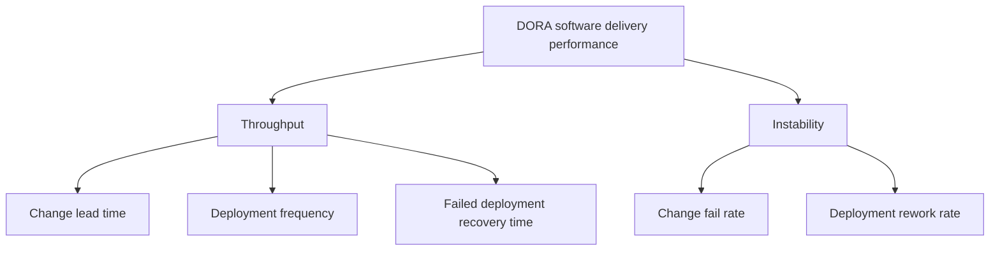

# Introducing Contextual Use of DORA Metrics by Team

DORA provides a quantitative perspective on an organization's ability to deliver software changes to users. These metrics help teams see how fast changes move through the system, how much instability deployments introduce, and how much unplanned work arises to fix post-release defects. Their value lies in helping teams ask the right questions and choose where to improve, not in creating a leaderboard across teams.

To use DORA effectively, first choose the right application or service as the unit of measurement, agree on deployment event definitions, understand user and operational context, and track trends over time. A transactional API, a mobile app, a data platform, and a batch system each have different release cadences; comparing raw numbers directly without considering context can lead to wrong conclusions.

Under the current model, DORA uses **five software delivery performance metrics**, divided into two groups: throughput (how effectively changes flow through the system) and instability (the degree of instability caused by changes). This model evolved from the earlier familiar set of four metrics; therefore, it is important to know which definition version is used when reading older reports or internal dashboards.

## 1. What does DORA measure, and what does it not measure?

DORA stands for DevOps Research and Assessment. This research program investigates the technical, process, and cultural capabilities associated with technology organization performance. The five software delivery metrics focus on the outcomes of delivering changes to production or users.

The metrics answer questions such as:

- How long does it take a change from commit until it runs successfully in production?
- How frequently is a service deployed?
- When a deployment degrades service, how long does the team take to recover?
- How many deployments cause production failures requiring immediate intervention?
- How many unplanned deployments arise to fix bugs users encountered?

The metrics do not by themselves explain why a team got those results. Long lead time might stem from slow builds, long review waits, manual approvals, unstable environments, or scarce release windows. High change fail rate might relate to testing, overly large changes, configuration, data, or observability. Teams must combine numbers with value stream mapping, pipeline logs, incident reviews, and conversations among those responsible for building, releasing, and operating the software.

### DORA is not an individual scorecard

The appropriate unit of measurement is an application or service together with the cross-functional team responsible for prioritizing, building, releasing, and operating it. Do not use deployment counts to rank developers, blame production failures on an individual, or turn metrics into rigid quotas.

When metrics become reward-or-punishment targets, teams may look for ways to inflate small valueless deploys, split events to flatter lead times, omit hotfixes, or avoid risky changes. Dashboards may then look greener while user experience worsens. DORA should support learning and improving the system of work, not create incentives to hide problems.

## 2. The current five-metric model



| Group | Metric | Core question | How to interpret improvement |
|---|---|---|---|
| Throughput | Change lead time | How quickly do changes travel from commit to production? | Flow through the system has less waiting and smaller batches |
| Throughput | Deployment frequency | How often does the service deliver changes to production? | The team can release small changes at an appropriate cadence |
| Throughput | Failed deployment recovery time | When a deploy degrades service, how fast does the team recover? | Failure scope is contained and service recovers faster |
| Instability | Change fail rate | What percentage of deploys cause production failures requiring immediate action? | Changes are better controlled and cause fewer disruptions |
| Instability | Deployment rework rate | How many unplanned deploys are executed to fix user-facing bugs? | Less delivery capacity is consumed by unplanned defect fixes |

DORA places the first three metrics under throughput and the latter two under instability. This grouping is DORA's model; do not arbitrarily reclassify a metric merely because its name sounds related to stability.

### Distinguishing the historical four metrics from the current five

In many older documents, dashboards, or articles, teams may encounter the name “Four Keys”:

- Deployment frequency.
- Lead time for changes.
- Mean time to recover (MTTR) or time to restore service.
- Change failure rate.

Two key changes to keep in mind:

1. In 2023, DORA renamed and refined the recovery metric to **failed deployment recovery time**. This metric focuses on recovery time after a production change degrades service and requires remediation. It no longer lumps in all non-deployment operational incidents as broad MTTR interpretations previously did.
2. In 2024, DORA added **deployment rework rate** to observe the share of unplanned deployments performed to address user-facing bugs. This is the fifth metric in the current model.

When ingesting historical data, do not splice broad MTTR with failed deployment recovery time as if they shared the same scope. Document the definition, time range, and data source of each series clearly.

## 3. Understanding each metric and how to measure it

### 3.1. Change lead time — time from commit to production

Change lead time is the duration from when a change is committed to version control until that change is successfully deployed to production.

For each change, it can be calculated as:

\[
\text{Change lead time} = t_{production\_success} - t_{commit}
\]

For example, a commit is created at 09:00 Monday and first runs successfully in production at 15:00 Tuesday. That change's lead time is 30 hours using continuous elapsed time.

When measuring in practice:

- Define the commit milestone clearly: the commit recorded in the repository, rather than arbitrarily substituting pull request open time or coding start time.
- Define the production milestone: the change actually running or released to users, not deploying to staging.
- If one deploy contains multiple commits, link each commit/change to the deployment that carried it to production.
- Include wait time for reviews, CI, approvals, release windows, and environments; all of that is elapsed time in the delivery stream.
- Apply the same rule across all releases so trends remain comparable.

Do not look only at averages. A few changes waiting for days can be hidden by many small commits moving rapidly to production. Track medians and high percentiles such as p85 or p90 to see the tail of the distribution. If a service releases infrequently and samples are small, display sample count and time range rather than treating percentiles as definitive conclusions.

Long lead time does not necessarily mean developers code slowly. Break it down into segments:

| Segment | Data to inspect | Diagnostic question |
|---|---|---|
| Commit to PR | Time from commit to opening PR | Are changes integrated frequently? |
| PR to review | Time waiting for reviewers and actual review duration | Are reviewers scarce or PRs too large? |
| Review to merge | Revision rounds, CI duration, and gate waits | Which gate routinely builds a queue? |
| Merge to artifact | Build, scan, signing, and publish | Is the build slow or re-run repeatedly? |
| Artifact to production | Approvals, release windows, deploy, and rollout | Are manual steps or environment dependencies blocking? |

These segments are supplemental diagnostic metrics, not replacements for DORA's lead time definition.

### 3.2. Deployment frequency — deployment cadence

Deployment frequency indicates how often an application or service is deployed to production or released to users. It can be expressed as deploys per period or the interval between consecutive deploys.

For example, a service with 12 production deployments over 4 weeks has an average frequency of 3 deploys per week.

When measuring:

- Count only deployments/releases actually reaching production or users; do not include staging deploys, test environments, or unreleased build artifacts.
- Define the service's deployment unit: one release application counts as one event; do not count each rolled-out pod/instance as a separate deployment if they belong to the same release.
- If a release is rolled back, record both the original deployment and the rollback deployment per event rules; link them to the same incident/release lineage.
- Do not recount retries of the same command if no new production change occurred.
- For mobile or desktop apps, define the user-facing release milestone clearly, such as app-store releases or percentage rollouts; do not mix with backend deploys.

High deployment frequency is not automatically better. A system with weekly releases may still fit its distribution model. What matters is whether the team can ship ready changes to users without batching heavily or waiting for rare release trains.

### 3.3. Failed deployment recovery time — recovery time after a failed deploy

This metric measures the time needed to recover from a deployment that causes service degradation or outage in production and requires remediation, such as rollback, hotfix, fix forward, or patch.

A consistent way to record it:

\[
\text{Recovery time} = t_{service\_restored} - t_{change\_impairment}
\]

The team must agree on the start milestone. You can store deployment time, impairment start/detection time, and the time service returned to acceptable levels separately. Do not use ticket creation time instead of error start time if observability data permits a more accurate timestamp.

This metric is scoped to incidents caused by production changes. A data center power outage, network provider failure, or independent infrastructure outage should not automatically count toward failed deployment recovery time, though it still belongs in separate reliability/incident metrics.

Also track diagnostic sub-milestones:

- Time to detect: from impairment start until alert fires or users report it.
- Time to diagnose root cause and decide on remediation.
- Time to execute rollback/fix.
- Time to verify service restoration.

These milestones uncover bottlenecks. For instance, rollback takes only 5 minutes, yet the team took 50 minutes to realize the release caused the failure; the problem lies in detection/observability, not the rollback command.

### 3.4. Change fail rate — percentage of deployments causing failures

Change fail rate is the percentage of production deployments that lead to service degradation and require immediate intervention, usually via rollback, hotfix, or fix forward.

\[
\text{Change fail rate} =
\frac{\text{Deployments causing service degradation and requiring remediation}}
{\text{Total production deployments}}
\times 100\%
\]

For example, out of 40 production deployments, 4 deployments cause impairment and require immediate intervention. Change fail rate is 10%.

To prevent inconsistent numbers:

- Define the post-deploy attribution window, such as a duration appropriate to service characteristics and failure detection.
- Define what constitutes impairment: SLO impact, business errors, outage, or degradation users genuinely experience.
- Count only deployments needing immediate remediation per agreed definition; do not count every alert or test failure that never reached production.
- If one deployment causes multiple incidents, a baseline rule can count one failed deployment once and link multiple incidents; avoid inconsistent denominator counting.
- Establish a process to update outcomes after incident analysis rather than relying solely on initial pipeline labels.

Change fail rate is not test failure rate, red build rate, or rejected PR rate. It measures the outcome of changes that reached production.

### 3.5. Deployment rework rate — percentage of unplanned bug-fix deployments

Deployment rework rate measures the share of unplanned deployments executed to resolve bugs encountered by users. The DORA Quick Check currently asks for the percentage of deployments over the past six months falling into this category.

\[
\text{Deployment rework rate} =
\frac{\text{Unplanned deployments to fix user-facing bugs}}
{\text{Total deployments in the same period}}
\times 100\%
\]

For example, out of 50 deployments in the period, 5 emergency deployments were made to fix user-facing bugs. Deployment rework rate is 10%.

This metric complements change fail rate from another angle:

- Change fail rate asks: among deployments, how many caused impairment requiring immediate intervention?
- Deployment rework rate asks: among deployments, how many were unplanned work to fix bugs users encountered?

The two metrics can relate yet are not identical. The original failing deployment adds to change fail rate; a subsequent hotfix can count as deployment rework. The hotfix might succeed without increasing its own change fail rate, yet it remains unplanned rework.

To measure accurately, classify planned releases prior to deployment and record the reason for unplanned deployments. Never label a hotfix as “planned” just to lower the rate.

## 4. Choosing the right unit of measurement: one application or service

DORA recommends applying the metrics in the context of the application or service the team is responsible for. This is the single most important point when using metrics in a multi-project organization.

Do not collapse all services into a single number upfront. A system may include:

- A payment API requiring safe changes, audit trails, and high fault tolerance.
- An internal service with few users, deployed in batches.
- A mobile app released via app stores with phased rollouts.
- A scheduled data pipeline with processing windows and large datasets.
- A shared library not deployed directly, instead publishing packages to many consumers.

These units have different cycles and definitions of production. Merging them into a single deployment frequency or average lead time destroys meaning.

### Creating a service profile before measuring

For each service, write a brief profile:

| Attribute | Example content |
|---|---|
| Service/application | `orders-api` |
| Owner | Team responsible for build, release, and operations |
| Users | Web/mobile clients, internal, or partners |
| Production boundary | Cluster/namespace or where releases actually reach users |
| Deployment unit | One release image digest of `orders-api` |
| Release model | Rolling, canary, blue-green, app-store rollout, or batch |
| Criticality | Business and user impact level |
| Runtime dependencies | Database, queue, identity provider, upstream services |
| Data ownership | Schemas or data the service owns |
| SLO/quality context | Availability, latency, correctness, and related requirements |

A service profile helps teams align on the denominator and explains why one service's results differ from another's.

### Teams owning multiple services

If a team operates multiple services, measure each service first. Afterward, you can present distributions or group services with similar characteristics. If aggregation is needed, publish the calculation method and weights; never take a simple unweighted average of ratios with vastly different denominators.

For example, service A has 100 deploys and 10 failures; service B has 4 deploys and 2 failures. The simple average of the two rates (10% and 50%) is 30%, whereas the pooled deployment-weighted rate is 12/104, roughly 11.5%. The two numbers answer two different questions. Reporting per service prevents hiding a troubled service B.

### Specifics of different product types

| Product type | What must be agreed? | Caution when interpreting |
|---|---|---|
| Backend API | What counts as one production deploy; how multi-instance rollouts are counted | Do not count every pod as a deployment |
| Mobile app | Store release milestone, percentage rollout, and when users receive updates | Users may remain on multiple versions for a long time |
| Data pipeline | When code/job changes enter production and actual run schedule | A daily job run does not mean code is deployed daily |
| Infrastructure/IaC | Which config/infra changes count as production changes | Separate real applies from plans/no-ops |
| Shared library | How package releases and consumer adoption are measured | Publishing a package does not mean all consumers deployed it |
| Batch/legacy system | Release windows, processing schedules, and recovery criteria | Do not force interactive-system frequencies onto batch workloads |

## 5. Collecting data with unified definitions

You do not need to build a massive telemetry platform from day one. Start with existing data in Git, CI/CD, deployment platforms, and incident management. What matters is that every event has an identifier and can be linked together.

### Common data sources

| Source | Events available | Related metrics |
|---|---|---|
| Git provider | Commit SHA, repository, timestamp, merge | Change lead time |
| CI/CD | Build, artifact publish, approval, deployment run | Lead time, deployment frequency |
| Deployment platform | Release ID, environment, digest, rollout status | Deployment frequency, change fail rate |
| Monitoring/incident | Impairment start, alert, service restored, remediation | Failed deployment recovery time, change fail rate |
| Change/release record | Planned/unplanned, reason, hotfix, owner | Deployment rework rate |
| Feature/release system | Rollout percentage, feature flag, release audience | Adds context for deployments and failure attribution |

### Defining a deployment event

An event should include minimum fields:

```json
{
  "deploymentId": "dep-2026-0412",
  "service": "orders-api",
  "environment": "production",
  "productionChange": true,
  "releaseId": "orders-2026.11.18.2",
  "artifactDigest": "sha256:<digest>",
  "sourceCommit": "<full-commit-sha>",
  "startedAt": "2026-11-18T08:00:00Z",
  "completedAt": "2026-11-18T08:08:00Z",
  "result": "succeeded",
  "planned": true,
  "changeType": "feature"
}
```

This is an illustrative schema. Not every system needs identical field names, yet you must capture service identity, production boundary, release/artifact, commit, timestamps, and status. The `planned` field alongside `changeType` separates regular releases from deployment rework; define a clear controlled vocabulary.

An incident record linked to a deployment can store `deploymentId`, impairment time, restore time, impact level, remediation type, and confirmation status. Avoid relying solely on free-text fields for analytical data when structured fields can be used.

### Avoiding double-counting or omissions

- Each release has one stable deployment ID across retries and rollout steps.
- If a canary rollout has multiple traffic steps for the same release, decide upfront whether it is one deployment or multiple production change events per the service's model; keep the rule consistent.
- If a rollback is a new deployment, record a separate event and link it to the failing deployment.
- If a deploy is canceled before making any production change, do not count it as a user-reaching deployment.
- If one deployment contains multiple commits, preserve the commit-to-deployment mapping to calculate lead time.
- If an incident is discovered late, update incident links once evidence arrives; do not delete event history.

## 6. Example calculating the five metrics for one service

Suppose `orders-api` has data over four weeks:

- 20 deployments actually reaching production.
- 3 deployments causing impairment and needing rollback or hotfix.
- 2 unplanned deployments performed to fix user-facing bugs.
- 3 deployment-induced incidents with recovery times of 40, 70, and 110 minutes.
- Deployed changes had a median lead time of 7 hours and p85 of 22 hours.

Illustrative results:

| Metric | Calculation | Result |
|---|---|---:|
| Change lead time | Median/p85 of commit-to-production | 7 hours / 22 hours |
| Deployment frequency | 20 deploys / 4 weeks | 5 deploys/week |
| Failed deployment recovery time | Median of 40, 70, 110 minutes | 70 minutes |
| Change fail rate | 3 / 20 × 100 | 15% |
| Deployment rework rate | 2 / 20 × 100 | 10% |

These numbers are calculation examples, not DORA targets or benchmarks. Teams should store denominator, time window, medians/percentiles, and attribution definitions so viewers understand the results.

### One event can affect multiple metrics

Suppose deployment `dep-17` introduces a billing bug. The team rolls back, then deploys `dep-18` as an unplanned hotfix.

- `dep-17` counts toward change fail rate because it caused impairment and needed remediation.
- The duration from impairment until service restoration counts toward failed deployment recovery time.
- `dep-18` counts as deployment rework if it is an unplanned deployment to fix a user-facing bug.
- `dep-18` does not automatically raise change fail rate if the hotfix works properly and introduces no new impairment.

Linking incidents, failing deployments, and fix deployments keeps teams from confusing failure counts with rework counts.

## 7. Establishing an appropriate baseline

A baseline is a snapshot of how a service is performing before a team launches an improvement initiative. You do not need a perfect dashboard to start; you can use the DORA Quick Check and existing pipeline data to establish an initial baseline.

### Choosing a time window

Pick a window long enough for a meaningful sample size:

- Services deploying frequently can use shorter windows to spot trends.
- Services releasing monthly or in waves need longer windows for enough deployments.
- Deployment rework in the DORA Quick Check asks about the past six months; when building your own time series, keep windows consistent and document the measurement period.
- For teams that recently changed logging/tracking systems, mark when definitions changed to avoid comparing non-equivalent before/after data.

Do not pick a time window just because it makes numbers look good. Document start/end dates, deployment counts, change counts, and counted incidents.

### Using DORA Quick Check as a starting point

The DORA Quick Check asks questions about a primary application or service the team works on. A cross-functional team should answer together to surface differing interpretations: what “deploy” means, when service is considered restored, and what counts as an unplanned bug-fix deployment.

Quick Check is useful for:

- Getting a fast baseline without integrating multiple systems immediately.
- Sparking conversations across development, operations, QA, security, and product.
- Exposing where the team disagrees on definitions or lacks visibility into data.
- Tracking progress by repeating the same assessment.

Quick Check results are high-level assessments and do not replace detailed event data if the team needs to analyze individual pipeline stages. The Quick Check's 0–10 composite score should also not replace reading each metric individually.

### Checking data quality before setting targets

Before using a baseline for decisions, verify:

- Are staging deployments accidentally counted as production?
- Are rollbacks and hotfixes recorded completely?
- Are commits properly linked to artifacts and deployments?
- Are deployment-caused incidents separated from independent infrastructure outages?
- Is service restoration time based on reliable operational signals?
- Are unplanned deployments classified consistently?
- Did the service change boundaries or ownership during the measurement window?

If data is incomplete, state confidence levels and improve instrumentation before comparing. Never turn estimates into false precision.

## 8. Interpreting DORA in team context

The five metrics should be read together. A single number rarely points to the right action on its own.

### Case A: Long lead time, low deployment frequency

Likely large batches or long queues. The team should map the flow from commit to production and analyze wait times for review, CI, approval, environments, and release windows.

Actions to try:

- Shrink pull request sizes and split features into independent changes.
- Integrate code more frequently into the main branch.
- Automate repetitive builds, tests, and deployments.
- Shorten approval queues with clear policies and proper delegation.
- Provision test environments on demand.
- Break migrations or infrastructure changes into compatible steps.

Do not set a “deploy daily” target without knowing why releases are slow. Find the real constraint first.

### Case B: High deployment frequency, but high change fail rate

The team releases often, yet changes frequently cause production errors. Inspect pre-deploy feedback quality and change scope.

Actions to try:

- Add component/contract tests for areas prone to regressions.
- Use canary or progressive delivery with clear abort thresholds.
- Add feature flags or kill switches for risky changes.
- Test configurations and migrations in production-like environments.
- Increase observability to detect impairment early.
- Shrink batch sizes and split changes with large blast radii.

Do not mechanically cut deployment frequency. Bundling changes into larger releases can make failure impacts even worse.

### Case C: Low change fail rate, but high deployment rework rate

Bug-fix deployments may succeed, yet the team still spends many unplanned deploys addressing user-facing bugs. Analyze bug categories, where they are caught, and time from report to fix.

Actions to try:

- Categorize rework by root cause: logic, data, config, UX, compatibility, or dependency.
- Improve acceptance testing and real user-flow testing.
- Review bugs frequently caught post-release due to missing telemetry or feedback.
- Improve the ability to ship small, controlled patches without disrupting the roadmap.
- Turn recurring root causes into owned improvement backlog items.

### Case D: Long recovery time despite low change fail rate

Failures may be rare, yet each recovery takes a long time. Causes may include slow alerts, missing release traceability, complex rollbacks, hard-to-reverse migrations, or unavailable emergency access.

Actions to try:

- Tag metrics/logs/traces with release IDs and artifact digests.
- Rehearse rollbacks and forward-fixes in representative environments.
- Retain traceable known-good artifacts/configs.
- Write runbooks and define break-glass permissions.
- Implement progressive rollouts with automated stops on threshold breaches.
- Design database migrations using expand-contract to reduce rollback risk.

### Case E: Strong throughput metrics, yet poor reliability

DORA does not replace SLOs, latency, availability, correctness, security, or user experience. A team can deploy fast with few rollbacks while still causing prolonged performance degradation or subtle business bugs.

Supplement with reliability metrics and product outcomes. Never conclude a system is healthy solely because the five DORA metrics look good.

## 9. Do not compare teams without context

One service can deploy multiple times daily; another releases monthly due to app stores, large datasets, certifications, or business windows. That does not automatically prove the second service performs poorly.

Before comparing two services, check:

- Do they share the same production/deployment definition?
- Are criticality and compliance requirements similar?
- Are user base, traffic, and failure impact comparable?
- Are release models, architectures, and dependencies comparable?
- Are deployment and change counts in the period large enough?
- Are incidents, hotfixes, and rework recorded consistently?

Prioritize comparing a service against its own history before and after a change. When using industry or DORA benchmarks, treat them as reference points for asking questions, not quotas imposed on every team.

### When can you aggregate at the organization level?

Organizations can use overview dashboards to spot trends or find services needing support. However, org-level dashboards should allow per-service drill-downs and publish the aggregation method.

Never use aggregate averages to hide a high-risk service. For rates, disclose denominators and weights; for lead time and recovery time, use distributions or percentiles rather than arbitrary sums/averages. Services with different boundaries should not be merged merely because they sit under one department.

## 10. Avoiding gaming and single-metric optimization

DORA warns that turning metrics into rigid targets can cause teams to optimize numbers instead of improving outcomes. Common behaviors include:

| Gaming behavior | Why it distorts | How to prevent |
|---|---|---|
| Splitting one rollout into many events to boost deployment frequency | Deploy counts no longer reflect independent user changes | Define stable deployment units and release IDs |
| Logging hotfixes as planned | Artificially low deployment rework rate | Classify by reason and plan prior to deployment |
| Failing to link incidents to deployments | Artificially low change fail rate | Combine incident reviews with deployment ledgers |
| Shifting commit or production milestones | Lead time loses meaning | Pull timestamps from Git and deployment platforms |
| Measuring only easy-to-deploy services, omitting hard ones | Reports fail to represent the system | Disclose scope and unmeasured services |
| Reducing deploys to avoid errors | Throughput drops and batch size grows | Read throughput alongside instability and user outcomes |
| Forcing every team to hit the same frequency | Ignores application context | Use separate baselines and constraint-based improvement goals |
| Using a composite score instead of five metrics | One score can mask specific weaknesses | Review individual metrics, denominators, and trends |

### Never optimize throughput by sacrificing stability

Raising deployment frequency while change fail rate, rework, and recovery time all worsen is not improvement. Conversely, stopping deploys to avoid failure lengthens lead time and makes users wait longer for fixes.

The goal is increasing the ability to deliver valuable changes to users under controlled risk. Teams should monitor both throughput and instability while watching SLOs and business outcomes.

## 11. Using leading indicators to find root causes

The five DORA metrics primarily describe delivery system outcomes. To shift those outcomes, teams need leading indicators closer to actionable causes.

| Observed issue | Leading indicators to watch | Improvements to try |
|---|---|---|
| High lead time | PR age, review wait, CI duration, approval wait, deploy queue | Smaller PRs, reviewer rotation, cache/build optimization, policy automation |
| Low deployment frequency | Batch size, release-window wait time, manual deploy ratio | Trunk-based development, automated promotion, self-service environments |
| High recovery time | Alert detection delay, rollback duration, deploys with release metadata ratio | Better alerting, runbooks, rollback automation, progressive delivery |
| High change fail rate | Risk-based test coverage, escaped defects, canary aborts, config drift | Contract tests, data tests, canary, policy-as-code |
| High rework rate | Bugs by cause, defect escape stage, feedback-to-fix time | Appropriate shift-left testing, clearer acceptance criteria, user telemetry |

Leading indicators must link to hypotheses. For example, a team suspects review wait is the bottleneck; they measure p85 review wait, pilot ownership-based reviewer assignment for one cycle, and check whether lead time shifts. Do not add dozens of metrics without specific questions.

## 12. Turning metrics into an improvement loop

DORA is valuable when teams convert findings into small improvement experiments, verify impact, and iterate.

A working loop can include:

1. **Select service:** cross-functional team confirms application boundaries and ownership.
2. **Align definitions:** commit, production deployment, failure, recovery, and rework share one meaning.
3. **Baseline:** use DORA Quick Check or existing event data; record denominators and confidence.
4. **Find constraints:** inspect value stream, queues, incidents, and developer/user feedback.
5. **Choose one change:** focus on the highest-impact bottleneck.
6. **Set leading indicators:** pick a few signals showing whether the change was adopted and worked.
7. **Execute:** dedicate team capacity to changing practices or tooling.
8. **Re-evaluate:** inspect DORA metrics, SLOs, quality, and team feedback.
9. **Adopt or adjust:** if improved, standardize; otherwise, update the hypothesis.

You do not need to move all five metrics at once. One clear constraint and one testable experiment usually drive better progress than a broad KPI program with no clear owner.

### Example improvement plan for one service

Suppose `orders-api` has p85 lead time of 3 days, deployment frequency of 2 times/week, change fail rate of 12%, median recovery of 90 minutes, and rework rate of 8%.

Analysis shows most lead time sits in review waits and an integration suite re-running repeatedly. The team hypothesizes: shrinking PR sizes and running targeted tests first will cut wait times without raising defect escapes.

6-week plan:

| Week | Experiment | Leading indicator | Outcome to observe |
|---|---|---|---|
| 1 | Measure per-stage baseline and validate data | PR age, CI rerun rate | Confirm review/test bottlenecks |
| 2–3 | Split large changes into small PRs, assign ownership reviewers | p85 review wait, PR size | Faster reviews, fewer stalled PRs |
| 3–4 | Run targeted integration via dependency graph, keep full suite on merge/nightly | Fast feedback time, escaped defects | Fast CI feedback without rising escaped bugs |
| 5 | Enable canary for high-risk changes | Canary aborts, error rate | Catch failures before wide rollout |
| 6 | Re-evaluate all five DORA metrics and SLOs | Lead time, frequency, fail/rework, recovery | Determine whether improvements worked |

Starting numbers are examples, not target benchmarks. If change fail rate rises after an experiment, investigate the cause and tune test selection instead of keeping the change solely because lead time dropped.

## 13. Role of DORA Quick Check and benchmarks

DORA Quick Check is a fast tool for teams to evaluate software delivery performance for an application or service. The 2026-updated version adds deployment rework rate, displays the five individual metrics alongside throughput/stability scores, and provides an overall 0–10 composite score. Benchmarks published in the updated Quick Check draw from 2025 DORA research.

When using Quick Check:

- Answer for the same service from a shared cross-functional perspective.
- If team members give different answers, treat it as a signal to align definitions or improve observability.
- Save results over time to track progress.
- Treat the composite score as a summary; inspect the five individual metrics and throughput/stability separately to see what drives the result.
- Use benchmarks to ask questions about gaps, not turn them into mandatory quotas for every service.

Quick Check relies on question/range assessments. Custom dashboards built from event data can use timestamps and finer distributions. The two approaches need not match identically if windows, denominators, or aggregation methods differ; state sources clearly when placing them side by side.

## 14. DORA does not replace product and operational measures

The five DORA metrics describe only part of software delivery performance. A balanced scorecard should add other perspectives depending on the service:

| Measurement group | Examples | Question |
|---|---|---|
| User/business outcome | Conversion, order success, task completion, customer satisfaction | Do changes create value for users? |
| Reliability | SLO, error budget, availability, latency, saturation | Does the service meet operational commitments? |
| Quality | Defect escape, data correctness, support tickets | Does the software work correctly and reliably? |
| Security/compliance | Vulnerability age, policy violations, audit findings | Do releases meet security and compliance requirements? |
| Developer experience | CI feedback latency, toil, satisfaction, environment wait | Can the team work effectively and sustainably? |
| Delivery performance | Five DORA metrics | How fast and stably do changes flow through the system? |

Do not collapse everything into a single score if doing so loses information. A service with high deployment frequency yet constant SLO breaches must prioritize reliability; a service with strong DORA numbers that creates no user value needs to re-examine product direction.

## 15. Common mistakes when applying DORA

| Mistake | Consequence | Better approach |
|---|---|---|
| Using the historical four metrics while calling it the current model | Omits deployment rework rate and uses outdated recovery definition | State definition version, use the current five-metric model where appropriate |
| Using all-incident MTTR as failed deployment recovery time | Mixes deploy failures with independent infra outages | Classify causes and keep operational metrics separate |
| Collapsing all services into one number | Context differences are obscured | Measure per app/service first, aggregate with weights and drill-down |
| Comparing mobile teams with backend API teams | Wrong conclusions due to different deployment boundaries | Compare in context and prioritize internal trends |
| Setting deploys/day quotas for every team | Encourages gaming and unnecessary releases | Set goals around service constraints |
| Watching only deployment frequency | May speed up while raising failures and rework | Read throughput alongside instability and SLOs |
| Watching only change fail rate | Misses volume of successful unplanned hotfixes | Also track deployment rework rate |
| Incident data lacks deployment links | Change fail rate and recovery time become wrong | Maintain deployment ledger and incident correlation |
| Treating Quick Check score as absolute truth | Composite score hides component metrics and self-assessment error | Use as conversation starter and validate with event data |
| Measuring heavily without action | Dashboards grow while systems do not improve | Pick one bottleneck, owner, and time-boxed experiment |

## 16. Checklist for using DORA in team context

Before bringing DORA into dashboards or reviews, verify:

- [ ] An application/service and responsible cross-functional team are selected.
- [ ] Production boundary and deployment unit are defined.
- [ ] The current five-metric model is used, or historical data usage is explicitly documented.
- [ ] Failed deployment recovery time is distinguished from all-incident MTTR.
- [ ] Change lead time links commits to successful production deployments.
- [ ] Deployment frequency counts only events actually reaching production/users.
- [ ] Change fail rate defines impairment, remediation, and attribution window.
- [ ] Deployment rework rate distinguishes unplanned deployments fixing user-facing bugs.
- [ ] Deployment ID, release ID, artifact digest, and commit SHA exist for traceability.
- [ ] Incidents link to both failing deployments and fix deployments.
- [ ] Denominators, time ranges, medians/percentiles, and data confidence are shown.
- [ ] Definitions are aligned across development, QA, operations, security, and product.
- [ ] Benchmarks are used solely as references, not quotas or individual rankings.
- [ ] Dashboards display throughput, instability, and necessary reliability/outcome metrics.
- [ ] The team picks one bottleneck, one hypothesis, and one owner per improvement cycle.
- [ ] Results are reviewed over time and adjusted as service context evolves.

## 17. References

- [DORA — Software delivery performance metrics](https://dora.dev/guides/dora-metrics/): definitions of the five metrics, throughput/instability grouping, application/service measurement context, and common pitfalls.
- [DORA — A history of DORA’s software delivery metrics](https://dora.dev/insights/dora-metrics-history/): evolution from the four-metric set, failed deployment recovery time change, and addition of deployment rework rate.
- [DORA — Quick Check updates](https://dora.dev/insights/quickcheck-updates/): 2026 Quick Check updates, throughput/stability scores, and 2025 research benchmarks.
- [DORA Quick Check](https://dora.dev/quickcheck/): self-assessment tool for an application or service.

Using DORA well starts with understanding the service and users the team serves. When deployment definitions are consistent, the five metrics are read in context, data is traceable, and teams select improvements from real bottlenecks, DORA becomes a learning tool for delivering better software over time rather than a scoreboard for competition.
