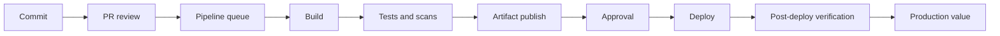
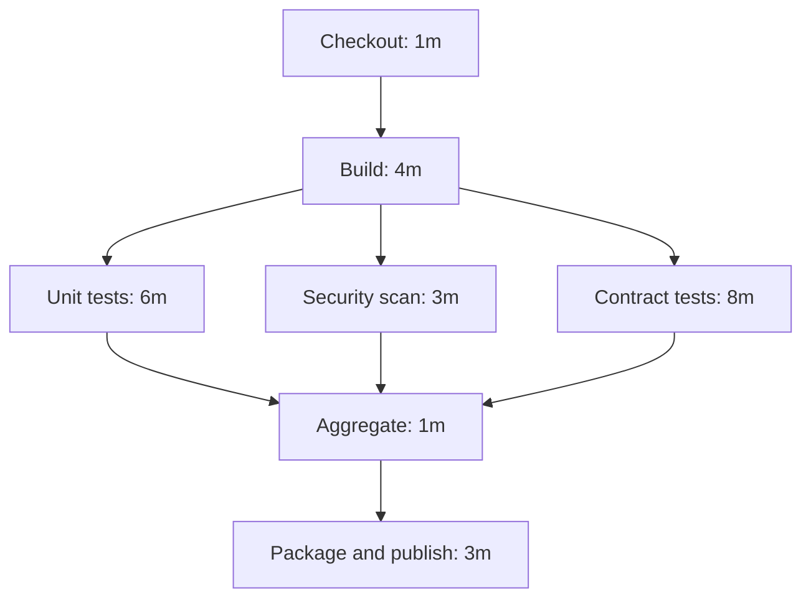

# Finding Bottlenecks with Data Instead of Adding More Automation Steps

When a pipeline is slow, the familiar reaction is to add runners, add caches, add parallel jobs, or automate yet another manual step. Those changes sometimes help, yet they can also make the system more complex while barely reducing developer wait times. If the true bottleneck sits in a 25-minute test suite, an approval waiting all day, or a single-slot staging environment, adding more automation steps will not address the root cause.

To improve CI/CD, first observe the entire workflow and measure time at each handoff point. You must know where work waits, which step sits on the critical path, which resource saturates, which errors cause reruns, and which parts contribute value to release quality. Only then should you choose a change, re-measure, and verify the impact.

**A bottleneck is the constraint governing the throughput or completion time of the workflow at the time of observation.** It can be a slow job, a runner queue, a shared dependency, an approval step, a deployment environment, or flaky test rates causing rework. Effective improvement starts from actual flow data, not from the number of steps added to the pipeline.

## 1. Why not assume the pipeline just needs more automation?

Automation reduces repetitive manual actions, increases consistency, and can shorten processing time. Yet every automated step also adds configuration, dependencies, runner usage, logs, access permissions, and failure modes.

For example, a team sees a 40-minute pipeline and decides to add four new parallel check jobs. If those jobs all wait for a single-slot integration database environment, wait time can increase. If they generate extra reports needing manual approval, lead time can grow even longer.

Before adding automation, answer:

- Is the observed problem execution time, wait time, failure rate, or cost?
- Which step is constraining the entire flow?
- What data proves that step is the bottleneck?
- Which constraint does the proposed change directly affect?
- Can existing work be eliminated, simplified, or parallelized instead?
- How will outcomes be measured after the change?

Automation should solve an identified need. Without a hypothesis and measurement, adding new steps merely expands the operational surface area.

## 2. Distinguishing types of time in CI/CD

A single “pipeline duration” figure is rarely enough to locate bottlenecks. Break time down by stage and separate execution time from wait time.

| Time metric | Meaning | Example |
|---|---|---|
| Lead time for change | From when a change is created/committed until it runs in production | Commit at 09:00, production at 16:00: 7 hours |
| PR/MR cycle time | From opening review until merge | PR waits 3 hours for review and 1 hour in review handling |
| Pipeline duration | From pipeline start until completion | 28 minutes |
| Queue time | Waiting for a runner, executor, or resource slot | Job waits 6 minutes for a runner |
| Execution time | Time jobs/steps actually run | Test job runs 14 minutes |
| Approval wait | Waiting for human or policy approval | Waiting 90 minutes for release owner |
| Environment wait | Waiting for environment or dependency readiness | Waiting 12 minutes for a staging slot |
| Rework time | Re-running due to errors, flaky tests, or misconfiguration | Rerun takes an extra 18 minutes |
| Deployment verification time | Waiting for sufficient post-deploy evidence | Observing canary for 20 minutes |

Lead time spans many activities outside the pipeline. Pipeline duration does not capture PR review wait, approvals, or environment waits. If the goal is shortening time to production, optimizing a job from 10 minutes to 5 minutes may be negligible when approvals sit idle for 8 hours.

## 3. Defining measurement boundaries and questions to answer

Before collecting data, clearly define the flow to improve. For example, measure from commit to production, from pipeline trigger to required checks completing, or from deploy start to validation passing.

A measurement needs to specify:

1. **Subject:** a pipeline, component, repository, team, or entire release flow.
2. **Start point:** commit, push, PR opened, pipeline queued, or deployment requested.
3. **End point:** merge, artifact published, production healthy, or release verified.
4. **Time scope:** peak hours, week, sprint, or release window.
5. **Unit of analysis:** pipeline run, change, job, deployment, or incident.
6. **Segments:** branch, service, runner type, test suite, environment, or team.

Never change metric definitions between the baseline and post-improvement periods. If calculations change, version the definition and explain how to compare.

## 4. Mapping the value stream of a change

A value stream is the sequence of activities a change passes through from creation until delivering a valuable result to users. In CI/CD, the flow may span coding, review, build, test, security checks, packaging, approval, deploy, and post-deployment validation.

For each step, record:

- Start and end timestamps.
- Run time and wait time.
- Retry or rerun counts.
- Inputs/outputs and dependencies.
- Responsible person or system.
- Conditions that block the step.
- Failure rate and root causes.

A value stream map reveals which steps add value, which are necessary for risk control, and which merely create queues or rework.

## 5. Collecting data from the right sources

No single dashboard always holds every piece of data. Connect data from source control, CI schedulers, runners, test frameworks, artifact stores, deployment controllers, and observability platforms.

| Data source | Information to capture | What issues it uncovers |
|---|---|---|
| Git/SCM | Commits, PRs, reviews, merges, changed files | Review wait times, change sizes, change frequency |
| CI orchestration | Triggers, queues, job start/end, statuses, retries | Queue times, critical paths, failures, and scheduling |
| Runner/agent | CPU, memory, disk, startup, image pulls | Insufficient capacity, overloaded runners, or slow setup |
| Test framework | Test durations, failures, seeds, shards, flaky/retries | Slow tests, shard imbalance, and unstable tests |
| Dependency/cache | Download times, cache hit/miss, registry latency | Dependency bottlenecks or ineffective caching |
| Artifact registry | Publish/download times, sizes, retention | Slow artifact transfers or oversized packages |
| Environment/deploy | Provisioning, approvals, rollouts, health checks | Environment waits, approval delays, and deployment delays |
| Monitoring/logs/traces | Latency, errors, saturation, dependency calls | Identifying runtime causes and bottlenecks outside CI |
| Incident/change records | Incidents, rollbacks, failed changes, recoveries | Assessing release quality and risk alongside speed |

### Joining data via identifiers

To trace a change across systems, use stable identifiers such as:

- Repository and commit SHA.
- Pull/merge request ID.
- Pipeline run ID and job ID.
- Release/deployment ID.
- Artifact digest.
- Environment and service/component.
- Trace/correlation ID for runtime-related operations.

Do not join data solely by branch name or nearby timestamps. Branches change and multiple pipelines run concurrently. Stable identifiers distinguish real runs, artifacts, and deployments.

## 6. Baseline metric set for finding bottlenecks

You do not need to measure hundreds of metrics upfront. Start with metrics reflecting time, throughput, stability, and resource consumption.

| Group | Metric | Question |
|---|---|---|
| Flow | Lead time, cycle time, throughput | How long do changes take to reach production? How many finish per week? |
| CI latency | Pipeline duration, queue time, job duration | Is delay in the scheduler or in execution steps? |
| Balance | Critical path, shard duration p50/p95, imbalance | Which job or shard dictates completion time? |
| Reliability | Failure rate, flaky rate, retry rate, rerun rate | How much time is lost to unstable outcomes? |
| Capacity | Runner utilization, queue depth, CPU/memory, concurrency | Are resources scarce or misallocated? |
| Dependency | Cache hit ratio, download time, registry latency | Are builds waiting to fetch dependencies or artifacts? |
| Deployment | Deployment frequency, change failure rate, recovery time | Does speed come with release quality? |
| Cost | Runner minutes, storage, network, cost per successful change | Do improvements deliver value commensurate with cost? |

Metrics should be read together. Low queue time with high execution time points to a different problem than high queue time with runner utilization near 100%.

## 7. Analyzing pipeline duration and critical path

Pipelines run many jobs in parallel, so total duration does not equal the sum of all job durations. Completion time depends on the longest path in the DAG, known as the critical path.

Example:

In this example, contract tests form the longest branch. Optimizing the security scan from 3 minutes to 1 minute will not speed up the pipeline if the contract tests branch still takes 8 minutes and nothing else changes. Targeted optimization must focus on the branch governing completion time.

### Calculating the critical path

For a simple DAG, you can compute the earliest finish time of each node as the maximum finish time of its dependencies plus that node's duration. The path with the largest total duration is the critical path.

Do not look only at the single longest job in isolation. A 10-minute job may sit off the critical path if it runs in parallel with a 15-minute branch. A 4-minute job sitting sequentially on the critical path directly extends total duration.

## 8. Measuring queue time and runner utilization

Queue time is the duration from when a job is eligible to run until a runner begins executing it. If queue time is high, speeding up commands inside the job will not remove that wait time.

Signals to observe:

- Queue depth by runner pool and label.
- Queue time p50, p95, and p99.
- Runner utilization by hour.
- Jobs pending due to capacity shortages, quotas, or label mismatches.
- Runner provisioning and image pull times.
- Runners sitting idle yet not picking up jobs due to constraints.
- Rate of jobs canceled while waiting.

### Interpreting utilization properly

100% runner CPU during tests can indicate healthy usage if completion times meet targets. However, high utilization paired with rising queue times indicates the pool may lack capacity. Conversely, low CPU while jobs wait long may stem from concurrency limits, locks, network bottlenecks, or a runner class ineligible for those jobs.

Do not simply add runners before checking whether jobs use overly narrow labels, runner images boot slowly, or external dependencies are blocking execution.

## 9. Using Little's Law to understand queues

Little's Law describes the relationship between the average number of items in a system, throughput, and the average time an item spends in the system:

\[
L = \lambda W
\]

Where:

- `L`: average number of work items waiting or in progress within the measured boundary.
- `λ`: average throughput, work items completed per unit time.
- `W`: average time a work item spends in the system.

For example, if an average of 24 jobs sit in the queue/pool and the system completes 12 jobs per hour, average time in the system is roughly 2 hours. To reduce that time, either raise throughput by removing bottlenecks or reduce incoming work; simply queuing more jobs does not increase throughput.

Little's Law applies when the system is in steady state over the observation window and all quantities are measured across the same boundary. Do not use the formula to extrapolate from a brief spike or mix queues of jobs with completely different behaviors.

## 10. Distinguishing capacity bottlenecks from flow bottlenecks

Not every bottleneck is solved by adding CPU or runners.

| Bottleneck type | Symptoms | Investigation direction |
|---|---|---|
| Capacity | Rising queues, saturated runners/DB/APIs | Tune parallelism, scale, or reallocate capacity |
| Slow execution | One job or test suite runs long | Profile commands, tests, builds, and dependencies |
| Serial dependency | Many jobs wait on one sequential step | Review DAG and dependency boundaries |
| Approval/process | Jobs finish yet releases wait on people or schedules | Measure approval waits, permissions, and release schedules |
| Environment | Waiting for provisioning, locks, or slots | Optimize environments, namespaces, and lifecycles |
| Rework | Retries, flaky tests, failed deployments | Eliminate error root causes and reduce variance |
| Data/dependency | Cache misses, slow package downloads, slow registry | Caching, mirrors, dependency pinning, and artifact locality |
| Policy | Unclear gates or rules blocking jobs | Clarify policies, owners, and unknown/waiver states |

Before intervening, determine whether the bottleneck lies in flow, capacity, input quality, or governance decisions.

## 11. Common bottlenecks in CI/CD

### 11.1. Builds and dependency resolution

Slow builds can result from redundant compilation, remote dependency downloads, misconfigured cache keys, annotation processing, or unoptimized build graphs. Measure dependency resolution, configuration, compilation, testing, and packaging separately.

### 11.2. Test suites

A few heavy integration/E2E tests can dominate the critical path. Measure per-test duration, balance shards, isolate data, and check for flaky tests causing reruns.

### 11.3. Runner pools

Runners may be scarce, slow to provision, using bloated images, mismatched by labels, or shared with noisy workloads. Segment queues by pool and job type to locate the cause.

### 11.4. Shared dependencies

Databases, package registries, API sandboxes, container registries, or message brokers can overload when parallelism increases. Adding runners sometimes worsens the bottleneck.

### 11.5. Approvals and release windows

A pipeline may finish in 20 minutes yet wait 6 hours for an approver or deployment window. That is a process bottleneck, requiring fixes to ownership, policies, and schedules rather than compiler tuning.

### 11.6. Environment provisioning

Shared staging environments, slow database resets, or uncleaned namespaces can create queues. Measure provisioning and teardown times separately.

### 11.7. Post-deployment observation

Canaries require observation windows and sufficient sample counts. Never shorten observation solely to make dashboards look faster if doing so weakens regression detection. Improvements here may mean picking better metrics or collecting telemetry faster, not dropping verification steps.

## 12. Measuring rework: failures, retries, and flaky tests

A pipeline can be fast on a clean first run yet slow when many jobs must re-run. Therefore, examine both execution time and rework time.

Metrics:

- First-run pass rate.
- Retry rate by job/test suite.
- Flaky test rate.
- Infrastructure failure rate.
- Full-pipeline rerun ratio vs. single-job rerun ratio.
- Average time to diagnose and fix failures.
- Post-release rollback or hotfix counts.

### Classifying failures before retrying

| Failure type | Example | How to handle |
|---|---|---|
| Product/test failure | Assertion fail, regression | Fix code or test by root cause; no blind retries |
| Infrastructure transient | Runner disconnect, registry timeout | Bounded retry and log infrastructure incident |
| Flaky test | Race condition, timing-sensitive assertion | Record first run, investigate root cause, assign owner |
| Configuration failure | Missing secret, wrong environment variable | Fix config or policy; retry only after root cause is fixed |
| External dependency failure | Sandbox API or external service outage | Use appropriate test doubles, circuit breakers, or separate schedules |

Retries must never turn a failure into an invisible pass. If the first attempt fails and the second passes, reports must surface the flaky/retried status so the team sees the rework.

## 13. Analyzing distributions instead of averages alone

Averages can hide the experience of either the majority or slow job cohorts. A pipeline with a 12-minute median yet a 50-minute p95 shows a cohort of runs dragged out significantly.

Examine:

- p50: typical experience.
- p75/p90: majority of runs including higher-latency cases.
- p95/p99: tail latency and very slow outliers.
- Min/max: use only to spot extremes, not as main summaries.
- Histograms: reveal multi-modal distributions or distinct clusters.

Segment by component, branch, runner pool, test type, time of day, and change size. Measuring only an org-wide average allows hundreds of fast pipelines to dilute a bottleneck hurting one critical service.

### Example

| Metric | p50 | p95 | Observation |
|---|---:|---:|---|
| Queue time | 1 minute | 18 minutes | Peak-hour spikes or under-provisioned pool |
| Build duration | 4 minutes | 6 minutes | Fairly stable |
| Integration tests | 9 minutes | 34 minutes | Abnormal suite or dependency tail |
| Approval wait | 25 minutes | 5 hours | Bottleneck likely in approval workflow |

In this example, shaving a 4-minute build will have far less impact than addressing the integration tail or approval wait.

## 14. Identifying bottlenecks through hypotheses and evidence

An investigation process can run as an iterative loop:

1. **Describe the symptom:** e.g., p95 lead time rose from 3 hours to 5 hours.
2. **Decompose the flow:** split time into review, queue, build, test, approval, deploy, and verification.
3. **Locate dominant segments:** inspect p50/p95 and critical path.
4. **Form a hypothesis:** e.g., the Linux runner pool lacks capacity in the morning.
5. **Gather evidence:** queue depth, runner utilization, label mismatches, and job arrival rates.
6. **Check other factors:** test duration, dependency outages, approval schedules.
7. **Pick the smallest change:** add peak-hour capacity, adjust labels, or tune scheduling.
8. **Measure before/after:** use identical definitions, segments, and a representative time window.
9. **Keep or revert:** retain the change only if beneficial without harming other metrics.

### Example of a strong hypothesis

“The p95 queue time for integration jobs rose from 2 to 14 minutes between 09:00 and 11:00; the runner pool exceeds 90% utilization and queue depth climbs during the same hours. If we allocate two additional ephemeral runners to this pool during peak hours, p95 queue time will drop by at least 30% without increasing error rates or cost per successful pipeline beyond threshold.”

This hypothesis specifies metrics, scope, expected cause, action, and evaluation criteria. It is testable.

## 15. Prioritizing bottlenecks by impact, not visibility

The longest-looking problem is not always top priority. Evaluate impact on lead time, throughput, reliability, cost, and risk.

A pragmatic ranking approach:

| Criterion | Question |
|---|---|
| Impact | How many developers, services, or releases are affected? |
| Frequency | How often does the issue occur? |
| Delay contribution | How much does it add to the critical path or lead time? |
| Rework | How many extra retries, reruns, or incidents does it trigger? |
| Risk | Would a fix reduce test coverage or weaken quality gates? |
| Cost | How do runner, license, storage, and operational costs shift? |
| Confidence | How strong is current evidence? |
| Effort | How much time and coordination are needed to fix it? |

You can use an impact/effort matrix to pick quick wins, but do not treat scores as absolute rules. A security or data bottleneck may demand attention despite high effort.

## 16. Choosing the right type of improvement

Once the bottleneck is found, select a change acting directly on its root cause.

| Root cause | Improvements to try | What to protect |
|---|---|---|
| High runner queue | Tune pools, autoscaling, scheduling, or concurrency | Cost, isolation, and quotas |
| Slow build | Incremental builds, dependency caches, remote caching, cut unnecessary work | Cache keys, trust, and reproducibility |
| Imbalanced shards | Duration-based sharding and tracking new tests | Test coverage, stable assignments |
| Flaky tests | Data isolation, remove races, fix timeouts and dependencies | Never hide failures with infinite retries |
| Long approval waits | Risk-based approvals, clear owners, and on-call rotations | Separation of duties and auditability |
| Slow environment provisioning | Ephemeral environments, standard images, and reusable fixtures | Cleanup, data isolation, and secret scopes |
| Slow artifact transfer | Registry near runners, shrink artifact size, layer reuse | Digests, signatures, and provenance |
| Overly sequential DAG | Split independent jobs and cut unneeded dependencies | Shared state and resource contention |
| Slow deploy/verification | Optimize rollout orchestration and telemetry | Never shorten critical guardrails |
| High rework | Classify failures and fix root causes | Preserve first-run results and audit trails |

A good improvement might be deleting a duplicate step, narrowing over-triggered tests, fixing one flaky test, or adjusting approval schedules. You do not always need more automation.

## 17. Evaluating trade-offs when increasing parallelism

Running more jobs concurrently can shorten the critical path, yet it also increases resource contention.

Questions to verify:

- Are runner CPU and memory sufficient?
- Can database connection pools handle the additional workers?
- Do API sandboxes enforce rate limits?
- Will the artifact registry experience excessive load?
- Do tests share data or accounts?
- Will multiple jobs contend for locks or wait for environments?
- Does raising concurrency lengthen queues for other teams?
- How does cost per successful pipeline change?

If runner utilization rises while throughput stays flat, the bottleneck may have shifted to a dependency. If total duration falls while flaky rate climbs, the change is not necessarily an improvement.

### Parallelism has an optimum

For a given workload, duration may drop as workers increase until shared resources saturate. Beyond that point, adding workers increases contention, context switching, dependency queuing, and cost. Benchmark multiple concurrency levels rather than picking the maximum possible.

## 18. Data-driven cache and dependency resolution improvements

Caching helps only when data is reused and regeneration cost exceeds cache lookup/transfer cost.

Metrics to measure:

- Cache hit/miss rate.
- Cache restore and save times.
- Cache size and transfer duration.
- Cache invalidation rate.
- Build failures caused by stale or corrupted caches.
- Dependency download times on cold vs. warm caches.

Overly broad cache keys can serve incompatible data; overly narrow keys cause constant misses. Do not boost hit rates by omitting lockfiles, toolchains, or OS from keys when they affect correctness.

If cache restore takes 90 seconds while a cold build takes 60 seconds, that cache brings no benefit. Measure end-to-end time rather than reporting hit rates alone.

## 19. Optimizing test suites around critical path and rework

Tests are a common bottleneck, yet they should never be solved by deleting tests or cutting coverage without risk assessment.

Improvement directions:

- Measure per-test and per-shard durations.
- Move fast, deterministic tests into PR loops; keep appropriate long tests in integration/nightly runs if policy allows.
- Use dependency-graph-based test selection with a full-suite fallback.
- Isolate data to scale parallelism safely.
- Cut repeated setup via appropriate fixtures/containers.
- Fix flaky tests to reduce rework.
- Use contract tests to reduce full-system spin-ups while retaining necessary system tests.
- Verify aggregated reports do not drop shards.

Evaluate improvements by feedback time, first-run pass rate, defect escape, and cost. A faster pipeline that lets severe regressions escape is not a success.

## 20. Optimizing approvals and manual steps

Approval waits can dominate lead time even when execution time is tiny. Separate approvals that genuinely manage risk from approvals existing merely out of habit.

Improve by:

- Defining clear owners and backups when someone is away.
- Setting appropriate notifications and response SLAs.
- Automating objective checks while reserving approvals for risk decisions.
- Using risk-based approvals: low-risk changes follow pre-approved policies; sensitive changes go to appropriate reviewers.
- Displaying artifact digests, tests, scans, rollout plans, and recovery plans directly in approval requests.
- Tracking wait times and approval rejection rates.

Never remove an approval solely to reduce lead time if it is a mandatory control. The goal is cutting non-value-adding waits and giving reviewers complete context.

## 21. Measuring deployment performance alongside quality

Release speed must be viewed alongside stability. You can pair DORA metrics such as deployment frequency, lead time for changes, change failure rate, and failed deployment recovery time with granular CI metrics.

| Metric | Question | Caution when interpreting |
|---|---|---|
| Deployment frequency | How often do successful deployments occur? | More deploys do not equal more value if deploys are empty or needlessly split |
| Lead time for changes | How long do changes take to reach production? | Requires consistent start/end definitions |
| Change failure rate | How many deployments cause incidents, rollbacks, or hotfixes? | Requires clear failure definitions and accurate deployment linkage |
| Failed deployment recovery time | How long does recovery take after a failed deployment? | Separate detection, decision, and restoration |
| Pipeline duration | How long the pipeline runs | Excludes wait times outside the pipeline |
| First-run pass rate | How many runs pass on the first attempt? | Separate infrastructure failures from product failures |

Never optimize one metric by degrading another. For example, cutting lead time by skipping security scans can raise change failure rates or security risks.

## 22. Designing dashboards that aid root-cause analysis

Dashboards should support investigation, not merely display a single composite score.

A CI/CD dashboard can be organized into:

1. **Flow overview:** throughput, lead time, cycle time, and backlog.
2. **Pipeline latency:** queue time, p50/p95 duration, and critical path.
3. **Job breakdown:** duration, retries, failures, and runner pool by job type.
4. **Test health:** flaky rate, slow tests, shard imbalance, and missing reports.
5. **Capacity:** runner utilization, queue depth, dependency saturation.
6. **Release quality:** deployment frequency, change failure, rollbacks, and recovery.
7. **Cost:** runner minutes, artifact storage, network, and cost per successful change.

Every chart should filter by repository, service, branch, environment, and time range. Clicking an anomaly should take operators directly to the corresponding pipeline run, job log, test report, or deployment record.

### Clear metric definitions

Every metric should document its name, description, unit, query/source, aggregation, labels, owner, and definition version. When a metric changes, dashboards should mark the change date to avoid comparing data with incompatible semantics.

## 23. Alerts and actionable thresholds

Not every slow metric warrants an immediate alert. Alerts should tie to service goals or thresholds affecting developers/releases.

Examples:

| Signal | Illustrative threshold | Action |
|---|---|---|
| p95 queue time | Exceeds 10 minutes for 3 consecutive windows | Inspect runner pools, quotas, and arrival rates |
| p95 PR feedback | Exceeds team-agreed target | Inspect critical path and test selection |
| Flaky test rate | Exceeds baseline for multiple days | Open issues by owner and suite |
| Missing shard reports | Any required shard missing | Block quality gate and investigate pipeline |
| Artifact download latency | Exceeds internal SLO | Inspect registry, network, and artifact sizes |
| Change failure rate | Rises above baseline | Analyze deployments and validation evidence |

Thresholds are illustrative only. Calibrate them from baselines, SLOs, run volumes, and impact. Every alert needs an owner, runbook, and clear action; unactionable alerts only create noise.

## 24. Improvement experiments and before/after verification

Treat an optimization change as a hypothesis-driven experiment. Before rollout, record a baseline; then change one primary factor when possible and re-measure across the same scope.

Process:

1. Select a bottleneck backed by clear evidence.
2. Record baseline metrics and observation window.
3. State the hypothesis and expected improvement level.
4. Pick a small-scoped change with a rollback path.
5. Measure post-change using identical metric definitions.
6. Verify both target metrics and guardrails.
7. Segment by component, runner pool, or pipeline type.
8. Keep, tune, or revert based on outcomes.
9. Update runbooks/templates if the improvement becomes standard.

### Example before/after table

| Metric | Baseline | Post-improvement | Change |
|---|---:|---:|---:|
| p95 queue time | 12 minutes | 5 minutes | Down 58.3% |
| p95 pipeline duration | 31 minutes | 25 minutes | Down 19.4% |
| First-run pass rate | 91% | 95% | Up 4 percentage points |
| Runner minutes/run | 42 | 48 | Up 14.3% |

Results show latency dropped while runner cost rose. The team must evaluate whether the feedback gain justifies the cost and whether scheduling or caching can trim runner minutes while keeping p95 low.

## 25. End-to-end example: finding the orders-api pipeline bottleneck

A team notices developers often wait nearly an hour to know whether a PR can merge. Instead of immediately adding runners, the team measures the last 200 pipelines and breaks down durations:

| Stage | p50 | p95 |
|---|---:|---:|
| Runner queue | 2 minutes | 16 minutes |
| Build/dependency | 5 minutes | 7 minutes |
| Unit tests | 6 minutes | 8 minutes |
| Integration tests | 14 minutes | 31 minutes |
| Security scan | 3 minutes | 4 minutes |
| Aggregate/report | 1 minute | 2 minutes |

Deeper analysis reveals:

- Queues spike between 09:00 and 11:00 because multiple teams share the runner pool.
- The fourth integration shard drags because several migration tests run sequentially.
- Test retries climb because database containers share state.
- Security scans sit off the critical path in most runs.

The team forms three distinct hypotheses. First, a dedicated runner pool for integration jobs during peak hours will cut queue times. Second, isolating database schemas per shard and fixing migration tests will reduce rework. Third, duration-based sharding will balance the critical path.

The team tests each change in phases while monitoring p95 queue time, integration duration, flaky rate, runner minutes, and defect escape. Post-improvement data shows p95 feedback dropped, first-run pass rate rose, and runner cost increased only slightly. The team retains the changes, updates templates, and keeps monitoring.

The key takeaway is that the team did not arbitrarily add new automation steps. They used data to isolate concrete constraints and selected changes directly targeting them.

## 26. Anti-patterns in measurement and improvement

| Anti-pattern | Consequence | Better practice |
|---|---|---|
| Watching only average pipeline duration | Hides wait times and tail latency | Separate queue/execution/approval and check p50/p95 |
| Adding runners before finding the bottleneck | Raises cost or overloads dependencies | Measure utilization, queues, and saturation |
| Optimizing off-critical-path jobs | Total duration barely changes | Analyze DAGs and critical paths |
| Raising parallelism without controls | Races, flaky tests, and contention | Isolate data, bound by dependencies |
| Deleting tests for speed | Defect escapes and release risk rise | Use test selection with fallbacks and measure quality |
| Retrying until green | Masks flaky tests and hides rework | Cap retries, preserve first-run results |
| Using one metric as sole goal | Local optimization harms the system | Combine speed, quality, reliability, and cost |
| Comparing before/after with changed definitions | Wrong conclusions | Version metrics and keep boundaries constant |
| Bloated dashboards with no owners | Hard to act and alert fatigue | Pick leading metrics, owners, and runbooks |
| Measuring count of automation steps | Incentivizes adding steps instead of value | Measure lead time, flow efficiency, and outcomes |
| Ignoring approval/environment waits | CI improves while lead time stays flat | Measure the entire value stream to production |

## 27. Checklist for finding bottlenecks with data

Before proposing CI/CD improvements, the team can review:

- [ ] Goal is identified: lead time, feedback time, throughput, reliability, or cost.
- [ ] Start/end boundaries and units of measurement are defined.
- [ ] Data links commits, PRs, pipelines, jobs, artifacts, and deployments.
- [ ] Queue time, execution time, approval wait, and rework are separated.
- [ ] p50/p95 and segments by service, job type, and runner pool are inspected.
- [ ] Critical path in the execution DAG is identified.
- [ ] Runner utilization, queue depth, and dependency saturation are checked.
- [ ] Failures, retries, flaky tests, and infrastructure errors are classified.
- [ ] Cache/dependency/artifact transfer times are checked.
- [ ] Approval wait and environment provisioning times are measured.
- [ ] Improvement hypotheses specify metrics, scope, and expected outcomes.
- [ ] Changes do not weaken security gates, test coverage, or validation.
- [ ] Baselines and equivalent before/after comparison windows exist.
- [ ] Guardrails for quality, cost, and stability are monitored.
- [ ] Key metrics have owners, dashboards, and runbooks.
- [ ] Results are recorded and propagated to pipelines/templates as appropriate.

## 28. Conclusion

Finding bottlenecks in CI/CD is a workflow measurement problem, not a race to add more automation steps. Separate run time from wait time, examine critical paths instead of summing durations, analyze queues and capacity, expose rework from errors/flaky tests, and measure approvals, environments, and post-deployment verification.

An effective improvement cycle starts with a baseline, locates bottlenecks via data, states testable hypotheses, applies scoped changes, and re-measures speed, quality, stability, and cost. When metrics have clear definitions, link to commits and deployments, dashboards have owners, and decisions rest on evidence, teams know which steps to eliminate, simplify, optimize, or automate to improve real-world outcomes.
