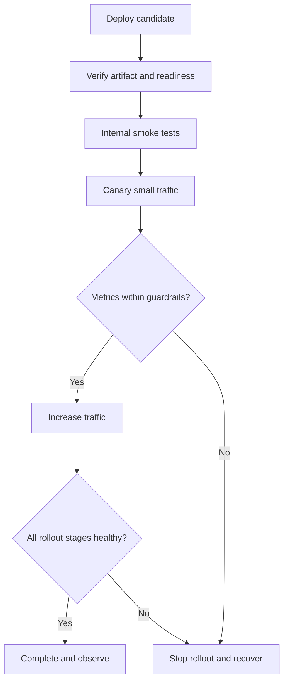

# Deploying Without Verifying the Service After the Change

A pipeline can report a successful deploy while users still cannot use the service. A workload update command returning exit code 0, a completed Kubernetes rollout, or a cloud API accepting new configuration only proves that a deployment action occurred at some level. Those signals do not prove that real requests can traverse ingress, the application can read the new configuration, dependencies work, data is compatible, or business flows remain intact.

This is a common thinking pitfall: **equating deployment status with service health**. The team sees a green pipeline and concludes the release succeeded without verifying the system after the change. As a result, defects only surface when users send requests, workers process queues, traffic rises, or real data hits the new code.

In CI/CD, completing a deployment is only one milestone in the release lifecycle. You must verify the observable state of the service after the change, compare it against expected outcomes, and maintain a long enough observation window to catch delayed issues. Verification must have clear criteria, run in the proper environment, and produce evidence linked to the specific release.

## 1. Why Does a Successful Deploy Not Mean the Service Is Healthy?

A deployment typically passes through multiple layers:

1. The pipeline sends a request to the deployment platform.
2. The platform accepts the manifest, image, or configuration.
3. The controller creates or updates workloads.
4. Processes/containers start.
5. Instances are marked Ready.
6. Traffic is routed to the new instances.
7. The application communicates with dependencies and handles requests.
8. Business flows produce the right outcomes.

Each step confirms only one slice. A deployment controller can report rollout completion because enough replicas are Ready, yet the readiness endpoint might only check that the process is alive. An API might return HTTP 200 while database queries fail. A homepage might load while order creation fails because the message broker lacks permissions.

Distinguish these concepts:

| State | What Has Been Confirmed | What Remains Uncertain |
|---|---|---|
| Deploy command succeeded | Command or deploy API completed per contract | Whether workloads serve requests properly |
| Workload started | Processes/containers launched | Whether dependencies and business logic work |
| Rollout complete | Controller reached rollout criteria | Whether traffic paths, data, and business flows are right |
| Readiness passed | Probe returned passing result per config | Whether the probe covers critical functionality |
| Smoke test passed | A few representative flows work | Rare bugs, high load, or background processing may still fail |
| Release verified | Post-deploy conditions passed within defined scope and window | Risks outside check scope still need telemetry monitoring |

Do not collapse all these states into a meaningless `success` label. A good report tells you how far the pipeline verified and what is still under observation.

## 2. Symptoms of This Thinking Pitfall

Common signs include:

- The deploy job exits with 0, so the pipeline ends immediately with no follow-up checks.
- Checking only `Running` pod status or desired replica counts.
- Using an overly simplistic health endpoint and treating it as complete proof.
- Running smoke tests from a CI runner without traversing the user network path.
- Testing staging and assuming production will behave identically.
- Reading only startup logs without sending real requests.
- Not verifying whether the running artifact digest matches the approved artifact.
- Not monitoring error rate, latency, and business metrics after shifting traffic.
- Having no observation window; the job terminates as soon as rollout finishes.
- When checks fail, re-running deploy repeatedly without inspecting the actual state.

Another warning sign is a release report consisting solely of "deployment succeeded" without environment, release ID, digest, health result, smoke test result, or verification timestamp.

## 3. Real-World Scenarios: Healthy Workload, Broken Service

### 3.1. Application Uses Wrong Configuration

The container starts cleanly, yet `PAYMENTS_API_URL` still points to the staging endpoint. The health probe only checks the process, so the pod goes Ready. Users invoke checkout and receive errors or requests get routed to the wrong environment.

**Lesson:** verify runtime configuration and critical endpoints directly in the target environment; do not merely confirm the container is running.

### 3.2. Dependency Connection Fails

A release adds a new database query. The database is reachable, yet the production database role lacks read permission on the new table. The readiness endpoint does not query that table, so it still returns 200. Errors only appear when users call the new API.

**Lesson:** verify dependencies and minimal required permissions for capabilities that will actually be used; health checks should not merely confirm a TCP port.

### 3.3. API Returns Success While Business Result Is Wrong

An order-creation endpoint returns HTTP 201, yet events published to the broker never arrive due to an outbox worker failure. Users see their order created while the inventory system never receives the event.

**Lesson:** smoke tests must verify business postconditions or a safe end-to-end flow rather than stopping at HTTP response codes.

### 3.4. Failures Only Appear Under Increased Traffic

Deployment finishes with a handful of smoke test requests. Once full traffic shifts over, the connection pool exhausts, p95 latency spikes, and requests begin timing out.

**Lesson:** an instantaneous spot check does not replace an observation window and baseline comparison under realistic load.

### 3.5. Verifying the Wrong Version

The pipeline calls a health endpoint through a load balancer, yet the request is still served by an old instance. The endpoint returns 200, so the job marks the new release successful even though new instances have not received traffic or are broken.

**Lesson:** verify the actual release ID or artifact digest on the workload/response, alongside checking rollout and traffic distribution.

## 4. The Right Mindset: Verify Observable Outcomes

Instead of asking "did the deploy command succeed?", ask:

- Were the right service and right environment updated?
- Do the actual runtime artifact digest and config revision match what was approved?
- Is the new workload ready to receive traffic?
- Do requests traversing the real access path succeed?
- Are essential dependencies usable?
- Do representative business flows produce the right outcomes?
- Have error rate, latency, and saturation shifted abnormally?
- After the defined observation window, do all criteria still hold?

Pre-define a **verification contract** for each release type. The contract specifies what must be verified, pass/fail criteria, data sources, timeouts, observation windows, and actions on failure.

Example:

| Condition | Evidence | Reference Criteria |
|---|---|---|
| Right release | Runtime image digest/release ID | Matches approved artifact |
| Workload ready | Rollout and readiness | Required replicas Ready, no abnormal restarts |
| API serving | Requests via real ingress | Status/schema valid, latency within bounds |
| Essential dependencies | Health/diagnostic operation | Authentication and minimal operations succeed |
| Business flow | Safe synthetic transaction | Postconditions verified |
| Stability post-traffic shift | Metrics and logs | Error/latency stay within thresholds over observation window |

Thresholds must be chosen based on service characteristics, SLOs, and baselines. Never take example numbers as universal defaults for every system.

## 5. Multi-Layer Verification

No single check proves the whole system works properly. Combining multiple layers reduces blind spots.

### Layer 1: Verify Version Identity

Read the release ID, commit SHA, image/package digest, or config revision from the actual running workload. Compare against what was built and approved. Across multiple replicas, inspect version distribution to detect incomplete rollouts.

### Layer 2: Verify Workload State

Inspect rollout progress, replicas, restart counts, crash loops, scheduling, resource pressure, and readiness. `Running` status alone is insufficient; a container can be running while the app receives no traffic or restarts repeatedly.

### Layer 3: Verify the Access Path

Send requests through ingress, gateways, DNS, and TLS just like a real user or consumer. For internal services, test from the corresponding namespace/network identity. This catches routing, certificate, authentication, authorization, and service discovery errors.

### Layer 4: Verify Dependencies

Check databases, caches, brokers, object storage, identity providers, and essential downstream APIs. Verify minimal required operations such as read-only queries, metadata reads, or topic permission checks. Avoid creating real side effects merely to prove connectivity.

### Layer 5: Verify Business Behavior

Pick one or a few critical flows that can be verified safely: searching, reading representative data, creating and cleaning up a synthetic object, or executing a sandbox test transaction. Verify postconditions rather than stopping at HTTP status.

### Layer 6: Observe After Traffic Shift

Monitor error rate, latency, saturation, dependency errors, and business metrics. Compare against baseline and canary cohorts. Passing conditions must hold throughout a defined duration.

## 6. Health Checks Do Not Replace Smoke Tests

Health checks are typically polled periodically by an orchestrator or load balancer. They must be fast, stable, and focused. Smoke tests are designed to verify representative post-release behaviors.

| Check | Purpose | Question to Answer |
|---|---|---|
| Startup probe | Give the application time to boot | Has the process finished initializing? |
| Liveness probe | Detect processes needing restart | Can the application still make progress? |
| Readiness probe | Decide whether instance receives traffic | Can this instance serve current requests? |
| Dependency check | Verify essential dependencies | Can the app use required resources? |
| Smoke test | Verify critical flows | Do representative behaviors work properly? |
| Synthetic monitoring | Periodic user-perspective checks | Does the service keep working over time? |

Do not put every external dependency inside a liveness probe. If a database blips temporarily, every pod might restart continuously even though restarts cannot fix networking or credentials. Readiness can reflect essential dependencies to keep traffic off instances unable to serve; optional dependencies need appropriate degraded modes.

## 7. Verify from the Right Location and Identity

A `curl` command succeeding from a CI runner does not prove users or production workloads can reach the service. The runner might sit on a different network, use a different DNS resolver, route through a different proxy, or hold broader permissions.

Choose check vantage points according to the path being verified:

- Test external ingress from a vantage point close to users.
- Test service-to-service calls from the corresponding namespace or workload identity.
- Test database/broker connectivity from the service's runtime context.
- Test secret-reading permissions via safe authentication without printing secrets.
- Test routing and TLS using real hostnames, certificate chains, and trust stores.

If using a diagnostic job, grant minimal permissions and network configuration matching the workload. Never grant broad production permissions merely to make a smoke test run.

## 8. Verify the Artifact and Configuration Actually Running

A release can deploy cleanly yet run the wrong image tag, chart, or config revision. Tags can be overwritten; version names do not prove immutable content.

Verify:

- Runtime artifact digest matches the approved digest.
- Commit/source revision bound to the artifact matches the release.
- ConfigMap, chart, manifest, or infrastructure revision matches the intended version.
- Secret references point to the right environment and valid versions.
- Feature flags/targeting are in the intended state.
- All replicas/regions have converged on the right revision.

Record the observed state in the deployment record. If drift exists, distinguish intentional changes from incomplete rollouts or out-of-band modifications. Never mark verified simply because the desired manifest was applied.

## 9. Do Not Check Only Response Codes

HTTP 200 or 201 can still accompany wrong results:

- The response uses an old schema or misses new fields.
- Returned data belongs to a different tenant or environment.
- The API returns success while a background job fails to enqueue.
- Caches return stale data after a migration.
- An endpoint returns 200 with a degraded status that the caller fails to recognize.
- The request was served by an older instance.

Smoke tests must check minimal business invariants: required fields, object states, correlation IDs, or observable postconditions. Test data must be isolated so it never triggers unintended real payments, emails, or production transactions.

For example, a check can invoke an API to create a synthetic object with a dedicated idempotency key, read the object back by ID, verify its state, and clean up per policy. If safe cleanup is not possible, use read-only endpoints or a sandbox.

## 10. Observe Long Enough to Catch Delayed Failures

Some failures do not appear immediately after deployment:

- Caches need time to expire or warm up.
- Background workers begin draining queues minutes later.
- Batch jobs run on schedules.
- Old tokens/certificates expire only after an interval.
- Connection pool or memory leaks accumulate under load.
- Canary metrics need sufficient requests to become meaningful.
- Replication lag grows under sustained write traffic.

Therefore, size the observation window to the service type and workload cadence. A continuously trafficked API may need a few minutes of evaluation; an hourly batch job may need to wait for a representative run cycle or use dedicated verification.

During the observation window, monitor:

- Request success/error rates by endpoint and status class.
- p50/p95/p99 latency.
- CPU, memory, restarts, thread pools, and connection pools.
- Database query latency, connection errors, and locks.
- Queue lag, retries/dead-letters, and worker throughput.
- Business outcomes such as orders created, transactions completed, or events processed.

Compare against baseline and matching cohorts. A 1% error rate may be normal for an endpoint prone to user input errors yet anomalous for a payment flow previously near 0%. Thresholds must rely on SLOs and historical data.

## 11. Progressive Delivery Limits Blast Radius

You do not need to shift 100% of traffic the moment a new workload goes Ready. You can release step-by-step:

1. Deploy new instances without live traffic yet.
2. Run internal smoke tests.
3. Shift a small percentage of traffic to the canary.
4. Compare error rate, latency, and business metrics against the stable cohort.
5. Promote at defined thresholds or abort if violated.
6. Gradually increase traffic to 100%.
7. Continue observing after completion.



Canaries need enough traffic and time for signals to be meaningful. If request volume is too low, do not conclude a candidate is safe merely because no errors appeared yet. For low-traffic systems, use synthetic traffic or controlled business checks to supplement evidence.

## 12. Base Rollback Decisions on Evidence

When validation fails, do not assume every error requires rollback. Classify the root cause:

| Finding | Reference Action |
|---|---|
| Wrong digest or config revision | Stop rollout, identify correct artifact/config, and recover |
| Readiness failing | Keep instances out of traffic, investigate startup/dependencies |
| Business smoke test failing | Stop promotion, inspect data and code; roll back if candidate caused it |
| Error rate/latency breaching guardrails | Stop increasing traffic, shift back to stable or roll back |
| External dependency disrupted | Assess degraded behavior; roll back only if the release worsens impact |
| Missing metric data | Do not treat as pass; restore observability or hold rollout |

Rollback is itself a change requiring verification. After reverting to the prior version, check observed digest, health, smoke tests, and metrics to ensure the service truly recovered. If a database migration is not backward-compatible, a forward fix or roll-forward may be needed instead of a simple binary rollback.

Do not auto-rollback on a few seconds of noisy metrics. Use thresholds, evaluation windows, minimum sample sizes, and anti-flapping guards. For severe faults such as data loss or security leaks, policy may demand an immediate halt.

## 13. Data Verification and Version Compatibility

An application can start and return HTTP 200 on health yet fail to read or write a new schema properly. Especially during rolling deployments, old and new versions can run concurrently.

After data changes, verify:

- Migration versions applied cleanly.
- Data invariants are preserved.
- Critical queries/commands succeed under the runtime database role.
- Old and new versions remain compatible during coexistence if the rollout requires it.
- Consumer/producer message formats do not drift.
- Backfills or background migrations progress without abnormal errors.

Never run destructive migrations as part of a smoke test. Migrations require their own procedure, separate evidence, and recovery plans. If data is not ready, do not mark the service verified merely because processes are running.

## 14. Distinguish No-Op, Deploy Complete, and Service Verified

A pipeline might re-apply manifests with no actual change. A GitOps controller might also reconcile the same revision multiple times.

Record these separately:

- `no_change`: desired state does not differ from observed state.
- `deployment_running`: change was accepted and is in progress.
- `deployment_completed`: controller reached rollout completion.
- `verification_running`: smoke tests/observation are underway.
- `verified`: mandatory conditions passed.
- `verification_failed`: a mandatory check failed.
- `unknown`: insufficient evidence to conclude.

Do not turn `no_change` into a new deployment event if runtime state did not change. Do not turn `deployment_completed` into `verified` if post-deploy steps have not run. Handle `unknown` explicitly; missing telemetry is not a green signal.

## 15. Automate Verification in the Pipeline

A job sequence can be structured as follows:

```yaml
jobs:
  deploy:
    steps:
      - name: Deploy immutable artifact
        run: ./scripts/deploy-by-digest.sh

      - name: Wait for rollout
        run: ./scripts/wait-for-rollout.sh

      - name: Verify observed release
        run: ./scripts/verify-runtime-digest.sh

      - name: Run smoke tests
        run: ./scripts/smoke-test-production-safe.sh

      - name: Observe release signals
        run: ./scripts/check-release-guardrails.sh

      - name: Publish verification evidence
        if: always()
        run: ./scripts/publish-verification-report.sh
```

The scripts are placeholders to implement per platform. The report-publishing step can run even when prior steps fail in order to save evidence, but it must never turn the overall status into success. The job must distinguish `pass`, `fail`, `skipped`, `cancelled`, and `unknown`.

Verification should have an overall timeout, bounded retries, and clear data sources. When a metric provider is unreachable, report missing evidence; never assume metrics are healthy. If validation runs asynchronously, store the operation ID so queries can resume if the runner disconnects.

## 16. Minimum Evidence for a Verified Release

A release record should link:

- Service, environment, and deployment ID.
- Release ID, source commit, and artifact digest.
- Config/manifest revision and secret references (without storing secret values).
- Timestamps for deploy start, rollout completion, and verification completion.
- Observed version/digest on running workloads.
- Readiness and dependency check results.
- Smoke test results, endpoints/flows tested, and test data references.
- Observation window, baseline, guardrails, and metric outcomes.
- Human or workload identity executing the deployment.
- Recovery action taken if validation failed.

Store reports where retention and access controls are appropriate. Logs may expire before an incident is investigated; the deployment record should keep stable IDs/references to persisted evidence.

## 17. Common Mistakes and How to Fix Them

| Mistake | Consequence | Fix |
|---|---|---|
| Treating deploy exit code as final result | Misses runtime failures | Add post-rollout verification |
| Checking only pod `Running` | Instances may not be able to serve | Verify readiness and real requests |
| Health endpoint only checks process | Passes even when dependencies/business logic fail | Design separate health groups and smoke tests |
| Checking only HTTP 200 | Response may carry wrong body or come from wrong instance | Verify schema, postconditions, and release ID |
| Smoke testing from wrong network | Misses target DNS/route/auth failures | Run from matching runtime context |
| No observation window | Misses bugs appearing under load or background jobs | Monitor metrics over time |
| Not verifying digest | May be running a different artifact | Compare observed digest against approved digest |
| Retrying deploy on timeout | Causes duplicate actions or competing rollouts | Reconcile operation state before retrying |
| Rolling back without re-verifying | Assumes recovery while service stays broken | Re-run verification after recovery |
| Treating missing telemetry as pass | Makes decisions on blind spots | Mark `unknown` and restore observability |

## 18. Checklist to Avoid Deploying Without Verification

- [ ] Clearly distinguish between deploy command, rollout complete, and release verified.
- [ ] Link deployments to service, environment, release ID, and artifact digest.
- [ ] Verify observed digest/config revision on actual running workloads.
- [ ] Check rollout, readiness, restarts, and replica distribution.
- [ ] Send requests through the real access path with appropriate network/identity.
- [ ] Check essential dependencies and minimal operational permissions.
- [ ] Smoke tests verify responses and business postconditions.
- [ ] Use synthetic/sandbox data or safe read-only operations.
- [ ] Monitor error rate, latency, saturation, and business metrics.
- [ ] Maintain an observation window sized to the service's workload cadence.
- [ ] Canary/progressive rollouts enforce guardrails and sufficient sample counts.
- [ ] When validation lacks data or times out, never auto-mark as pass.
- [ ] Rollback/roll-forward is re-verified after execution.
- [ ] Store reports linking deployment ID, digest, config, tests, and telemetry.
- [ ] Assign an owner and process for handling unverified releases.

Deploying without verifying the service places trust in a tool's execution rather than the outcome users actually experience. By separating deployed state from verified state, inspecting the exact artifact and traffic path, verifying both technical and business behavior, and observing after traffic shifts, teams catch failures early and make promotion or recovery decisions grounded in evidence.
