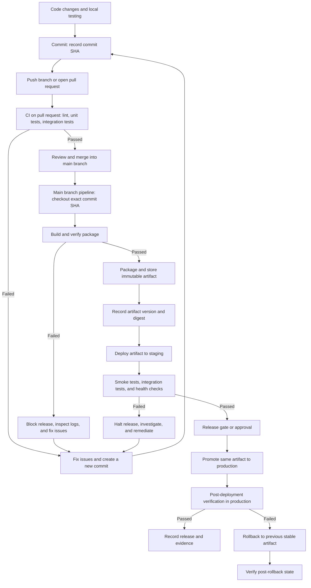

# Diagramming the Flow of a Change from Commit to Deployment Verification

A CI/CD pipeline may run successfully, yet that alone is not enough to conclude that a change works properly in the target environment. To verify a release, you must be able to trace which source code changed, which commit triggered the pipeline, which artifact the pipeline produced, where that artifact was deployed, and what the post-deployment verification results were.

In this hands-on lab, you will draw an end-to-end diagram following a change from Git to the runtime environment. The diagram must show the triggering events, automated steps, quality gates, handed-off artifacts, and evidence proving that the deployment succeeded. This turns a pipeline from a disconnected list of jobs into an explainable, traceable, and verifiable flow.

## 1. Objectives and Deliverables

After completing this lab, you will be able to:

- Distinguish between a commit, CI run, artifact, deployment, and verification.
- Map the path of a change through source code checks, build, artifact storage, deployment, and application verification.
- Explicitly state the trigger event for each stage and the conditions required for the flow to proceed.
- Link stages using identifiers such as commit SHA, pipeline run ID, artifact digest, and deployment ID.
- Represent failure-handling branches when tests fail, deployments error out, or post-deployment verification does not pass.

**The final deliverable** consists of a one-page flow diagram, an evidence table for each stage, and a list of quality gates. Looking at it, someone else should be able to answer: which change was released, which build is running in which environment, and what evidence proves it is working properly.

## 2. Lab Context

Suppose a team is developing a web service and needs to add a `GET /version` endpoint. The endpoint returns the application version along with the commit SHA that produced the build. This small change helps verify after deployment that the application is running the exact released codebase.

Example endpoint response:

```json
{
  "version": "1.4.0",
  "commit": "8e21c4f"
}
```

This is illustrative data. In a real system, only include safe build information in the endpoint; never return tokens, passwords, secret environment variables, or sensitive internal details.

The flow to describe begins when a developer creates a commit, goes through checks on a working branch, gets reviewed and merged, and then the pipeline builds an artifact, deploys it to staging, verifies it, and finally releases it to production. Lastly, you verify the application in production and record evidence tied to that deployment.

## 3. Distinguishing Milestones in the Flow

Before drawing, agree on the meaning of each milestone. These milestones are related, not interchangeable.

| Milestone | Meaning | Common Evidence |
|---|---|---|
| Commit | A source code state recorded in Git | Commit SHA, commit message, branch |
| Push or pull request | An event pushing changes to the Git server and requesting integration | Branch name, pull request ID, commit SHA |
| CI run | A pipeline execution running check steps | Run ID, job status, logs, test reports |
| Build | The process of turning source code into a deployable package | Build ID, version, build logs |
| Artifact | A packaged output stored for deployment | Artifact name, version, image digest or checksum |
| Deployment | A version of an artifact delivered to an environment | Deployment ID, environment, artifact digest, timestamp |
| Verification | Checking the application after deployment | Smoke test results, health checks, integration tests, observability metrics |

For example, a green CI run only proves that the steps in that run passed. It does not by itself prove that the artifact was deployed to production. Similarly, a deployment job reporting success only proves that the deployment tool finished according to its own criteria; the application still needs to be verified using real requests, health checks, and operational signals.

## 4. Drawing the Flow from Commit to Verification

The diagram below serves as a reference template for this lab. Job names and stage organization may vary across CI/CD platforms, but the traceability milestones must remain clear.



When adapting the reference diagram into your project's diagram, check the following points:

1. **The starting point must be an identifiable event.** For example: pushing a commit to a branch or opening a pull request. Explicitly note which event triggers which pipeline.
2. **Pull request validation and post-merge pipelines must have a clear relationship.** Pull requests typically run early checks to block non-compliant changes. After merging, the main branch pipeline validates the source code state that will be packaged and released.
3. **Artifacts must have a stable identity.** After building, record the version and digest or checksum. Subsequent environments must reference this stored artifact.
4. **Each environment must be a separate stage.** Staging and production have different configurations, access permissions, and verification objectives. Do not lump them into a single "Deploy" box.
5. **Include both success and failure branches.** Each gate must clearly state what happens when it passes or fails. A failed check must stop the flow at the appropriate point.
6. **Rollbacks must also be verified.** After reverting to a previous version, confirm that the stable version is actually serving requests.

## 5. Recording Events, Inputs, Outputs, and Evidence

A readable diagram should answer four questions at each stage: what triggers this step, what data does it receive, what output does it produce, and where is the evidence stored.

| Stage | Trigger Event or Entry Condition | Output to Track | Evidence to Store |
|---|---|---|---|
| Commit | Developer finishes changes | Commit SHA | Diff, commit message, branch |
| CI pull request | Push to branch or pull request update | Check job statuses | PR ID, CI run ID, logs, test reports |
| Review and merge | Review approved, required checks pass | Commit integrated into main branch | Reviewer, merge commit or commit SHA, timestamp |
| Build | Main branch pipeline starts | Build package or image | Build ID, logs, input commit SHA |
| Publish artifact | Build and package checks pass | Artifact stored in registry or repository | Artifact version, digest/checksum, storage location |
| Deploy staging | Artifact selected for deployment | Release running on staging | Deployment ID, environment, artifact digest, deployment logs |
| Verify staging | Staging deployment completes | Smoke test and integration test results | Checked URL or endpoint, results, timestamp, observed commit/version |
| Promote and deploy production | Release gate passes, approved if required | Release running in production | Approval record, deployment ID, artifact digest |
| Verify production | Production deployment completes | Post-release application state | Health checks, synthetic tests, logs, metrics, timestamp |
| Complete or rollback | Verification passes or fails | Confirmed release or previous version restored | Release record, verification results, rollback record if applicable |

Not every project has the exact jobs shown in this table. Use the actual step names from your team's pipeline, while still retaining enough evidence to link the stages together.

### 5.1. Linking Stages with Identifiers

To enable traceability, select a set of identifiers as a "thread" running through the entire flow:

- **Commit SHA:** identifies the exact input source code.
- **Pipeline run ID:** identifies the CI/CD execution that processed that commit.
- **Artifact digest or checksum:** identifies the exact contents of the generated package.
- **Deployment ID:** identifies the delivery of an artifact to a specific environment.
- **Environment:** specifies whether the deployment occurred in staging, production, or another environment.
- **Verification run ID:** identifies the post-deployment verification run and its outcome.

Example record linking milestones together:

```yaml
commit_sha: 8e21c4f
pipeline_run_id: ci-1842
artifact:
  name: web-service
  version: 1.4.0
  digest: sha256:abc123-example
deployment:
  id: deploy-staging-392
  environment: staging
verification:
  id: smoke-392
  result: passed
```

The values above illustrate the structure only. In a real system, obtain the IDs from Git, the CI server, the artifact registry, and the deployment tool. Never fabricate IDs in place of actual evidence.

A key principle is **build once, promote the same artifact across environments**. If staging tests image digest `sha256:abc...` while production rebuilds a new image from the same branch, you have not proven that production is running the exact package verified in staging. The same commit SHA does not guarantee the same artifact if dependencies, build time, parameters, or the build environment change. The digest confirms whether the promoted artifact's contents match.

## 6. Hands-on: Drawing Your Team's Diagram

Follow the steps below. You may use paper, a whiteboard, or a diagramming tool. If you do not yet have access to a real project's pipeline, use the reference diagram in Section 4 and mark the details that need to be verified later.

### Step 1: Choose a Concrete Change

Pick a small, testable change, such as adding a `/version` endpoint, fixing a calculation rule, or updating a display message. Note down:

- What is the goal of the change?
- Which commit contains the change?
- What behavior proves the change works correctly?
- Are there any data sources or dependent services that need to be checked?

For the `/version` example, the expected behavior is that the endpoint returns the exact version and commit SHA of the running artifact.

### Step 2: Identify the Trigger Events

Trace the change from Git. Clearly state which push, pull request, merge, or tag initiates the pipeline. If the project has multiple workflows, identify the pull request validation workflow and the release workflow. Avoid vague descriptions like "Git triggers CI"; specify the exact event and relevant branch or filter conditions.

### Step 3: List the CI Steps

Inspect the pipeline-as-code configuration and identify the actual steps, such as checkout, installing dependencies, linting, unit tests, integration tests, build, and publishing reports. For each step, note its inputs, outputs, and failure conditions. Distinguish steps that run in parallel from steps that depend on prior results.

### Step 4: Identify the Released Artifact

Note the type of artifact your project produces: JAR file, package, container image, or other deployment bundle. Identify where it is stored, how it is versioned, and how to obtain its digest/checksum. Find out how the pipeline links the artifact to the commit SHA and build run ID.

### Step 5: Trace the Deployment

Record the environments the artifact passes through, the deployment order, and any approval gates. Identify which deployment job receives which artifact, which environment configuration it uses, and where the deployment ID is generated. If there is a rollout by instance group or traffic percentage, represent those phases in the diagram.

### Step 6: Choose Post-Deployment Verification

Do not stop at "deploy job succeeded." Choose checks suited to the change:

- Health checks confirm the application is ready to serve traffic.
- Smoke tests exercise key critical paths after deployment.
- Integration tests confirm the application can connect to required dependencies.
- Synthetic tests verify behavior from a user or client perspective.
- Logs and metrics help detect elevated errors, high latency, or failed request rates.

For the `/version` endpoint, send a request to staging and production, then compare the returned commit SHA against the commit SHA recorded in the release. At the same time, check a core business endpoint or flow to avoid concluding success solely from a version info endpoint.

Illustrative check command:

```bash
curl --fail --silent https://staging.example.test/version
```

Expected output might look like:

```json
{
  "version": "1.4.0",
  "commit": "8e21c4f"
}
```

The `.test` domain and response data here are examples only. When practicing on your team's system, use the assigned URL and adhere to environment access permissions.

### Step 7: Draw Failure Branches and Rollback Paths

Clearly mark where the flow stops: failed tests, build errors, failure to publish the artifact, deployment errors, failed smoke tests, or post-release metrics exceeding thresholds. For each scenario, record the person or team responsible for handling it, the next action, and the conditions to re-run.

If production fails after deployment, the diagram must show how to revert to the previous stable artifact, how to verify the rollback, and where the event is recorded. For database changes, also show backward-compatibility handling or data recovery if required by the system's process.

## 7. Pipeline-as-Code Reference Template

The snippet below is **pseudocode describing dependency relationships**, not a configuration that can run directly on a specific CI/CD platform. Use it to verify whether your diagram captures the full sequence and quality gates.

```yaml
triggers:
  - pull_request_to_main
  - push_to_main

stages:
  validate_pull_request:
    steps:
      - checkout
      - lint
      - unit_tests
      - integration_tests

  build_main:
    requires: [validate_pull_request, merge_to_main]
    steps:
      - checkout_exact_commit
      - run_tests
      - build_package
      - publish_immutable_artifact

  deploy_staging:
    requires: [build_main]
    environment: staging

  verify_staging:
    requires: [deploy_staging]
    steps:
      - smoke_tests
      - integration_checks
      - health_check

  deploy_production:
    requires: [verify_staging, release_approval]
    environment: production
    artifact: same_artifact_as_staging

  verify_production:
    requires: [deploy_production]
    steps:
      - health_check
      - synthetic_test
      - observe_error_rate_and_latency
```

When cross-checking, verify that `same_artifact_as_staging` means production receives the exact artifact tested in staging, confirmed by digest or an equivalent identifier mechanism. Having the same version name with different artifact contents is not enough to prove consistency.

## 8. Quality Gates and Release Decisions

A quality gate is a required condition that must be met before the flow is allowed to advance. A gate must have measurable criteria and clear actions when it fails.

| Gate | Example Criteria | On Failure |
|---|---|---|
| CI pull request | Lint, unit tests, and required checks all pass | Block merge; fix issues and re-run |
| Build | Build succeeds, package checks pass | Do not publish artifact; inspect build logs |
| Artifact | Artifact has version and digest, traceable back to commit | Block deploy; check publish step and metadata |
| Staging | Smoke tests, integration tests, and health checks pass | Do not promote to production; investigate staging |
| Release approval | Authorized approver and release criteria satisfied | Hold release in pending state |
| Production | Health checks and key signals remain within thresholds | Halt rollout or rollback per procedure |

Do not use vague criteria like "looks okay." For example, if your team uses error rate and latency to decide, specify the observation window, thresholds, and metric source. Specific thresholds must be based on your team's SLOs, service characteristics, and operational procedures; this lab does not impose a single number across all systems.

## 9. Common Traceability Pitfalls

**Pipeline is green, but no deployment is found.** CI might only run checks and builds. Look for the CD workflow or job, deployment trigger conditions, and target environment. Do not use CI status to infer deployment status.

**Deployment succeeds, but features do not work.** The tool may have updated the workload, but the application fails on startup, lacks configuration, or cannot connect to dependencies. Add smoke tests, health checks, and post-deployment log inspection.

**Staging passes, but production runs a different package.** The pipeline might rebuild during the production release. Compare artifact digests across both environments and adjust the process to promote the exact tested artifact.

**Cannot determine which commit produced the running build.** Build metadata may not be attached to the artifact, or the deployment record lacks links. Add the commit SHA to safe build metadata and store relationships between commit, run, artifact, and deployment.

**Diagram only has a happy path.** A diagram without failure branches is hard to use during incidents. Add stopping points, owners, re-run conditions, and rollback paths.

**Only checking the health endpoint.** The health endpoint can return success while core features are broken. Combine health checks with smoke tests or synthetic tests representing critical user behavior.

## 10. Submission and Self-Assessment Criteria

Complete this lab by saving the following three items in your team's document or workspace page:

1. **Flow diagram:** from commit to production verification, with event labels on arrows, quality gates, and failure/rollback branches.
2. **Evidence table:** containing at minimum the commit SHA, CI run ID, artifact version/digest, deployment ID, environment, and verification result.
3. **Verification notes:** describing one specific post-deployment check, its expected result, where to view the result, and the conditions requiring a halt or rollback.

Use this checklist for self-assessment:

- [ ] The diagram starts from an identifiable commit or Git event.
- [ ] Pull request validation is distinguished from the post-merge release pipeline.
- [ ] Every key step lists inputs, outputs, and evidence.
- [ ] The artifact has a version and digest/checksum or equivalent immutable identifier.
- [ ] Commit SHA can be linked to CI run, artifact, and deployment.
- [ ] Staging and production are represented as separate stages.
- [ ] Production receives the exact artifact that passed the previous test stage.
- [ ] Post-deployment behavioral verification is included, not relying solely on deploy job status.
- [ ] Stop conditions exist when quality gates fail.
- [ ] A rollback path and post-rollback verification step are included.

A diagram meets the standard when another team member can pick a specific deployment, trace back to the commit that produced it, find the corresponding pipeline run and artifact, and open the post-deployment application verification evidence. If any arrow lacks a clear trigger event, an artifact lacks an identifier, or a success conclusion lacks verification results, fill in those details before considering the diagram complete.

## 11. Lab Conclusion

A CI/CD flow is traceable when every handoff has an event, inputs, outputs, and evidence. The commit identifies the source code; the pipeline run identifies the automation execution; the artifact digest identifies the released package; the deployment ID identifies where the package is running; and the verification record proves post-deployment behavior. Mapping all these links helps teams spot breaks in the process, investigate incidents faster, and make data-driven release decisions.
