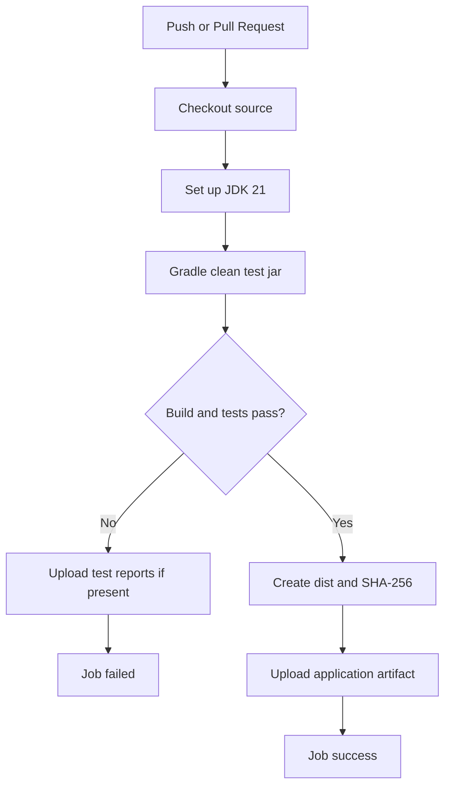

# Designing a Minimal Pipeline with Build, Test, and Package

In this hands-on lab, you will create a small Java application, commit the source code to Git, and build an automated CI pipeline for three tasks: compiling/building, running unit tests, and packaging a JAR. The pipeline will trigger on pull requests or pushes to the main branch, store test reports even when tests fail, and publish the application artifact only when all required steps succeed.

The goal is to complete a repeatable and traceable CI flow. After this lab, you will be able to answer: which commit was tested, which tests ran, which package was produced, what the package checksum is, and how the pipeline reacts when tests fail.

## 1. Expected Outcomes

Upon completion, the repository will have a structure similar to:

```text
ci-cd-lab/
├── .github/
│   └── workflows/
│       └── ci.yml
├── gradle/
│   └── wrapper/
│       ├── gradle-wrapper.jar
│       └── gradle-wrapper.properties
├── src/
│   ├── main/
│   │   └── java/
│   │       └── com/example/App.java
│   └── test/
│       └── java/
│           └── com/example/AppTest.java
├── .gitattributes
├── .gitignore
├── build.gradle.kts
├── gradlew
├── gradlew.bat
└── settings.gradle.kts
```

The pipeline will build the artifact on the CI side; do not commit the `build` or `dist` directories to Git.

**Expected Outputs**

- A pull request automatically triggers the workflow.
- The Gradle build succeeds and unit tests are executed.
- A JAR is created named `ci-cd-lab-1.0.0.jar`.
- Test reports are uploaded for review.
- The JAR, SHA-256 checksum, and build metadata are saved as a single artifact named with the commit.
- When a test is intentionally failed, the job transitions to failed and does not upload the application artifact.

## 2. Duration and Prerequisites

*Estimated duration: 45–75 minutes, depending on GitHub repository setup speed.*

You need:

- JDK 21 installed and `java -version` working.
- Gradle pre-installed to generate the Gradle Wrapper initially. Once the wrapper is generated, subsequent builds use `gradlew`.
- Git installed and configured with commit name and email.
- A GitHub account with permission to create repositories.
- A terminal such as PowerShell, Git Bash, or a Linux/macOS shell.
- Internet connectivity to download Gradle and dependencies from the Maven repository.

Verify your environment:

```bash
java -version
gradle --version
git --version
```

On Windows PowerShell, the verification commands are identical. If your organization already provides a repository template or standard Gradle Wrapper, use the wrapper version specified by your project.

## 3. Creating the Java Project

Create the lab directory and navigate into it:

```bash
mkdir ci-cd-lab
cd ci-cd-lab
mkdir -p src/main/java/com/example
mkdir -p src/test/java/com/example
mkdir -p .github/workflows
```

If using PowerShell, create the project directory first with `New-Item -ItemType Directory -Force ci-cd-lab`, then run `Set-Location ci-cd-lab`, and create the subdirectories as shown in the PowerShell example below.

On Windows PowerShell, you can create the directories with:

```powershell
New-Item -ItemType Directory -Force ci-cd-lab
Set-Location ci-cd-lab
New-Item -ItemType Directory -Force src/main/java/com/example
New-Item -ItemType Directory -Force src/test/java/com/example
New-Item -ItemType Directory -Force .github/workflows
```

Create `settings.gradle.kts`:

```kotlin
rootProject.name = "ci-cd-lab"
```

Create `build.gradle.kts`:

```kotlin
plugins {
    application
}

group = "com.example"
version = "1.0.0"

repositories {
    mavenCentral()
}

dependencies {
    testImplementation("org.junit.jupiter:junit-jupiter:5.11.4")
    testRuntimeOnly("org.junit.platform:junit-platform-launcher:1.11.4")
}

java {
    toolchain {
        languageVersion.set(JavaLanguageVersion.of(21))
    }
}

application {
    mainClass.set("com.example.App")
}

tasks.test {
    useJUnitPlatform()
    testLogging {
        events("passed", "skipped", "failed")
    }
}

tasks.jar {
    manifest {
        attributes["Main-Class"] = application.mainClass.get()
    }
}
```

Key parts explained:

- `application` provides tasks to run and package the application.
- `java.toolchain` instructs Gradle to use JDK 21 for compiling and testing.
- JUnit Jupiter is used for unit tests.
- `useJUnitPlatform()` configures Gradle to run JUnit 5.
- The manifest records the main class so the JAR can be executed via `java -jar`.
- The version is explicitly declared so the artifact name is traceable.

## 4. Writing Application Code and Unit Tests

Create `src/main/java/com/example/App.java`:

```java
package com.example;

public final class App {
    private App() {
    }

    public static String greeting(String name) {
        if (name == null || name.isBlank()) {
            throw new IllegalArgumentException("name must not be blank");
        }

        return "Hello, " + name.trim() + "!";
    }

    public static void main(String[] args) {
        String name = args.length == 0 ? "CI" : args[0];
        System.out.println(greeting(name));
    }
}
```

Create `src/test/java/com/example/AppTest.java`:

```java
package com.example;

import org.junit.jupiter.api.Test;

import static org.junit.jupiter.api.Assertions.assertEquals;
import static org.junit.jupiter.api.Assertions.assertThrows;

class AppTest {
    @Test
    void trimsNameBeforeBuildingGreeting() {
        assertEquals("Hello, Ada!", App.greeting(" Ada "));
    }

    @Test
    void rejectsBlankName() {
        assertThrows(
            IllegalArgumentException.class,
            () -> App.greeting(" ")
        );
    }

    @Test
    void rejectsNullName() {
        assertThrows(
            IllegalArgumentException.class,
            () -> App.greeting(null)
        );
    }
}
```

The application has simple behavior, yet it is sufficient to demonstrate both valid input tests and invalid input rejection. The tests verify the returned string while confirming that blank strings and `null` are rejected.

## 5. Generating the Gradle Wrapper and Configuring Git

Generate the wrapper with Gradle 8.14.3:

```bash
gradle wrapper --gradle-version 8.14.3
```

This command creates `gradlew`, `gradlew.bat`, and the `gradle/wrapper` directory. Commit the wrapper scripts, wrapper JAR, and properties file to the repository. CI and subsequent users will not need Gradle installed globally; the wrapper automatically downloads the declared version.

Verify the wrapper:

```bash
./gradlew --version
```

On Windows PowerShell:

```powershell
.\gradlew.bat --version
```

Create `.gitignore`:

```gitignore
.gradle/
build/
dist/
.idea/
*.iml
```

Create `.gitattributes` to normalize line endings for scripts and project files:

```text
gradlew text eol=lf
gradlew.bat text eol=crlf
*.java text eol=lf
*.kts text eol=lf
*.yml text eol=lf
```

Verify the JDK and run build/test/package locally before pushing to CI:

```bash
./gradlew --no-daemon clean test jar
```

On Windows:

```powershell
.\gradlew.bat --no-daemon clean test jar
```

Expected results:

- Gradle finishes with `BUILD SUCCESSFUL`.
- An HTML test report exists at `build/reports/tests/test/index.html`.
- JUnit XML files exist in `build/test-results/test/`.
- The JAR exists at `build/libs/ci-cd-lab-1.0.0.jar`.

Test running the JAR:

```bash
java -jar build/libs/ci-cd-lab-1.0.0.jar Ada
```

Expected output:

```text
Hello, Ada!
```

If the local build does not pass, fix the issues before continuing. CI re-verifies the same steps in a clean environment; it does not replace checking whether the project builds locally.

## 6. Initializing the Git Repository

If the project does not yet have a Git repository:

```bash
git init -b main
git add .
git commit -m "Create Java app and Gradle build"
```

Create an empty repository on GitHub, for example `ci-cd-lab`. Do not choose to auto-generate a README or license if you already have local files and want to avoid an initial merge commit.

Add the remote and push the main branch:

```bash
git remote add origin https://github.com/OWNER/ci-cd-lab.git
git push -u origin main
```

Replace `OWNER` with your actual account or organization. If the repository already exists with history, clone that repository and place the lab files inside the project; do not initialize an independent Git history in a directory that already has history.

## 7. Writing the CI Workflow

Create `.github/workflows/ci.yml`:

```yaml
name: CI

on:
  pull_request:
  push:
    branches: [main]
  workflow_dispatch:

permissions:
  contents: read

concurrency:
  group: ${{ github.workflow }}-${{ github.ref }}
  cancel-in-progress: true

jobs:
  build-test-package:
    name: Build, test and package
    runs-on: ubuntu-24.04
    timeout-minutes: 15

    steps:
      - name: Checkout source
        uses: actions/checkout@v4

      - name: Set up JDK 21
        uses: actions/setup-java@v4
        with:
          distribution: temurin
          java-version: '21'
          cache: gradle

      - name: Allow Gradle wrapper to execute
        run: chmod +x gradlew

      - name: Show toolchain
        run: |
          java -version
          ./gradlew --version

      - name: Build, test and package
        run: ./gradlew --no-daemon clean test jar

      - name: Upload test reports
        if: ${{ always() }}
        uses: actions/upload-artifact@v4
        with:
          name: test-reports-${{ github.run_id }}-${{ github.run_attempt }}
          path: |
            build/reports/tests/test/
            build/test-results/test/
          if-no-files-found: ignore
          retention-days: 7

      - name: Prepare package and metadata
        if: ${{ success() }}
        run: |
          mkdir -p dist
          cp build/libs/ci-cd-lab-1.0.0.jar dist/
          (
            cd dist
            sha256sum ci-cd-lab-1.0.0.jar > SHA256SUMS
          )
          {
            printf 'checked_out_sha=%s\n' "$GITHUB_SHA"
            printf 'pull_request_head_sha=%s\n' "$PR_HEAD_SHA"
            printf 'run_id=%s\n' "$GITHUB_RUN_ID"
            printf 'run_attempt=%s\n' "$GITHUB_RUN_ATTEMPT"
            java -version 2>&1 | head -n 1 | sed 's/^/java=/'
          } > dist/build-info.txt
        env:
          PR_HEAD_SHA: ${{ github.event.pull_request.head.sha || github.sha }}

      - name: Upload application artifact
        if: ${{ success() }}
        uses: actions/upload-artifact@v4
        with:
          name: app-${{ github.sha }}
          path: dist/
          if-no-files-found: error
          retention-days: 14
```

The expressions in the workflow have the following meanings:

- `concurrency.group` combines the workflow name and ref so runs on the same branch can be managed in one group.
- `always()` allows the upload test reports step to be evaluated even when the build/test step fails.
- `success()` allows preparing and uploading the application artifact only when preceding steps succeed.
- `github.run_id` and `github.run_attempt` distinguish individual runs and re-runs.
- `github.sha` ties the artifact name to the commit being checked.

### 7.1. Understanding the Workflow



### 7.2. Purpose of Each Step

| Step | Purpose |
|---|---|
| Checkout | Fetch the exact source revision of the event |
| Setup JDK | Use the specified toolchain |
| Wrapper permission | Allow the script to execute on the Linux runner |
| Show toolchain | Record Java and Gradle versions in the logs |
| Build/test/jar | Compile, run unit tests, and create the package |
| Upload test reports | Preserve reports even when tests fail |
| Prepare package | Copy the JAR, compute checksum, and write metadata |
| Upload artifact | Store the package only when required steps succeed |

`cache: gradle` in `setup-java` caches Gradle dependencies. It does not mean enabling the Gradle build cache for tasks. This lab focuses on build/test/package; you can experiment with the build cache as a separate improvement once the basic pipeline works.

`permissions: contents: read` restricts the workflow token's default permissions to reading the repository. This example does not require secrets to build and upload internal GitHub Actions artifacts. Do not add write permissions or secrets when the lab does not need them.

The application artifact name contains `github.sha`; `build-info.txt` records the checked-out revision SHA, the pull request head SHA (if applicable), and the run ID. For `pull_request` events, `github.sha` is typically the merge commit used to test the PR, while `pull_request_head_sha` is the tip commit of the source branch; for `push` events, the head SHA falls back to `github.sha`. `SHA256SUMS` detects whether the JAR contents were altered after downloading. This provides basic traceability and integrity verification, not release signing.

## 8. Committing the Workflow and Opening a Pull Request

The workflow must exist on the default branch for `pull_request` events to trigger reliably. For a new lab repository without branch protection enabled yet, push the workflow to `main` first:

```bash
git switch main
git add .github/workflows/ci.yml
git commit -m "Add build test and package workflow"
git push origin main
```

This push triggers the workflow via the `push` event. If `main` is already protected, create a bootstrap pull request to add the workflow and merge it according to your repository's process; do not configure this workflow as a required check before it has completed its first successful run.

Once the workflow is on `main`, create a small feature branch to test the pull request event:

```bash
git switch -c feature/verify-ci-pipeline
```

Add the following test to `AppTest`:

```java
@Test
void handlesAnotherName() {
    assertEquals("Hello, Linh!", App.greeting(" Linh "));
}
```

Commit, push, and open a pull request:

```bash
git add src/test/java/com/example/AppTest.java
git commit -m "Add another greeting test"
git push -u origin feature/verify-ci-pipeline
```

Open a pull request from `feature/verify-ci-pipeline` into `main`.

In GitHub's Actions tab:

1. Select the CI workflow you just created.
2. Open the run triggered by the pull request.
3. Monitor the `Build, test and package` job.
4. Open the logs for each step.
5. Confirm that the build and tests complete.
6. Inspect the Artifacts section of the run.

If the repository requires approval for workflows from forks, follow your organization's policy. Never place personal tokens or credentials into workflow files to bypass that control.

## 9. Verifying Test Reports and Artifacts

When the job succeeds, the run should contain two artifact groups:

| Artifact | Contents | Upload Condition |
|---|---|---|
| `test-reports-...` | HTML report and JUnit XML | Always attempt upload after job finishes |
| `app-...` | JAR, SHA256SUMS, and build-info.txt | Only when job succeeds |

Download the application artifact from the run page. Extract it into a dedicated `dist` folder containing the JAR and `SHA256SUMS`, then verify the checksum.

On Linux or Git Bash:

```bash
cd dist
sha256sum -c SHA256SUMS
```

On Windows PowerShell, if the downloaded folder contains the JAR and checksum file:

```powershell
$line = Get-Content .\SHA256SUMS
$expected = ($line -split '\s+')[0].ToLowerInvariant()
$actual = (Get-FileHash .\ci-cd-lab-1.0.0.jar -Algorithm SHA256).Hash.ToLowerInvariant()

if ($expected -ne $actual) {
    throw "Checksum mismatch"
}

"Checksum OK"
```

Run the downloaded JAR:

```bash
java -jar ci-cd-lab-1.0.0.jar Linh
```

Expected output:

```text
Hello, Linh!
```

Open `build-info.txt` and compare `checked_out_sha` against the run's revision; for pull requests, also compare `pull_request_head_sha` against the source branch's tip commit. Checksum verification only confirms that the downloaded file matches its accompanying checksum; stronger provenance verification in real releases requires signatures or provenance generated and verified by a trusted identity.

## 10. Exercising the Failure Path

A pipeline is only verified when you know it responds properly when tests fail.

Open `src/test/java/com/example/AppTest.java` and intentionally change the expected value in the first test:

```java
assertEquals("Hello, Grace!", App.greeting(" Ada "));
```

Since the actual output remains `Hello, Ada!`, this assertion will fail.

Commit and push the change:

```bash
git add src/test/java/com/example/AppTest.java
git commit -m "Exercise failing test path"
git push
```

Observe the workflow:

- The build/test/package step fails due to the unit test.
- The upload test reports step is still evaluated thanks to the `always()` condition.
- The prepare package and upload application artifact steps do not run because the success condition is not met.
- The job enters the failed state and the pull request fails its required check.

Open the test report to find the failing test name, expected value, and actual value. This confirms the pipeline preserves investigative evidence even when no release artifact is produced.

Restore the expected value to `Hello, Ada!`, commit, and push again. Confirm that the workflow turns green and the application artifact appears.

## 11. Enforcing the Required Check Before Merge

Once the workflow is working, the repository can configure branch protection or a ruleset to require the `Build, test and package` job to pass before merging into `main`.

Verify:

- The required check points to the correct workflow/job.
- Pull requests cannot be merged when the job fails.
- No bypass path exists outside organizational policy.
- The workflow runs on the exact source revision to be merged.
- Workflows from forks do not receive unnecessary secrets.
- `GITHUB_TOKEN` permissions are set to least privilege.

The check display name may change if you rename the job or workflow. After renaming, re-verify the required check so the ruleset does not reference an outdated check name.

## 12. Troubleshooting

| Symptom | Common Cause | Resolution |
|---|---|---|
| `gradle: command not found` | Gradle is not installed to generate the wrapper | Install Gradle or use the wrapper from an existing template |
| Wrong `JAVA_HOME` or missing JDK | JDK 21 not installed or configured | Check `java -version` and `JAVA_HOME` |
| Wrapper fails on Linux | Missing execute bit or wrong line endings | Run `chmod +x gradlew` and check `.gitattributes` |
| Dependency download fails | Temporary network, mirror, or Maven Central error | Check logs and perform a controlled retry |
| No tests found | Incorrect package/path or missing JUnit Platform | Check source path, dependencies, and `useJUnitPlatform()` |
| JAR missing Main-Class | Manifest task not configured | Check `tasks.jar` |
| Test report missing | Tests did not run or wrong task path | Check Gradle test results and upload path |
| Application artifact missing | Job/test failed or prepare step errored | Inspect the first failing step and upload conditions |
| Checksum mismatch | File modified, incomplete download, or comparing wrong file | Re-download artifact and verify exact filename |
| Pull request not triggering | Workflow path, branch, or event mismatch | Verify file is in `.github/workflows` and check event filters |
| Required check stays pending | Ruleset references wrong check or workflow has not run | Open Checks to get the exact check name and update policy |

When investigating, locate the first error that caused the job to fail. Subsequent errors may simply be side effects of an earlier step not producing output.

## 13. Lab Completion Criteria

| Item | Passing Evidence |
|---|---|
| Project | Java source code and JUnit tests exist |
| Wrapper | Wrapper scripts, JAR, and properties are committed |
| Local verification | `clean test jar` runs successfully |
| CI trigger | Pull request triggers the workflow |
| Build/test | Logs show Gradle running tasks and tests passing |
| Test report | Report is uploaded and can be opened |
| Package | JAR is built and uploaded when job succeeds |
| Traceability | Artifact name or build metadata links commit/run |
| Integrity | SHA-256 is generated and verified successfully |
| Failure path | Intentionally failing test turns job red; report is still uploaded |
| Artifact gate | Application artifact is not uploaded when job fails |
| Recovery | Restoring test makes workflow pass again |

If an item does not pass, record the error and evidence rather than marking it complete by intuition.

## 14. Self-Check Questions

1. Why should CI use the Gradle Wrapper instead of relying on the Gradle version installed on the runner?
2. What types of output do `test` and `jar` produce?
3. Why is the test report uploaded with the `always()` condition?
4. Why is the application artifact uploaded only when the job succeeds?
5. In what ways do commit SHA, run ID, and checksum support traceability?
6. Why does a checksum not replace a signature or provenance?
7. If the build succeeds but tests fail, how should branch protection handle it?
8. How does the dependency cache differ from the Gradle build cache?
9. Why should pull requests from forks not receive unnecessary secrets?
10. If you change the JDK or Gradle version, what checks would you add?

## 15. Extensions Beyond the Lab

Once the basic pipeline is stable, you can choose an extension path:

- Add integration tests running against a database test container.
- Add static analysis or dependency vulnerability scanning.
- Split build and test into dependent jobs.
- Use a matrix to test JDK 21 and another runtime within your support policy.
- Add an SBOM and provenance for the artifact.
- Pin GitHub Actions by commit SHA per policy.
- Use a remote build cache with separated read/write permissions.
- Create a release workflow promoting the same artifact digest across staging and production.
- Add post-deployment smoke tests and store deployment evidence.

Each extension should have a clear objective and its own evidence. Do not add steps just to make the workflow longer.

## Conclusion

This lab built a minimal CI pipeline capable of building, testing, and packaging a Java application. The workflow is stored alongside the source code, triggers on Git events, uses a pinned JDK and Gradle Wrapper, preserves test reports, and uploads the JAR only when all required steps succeed.

By verifying checksums and cross-checking build metadata, you can trace a package back to the commit and run that produced it. The failure-path exercise also proves the pipeline preserves reports for investigation while blocking the application artifact when tests fail. This provides a solid foundation for adding security scanning, artifact provenance, deployment, and post-deploy verification.
