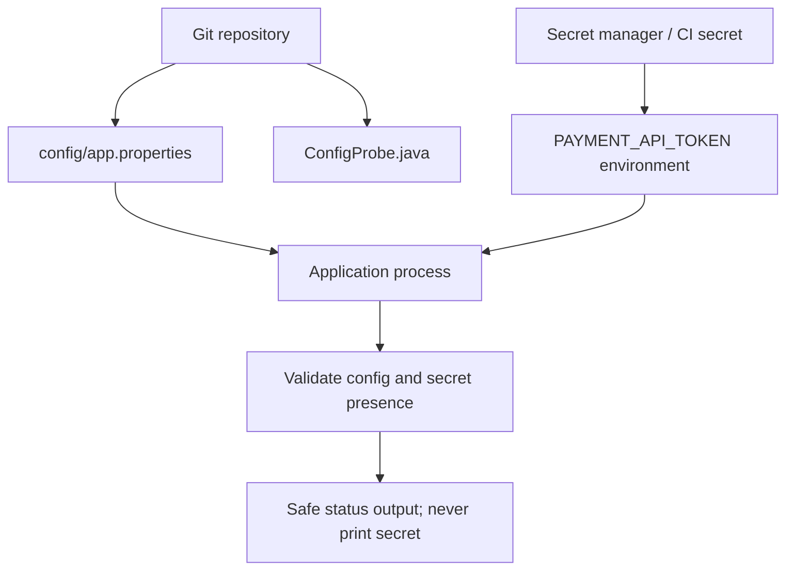

# Passing Configuration Alongside Secrets Using Separate Mechanisms

In a CI/CD pipeline, an application needs both configuration to know how to operate and secrets to authenticate with external systems. Both types of data are often injected into the runtime simultaneously, yet they should not be stored or managed the same way. Service URLs, timeouts, and environment names can usually be versioned alongside source code; API tokens, database passwords, and private keys must be stored in a secret manager with separate access controls, auditing, and rotation.

This lab builds a small Java application that reads non-sensitive configuration from a file in the repository and reads a token from an environment variable. Next, you run the application locally with PowerShell, configure GitHub Actions to validate pull requests without secrets, and inject the secret only for the smoke test step in a protected staging environment. The proof required is that the application receives everything it needs to run while the secret never appears in Git, logs, or artifacts.

## 1. Objectives and Expected Outcomes

After this lab, you will be able to:

- Distinguish non-sensitive configuration from secrets.
- Store reviewable, versioned configuration in Git.
- Inject secrets via environment variables or secret integrations at runtime.
- Ensure local files containing secrets are never committed.
- Run CI checks on pull requests without supplying secrets to untrusted code.
- Inject secrets only into the jobs/steps that need them and scope them by environment.
- Verify that the application does not print secrets to stdout/stderr.
- Handle missing secrets and clean up lab values after completion.

Suggested duration: 45–75 minutes. This lab uses a simulated token and does not require connecting to a real payment API.

## 2. Model to Build

We use a `ConfigProbe` program to verify the configuration contract. The program reads `app.env`, `payment.api.url`, and `payment.timeout.seconds` from `config/app.properties`; the `PAYMENT_API_TOKEN` token is retrieved exclusively from the environment. The program reports only whether the token is configured and never prints the token value.



| Data | Example | Storage / Injection Source |
|---|---|---|
| Non-sensitive configuration | `app.env=staging` | Config file in Git or CI variable |
| Non-sensitive configuration | `payment.api.url=https://payments.example.test` | Config file in Git |
| Non-sensitive configuration | `payment.timeout.seconds=5` | Config file in Git |
| Secret | `PAYMENT_API_TOKEN` | GitHub Environment Secret or secret manager |

The example URL uses the `.test` domain reserved for testing. The program does not call this endpoint; it only verifies that configuration can be read.

## 3. Preparing the Environment

You need:

- Git.
- JDK 17 or newer (`java -version`, `javac -version`).
- PowerShell on Windows, or an equivalent shell if you adapt the commands.
- A GitHub repository with permissions to create repository/environment secrets for the optional CI section.

Verify the JDK in PowerShell:

```powershell
java -version
javac -version
git --version
```

If `javac` is not recognized, install a JDK and check `JAVA_HOME`/`PATH` before proceeding. No database, Docker, or Kubernetes installation is required for the core lab.

## 4. Creating the Project Structure

Create a new directory, for example `config-secret-lab`, with this layout:

```text
config-secret-lab/
├── .gitignore
├── .env.example
├── ConfigProbe.java
├── config/
│   ├── app.properties
│   └── staging.properties
└── .github/
    └── workflows/
        └── config-secret-check.yml
```

Do not create any file containing a real token inside the repository. `.env.example` lists only variable names and empty values so readers know which variables the application requires.

### 4.1. Creating Non-Sensitive Configuration Files

Create `config/app.properties`:

```properties
# These values are non-secret and can be reviewed in Git.
app.env=local
payment.api.url=https://payments.example.test
payment.timeout.seconds=5
```

These values describe the environment and connection behavior. Never put user/password credentials in a URL, never embed tokens in properties, and never use a single shared config file containing both secrets and regular settings.

Also create `config/staging.properties` so staging has its own non-sensitive configuration:

```properties
app.env=staging
payment.api.url=https://payments.example.test
payment.timeout.seconds=5
```

Both files share the same schema, while `app.env` reflects the target environment. As the number of environments grows, you can use templates/overlays or CI variables instead of duplicating too many files; secrets continue to be supplied through a separate secret manager.

### 4.2. Declaring Required Secret Variables

Create `.env.example`:

```dotenv
# Copy the variable name into your local secret injection mechanism.
# Do not put a real token in this file.
PAYMENT_API_TOKEN=
```

This file documents variable names, not a place to store secrets. In real work, pull secrets from a secret manager or an organization-approved local injection mechanism.

### 4.3. Ignoring Files That Could Contain Secrets

Create `.gitignore`:

```gitignore
# Local environment files
.env
.env.*
!.env.example

# Local-only configuration and secret material
*.local.properties
secrets/
*.pem
*.key
credentials.json
```

Do not ignore `config/app.properties`, because it holds only non-sensitive configuration and needs to be reviewed alongside application changes. `.gitignore` rules only block untracked files; they do not remove a secret file that was already committed earlier.

### 4.4. Writing the Program to Read Configuration and Secrets Separately

Create `ConfigProbe.java`:

```java
import java.io.IOException;
import java.io.InputStream;
import java.net.URI;
import java.nio.file.Files;
import java.nio.file.Path;
import java.util.Properties;

public final class ConfigProbe {
    private static String required(Properties properties, String key) {
        String value = properties.getProperty(key);
        if (value == null || value.isBlank()) {
            throw new IllegalArgumentException("Missing configuration: " + key);
        }
        return value.trim();
    }

    public static void main(String[] args) throws IOException {
        boolean requireSecret = args.length == 0
                || !"--validate-config-only".equals(args[0]);

        String configFile = System.getenv().getOrDefault(
                "APP_CONFIG_FILE", "config/app.properties");
        Properties config = new Properties();
        try (InputStream input = Files.newInputStream(Path.of(configFile))) {
            config.load(input);
        }

        String environment = required(config, "app.env");
        URI paymentUri = URI.create(required(config, "payment.api.url"));
        if (paymentUri.getHost() == null || paymentUri.getUserInfo() != null) {
            throw new IllegalArgumentException(
                    "payment.api.url must have a host and must not contain credentials");
        }

        int timeoutSeconds = Integer.parseInt(
                required(config, "payment.timeout.seconds"));
        if (timeoutSeconds < 1 || timeoutSeconds > 120) {
            throw new IllegalArgumentException(
                    "payment.timeout.seconds must be between 1 and 120");
        }

        String token = System.getenv("PAYMENT_API_TOKEN");
        boolean tokenConfigured = token != null && !token.isBlank();
        if (requireSecret && !tokenConfigured) {
            System.err.println("Missing required secret: PAYMENT_API_TOKEN");
            System.exit(2);
            return;
        }

        System.out.println("Configuration validation: PASS");
        System.out.println("Environment: " + environment);
        System.out.println("Payment API host: " + paymentUri.getHost());
        System.out.println("Payment timeout seconds: " + timeoutSeconds);
        System.out.println("Payment API token configured: " + tokenConfigured);
    }
}
```

The program supports two modes:

- Run `java ConfigProbe --validate-config-only` to validate the config file without requiring the secret. This mode suits untrusted pull requests.
- Run `java ConfigProbe` to validate the config and require `PAYMENT_API_TOKEN`. This is the smoke test step after the secret is injected in a protected environment.

The program does not use the token to call a live service; it only verifies the variable is present. In real applications, never put tokens into exceptions, logs, metric labels, command arguments, or URLs.

## 5. Testing Locally with PowerShell

Open PowerShell inside the `config-secret-lab` directory.

### 5.1. Validating Configuration Without a Secret

```powershell
javac ConfigProbe.java
java ConfigProbe --validate-config-only
```

Expected output is similar to:

```text
Configuration validation: PASS
Environment: local
Payment API host: payments.example.test
Payment timeout seconds: 5
Payment API token configured: false
```

The next command should fail because the secret has not been provided:

```powershell
java ConfigProbe
$LASTEXITCODE
```

Expected result: the program reports `PAYMENT_API_TOKEN` is missing and exits with code `2`. The message names only the variable and does not expose any secret value.

### 5.2. Supplying a Simulated Token in the Current PowerShell Session

Set a dummy value, not a live credential:

```powershell
$env:PAYMENT_API_TOKEN = 'lab-only-fake-token-not-a-real-credential'
java ConfigProbe
```

Expected output:

```text
Configuration validation: PASS
Environment: local
Payment API host: payments.example.test
Payment timeout seconds: 5
Payment API token configured: true
```

Verify the output does not contain the dummy token:

```powershell
$output = java ConfigProbe 2>&1 | Out-String
if ($LASTEXITCODE -ne 0) {
    throw 'ConfigProbe did not complete successfully'
}
if ($output.Contains($env:PAYMENT_API_TOKEN)) {
    throw 'Secret value was exposed in application output'
}
'Secret output check: PASS'
```

Remove the variable when finished:

```powershell
Remove-Item Env:PAYMENT_API_TOKEN
```

Environment variables exist only in the current process/session and child processes spawned from it. Do not run the command above with a real token if your terminal history, transcript, or command-auditing system could record entered values. For real local development, prefer a secret manager CLI, IDE run configurations excluded from Git, or an appropriate workload identity mechanism.

## 6. Verifying Git Does Not Commit Secrets to the Repository

Initialize Git and inspect tracked files:

```powershell
git init
git status --short
git check-ignore -v .env
git check-ignore -v .env.local
git check-ignore -v .env.example
```

Both `.env` and `.env.local` must be ignored. `.env.example` must not be ignored. If `.env` does not exist yet, `git check-ignore` can still evaluate rules based on path; you can create a temporary empty file and delete it afterward.

Create a `.env.local` file containing only a dummy token to test the ignore rule:

```powershell
Set-Content -Path .env.local -Value 'PAYMENT_API_TOKEN=lab-only-fake-token'
git status --short
git check-ignore -v .env.local
Remove-Item .env.local
```

`git status` must not list `.env.local` as a file to commit. Never rely on `.gitignore` as the sole safeguard: before committing, still review `git status`, diffs, and secret scans. If a secret has already been committed, revoke/rotate it immediately; deleting the file in a new commit does not erase the secret from Git history.

## 7. Configuring GitHub Actions to Separate PR Validation and Staging Smoke Tests

The workflow goals are:

- Pull requests run only configuration checks that require no secrets.
- After committing to `main`, the smoke test job runs in the `staging` GitHub Environment.
- The token is mapped only to the specific step that needs it.
- The workflow never prints the token value.

### 7.1. Creating the Environment Secret

In your GitHub repository, open **Settings → Environments** and create an environment named `staging`. Add a secret named `PAYMENT_API_TOKEN` with a test token dedicated solely to this lab. Never use a production token or personal credential. If the repository supports protection rules, configure appropriate reviewers and deployment branches before allowing the job to run.

GitHub Actions distinguishes between:

- `vars`: non-sensitive configuration values.
- `secrets`: confidential values masked in logs by the platform, though workflows must still avoid intentionally printing or transforming them into exposed output.

### 7.2. Creating the Workflow

Create `.github/workflows/config-secret-check.yml`:

```yaml
name: Config and secret separation

on:
  pull_request:
  push:
    branches: [main]

permissions:
  contents: read

jobs:
  validate-config:
    runs-on: ubuntu-latest
    steps:
      - uses: actions/checkout@v4
      - uses: actions/setup-java@v4
        with:
          distribution: temurin
          java-version: '17'
      - name: Compile and validate non-secret configuration
        env:
          APP_CONFIG_FILE: config/app.properties
        run: |
          javac ConfigProbe.java
          java ConfigProbe --validate-config-only

  staging-smoke:
    if: github.event_name == 'push' && github.ref == 'refs/heads/main'
    needs: validate-config
    runs-on: ubuntu-latest
    environment: staging
    steps:
      - uses: actions/checkout@v4
      - uses: actions/setup-java@v4
        with:
          distribution: temurin
          java-version: '17'
      - name: Verify runtime secret is injected
        env:
          APP_CONFIG_FILE: config/staging.properties
          PAYMENT_API_TOKEN: ${{ secrets.PAYMENT_API_TOKEN }}
        run: |
          javac ConfigProbe.java
          java ConfigProbe
```

The `validate-config` job receives no secrets and can run on pull requests. The `staging-smoke` job runs only after a push to `main`, requires the `staging` environment, and maps the secret at the exact step. If the secret is missing, the program exits with a non-zero exit code. Never use `pull_request_target` to run untrusted PR code with sensitive permissions or secrets.

Set `validate-config` as a required status check in branch protection/rulesets. If configuration validation fails, the PR cannot be merged per policy. The staging job should be restricted by branch and reviewers according to the environment's sensitivity.

### 7.3. Verifying the Workflow

Create a pull request and observe:

- `validate-config` runs and succeeds.
- The pull request does not receive `PAYMENT_API_TOKEN`.
- `staging-smoke` is skipped on the `pull_request` event.
- No secret values appear in logs, artifacts, or output.

After merging into `main`, observe `staging-smoke`:

- The job runs inside the `staging` environment.
- The step receives `PAYMENT_API_TOKEN`.
- Logs display only `Payment API token configured: true`.
- If the secret is not configured, the job fails naming only the missing variable.

In a real repository, if the staging smoke test calls an external API, use a sandbox endpoint and a token scoped strictly to test operations. The current example sends no network requests.

## 8. Kubernetes Approach: ConfigMap and External Secret

If the workload runs on Kubernetes, the same principle is expressed through two separate resources:

- `ConfigMap` holds non-sensitive configuration.
- Secrets are fetched from a secret manager and synced into the namespace via an integration such as External Secrets Operator.

Example `ConfigMap`:

```yaml
apiVersion: v1
kind: ConfigMap
metadata:
  name: orders-runtime-config
  namespace: staging
data:
  APP_ENV: "staging"
  PAYMENT_API_URL: "https://payments.example.test"
  PAYMENT_TIMEOUT_SECONDS: "5"
```

Example `ExternalSecret` referencing a secret stored in the secret manager:

```yaml
apiVersion: external-secrets.io/v1
kind: ExternalSecret
metadata:
  name: orders-runtime-secret
  namespace: staging
spec:
  refreshInterval: 1h
  secretStoreRef:
    name: staging-secret-store
    kind: SecretStore
  target:
    name: orders-runtime-secret
    creationPolicy: Owner
  data:
    - secretKey: PAYMENT_API_TOKEN
      remoteRef:
        key: staging/orders/payment-api-token
```

The example above assumes External Secrets Operator and `SecretStore` are already installed and configured with the proper provider and secret-read permissions. The API version/resource schema must match your installed CRD version. The `ExternalSecret` manifest contains only the reference key in the secret manager; never place token values in Git.

The Deployment can reference the two sources separately:

```yaml
apiVersion: apps/v1
kind: Deployment
metadata:
  name: orders
  namespace: staging
spec:
  replicas: 1
  selector:
    matchLabels:
      app: orders
  template:
    metadata:
      labels:
        app: orders
    spec:
      containers:
        - name: orders
          image: registry.example.test/team/orders@sha256:0123456789abcdef0123456789abcdef0123456789abcdef0123456789abcdef
          envFrom:
            - configMapRef:
                name: orders-runtime-config
          env:
            - name: PAYMENT_API_TOKEN
              valueFrom:
                secretKeyRef:
                  name: orders-runtime-secret
                  key: PAYMENT_API_TOKEN
```

Kubernetes Secret objects are not automatically encrypted simply because manifest data is base64-encoded. Configure encryption at rest for the datastore, least-privilege RBAC, auditing, and secret read access controls. When possible, prefer workload identity or a CSI/provider integration so workloads fetch secrets directly without storing long-lived copies in manifests or repositories.

## 9. Troubleshooting Common Configuration Errors

| Symptom | Possible Cause | Resolution |
|---|---|---|
| Application reports missing `PAYMENT_API_TOKEN` | Secret not configured or not mapped into step/job | Check secret name and repository/environment scope |
| Secret exists in repository but workflow cannot read it | Secret stored in wrong scope or environment not attached to job | Check environment name and workflow permissions |
| Pull request from fork lacks secret | Platform blocks secrets for untrusted PR workflows | Validate only non-secret config in PRs; run smoke tests after merge in a protected environment |
| `app.properties` not found | Incorrect working directory or `APP_CONFIG_FILE` | Verify relative path from the process working directory |
| URL rejected | URL contains userinfo or lacks a host | Move credentials to a separate secret; keep only the endpoint in the URL |
| Works locally but fails in CI | Local environment variables absent on runner | Declare non-secret variables and secrets at the proper step scope |
| Secret appears in logs | Script echoes env, shell tracing enabled, or exception includes value | Stop workflow, rotate/revoke secret, and fix log handling |
| `.env.local` appears in `git status` | Missing ignore rule or file was tracked previously | Fix `.gitignore`; if already tracked, remove from index and treat secret as compromised |

Never enable `set -x`, `Write-Host $env:PAYMENT_API_TOKEN`, `env`, `printenv`, or commands dumping the full process environment in a job with secrets. Never pass secrets via command-line arguments if tools can record commands in logs or process metadata.

## 10. Protecting Secrets Across CI/CD Stages

| Stage | Rule |
|---|---|
| Source control | Never commit secrets; store only classified non-sensitive configuration and required variable names |
| Pull request | Never supply production/staging secrets to untrusted PR code |
| Build | Never embed secrets in Docker `ARG`/`ENV`, source bundles, or image layers; use ephemeral secret mounts when builds require credentials |
| Test | Use least-privilege sandbox secrets; never print request headers/bodies containing tokens |
| Artifact | Never bundle `.env`, credential files, or test secrets into JARs/images/caches |
| Deploy | Inject secrets at runtime via secret manager, workload identity, or platform secret store |
| Runtime | Restrict readable processes/users, enforce rotation and auditing |
| Logging/observability | Redact tokens, passwords, and authorization headers; never use secrets as metric labels |
| Cleanup | Revoke lab tokens, delete local files and temporary resources |

If a build must read from a private package registry, that secret is a build-time secret. Use the build tool's secret mount or credential helper mechanism; never hardcode tokens into a Dockerfile, build arguments recorded in image history, or shared cache files.

## 11. Verifying Lab Completion

Check off each item once you have evidence:

- [ ] `config/app.properties` contains only non-sensitive configuration and is tracked by Git.
- [ ] `.env.example` contains only variable names and empty placeholders.
- [ ] `.gitignore` ignores `.env`, `.env.local`, and local secret files.
- [ ] `ConfigProbe --validate-config-only` succeeds without a token.
- [ ] `ConfigProbe` fails with exit code 2 when the token is missing.
- [ ] `ConfigProbe` succeeds when a dummy token is provided via the environment.
- [ ] Output does not contain the token value.
- [ ] Pull request workflow receives no secrets and still validates configuration.
- [ ] Staging job receives the secret only in the protected environment/step.
- [ ] Git diffs, workflow logs, and artifacts contain no secrets.
- [ ] Local environment variables and dummy tokens were removed after practice.

### Evaluation Criteria

| Criterion | Passing Standard |
|---|---|
| Data separation | Regular config lives in reviewable files; tokens come strictly from secret sources |
| Fail safely | Missing secret causes the secret-dependent step to fail clearly |
| Least privilege | Only jobs/steps requiring the secret receive it; scope limited by environment |
| No disclosure | No secret values appear in logs, Git, artifacts, or output |
| PR isolation | Untrusted pull request code cannot receive staging/production secrets |
| Traceability | Commit, workflow run, environment, and step using the secret are identifiable |

## 12. Extended Exercises

1. Add `PAYMENT_API_TIMEOUT` as a non-sensitive configuration option, validate its value range, and verify this change requires no secrets.
2. Create a separate `production` GitHub Environment allowing deployments only from protected branches/tags and using a distinct secret from staging.
3. Replace long-lived repository secrets with OIDC/workload identity so the workflow obtains short-lived credentials from a secret manager. Restrict the trust policy by repository, branch, environment, and audience.
4. Add secret scanning to required checks and create a clearly patterned dummy token fixture to verify the scanner works; never use a real token as a fixture.
5. For Kubernetes, deploy the ConfigMap and ExternalSecret in a lab namespace, verify the Pod receives only the required key, and practice rotating the sandbox token.

## 13. Cleaning Up After the Lab

In PowerShell:

```powershell
Remove-Item Env:PAYMENT_API_TOKEN -ErrorAction SilentlyContinue
Remove-Item Env:APP_CONFIG_FILE -ErrorAction SilentlyContinue
```

In GitHub, delete the test secret from the `staging` environment once finished. If you ever accidentally used a real credential in the lab, revoke/rotate that credential first, inspect audit logs, and clean up any records that may have captured the value; deleting local files or making a new commit does not replace secret revocation.

The lab is complete when non-sensitive configuration can be reviewed and versioned, secrets are supplied at the right time and scope, the application verifies secret presence without disclosing values, and untrusted pull requests have no access to environment secrets.
