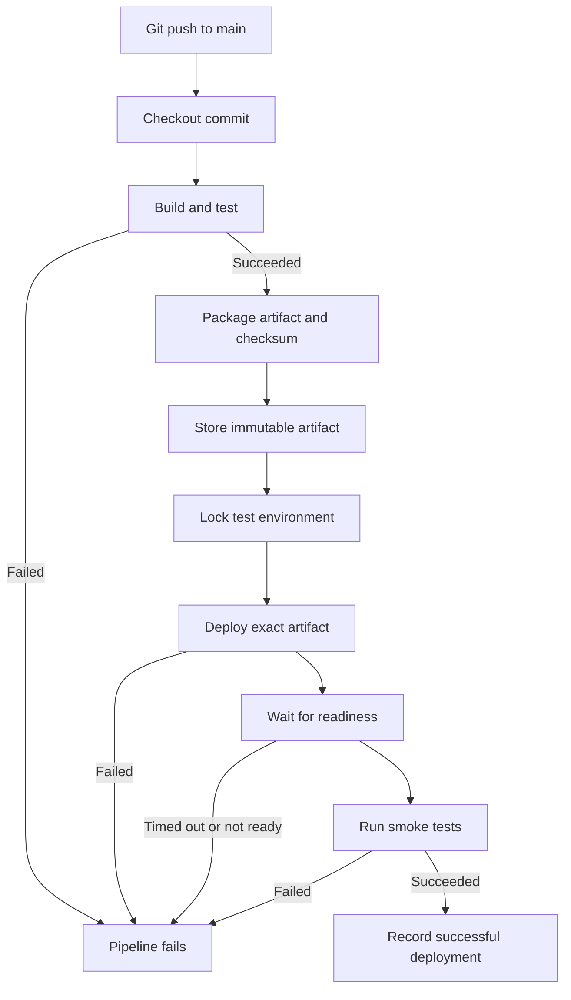

# Automatically Deploying to a Test Environment and Running Smoke Tests

This hands-on lab belongs to the **Hands-on Lab** chapter of the **DEVOPS_CI_CD_FUNDAMENTALS** module. The module builds a CI/CD mindset spanning Git events, pipeline-as-code, automated builds and testing, artifact management, environments, and quality gates. In this lab, we connect verified build outputs to a controlled deployment into a test environment, then quickly verify that the new version actually works.

A pipeline that merely succeeds at building does not prove the application has been deployed properly. A deployment command might return exit code 0 while the application process has not started, configuration is wrong, endpoints are unreachable, or the server is still serving the old version. Therefore, deployment and post-deployment verification must be explicit steps with clear evidence inside the same CI/CD flow.

## Learning Objectives

After completing this lab, you will be able to:

- Distinguish between build, artifact packaging, deployment, and post-deployment verification steps.
- Design an automated flow to deploy a tested artifact to a test environment.
- Manage configuration, credentials, and access permissions for the deployment environment.
- Prevent concurrent deployments from overwriting each other or leaving the environment in an indeterminate state.
- Design concise, time-bounded smoke tests that verify the exact newly deployed version.
- Read pipeline results, locate failure points, and decide when to stop or roll back.

## Problem Statement and Expected Outcomes

Suppose a Java application is stored in Git. When a commit is pushed to the **main** branch, the pipeline must perform the following tasks:

1. Check out the exact source code of the commit.
2. Build and run automated tests.
3. Package a single artifact tied to that commit and generate a checksum.
4. Only when build and tests succeed, deploy the artifact to the **test** environment.
5. Wait for the application to become ready, then run smoke tests against the environment's URL.
6. Mark the flow successful only when both deployment and smoke tests succeed.

The expected outcome is that every deployment can be traced back to its commit, artifact, environment, and verification results. When smoke tests fail, the pipeline must report a failure for operators to investigate; a file copy or service restart command must never be treated as proof that the application is working.

## 1. Where Deployment and Smoke Tests Fit in CI/CD

The basic flow can be represented as follows:



Each step answers a different question:

| Step | Question to Answer | Evidence |
|---|---|---|
| Build and test | Can the source code produce an output and pass required tests? | Build logs, unit/integration test results |
| Package | Which artifact will be deployed? | Artifact name, commit SHA, checksum |
| Deploy | Was the artifact installed in the target environment? | Deployment logs, release ID, service status |
| Readiness | Is the application ready to accept requests? | Health/readiness endpoint results |
| Smoke test | Are key critical paths working after deployment? | HTTP status, response body, version |

Do not lump everything into a single **deploy** command and look only at its exit code. A deployment tool can finish copying files or updating configuration before the application finishes starting up. Smoke tests provide an independent signal from the user or client perspective.

### What Is a Smoke Test?

A smoke test is a small, fast set of checks run immediately after deployment to catch critical defects that render the application unusable at a basic level. It typically verifies:

- The environment URL resolves DNS, establishes a connection, and returns an HTTP response.
- The readiness endpoint indicates the application is ready.
- The application is serving the exact newly deployed version.
- A critical read path or representative API returns valid output.

Smoke tests do not replace unit tests, integration tests, regression tests, load tests, or security tests. Nor do they prove every feature works. Their purpose is to detect major failures early at low cost and time.

## 2. Preparing the Test Environment

The test environment should closely match the target environment in runtime, startup behavior, networking, and dependent services. Data and credentials must belong to the test environment; never use production accounts or data for a lab exercise.

### 2.1. Defining the Deployment Contract

The pipeline needs to know where the artifact lives, how to transfer it to the target host, and how to instruct the target host to activate the new version. In the example below, we assume:

- The Java build produces **target/application.jar**.
- The test server has a dedicated deployment account.
- The server provides the **/usr/local/sbin/deploy-app** command to verify checksums, install the release, and start the application.
- The application exposes **GET /actuator/health/readiness**, **GET /version**, and **GET /api/smoke**.
- **GET /version** returns the running commit SHA; **GET /api/smoke** returns JSON with a **status** field equal to **ok**.

These filenames, commands, and endpoints represent an illustrative contract. When applying this to a real application, substitute the artifact path, deployment tool, and endpoints defined by your project. Never create fake endpoints just to make a pipeline green.

The server-side deploy command in this example accepts the following flags:

```bash
sudo /usr/local/sbin/deploy-app \
  --environment test \
  --artifact /tmp/application.jar \
  --checksum /tmp/application.jar.sha256 \
  --version <commit-sha>
```

This command must be pre-provisioned by the operations team on the test server. It should verify the checksum (running the check in the directory containing the two files in `/tmp`), create a versioned release directory, install the artifact, update environment configuration, switch the active version atomically, and restart the service. Retain the previous release to enable rollback when needed. Since a CI runner is non-interactive and cannot enter a `sudo` password, the deployment account should be granted `NOPASSWD` solely for this specific deploy command via `sudoers` configuration; do not grant full host administrator privileges.

### 2.2. Declaring Configuration and Secrets

For GitHub Actions, create a GitHub Environment named **test**, then declare:

| Type | Name | Purpose |
|---|---|---|
| Secret | **TEST_DEPLOY_HOST** | SSH host of the test server |
| Secret | **TEST_DEPLOY_USER** | Deployment account with restricted permissions |
| Secret | **TEST_SSH_PRIVATE_KEY** | Private key used for SSH connection |
| Secret | **TEST_SSH_KNOWN_HOSTS** | Verified host key of the server |
| Variable | **TEST_BASE_URL** | Base URL of the application in the test environment |

Secrets should be scoped to the specific environment so jobs receive them only when deploying to **test**. Restrict which branches or tags are permitted to deploy in the environment configuration. For shared environments or those holding important data, you can require reviewer approval before the job is granted deployment access.

**TEST_SSH_KNOWN_HOSTS** must be obtained and verified through a trusted channel before storing. Never disable host key checking and never run **ssh-keyscan** inline during the pipeline and blindly trust its output, as that gives the pipeline no basis to confirm it is connecting to the authentic host. Never commit private keys, tokens, or passwords to the repository.

If the target platform supports workload identities such as OpenID Connect (OIDC), prefer short-lived job-identity credentials over long-lived keys. Whether using SSH or OIDC, pipeline permissions should be scoped strictly to deploying to the **test** environment.

## 3. Designing Safe Deployment Steps

### 3.1. Deploying the Exact Tested Artifact

The build job produces and stores the artifact. The deploy job downloads that exact artifact to deploy it. Do not rebuild inside the deploy job, because a second build could produce a different binary from the one that passed tests.

Record at least the following information:

- Commit SHA that produced the artifact.
- Artifact name and checksum.
- Pipeline run ID.
- Target environment.
- Deployment start and end timestamps.
- Deploy and smoke test results.

The commit SHA enables source traceability; the checksum detects artifact tampering during storage or transfer. If your registry supports immutable digests, use the digest as the deployment identifier instead of a mutable tag.

### 3.2. Separating Configuration from the Artifact

An artifact should be packaged once and reused across environments. Base URLs, connection strings, feature flags, and secrets are injected at deploy time via environment configuration or a secret manager. Never bake test environment passwords or endpoints into the JAR file.

When deploying the same artifact across multiple environments, preserve the artifact's checksum and record the configuration applied to each environment. When a bug appears only in **test**, this makes it easy to distinguish binary bugs from configuration bugs.

### 3.3. Preventing Overlapping Deployments

Two concurrent deployments could write to the release directory, restart the service, or update symlinks simultaneously. This can cause the first run's smoke test to accidentally test the second run's version.

Use a concurrency control or deployment lock keyed by environment name. For example, in GitHub Actions use the **test-environment** group. If your system requires processing every commit strictly in order, use a deployment queue that guarantees ordering; GitHub Actions concurrency keeps only one active run and one pending run per group, so an older queued run may be superseded when a newer run arrives.

### 3.4. Making Deployment Operations Repeatable

Re-running a pipeline must not break the environment. The deployment command should:

- Accept an explicit commit or release ID.
- Verify the artifact and checksum before activation.
- Never mutate an already stored artifact in place.
- Create a new release isolated from the currently running release.
- Identify the version currently deployed.
- Log clearly and exit non-zero when an operation fails.

Repeatedly deploying the same release should yield consistent results. If that cannot be guaranteed, clearly document which steps are not idempotent and how to recover if the pipeline is interrupted mid-flight.

## 4. Hands-on: Building the deploy-test Pipeline

This example uses GitHub Actions, Maven, a Linux host over SSH, and an application exposing the endpoints from the preparation section. If your project uses another platform, keep the same step ordering and conditions and translate the syntax accordingly.

### 4.1. Producing the Artifact and Checksum

In the build job, run tests first and then package the exact JAR file. For example:

```bash
./mvnw -B clean verify

set -euo pipefail
test -f target/application.jar
mkdir -p dist
cp target/application.jar dist/application.jar
(cd dist && sha256sum application.jar > application.jar.sha256)
```

The **verify** command runs prior phases in the Maven lifecycle, including compile, test, and package according to project configuration. The **test -f** line stops the pipeline if the artifact does not exist. If your project generates a different filename, replace **target/application.jar** with the exact verified path; avoid wildcards when the **target** directory may contain multiple JARs.

The checksum is generated after copying into the **dist** directory, because that is the file uploaded and downloaded by the deploy job. The checksum file accompanies the artifact so the server can re-verify it upon receipt.

### 4.2. Writing the Smoke Test

Create **scripts/smoke-test.sh**:

```bash
#!/usr/bin/env bash
set -euo pipefail

base_url="${1:?Must provide TEST_BASE_URL}"
expected_version="${2:?Must provide commit SHA}"
base_url="${base_url%/}"

echo "Checking readiness at ${base_url}"

for attempt in {1..12}; do
  if readiness="$(curl -fsS --connect-timeout 3 --max-time 8 \
      "${base_url}/actuator/health/readiness" 2>/dev/null)" \
    && printf '%s' "$readiness" | grep -Eq '"status"[[:space:]]*:[[:space:]]*"UP"'; then
    echo "PASS readiness"
    break
  fi

  if [[ "$attempt" -eq 12 ]]; then
    echo "FAIL readiness: application did not become ready"
    exit 1
  fi

  sleep 5
done

actual_version="$(curl -fsS --connect-timeout 3 --max-time 8 \
  "${base_url}/version")"
if [[ "$actual_version" != "$expected_version" ]]; then
  echo "FAIL version: expected $expected_version, got $actual_version"
  exit 1
fi
echo "PASS version $actual_version"

smoke_response="$(curl -fsS --connect-timeout 3 --max-time 8 \
  "${base_url}/api/smoke")"
if ! printf '%s' "$smoke_response" | grep -Eq '"status"[[:space:]]*:[[:space:]]*"ok"'; then
  echo "FAIL smoke endpoint: unexpected response"
  exit 1
fi
echo "PASS core API smoke test"
```

This script has three verification layers:

1. **Readiness:** retries up to 12 times, waiting at most 8 seconds per attempt with a 5-second interval. Bounded waiting gives the application time to start without hanging the pipeline indefinitely.
2. **Version:** compares the contents of **/version** against the commit SHA of the current run. If the endpoint returns an old version, the pipeline catches cases where deployment failed to activate the new release.
3. **Representative path:** calls the read API **/api/smoke** and verifies the response body reports status **ok**.

**curl -f** causes the command to fail on HTTP status 400 or higher. **--connect-timeout** and **--max-time** bound connection setup and total request duration. **grep** inspects response content rather than only checking whether the server returned HTTP 200.

Endpoints in the script must reflect the application's real contract. If **/version** returns JSON, parse the version field with an appropriate tool like **jq** and perform an exact comparison. If the API requires authentication, use a least-privilege test identity and environment-scoped secret; never print tokens to logs. Smoke tests should favor read requests and avoid creating data or triggering hard-to-reverse transactions.

### 4.3. Declaring the GitHub Actions Workflow

Create a workflow, for example **.github/workflows/deploy-test.yml**:

```yaml
name: Deploy to test

on:
  push:
    branches:
      - main
  workflow_dispatch:

permissions:
  contents: read

jobs:
  build:
    runs-on: ubuntu-latest
    steps:
      - name: Checkout source
        uses: actions/checkout@v4

      - name: Set up Java
        uses: actions/setup-java@v4
        with:
          distribution: temurin
          java-version: '21'
          cache: maven

      - name: Build and test
        run: ./mvnw -B clean verify

      - name: Prepare immutable artifact
        shell: bash
        run: |
          set -euo pipefail
          test -f target/application.jar
          mkdir -p dist
          cp target/application.jar dist/application.jar
          (cd dist && sha256sum application.jar > application.jar.sha256)

      - name: Upload artifact
        uses: actions/upload-artifact@v4
        with:
          name: application-${{ github.sha }}-${{ github.run_id }}-${{ github.run_attempt }}
          path: dist/
          if-no-files-found: error
          retention-days: 7

  deploy-test:
    needs: build
    runs-on: ubuntu-latest
    environment: test
    concurrency:
      group: test-environment
      cancel-in-progress: false
    steps:
      - name: Checkout scripts
        uses: actions/checkout@v4

      - name: Download the artifact from this run
        uses: actions/download-artifact@v4
        with:
          name: application-${{ github.sha }}-${{ github.run_id }}-${{ github.run_attempt }}
          path: dist

      - name: Deploy to test over SSH
        shell: bash
        env:
          TEST_DEPLOY_HOST: ${{ secrets.TEST_DEPLOY_HOST }}
          TEST_DEPLOY_USER: ${{ secrets.TEST_DEPLOY_USER }}
          TEST_SSH_PRIVATE_KEY: ${{ secrets.TEST_SSH_PRIVATE_KEY }}
          TEST_SSH_KNOWN_HOSTS: ${{ secrets.TEST_SSH_KNOWN_HOSTS }}
        run: |
          set -euo pipefail
          : "${TEST_DEPLOY_HOST:?Missing TEST_DEPLOY_HOST}"
          : "${TEST_DEPLOY_USER:?Missing TEST_DEPLOY_USER}"
          : "${TEST_SSH_PRIVATE_KEY:?Missing TEST_SSH_PRIVATE_KEY}"
          : "${TEST_SSH_KNOWN_HOSTS:?Missing TEST_SSH_KNOWN_HOSTS}"

          test -s dist/application.jar
          test -s dist/application.jar.sha256
          install -d -m 700 "$HOME/.ssh"
          printf '%s\n' "$TEST_SSH_PRIVATE_KEY" > "$HOME/.ssh/id_ed25519"
          printf '%s\n' "$TEST_SSH_KNOWN_HOSTS" > "$HOME/.ssh/known_hosts"
          chmod 600 "$HOME/.ssh/id_ed25519"
          chmod 644 "$HOME/.ssh/known_hosts"
          trap 'rm -f "$HOME/.ssh/id_ed25519"' EXIT

          scp -i "$HOME/.ssh/id_ed25519" \
            -o IdentitiesOnly=yes \
            -o BatchMode=yes \
            -o StrictHostKeyChecking=yes \
            -o UserKnownHostsFile="$HOME/.ssh/known_hosts" \
            dist/application.jar dist/application.jar.sha256 \
            "${TEST_DEPLOY_USER}@${TEST_DEPLOY_HOST}:/tmp/"

          ssh -i "$HOME/.ssh/id_ed25519" \
            -o IdentitiesOnly=yes \
            -o BatchMode=yes \
            -o StrictHostKeyChecking=yes \
            -o UserKnownHostsFile="$HOME/.ssh/known_hosts" \
            "${TEST_DEPLOY_USER}@${TEST_DEPLOY_HOST}" \
            "sudo /usr/local/sbin/deploy-app --environment test --artifact /tmp/application.jar --checksum /tmp/application.jar.sha256 --version ${GITHUB_SHA}"

      - name: Run smoke tests
        shell: bash
        env:
          TEST_BASE_URL: ${{ vars.TEST_BASE_URL }}
          EXPECTED_VERSION: ${{ github.sha }}
        run: |
          set -euo pipefail
          bash scripts/smoke-test.sh "$TEST_BASE_URL" "$EXPECTED_VERSION"
```

Key points in the flow above:

- **needs: build** ensures deployment runs only after the build job succeeds.
- The artifact is named using the commit SHA, run ID, and run attempt. The deploy job downloads the artifact from that exact run.
- **sha256sum** is generated in the build job and transferred alongside the JAR. The server-side deploy command is responsible for verifying the checksum before activation.
- **environment: test** provides the appropriate secrets/variables and enforces environment protection rules.
- **concurrency** prevents two jobs from deploying to the **test** environment simultaneously.
- Smoke tests run after the deploy command. If the script returns non-zero, the job fails and the workflow is not marked successful.

The example uses GitHub Actions version tags for readability. Repositories with strict security requirements should pin each action to a full commit SHA and update SHAs through a review process. Also verify that the Java version, artifact name, deploy path, and endpoints match your actual application.

### 4.4. Running and Observing the Pipeline

After configuring the GitHub Environment and workflow:

1. Verify **target/application.jar** is actually created after running **./mvnw -B clean verify**.
2. Confirm the **test** server has the deploy command installed, a verified host key, and necessary permissions for the CI account.
3. Confirm **TEST_BASE_URL** points to the correct test environment.
4. Push a commit to **main** or trigger the workflow manually from a branch allowed by the environment.
5. Open each job's logs and inspect build, artifact upload, artifact download, deploy, and smoke tests.
6. Cross-check the commit SHA in the logs against the **/version** endpoint and the active release on the server.

A successful run requires evidence across all three layers:

- **Build:** tests ran and the artifact was produced.
- **Deploy:** the exact artifact and checksum were transferred, and the server confirmed release activation.
- **Smoke:** readiness passed, version matches commit SHA, and the representative API returned a valid response.

Do not conclude success solely because the deploy job has a green checkmark if smoke tests did not run or were skipped due to workflow conditions. Inspect the dependency graph and the actual status of every step.

## 5. Designing High-Signal Smoke Tests

### 5.1. Distinguishing Liveness and Readiness

These two health check types serve different purposes:

| Check | Meaning | When Used |
|---|---|---|
| Liveness | The process is alive and not stuck in a state needing restart | Orchestrator decides whether to restart the container/process |
| Readiness | The application is ready to accept traffic | Orchestrator or pipeline decides whether requests can be routed |

A process may be alive yet still unable to connect to the database or finish loading configuration. In that state, liveness can succeed while readiness has not yet passed. Post-deploy smoke tests should wait for readiness before calling business APIs.

Do not mechanically include every dependency in liveness checks. If a temporarily slow database causes liveness to fail, the system may enter a continuous restart loop and worsen the incident. Design each health check according to how the operations platform consumes it.

### 5.2. Choosing the Right Number of Checks

A useful smoke suite typically includes:

| Check | Example | Pass Condition |
|---|---|---|
| Connectivity | Call base URL or readiness endpoint | Connection succeeds, expected HTTP status |
| Readiness | GET /actuator/health/readiness | JSON reports status UP |
| Correct version | GET /version | Commit SHA equals the deployed SHA |
| Core path | GET /api/smoke | HTTP 2xx and response contains expected body |
| Essential dependency | Read-only endpoint accessing test data | Valid response, no dependency errors |

You do not need to call every API in a smoke test. Pick a few representative paths capable of catching configuration, routing, connectivity, or startup errors. Deeper business scenarios belong in integration or regression tests.

### 5.3. Setting Bounded Timeouts and Retries

Retries prevent false failures when an application needs a few seconds to start. However, infinite retries hide real failures and tie up runners unnecessarily.

A simple policy could be:

- 3-second connection timeout.
- 8-second per-request timeout.
- Maximum of 12 readiness checks.
- 5-second pause between attempts.
- Exit non-zero once attempts are exhausted.

Tune these values to your application's actual startup time. If you need to retry an API after readiness, retry only predictable transient errors; never repeat a data-writing operation with side effects. For larger systems, use exponential backoff and jitter to avoid multiple pipelines generating load spikes simultaneously.

### 5.4. Verifying the Exact Version

An endpoint returning HTTP 200 does not guarantee it is the newly deployed version. A reverse proxy might still route to old instances, a rollout may be incomplete, or the deployment command may have updated the wrong service. Therefore, the version endpoint should return the running commit SHA or image digest.

The smoke test compares that value against pipeline metadata. If they do not match, fail and investigate the rollout. This is a small check with high value in environments with multiple instances or frequent consecutive deployments.

### 5.5. Avoiding Side Effects in Smoke Tests

Prefer read endpoints and reproducible test data. If you must test a write path, use a dedicated fixture, a unique identifier per run ID, and a cleanup step. Never send real emails, process real payments, delete shared data, or trigger irreversible jobs from smoke tests.

Smoke tests must remain small enough to run routinely. If a scenario takes several minutes, relies on hard-to-prepare data, or fails intermittently, extract it into a more appropriate test tier.

## 6. Handling Post-Deployment Failures

When deployment or smoke tests fail, preserve the run's evidence: commit SHA, artifact checksum, release ID, service logs, HTTP status, sanitized response body, and check timestamp.

| Symptom | Possible Cause | Investigation Path |
|---|---|---|
| Build passes but no artifact | Wrong path, JAR name changed, package step did not run | Check Maven logs and files in `target` |
| Cannot download artifact | Upload/download artifact names differ or job ran in another run | Compare artifact name, SHA, run ID, and run attempt |
| SSH rejected | Wrong host/user/key, bad key file permissions, or host key mismatch | Check environment secrets and verified `known_hosts` |
| Deploy command fails | Account lacks permissions, checksum mismatch, disk full, or server script error | Inspect deploy logs on runner and server |
| Readiness never becomes UP | App fails on startup, misconfiguration, or dependency unavailable | Inspect application logs, environment variables, and dependency status |
| Readiness is UP but old version | Incomplete rollout, proxy routing to wrong instance, or wrong service deployed | Compare release IDs, routing, and status per instance |
| Correct version but smoke API fails | Route bug, config error, permission issue, or business dependency error | Check status code, response body, and application logs |
| Smoke test times out | Network, DNS, TLS, firewall, or slow application response | Test connectivity from runner to URL, timeouts, and environment health |

If smoke tests fail after switching versions, the environment may be running the new release in an unusable state. Mark the pipeline failed, halt dependent steps, and notify the environment owner. If the system has a tested rollback mechanism, restore the previous stable release per the runbook. Never run a blind rollback if the change includes incompatible data migrations or irreversible operations.

A safe deployment strategy typically stages the new release side by side, verifies readiness before shifting traffic, and only then switches the active version. Retaining the old release long enough for verification reduces recovery time. For shared test environments, clearly announce which release is active so other teams do not test against an unexpectedly shifting version.

## 7. Protecting the Environment and Pipeline Reliability

### Least Privilege Access

The deployment account should not be a full server administrator. Restrict permissions to the release directory, the service requiring restarts, and the permitted deploy command. If using `sudo`, configure `sudoers` to allow only the necessary command with validated arguments.

Never print secrets to logs, pass secrets in URLs, or embed secrets in artifacts. Treat the platform's secret masking as an extra layer of defense, not a reason to echo secret values intentionally.

### Environment Isolation

The test environment needs its own URL, secrets, data, and permissions. Pipelines must explicitly target a specific environment. Avoid ambiguous defaults that could let a manual run accidentally point at production. Configure branch protection or environment protection to restrict who and which branches may deploy.

### Traceable Evidence

Logs should record the commit SHA, release ID, environment name, artifact checksum, timestamp, and smoke test results. Never log tokens, private keys, passwords, or personal data. During incidents, this information links a Git event directly to the running version.

### Avoiding False Positives

A smoke test checking only HTTP 200 can miss error responses, login redirects, or stale versions. Verify status codes, critical response content, and the version. Also ensure the smoke test step cannot be accidentally skipped by an `if` condition when deployment succeeds.

### Managing Timing and Queues

Per-request timeouts, retry counts, and total time limits must align with the test environment's SLA. Monitor runner queue wait times and deployment durations. If multiple teams share one environment, agree on scheduling or queuing rules so one team's smoke test does not execute while another team swaps versions.

## 8. Extended Exercises

Once the basic flow succeeds, perform the following changes in the test environment:

1. Change a displayed version value to verify `/version` reflects the new commit.
2. Temporarily configure the smoke endpoint to return an invalid response on a test branch, verify the pipeline transitions to failed, and confirm logs pinpoint the failing check step.
3. Restore the endpoint, redeploy, and verify the pipeline turns green.
4. Trigger two workflows close together to observe concurrency. Confirm no two deployments run simultaneously, and check how the system handles the queued run.
5. If the application runs across multiple instances, verify smoke tests pass only after all rollout instances are ready and serving the exact version, or after routing ensures only healthy instances receive traffic.

Never intentionally break a shared test environment without notifying active teams. Perform failure exercises on a dedicated branch or an isolated environment.

## 9. Acceptance Criteria

Mark this lab complete when all of the following conditions are satisfied:

- [ ] Build and tests execute before the deploy step.
- [ ] The artifact is built once, tied to the commit SHA, and accompanied by a checksum.
- [ ] The deploy job runs only when the build job succeeds and downloads the exact artifact from the current run.
- [ ] Environment configuration and credentials are stored in an appropriate management mechanism; no secrets exist in Git.
- [ ] SSH connections verify host keys or use an equivalent workload identity mechanism.
- [ ] Deployments to the same environment are serialized.
- [ ] Smoke tests wait for readiness with bounded timeouts and retries.
- [ ] Smoke tests verify the exact version and at least one representative path.
- [ ] A failing smoke test fails the pipeline and preserves evidence for investigation.
- [ ] A rollback procedure exists suited to how the application manages releases and data.

## 10. Key Takeaways

Automated deployment is complete only when the release is activated and passes post-deployment verification. The build job produces the artifact; the deploy job places that exact artifact into the environment; smoke tests confirm the application is ready and serving the correct version.

Keep artifacts immutable, separate configuration from binaries, restrict deployment privileges, and serialize operations on shared environments. Smoke tests should be fast, time-bounded, finitely retried, content-aware, and free of side effects. When checks fail, the pipeline must fail loudly and provide enough evidence to decide whether to fix forward or roll back.
