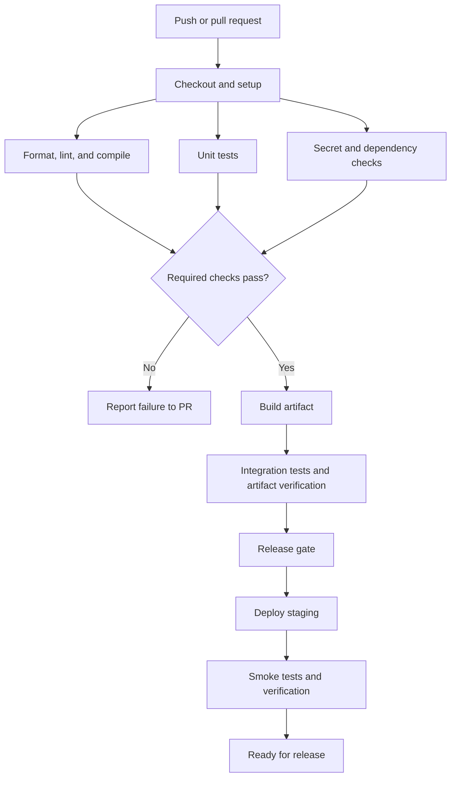

# Self-Assessing Frequent Integration, Fast Feedback, and Safe Releases

A team can have a CI server, multiple pipelines, and an automated deploy button yet still take days to integrate changes, wait too long to learn about test failures, or be unable to identify the exact artifact running in production. To know whether a CI/CD process is genuinely effective, you must inspect evidence from the moment a change is created to when the release is deployed and verified.

This hands-on lab helps you evaluate a repository's or service's workflow across three capabilities:

1. **Frequent integration:** small changes are merged into the shared branch and validated on the state to be merged.
2. **Fast feedback:** pipelines return results quickly, reliably, and pinpoint what needs attention.
3. **Safe releases:** artifacts are traceable, quality gates and access permissions are controlled, deployments are verified, and recovery procedures exist.

You will gather evidence, redraw the current flow, run a release simulation exercise, and score maturity levels. The final output is an evidence-backed assessment scorecard and a prioritized improvement plan.

## 1. Expected Outcomes

After completing this lab, you will be able to:

- Distinguish between simply having CI tooling and a team genuinely practicing continuous integration.
- Measure time from change submission to feedback, separating runner queue time from execution time.
- Check whether the pipeline validates the actual merge state and keeps the shared branch healthy.
- Evaluate test stability and build reproducibility.
- Trace an artifact from commit to deployment environment via version or digest.
- Audit release gates, secret protection, post-deployment verification, and rollback readiness.
- Score based on evidence rather than intuition.

## 2. Lab Context and Scope

Choose a service repository where you can inspect Git history, pull requests, and CI results. If you lack access to a live system, use data from a learning project or the illustrative scenario in this lab.

The running scenario is the `orders-service` service:

- A developer updates order-processing logic and opens a pull request.
- CI builds the application, runs tests, and performs quality checks.
- The artifact is published to a registry.
- The release is deployed to staging, and may then be approved for production deployment.
- Post-deployment, the pipeline checks application health.
- If the new release fails requirements, the team must restore the known-good version.

You may substitute your active repository's name for the service name. This lab does not require production access or performing a real deployment. If no sandbox environment is available, complete the release section as a tabletop simulation and explicitly note which evidence could not yet be verified.

**Estimated duration:** 90–120 minutes.

**Inputs to prepare:**

- A Git repository and its shared branch, typically `main` or `trunk`.
- Pull request or merge request history from roughly the past 2–4 weeks.
- Pipeline results from roughly the past 20 runs, if available.
- Details about artifacts, staging/production environments, and rollback procedures.
- Read access to pipeline logs and configuration. Production admin access is not required.

## 3. Part A — Auditing How the Team Integrates Changes

First, observe how changes travel from working branches into the shared branch. Run these read-only commands inside the repository:

```bash
git status --short
git log --oneline --decorate -n 30
git log --first-parent --date=short --pretty=format:"%h %ad %s" -n 20 main
git diff --stat origin/main...HEAD
```

Replace `main` with your project's shared branch name if different. `git diff` shows the size of changes between the current branch and target branch; if you are currently on the shared branch or lack a matching remote-tracking ref, run it on a pull request branch or skip this command.

Git commands reveal commit history and diff scope. They do not directly tell you how long a branch lived. Retrieve branch creation, pull request open, and merge timestamps from your Git hosting platform if it records them.

Gather data:

| Question | Evidence to Look For | Notes |
| --- | --- | --- |
| How often are changes merged into the shared branch? | Merge history over 2–4 weeks | Count and intervals between merges |
| How long do branches typically live? | Branch creation and PR merge timestamps | Median or common duration range |
| How large are pull requests? | Files changed, lines changed, functional scope | Small, medium, or very large; give examples |
| Is code reviewed before merging? | Approvals and branch protection | Whether rules are enforced automatically |
| Which state does the pipeline validate? | PR commit, merge result, or post-merge commit | Specify the exact mechanism |
| When the shared branch turns red, what does the team do? | Incidents, chat, issues, or revert history | Time to recover and owner |

Evaluate the evidence:

- Integration is frequent when small changes merge over short intervals and the team does not batch most work into one large integration event.
- Short-lived branches and small pull requests speed up reviews, reduce merge conflicts, and narrow the search space for defects.
- Each pull request passing individually does not guarantee the combined state will pass. Validating the merge result or using a merge queue verifies the exact contents entering the shared branch.
- If the shared branch stays red for extended periods while the team continues merging, the process lacks integration state protection.

**Exercise A:** Select the three most recent pull requests. For each PR, record the duration from first commit to merge, number of files changed, number of pipeline runs, final outcome, and whether the merge result was validated. If data is unavailable, record `No evidence yet`; never guess.

## 4. Part B — Evaluating the Pipeline and Feedback Speed

Diagram the current pipeline from the Git event until the author receives results. Specify triggers, jobs, dependencies, mandatory gates, and where status is reported.

Reference flow:



This is a reference flow, not a mandatory sequence. Draw your actual pipeline and mark which jobs run in parallel versus which depend on prior job results.

### Measuring Feedback Time

For roughly the past 20 runs, if data is available, record these timestamps:

- When the push or commit needing verification was submitted.
- When the job entered the queue.
- When the runner started executing.
- When required checks completed.
- When status was published back to the pull request.

From these, break down:

```text
queue_time = runner_start - job_queued
execution_time = required_checks_completed - runner_start
feedback_time = result_published - change_submitted
```

Calculate p50 and p95 of `feedback_time` if enough data exists. p50 describes a typical run; p95 highlights the long waits the team regularly experiences. Never use the arithmetic mean in place of both, because a few very slow runs can skew perception.

| Metric | Repository Result | Target or Commentary |
| --- | --- | --- |
| p50 feedback time |  |  |
| p95 feedback time |  |  |
| p50 queue time |  |  |
| p95 queue time |  |  |
| Slowest job |  |  |
| First-pass green pipeline rate |  |  |
| Rerun rate due to flaky tests or infra |  |  |

If insufficient data exists to compute percentiles, note the sample size and missing timestamps. Never conclude a pipeline is fast from a single passing run.

### Inspecting Feedback Quality

Pick one failed run and answer:

1. Where did the failure status appear, and after how long?
2. Can you identify the failing commit, job, command, and test directly from the notification?
3. Do logs identify a root cause specific enough for a developer to act on?
4. Was the failure caused by source code, tests, dependencies, the runner, permissions, or an external service?
5. Did the team retry? If so, was the error genuinely transient and was the operation safe to repeat?
6. After fixing, did the team re-verify the exact integration state?

A pipeline with good feedback tells the recipient what to do next. Displaying only `Job failed` without links to logs, commits, or the failing step is insufficient.

## 5. Part C — Evaluating Test and Build Reliability

CI running frequently yet producing inconsistent results triggers repeated reruns and erodes team trust. Inspect the following factors:

- Are dependencies pinned via lockfiles or exact versions?
- Are runtimes, compilers, and build tools pinned?
- Do tests use isolated data and clean up after each run?
- Do parallel tests write to the same shared database, file, or account?
- Are there recurring flaky tests? Does the team assign owners to fix them?
- Can the pipeline perform a clean build with an empty cache?
- Can the artifact be reproduced from the recorded commit and toolchain?

Pick one previously flaky test or an unstable job. Record its known cause, failure count, retry count, and remediation status. Never treat a green retry as proof that a test is stable.

Additionally evaluate how the team handles red builds on the shared branch:

| Situation | How the Team Currently Handles It | Required Evidence |
| --- | --- | --- |
| Test fails due to code change |  | Fix PR or revert |
| Runner or registry transient failure |  | Infra logs and bounded retries |
| Flaky test |  | Issue, owner, and remediation plan |
| Wrong secret or access permission |  | Reviewed config/permission change |
| Main build turns red |  | Time to detect and time to restore |

## 6. Part D — Artifact Traceability and Release Gates

Choose a recent release and trace the path from commit to the artifact currently or previously running in staging. If no real release exists, use the lab's simulated release.

Record:

1. Repository and commit SHA.
2. Pipeline run that built the artifact.
3. Artifact version and digest.
4. Build, unit test, integration test, and security check results.
5. Where the artifact is stored and who has publish or read permissions.
6. Deployed environment and verification results.
7. Person or policy that approved the next release step.

Artifacts require immutable identifiers. Human-readable tags like `orders-service:2.1.0` help with version management, while the digest uniquely identifies exact contents. For container images, reference formats like `registry.example/orders-service@sha256:...` can be used.

Fill in the illustrative manifest below with real data if available:

~~~yaml
release_id: orders-2026.11.18-rc1
source:
  repository: orders-service
  commit: 4d91a2c
  pipeline_run: ci-1842
artifact:
  reference: registry.example/orders-service@sha256:abc...
  version: 2.1.0
checks:
  build: passed
  unit_tests: passed
  integration_tests: passed
  security_scan: passed
deployment:
  environment: staging
  approval: recorded
  smoke_test: passed
rollback:
  previous_artifact: registry.example/orders-service@sha256:789...
~~~

Values in the example illustrate structure only. When assessing a real repository, never fill in commits, digests, test statuses, or approvals without backing evidence.

Check these safe-release questions:

- Is the artifact built once and promoted across environments?
- Does production run the exact digest tested in staging?
- Are secrets retrieved from a secret manager or equivalent mechanism?
- Does the pipeline use least-privilege credentials scoped per environment?
- Can untrusted pull requests access secrets or deployment permissions?
- Can mandatory gates be bypassed manually? If so, are exceptions recorded?
- Is metadata stored to trace commit, artifact, pipeline run, and approvers?

## 7. Part E — Safe Release and Recovery Simulation

Run this simulation using diagrams, tables, or a sandbox environment. Never execute commands that modify production during this lab.

**Scenario:** `orders-service` currently has version `2.0.4` running smoothly. The pipeline builds version `2.1.0`, all required tests pass, and the artifact is published with a new digest. The team deploys to staging, runs smoke tests, and prepares to release to production.

### E1. Pre-Deployment Checks

Verify:

- The commit was reviewed and merged into a protected branch.
- The pipeline validated the exact commit or merge result.
- Build and required checks all passed.
- The artifact has a clear version, digest, and origin.
- Secrets and credentials are scoped properly.
- Staging is running the exact artifact digest planned for deployment.

Record results:

| Condition | Pass / Fail / No Evidence Yet | Evidence |
| --- | --- | --- |
| Commit and review |  |  |
| Required checks |  |  |
| Artifact version/digest |  |  |
| Security and secret handling |  |  |
| Staging runs exact digest |  |  |

### E2. Post-Deployment Verification

Assume staging has received the new version. Identify the signals to verify:

- Is the workload running the exact artifact digest?
- Are readiness or health checks passing?
- Do critical endpoints return accurate responses?
- Is there any spike in errors in logs or metrics?
- Do smoke tests verify core business flows?
- Did the pipeline record the environment, timestamp, digest, and result?

Never treat a deploy command returning success as the sole proof. Verify that the application is genuinely running the right version and meeting defined health criteria.

### E3. Failure and Rollback Simulation

Suppose after deploying `2.1.0`, readiness fails within the allowed timeout and smoke tests detect that the order-creation flow is broken. Write out the response decisions:

1. Halt further promotion and mark the release as degraded or failed.
2. Identify the actual running digest and inspect deployment logs.
3. Verify whether the prior `2.0.4` version remains compatible with the current data state.
4. If rollback is safe, redeploy the previous artifact by its saved digest.
5. Re-run health checks and smoke tests.
6. Record the release ID, post-rollback digest, timestamp, and approver.
7. File an issue to investigate the root cause of `2.1.0` before re-releasing.

If the new version already ran a migration that breaks backward compatibility for the old version, do not assume a binary rollback alone suffices. Evaluate a compensating migration or rolling forward. Decisions must be grounded in data compatibility and dependent services.

Complete the table:

| Milestone | Artifact Digest | Status | Verification Evidence |
| --- | --- | --- | --- |
| Pre-release | Digest of 2.0.4 | Healthy |  |
| Staging | Digest of 2.1.0 | Smoke test passed/failed |  |
| Post-deploy production (simulated) | Digest of 2.1.0 | Healthy/degraded |  |
| Post-rollback (if needed) | Digest of 2.0.4 | Healthy/degraded |  |

## 8. Part F — Scoring Maturity Levels

Score each criterion from 0 to 3. Award high scores only when backed by evidence in Git, CI, release records, or enforced workflows.

| Score | Meaning |
| --- | --- |
| 0 | Practice does not exist or no verifiable evidence |
| 1 | Done manually, inconsistently, or relies on specific individuals |
| 2 | Process and tooling exist, but are not enforced consistently |
| 3 | Practiced routinely with controls and traceable evidence |

| Capability | 0–3 | Collected Evidence |
| --- | ---: | --- |
| 1. Small changes integrated frequently into shared branch |  |  |
| 2. Short-lived branches, easily reviewable and controlled pull requests |  |  |
| 3. CI validates actual merge state and required checks |  |  |
| 4. Measurable feedback times, actionable logs and notifications |  |  |
| 5. Shared branch restored rapidly when builds break |  |  |
| 6. Stable tests, reproducible environments, and working clean builds |  |  |
| 7. Immutable artifacts with digests traceable to commit/pipeline |  |  |
| 8. Secrets, credentials, approvals, and release gates controlled |  |  |
| 9. Deployments include post-deploy verification and record actual state |  |  |
| 10. Rollback or recovery rehearsed and verified |  |  |
| **Total Score** | **/30** |  |

Interpreting the total score:

| Total Score | Current Level | Priority Focus |
| ---: | --- | --- |
| 0–10 | Ad hoc | Establish shared branch, automated build/tests, and failure-handling rules |
| 11–19 | Emerging | Shorten integration cycles, improve reliability, and standardize releases |
| 20–25 | Repeatable | Improve p95, artifact traceability, exception control, and rollback drills |
| 26–30 | Disciplined | Maintain evidence, detect drift, and drive continuous improvement |

**Important condition:** a high total score does not automatically prove safe releases. Before declaring a workflow capable of safe releases, criteria 7, 8, 9, and 10 must each score at least 2. If any criterion in this group scores below 2, explicitly document the gap and never use the total score to mask that risk.

## 9. Selecting One Priority Improvement

From the assessment scorecard, choose one high-impact issue addressable within one to two weeks. Avoid picking multiple items at once if the primary root cause is not yet clear.

Document the plan:

| Item | Response |
| --- | --- |
| Observed problem |  |
| Supporting evidence or metrics |  |
| Most likely root cause |  |
| Change to implement |  |
| Owner |  |
| Due date |  |
| Baseline metric before change |  |
| Acceptance criteria after change |  |
| How to revert if results degrade |  |

Example:

- Problem: p95 feedback time is 28 minutes, with 12 minutes spent in queue time.
- Evidence: data from the last 20 runs shows runners queueing heavily during peak hours.
- Change: tune concurrency and split fast-check jobs from long integration jobs.
- Acceptance criteria: p95 feedback time decreases, first-pass green rate does not drop, and runner cost remains within budget.
- How to revert: restore prior concurrency limits if queue times or costs worsen.

After implementing, re-measure the same workload type and update the scorecard. A change counts as an improvement only when backed by before/after data without weakening quality gates.

## 10. Practice Result Report Template

Complete this brief report upon finishing:

```text
Repository:
Assessment period:
Pull requests/merges reviewed:
CI runs reviewed:

Integration frequency:
Branch lifetime:
Merge-result validation:
Feedback p50/p95:
Queue time p50/p95:
First-pass success rate:
Main recovery time:

Artifact version/digest:
Release gates:
Post-deployment verification:
Rollback evidence:

Self-assessment score: __/30
Critical release criteria (7-10): PASS / GAP

Top 3 gaps:
1.
2.
3.

Improvement commitment:
Owner:
Due date:
Acceptance criteria:
Evidence location:
```

If an item lacks data, record `No evidence yet` and add it to the list of items to collect. Never turn missing data into an optimistic assumption.

## 11. Lab Completion Criteria

This lab is considered complete when you have:

- [ ] Evidence from at least three recent pull requests or merges.
- [ ] A diagram of the current pipeline and a list of required check gates.
- [ ] CI feedback metrics or explicit documentation of missing data.
- [ ] One failure case analyzed by root cause and recovery approach.
- [ ] One artifact traced from commit to environment, or explicit notes on where traceability breaks.
- [ ] Post-deployment verification and rollback simulation tables.
- [ ] The 10-criterion self-assessment scorecard with evidence.
- [ ] An improvement plan with an owner, due date, and acceptance criteria.

The value of this lab lies in evidence and follow-up action. A team with strong CI/CD practices can explain when changes integrate, what gets checked, how long feedback takes, which artifact was released, who or which policy authorized deployment, how the application was verified, and how to recover if a release falls short.
