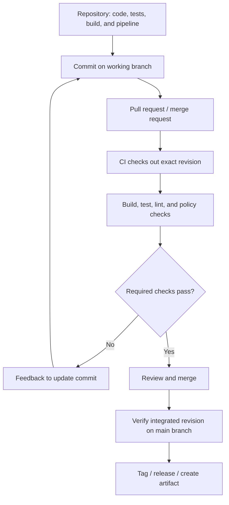

# Managing Application Code, Tests, and Pipeline Configuration with Version Control

A version control system is the foundation for a development team to coordinate source code changes and for CI/CD to identify the exact content to verify. A repository does not contain only application code. It also stores change history, build configuration, test suites, pipeline definitions, review rules, and the documentation needed to reproduce the development process.

In a traceable CI/CD flow, every verification run must be tied to a specific revision. Branches, pull requests, or merge requests organize collaboration; commits identify what changed; the CI system checks out the exact revision and runs checks; and check results become the condition for merging changes. When pipeline configuration is also version-controlled, the team can review and investigate changes to the software delivery process itself.

## 1. Role of Version Control in CI/CD

Git is a distributed version control system commonly used in software development. Each commit records a snapshot of the repository along with parent information, author, timestamp, and message. A commit is identified by a content hash (object ID, commonly called a commit SHA). This allows the team to pinpoint the exact source code that was reviewed, tested, and used to produce artifacts.

The repository becomes the historical source of truth for:

- Application code, shared libraries, build scripts, and developer helper scripts.
- Unit tests, integration tests, contract tests, end-to-end tests, fixtures, and non-sensitive sample data.
- Compiler, formatter, linter, dependency, and build tool configurations.
- Pipeline definitions, reusable workflows, templates, and automation rules.
- Technical documentation, local run guides, release procedures, and contribution conventions.

Not all operational data belongs in Git. Secrets, personal data, production data, generated build files, and log files generally need to be managed in dedicated systems. The repository should hold shareable configuration and safe references to secret sources or environment configuration.



The key takeaway from this diagram is that CI verifies a specific revision. If a pull request changes after verification, previous results no longer prove the new content. The system must re-run checks for the new commit or for the final integrated result before allowing a merge.

## 2. Organizing Repositories to Support Development and Testing

### 2.1. Choosing Repository Boundaries

There are two common organizational approaches:

| Model | Characteristics | Suitable When |
|---|---|---|
| Monorepo | Multiple applications, libraries, or services live in one repository | Synchronized changes across multiple components, shared tooling, and common rules are needed |
| Polyrepo | Each application or service has its own repository | Components have independent lifecycles, ownership, release schedules, or access permissions |

A monorepo allows a cross-module change to be reviewed and verified in the same revision. In return, the pipeline must detect affected parts, manage internal dependencies, and avoid running all tasks unnecessarily. A polyrepo provides clearer permission and release boundaries, but compatible changes across multiple repositories must be coordinated through package versions, API contracts, or dependency update processes.

Do not choose a model based solely on repository count. Consider ownership boundaries, coupling, security requirements, how frequently components change together, and each component's ability to release independently. Regardless of the model chosen, every repository needs clear owners and a well-defined way to identify the revision used for a build.

### 2.2. Convention-Based Directory Structure

A reference structure for an application might look like this:

```text
sample-service/
├── .github/
│   ├── workflows/
│   │   ├── ci.yml
│   │   └── release.yml
│   └── CODEOWNERS
├── src/
│   ├── main/
│   └── test/
├── integration-tests/
├── scripts/
├── config/
├── docs/
├── .editorconfig
├── .gitignore
├── build.gradle
├── gradlew
├── gradlew.bat
└── README.md
```

This is only an example. Projects should keep a structure familiar to their ecosystem and avoid creating too many meaningless directory levels. Important configuration files should be placed in easy-to-find locations, documented with instructions on how to run them, and backed by automated checks to detect drift.

### 2.3. Distinguishing Source Files, Generated Files, and Local Data

Git should track the files needed for others to reproduce the project state. Compiled files, cache directories, logs, personal IDE files, and temporary outputs generally should not be committed. `.gitignore` describes paths Git should ignore, though it does not automatically remove files that were already tracked.

Example `.gitignore` for a JVM project:

```gitignore
# Build output
build/
out/
*.class

# IDE and local settings
.idea/
*.iml
.vscode/

# Local environment and secrets
.env
.env.*
!.env.example
*.pem
*.key

# Logs and temporary files
*.log
tmp/
```

Do not add overly broad rules that hide managed files, such as ignoring the entire `config/` directory or all `.yml` files. If a file is already tracked by Git, adding it to `.gitignore` does not stop Git from tracking it; you must intentionally untrack it and inspect the history if the file ever contained secrets.

Template configuration files can be committed with dummy values or clear placeholders, such as `.env.example`. Local users copy them into private files; pipelines retrieve real values from a secret manager or protected environment.

## 3. Small, Clear, and Verifiable Commits

### 3.1. Commits as Units of History

A good commit describes a single meaningful, reviewable change. When a commit contains too many unrelated goals, reviewers struggle to assess risk and CI struggles to pinpoint the cause of a failure. Commits that are too small without independent meaning also make history hard to follow. The goal is to create slices of change small enough to understand, test, and revert when needed.

Before committing, developers should inspect status and diffs:

```bash
git status --short
git diff
git diff --staged
```

After selecting the appropriate files, you can stage selectively and commit:

```bash
git add src/main/java/example/DiscountService.java
git add src/test/java/example/DiscountServiceTest.java
git diff --staged
git commit -m "feat(discount): add discount validation"
```

Before pushing, inspect the new commits and sync with the remote according to team policy:

```bash
git log --oneline --decorate -5
git fetch origin
git status -sb
```

Synchronization commands such as `git pull --rebase` or merge must follow repository conventions. Do not arbitrarily rewrite the history of shared branches. For unshared personal branches, rebasing can keep history clean; for branches used by multiple people, coordinate before force pushing.

### 3.2. Consistent Commit Messages

Commit messages should clearly state the change and its scope. A common convention is Conventional Commits:

```text
<type>(<scope>): <short description>

[optional explanation]
```

Examples:

```text
feat(checkout): support discount codes
fix(payment): handle gateway timeout
test(order): cover invalid quantity
build(deps): update test framework
ci(pipeline): run integration checks on pull requests
docs(api): clarify error response fields
```

Types such as `feat`, `fix`, `test`, `build`, `ci`, `docs`, and `refactor` help readers recognize intent. Teams can use different rules, but they should be consistent so commit history, changelogs, and release workflows can process them automatically when needed. Do not turn types into empty labels: the commit content still needs to describe what changed and why.

### 3.3. Commits and Sensitive Data

Never commit passwords, access tokens, private keys, private certificates, production dump files, or user data. If a secret is accidentally committed, deleting the file in a subsequent commit does not remove the secret from history. Immediately revoke or rotate the credential, assess exposure scope, and then clean repository history through a controlled process. Rewriting history is only a supplementary measure and can affect every existing clone.

Secret scanning can run on push, on pull requests, or on a schedule. Scan findings should be treated as a quality gate; exceptions must have a justification, an owner, and an expiration date. Scanning tools do not replace least-privilege permissions and credential rotation.

## 4. Branching Strategies and Change Integration

### 4.1. Short-Lived Branches and Trunk-Based Development

In trunk-based development, developers integrate small, frequent changes into the main branch (trunk or `main`). Working branches are short-lived, CI provides fast feedback, and compatibility across in-progress changes is maintained continuously. Feature flags can help merge code that should not yet be enabled for users.

The advantage is reducing how long branches diverge from the main branch and lowering the risk of integrating large batches of changes. Applying it well requires reliable tests, fast reviews, a clear process for fixing main branch failures, and the ability to deploy changes with features disabled.

### 4.2. GitHub Flow

GitHub Flow is a straightforward workflow: create a short-lived branch from the main branch, commit changes, open a pull request, run checks and reviews, and then merge. When the main branch is protected and CI is reliable enough, the team can deploy from the main branch.

Reference workflow:

```bash
git switch main
git pull --ff-only origin main
git switch -c feat/discount-validation

# edit code and tests
git add src test
git commit -m "feat(discount): validate discount codes"
git push -u origin feat/discount-validation
```

After pushing, create a pull request on the Git hosting platform. The pull request brings together the diff, goal description, discussion, reviews, and check statuses. When feedback arrives, update the branch and let CI re-run on the new revision. After merging, delete the short-lived branch if policy allows.

### 4.3. Gitflow and Release Branches

Gitflow uses branches with dedicated roles such as `main`, `develop`, `feature/*`, `release/*`, and `hotfix/*`. This model can be useful when a product maintains multiple versions, follows fixed release cycles, or needs long-term support branches. However, many long-lived branches increase the effort required to merge, backport, and keep branches synchronized.

Do not adopt Gitflow out of habit if the team can release frequently from a single stable main branch. Choose a strategy based on how the product is released, how many versions are supported, and the team's integration capability. Whatever strategy is used, release branches must have clear policies for bug fixes, testing, and traceability.

### 4.4. Merge, Squash, and Rebase

| Integration Method | History Outcome | Notes |
|---|---|---|
| Merge commit | Preserves branch commits and creates a merge commit | Shows merge points and branch structure |
| Squash merge | Combines pull request changes into a single commit on the target branch | Clean main branch history; individual branch commits are no longer separate on the target branch |
| Rebase | Replays commits on top of another base commit | Linear history; changes SHAs and is unsuitable for arbitrarily rewriting shared branches |

Teams must agree on a merge policy so history remains readable and traceable. A merge queue or similar mechanism can queue pull requests that have passed checks and re-verify the integrated state sequentially, reducing cases where individual pull requests are green on their own but break the main branch when combined.

## 5. Pull Requests, Reviews, and Branch Protection Rules

### 5.1. Pull Requests as a Change Contract

A good pull request should answer:

- What problem or need is being addressed?
- Where are the main changes located and which components are affected?
- Which tests were run? Are there any checks that cannot be automated yet?
- Are there any API, schema, configuration, dependency, or operational behavior changes?
- Are there risks, rollout steps, feature flags, or rollback plans reviewers should know about?

The diff should be small enough to review in one focused session. If a large change is unavoidable, split it into dependent pull requests or separate refactoring from behavioral changes. Do not use a pull request as a dumping ground for unfinished work without clearly marking it as a draft.

### 5.2. Risk-Focused Reviews

Reviewers evaluate correctness, design, maintainability, security, backward compatibility, testing, and operability. Review is not just checking formatting that formatters and linters can handle. Useful questions include: what failures can occur? could data be written incorrectly? is the change compatible with currently running versions? do logs expose sensitive information? can the feature be disabled or rolled back when needed?

Reviews should have reasonable turnaround times and clear ownership. Rules requiring multiple approvals can suit sensitive code, but applying them to every minor change without considering risk can create queues and slow down integration.

### 5.3. CODEOWNERS and Branch Protection

CODEOWNERS declares the individuals or teams responsible for reviewing specific paths. Example:

```text
# .github/CODEOWNERS
*                       @team-platform
/security/              @team-security
/database/migrations/   @team-data
/.github/workflows/     @team-platform @team-security
```

Syntax and group naming depend on the Git hosting platform. A CODEOWNERS file does not protect a branch on its own; you must enable rules requiring code owner reviews and corresponding branch protections on the platform.

Branch protection or rulesets can typically require:

- Pull requests instead of direct pushes to the main branch.
- One or more approvals, optionally requiring code owners for sensitive paths.
- Required status checks to succeed.
- Conversations to be resolved before merging.
- Disallowing force pushes or deletion of the main branch.
- Checking against the latest state of the target branch or using a merge queue.
- Commit signatures or other rules if required by organizational policy.

Status check names must be stable. If a workflow or job is renamed, the ruleset may keep waiting for an old check that is no longer emitted. When changing job names, update branch protection settings at the same time and verify with a test pull request.

## 6. Managing Test Code in the Repository

### 6.1. Tests Must Accompany Changes

Tests are part of a software change and should be reviewed and versioned alongside application code. When modifying logic, update or add tests reflecting expected behavior. When fixing a bug, a regression test proves the bug was reproduced and prevents it from returning in future changes.

Different test layers typically serve distinct purposes:

| Test Type | Scope | Usage in CI |
|---|---|---|
| Unit test | A single function, class, or small unit with controlled dependencies | Run frequently, prioritizing fast feedback |
| Integration test | Interaction between modules, databases, brokers, or services | Run with real dependencies or appropriate emulated environments |
| Contract test | Contract between consumer and provider | Detect incompatible API changes |
| End-to-end test | Business flows across multiple components | Select a measured number because they are slow and environment-sensitive |
| Static analysis | Code rules, types, security, or dependencies | Run automatically on the revision under review |

Not every test needs to run at every step. A common pattern is running formatters, linters, unit tests, and fast checks on pull requests; running integration tests when dependencies are needed; and running end-to-end or long-running tests on a schedule, on the main branch, or before release. Layering must be risk-based and must never skip required tests for a change.

### 6.2. Tests Must Be Stable and Independent

A flaky test is one that passes and fails intermittently on the same revision due to timing, shared state, networking, data, or external dependencies. Flaky tests erode trust in required checks and condition teams to ignore alerts. Capture logs, random seeds, execution times, and environment details to find the root cause; do not turn endless retries into a way to mask failures.

Each test should prepare and clean up its own data, avoid execution-order dependencies, and avoid sharing resources that can conflict. For parallel tests, use separate namespaces or isolated data per run. Clocks, randomness, networking, and external services should be controlled or replaced with test doubles when the goal of the test is not verifying real integration.

### 6.3. Fixtures and Test Data

Fixtures, factories, and seed data can be managed in the repository as long as they contain no sensitive data. Data should be small, easy to understand, structurally stable, and cover both valid and invalid cases. Never copy a production database verbatim into a repository or pipeline. If near-realistic data is needed, use synthetic data or data anonymized through a controlled process.

Tests must assert expected outcomes, not merely check that the program does not throw an exception. For example, testing a discount calculation API should verify the total amount, rounding rules, code limits, expiration timestamps, and repeated-application cases. These assertions help reviewers understand how business contracts are protected.

### 6.4. Do Not Let Tests Depend on Personal Machine State

Test commands must run from project instructions in a clean environment. Use wrappers and tool version configurations to reduce differences between local machines and runners. Dependencies should be locked or controlled using the ecosystem's mechanisms. If tests need services such as a database or message broker, define how to start them via containers or CI-defined environments rather than relying on a background service running on someone's workstation.

## 7. Managing Build and Pipeline Configuration with Git

### 7.1. Pipeline Configuration Is Source Code

Pipeline as Code stores workflows in the repository. Changes to triggers, permissions, jobs, dependencies, quality gates, or deployment procedures therefore also go through diffs, reviews, and commit history. This makes it possible to know which pipeline verified a revision and who changed release conditions.

Example of a minimal GitHub Actions workflow:

```yaml
# .github/workflows/ci.yml
name: CI

on:
  pull_request:
    branches: [main]
  push:
    branches: [main]

permissions:
  contents: read

concurrency:
  group: ci-${{ github.workflow }}-${{ github.ref }}
  cancel-in-progress: true

jobs:
  verify:
    name: verify
    runs-on: ubuntu-latest
    steps:
      - name: Check out source
        uses: actions/checkout@v4

      - name: Set up Java
        uses: actions/setup-java@v4
        with:
          distribution: temurin
          java-version: '21'

      - name: Run verification
        run: ./gradlew check
```

This example illustrates basic structure and does not represent a complete production configuration. Action versions in the example should be governed by organizational policy; real environments may require pinning actions by full commit SHA, periodic reviewed updates, and verifying action provenance. The job only receives `contents: read` permission because the illustrated task does not need to write to the repository.

### 7.2. Triggers and Execution Scope

Triggers must match the type of change. Pull requests should run checks to catch errors before merging; pushes to the main branch can run additional integration checks; tags or releases can trigger packaging workflows. In a monorepo, path filters can avoid running tasks for unaffected modules, but must account for shared files such as build logic, workflows, core libraries, and root configurations.

A common design mistake is path filtering that prevents indirect changes from triggering the pipeline. If a filter cannot be proven safe, run broader checks or create an aggregator job that always emits the required status check. A required check must never disappear simply because a workflow was skipped by a path filter.

### 7.3. Workflow Permissions and Untrusted Code

Pull requests from forks can contain code contributed by external parties. Jobs checking that code should have minimal permissions and must have no access to secrets or write tokens. Do not use elevated-privilege triggers to check out and execute untrusted pull request code. In GitHub Actions, understand the difference between `pull_request` and `pull_request_target`; `pull_request_target` runs in the context of the base repository and may have higher permissions or secrets, so never arbitrarily check out and execute content from the pull request head.

Do not leak secrets into logs or public artifacts. When a workflow needs write permissions to publish, separate release jobs from pull request verification jobs and grant permissions only on protected events, branches, or environments. Use environment protections and approvals for high-impact operations.

### 7.4. Reusable Workflows and Change Management

Repositories can use reusable workflows, composite actions, or internal templates to standardize building, testing, and releasing. Shared components should have pinned versions or revisions; broad-impact changes must include reviews, compatibility notes, and upgrade guidance. Avoid loosely depending on the `main` branch of a shared workflow repository because its branch content can change without any diff in the calling repository.

Pipeline configuration should be verified like code: check syntax, lint workflows, verify job/status check names, audit permissions, and test on pull requests. A pipeline change that removes a required test or expands write permissions should be reviewed with the same risk level as an application change.

## 8. Managing Dependencies, Versions, and Tags

### 8.1. Locking Dependencies and Controlled Updates

Dependencies directly affect build outputs and security posture. Use lockfiles or dependency locking mechanisms when supported by the ecosystem; record source repositories and tool versions; and update periodically via pull requests so there are diffs and check results. Do not let builds automatically pull unconstrained latest versions, as the same commit could produce different results at two points in time.

Dependency update bots can create periodic pull requests. CI must run tests, vulnerability scans, and compatibility checks before merging. For major updates, read changelogs, check deprecated/removed APIs, and evaluate behavioral changes. Auto-merging is only appropriate for predefined dependency groups and risk policies.

### 8.2. Tags and Semantic Versioning

Git tags name a specific revision and are commonly used to mark releases. Semantic Versioning follows the format `MAJOR.MINOR.PATCH`:

- Increment `MAJOR` for incompatible changes to the public contract.
- Increment `MINOR` when adding backward-compatible functionality.
- Increment `PATCH` for backward-compatible bug fixes.

Example:

```bash
git tag -a v2.4.1 -m "Release 2.4.1"
git push origin v2.4.1
```

Release tags should point to verified commits and be protected by policy. Platforms may support tag protection or release permissions. Never reuse an already released tag to point to a different commit; if a release has an issue, create a new version and preserve an auditable history.

### 8.3. Submodules, Subtrees, and Git LFS

Git submodules reference another repository at a specific commit. They are useful when preserving repository boundaries, though they require users and CI to initialize submodules properly. Git subtree brings a sub-repository's content into the main repository in a different way, which can be convenient for certain code-sharing workflows. Git LFS stores large content outside the regular object database and lets Git manage pointers. These options increase requirements around checkout configuration, access permissions, and runner caching; use them only when there is a concrete need and operational documentation.

Do not place large binaries, build files, or generated data into Git just because the repository allows it. Choose an artifact repository or object storage for build outputs and large data with separate lifecycles.

## 9. Syncing Local, Remote, and Resolving Conflicts

A remote is a shared repository location, commonly named `origin`. `fetch` updates information about the remote without automatically merging into the current branch; `pull` combines fetch with merge or rebase depending on configuration. Understanding this difference prevents unexpected integrations.

```bash
git fetch origin
git log --oneline --graph --decorate --all -15
git switch feat/discount-validation
git rebase origin/main
```

When a rebase encounters conflicts, Git marks the files that need resolution. The developer edits the content, checks the diff, and then continues or aborts the operation:

```bash
git status
# edit conflicted files
git add path/to/resolved-file
git rebase --continue

# if you need to abort the in-progress rebase:
git rebase --abort
```

Do not resolve conflicts by blindly accepting one entire side without understanding the meaning. Identify which changes belong to each side, preserve intended behavior, and re-run relevant tests. After integrating, inspect repository status and diffs before pushing.

For branches that have been pushed and are used by others, force pushing can discard commits others depend on. If policy allows rewriting history on a personal branch, use `--force-with-lease` to verify the remote has not changed unexpectedly; still notify and coordinate when a branch is shared.

## 10. Practical Scenario: Adding Discount Code Validation

A team needs to add a rule rejecting expired discount codes. The integration flow can be carried out as follows:

1. Create a short-lived branch from `main` and update the expiration check function in the service.
2. Add unit tests for valid codes, expired codes, timezone boundaries, and invalid time values. Tests use a Clock or controllable time source to avoid depending on the machine clock.
3. Run `./gradlew check` locally, inspect the diff, and commit the code together with tests in a change with a clear message.
4. Push the branch and open a pull request describing the business rule, API impact, and testing approach.
5. CI checks out the exact pull request commit and runs linting, unit tests, and required checks. Module reviewers inspect the business logic; workflow code owners are requested for review if pipeline files changed.
6. If reviewers request edge-case handling, update the commit. CI results from the old revision are not reused for the new revision; required checks re-run.
7. Once approvals and checks pass, merge according to repository policy. CI on the main branch verifies the integrated state; a release tag is later created from the verified commit.

In this example, application code, tests, build configuration, and workflows all reside in a reviewable history. When a bug surfaces in production, the team can trace from the release tag back to the commit, pull request, tests, and pipeline run to see exactly how the change was verified.

## 11. Common Mistakes and How to Avoid Them

| Mistake | Consequence | Prevention |
|---|---|---|
| Long-lived branches | Large conflicts and late integration | Split changes small, integrate frequently, and use feature flags when needed |
| Committing multiple unrelated goals | Difficult reviews and rollbacks | Separate changes by goal and inspect staged diffs |
| Testing only on a personal machine | CI environment may fail | Standardize build/test commands and run on clean runners |
| Flaky or order-dependent tests | Required checks lose reliability | Isolate data, control time, and investigate root causes |
| Overly broad workflow permissions | Untrusted code can affect repository or environments | Least privilege, separate jobs, and protect environments |
| Path filters missing shared dependencies | Changes go unchecked | Identify affected dependencies and maintain an aggregate required check |
| Using floating tags or dependencies | Hard to reproduce builds | Pin revisions/versions and keep release tags immutable |
| Committing secrets | Credentials may be exposed even after file deletion | Secret scanning, revoke/rotate, and investigate history |
| Merging with stale checks | Main branch receives unverified revisions | Require up-to-date checks or use a merge queue |

## 12. Checklist for a CI/CD-Ready Repository

- [ ] The repository has clear owners, structure, and development guidelines.
- [ ] Application code, tests, build logic, and pipeline configuration are version-controlled.
- [ ] Generated files, logs, secrets, and sensitive data are excluded from repository history.
- [ ] Commits are small, messages are consistent, and diffs are reviewed before pushing.
- [ ] Branching, merging, and release strategies fit the product lifecycle.
- [ ] Pull requests describe goals, risks, tests, and related configuration changes.
- [ ] Branch protection requires appropriate reviews and status checks; code owners are enforced for sensitive paths.
- [ ] CI checks out the exact revision, runs reliable tests, and updates status on the current commit.
- [ ] Workflows use least privilege; code from forks has no access to secrets or production writes.
- [ ] Dependencies, toolchains, actions, and shared workflows are version-pinned and updated with review.
- [ ] Release tags point to verified revisions and are never reused.
- [ ] Artifacts/releases can be traced back to commits, pull requests, tests, and pipeline definitions.

When application code, tests, and pipeline configuration are managed with discipline in version control, the repository becomes a reliable foundation for continuous integration. Every change can be reviewed, verified on a specific revision, and linked to release history. This is the prerequisite for consistent pipeline feedback and for the team to know exactly what entered the software delivery flow.
