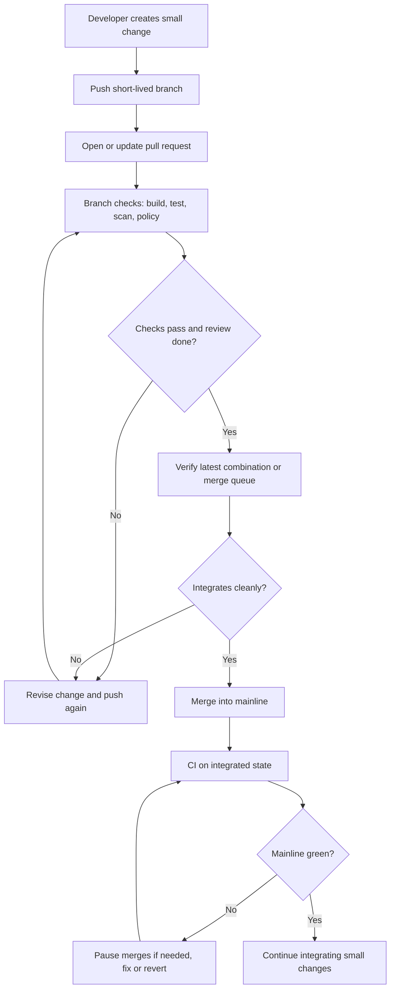

# Distinguishing Branch Checks from Continuous Integration Practices

Branch checks and Continuous Integration (CI) often appear in the same Git workflow, yet they answer two different questions. Branch checks indicate whether a revision or pull request passes the configured technical and policy conditions. CI is the practice of integrating changes into the shared development line frequently, in small batches, and verifying the integrated state with automated builds and tests.

A pull request can be green because all branch checks pass, while the team still lacks effective CI if branches live too long, changes are only integrated at the end of a sprint, or the main branch state is not continuously verified. Conversely, pull request checks are a useful CI mechanism when they help the team integrate frequently, detect errors early, and keep the main branch healthy.

## 1. Two Concepts Answering Two Different Questions

**Branch checks** are the set of verifications run on a branch, commit, or pull request. They can include compilation, unit tests, integration tests, linting, static analysis, security scanning, formatting checks, configuration validation, and policy rules. Results are typically shown as succeeded, failed, running, or skipped statuses. The Git platform can use these required statuses to allow or block a merge operation.

**Continuous Integration** is a development practice in which team members integrate small changes into the shared source line frequently—usually at least once per working day—and every integration is verified by an automated build and test process. Teams actively keep branch lifetimes short, keep the mainline in a working state, and respond immediately when an integration breaks the green state.

| Perspective | Branch Checks | CI Practice |
|---|---|---|
| Primary question | Does this revision pass the configured checks? | Does the team integrate changes into the shared line frequently and keep the integrated state healthy? |
| Scope | A specific commit, branch, or pull request | The shared development line and the team's working cadence |
| Timing | Usually triggered on push, pull request open/update, or merge request | Continuous whenever changes are integrated into mainline |
| Evidence | Job statuses, test reports, scan results, reviews, and policies | History of small integrations, builds/tests on the shared state, short branch lifetimes, and a green mainline |
| Failure mode | One or more conditions on the revision fail | Integration breaks mainline, conflicts drag on, or the team cannot integrate frequently |
| Desired outcome | Prevent unverified or non-compliant changes from being merged | Reduce integration risk, get early feedback, and keep software continuously ready for further development |

Therefore, branch checks are a control mechanism that can support CI, whereas CI is how a team organizes its work and feedback loops. Having many checks, short runtimes, or a green check mark on a pull request does not by itself prove the team is practicing CI well.

## 2. What Do Branch Checks Usually Include?

A Git hosting platform can trigger workflows when a developer pushes commits, opens a pull request, updates a pull request, or enqueues a change in a merge queue. Each job verifies one aspect and returns a result for reviewers and branch protection rules to evaluate.

Common checks include:

- **Build:** verifies that the code compiles or packages with the declared toolchain and dependencies.
- **Unit tests:** verify small rules in an isolated scope.
- **Integration tests:** verify interactions with databases, message brokers, services, or real/emulated components.
- **Contract tests:** verify that API, event, or schema contracts are not broken unexpectedly.
- **Lint and format:** detect convention violations, potential syntax errors, and formatting discrepancies.
- **Static analysis:** find quality issues, type errors, or risky code patterns without running the application.
- **Security checks:** scan dependencies, secrets, containers, source code, and configuration against policies.
- **Policy checks:** verify naming rules, change structure, licenses, required files, or review requirements.
- **Review and approval:** confirm that responsible owners have examined the change according to repository rules.

Not all of these items are automated status checks. Some come from external systems, and some are platform review requirements. What they share is providing evidence to decide whether a change is allowed to proceed.

Branch checks should be organized by feedback speed. Fast checks such as formatting, linting, compilation, and unit tests usually run first. Integration tests, contract tests, or heavier security scans can run in parallel or in a subsequent stage. Required conditions must still complete before merging; optimizing order never means skipping necessary evidence.

## 3. Branch Protection and Required Status Checks

Branch protection is a policy safeguarding critical branches, typically `main`, `master`, or release branches. Policies can require pull requests, a minimum number of reviews, reviewers from designated groups, passing status checks, resolved conversations, linear commit history, or merging through a queue.

A required status check must be bound to the right workflow and context. If two jobs share the same name but mean different things, selecting the wrong check can create an unreliable gate. Teams must keep check names stable, assign clear owners, and prevent a required check from being skipped due to misconfigured run conditions.

Common statuses:

| Status | Practical Meaning | Appropriate Action |
|---|---|---|
| Success | The check ran and passed | Can be evaluated alongside other conditions |
| Failure | The check ran and found errors or unmet conditions | Fix the error or handle exceptions per policy |
| Pending / In progress | The check has no final result yet | Wait for completion; do not treat as passed |
| Skipped / Neutral | The check did not run or did not apply per conditions | Verify whether skipping is permitted by policy |
| Cancelled | The run was cancelled before completion | Determine the cause and re-run as needed |

A `success` status is only meaningful within the scope of what the check actually verified. If a workflow only runs unit tests, you cannot infer that database migrations, API compatibility, or production behavior have been verified. Check names, descriptions, and repository documentation should state that scope clearly.

## 4. Why Green Branch Checks Alone Do Not Prove CI

Branch checks typically evaluate a snapshot of source code at a single point in time. While a pull request remains open, the main branch can continue changing and other pull requests can be merged. Thus, a green result on an isolated branch does not guarantee the final combined state will work.

For example, two developers modify an API contract concurrently. Pull request A renames the `customerId` field; pull request B adds a consumer that still reads the old field. Each branch runs its own tests and passes because neither includes the other's changes. Once A and B are merged, the application may no longer be compatible. CI must integrate changes into the shared line frequently and verify the integrated state to catch this early.

Other common gaps:

1. **Long-lived branches:** changes accumulate for days or weeks, causing divergence from mainline to grow until merging becomes a separate project.
2. **Running tests only on pull requests:** workflows do not run or re-verify the state after merging into the shared branch.
3. **Checking against a stale base:** the main branch changed after the last check, yet the pull request is merged without re-verifying the new combination.
4. **Multiple pull requests pass independently but are incompatible:** each change is green alone, yet their combination fails.
5. **Unrepresentative tests:** only tiny unit tests exist, lacking contract, integration, or real build checks.
6. **Leaving mainline red:** a failure enters the main branch, yet the team keeps merging more changes, making root-cause analysis and recovery harder.
7. **Unreliable checks:** flaky tests, overly broad skip conditions, bad caching, or checks running on a different revision than the one merged.

A solid CI process must verify the integrated state and deliver feedback fast enough for the team to fix errors while changes are small and authors still remember their original intent.

## 5. CI Is a Practice of Frequent Integration, Not Just a Workflow

A team can own a modern CI system and still fail to practice CI well if their workflow holds changes back for too long. CI requires coordinated habits:

- Break work into small slices that can be integrated independently.
- Commit and push regularly to share progress, receive feedback, and limit divergence.
- Keep feature branches short-lived; do not keep a private branch open until an entire feature is finished before integrating.
- Automate builds and tests for critical behaviors.
- Keep the main branch always buildable and ready for continued development.
- When mainline breaks, prioritize restoring the green state before introducing new changes.
- Use feature flags, configuration, or backward-compatible designs to integrate code not yet ready to expose to users.
- Treat integration failures as shared team responsibility, not solely the last merger's problem.

CI does not require every commit to be deployed to production. CI focuses on integrating and verifying shared source code. Continuous Delivery extends the pipeline so software is always in a releasable state; Continuous Deployment automatically deploys to production when all conditions are met. These represent distinct levels and scopes of automation.

## 6. Short-Lived Branches and Trunk-Based Development

Effective CI usually pairs with a branching strategy that minimizes how long changes stay outside mainline. *Trunk-based development* is an approach where developers integrate into the main branch frequently, either directly or via very short-lived branches. This does not mean everyone must push straight to `main` or skip reviews. Small pull requests, fast reviews, and merge queues all fit well with trunk-based development.

| Approach | Characteristics | Risks or Benefits |
|---|---|---|
| Long-lived feature branches | Keep an entire feature in a separate branch until completion | Prone to mainline drift, large conflicts, and late integration bug discovery |
| Short-lived branches | Create a branch for a small change and integrate quickly | Reduces diff size and feedback wait time |
| Trunk-based development | Many small changes integrated into trunk frequently | Lowers merge overhead; requires fast tests and design for unactivated changes |
| Release branches | Create a stabilization branch to prepare a release version | Useful for version maintenance, but fixes must still be synced back to trunk |

A short-lived branch still needs enough time for review and checks. The goal is not to force unready merges, but to split changes so each piece can be reviewed and integrated promptly. If a large feature cannot be completed in a single merge, break it into compatible foundational changes and use feature flags to control activation timing.

### Using Feature Flags to Integrate Unactivated Code

Suppose a team is building a new checkout page whose design and copy are not yet finalized. The team can merge backend structures, APIs, or UI scaffolding in small steps while the feature flag remains off for users. As a result, the code is already in mainline and built/tested alongside everything else, yet the behavior is not yet exposed.

Feature flags need clear names, safe default values, owners, activation criteria, and a removal plan. Avoid letting temporary logic branches live indefinitely, as they multiply test states and make application behavior harder to understand.

## 7. Workflow Combining Branch Checks and CI

A practical process typically connects two related verification points:

1. A developer creates a small change and pushes to a short-lived branch.
2. A pull request opens, triggering branch checks on the revision under review.
3. Reviewers inspect the diff, check the design, and respond within a short timeframe.
4. When the main branch changes, the pull request is updated or placed in a merge queue to verify the expected combination.
5. Once all required conditions pass, the change is integrated into mainline.
6. The mainline pipeline verifies the post-integration state, produces evidence, and alerts immediately on failure.
7. If mainline turns red, the team pauses further merges if needed, identifies the offending revision, and reverts or fixes it promptly.
8. Small changes continue to be integrated, keeping mainline history readable and traceable.



The crucial point is that the main branch itself must also be verified. If the system only runs pre-merge checks without verifying the post-merge mainline state, the team can miss errors caused by combined changes or differences between the checked revision and the revision actually integrated.

## 8. Pull Request Checks vs. Integrated State Checks

Three types of state must be distinguished:

- **Head commit:** the latest commit on the pull request branch. Checks on head indicate whether the branch's isolated changes meet criteria.
- **Merge result / synthetic merge commit:** a simulated state merging the pull request branch with the current base. This check helps catch issues that appear only when both sides combine.
- **Integrated mainline commit:** the commit actually landed on the shared branch. The mainline pipeline verifies the state after integration.

Exact naming and behavior depend on the Git platform. Some platforms default to creating a merge ref so pull request workflows check the combination; some configurations may run only on the head SHA. Teams need to verify which revision checkout, build, and tests actually use, and compare it against the merged revision.

When many pull requests target a high-traffic main branch, a *merge queue* or *merge train* can order changes and verify each expected combination sequentially before landing on mainline. If a preceding change merges or fails, the system recalculates combinations for queued changes behind it. This reduces situations where individual pull requests are green in isolation yet break mainline when merged back-to-back.

A merge queue does not replace CI. It is a coordination and combination-verification mechanism. Teams still need appropriate tests, a mainline pipeline, rules for keeping main green, and procedures for handling check failures.

## 9. Example Workflow for Branch Checks and Mainline Verification

The example below uses GitHub Actions for a Gradle project. The workflow runs the same `verify` task on pull requests targeting `main`, on pushes to `main`, and when a merge queue requests checks. In a real repository, pin actions to versions or commits approved by your organization and add project-appropriate test/security jobs.

```yaml
name: CI

on:
  pull_request:
    branches: [main]
  push:
    branches: [main]
  merge_group:
    types: [checks_requested]

permissions:
  contents: read

jobs:
  verify:
    name: verify
    runs-on: ubuntu-latest
    steps:
      - name: Checkout source
        uses: actions/checkout@v4

      - name: Set up Java
        uses: actions/setup-java@v4
        with:
          distribution: temurin
          java-version: '21'
          cache: gradle

      - name: Verify build and tests
        run: ./gradlew --no-daemon clean check
```

In this example:

- The `pull_request` event produces evidence for branch checks. `verify` can be configured as a required status check in branch protection.
- The `push` event on `main` verifies the integrated state and gives a fast signal if mainline turns red.
- The `merge_group` event lets the merge queue request the workflow to verify the expected combination before merging.
- `permissions: contents: read` restricts the job's default permissions to reading the repository. Jobs needing other permissions must declare only the necessary scope.
- `clean check` is only an example Gradle task. Each project must decide which tests run quickly on pull requests and which run in later stages.

In real environments, never copy a template blindly without reviewing action versions, token permissions, fork handling, caching, concurrency, and security requirements. If a workflow uses `paths`, `if` conditions, or job dependencies, ensure required checks cannot be skipped in a way that lets a branch merge without mandatory evidence.

## 10. Designing a Fast and Reliable Verification Suite

A good CI pipeline balances speed, coverage, and reliability. If every pull request must wait hours for a huge end-to-end test suite, developers may delay pushing or bundle many changes to run it fewer times. That increases batch size and integration cost.

Checks can be organized in tiers:

| Tier | Typical Checks | Relative Time Target | Role |
|---|---|---|---|
| Very early | Formatting, linting, compilation, fast unit tests | Seconds to a few minutes | Catch basic mistakes before reviewers spend time |
| Pull request | Full unit tests, contract tests, static analysis, dependency scan | A few minutes | Provide primary evidence for the merge decision |
| Integrated state | Clean build, integration tests, affected module checks | Several minutes or longer depending on system | Verify changes in the mainline context |
| Scheduled or later stage | Broad end-to-end, performance, large-environment testing | Can take longer | Find issues hard to reproduce on every push |

Tiering does not mean important tests can be arbitrarily pushed past merge. Risks that must be caught pre-merge require appropriate gates. Some long-running tests may run post-merge if the team can halt releases, recover quickly, and explicitly accepts the remaining risk.

### Managing Flaky Tests

Flaky tests pass and fail inconsistently on the same input due to race conditions, environment dependencies, timing, shared data, or external services. Flaky tests degrade the value of required checks because developers cannot tell whether a red run reflects a product bug or test noise.

When a flaky test occurs, teams should capture logs, seeds, timestamps, revisions, and environment info; classify the root cause; create a fix ticket; and track flaky rates. Tests can be temporarily quarantined from the main gate if compensating controls and an owner exist, provided the exception and deadline are published. Never retry infinitely until a run turns green and treat the change as safe.

### Controlled Caching

Caching dependencies and build outputs shortens CI runtime, but wrong cache keys can cause workflows to reuse stale results. Keys must reflect inputs that affect output, such as lockfiles, toolchain versions, and build configuration. For critical verification steps, maintain the ability to run clean builds to catch issues masked by caching.

## 11. Keeping Mainline Green and Handling Red States

The main branch is where changes converge. If mainline fails to build, other team members get blocked, subsequent checks lose value, and it becomes harder to pinpoint where new failures came from. Thus, mainline's green state is a shared responsibility and must be prioritized for recovery.

When the mainline pipeline fails:

1. Identify the failing revision and job; inspect logs and test reports to distinguish product defects, infrastructure issues, or flaky tests.
2. Communicate mainline status clearly and pause further merges if continuing risks obscuring traceability.
3. If the cause is clear and the fix is quick, submit a small fix and re-run all relevant checks.
4. If a fast fix is not possible or the change causes severe breakage, revert the commit or merge to restore mainline.
5. Once mainline is green, investigate the root cause and improve tests, review practices, or change slicing.

Reverting is often the fastest recovery because it creates a new, reviewable, traceable change. However, with data changes or incompatible schema updates, reverting code may not undo already written data. In such cases, evaluate schema compatibility and choose a forward fix or an appropriate data recovery procedure.

Never leave a red main branch unaddressed while continuing to merge as usual. When teams repeatedly ignore failures, CI signals become meaningless and root-cause costs escalate rapidly.

## 12. Measuring Integration Process Health

Counting status checks or pipeline runs alone is insufficient to evaluate CI. Metrics should reflect both integration cadence and feedback quality:

- **Branch lifetime:** time from branch creation to integration. Longer-lived branches tend to accumulate greater divergence.
- **Batch size:** number of commits, files, or change scope per merge. Smaller batches make fault isolation and review easier.
- **Time to feedback:** time from push until developers receive actionable check results.
- **Time to merge:** time from when a pull request is ready for review until integration; separate review wait time from CI execution time.
- **Mainline health:** percentage of time mainline is green and mean time to recover after turning red.
- **Integration failure rate:** rate of integrations that break the shared state or require urgent reverts/fixes.
- **Flaky test rate:** rate of tests producing inconsistent outcomes for identical inputs.
- **Queue time:** time waiting for runners or a merge queue before checks begin.

Read these metrics together to diagnose causes. If time to feedback rises, look at runners, caching, overly broad tests, or unnecessary sequential jobs. If branch lifetime rises, tasks may be too large, reviews bottlenecked, or the team may not be slicing features into integrable increments. If mainline breaks often, inspect test coverage, merge queues, protection rules, and incident ownership.

Never chase shorter branch lifetimes by forcing merges before reviews finish or by dropping tests. Metrics are signals for improving the work system, not quotas for evaluating individuals.

## 13. Common Anti-Patterns

| Anti-Pattern | Why It Causes Problems | Improvement Direction |
|---|---|---|
| Feature branches lasting weeks | Large mainline divergence, painful merges, and late defect discovery | Split features into small slices and integrate frequently |
| Treating PR green marks as complete CI | Does not prove post-integration state stays healthy | Run pipelines on mainline and verify latest combinations |
| One giant monolithic test job | Slow feedback, hard to tell failure types, and hard to optimize | Split stages by goal and feedback speed |
| Required checks unintentionally skipped | Branches can merge without required evidence | Audit workflow conditions and branch protection rules |
| Merging multiple PRs simultaneously without combination checks | Individual PRs pass while their combination fails | Use a merge queue or update and test against the latest base |
| Ignoring flaky tests | Red signals lose credibility | Track, fix root causes, and time-box exceptions |
| Continuing to merge on a red mainline | Failures pile up, making culprit identification difficult | Prioritize fixing or reverting to restore mainline |
| Using feature flags with no removal plan | Multiplies states and testing complexity | Assign owners, review dates, and cleanup criteria |
| Relying on caches without validating inputs | Can reuse outputs that are no longer valid | Design accurate cache keys and retain clean builds |

## 14. Scenario Example: Two Pull Requests Changing a Contract Simultaneously

Suppose a team maintains `order-service` and `billing-service`. Pull request A from the order team changes an API response field from `total` to `grandTotal`. At the same time, pull request B from the billing team updates the consumer to read `grandTotal`.

If A and B are developed on long-lived branches, both may pass their own unit tests because each branch only tests its own code. Upon merging, integration order can create an incompatible intermediate state: order removes `total` before billing is updated, or vice versa.

A safer CI approach splits the change in a backward-compatible sequence:

1. Integrate a producer change returning both `total` and `grandTotal`, keeping old consumers working.
2. Integrate the consumer reading the new field, backed by contract tests verifying the response.
3. Monitor usage of the old field and confirm all consumers have migrated.
4. In a separate change, remove the old field once no dependencies remain.

Each step is a small change verified on a pull request and confirmed on mainline. With a merge queue, the team can also validate combinations of queued pull requests. This approach minimizes time spent in incompatible states and avoids holding a massive branch containing the entire change.

## 15. Checklist: Is the Team Practicing CI or Only Running Branch Checks?

Evaluate your current process using these questions:

- [ ] Feature branches are integrated quickly and changes are split into small batches.
- [ ] Every pull request has automated builds and tests with clearly documented scope.
- [ ] Required status checks bind to the right revision and cannot be skipped unintentionally.
- [ ] The team knows whether pull requests are checked on the head commit or the merge result.
- [ ] Mechanisms exist to verify the latest integrated state when the base branch changes.
- [ ] Pipelines run on mainline post-merge and detect integration failures.
- [ ] Mainline is kept green; when red, the team prioritizes fixing or reverting.
- [ ] Flaky tests are measured, assigned owners to fix, and exceptions are time-boxed.
- [ ] Strategies exist for incomplete features, such as feature flags or backward-compatible designs.
- [ ] CI feedback time is short enough for developers to fix issues while context is fresh.
- [ ] The team tracks branch lifetime, batch size, feedback time, and mainline health.

If a team only has pull request checks while keeping long-lived branches, rarely merging to mainline, and never verifying post-integration state, the current setup is mainly a pre-merge gate. That is a helpful foundation, yet integration cadence and mainline stewardship must change to become true Continuous Integration.

## 16. Conclusion

Branch checks provide evidence for a revision and help protect the shared branch from non-compliant changes. Continuous Integration organizes how a team works so small changes land on mainline frequently, are verified immediately on the integrated state, and recover rapidly when failures occur.

A robust workflow combines both: fast and reliable branch checks; timely reviews; short-lived branches; merge queues or latest-base verification when needed; mainline pipelines; rules to keep main green; feature flags for unactivated changes; and metrics to drive improvement. A green check mark on a pull request is important evidence, while the health of the shared code line reveals whether the team is truly practicing continuous integration.
