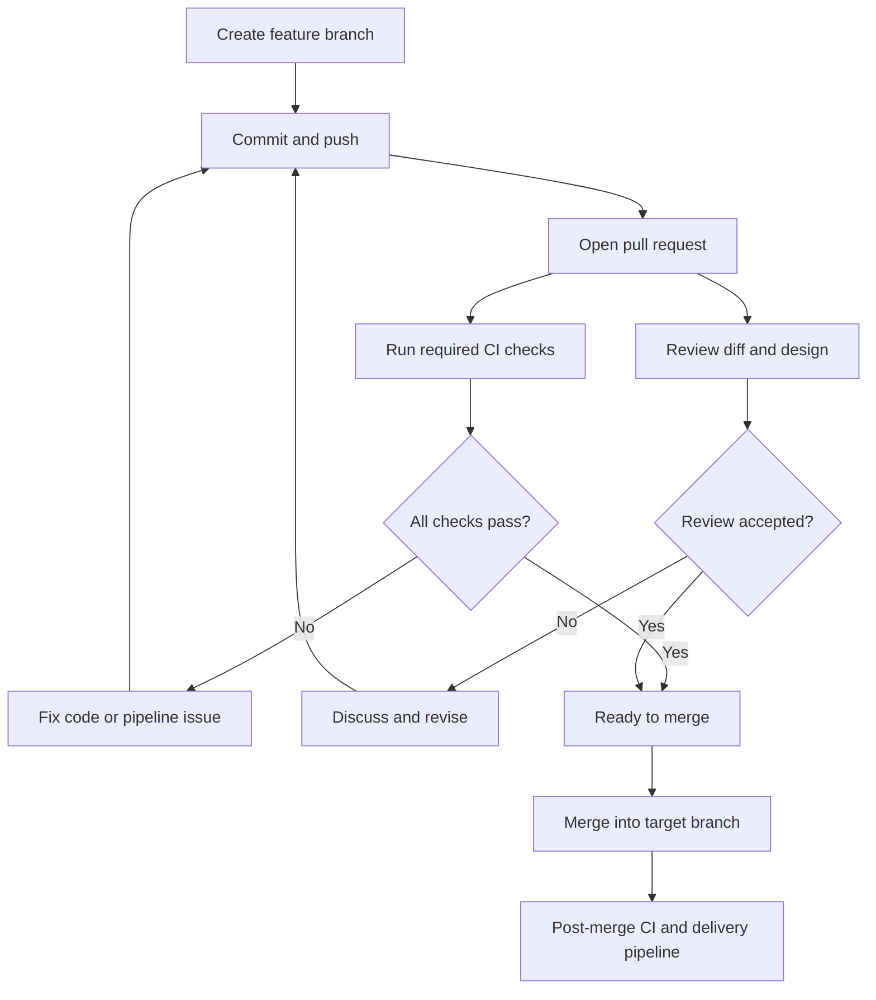

# Role of Pull Requests, Code Reviews, and Required Checks

In a project with CI/CD, moving source code from a working branch into an integration branch is a critical control point. A change can compile cleanly on the author's machine yet fail when combined with the rest of the system, break an API contract, leak secrets, or block the release process. A pull request (PR) establishes a controlled space for the team to understand changes, discuss, review, and verify before merging.

A pull request is often called a merge request (MR) on some platforms. Although names and interfaces differ, the core goal is identical: requesting to integrate a set of commits from a source branch into a target branch, providing context for others to evaluate, and binding automated verification results to the exact version of the change.

A PR does not automatically guarantee good code. Its value comes from description quality, responsible reviews, appropriate CI checks, and properly configured branch protection rules. When these pieces work together, the team catches issues before code enters the main branch, keeps change history clear, and enables post-merge pipelines to release a verified code state.

## 1. Where Does a PR Sit in the Source Integration Flow?

A working branch typically starts from a stable revision of the target branch. The author makes changes, creates commits, and pushes the branch to the Git server. Upon opening a PR, the author specifies the source and target branches, describes the goal, links related work items, and requests review from responsible owners.

From that moment, the PR becomes the aggregation point for evidence about the change:

- The diff shows which code lines and files changed.
- The description explains the problem, solution, scope, and risks.
- Review comments record questions, feedback, and technical decisions.
- CI runs show which revision passed or failed each check.
- Approvals signify that authorized reviewers accepted the change under policy.
- Merge status shows whether the change has been integrated into the target branch.

Typical flow:

1. Create a branch from the appropriate target branch.
2. Make a small, clearly scoped change and create commits.
3. Push the branch to the Git server.
4. Open a PR specifying the target branch, description, reviewers, and required links.
5. CI runs checks for the PR's revision.
6. Reviewers inspect the diff, discuss, and request adjustments if needed.
7. The author updates commits; CI re-runs for the new revision.
8. The PR is merged only when required conditions are met.
9. Post-merge, the target branch pipeline continues verifying, packaging, or releasing per project policy.



A PR may be updated multiple times. Every new commit alters the content requiring review and can invalidate prior CI results. Therefore, check review status and check status against the current revision, not merely whether the PR once had a green run.

## 2. Why Integrate Through a PR?

PRs simultaneously solve coordination, quality, and traceability problems.

**Establish a pre-merge control point.** Teams can catch logic bugs, missing tests, incompatible changes, or security risks before code lands on a branch used by many people.

**Share knowledge.** Reviewers learn more about the system, conventions, and design decisions. Authors also receive feedback from different perspectives. Valuable discussions should be captured in the PR or linked architecture docs so future readers understand the rationale.

**Reduce integration conflicts.** Small, frequently integrated changes shrink the gap between working branches and the main branch. When conflicts occur, their scope is usually easier to understand and resolve.

**Produce traceable evidence.** PRs link work items, commits, reviewers, CI results, and merge decisions. During incidents, the team can trace which change introduced new behavior into the system.

**Standardize quality.** Rules such as mandatory tests, code owner reviews, and secret scanning can be enforced consistently via branch protection settings.

PRs should not devolve into rubber-stamp approvals. If reviewers click Approve without reading the diff, or if CI runs only a basic build command while the change carries data risks, this checkpoint yields no useful evidence.

## 3. Preparing an Understandable, Reviewable PR

Review quality depends heavily on how the author presents the change. A small PR with a clear purpose and verification evidence is far easier to evaluate than a PR bundling unrelated edits.

### 3.1. Keep Change Scope Focused

Each PR should solve one objective describable in a few sentences. For example, "add bounded retries for calls to the payment service" is a concrete goal. If the same PR also reorganizes directories, upgrades dozens of dependencies, tweaks UI styling, and alters logging configuration, reviewers must hold too much context in mind.

Changes can be split into sequential PRs when dependencies are clear. A foundational PR can merge first, with the follow-up PR based on the updated target branch. If multiple PRs must stay open together, descriptions should clarify ordering and what depends on what.

There is no universal line-count limit suitable for every project. A large generated-code or snapshot update may have a long diff that is easy to verify with specialized tooling, whereas a few lines in authorization logic can carry high risk. Optimize so reviewers grasp intent and can verify the critical points.

### 3.2. Write Descriptions Answering Essential Questions

A good description typically covers:

- **Context:** what problem or need prompted the change?
- **Solution:** how is the change implemented?
- **Scope:** which components or business flows are affected?
- **Evidence:** what tests, manual checks, or experiments were run?
- **Risks:** are there migrations, config changes, backward-compatibility concerns, or operational steps to note?
- **Links:** which issues, requirements, design docs, or dependent PRs relate to this?

Example description:

```markdown
## Goal
Prevent duplicate order creation requests when clients retry after a timeout.

## Changes
- Add an idempotency key to the order creation endpoint.
- Persist the processing outcome by key within the transaction.
- Return the previous result when receiving the same key and identical request payload.

## Testing
- Unit tests for first request and repeated request.
- Integration test for two concurrent requests.
- Test case for identical key with mismatched payload.

## Risks and Rollout
- Requires a migration adding the key storage table.
- Monitor key conflict rates after deployment.

## Related
Closes ISSUE-123
```

This tells reviewers to focus on data consistency, concurrency races, and retry behavior. Writing only "fix bug" or "update code" provides no context for evaluation.

### 3.3. Create Meaningful Commits

Commits should describe a logical change or sensible step in development. Messages like "fix order idempotency" are far more useful than "update" or "changes". Meaningful commits help reviewers follow how the problem was solved and aid later investigation.

Before opening a PR, authors should self-review the diff to remove debug logs, unintended generated files, unrelated formatting edits, and sensitive data. Self-review usually catches simple mistakes faster and saves others' time.

## 4. Code Review Is Goal-Directed Evaluation

Code review is the process where one or more people inspect a change to evaluate correctness, safety, maintainability, and architectural fit. Review is neither a syntax-nitpicking contest nor an arena for personal style preferences.

Reviewers should start from the PR's goal and understand expected behavior before reading line by line. Then inspect high-risk areas:

1. **Correctness:** does the code fulfill requirements and handle edge cases?
2. **Data flow:** where does data come from, how is it validated and transformed, and could it be lost or corrupted?
3. **Errors and recovery:** how are timeouts, dependency failures, retries, and partial states handled?
4. **Compatibility:** does the change break APIs, schemas, configs, legacy data, or existing clients?
5. **Security:** are there leaked secrets, missing permission checks, injection risks, unsafe input handling, or expanded attack surfaces?
6. **Testing:** do tests prove new behavior and confirm critical existing behavior still holds?
7. **Operations:** are logs, metrics, alerts, migrations, rollouts, and rollbacks appropriate?
8. **Maintainability:** do naming, structure, and complexity allow future maintainers to understand and modify safely?

Reviews should be risk-based. A documentation update does not require the same depth of analysis as changing customer data access permissions. Nevertheless, every change must satisfy the repository's baseline checks.

### 4.1. Distinguish Blocking Issues from Suggestions

Review comments should clearly state severity and rationale:

- **Blocking:** defects that can cause data corruption, vulnerabilities, system outages, contract breakage, or policy violations; must be fixed before merge.
- **Question:** unclear points needing explanation or evidence from the author.
- **Suggestion:** helpful improvements that do not necessarily block the PR.
- **Nit:** minor presentation or phrasing issues; should not turn into drawn-out review cycles.

A strong comment identifies location, potential behavior, impact, and suggested direction. For instance: "If two requests with the same idempotency key arrive concurrently, both can pass the check before a record is inserted. A database unique constraint and conflict handling are needed so only one request creates an order."

Comments like "this code is wrong" or "rewrite this cleaner" do not help the author pinpoint the problem. For style choices, rely on formatters, linters, or agreed conventions instead of personal debate.

### 4.2. Responsibilities of Authors and Reviewers

The author is responsible for change correctness, tests, description, addressing feedback, and updating the PR. Approval does not transfer full quality responsibility from author to reviewer.

Reviewers are responsible for reading their assigned scope, checking critical risks, asking when information is missing, and stating clearly what remains unmet. Reviewers should not approve without understanding the change or verifying results for the current revision.

When disagreements arise, both sides should return to requirements, evidence, conventions, and operational impact. If a decision affects architecture or carries long-term consequences, involve an architecture owner or domain owner.

## 5. Approvals and Code Ownership

Many Git platforms support requiring one or more approvals before merge. Some projects also require owners of modified files to review. This is typically configured via an ownership declaration file or equivalent policy.

An approval indicates the reviewer accepts the change within project scope and policy at review time. It does not replace CI and does not prove every runtime case works.

Policies may include:

- Minimum approval count.
- Requiring at least one approval from a code owner of affected code areas.
- Prohibiting authors from self-approving their own changes.
- Dismissing or requiring re-review of stale approvals when new commits arrive.
- Blocking merge while unresolved blocking threads remain.
- Restricting who can bypass branch protection rules.

Requiring more approvals does not automatically yield better reviews. If small PRs must wait for too many people, integration lead time grows without matching quality gains. Reviewer count and type should match risk level, ownership scope, and team capacity.

Code ownership is especially valuable for sensitive areas such as authentication, authorization, payments, deployment infrastructure, data schemas, or security configuration. When changes touch those paths, the system can require domain specialists to participate.

## 6. What Are Required Checks?

A required check is an automated verification result that the repository platform enforces as a mandatory precondition before allowing a merge. Checks are typically reported by CI or an integrated app. Depending on the platform, they may appear as status checks, pipeline statuses, jobs, policy checks, or similar terms.

A check typically reports statuses such as:

- **Pending/running:** no final result yet.
- **Success/passed:** verification completed and passed.
- **Failure/failed:** verification ran and failed.
- **Cancelled/skipped/neutral:** did not produce a standard passing result; platform handling depends on configuration.

When a check is required, pending or failure states normally block merging. Teams must understand exactly how their platform handles skipped, cancelled, and missing checks. Never assume a skipped job equals a passed verification.

Required checks turn quality policies into enforceable conditions. Users can inspect the status and see immediately whether a PR is blocked by a failing test, missing approval, or missing required check.

## 7. Selecting Appropriate Required Checks

Do not turn every pipeline step into a required check. A required check must be reliable, purposeful, and tied to change risk. Too many slow or noisy checks stall PRs and push teams toward bypassing them.

A PR check suite typically includes these categories:

| Check Category | Examples | Purpose |
|---|---|---|
| Style and structure | Formatters, linters, syntax checks, type checks | Catch simple mistakes and maintain consistent conventions |
| Build | Compile, package, build config checks | Confirm code can produce outputs |
| Unit tests | Function, class, and business rule tests | Fast feedback on modified logic |
| Integration/contract tests | Database connections, APIs, message contracts | Catch errors when components interact |
| Security checks | Secret scanning, SAST, dependency scanning | Detect leaked secrets and known risks |
| Data and migration checks | Migration validation, schema compatibility | Reduce data corruption or upgrade downtime |
| Infrastructure checks | IaC validation, policy scanning | Catch dangerous deployment configurations |
| License checks | Dependency license policies | Ensure dependencies comply with policy |

A PR does not necessarily need to run the entire integration or end-to-end suite if cost is prohibitive. Teams can tier checks: fast checks on every PR, broader checks scoped to affected components, and full-system checks before release or on schedule. However, severe risks must never be skipped solely for pipeline speed.

### 7.1. Checks Must Bind to the Exact Revision

CI results apply only to the revision they actually tested. If the author pushes a new commit after tests pass, old results do not prove the new commit passes.

The platform and CI setup must associate checks with a specific commit SHA or revision. Before merging, ensure required checks correspond to the PR state being merged. If the target branch moves, prior results may no longer reflect integration against the new base.

Some platforms support requiring the source branch to be up to date with the target branch before merge. Others support merge queues or merge trains to verify the expected combination before landing on the main branch. These mechanisms help when multiple PRs wait to merge and pass individually yet conflict when combined.

### 7.2. Checks Must Have Trusted Identity and Provenance

Identical check names can be emitted by different workflows or applications. On platforms supporting check-source restrictions, explicitly specify which trusted app or workflow is authorized to report required checks.

If a workflow running untrusted code can report a success status for the same check name, required check policies can be spoofed. Restrict tokens, status-write permissions, and check emitters. Repository admin privileges must also be protected, as anyone able to alter branch rules can weaken merge conditions.

## 8. Designing PR CI: Fast, Stable, and Diagnosable

PR CI is the tightest feedback loop for the developer writing code. If results take hours, authors context-switch or forget change details. If pipelines fail randomly, the team loses trust in required checks.

Design principles:

**Prioritize fast checks.** Run formatters, linters, type checks, and unit tests early. Independent steps should run in parallel once required dependencies are ready.

**Tier verification.** Use fast checks as a gate for every PR; run integration tests by component or in isolated environments; run longer suites at appropriate milestones. If a critical check is a merge requirement, its result must complete before merge.

**Keep environments stable.** Lock dependencies, pin toolchains, isolate test data, and avoid uncontrolled external service dependencies. The same commit should yield consistent results under identical conditions.

**Make results clear.** Give each job a clear name, sufficient logs for investigation, test reports, and links to diagnostic artifacts where appropriate. A bare "CI failed" message without identifying the failing test or step inflates triage time.

**Set sensible timeouts and retries.** Timeouts protect runners from hung jobs. Retries suit only recognized transient failures; never infinitely retry test failures, config errors, or logic bugs. When tests are unstable, track and fix root causes.

**Reuse standardized configurations.** Repositories sharing a tech stack should reuse common workflows or scripts where appropriate. However, changes to shared workflows need careful review because they affect many projects.

**Prevent CI from mutating source code unpredictably.** Auto-formatters can help, but checking formatting and having authors commit fixes is safer. If jobs generate code or update snapshots, outputs must be controlled and reviewed.

## 9. Securing CI When Running Pull Request Code

PRs contain author-supplied code that CI will execute. This creates a critical trust boundary. Code inside a pull request can alter build scripts, tests, or dependencies; when pipelines run those scripts, arbitrary commands can execute on the runner.

Risk is especially high for PRs from forks or untrusted contributors. Pipelines must not expose repository write tokens, release secrets, or production credentials to jobs executing unreviewed code.

Measures to consider:

- Use minimal token permissions and grant read-only access to standard check jobs.
- Never supply production secrets or release credentials to PRs from forks.
- Separate workflows checking untrusted code from deployment or release workflows.
- Use ephemeral runners or isolated environments; never share sensitive access across untrusted jobs on persistent runners.
- Control artifacts, caches, and data passed between workflows; never treat outputs from an untrusted PR as trusted inputs.
- Review changes to CI workflows, build scripts, and dependencies because they can alter how the pipeline itself executes.
- Restrict who can modify required checks, branch protection, and bypass permissions.

Some platforms provide special triggers for workflows triggered when PRs open or update. Carefully read the platform's permission model and execution context. For example, a trigger might run in the target branch's context while checking out PR code; if that workflow holds secrets or write scopes, it creates severe risk. Never use privileged triggers to run arbitrary scripts from untrusted PRs.

Secret scanning is an extra defense layer, not a substitute for keeping secrets out of the CI environment. If a token was committed, revoke or rotate it immediately and investigate usage scope; deleting the token from a diff does not invalidate the exposed credential.

## 10. Branch Protection Rules and Merge Conditions

Branch protection or equivalent rules let teams define conditions for updating critical branches such as main, master, or release. Depending on the platform, policies can target branch names, patterns, repositories, or rulesets.

A typical policy includes:

- Allowing branch updates only through PRs.
- Requiring a minimum number of approvals.
- Requiring code owner reviews for protected areas.
- Requiring all required checks to pass.
- Requiring the source branch to be up to date with the target branch or go through a merge queue.
- Blocking force pushes and main branch deletion.
- Requiring conversation or blocking thread resolution.
- Restricting who can bypass rules.

Verify configurations after applying them. A branch rule may look right yet fail to match actual branch names, omit release branches, or grant bypass rights more broadly than intended. Test with a sample PR to confirm platform behavior.

Bypass privileges are high-impact exceptions. When emergency use is needed, restrict authorized users, record justification, and retain audit trails. Never normalize bypassing to compensate for slow or flaky required checks; that signals the policy or CI needs fixing.

## 11. Updating PRs, Resolving Conflicts, and Keeping Reviews Valid

While a PR stays open, the target branch may continue receiving commits. The PR's changes can then conflict or become incompatible with the latest state.

The author must update the branch per project workflow, resolve conflicts, and re-verify affected areas. After updating, CI must verify the new revision. Reviewers should also inspect the newly introduced diff rather than assuming an earlier approval covers the updated content.

Some policies automatically dismiss approvals upon new commits. This suits high-risk changes or cases where new commits can alter previously approved logic. For smaller changes with clear scoping mechanisms, a project may opt for lighter rules. Either way, authors and reviewers must know which revision an approval applies to.

When resolving conflicts, never blindly pick one side just to make CI green. Understand both changes and verify combined behavior. If conflicts touch migrations, configs, APIs, or concurrency logic, additional tests may be warranted.

## 12. Choosing an Appropriate Merge Strategy

Git platforms commonly support several merge strategies:

| Strategy | Outcome | When Suitable | Considerations |
|---|---|---|---|
| Merge commit | Creates a merge commit, preserving branch history and integration points | When preserving branch structure and merge milestones | History can accumulate many merge commits |
| Squash merge | Combines PR commits into one commit on the target branch | When wanting a tidy main history with one commit per PR | Detailed commit history inside the branch is omitted from the target branch |
| Rebase and merge | Replays PR commits onto the tip of the target branch for linear history | When keeping individual commits without merge commits | Changes commit SHAs and requires rules for shared branches |

There is no single best strategy for every team. What matters is agreeing on commit hygiene, linking PRs to issues, and maintaining post-merge traceability. With squash merges, the PR description and final commit title must provide enough detail to understand the change. With multi-commit merges, each commit should carry meaningful content.

Merge strategy also affects how post-merge pipelines identify the released revision. Systems must record the actual commit landed on the target branch and link it to produced artifacts.

## 13. Post-Merge: The PR Is Closed, Integration Responsibility Continues

Merging does not always mean a change is ready to release. Target branch pipelines typically re-run checks on the actual integrated state, produce artifacts, run broader tests, or wait for release gates.

Distinguish between:

- **PR checks:** verify changes in review context and against the target branch at merge time.
- **Post-merge CI:** verifies the new commit or state on the target branch.
- **Release pipeline:** packages and publishes artifacts according to policy.
- **Deployment verification:** verifies the service after deployment.

A PR can be green yet fail post-merge pipelines due to interactions with other changes, configuration differences, or environment factors. Teams should monitor mainline health and prioritize recovery when main breaks. If a PR must be reverted, the revert itself should follow proper verification and traceability.

A PR is the integration record, while CI/CD is the continuous execution chain afterward. Closing a PR does not end responsibility for tracking the change's impact.

## 14. Example PR Policy as Conceptual Configuration

The YAML below illustrates the concepts of a repository policy. This is a vendor-neutral conceptual illustration, not syntax to copy directly into GitHub, GitLab, or a specific provider.

```yaml
repository_policy:
  target_branches:
    - main
    - release/*

  pull_request:
    require_description: true
    require_linked_work_item: true
    require_conversation_resolution: true
    allow_author_approval: false

  approvals:
    minimum: 1
    dismiss_stale_approvals_after_new_commit: true
    require_code_owner_review_for_owned_paths: true

  required_checks:
    - lint
    - compile
    - unit-tests
    - dependency-policy
    - secret-scan

  merge:
    require_checks_for_current_revision: true
    require_branch_up_to_date_or_merge_queue: true
    block_force_push: true
    block_branch_deletion: true

  permissions:
    pull_request_ci:
      repository_read: true
      production_secrets: false
      production_deploy: false
    release_pipeline:
      production_deploy: approval_required

  bypass:
    allowed_roles:
      - repository_admin
    require_reason: true
    audit_event: true
```

When implementing a real policy, map each condition to features supported by your platform. Verify check names, check provenance, branch scope, token permissions, and behavior when jobs are skipped. Illustrative configuration never replaces testing actual branch rules on the repository.

## 15. Practical Scenario: Green CI, Yet the Change Must Still Be Blocked

Suppose a PR changes how order status is stored. All new unit tests pass and the build succeeds. However, the diff shows a migration renaming a column still queried by the older application version. If production rolls out gradually across multiple instances, old and new versions may access the database concurrently for a period.

A responsible review asks:

- Is the migration compatible with the currently running application version?
- Can it roll out in multiple steps to preserve compatibility?
- Will application rollback still work after the migration?
- Do integration tests verify the new schema and realistic access patterns?
- Should a data-domain code owner approve?

Green CI only proves that configured checks passed. If the pipeline lacks migration compatibility checks, reviewers can request added tests or a revised rollout plan. After the author updates the PR, CI must re-run on the new revision and reviewers confirm the relevant changes. Only then does the PR have sufficient evidence to merge.

This scenario shows how review and CI complement one another. Automation checks codified rules; humans evaluate context, assumptions, and impacts not yet covered by checks. Recurring review findings should be turned into lint rules, tests, or policies whenever possible.

## 16. Common Anti-Patterns

| Anti-Pattern | Consequence | Improvement |
|---|---|---|
| Oversized PRs with multiple goals | Reviewers miss details and reviews drag out | Split by independent changes and document dependencies clearly |
| Generic one-line descriptions | Reviewers lack context and do not know what to check | State problem, solution, tests, and risks |
| Rubber-stamp approvals | PR appears controlled without substantive evaluation | Assign appropriate reviewers and clarify review scope |
| Requiring only a green build | Logic bugs or integration errors still merge | Choose tests and gates according to risk |
| Unstable required checks | PRs block randomly; teams seek bypasses | Fix flaky tests, environments, and retry rules |
| Old approvals remain valid after major changes | Reviewers may not have seen the final content | Dismiss stale approvals or require re-review per policy |
| PRs from forks receive release secrets | Untrusted code can steal credentials | Separate permissions and workflows by trust level |
| Allowing force pushes to main branch | History and integrated state can be rewritten | Protect branches and restrict permissions |
| Bypassing becomes routine | Quality gates lose effectiveness | Fix CI and audit every exception |
| Ignoring mainline after merging | Integration failures persist and block many people | Monitor post-merge CI and establish recovery procedures |

## 17. Measuring PR Process Effectiveness

PR counts or comment counts do not directly reflect review quality. Teams should track several metrics to locate bottlenecks and improve the integration flow:

- Time from opening a PR to first review.
- Time from opening a PR to merge.
- CI queue time and actual execution time.
- Ratio of required check failures caused by product bugs vs. infrastructure issues.
- Flaky test rate and retry counts.
- Rate of PRs reopened or reverted post-merge.
- Percentage of changes reviewed by the right code owners.
- Number of bypasses and bypass reasons.

Never game metrics by pressuring reviewers to approve quickly, dropping tests, or splitting PRs mechanically. The goal is cutting non-value-added wait time, increasing useful feedback, and catching defects before integration.

If review wait time is high, examine whether PRs are too large, descriptions lack context, reviewers are overloaded, or approval rules are miscalibrated. If CI is slow, analyze per-job duration, caching, parallelism, and test scope. If revert rates climb, inspect test quality, risk reviews, and post-merge verification.

## 18. Checklist for Authors, Reviewers, and Repository Admins

### PR Authors

- [ ] The PR has one clear goal and a focused change scope.
- [ ] The description explains context, solution, tests, and risks.
- [ ] The diff contains no debug logs, stray files, or secrets.
- [ ] Self-review was completed before requesting review.
- [ ] Relevant tests ran and results are provided.
- [ ] Blocking comments are resolved or discussed to a clear decision.
- [ ] After new commits, required checks ran on the current revision.

### Reviewers

- [ ] Understand the PR's goal and expected behavior.
- [ ] Check logic, edge cases, data, security, and compatibility.
- [ ] Verify tests prove critical behaviors.
- [ ] Distinguish blocking issues from suggestions.
- [ ] Leave comments stating clear impact and reasoning.
- [ ] Approve only after inspecting the current revision with sufficient evidence.

### Repository Administrators

- [ ] Main and release branches have appropriate protection rules.
- [ ] Required checks are chosen based on risk and originate from trusted sources.
- [ ] Approvals and code ownership are configured with proper scope.
- [ ] Stale approvals are handled on new changes according to policy.
- [ ] CI for untrusted code has no access to secrets or release permissions.
- [ ] Bypass permissions are restricted and audited.
- [ ] Post-merge CI is monitored with recovery procedures when mainline fails.

## Conclusion

Pull requests coordinate authors, reviewers, and the CI system before changes integrate into shared branches. Reviews evaluate intent, design, and risk; required checks verify automated conditions; branch protection ensures those conditions are enforced consistently.

An effective PR workflow requires changes small enough to review, context-rich descriptions, appropriate reviewers, stable CI, and controlled merge permissions. After merging, post-merge CI and release pipelines continue verifying the integrated state. This enables teams to integrate frequently, maintain clear history, and catch issues while fix costs remain low.
