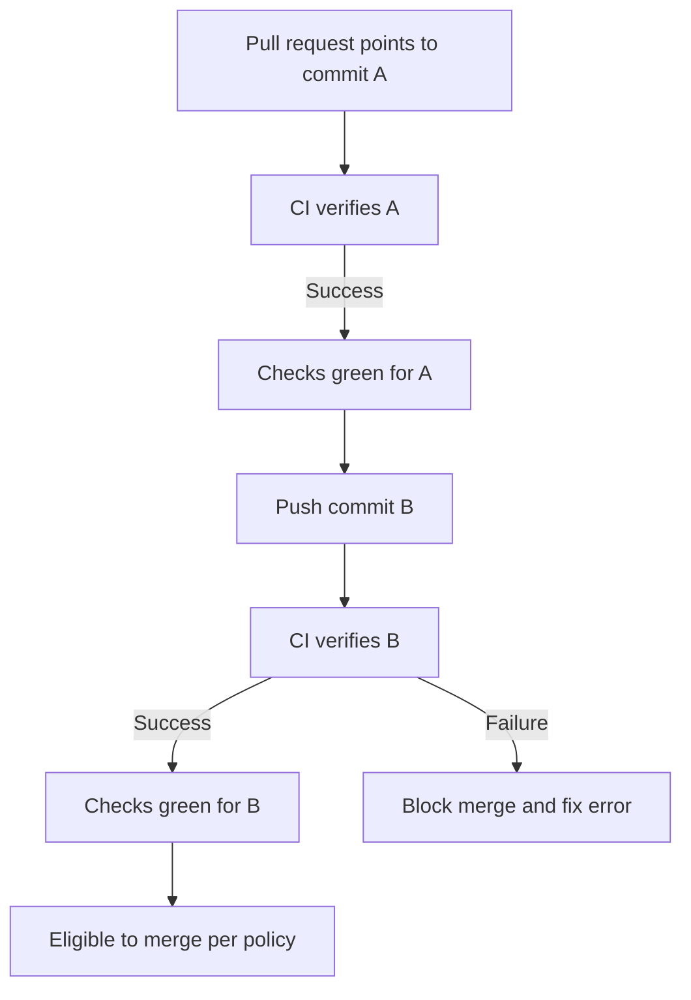

# Handling New Changes That Invalidate Previous Check Results

In a CI/CD workflow, check results are meaningful only for the exact content verified and its associated input conditions. When a new commit is pushed to a branch, the target branch changes, pipeline configuration is updated, or dependencies change, prior results may no longer prove that the current change is safe to integrate.

This commonly happens when a pull request turns green and the author pushes another commit; an older pipeline run is still in progress; the main branch receives changes while the pull request waits to merge; or a build was produced from an older revision. If the system still relies on stale success statuses to allow a merge or deployment, the team risks landing untested code onto the main branch or into production.

The guiding principle is: **every integration or release decision must rely on evidence bound to the exact revision and integration context being accepted**. This lesson explains how to detect stale results, decide re-verification scope, and design pipelines that avoid race conditions.

## 1. What Do Check Results Prove?

A CI run returns more than `success` or `failure`. It produces evidence about a specific set of inputs. Depending on the check type, those inputs can include:

- The commit SHA of the checked-out source code.
- The target commit and merge base used when evaluating a pull request.
- Workflow definitions, build scripts, test configs, and relevant configuration files.
- Versions of dependencies, lockfiles, compilers, build tools, base images, and runners.
- Test data, auxiliary services, environments, and non-secret configuration variables.
- Vulnerability database versions or rule sets used during security scans.

For example, unit tests passing on commit `a12bc34` only prove those tests succeeded against that source tree and recorded environment. If the pull request subsequently receives commit `d56ef78`, the green status of `a12bc34` does not automatically prove `d56ef78` passes too.

A check record can be modeled with the following attributes:

| Attribute | Meaning |
|---|---|
| `head_sha` | Commit containing the change under evaluation |
| `base_sha` | Target branch commit at the time of integration or verification |
| `tested_revision` | Actual revision checked out or merged to run checks |
| `workflow_revision` | Version of the pipeline and verification scripts |
| `inputs_fingerprint` | Fingerprint of dependencies, toolchain, and relevant inputs |
| `run_id` and timestamp | Run identifier and time the evidence was produced |
| `result` | Outcome along with associated reports, logs, and artifacts |

Not every platform stores every field separately. Even so, pipeline design must ensure you can identify the tested revision, key inputs used, and the run that generated the result.

## 2. Which Changes Invalidate Prior Results?

A new change invalidates prior results whenever it can alter the conclusion reached by the previous run. Common cases include:

| Change | Potentially Affected Evidence | Action Usually Required |
|---|---|---|
| New commit pushed to pull request | Unit tests, integration tests, builds, linters, and scans tied to source code | Re-run required checks for the new commit |
| Target branch receives a new commit | Integration results against old base, conflicts, and compatibility tests | Update base or build a new merge candidate and verify |
| Workflow, build script, or test script edited | Evidence generated by the previous process | Re-run checks using the modified workflow or script |
| Lockfile, dependency, submodule, or base image changed | Build, compatibility tests, and component scan results | Rebuild and run affected checks |
| Configuration, schema, or migration edited | Integration, contract, and data checks | Re-run checks across the impacted scope |
| Permissions, secrets, or environment config changed | Checks dependent on environment and identity | Verify the new configuration and re-run dependent steps |
| Vulnerability database or scan policy updated | Security conclusions under updated data/policy | Re-scan per policy freshness requirements |

Not every change invalidates every previous result. An isolated documentation edit might not affect unit tests in another module. However, skipping checks must rely on verified impact-analysis rules. When safe scope cannot be proven, re-running the required suite is the more reliable choice.

## 3. New Commits on a Pull Request: Old Green Statuses Are Insufficient

Suppose a pull request starts at commit `A`. CI runs unit tests and integration tests, then reports success. The author pushes commit `B` to the same branch. The pull request branch now points to `B`, while the prior green evidence was produced from `A`.



The source control system must bind status checks to the exact commit SHA or revision. When the head SHA shifts from `A` to `B`, required checks must be confirmed for `B`. Results for `A` remain useful for historical investigation, but must never stand in for `B`.

This also applies to commits created by amend, rebase, or force push. Even if the content delta looks small, a new SHA represents a new revision. The pipeline must evaluate the revision currently requested for merge rather than inferring validity from branch names or commit counts.

If multiple commits are pushed back-to-back, the pipeline may cancel or supersede older runs to save resources. Either way, results from an older run must never overwrite the status of a newer commit. Every check must bind to the revision of its run, and the system must accept only results matching the current head.

## 4. Target Branch Changes: Re-Verifying Integrated Content

A pull request might sit unchanged for hours or days while the target branch continues receiving commits from other pull requests. Once the base shifts, test results against the old base may no longer reflect how the change behaves after integration.

Example:

1. Pull request `feature/cart` is verified while `main` is at commit `M1`.
2. Another pull request merges, advancing `main` to `M2`.
3. `feature/cart` has not changed, yet its code will now integrate onto the new `M2` baseline.
4. An API, interface, or dependency changed in `M2`, causing tests that passed on `M1` to fail when combined with `M2`.

Thus, distinguish between two verification modes:

- **Head commit check:** evaluates the pull request's source tree in isolation.
- **Integrated revision check:** evaluates the result of combining the pull request with the current base or with the synthetic commit the system will merge.

If policy only requires head commit checks, a moving base might not automatically invalidate every check. Yet if the goal is ensuring merges do not break the target branch, the pipeline must re-verify the latest integrated revision. Mechanisms include updating the feature branch via merge/rebase, creating a temporary merge commit, or using a merge queue.

### Merge Queues and Merge Candidates

A merge queue orders verified changes in a queue and constructs an expected integrated revision to test before updating the target branch. The tested revision may be a merge commit or a synthetic commit representing the queued order of changes.

If a preceding change merges or drops from the queue, the expected integrated content for subsequent changes can shift. Results for the old merge candidate then become invalid; the system must build a new candidate and re-run required checks. This prevents scenarios where each pull request is green on its own yet the final combination fails.

## 5. Approvals and Reviews Can Also Become Stale

Test results are not the only evidence used to permit a merge. Review approvals are likewise tied to the inspected content. If an author pushes additional commits after receiving approval, reviewers may not have seen the new edits.

Repositories can enforce policies such as:

- Requiring re-approval after new commits arrive.
- Requiring a different reviewer to approve the final push.
- Dismissing stale approvals on significant edits or changes to sensitive areas.
- Retaining approvals for minor edits while requiring supplemental review per CODEOWNERS or team rules.

Exact behavior depends on the Git platform and branch protection settings. What matters is clearly defining which approvals remain valid after head changes. Never treat an `approved` badge untethered from the reviewed revision as sufficient evidence.

## 6. Deciding What to Re-Run

Re-running the entire pipeline after every edit can be expensive. Running only affected tests can be faster, provided there is a sound basis for determining scope accurately. A practical strategy classifies checks by input and risk level:

| Check Group | Conditions Requiring Re-Run Consideration |
|---|---|
| Format, lint, static analysis | Source files, rules, configuration, or tool versions changed |
| Unit tests | Module code, shared code, or relevant dependencies changed |
| Integration/contract tests | APIs, schemas, adapters, config, or auxiliary services changed |
| Build/package | Source, lockfiles, build scripts, compiler, base image, or packaging args changed |
| Security/dependency scans | Artifacts, dependencies, scanners, advisory databases, or policy freshness requirements changed |
| End-to-end tests | Relevant user flows, integrations, or environment configuration changed |
| Integrated revision checks | Head commit or base commit altered the merge candidate |

A three-tier approach works well:

1. **Fast checks:** run on every push, covering formatting, linting, unit tests, and short-feedback checks.
2. **Impact-based checks:** run integration, contract, or targeted tests based on dependency graphs and changed files.
3. **Full verification before critical gates:** run the mandatory suite on the final integrated revision before merge or on the artifact before production.

Selective testing is reliable only when dependency relationships are determined accurately. If a change touches shared libraries, build plugins, schemas, or root configs, blast radius can extend beyond the directory of the edited file. Whenever the dependency graph is incomplete, default to broader or full test runs.

## 7. Distinguishing Check Results, Caches, and Artifacts

These three concepts are often confused:

- **Check result:** evidence that a check ran against a specific revision and set of inputs.
- **Cache:** intermediate data reused to speed up execution, such as a dependency cache or build cache.
- **Artifact:** a stored output intended for downstream use, such as a JAR or container image.

A cache hit does not mean tests ran and passed on the new commit. Some build caches reuse compilation outputs when inputs match; that never substitutes for tests verifying integration or runtime behavior. Likewise, an artifact from an old commit cannot be treated as the artifact of a new commit merely because many files look identical.

If reusing test results or artifacts, the pipeline must prove relevant inputs match under policy. At minimum, record revision, dependencies, toolchain, configuration, and content identifiers. For high-risk steps, re-running checks on the final revision is usually easier to explain and audit than inferring validity from caches.

## 8. Preventing Older Runs from Overwriting Newer Statuses

A subtle bug arises when two CI runs execute concurrently on the same pull request:

1. Run `R1` starts on commit `A` and takes a long time.
2. The author pushes commit `B`; run `R2` starts and finishes faster.
3. `R2` reports success for `B`.
4. Later, `R1` finishes and emits a late failure or success status.

If the system updates checks solely by job name or branch name without binding to SHA, `R1`'s late result can cause confusion or mask the newer state. Design concurrency and status updates so results always belong to the right revision.

Helpful measures include:

- Bind checks and artifacts to the commit SHA; when testing merge candidates, record both candidate ID and base SHA.
- Use concurrency groups per pull request or branch to cancel older runs on new pushes when supported by the platform.
- Verify the current head SHA before publishing summary results or triggering downstream actions.
- Prevent older runs from deploying after a newer revision has been accepted.
- Use merge queues or target-branch update locks when serializing integration.
- Record run IDs and cancellation states to distinguish `cancelled`, `skipped`, `success`, and `failure`.

Pseudocode pipeline example:

```yaml
on:
  pull_request:
    types: [opened, synchronize, reopened]

concurrency:
  group: pr-${pull_request_number}
  cancel-in-progress: true

jobs:
  verify:
    steps:
      - checkout_exact_event_revision
      - record_head_and_base_sha
      - run_required_checks
      - publish_result_for_tested_revision

  merge_candidate:
    needs: verify
    steps:
      - ensure_candidate_matches_current_head_and_base
      - run_integration_checks_on_candidate
      - allow_merge_only_if_required_checks_match_candidate
```

This is illustrative pseudocode, not ready-to-paste syntax for every platform. In real implementations, use your platform's event, concurrency, and check APIs. Cancelling older runs saves compute; binding results to the exact new revision is the guardrail ensuring correctness.

## 9. Example: A Pull Request Changing Continuously

A team is developing a payment feature. The initial pull request has commit `C1`; unit tests, integration tests, and security scans all pass. Before merging, the author adds timeout handling and pushes `C2`.

The pipeline should proceed as follows:

1. Record current head as `C2` and launch required checks for this revision.
2. Cancel or mark the older run for `C1` as no longer valid for the merge decision.
3. Run unit tests covering timeouts, integration tests against an emulated payment gateway, and other mandatory checks.
4. If `main` changed since the prior run, generate a new merge candidate or route the pull request through the merge queue.
5. Run integration checks on the new candidate and require a valid approval per review policy.
6. Merge only when all required checks report success for the exact revision being merged.
7. Build the artifact from the accepted integrated commit, storing its digest and evidence for downstream stages.

If `C2` edits only unrelated documentation, policy might allow skipping certain costly tests. Even then, the pipeline still needs a mandatory check confirming change scope and recording why checks were skipped. A policy-skipped check is not the same as a passed check; the aggregate status must reflect that accurately.

## 10. Conditions to Allow Merging or Releasing

Before merging, the pipeline should verify:

- Current head SHA matches the revision checked by required checks.
- If policy requires integration checks, the base SHA or merge candidate matches the candidate actually verified.
- No required check remains pending, cancelled, or stale.
- Required approvals and reviews remain valid for the current change.
- Artifacts or build outputs carried forward originate from the accepted revision.

Before deploying to production, verify additionally that the deployed artifact is the exact one that cleared quality gates; digests, signatures, or provenance match; and no newer change has invalidated the release decision. If a new commit lands after artifact creation, the pipeline must decide whether it constitutes a new release candidate or the older artifact remains the approved target.

Never collapse all checks into a single opaque green badge without preserving detailed evidence. Summary dashboards help users, yet every check needs links to its revision, run, logs, and reason for running or skipping.

## 11. Checklist for Designing Stale-Result Handling

- [ ] Every run records the commit SHA and relevant baseline revisions.
- [ ] Required checks bind to the exact commit or merge candidate.
- [ ] Pushing a new commit triggers re-runs of necessary checks or marks old ones stale.
- [ ] Target branch updates are handled according to integration verification policy.
- [ ] Approvals after new commits follow clear review rules.
- [ ] Older runs are cancelled or isolated so they cannot overwrite a newer revision's status.
- [ ] Selective testing based on dependency graphs is verifiable and falls back to broader runs when uncertain.
- [ ] Caches are never treated as proof that tests ran on a new commit.
- [ ] Artifacts, test reports, and security scans link to the corresponding revision/digest.
- [ ] Merges and deployments proceed only while mandatory evidence remains valid.

CI results are trustworthy only when they describe the exact content entering the next branch or environment. By binding checks to revisions, accounting for base branch changes, managing concurrent runs, and defining re-verification scope clearly, teams avoid using stale green statuses to legitimize unverified changes.
