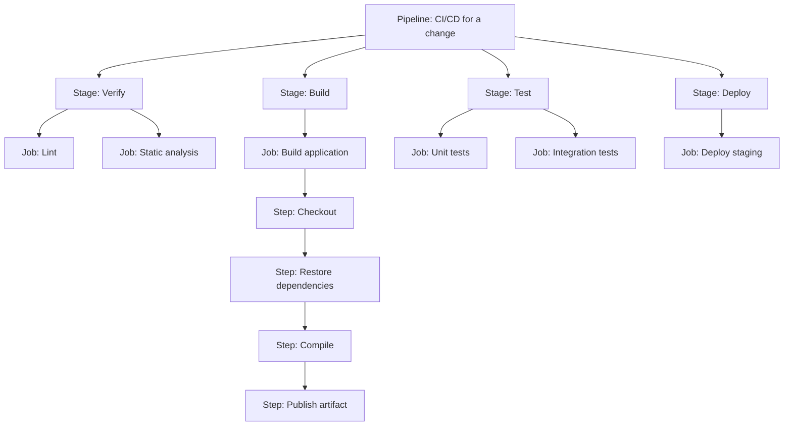
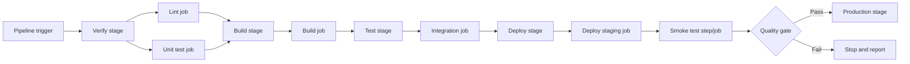
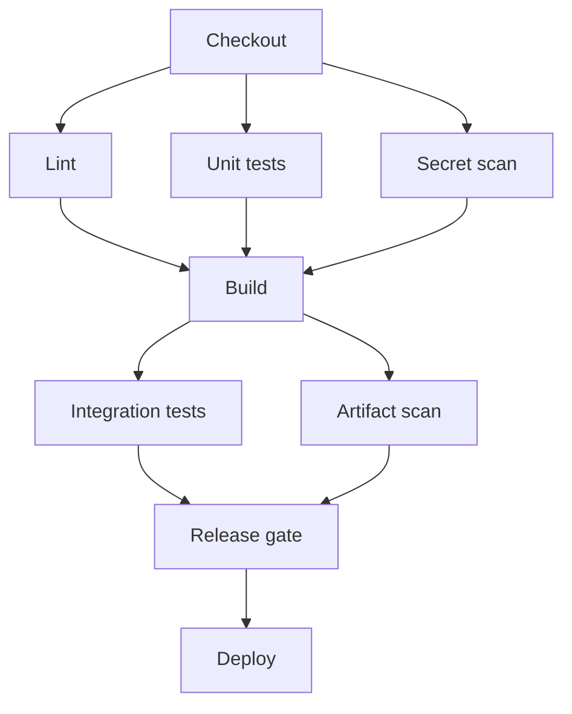
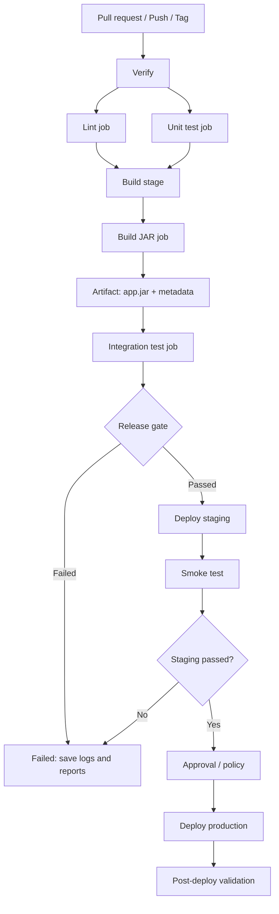

# Distinguishing Pipelines, Stages, Jobs, and Steps

## 1. Why understand pipeline structure?

When building CI/CD, a workflow typically consists of many activities: fetching source code, installing dependencies, running quality checks, building, testing, packaging artifacts, deploying, and verifying after deployment. If all activities are written as a single long block of commands, the workflow becomes hard to read, hard to reuse, hard to parallelize, and difficult to troubleshoot when failures occur.

CI/CD platforms provide a structural model to organize these activities. Four common concepts are:

- **Pipeline:** the entire automated flow triggered by an event or request, orchestrating activities from start to finish.
- **Stage:** a logical grouping of jobs that share the same purpose or lifecycle milestone, such as Verify, Build, Test, Package, or Deploy.
- **Job:** a unit of execution scheduled on a runner/agent or execution environment; a job typically contains multiple steps and can run in parallel with other jobs when they do not depend on each other.
- **Step:** a specific operation inside a job, usually running a command, invoking an action/task, restoring cache, or downloading artifacts.

Understanding the relationship among these four concepts helps you design clear pipelines, control ordering, optimize execution time, restrict permissions, and trace results. This is the foundation for building maintainable pipelines as code in the CI/CD module.

## 2. General hierarchical model

You can think of a pipeline as an orchestration map. The pipeline defines when the workflow starts and which tasks must be completed. Stages divide the map into logical phases. Each stage can contain one or more jobs. Each job contains steps executed within the same job context.



This is a conceptual model. Not every platform requires all four levels or uses these exact names. Some tools organize workflows directly into jobs and steps, some use stages as the primary level, and some call a job a task or an action. Certain platforms also have workflows, pipeline templates, task groups, deployment jobs, or matrices. When reading documentation for a specific tool, you must identify the actual semantics of each level rather than inferring from names alone.

## 3. Pipeline: the orchestration unit from event to outcome

A pipeline is the overall orchestration scope of an automation run. It typically defines:

- **Trigger:** the event that starts the run, such as a push, pull request, tag creation, schedule, or manual action.
- **Input sources:** repository, commit/ref, parameters, configuration variables, and related metadata.
- **Execution flow:** the stages/jobs to run, their order, and the dependencies between them.
- **Policies:** run conditions, quality gates, approvals, access permissions, and environment restrictions.
- **Outputs:** status, logs, reports, artifacts, metadata, and deployment history.

For example, a push to the `main` branch can trigger a CI pipeline to validate and produce artifacts. A version tag can trigger a release pipeline to deploy an artifact that has already been built and verified. Depending on the design, these can be two separate pipelines or two conditional branches within the same pipeline definition.

A pipeline has its own lifecycle: created by a trigger, queued, executed, completed, or failed. Each run should have an identifier to link it with commits, logs, test reports, and artifacts. When investigating an incident, you need to know which pipeline run processed which revision and why a job ran or was skipped.

A pipeline should not be equated with a single YAML file. A YAML file or configuration code is how a pipeline is described as code; the pipeline is the actual process interpreted and executed by the platform from that configuration. A pipeline can be composed from multiple files/templates or invoke reusable workflows, depending on the tool.

## 4. Stage: dividing the flow into logical phases

A stage groups jobs by purpose or transition point in the workflow. For example:

| Stage | Objective | Typical Outputs |
|---|---|---|
| Verify | Fast checks and input validation | Lint results, type check, static analysis |
| Build | Produce deliverables from the selected revision | Binary, package, or container image |
| Test | Verify behavior and interactions | Test report, coverage, contract/integration test results |
| Package/Publish | Package and store deliverables | Versioned/digest artifact and metadata |
| Deploy | Deliver artifacts into the target environment | Deployment record, running version |
| Validate/Observe | Post-deployment verification and rollout monitoring | Smoke test, health check, canary metrics |

Stages help readers see which phase a pipeline is in and can represent transition gates. For example, the Deploy stage only starts after Build and Test pass; the Production stage may require approval after staging validation succeeds.

In many systems, stages run sequentially in declaration order or by dependency relationships. However, you should not assume all stages must always run serially. Some platforms allow stages to run in parallel, be skipped conditionally, or form a DAG (directed acyclic graph) dependency flow. Actual execution structure depends on how dependencies are declared.

A stage does not necessarily correspond to an environment. “Test” can be a stage running on a runner without deploying the application to a test environment; conversely, “Deploy to Staging” can be a dedicated stage. Name stages after the goal and decision to be reached, avoiding overly generic names like `Step1` or `Other`.

## 5. Job: the unit of scheduling and execution

A job is a unit of work that the platform can assign to a runner, agent, or execution environment. A job typically has:

- A specific execution environment, operating system, or image/container.
- Steps executed sequentially within the scope of the job.
- Required environment variables, permissions, and credentials.
- Allocated resources such as CPU, memory, workspace, and maximum duration.
- Run conditions, timeout, retry, or failure-handling policies if supported by the platform.
- Outputs such as logs, reports, artifacts, or output values used by other jobs.

For example, the Test stage may have three independent jobs: UnitTests, ContractTests, and SecurityScan. They can run simultaneously on three different runners. If one job fails, the pipeline aggregates the status according to configured policies; remaining jobs may continue to gather additional results or be canceled depending on the strategy.

A job is often an important workspace boundary. A job may run on its own virtual machine or container; files created in one job do not automatically exist in another job. If a downstream job needs those files, the pipeline must transfer them via artifacts, cache, or a platform-supported sharing mechanism. Do not assume two jobs share a working directory.

A job is also the right place to define the execution environment and least-privilege permissions. A job that only runs unit tests does not need production credentials. A job deploying to staging needs staging permissions; a job deploying to production needs dedicated production permissions and policies. Separating jobs by permissions and purpose limits the blast radius when errors or misconfigurations are exploited.

## 6. Step: a specific operation inside a job

A step is an action within a job. Steps usually run sequentially and share the job's workspace, so a later step can use files created by an earlier step in the same job.

An application build job might include:

1. Checking out the exact commit.
2. Setting up the runtime version and build tools.
3. Restoring dependencies or cache.
4. Running formatter/lint if placed in this job.
5. Compiling source code.
6. Running unit tests or collecting build reports.
7. Packaging and uploading artifacts.

A step can be a shell command, action, built-in task, internal script, or operation provided by a platform plugin. Each platform has different syntax for declaring steps and handling exit codes. As a rule, a step should have a clear purpose, well-defined inputs, and inspectable outputs.

Example of a job illustrated in pseudocode:

```yaml
jobs:
  build_application:
    steps:
      - name: Checkout source
        run: git checkout $SOURCE_REVISION
      - name: Restore dependencies
        run: ./build-tool restore
      - name: Compile
        run: ./build-tool compile
      - name: Run unit tests
        run: ./build-tool test
      - name: Publish artifact
        run: ./build-tool package
```

This is YAML illustrating structure, not a configuration that runs directly on every platform. The syntax for `jobs`, `steps`, `run`, and variable access varies across CI/CD products. In a real pipeline, you need to declare checkout, permissions, and artifact upload according to the platform's documentation.

## 7. Relationships across levels: containment, execution, and dependencies

A common model is that a pipeline contains stages, stages contain jobs, and jobs contain steps. However, this is an organizational relationship. Execution relationships are determined by dependencies, conditions, and policies.



In this example, Lint and Unit test do not depend on each other and can run in parallel. Build only starts after both pass. Integration test requires the artifact from Build, so it depends on that output. Deploy staging requires the verified artifact. Production is only allowed to run after passing the quality gate and policy approvals.

Several terms should be distinguished:

- **Containment:** jobs reside in stages; steps reside in jobs.
- **Ordering:** one activity must complete before another activity starts.
- **Dependency:** a downstream activity requires the status or output of an upstream activity.
- **Condition:** a rule that determines whether an activity should run.
- **Artifact flow:** how deliverables are passed from producer jobs to consumer jobs.

Two jobs in the same stage do not necessarily depend on each other. Two different stages can also run in parallel if the platform and pipeline definition allow it. Likewise, declaration order in a file is not always execution order; the dependency graph is what you must read.

## 8. DAG and parallel execution

A DAG (Directed Acyclic Graph) describes activities and their dependency relationships. Each node is a job or task; edges indicate that one activity must finish before another. Acyclic means there is no dependency path that loops back to itself.

For example, after checkout, lint, unit tests, and secret scan can run in parallel. Only when all required checks pass does the pipeline build. After build, integration tests and artifact scan can run in parallel if both need the artifact. Upon completion, the pipeline permits deployment.



Parallel execution can reduce total duration, but it is not free. Many concurrent jobs require more runners, CPU, memory, and connections, and can increase queue wait times for other pipelines. Jobs sharing resources can cause data conflicts or flaky tests. Therefore, you should:

- Only parallelize jobs that are independent in data and outputs.
- Explicitly declare which job needs which job's artifacts or outputs.
- Limit concurrency according to runner capacity and system policies.
- Avoid having multiple jobs write to the same shared environment or resource without locking/coordination.
- Measure actual runtime and queue time to determine beneficial parallelism levels.

## 9. Passing data between jobs: outputs, artifacts, and cache

Jobs can produce many kinds of data, but not all data should be passed in the same way.

| Mechanism | Purpose | Examples | Notes |
|---|---|---|---|
| Job output | Pass small values to control downstream jobs | Build version, flag indicating whether to deploy | Do not use to pass large files or secrets if the platform is not designed for it |
| Artifact | Store and transfer output files of a run | JAR, container metadata, test report, package | Requires appropriate naming/identification, access permissions, and retention period |
| Cache | Speed up runs by reusing regenerable data | Dependency cache, build cache | Cache is not a source of truth; must be keyed by inputs and be safe to evict/rebuild |
| Workspace/shared volume | Share files within a configured environment scope | Temporary files between steps or jobs on a shared runner | Platform-dependent; avoid assuming workspaces are shared by default |

Example: The Build job produces `app.jar` and uploads an artifact named `application-build`. The IntegrationTest job downloads that artifact and tests the exact packaged build. The DeployStaging job continues by downloading the same artifact to deploy. If each job rebuilds on its own, results may differ due to dependencies, configuration, or build timing.

For container images, pass immutable identifiers such as digests rather than relying solely on tags that can move. Metadata should link the artifact to the commit, pipeline run, and verification results. This supports the principle of building once and promoting the same artifact across environments.

## 10. Run conditions, statuses, and failure handling

A pipeline must clearly define when a job or step executes. Common conditions include:

- Run only when the event is a pull request or a push to a specific branch.
- Run the publish step only when required builds and tests succeed.
- Deploy to production only with a valid tag/release and approval.
- Run the migration job only when the artifact contains schema changes.
- Always run log/report collection steps even if a preceding test job failed.
- Skip unrelated jobs when a set of files did not change, provided the selection rules are sufficiently reliable.

Common statuses include pending/queued, running, succeeded, failed, canceled, and skipped. Specific status names depend on the platform. When reading overall status, distinguish a job skipped by condition from a job that ran and failed; the two have different meanings.

Failure handling should also be designed intentionally:

- **Fail fast:** halt dependent flows when a required condition fails.
- **Continue/allow failure:** allow an optional job to fail while the pipeline continues, but clearly display the status and reason.
- **Retry:** retry operations susceptible to transient failures, with appropriate limits and backoff.
- **Always/finally step:** collect reports, logs, or perform cleanup even if previous steps failed.
- **Cancel in progress:** cancel an older pipeline run when a new revision arrives, if the older run no longer provides value and cancellation is safe.

Do not use retries to mask logic bugs or flaky tests. Retries are better suited for identifiable transient infrastructure errors, such as a registry service call timing out. For failing tests, preserve the first failure and investigate the root cause before deciding to retry.

## 11. Matrix jobs and configuration reuse

When you need to run the same operation across multiple runtime versions, operating systems, or configurations, a matrix strategy can generate multiple jobs from a single definition. For example, testing a library on Java 17 and Java 21, or on Windows and Linux.

Pseudocode:

```yaml
jobs:
  test:
    strategy:
      matrix:
        java: [17, 21]
        os: [linux, windows]
    steps:
      - name: Set up runtime
        run: setup-java $JAVA_VERSION
      - name: Run tests
        run: ./build-tool test
```

The definition above only illustrates the concept. Actual matrix syntax and variable names depend on the platform. With two Java versions and two operating systems, this strategy can generate four job combinations. Matrices help avoid duplicating configuration, though the number of combinations grows rapidly as you add dimensions. Select representative combinations aligned with your actual support matrix instead of expanding every combination when it adds no value.

Configuration reuse can be implemented via templates, reusable workflows, composite actions, task groups, or shared scripts. When reusing configurations, manage versions and roll out changes in a controlled manner so a template update does not unexpectedly break many repositories at once.

## 12. Security boundaries and execution permissions

Each level in a pipeline can enforce different policies. Pay special attention to:

- Triggers from external pull requests may run untrusted code; do not grant sensitive secrets or registry/production write permissions to those jobs.
- Production deployment jobs should be separated from source-code testing jobs and only accept verified artifacts.
- Grant least-privilege permissions per job; do not use one over-privileged credential across all stages.
- Protect environment variables and logs; do not print tokens or secret contents inside steps.
- Use protected environments, approvals, and restricted deployers when policy requires.
- Control versions of actions, plugins, runner images, and scripts used in pipelines.
- Record who or what condition initiated the pipeline, which job used which permissions, and which artifact was deployed.

Separating jobs along security boundaries reduces the scope of required permissions. For example, a Build job may only need read access to the repository and dependencies; a Publish job needs registry write access; a DeployStaging job needs staging credentials; a DeployProduction job needs dedicated permissions along with approval. If one step in a job has broad permissions, all commands running in that job can inherit those permissions.

## 13. End-to-end example: pipeline for a Java service

Suppose a team develops a Java service using Git for source control and builds a JAR as its artifact. The pipeline is organized as follows:

| Level | Name | Responsibility |
|---|---|---|
| Pipeline | `service-ci-cd` | Triggered by pull requests, pushes to `main`, or release tags; links runs to commits. |
| Stage | `Verify` | Organizes fast checks before building. |
| Job | `lint` | Runs formatter checks and static analysis. |
| Job | `unit-tests` | Runs unit tests and outputs reports. |
| Stage | `Build` | Produces the application package. |
| Job | `build-jar` | Checks out code, sets up JDK, restores dependencies, compiles, and uploads the JAR. |
| Stage | `Integration` | Verifies interactions using the built artifact. |
| Job | `integration-tests` | Downloads the JAR, initializes test dependencies, and runs integration tests. |
| Stage | `Staging` | Performs pre-production deployment. |
| Job | `deploy-staging` | Downloads the artifact by identifier, retrieves staging credentials, and deploys. |
| Job | `smoke-test` | Verifies endpoints, health, and core flows after deployment. |
| Stage | `Production` | Performs controlled release. |
| Job | `deploy-production` | Runs only when the release is valid, gates pass, and policy approvals are granted. |
| Job | `post-deploy-check` | Verifies health, metrics, and rollout status. |

Dependency flow:



In this pipeline, lint and unit tests can run in parallel because both use the checked-out revision and do not depend on each other's outputs. Build waits for both required jobs to pass. Integration tests download the produced JAR, ensuring verification against the exact artifact intended for deployment. Staging and production use the same artifact, but with different configurations and credentials. If the staging smoke test fails, the pipeline stops before production and preserves evidence for investigation.

## 14. How to read and design a maintainable pipeline

When reading a new pipeline file, look for the following in order:

1. **Trigger:** when does the pipeline run, and on which branches/tags/events?
2. **Revision:** which source code is checked out, and is the commit pinned?
3. **Stages/jobs:** how are tasks divided by objective?
4. **Dependency graph:** which jobs run first, which run in parallel, and what are the transition conditions?
5. **Runner/environment:** which OS, image, or environment does each job run on?
6. **Steps:** what operations does each job perform and what outputs are produced?
7. **Data flow:** how are artifacts, outputs, caches, and reports passed between jobs?
8. **Conditions/failure:** how are skip, fail, retry, approval, and cleanup conditions declared?
9. **Permissions/secrets:** what permissions does each job have and where are secrets scoped?
10. **Observability:** where are logs, reports, run IDs, and deployment records stored?

When designing, name items after the action or objective, such as `unit-tests`, `build-image`, `publish-artifact`, or `deploy-staging`. Clear names help read logs and locate failed jobs faster. Each job should have an appropriately scoped responsibility; avoid a single job that performs everything from lint, build, and deploy to migrations if those activities require different permissions, environments, or conditions.

Do not split every command into a separate job. Creating a job incurs initialization, workspace setup, artifact transfer, and orchestration overhead. If two operations need the same workspace, the same permissions, and must always run sequentially, they likely fit as steps within one job. If they require different environments, permissions, schedules, or parallelization, splitting them into separate jobs is usually clearer.

## 15. Common misconceptions

| Misconception | Correct Understanding |
|---|---|
| Pipeline and stage are the same | A pipeline orchestrates the entire run; a stage is a logical grouping inside it or a partitioning level defined by the platform. |
| Every stage must run sequentially | Execution order is determined by dependencies and platform features; stages can be parallel or conditional. |
| Job and step are interchangeable | A job is a scheduled unit of execution; a step is an operation inside a job and typically shares the job's workspace. |
| Two jobs share files by default | Jobs may run on separate runners; configured artifacts/caches/workspaces are needed to transfer data. |
| One stage is always one environment | A stage is a logical phase; an environment is a deployment target or context that may be used in one or more stages. |
| Looking at order in YAML is enough | You must read dependencies, conditions, and platform semantics; declaration order does not always determine execution order. |
| More jobs always mean faster runs | Parallel jobs consume resources and incur orchestration overhead; you must measure and limit concurrency. |
| Cache is the same as an artifact | Cache is for speeding up runs and can be regenerated; an artifact is an output that must be identified, retained, and promoted. |
| Test jobs and deploy jobs share credentials | Permissions should be separated by purpose and environment, applying the principle of least privilege. |

## 16. Core practical principles

1. Use pipelines to describe and orchestrate the entire flow from trigger to outcome.
2. Group stages around meaningful objectives and transition gates.
3. Use jobs as execution units with clear runners, workspaces, permissions, and outputs.
4. Use steps for specific, sequential operations within the same job.
5. Model execution order with a dependency graph; parallelize only independent tasks.
6. Pass data between jobs using outputs, artifacts, or caches for their intended purpose; do not assume shared workspaces.
7. Design conditions, statuses, retries, and failure handling transparently.
8. Separate jobs by security boundaries, environments, and access permissions.
9. Use clear naming, version-controlled templates, and preserve evidence for every run.

By distinguishing pipelines, stages, jobs, and steps, designers can break CI/CD workflows into understandable and controllable units. A sound architecture tells you what needs to happen, what it depends on, which environment it runs in, what permissions it uses, what outputs it produces, and what conditions permit advancing to the next step. That clarity makes pipelines maintainable, optimizable, and traceable throughout the software development lifecycle.
