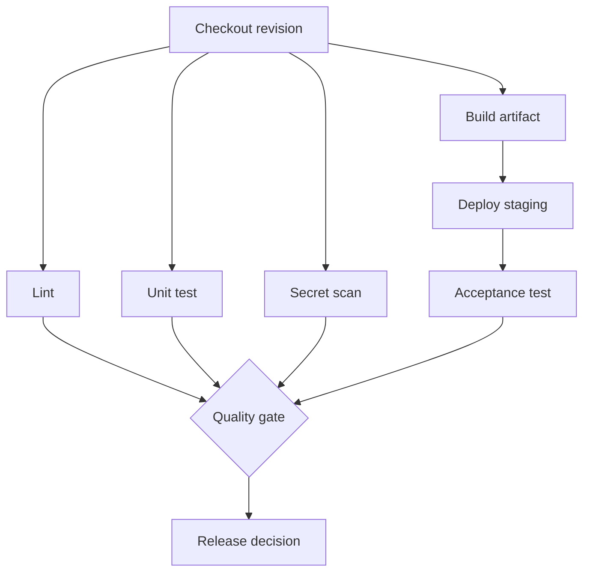
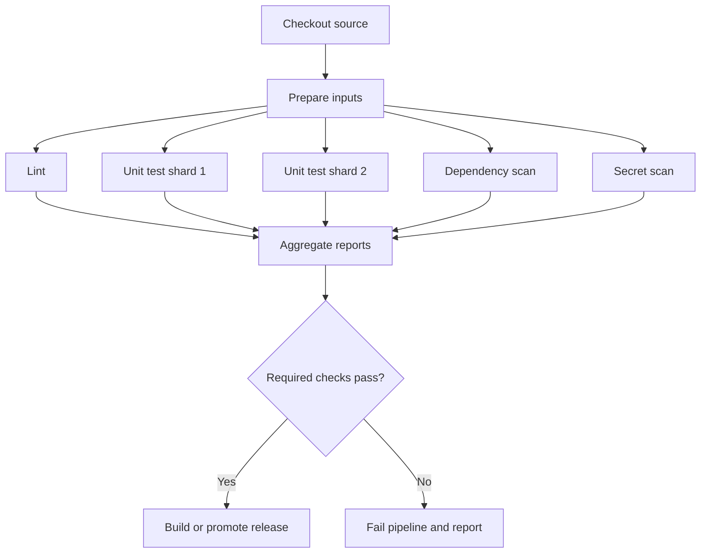
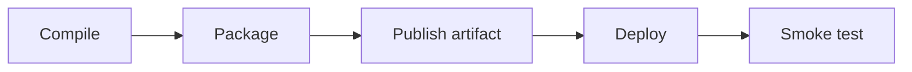
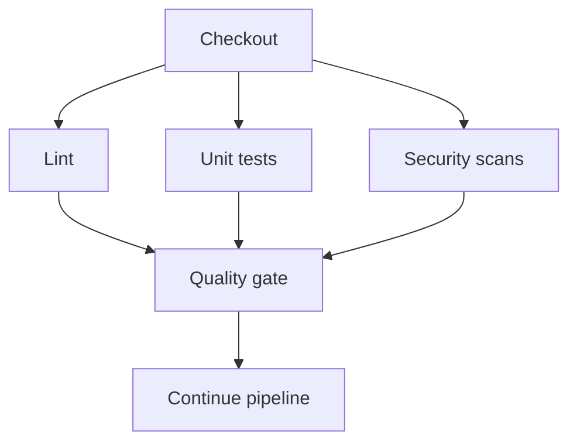
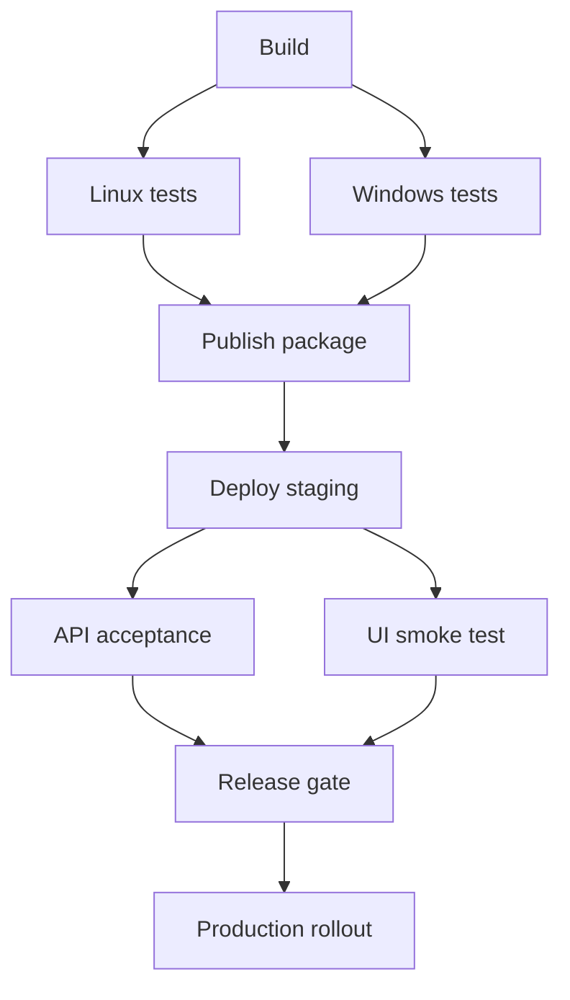

# Choosing Sequential vs. Parallel Jobs

A CI/CD pipeline can consist of many jobs: fetching source code, checking formatting, running static analysis, running unit tests, building the application, scanning dependencies, creating artifacts, running integration tests, and deploying. If every job runs sequentially, the pipeline is easy to understand but can incur significant waiting time. If you try to run everything simultaneously without proper coordination, a job might start before its required data is ready, multiple jobs might overwrite the same resource, or test results might become flaky.

Good pipeline design requires determining **which jobs truly depend on others, which are independent, and which resources can be used concurrently**. Dependent jobs must run in the proper order. Independent jobs can run in parallel to shorten feedback time. The goal is achieving good speed while keeping results accurate, repeatable, and easy to investigate.

In CI/CD, this organization is typically modeled using a Directed Acyclic Graph (DAG). The pipeline engine uses dependency relationships to decide which jobs are ready, which must wait, and which must stop when a mandatory condition fails.

## 1. Understanding dependency relationships before choosing execution order

A pipeline consists of nodes and dependency edges. A node can be a step, job, or stage depending on the platform. An edge from A to B means B may only start once the dependency condition on A has been satisfied—typically meaning A has succeeded and provided sufficient outputs.

For example, the staging deployment job requires the built artifact. Therefore, `build_artifact` must finish before `deploy_staging`. Meanwhile, `lint`, `unit_test`, and `secret_scan` can be independent if they only read the same Git revision and do not mutate shared state. They can run concurrently.



The diagram shows that several jobs can run concurrently after checkout, while deployment jobs must wait for the artifact. The quality gate aggregates mandatory results before making the next decision.

### DAG and execution order

A DAG has two properties:

- **Directed:** dependency relationships identify predecessor and successor jobs.
- **Acyclic:** no chain of dependencies loops back to the starting node.

The pipeline engine can pick any ready node, provided all of its dependencies have completed per policy. Consequently, a DAG often has multiple valid execution orders. Independent jobs can start nearly simultaneously if sufficient runners and resources are available.

For example, if `lint`, `unit_test`, and `dependency_scan` all depend on `checkout`, there is no data reason to force `lint` to wait for `unit_test`. Whether they actually run concurrently also depends on runner count, concurrency limits, queues, and platform configuration.

A valid DAG does not guarantee all jobs will run concurrently. It only describes the constraints that must be honored; the scheduler decides actual timing based on execution capacity and policy.

## 2. When must jobs run sequentially?

Two jobs must run sequentially when the later job needs a result, state, or condition produced by the earlier job. Before adding a dependency, identify that exact relationship.

### 2.1. Output data dependencies

If job B needs a file, package, image, or metadata produced by job A, B must wait for A to publish that output successfully. For example:

1. Compile source code to produce a JAR file.
2. Package a container image containing the JAR file.
3. Publish the image to a registry and obtain its digest.
4. Deploy that exact digest to staging.

You cannot deploy an image before it is built and published. This is a genuine dependency, so it must be declared in the pipeline rather than relying on sleep delays or assuming job A usually runs fast.

### 2.2. Mutating the same shared state

Two jobs may not share a data dependency yet still conflict if both write to the same resource. For example, two jobs running migrations on the same test database, modifying the same Kubernetes namespace, or writing to the same shared output directory.

If resources cannot be isolated, you must serialize execution or use a locking mechanism. However, before adding locks, consider provisioning separate databases, namespaces, directories, or datasets per job. Isolation often enables safe parallel execution and increases throughput.

### 2.3. Business order or state transition order

Some steps must follow a sequence because they change system state:

- Create a new schema before the application version begins using that schema.
- Deploy foundational components before application components that depend on them.
- Verify staging before permitting artifact promotion to production.
- Drain traffic before performing disruptive maintenance operations.
- Complete verification or approval before a controlled release action.

This ordering usually reflects compatibility and safety requirements rather than CI/CD tool limitations.

### 2.4. Quality gates or human decisions

A production deployment job may need to wait for security checks, acceptance tests, and approvals. In this case, the dependency represents a decision gate: only when all mandatory conditions pass may the pipeline advance.

Do not place approvals ahead of jobs that generate the evidence reviewers need. Reviewers need to see the artifact, test results, scan reports, release notes, and recovery plan. A meaningful approval must be tied to the exact version about to be deployed.

### 2.5. Need to limit impact or access rate

Some shared test systems cannot handle multiple concurrent jobs. A sandbox API may have rate limits, a hardware lab may only have one device, or a test account may disallow multiple login sessions. When independent resources cannot be created, jobs must be queued or concurrency-limited.

This is a resource or policy constraint. Clearly document the reason and scope of the lock to avoid serializing the entire pipeline just because one small resource is constrained.

## 3. When can jobs run in parallel?

Jobs can run in parallel when they do not need each other's outputs, do not cause state conflicts, and can execute safely on allocated resources.

### 3.1. Independent checks on the same revision

After checking out a specific revision, many types of checks can usually run independently:

- Lint and format checks.
- Static analysis and type checks.
- Unit tests across independent modules.
- Secret scans and dependency scans.
- License or package policy checks.

Each job reads the same commit but produces its own report. One job does not need to wait for another because it does not consume the other's outputs. After all finish, the quality gate aggregates the results.

### 3.2. Running multiple configurations with a matrix

A matrix lets you run the same suite of checks across multiple configuration values. For example, a library must be tested on multiple JDK versions or multiple operating systems. Instead of writing a separate job for each configuration, the pipeline generates multiple instances from one definition.

```yaml
# Illustrative YAML for the matrix concept, not tied to a specific platform's syntax
test_matrix:
  job: unit_test
  matrix:
    java: [17, 21]
    os: [linux, windows]
  run:
    - setup_java: ${matrix.java}
    - run_tests
```

The example above produces four combinations: JDK 17/Linux, JDK 17/Windows, JDK 21/Linux, and JDK 21/Windows. Instances can run concurrently if suitable runners are available. If a configuration is unsupported, exclude it explicitly rather than letting the job fail due to an invalid setup.

Matrices fit compatibility testing, multiple runtime versions, multiple CPU architectures, multiple browsers, or multiple build configurations. The number of combinations grows as the product of dimensions; therefore, control matrix size to avoid spawning hundreds of unnecessary jobs.

### 3.3. Splitting test suites (test sharding)

A large test suite can be divided into multiple shards. Each shard runs a distinct subset of tests on an independent runner. Once all shards finish, the pipeline aggregates reports and determines pass/fail.

For example, 800 tests can be split into four groups of roughly 200 tests each. If each group's runtime is comparable and there is no resource contention, total time can approach the duration of the slowest group rather than the sum of all four groups.

Sharding must ensure:

- Every test executes the expected number of times, avoiding accidental omissions or duplicates.
- Test data and resources are isolated or properly synchronized.
- Results from all shards are aggregated; missing a mandatory shard must fail the quality gate or mark it incomplete.
- Shards have relatively balanced durations so one runner does not drag out the entire pipeline.

### 3.4. Testing multiple independent components

In a monorepo, a change can affect multiple independent services or packages. The pipeline can detect changed areas and run the corresponding checks in parallel. For example, modifying a shared library can trigger tests for multiple services that consume that library.

The critical requirement is accurately determining impact scope. If service B depends on a newly modified package A, B's tests may need to wait for artifact A or use an updated workspace. Parallel execution is only valid once inter-component dependencies are resolved.

### 3.5. Fan-out and fan-in

A common pattern is **fan-out**: one input job branches into multiple independent jobs; followed by **fan-in**: an aggregation job waits for the mandatory branches to complete.



Fan-out leverages concurrency. Fan-in ensures the pipeline does not treat one passing branch as sufficient when other mandatory branches have not finished.

## 4. Modeling a pipeline as a dependency graph

Several common DAG patterns help design clear pipelines.

### 4.1. Sequential chain



A chain fits when each step requires the output or state produced by the previous step. Do not insert fixed waits like `sleep 30` in place of dependencies. Jobs must wait on actual conditions, such as an artifact being published or a deployment becoming ready.

### 4.2. Parallel branches followed by convergence



This pattern fits when multiple checks evaluate the same revision. The quality gate runs only once all required results are available.

### 4.3. Diamond: branch out, merge, and branch out again



The diamond pattern appears when a shared artifact or result is produced from multiple branches and then consumed by multiple subsequent checks. It clearly shows convergence and divergence points in the flow.

### 4.4. Conditional branches

Not every job needs to run in every situation. For instance, documentation checks might run only when documentation files change; production deployment runs only on authorized branches or tags; heavy performance tests might run on a schedule or when a label requests them.

Conditions must be based on verifiable data such as Git event type, changed paths, branch, tag, validated inputs, or quality gate status. Avoid ambiguous conditions that cause a mandatory job to be skipped while the pipeline still reports success.

When a branch is intentionally skipped, the aggregation job must interpret the `skipped` status according to policy. A non-applicable check may be considered valid; a mandatory check that never ran must not automatically count as a pass.

## 5. Declaring explicit dependencies in Pipeline as Code

Pipeline as Code lets you store the job graph inside the repository. Field names and syntax depend on the platform, but the general idea is declaring triggers, jobs, dependencies, conditions, and outputs.

The following example is **platform-agnostic illustrative YAML**, and cannot run directly without adapting to the syntax of GitHub Actions, GitLab CI, Jenkins, or the tool in use:

```yaml
pipeline:
  trigger:
    - pull_request
    - merge_to_main

  jobs:
    prepare:
      steps:
        - checkout_revision
        - resolve_build_inputs

    lint:
      needs: [prepare]
      steps:
        - run_linter

    unit_tests:
      needs: [prepare]
      steps:
        - run_unit_tests
        - publish_test_report

    security_scan:
      needs: [prepare]
      steps:
        - scan_dependencies
        - scan_secrets

    quality_gate:
      needs: [lint, unit_tests, security_scan]
      condition: all_required_checks_pass

    build_artifact:
      needs: [quality_gate]
      outputs:
        - artifact_digest
        - provenance

    deploy_staging:
      needs: [build_artifact]
      input: artifact_digest

    acceptance_tests:
      needs: [deploy_staging]
      steps:
        - run_api_acceptance
        - run_smoke_tests

    release:
      needs: [acceptance_tests]
      condition: release_policy_approved
      steps:
        - promote_same_artifact
```

In this example, `lint`, `unit_tests`, and `security_scan` all depend on `prepare`, so they can run in parallel. `quality_gate` waits for all required results. Build starts only when the gate passes; staging receives the digest from build; acceptance tests wait for staging to finish; release waits for acceptance results and approval policy.

When translating to a specific platform, check the actual semantics of dependencies and conditions. Some tools skip dependent jobs by default when an upstream job fails; others provide syntax allowing result collection even if one branch fails. Do not assume `needs`, `depends_on`, or `stage` behave identically across tools.

### Minimal dependencies vs. redundant dependencies

Declare a dependency only when the downstream job genuinely requires a result, state, or condition from the upstream job. If every job depends on one large aggregation job merely for configuration convenience, the pipeline can inadvertently turn into a sequential chain.

For example, `lint` does not need to wait for `unit_tests` if both only read the same revision. Declaring `lint needs unit_tests` forces the pipeline to wait despite having no data relationship. Redundant dependencies increase wait times and obscure the true structure of the pipeline.

Conversely, missing dependencies are also dangerous. If `deploy_staging` does not declare that it needs `build_artifact`, the scheduler might start deploying before the artifact is ready or pick up a stale artifact lingering in the workspace.

## 6. Passing data safely between jobs

Parallel execution typically means each job runs in its own workspace or runner. Do not assume files created in job A's filesystem automatically appear in job B. Data must be transferred via artifacts, caches, or platform-supported outputs.

### 6.1. Use artifacts for outputs that must be preserved

An artifact is an output saved for use by another job or release step—such as a JAR, container image, test report, coverage report, or manifest. Artifacts should have clear identifiers and be tied to the revision and pipeline run.

For deployable artifacts, build once and promote the same content across environments. Staging and production jobs must receive the exact same immutable version or digest, rather than rebuilding on their own. That way, test results correlate directly with the exact content being deployed.

### 6.2. Use outputs for small data and metadata

Outputs suit small values like an image digest, package version, artifact path, or decision result. Outputs should be clearly named and validated before use. Do not pass secrets through broadly visible outputs or logs.

### 6.3. Use cache to speed up runs, not as a canonical data source

Caches store dependencies or regenerable data to reduce download and build times. Caches can be evicted, expire, or not be shared across runners. Therefore, the pipeline must still work correctly on a cache miss.

Do not use cache in place of releasable artifacts. An overly broad cache key can cause a job to use dependencies or build outputs that do not match the current revision. Cache keys should reflect the inputs that affect cached content, such as lockfiles, runtime versions, or build configuration.

### 6.4. Do not share concurrently written workspaces

If multiple jobs write to the same directory, they can overwrite files or read incomplete state. Use separate workspaces, distinct filenames, and separate output directories, then aggregate results in a later job. When a shared resource is unavoidable, implement explicit synchronization protocols or locks.

## 7. Managing resources and concurrency limits

Dependencies are only part of the parallel execution equation. A DAG may have ten ready jobs but only two runners. In that case, the scheduler must queue them; the remaining jobs cannot start immediately.

Resources to consider include:

- **Runners or executors:** available count, CPU, memory, operating system, and architecture.
- **Databases and dependent services:** connection counts, quotas, shared data, and load limits.
- **Registries and external services:** rate limits, bandwidth, and request quotas.
- **Deployment environments:** namespaces, clusters, accounts, network addresses, and isolation capabilities.
- **Specialized hardware resources:** mobile devices, GPUs, embedded devices, or shared licenses.

### Limiting concurrent jobs

Concurrency limits protect resources and prevent traffic spikes. For instance, a pipeline might allow at most four concurrent integration tests because that is all the test database can handle. Remaining jobs wait for a slot.

Limits should be scoped only as broadly as needed: per repository, job group, environment, or specific resource. If only a production deployment job needs an environment lock, do not lock builds and unit test pipelines across all branches.

### Resource locks and deployment groups

Two releases deploying to the same environment simultaneously can overwrite each other's state. Use concurrency groups or environment locks to ensure only one critical state-changing operation runs at a time.

Locks must have reasonable scope and expiration. A hung job should not hold a lock indefinitely. Pipelines need timeouts, release mechanisms when jobs finish or are canceled, and handling for expired leases.

### Isolating to increase parallelism

If tests require the same database engine but can use separate schemas, create a schema per pipeline run or shard. If each job needs a Kubernetes namespace, provision an ephemeral namespace and tear it down afterward. If jobs write reports, write to separate directories and aggregate afterward.

Isolation adds provisioning and cleanup overhead, but generally reduces wait times and contention failures. Balance ephemeral environment costs against the value of faster feedback.

## 8. Error handling in parallel pipelines

When multiple jobs run concurrently, one job may fail while others are still executing. Failure policies must be designed clearly so the pipeline does not draw false conclusions or waste unnecessary resources.

### Fail-fast

Fail-fast stops remaining branches early when a critical check fails. This saves runner capacity and reduces wait time once a passing outcome is no longer possible. For example, if compilation fails, jobs requiring compiled binaries have no reason to continue.

However, you should not always cancel every branch. When you need full scan reports or results from all test shards for debugging, the pipeline can let independent branches finish and then report the aggregated failure.

### Continue-on-error and non-blocking checks

Some checks can be set to warning mode during a trial period, such as a new lint rule or a benchmark without a stable baseline. In such cases, the pipeline must clearly distinguish `warning`, `allowed failure`, and `required pass`.

Do not turn a mandatory security check into a non-blocking check just to keep the pipeline green. Exceptions must have an owner, justification, scope, and expiration. The final quality gate must evaluate against published policy.

### Retries and idempotency

Retries suit transient errors such as interrupted registry connections or rate-limited API responses. Jobs with side effects must be designed to be idempotent: re-running them must not create duplicate resources, write corrupted data, or publish twice.

Do not retry indefinitely and do not use retries to hide logic bugs. Configure retry limits, backoff with jitter where appropriate, and record retry counts. For deployment jobs, define how to detect whether a previous attempt partially succeeded before re-running.

### Canceling dependent jobs and handling skipped states

When an upstream job fails, downstream jobs needing its output usually must be skipped. Aggregation jobs may still need to run to collect reports and diagnostic data. Therefore, separate "result aggregation" jobs from "release authorization" jobs.

The pipeline must interpret skipped states in context. An optional branch that does not apply may legitimately be skipped; a mandatory branch skipped due to an upstream failure must fail the gate.

## 9. Optimizing pipeline duration using the critical path

Parallelism can reduce pipeline duration, but improvements are bounded by the longest dependency path and actual resource availability. The path with the largest total duration from start node to end node is called the **critical path**. If a job on the critical path is slow, other jobs that finish early must still wait.

Suppose a pipeline has the following illustrative durations:

| Job | Duration | Dependencies |
|---|---:|---|
| Checkout | 1 minute | None |
| Lint | 2 minutes | Checkout |
| Unit test | 6 minutes | Checkout |
| Security scan | 4 minutes | Checkout |
| Build artifact | 5 minutes | Unit test and lint |
| Deploy staging | 3 minutes | Build artifact |
| Acceptance test | 4 minutes | Deploy staging |

Lint, unit tests, and security scans can run in parallel. With enough runners, the wait time for that stage is the longest job's duration, 6 minutes. Then build, deploy staging, and acceptance tests take another 12 minutes. Including the 1-minute checkout, total critical-path duration is roughly 19 minutes, excluding queuing, artifact download, or scheduler overhead.

If everything ran sequentially, total duration would be the sum of all jobs: 25 minutes. Parallelizing saves roughly 6 minutes in this example. Adding more runners will not shorten the critical path if the durations of jobs on that path remain unchanged.

### How to find and improve the critical path

1. Collect actual durations for each job, including queue time and execution time.
2. Inspect the DAG to identify the dependency chain with the largest total duration.
3. Identify which jobs are waiting on data, runners, locks, or environments.
4. Split long jobs if parts can run independently with aggregatable outputs.
5. Optimize jobs on the critical path first—for instance, speeding up tests, improving caching, or removing unnecessary dependencies.
6. Re-measure after changes to confirm total pipeline duration actually decreased.

Do not split a job into multiple small jobs if runner startup, checkout, dependency installation, and artifact transfer overhead exceed the saved time. Parallelization has overhead; it pays off only when tasks are substantial enough or environments can be reused effectively.

### Balancing duration across branches

In fan-out/fan-in, convergence time is dictated by the slowest branch. If four test shards run for 2, 2, 3, and 12 minutes respectively, the first three shards barely affect when the gate finishes; the last shard is the bottleneck.

You can rebalance tests using historical duration data, schedule long tests first, or use dynamic work distribution. The goal is keeping branch workloads roughly balanced and preventing one shard from consistently dragging out the pipeline.

## 10. Risks of parallelization

Improper parallelization can make a pipeline faster while producing wrong or unstable results.

### Race conditions

A race condition occurs when outcomes depend on the order or timing with which jobs access shared state. For example, two jobs updating a `latest` tag concurrently; a deploy job might pull an image published by a different branch. The solution is using immutable versions or digests, separate outputs, and explicit dependencies.

### Tests sharing data

Two tests creating a user with a hardcoded email or truncating the same table can cause each other to fail. Use run/shard-scoped identifiers, transactions, or independent fixtures; clean up only data owned by the job.

### Repeating side effects

A retried job or one triggered concurrently by multiple events can create duplicate releases, send duplicate notifications, or run migrations twice. Use idempotency keys, locks, pre-action state checks, and restricted execution permissions.

### Incomplete aggregated results

If an aggregation job only collects reports from completed shards without checking the expected shard count, the pipeline might pass even though some tests never ran. Verify a manifest or required results list before allowing the gate to pass.

### Resource exhaustion and rising costs

An oversized matrix can spin up hundreds of runners, inflate costs, and overload dependent services. Limit concurrency, pick high-value matrix combinations, use sensible test selection, and monitor queue times. Shorter individual job durations do not reduce overall wall-clock time if queues grow longer.

## 11. Security when executing multiple jobs concurrently

Every job should have only the minimum permissions needed for its task. Parallel execution is no excuse to share one broad credential across all jobs.

- Lint or unit test jobs typically only need to read source code and write reports; they do not need deployment permissions.
- Artifact publish jobs only need registry write permissions for allowed repositories or packages.
- Deployment jobs receive a dedicated identity and permissions for the target environment, preferring short-lived credentials.
- Jobs running on pull requests from forks or untrusted sources must not access production secrets.
- Artifacts from untrusted jobs must have provenance and policy verified before use in release steps.
- Logs and outputs must not contain tokens, passwords, or sensitive data.

Shared runners must isolate workspaces and credentials between jobs. If a runner retains state from a previous run, a job might inadvertently read leftover files or credentials. Ephemeral runners or post-job cleanup mechanisms help reduce this risk.

## 12. Observing and operating a DAG

A pipeline must display the status of each node and its dependency relationships. Operators need to know which jobs are waiting on dependencies, waiting on runners, running, failed, and which downstream jobs were skipped.

Useful telemetry includes:

| Metric | Meaning |
|---|---|
| Queue time | Time a job waits for a runner or concurrency slot |
| Execution time | Actual execution duration of the job |
| Critical path duration | Duration of the longest dependency path |
| Retry count | Number of retries and level of transient failures |
| Cache hit/miss | Cache utilization rate and impact on build time |
| Runner utilization | CPU, memory usage, and number of busy runners |
| Failure/skip reason | Reason a job failed or was skipped |
| Artifact lineage | Link between commit, producing job, digest, and deploying job |

A pipeline with a long total duration is not necessarily slow because jobs run slowly. Runners might be scarce, locks held too long, or an unnecessary dependency forcing jobs to wait. Distinguishing queue time from execution time helps select the right fix.

Logs should include pipeline run ID, job ID, commit SHA, and artifact digest where applicable. For parallel jobs, a correlation ID links reports and logs belonging to the same run. Do not rely on reading chronological logs to infer dependencies; use the DAG and job statuses.

## 13. End-to-end example: pipeline for a web service

Suppose a team develops a web service consisting of a backend API and a frontend. On pull requests, the pipeline must give fast feedback and verify affected components. After merge, the pipeline builds artifacts and deploys to staging.

**Pull request phase:** after checkout, the pipeline runs backend lint, frontend lint, backend unit tests, frontend unit tests, secret scan, and dependency scan in parallel. If changes affect API contracts, contract tests are triggered. The quality gate waits for all mandatory checks applicable to the change.

**Build phase:** after the gate passes, backend and frontend can build in parallel if independent. Each job publishes its own artifact tagged with the commit SHA. An aggregation manifest job records digests to define the compatible version bundle.

**Staging phase:** the pipeline applies backward-compatible database migrations first, then deploys backend and frontend according to actual dependencies. If the frontend requires a new API, the backend must be ready before routing frontend traffic to the new version. If both components maintain backward compatibility and can deploy independently, ordering may be relaxed by design.

**Verification phase:** API acceptance tests and UI smoke tests can run in parallel once both components are ready. An aggregation job waits for both reports. If either branch fails, the release gate fails; the pipeline retains artifacts and logs for investigation.

**Production phase:** after approval if required by policy, the pipeline deploys the exact tested digests. Production state-changing steps are locked per environment to prevent overlapping releases. After deployment, health checks and smoke tests run; rollout continues only while telemetry meets thresholds.

This flow uses parallelism where parts can be independent and enforces ordering where data or state dependencies exist. If backend and frontend are later designed for independent compatibility, the DAG can evolve to increase concurrency without sacrificing safety.

## 14. Anti-patterns in sequential and parallel design

| Anti-pattern | Why It Causes Problems | How to Improve |
|---|---|---|
| Running all jobs in one sequential stage | Creates wait time even when checks are independent | Split independent branches and use fan-out/fan-in |
| Running all jobs in parallel | Ignores data and state dependencies | Identify inputs/outputs and declare a proper DAG |
| Redundant dependencies | Jobs wait on each other without a real relationship | Declare only necessary dependencies |
| Missing dependencies | Job runs before artifacts or state are ready | Declare relationships explicitly and validate outputs |
| Using sleep instead of dependencies | Fixed wait times do not guarantee readiness | Wait on actual status or readiness signals |
| Sharing concurrently written workspaces | File overwrites and race conditions | Separate workspaces, explicit artifacts, and outputs |
| Using mutable tags for artifacts | Jobs may receive different content over time | Use immutable versions or digests |
| Unbounded matrices | Increases queue time, cost, and service load | Choose high-value combinations, set concurrency limits |
| Infinite retries | Masks failures and ties up runners | Limit retries, add backoff, ensure idempotency |
| Gate ignores missing shards | May report pass without full evidence | Aggregate manifests and verify complete results |
| Optimizing the fastest job | Does not improve the critical path | Focus on the slowest branch and queue time |
| Locking the whole pipeline to protect one environment | Slows down unrelated work | Scope locks to the exact resource and scope needed |

## 15. Checklist for choosing sequential vs. parallel jobs

Before finalizing a DAG, the team can review:

- [ ] Each job has clear inputs, outputs, and purpose.
- [ ] Dependencies reflect actual data, state, or policy relationships.
- [ ] There are no cycles in the dependency graph.
- [ ] Independent checks on the same revision are evaluated for parallel execution.
- [ ] Build, publish, deploy, and verification steps have clear ordering.
- [ ] Matrices and test sharding use reasonable combination counts without skipping mandatory checks.
- [ ] Fan-in verifies all required results exist before passing the quality gate.
- [ ] Artifacts and outputs are passed explicitly; caches are not used in place of release artifacts.
- [ ] Jobs do not write concurrently to shared workspaces or data without isolation/synchronization.
- [ ] Concurrency limits and locks are scoped to the appropriate resources.
- [ ] Retries are bounded and jobs with side effects are idempotent.
- [ ] Fail-fast, continue-on-error, and skipped policies are clearly defined.
- [ ] Jobs from untrusted sources do not receive secrets or sensitive deployment permissions.
- [ ] Queue time, execution time, and the critical path can be distinguished.
- [ ] Slow, flaky, or resource-contended branches are monitored and improved.

## 16. Conclusion

Choosing between sequential and parallel jobs is a problem of designing dependencies, state, and resources in a pipeline. Jobs needing outputs or conditions from earlier steps must wait on those exact steps. Independent jobs can run in parallel provided data and resources are isolated, results are fully aggregated, and execution permissions are restricted.

A clear DAG enables pipelines to leverage concurrency while preserving correctness. Combining minimal dependencies, immutable artifacts, fan-out/fan-in, resource limits, explicit error-handling policies, and critical-path observability allows teams to shorten feedback loops while maintaining traceability and reliability across the CI/CD workflow.
