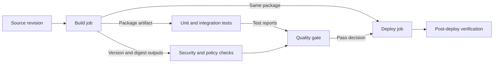

# Passing Outputs Between Jobs with Explicit Mechanisms

A pipeline is typically divided into multiple jobs to run work in parallel, isolate environments, or separate build, test, packaging, and deployment responsibilities. When one job finishes, a subsequent job may need the version, file, report, or deployment package produced by the previous job. How data is passed between jobs determines whether a pipeline is reproducible, runs in the correct order, and can accurately trace which output was used.

You should not assume that jobs share a working directory or run on the same machine. A runner may be freshly provisioned for each job, run on a different host, in a different container, or at a different time. Therefore, any data that needs to cross job boundaries must be published through a mechanism with an explicit contract: the producing job, data name and type, how consuming jobs receive it, retention period, and how integrity is verified.

## 1. Job boundaries and the need for data handoff

A pipeline is a graph of jobs and dependency relationships. A single job can contain multiple steps running sequentially in the same execution environment; different jobs can run in parallel and do not share a filesystem. Some platforms preserve the workspace across steps within the same job, but do not guarantee that workspace will exist in another job.

For example, an application pipeline might consist of:

1. `build` checks out source code and produces a package.
2. `unit-test` runs fast tests against the code or package.
3. `integration-test` downloads the built package and verifies interactions with dependencies.
4. `security-scan` analyzes the package, dependencies, and metadata.
5. `deploy-staging` deploys the exact verified package.
6. `post-deploy-verify` checks the running version and post-deployment metrics.

The test jobs need to know which package was built; the deployment job needs to know which package passed the gate; the verification step needs to know which version the environment is running. If each job rebuilds on its own or looks for files via an implicit path, the pipeline can generate inconsistent outputs and lose the link between testing and release.



The diagram illustrates three distinct types of information: the package is a file to download; the version or digest is small metadata; the gate result is a flow-control condition. They may be related, yet you should not rely on a single mechanism for all of them.

## 2. Distinguishing outputs, artifacts, caches, and workspaces

CI/CD platforms use different names and syntax, but most handoff mechanisms fall into four groups:

| Mechanism | Suitable Data | Scope and Characteristics | Should Be Used as Source of Truth? |
|---|---|---|---|
| Job outputs | Small values such as version, digest, artifact name, URL, result flag | Metadata published by a job for dependent jobs | Yes, if bound to the exact run with a clear source |
| Artifacts | Packages, binaries, test reports, manifests, SBOMs, generated files | Files stored and downloaded across job or stage boundaries; typically subject to retention limits | Yes, if the artifact is identified, protected, and integrity-checked |
| Cache | Downloaded dependencies, regenerable build objects, expensive-to-create intermediate data | Speed optimization; may be evicted, expire, or fail to restore | No; the pipeline must still succeed on a cache miss |
| Workspace | Temporary files during a job's execution | Usually guaranteed only within the same job or same runner per platform rules | Only within the scope guaranteed by the platform |

A helpful rule of thumb is: outputs transmit information about a result; artifacts transmit file contents; caches help regenerate results faster; workspaces are where a job does its active work. Do not store the sole release package in cache or rely on leftover directories on a self-hosted runner to pass data.

### Job outputs: passing small metadata

Outputs are suitable for short values representable as strings: application version, commit SHA, artifact ID, image digest, report filename, or an internal URL. The producing job must publish the value via the platform's mechanism; the consuming job must declare the dependency relationship and read the exact output from the source job.

Do not pass binary contents, large JSON files, or full logs via outputs. Output values are typically stored in run metadata, have size limits, and may appear in UIs or logs. Never put passwords, tokens, private keys, or personal data into outputs.

### Artifacts: transferring generated files

Artifacts are suitable when a downstream job needs the exact file created by an upstream job: packages, binaries, frontend bundles, test reports, coverage reports, SBOMs, manifests, or rendered configuration files. Platforms typically provide artifact upload and download operations by name or ID.

Artifact names should be tied to the run and purpose, such as `app-package-<run-id>-<attempt>`. When multiple jobs generate files with the same name, use distinct names per shard, platform, architecture, or test matrix entry to avoid overwrites. Consuming jobs should download the exact artifact published by the source job rather than searching for the latest file in storage.

### Cache: accelerating runs without guaranteeing data

Cache suits downloaded dependencies, package manager caches, or regenerable intermediate results. A cache might not exist when a job runs, may be evicted, or may not match the key. Consequently, a cache miss must simply cause the job to download or rebuild normally.

Cache keys should reflect the inputs that affect results, such as operating system, architecture, toolchain version, and lockfile. Broader restore keys may be used to restore a partial cache, but cache contents must never be treated as proof that a package passed testing. Releasable artifacts must be stored using an explicit artifact mechanism or registry with clear identification.

## 3. Designing a handoff contract

Before choosing syntax for GitHub Actions, GitLab CI, Jenkins, or another platform, describe the data contract between producer and consumer. A good contract answers these questions:

- **Producer:** which job creates the data and at which revision?
- **Name and type:** is the data a metadata string, single file, directory, package, or report bundle?
- **Semantics:** what are the version, schema, and intended purpose of the data?
- **Consumer:** which jobs are permitted to read it and at which step do they need it?
- **Identification:** how is the data linked to the pipeline run, commit, build, and attempt?
- **Integrity:** what checksum, digest, signature, or provenance must be verified?
- **Lifecycle:** how long is it retained, who has read/delete permissions, and when may it expire?
- **Error handling:** what happens when the producer fails, the artifact is missing, an output is empty, or the data is incompatible?

For example, a package contract might be documented as follows:

```yaml
artifact:
  name: app-package-<run-id>-<attempt>
  path: dist/app.tar.gz
  format: tar.gz
  version: <git-sha>
  producer: build
  consumers:
    - integration-test
    - deploy-staging
  integrity:
    algorithm: sha256
    digest: <computed-digest>
  retention: 14 days
```

This is a documentation structure example, not a mandatory schema for any specific platform. Actual values must be generated during the pipeline run; do not copy placeholder strings verbatim into a release manifest.

### Creating explicit dependencies in the pipeline graph

Consuming jobs must declare a dependency on the data-producing job. This relationship both enforces execution order and shows readers the data lineage. A job that only needs to wait for another job to finish without using its output may still need a dependency to ensure a gate ran. Conversely, simply naming stages or assuming an earlier job finishes before a later one does not always create a sufficiently explicit data relationship.

If a job needs multiple producers, declare all required sources. If one producer fails, downstream jobs should usually be blocked or routed to a pre-designed failure-handling branch. Do not configure conditions that allow deployment when a mandatory test job is skipped without an explicit exception policy.

## 4. Example: passing outputs and artifacts in GitHub Actions

The example below builds the package once, publishes the artifact name and version via job outputs, and then uses that exact package in verification and deployment jobs. Actions are illustrated using common versions; real repositories should pin and update versions according to organizational supply-chain policies.

```yaml
name: Build, verify and deploy

on:
  push:
    branches: [main]

permissions:
  contents: read

jobs:
  build:
    runs-on: ubuntu-latest
    outputs:
      package_name: ${{ steps.metadata.outputs.package_name }}
      version: ${{ steps.metadata.outputs.version }}
    steps:
      - uses: actions/checkout@v4

      - name: Create package
        run: |
          ./gradlew --no-daemon clean assemble
          mkdir -p dist
          tar -czf dist/app.tar.gz -C build/libs .

      - name: Publish job metadata
        id: metadata
        shell: bash
        run: |
          echo "package_name=app-${GITHUB_RUN_ID}-${GITHUB_RUN_ATTEMPT}" >> "$GITHUB_OUTPUT"
          echo "version=${GITHUB_SHA}" >> "$GITHUB_OUTPUT"

      - name: Upload package
        uses: actions/upload-artifact@v4
        with:
          name: ${{ steps.metadata.outputs.package_name }}
          path: dist/app.tar.gz
          if-no-files-found: error
          retention-days: 14

  verify:
    needs: build
    runs-on: ubuntu-latest
    steps:
      - uses: actions/checkout@v4

      - name: Download package from build
        uses: actions/download-artifact@v4
        with:
          name: ${{ needs.build.outputs.package_name }}
          path: input

      - name: Verify package
        run: |
          test -s input/app.tar.gz
          mkdir extracted
          tar -xzf input/app.tar.gz -C extracted
          ./scripts/verify-package.sh extracted

  deploy-staging:
    needs: [build, verify]
    runs-on: ubuntu-latest
    environment: staging
    steps:
      - uses: actions/checkout@v4

      - name: Download the verified package
        uses: actions/download-artifact@v4
        with:
          name: ${{ needs.build.outputs.package_name }}
          path: input

      - name: Deploy exact build
        env:
          APP_VERSION: ${{ needs.build.outputs.version }}
        run: ./scripts/deploy-staging.sh input/app.tar.gz "$APP_VERSION"
```

Key points to note:

1. `build` creates the package and publishes two metadata outputs. `GITHUB_OUTPUT` is the mechanism for writing step outputs; `jobs.build.outputs` promotes them to job scope.
2. `upload-artifact` stores the file so other jobs can download it. The `package_name` output only passes the name; it does not carry the package bytes.
3. `verify` declares `needs: build`, downloads the exact artifact named by the build job, and inspects the file before using it.
4. `deploy-staging` depends on both `build` and `verify`. It downloads the same generated artifact rather than building another copy.
5. `version` is passed through the deployment step's environment. This value is metadata, not a secret.

In a real pipeline, `verify-package.sh` must be supplied from the repository or a managed action. If signature or digest verification is required, add a step to compute and compare the digest before extracting or deploying. The example above focuses on illustrating the handoff mechanism; it does not replace production security validation steps.

## 5. Example: artifacts and dependencies in GitLab CI

GitLab CI supports transferring files via `artifacts` and declaring job relationships with `needs`. You can specify that downstream jobs download artifacts from a producer to avoid implicit reliance on stage ordering.

```yaml
stages:
  - build
  - verify
  - deploy

build:
  stage: build
  script:
    - ./gradlew --no-daemon clean assemble
    - mkdir -p dist
    - tar -czf dist/app.tar.gz -C build/libs .
    - echo "APP_VERSION=$CI_COMMIT_SHA" > dist/build.env
  artifacts:
    name: "app-$CI_PIPELINE_ID-$CI_JOB_ID"
    paths:
      - dist/app.tar.gz
    reports:
      dotenv: dist/build.env
    expire_in: 14 days

verify:
  stage: verify
  needs:
    - job: build
      artifacts: true
  script:
    - test -s dist/app.tar.gz
    - mkdir extracted
    - tar -xzf dist/app.tar.gz -C extracted
    - ./scripts/verify-package.sh extracted

deploy-staging:
  stage: deploy
  needs:
    - job: build
      artifacts: true
    - job: verify
      artifacts: false
  script:
    - test -s dist/app.tar.gz
    - ./scripts/deploy-staging.sh dist/app.tar.gz "$APP_VERSION"
  environment:
    name: staging
```

In this example, `artifacts.paths` saves the package; `reports.dotenv` exposes environment variables from the dotenv file to eligible jobs; `needs` specifies which job provides artifacts. `verify` needs the file, so it downloads artifacts from `build`. `deploy-staging` needs the package from `build` and must wait for `verify` to pass, but does not need artifacts from `verify`, so `artifacts: false` is explicitly declared.

When using `needs`, check the artifact download rules for your GitLab version and project configuration. Avoid declaring both `needs` and `dependencies` in overlapping or conflicting ways. For dotenv files, include only non-sensitive metadata; never use them to transport secrets.

## 6. Using a registry for large or long-lived artifacts

Pipeline-internal artifacts are typically suited for handoffs between jobs within the same run. For large packages, container images, packages promoted across multiple environments, or outputs that must outlive CI artifact retention limits, publish to a registry or dedicated artifact repository.

Common workflow:

1. Build the package or container image from a specific commit.
2. Publish to the registry with a human-readable tag, such as a commit or release tag.
3. Capture the digest returned by the registry and record it in a job output or release manifest.
4. Test and deploy using the immutable digest, such as `registry.example/team/app@sha256:...`.
5. Store provenance, SBOM, signatures, and gate results linked to that same digest.

Tags help humans find versions, while digests identify the exact content. Do not use mutable tags like `latest` as the sole identifier for a deployment. If a pipeline retries or a newer run publishes the same tag, the tag may point to different content; downstream jobs might accidentally pull the wrong package.

For container images, the build job can push the image to the registry and then publish the image reference by digest. Scan and deployment jobs read that exact reference. If each job rebuilds the image independently, they may evaluate and deploy different bytes even under the same tag name.

## 7. Fan-out and fan-in: passing data across parallel branches

A pipeline can split one output across multiple parallel jobs (*fan-out*), then aggregate results in one job (*fan-in*). For example, a package is tested across multiple Java versions, operating systems, or CPU architectures. Each matrix job produces its own report; the aggregation job must download all reports and know which report belongs to which shard.

When designing fan-out/fan-in:

- Give each artifact a unique name by shard, matrix value, or job ID.
- Record metadata for each shard: revision, runtime, platform, test suite, and status.
- Never allow multiple jobs to overwrite the same artifact path or the same cache key with different contents.
- The aggregation job must know the expected result set and detect missing shards.
- Distinguish failed tests from jobs that did not run, were canceled, or lost their reports.
- Permit the quality gate to pass only when all mandatory shards have valid results.

For example, artifacts might be named `test-report-java-17`, `test-report-java-21`, and `test-report-linux-arm64`. The aggregation job downloads each artifact, checks the manifest, and produces the final report. If a shard fails to produce an artifact, the pipeline must report an error or handle it under a defined exception policy; never silently treat a missing shard as success.

## 8. Passing data across different workflows or runs

Job outputs and artifacts are scoped to a specific pipeline run. When another workflow needs to consume an output, do not rely on a shared generic artifact name or query the "latest version" without verifying its source. Use a cross-workflow contract:

- The producer workflow publishes the package to a registry or artifact store with explicit access controls.
- The producer creates a manifest containing commit SHA, version, digest, build timestamp, and source pipeline.
- The consumer workflow receives the release identifier via trigger, release record, or authenticated API.
- The consumer verifies the manifest, digest, signature, and policy before deploying.
- Deployment results are linked back to the digest and producer run.

If the platform supports downloading artifacts from another workflow run, pass the explicit run ID or artifact ID and verify repository, branch, commit, access permissions, and source workflow status. Do not select artifacts by name alone since multiple runs can produce the same name.

For systems sharing data over longer timeframes, a registry, package repository, or versioned object storage is usually more appropriate than ephemeral job artifacts. Read permissions, write permissions, retention, and deletion procedures must be designed as part of the release system.

## 9. Protecting handed-off data

Artifacts and caches are inputs to subsequent jobs. If a producer runs on untrusted code, the generated data could contain malicious executables, abnormal paths, or content crafted to exploit consumers. Therefore, never treat downloaded artifacts as trustworthy merely because they reside within the same CI platform.

Principles to apply:

- Never include tokens, passwords, private keys, or secrets in outputs, artifacts, caches, reports, or manifests.
- Scope artifact read/write permissions by repository, project, pipeline, and environment; do not allow fork workflows to overwrite artifacts trusted by production.
- Verify producer source, revision, and workflow status before using data.
- Verify digests to detect tampered content; use signatures and provenance when origin verification is required.
- Validate paths and archive structure before extracting; prevent path traversal or writing files outside the target directory.
- Never execute scripts taken from unverified artifacts or produced by untrusted workflows.
- Restrict consumer job permissions; test jobs do not need production deploy permissions.
- Configure retention and access controls so sensitive data does not persist longer than needed.

Checksums confirm that bytes match a known digest, but by themselves do not prove who created the artifact. Signatures and provenance verify creator identity, workflow identity, and build inputs against policy. For packages impacting production, attach this evidence to the same artifact identifier.

## 10. Error handling and data consistency

A reliable pipeline must define behavior when handed-off data is missing or invalid. Common scenarios include:

| Scenario | Recommended Behavior |
|---|---|
| Producer fails | Block mandatory consumers; preserve logs and failure status |
| Output is empty or malformed | Validate schema/format and halt before use |
| Artifact does not exist | Fail with clear producer name, artifact name, and run ID |
| Digest mismatch | Reject usage; investigate integrity and provenance |
| Artifact expired | Rebuild from the exact revision or fetch from registry by recorded digest |
| A shard is missing a report | Mark incomplete results; never infer a pass |
| Consumer re-runs | Use the exact same identified input or create a new deployment with a distinct ID |
| Two pipelines publish the same tag | Use unique versions/digests and concurrency controls or controlled promotion |

Consuming jobs should validate data immediately at startup: file exists, reasonable size, parseable manifest, matching revision, and matching digest. Early validation ensures handoff failures surface right at the boundary instead of appearing as cryptic errors during deployment.

If retries are needed, separate data-reading operations from data-creation or publishing operations. Artifact downloads can be retried on transient network errors; publishing or deploying requires idempotency and identifiers to avoid creating duplicate versions or unintended overwrites.

## 11. Managing retention and reproducibility

Not all data needs the same retention period. Caches can expire quickly because they can be regenerated; test reports may need longer retention for incident investigation; production release artifacts may need to be retained per operational or audit policies.

Retention policies should consider:

- Value of the data for debugging, auditing, and recovery.
- Storage capacity and cost.
- Compliance, privacy, and data classification requirements.
- Ability to reproduce the artifact from pinned commit, dependencies, and toolchain.
- Links among artifact, digest, provenance, and release records.
- Ability to roll back to prior versions within the committed window.

Expired artifacts must not erase the ability to identify what version ran. Release records should preserve key metadata such as commit, digest, environment, timestamp, and gate results for an appropriate retention period. If rollback is needed, the corresponding package must still exist in the registry or storage with sufficient retention.

Cache is not an archive. If the cache is cleared, the pipeline must still be able to download dependencies and rebuild. For reproducible builds, manage lockfiles, toolchains, dependency sources, and build configurations; do not rely on a runner accidentally keeping an old directory on disk.

## 12. Common design mistakes

| Mistake | Consequence | How to Improve |
|---|---|---|
| Assuming workspaces are shared across jobs | Downstream job cannot find files or uses stale ones | Upload/download artifacts or publish to a registry |
| Passing packages via outputs | Exceeds metadata limits, hard to control contents | Outputs carry only names, IDs, versions, or digests; use artifacts for files |
| Using cache as a release package store | Cache misses or evictions block deployment | Store packages via artifacts/registries with retention |
| Rebuilding the same revision in multiple jobs | Contents may differ from the tested package | Build once, promote the exact artifact/digest |
| Selecting the latest artifact by name | May pick up the wrong run or branch | Use specific run ID, artifact ID, and commit |
| Not declaring dependency between producer and consumer | Execution order is not guaranteed, data lineage is unclear | Declare `needs` or the corresponding dependency mechanism |
| Multiple shards writing the same artifact name | Contents get overwritten or mixed | Generate unique names and manifests per shard |
| Storing secrets in dotenv or reports | Secrets may leak in UIs and logs | Use a secret manager or identity federation |
| Not validating downloaded files | Corrupted or wrong-source package gets used | Validate schema, revision, digest, and signature |
| Retention period too short | No package available for investigation or rollback | Set retention aligned with release lifecycle |

Another anti-pattern is treating self-hosted runners as long-term data stores. If a later job reads files left behind on disk, outcomes may depend on which job ran earlier, which machine was picked, and which run wrote the files. This makes pipelines non-reproducible and risks cross-project data leakage. Runners should be treated as execution environments; data requiring handoff must flow through managed mechanisms.

## 13. Practical example: build once, test and deploy the same package

Suppose a team develops `order-service`. A commit on `main` triggers the pipeline. The build job compiles the application, produces `order-service.tar.gz`, computes its SHA-256, and publishes the version and artifact name. Unit test and integration test jobs run in parallel, both downloading the exact same package. The quality-gate job aggregates test reports and security results. Only when all mandatory conditions pass does the deploy job run.

The data flow can be described as follows:

1. `build` receives the commit SHA, builds the package and manifest, and uploads the package as a run artifact.
2. `unit-test` and `integration-test` declare a dependency on `build`, download the package using the published artifact name/ID, and verify its digest before running.
3. `security-scan` inspects the package and dependencies, emitting a report linked to the same digest.
4. `quality-gate` collects statuses from those jobs, checks that all mandatory results are present, and publishes a pass/fail decision.
5. `publish` or `deploy` runs only if the gate passes; the package is pushed to the registry or downloaded from the exact run's artifact.
6. Staging and production environments use the same digest. Configurations and secrets are supplied per environment, not embedded into the package.
7. `post-deploy-verify` receives the expected version/digest, queries the running service, and records verification results in the release record.

If integration tests fail, the deploy job is blocked. If the artifact fails to download, the pipeline errors at the download step. If the digest mismatches, the consumer rejects the package. If staging deployment succeeds but post-deploy verification fails, the pipeline does not mark the release complete and transitions to the defined recovery procedure.

## 14. Checklist for designing output transfer mechanisms

Before rolling a pipeline out broadly, verify:

- [ ] Every job has clearly defined inputs and outputs.
- [ ] Consuming jobs declare dependencies on the exact producer.
- [ ] Small metadata uses outputs; files use artifacts; cache serves only to speed up runs.
- [ ] Release packages are identified by run/commit and cannot be mismatched from another run.
- [ ] Test and deployment jobs use the exact same artifact or digest.
- [ ] Fan-out/fan-in uses unique artifact names and detects missing results.
- [ ] Cross-workflow data uses explicit run IDs or release references and appropriate access permissions.
- [ ] Manifests include version/schema, producer, revision, and required integrity details.
- [ ] No secrets appear in outputs, artifacts, caches, reports, or logs.
- [ ] Artifacts are checked for source, digest, and signature per security requirements.
- [ ] Retention meets debugging, auditing, and rollback needs.
- [ ] The pipeline still runs correctly with an empty cache, fresh runner, or re-run job.
- [ ] Missing files, empty outputs, failed shards, and digest mismatches all have deterministic behavior.

## 15. Conclusion

Passing outputs between jobs is part of pipeline architecture, not an implementation detail dependent on whether a runner leaves files behind. Job outputs suit small metadata; artifacts handle files needing handoff; cache optimizes speed only; registries suit packages needing identification across multiple runs. Explicit dependencies control execution order and document data lineage.

When a handoff contract specifies producer, consumer, data type, revision, integrity, access permissions, and retention, pipelines can run on isolated runners while remaining reproducible. More importantly, teams can prove which package was built, tested, and deployed, ensuring every release step uses the exact verified output.
