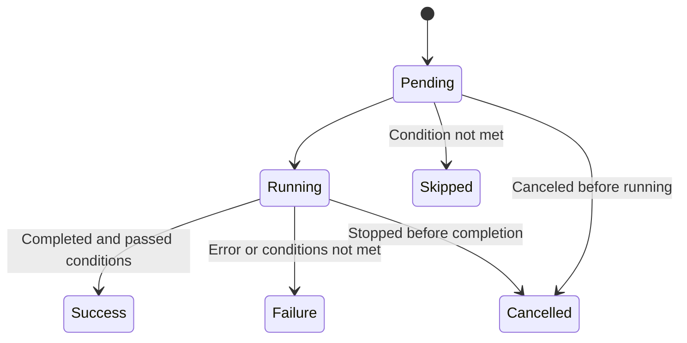
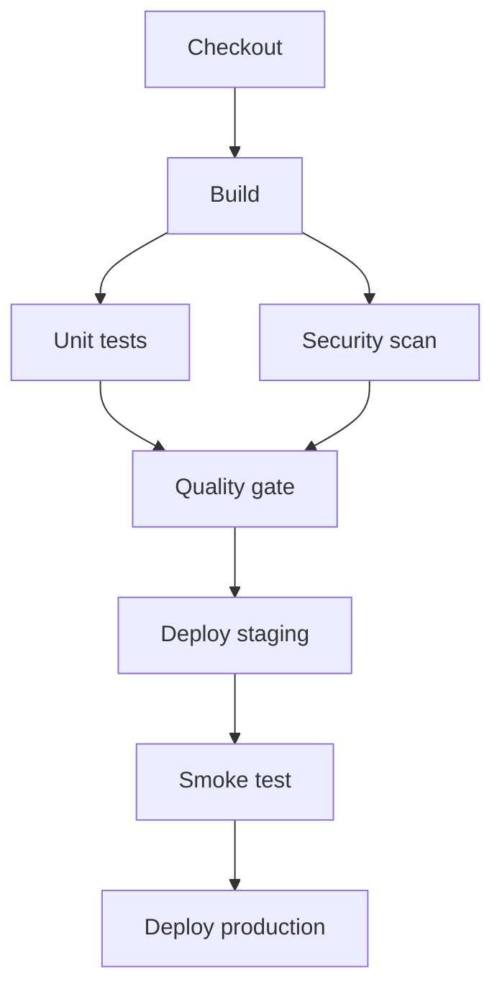

# Distinguishing Success, Failure, Skipped, and Cancelled Statuses

In CI/CD, a pipeline can end in several different statuses. Four common outcomes are **success, failure, skipped, and cancelled**. They are not merely four colors in a UI. Each status describes something distinct about how far the work progressed and how much confidence the team can place in the outcome.

For example, a test job returning success means the job's checks ran and met their configured criteria. A job skipped because a pull request only modified documentation means the job did not run; it does not prove tests passed. A job canceled when a user pushes a new commit also yields no conclusion about the quality of the running revision.

For the CI/CD module, understanding statuses accurately helps you design pipelines as code, coordinate dependent jobs, handle errors, enforce quality gates, and decide whether to permit merging, deploying, or releasing. This article distinguishes statuses at the step, job, and pipeline levels; explains how they propagate across a dependency graph; and provides rules to avoid mistaking "did not run" for "tested and passed."

## 1. Status describes the outcome of a unit of work

A pipeline typically has multiple levels:

- **Step:** a specific operation such as checking out source code, installing dependencies, running unit tests, or packaging an artifact.
- **Job:** a group of steps running in the same execution context or runner, such as `unit_test`, `build_image`, or `deploy_staging`.
- **Workflow/pipeline run:** the entire run triggered by a Git event or manual action, consisting of multiple jobs with dependency relationships.

One step can succeed while the next step fails. One job can fail while a log-collection job still runs to preserve evidence. Some jobs can be conditionally skipped while other mandatory jobs complete successfully. You must therefore identify which level a status refers to.

Typically, a unit of work moves through waiting and running states to a terminal status:



Exact names and state transitions vary across platforms. Some platforms also have `neutral`, `timed_out`, `stale`, `warning`, or `action_required`. The four statuses in this article form the foundational model for orchestration; when configuring a specific tool, verify that tool's exact status-mapping rules.

## 2. Success: work ran and met its conditions

`success` indicates the unit of work completed according to configured success criteria. For a step running a shell command, the common condition is the process returning exit code `0`. For a job, mandatory steps completed without an error failing the job. For a pipeline, all required gates passed under the aggregation policy.

For example:

```bash
./gradlew test
```

If the command exits with code `0`, the step can be marked successful. However, exit code `0` is only meaningful if the program genuinely returns exit codes matching its contract. A script that always returns `0` even when tests fail produces a false success signal.

Success also has scope. `unit_test = success` proves the unit test suite ran and passed under the recorded conditions; by itself, it does not prove integration tests, security scans, or deployments succeeded. Likewise, a successful build job only indicates the artifact was created under build conditions—not that the artifact was deployed or released.

When aggregating pipeline status, distinguish:

- **Job success:** that specific job finished according to its own criteria.
- **Pipeline success:** all jobs and gates marked mandatory passed, and optional branches were handled per policy.
- **Release success:** additional conditions such as approvals, deployment, post-deployment verification, and monitoring passed.

A pipeline can be considered successful even if an optional job was skipped, provided policy defines that job as unnecessary for the current run. Therefore, success does not mean every declared job must run; it means every mandatory requirement for the run was satisfied and any exceptions were intentionally permitted.

## 3. Failure: work ran but did not pass

`failure` indicates an operation executed but failed to satisfy success criteria. Common causes include:

- A command returned a non-`0` exit code.
- Unit tests, integration tests, or assertions failed.
- Compilation, packaging, or dependency download errors occurred.
- Static analysis or security scans exceeded blocking thresholds.
- Required artifacts failed to generate or push to a registry.
- Deployment failed due to permissions, configuration, connectivity, or resources.
- A quality condition evaluated to failed.

Failure is a signal requiring investigation. It does not necessarily mean the application has a logic bug: a pipeline can also fail because a runner ran out of disk space, an auxiliary service was temporarily unavailable, or credentials were misconfigured. Reports should retain logs, exit codes, test reports, and context to distinguish product bugs from CI infrastructure errors.

If a mandatory job fails, dependent jobs usually do not run or also transition to skipped. Some pipelines apply `fail-fast` to halt remaining parallel jobs upon the first failure. In that case, the overall run still fails; jobs stopped by fail-fast may be recorded as cancelled or skipped depending on the tool.

Never turn a failure into a success simply by ignoring exit codes or appending `|| true` to a mandatory step. If an error is acceptable, express it via explicit conditions, warning classification, or an exception policy with an owner and an expiration date.

## 4. Skipped: work was not executed

`skipped` means a step or job did not run. Conditions may not have been met, a control branch was not selected, or an upstream dependency did not pass so the job was not triggered. Skipped is neither a passing nor a failing test result; there is simply no execution result for that job.

Common scenarios:

- A production deploy job runs only on pushes to the main branch or upon approval.
- A documentation check job runs only when files under the docs directory change.
- A frontend test job is skipped when a pull request only edits backend code and impact-detection rules confirm this.
- A job depends on a failed build job and therefore cannot run.
- An `if/else` branch picks one of two jobs, leaving the other skipped.

Pseudocode example:

```yaml
jobs:
  docs_check:
    if: changed_files_include_docs
    steps:
      - run_documentation_lint

  deploy_production:
    if: event_is_release_tag
    needs: [build, test]
    steps:
      - deploy_release_artifact
```

In this example, `docs_check` may be skipped if no documentation changed; `deploy_production` may be skipped when the event is not a release tag. Both statuses are intentional control-flow outcomes, not errors.

However, skipped due to valid conditions must be distinguished from skipped due to failed dependencies. Both may display the same label, yet their meanings differ:

| Cause | Meaning | How to Handle |
|---|---|---|
| Condition not applicable | Work did not need to run in this execution | Log the reason and confirm policy permits skipping |
| Dependent job failed | Preconditions to proceed were not met | Address the failure in the upstream job; do not treat the dependent branch as passing |
| Alternate control branch chosen | An alternative branch executed instead | Verify the chosen branch satisfies equivalent requirements |
| Misconfigured condition | Job needed to run but was mistakenly excluded | Fix the condition and re-run the pipeline |

An unexpectedly skipped mandatory job must block the quality gate. In particular, never let a `quality_gate` job succeed merely because test jobs were skipped and there is no condition inspecting actual statuses.

## 5. Cancelled: work was stopped before completion

`cancelled` indicates a step, job, or entire run was terminated before normal completion. Cancellation can occur because:

- A user manually clicked Cancel.
- A new commit arrived and concurrency policy canceled the older run.
- A new run superseded a previous run on the same branch or pull request.
- An administrator or the system stopped the runner, workflow, or environment.
- The pipeline was stopped after hitting a policy-defined cancellation condition.

Unlike skipped, a cancelled job may have already started and executed part of its work. For example, a deployment updated two of five instances before being canceled. The system may be left in an intermediate state requiring verification or recovery steps.

Cancelled does not mean the work failed on quality grounds, nor does it provide evidence that the work passed. If a mandatory job is canceled, merge or release gates must usually wait for another valid run. If an optional job is canceled, the pipeline can proceed only when policy allows it and does not rely on that job's results.

**Timeouts must be distinguished from cancellation.** Many tools classify timeouts as failures because the job exceeded its time limit without meeting criteria; some platforms represent them with a dedicated status. Do not assume a timeout is always classified as cancelled. Check the exact termination status and reason reported by your tool.

When a job is canceled, appropriate cleanup or recovery mechanisms should run. However, successful cleanup does not turn a canceled deployment job into a success. Original outcomes and cleanup results must be recorded separately.

## 6. Comparing the four statuses

| Status | Did Work Run? | Quality Passing Conclusion? | Meaning for Mandatory Gates |
|---|---|---|---|
| `success` | Yes | Yes, within check scope | Can satisfy the gate if revision and inputs are valid |
| `failure` | Yes | No | Blocks the gate and requires investigation or fix |
| `skipped` | No | No conclusion from this run | Acceptable only if the job is genuinely optional or skip conditions are permitted |
| `cancelled` | May have run partially or not started | No completed conclusion | Blocks mandatory gates until a valid outcome exists |

The critical rule is never to conflate `skipped` and `cancelled` with `success`. Both can be valid control-flow outcomes, yet neither provides evidence of completed verification.

## 7. How statuses propagate in a dependency graph

A pipeline is typically a directed acyclic graph (DAG). A job starts only when its dependencies and conditions are satisfied. For example:



If `Build` fails, `Unit tests` and `Security scan` may be skipped because their dependency did not pass. `Quality gate` cannot conclude a pass either. The pipeline must preserve the root cause as the build failure while recording that dependent jobs did not run.

If `Security scan` is configured as optional for a certain change type and is intentionally skipped, `Quality gate` can proceed when policy confirms the scan is not mandatory in that case. If the scan is mandatory, being skipped must fail the gate or leave it pending; it must never automatically count as a pass.

Aggregation rules must clearly define:

1. Which jobs are mandatory in the current run.
2. Under what conditions a job may be skipped.
3. Which failures block downstream jobs.
4. When cleanup is allowed to run despite upstream failure or cancellation.
5. Conditions under which the pipeline run is considered a success.

A pipeline run can contain passing jobs, skipped jobs, and still succeed overall. Conversely, one failed mandatory job or one canceled mandatory job typically causes the pipeline to fail. Exact rules depend on the tool and configuration; never infer overall results solely from the count of green jobs.

## 8. Designing quality gates without status blind spots

A quality gate should inspect the actual status of each required check rather than merely checking whether the job existed. The pseudocode below illustrates how to express this:

```yaml
pipeline:
  unit_test:
    required: true
    run: ./gradlew test

  integration_test:
    required_when: changes_include_service_or_api
    run: ./gradlew integrationTest

  docs_check:
    required_when: changes_include_docs
    run: ./gradlew docsCheck

  quality_gate:
    evaluate:
      - unit_test must_be success
      - integration_test must_be success when required
      - docs_check must_be success when required
      - required_job_skipped_without_valid_reason is failure
      - required_job_cancelled is failure_for_gate
```

This is pseudocode, not syntax for any specific platform. In a real pipeline, you can use an aggregator job, `if` conditions, dependencies, result-evaluation expressions, or the platform's status API. The goal is clarifying the difference between "did not need to run" and "should have run but produced no result."

For optional jobs, record the skip reason, such as `not_applicable: no_frontend_files_changed`. Reasons can be stored as outputs, annotations, or logs. Avoid generic conditions that leave viewers unsure whether a job was skipped as non-applicable, due to an upstream error, or due to misconfiguration.

If an aggregation step must run after other jobs finish regardless of success or failure, use the platform's `always`/`finally` mechanism. This step suits collecting test reports, logs, status info, and cleaning up resources. Preserve the original failure or cancellation when computing the final outcome.

## 9. Fail-fast, retry, and cancellation

### Fail-fast

Fail-fast stops remaining work early when a sufficiently severe error is detected. For example, if a test matrix has 12 configurations and one configuration hits a shared compilation error, the system can cancel the remaining 11 configurations. This saves runners and time, though logs must clearly show which job failed and which jobs were stopped by fail-fast.

Do not enable fail-fast blindly for every job group. When you need to collect multiple independent failures in a single run, let parallel jobs finish and aggregate results afterward. For deployments or environment-mutating operations, design dedicated stop and recovery rules.

### Retry

Retries create another attempt after transient errors, such as a runner losing connectivity or a test service being temporarily unavailable. Distinguish individual attempt status from final job outcome. If the first attempt fails and a subsequent attempt succeeds, the system may report final job success with retry history; reports should still retain the initial failure to spot flaky tests or unstable infrastructure.

Never use unbounded retries to mask recurring bugs. Set maximum attempt limits, backoff where appropriate, and record retry reasons. For deterministic errors like failed assertions or compilation errors, retries generally do not help.

### Cancellation and concurrency

When a new commit arrives, teams may cancel older runs to free capacity for the newer revision. This makes sense for pull request checks, provided older runs cannot count as passing and cannot proceed to deploy. For jobs with external side effects, cancellation must address intermediate state, resource locks, and cleanup.

## 10. Mapping statuses to Git and release gates

Git hosting platforms may display check statuses, conclusions, or branch protection rules differently from CI job labels. Some systems treat skipped checks as neutral; some branch protection rules still require mandatory checks to appear and complete. Verify actual platform behavior rather than assuming every `skipped` check is accepted.

For merge gates, require:

- Mandatory checks report `success` for the exact commit or merge candidate.
- No checks remain `pending`, `cancelled`, or `failure`.
- Any skipped job has a valid reason permitted by policy.
- Approvals and other branch protection rules remain valid.

For deployment/release gates, also require:

- Artifacts were built and verified from an approved revision.
- Deployment jobs were not unexpectedly skipped or canceled mid-run.
- Post-deployment verification passed and observability signals did not breach halt thresholds.
- If a rollout is canceled, environment state is determined and a resume or rollback plan exists.

A `deploy_production` job skipped because the pipeline ran on a pull request is normal. That same job skipped during a release-tag run intended to ship a release is likely a serious configuration error. Status must be evaluated alongside the event, branch, tag, and goal of the run.

## 11. Example of reading a run's results

Suppose a pull request pipeline produces these results:

| Job | Status | Interpretation |
|---|---|---|
| `build` | `success` | Artifact was created |
| `unit_test` | `success` | Unit tests ran and passed |
| `integration_test` | `failure` | Integration tests did not pass |
| `security_scan` | `success` | Scan ran and met policy |
| `deploy_staging` | `skipped` | Did not run because quality gate failed |
| `upload_diagnostics` | `success` | Logs and reports were saved |

The correct conclusion is that the pipeline failed due to `integration_test`. `deploy_staging` being skipped is a consequence preventing deployment when quality criteria fail; it is neither an independent failure nor a success. `upload_diagnostics` succeeding only confirms reports were saved—it does not alter test results.

Another example: a pull request edits only documentation; `docs_check` is `success`, `unit_test` is `skipped` per path-filtering rules, and `deploy_production` is `skipped` because the event is not a release. The pipeline can succeed if policy confirms unit tests are not mandatory for that change type and all required gates passed. If policy always mandates unit tests, the `skipped` status must fail the quality gate.

## 12. Design and operations checklist

- [ ] Clearly distinguish statuses at the step, job, and pipeline levels.
- [ ] Assign `success` only when execution and verification conditions are met.
- [ ] Preserve root cause, exit codes, and related evidence on `failure`.
- [ ] Ensure `skipped` has clear reasons and applicability conditions.
- [ ] Prevent unexpectedly skipped mandatory jobs from counting as a pass.
- [ ] Distinguish `cancelled` from `skipped` and never treat cancellation as passing evidence.
- [ ] Map timeouts, retries, and fail-fast behavior according to actual platform semantics.
- [ ] Allow cleanup/diagnostics jobs to run when needed without erasing the original failure status.
- [ ] Configure quality gates to aggregate statuses against mandatory job lists and skip conditions.
- [ ] Require valid outcomes on the exact revision for Git, merge, and release gates.
- [ ] Define procedures to determine environment state and recover when a deployment is canceled.

When each status is accurately understood and aggregated under transparent rules, pipelines become easier to read and more trustworthy. Teams know whether work passed, failed, did not apply, or was stopped—enabling sound decisions on what can proceed, what must re-run, and when merging or releasing is safe.
