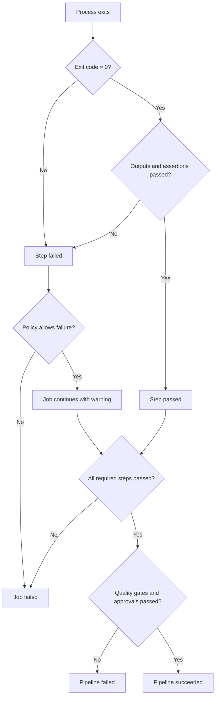

# Defining Exit Codes and Criteria for a Step to Pass

In CI/CD, a step should be considered passing only when the system has clear evidence that mandatory work completed and all associated quality criteria were met. The most common signal is the process **exit code**: code `0` usually indicates success, while non-`0` indicates an error per the program's contract. However, exit code is only part of the conclusion. A pipeline must also consider run conditions, check results, required outputs, timeouts, cancellation status, and failure-allowance policies.

If a test command exits with `0` despite finding zero tests, or a build step exits with `0` without producing the required artifact, marking that step as passing sends a false signal. Conversely, an optional step may fail without blocking the entire pipeline if policy explicitly permits it. Pipeline architecture must therefore distinguish process exit codes, step/job statuses, and overall pipeline outcomes.

## 1. Distinguishing outcomes at each layer

A pipeline typically has multiple outcome layers:

1. **Process/command:** what exit code did the program return?
2. **Step/task:** did the command execute, finish as required, and produce all required outputs?
3. **Job:** did all mandatory steps pass, without timeouts or cancellations?
4. **Pipeline/workflow:** did all mandatory jobs, quality gates, and release conditions pass?



This diagram is a conceptual model. Each CI/CD platform has different status names and aggregation rules. The key is not equating `exit code = 0` with `pipeline = success`.

## 2. Exit codes as a contract between program and OS

When a process terminates, it returns a status code to its caller. The shell or runner reads this code to decide whether the command succeeded by convention.

In Unix/Linux environments, the common convention is:

- `0`: the program completed successfully.
- Non-`0`: the program reported an error, failed to complete, or encountered a special condition documented by the tool.

Non-`0` codes do not have a single universal meaning. Specific meanings depend on the program. For example, a search tool might use code `1` to indicate no matches found; a test runner might use a dedicated code when zero tests exist; a diff command might use non-`0` to indicate "differences exist" rather than an operational error.

Some common shell exit codes on Unix/Linux:

| Code | Common Meaning | Notes |
|---:|---|---|
| `0` | Success | Meaningful only per the program's contract |
| `1` | General error or unmet condition | Must consult the command's documentation |
| `2` | Misuse or invalid arguments | Not used identically by every program |
| `126` | Command found but not executable | May be due to permissions or executable format |
| `127` | Command not found | Usually a typo or missing PATH entry |
| `128 + N` | Common convention when terminated by signal N | Representation depends on shell and system |
| `130` | Typically corresponds to SIGINT (interrupted via Ctrl+C) | Should not be treated as a successful run |

On Windows, processes also return exit codes, typically represented as 32-bit values. Do not mechanically apply Unix code conventions to every Windows program. For cross-platform tools, consult the tool's documentation and verify how the runner maps exit codes to job status.

### Designing exit codes for team scripts

Custom scripts should have consistent, understandable, and documented exit-code contracts. A simple convention might be:

| Script-Defined Code | Example Meaning |
|---:|---|
| `0` | Completed as required |
| `1` | Business check or quality gate failed |
| `2` | Invalid arguments or input configuration |
| `3` | Unable to reach required dependency or service |
| `4` | Required output missing or invalid |

This is only an example of an internal contract, not a universal standard. Choose codes suited to your needs and avoid colliding with codes used by child tools. If a script invokes another program, explicitly decide whether to propagate the child exit code as-is or map it to a custom code. Either way, logs must record enough details for operators to know which command failed and why.

## 3. How the shell determines exit codes for command combinations

A common cause of misleading pipeline statuses is misunderstanding how the shell aggregates exit codes when a step runs multiple commands.

### Commands separated by semicolons or newlines

```bash
./gradlew test
echo "Tests finished"
```

In the shell, the second command still runs after the first fails. The exit code of the command list is normally the exit code of the last command. Since `echo` usually returns `0`, the step can succeed even though `./gradlew test` failed.

To stop when a preceding command fails, use `&&`:

```bash
./gradlew test && echo "Tests passed"
```

When the test command returns non-`0`, the part after `&&` does not run and the list's exit code reflects that failure.

### Using fallback branches with `||`

```bash
./scripts/check-cache.sh || ./scripts/rebuild-cache.sh
```

The command after `||` runs when the preceding command fails. The final exit code is usually that of the last executed command. This fits when a genuine fallback exists, but can mask errors if the fallback command always returns `0` even when required conditions were not restored.

Do not use `|| true` to force a mandatory step green:

```bash
# Unsuitable for mandatory tests because it ignores error codes
./gradlew test || true
```

If you want to permit a specific exit code, inspect that code explicitly and log the reason instead of ignoring all errors.

### Pipelines via the `|` operator

```bash
./scripts/generate-report.sh | tee report.log
```

In Bash, by default, a pipeline's exit code is that of its last command. If `generate-report.sh` fails while `tee` writes the file successfully, the pipeline can return `0`. Enable `pipefail` so the pipeline returns non-`0` when any command in the chain fails:

```bash
set -o pipefail
./scripts/generate-report.sh | tee report.log
```

When requiring `errexit`, `nounset`, and `pipefail` together, Bash scripts typically begin with:

```bash
set -Eeuo pipefail
```

These options catch many common mistakes, but do not replace deliberate error handling. `set -e` has exceptions depending on whether commands appear inside `if`, `while`, `&&`, `||`, pipelines, or functions. Never assume `set -e` makes every failing command abort the script the way you expect. For critical steps, check and handle exit codes explicitly.

### Capturing exit codes at the right moment

In Bash, `$?` holds the exit code of the most recently executed command. Running another command before saving it overwrites the value:

```bash
./gradlew test
test_rc=$?

if [ "$test_rc" -ne 0 ]; then
  echo "Gradle tests failed with exit code $test_rc" >&2
  exit "$test_rc"
fi
```

When you want to log an error while preserving the original code, capture it immediately in the `else` branch:

```bash
if ./gradlew test; then
  echo "Unit tests passed"
else
  test_rc=$?
  echo "Unit tests failed with exit code $test_rc" >&2
  exit "$test_rc"
fi
```

Do not write `if ! command; then rc=$?` to capture the original code: the `!` operator negates the status, so `$?` inside the branch may be `0`. Use the `if command; then ... else rc=$?; ... fi` pattern shown above to preserve the actual code.

## 4. Explicit error handling in scripts

A CI script should stop when mandatory work fails, preserve a meaningful exit code, and print sufficient diagnostics. Bash example:

```bash
#!/usr/bin/env bash
set -Eeuo pipefail

run_required_step() {
  local step_name="$1"
  shift

  echo "==> ${step_name}"
  if "$@"; then
    echo "PASS: ${step_name}"
  else
    local rc=$?
    echo "FAIL: ${step_name} (exit code ${rc})" >&2
    return "$rc"
  fi
}

run_required_step "unit tests" ./gradlew test --no-daemon
run_required_step "package application" ./gradlew assemble --no-daemon

test -s build/libs/app.jar || {
  echo "FAIL: build/libs/app.jar is missing or empty" >&2
  exit 4
}

echo "All required steps passed"
```

In this example, each required command runs as a separate invocation; the function returns the child command's error code. After building, the script also verifies that the artifact exists and is non-empty. Consequently, a build process returning `0` without producing the required file still fails the overall step.

Not every script needs to wrap every command in a function. For short scripts, you can use `set -Eeuo pipefail` and add assertions after critical commands. The goal is keeping the outcome contract readable without adding hard-to-maintain abstraction layers.

### Background processes and asynchronous commands

If a script launches a background process, the launch command's exit code only indicates the process spawned successfully—not that the background work completed. You must `wait` and check the process's exit code:

```bash
./scripts/build-index.sh &
worker_pid=$!

if wait "$worker_pid"; then
  echo "Index build passed"
else
  rc=$?
  echo "Index build failed with exit code $rc" >&2
  exit "$rc"
fi
```

Similarly, if a step sends a request to an external system and receives HTTP `202 Accepted`, that only means the job was accepted. The step must poll/wait for final job status or verify completion conditions before reporting success.

## 5. Checking exit codes of native programs on Windows PowerShell

In PowerShell, distinguish PowerShell cmdlet errors from exit codes of native programs such as `gradlew.bat`, `dotnet.exe`, or `npm.cmd`.

- `$?` reflects the success status of the most recent PowerShell operation.
- `$LASTEXITCODE` holds the exit code of the most recently executed native program.
- `$ErrorActionPreference = 'Stop'` turns many non-terminating cmdlet errors into terminating errors, but should not be relied upon to replace checking `$LASTEXITCODE` for native programs.

Example:

```powershell
$ErrorActionPreference = 'Stop'

& .\gradlew.bat test --no-daemon
$testExitCode = $LASTEXITCODE

if ($testExitCode -ne 0) {
    [Console]::Error.WriteLine("Gradle tests failed with exit code $testExitCode")
    exit $testExitCode
}

Write-Output 'Unit tests passed'
```

Read `$LASTEXITCODE` immediately after the native program runs, before executing another native program that could overwrite it. If a script runs multiple native commands, check each one inline. When PowerShell exceptions occur, use `try/catch` for cmdlet errors while still checking native exit codes separately.

## 6. Exit codes are not the entirety of pass criteria

A step can return `0` without achieving its goal. Examples:

- A test runner exits cleanly at the process level yet discovers zero tests.
- A scan command completes, yet its report reveals vulnerabilities exceeding allowed thresholds.
- A build command returns `0`, yet the expected artifact does not exist or has zero size.
- An upload command returns `0`, yet the object was pushed to the wrong repository or with the wrong digest.
- A deploy script sends its request successfully, yet the rollout in the target environment has not finished.

Therefore, a passing criterion should combine at least the following verification groups:

| Group | Example Criterion | Evidence |
|---|---|---|
| Execution | Process terminates with an accepted exit code | Exit code and logs |
| Functional results | Tests and assertions pass | Test report, assertion summary |
| Outputs | Required artifacts, reports, or metadata exist and are valid | File, checksum, digest, schema validation |
| Quality | Coverage, lint, scans, or policies within thresholds | Reports and policy thresholds |
| Deployment | Rollout finishes in the exact target environment | Deployment ID, revision, workload status |
| Verification | Health checks, smoke tests, or SLOs pass | Probe results and metrics |

### When zero tests are found

A test runner may distinguish "all tests passed" from "no tests found." For example, pytest uses exit code `5` when zero tests are collected. If a project requires tests, this case must fail the job or be blocked by the quality gate. If a test directory is intentionally allowed to be empty by design, express that exception explicitly by scope rather than automatically treating every zero-test case as passing.

### Quality thresholds must be checked explicitly

A coverage tool can generate a report and exit with code `0` even when coverage falls below the team's threshold. Likewise, a security scanner can complete analysis while finding critical vulnerabilities. An explicit policy evaluation step is required:

```bash
./gradlew test jacocoTestReport
./scripts/check-coverage-threshold.sh --minimum 80
./scripts/check-security-policy.sh --fail-on critical
```

The example above assumes both verification scripts return non-`0` when thresholds are not met. Never check only whether the report file was created; inspect its contents and enforce applicable rules. If a parser cannot read the report, data is missing, or the schema is invalid, the quality gate should fail explicitly rather than defaulting to success.

## 7. Run conditions, skipping, and allowing failure

A step may not execute because conditions do not match. `skipped` status differs from `passed`: skipped means it did not run; passed means it ran and satisfied conditions. For example, a production deploy job runs only on release tags, so pull request pipelines can skip that job by design.

When designing conditions, clarify:

- Is the step mandatory in every pipeline or only for certain event types?
- If conditions are not met, is skipping the step valid or must it fail the pipeline?
- Should dependent jobs be allowed to run when the upstream job is skipped?
- Should a manual step awaiting approval keep the pipeline in a pending/waiting state?
- What evidence proves the condition evaluated properly?

### Optional failures and `continue-on-error`

Some steps are informational, such as gathering supplemental benchmarks or generating optional reports. Organizations may allow these steps to fail while the pipeline continues. However, classify them as optional and preserve a warning status so they are never mistaken for full success.

In GitHub Actions, `continue-on-error: true` allows a step/job to fail while the workflow continues. For steps with an `id`, you can inspect `steps.<id>.outcome` for the raw execution result; `conclusion` reflects the result after applying `continue-on-error`. Never inspect only the overall workflow status to conclude every step passed.

Example:

```yaml
steps:
  - name: Run optional benchmark
    id: benchmark
    continue-on-error: true
    run: ./scripts/benchmark.sh

  - name: Report benchmark status
    if: always()
    env:
      BENCHMARK_OUTCOME: ${{ steps.benchmark.outcome }}
    run: echo "Benchmark outcome: $BENCHMARK_OUTCOME"
```

In GitLab CI, `allow_failure: true` lets a job fail without blocking the pipeline in the usual way; the UI may display a warning icon indicating the job was allowed to fail. Failure allowance can be scoped via `exit_codes` when needed, provided you pick the tool's exact codes and document their meaning.

Never mark mandatory tests, critical security checks, or deployment verifications as optional just to keep the pipeline green. When an exception is granted, record its justification, approver, scope, and expiration.

### Dependency conditions and skipped statuses

Jobs depending on prior jobs must define how to behave when the prior job is skipped, canceled, or allowed to fail. For instance, a publish step must not run automatically simply because a test step was skipped due to a misconfigured condition. For each dependency, distinguish "passed," "validly skipped," "allowed failure," and "no result." Never treat the absence of a result as a passing result.

## 8. Timeouts, cancellation, retries, and infrastructure errors

Not every incomplete run has a clean application exit code. A runner may kill a process on timeout, a user may cancel the job, the host may lose connectivity, or the container may be terminated. Systems may represent these cases with `timed_out`, `canceled`, `cancelled`, `stuck`, or equivalent infrastructure statuses.

Principles to apply:

- **Timeout:** if a mandatory step fails to complete within the allowed time, the outcome is failed or indeterminate—never treat it as success.
- **Canceled:** there is no complete result. The pipeline must reflect canceled or incomplete status per policy.
- **Runner/infrastructure failure:** classify separately from application logic errors to avoid misattribution, yet the mandatory job still has not passed until re-run successfully.
- **Retry:** use only for identified transient errors, such as network glitches or brief downstream service interruptions. Record attempt count, per-attempt outcomes, and final result.
- **Flaky tests:** never mask with unbounded retries. Track flake rates, retain the initial failure, and fix the root cause.

A successful retry may allow the final job status to pass under policy, yet the history of prior failed attempts must be preserved. For steps with side effects such as creating releases, sending notifications, or deploying, design idempotency or duplicate-execution locks before enabling automatic retries.

## 9. Example of pass criteria design in GitLab CI

The following example separates testing, artifact verification, and the quality gate into distinct jobs. It illustrates how exit codes and outputs jointly determine status. JAR paths must be adjusted to match the actual project.

```yaml
stages:
  - test
  - package
  - quality

unit_tests:
  stage: test
  script:
    - ./gradlew test --no-daemon
    - |
      report="$(find build/test-results/test -type f -name 'TEST-*.xml' -print -quit)"
      if [ -z "$report" ]; then
        echo "No JUnit test report was produced" >&2
        exit 1
      fi
  artifacts:
    when: always
    reports:
      junit: build/test-results/test/*.xml

package_app:
  stage: package
  script:
    - ./gradlew assemble --no-daemon
    - test -s build/libs/app.jar
  artifacts:
    paths:
      - build/libs/app.jar

quality_gate:
  stage: quality
  needs:
    - job: unit_tests
    - job: package_app
      artifacts: true
  script:
    - ./scripts/check-coverage-threshold.sh --minimum 80
    - ./scripts/check-artifact-metadata.sh build/libs/app.jar
```

In this example, the shell snippet searches for at least one JUnit report matching `TEST-*.xml`; if the directory does not exist or no report exists, the step exits non-`0`. Real projects must adjust the path and filename pattern to match their test runner configuration. `quality_gate` runs only after required jobs pass and the artifact is delivered. If the coverage or metadata check script returns non-`0`, the quality gate job fails.

If an optional job must be allowed to fail, declare `allow_failure` intentionally and log a warning. Do not apply `allow_failure` to mandatory test or gate jobs in this example.

## 10. Example of pass criteria design in GitHub Actions

GitHub Actions represents each step inside a workflow. A `run` step is normally considered successful when the shell process exits with `0`; non-`0` fails the step unless configured to continue. Job dependencies and `if` conditions determine whether subsequent steps execute.

```yaml
name: CI

on:
  pull_request:
  push:
    branches: [main]

jobs:
  verify:
    runs-on: ubuntu-latest
    steps:
      - uses: actions/checkout@v4

      - name: Run tests
        run: ./gradlew test --no-daemon

      - name: Build application
        if: success()
        run: ./gradlew assemble --no-daemon

      - name: Verify package exists
        if: success()
        run: test -s build/libs/app.jar

      - name: Verify test report exists
        if: success()
        run: test -n "$(find build/test-results/test -name 'TEST-*.xml' -type f -print -quit)"

      - name: Check quality policy
        if: success()
        run: ./scripts/check-quality-gate.sh

      - name: Upload verified package
        if: success()
        uses: actions/upload-artifact@v4
        with:
          name: app-package
          path: build/libs/app.jar

  publish:
    needs: verify
    if: github.event_name == 'push' && github.ref == 'refs/heads/main'
    runs-on: ubuntu-latest
    steps:
      - uses: actions/checkout@v4

      - name: Download verified package
        uses: actions/download-artifact@v4
        with:
          name: app-package
          path: dist

      - name: Publish release artifact
        run: ./scripts/publish.sh dist/app.jar
```

`publish` depends on the `verify` job and only runs on a push event to `main`. On pull requests, the `publish` job is conditionally skipped; that does not mean `verify` skipped tests. In a real system, the publish step must also download the artifact built in `verify`, verify its digest, and use appropriate permissions/secrets.

The `find` usage only illustrates verifying that at least one report file exists. If a project uses a different report convention, adjust the condition accordingly. Checking that a report file exists does not replace parsing report contents to confirm tests actually passed.

## 11. Building clear and auditable quality gates

A sound quality gate should have the following properties:

**Clear conditions.** Every gate states its criteria, thresholds, applicable scope, and failure types that cause rejection. For example: all mandatory unit tests must pass; zero unwaived critical vulnerabilities; coverage not below the project threshold.

**Backed by evidence.** The gate preserves exit codes, logs, reports, artifact digests, policy version, and evaluation timestamp. Anyone can review why the gate passed or failed.

**Policy-driven handling of missing data.** If a mandatory report is missing, unreadable, or cannot be linked to the artifact, the gate should fail or enter an explicit action-required state. Never assume no warnings means no errors.

**Distinguishing product defects from infrastructure failures.** Tests failing due to an assertion differ from a runner failing to fetch dependencies. The two scenarios require different logs and remediation workflows, even though the mandatory job cannot yet be marked passing.

**Controlled exceptions.** If an error is permitted, record the reason, approver, scope, expiration, and tracking mechanism. Expired exceptions must automatically revert to default policy.

**Consistent results.** Identical inputs and policy versions should yield explainable, reproducible outcomes. Avoid relying on untracked external state such as mutable tags, leftover runner temp files, or nondeterministic cache contents.

## 12. Checklist for investigating a misclassified step

When a pipeline reports green yet you suspect a step did not truly pass, or reports red even though the program appeared to finish, check in order:

1. What exact command did the runner execute? Did any command run after the main command and overwrite `$?`?
2. What was the final exit code? How does the tool define that code?
3. Did the step use `;`, `&&`, `||`, or a pipe? If using a pipe in Bash, was `pipefail` enabled?
4. Does the script contain `|| true`, `continue-on-error`, `allow_failure`, or a wrapper ignoring error codes?
5. Did the process hit a timeout, cancellation, signal, or runner disconnect?
6. Did run conditions cause the step to be skipped? How did dependent jobs handle that status?
7. Were tests actually collected and executed? Is the report complete, readable, and tied to the exact commit/artifact?
8. Do required artifacts or outputs exist, with non-zero size and matching digest?
9. Which policy and thresholds is the quality gate enforcing? Are any exceptions currently active?
10. Did deployment finish and did health checks pass in the exact target environment?

A step should be marked passing only when the process finishes according to its contract, assertions and mandatory outputs are verified, run conditions are satisfied, and no unhandled timeout or cancellation occurred. Jobs and pipelines then aggregate results under declared policy. This approach ensures CI/CD statuses accurately reflect work quality, aids diagnostics, and prevents a single misleading exit code `0` from masking defects across the entire release flow.
