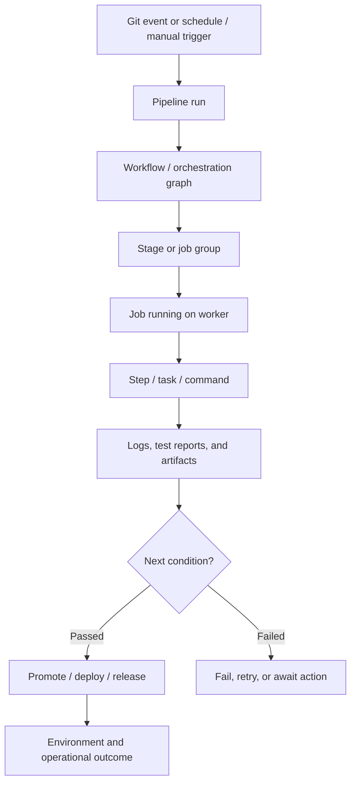

# Identifying Terminology Differences Across CI/CD Platforms

CI/CD platforms all solve the same problem: ingesting changes, orchestrating automated work, producing verification evidence, and helping deliver software to target environments. However, each platform names its components differently. A concept such as `job`, `step`, `stage`, `workflow`, `runner`, or `environment` can carry different scopes depending on the product.

When reading documentation, designing pipelines, or migrating across platforms, understand each component's role and execution boundaries before mapping names. Translating keywords literally can easily miswire dependencies, misconfigure parallelism, over-scope permissions, or drop approval conditions. This article builds a cross-reference glossary across GitHub Actions, GitLab CI/CD, Jenkins, Azure Pipelines, and CircleCI, while highlighting places that do not map one-to-one.

## 1. Starting from a shared conceptual model

A pipeline can be viewed as a graph of work. A triggering event creates a run; the orchestrator determines units of work, dependencies, and execution conditions; workers pick up jobs; each unit executes commands or tasks; outcomes are recorded and may unlock subsequent steps.



This is a conceptual model, not a mandatory structure across every product. Some platforms have a `pipeline` object containing `stages`, `jobs`, and `steps`; others use `workflow` as the top-level orchestrator; Jenkins can describe nearly the entire flow inside a single Jenkinsfile; some systems lack a distinct `stage` object.

When comparing platforms, ask six questions:

1. Which object receives the event and creates a run?
2. Which object describes the dependency graph or execution order?
3. Which unit is scheduled onto a machine/worker?
4. What is the smallest unit executing commands or plugins?
5. Where are outputs, caches, and shared state stored?
6. Which objects carry approval conditions, access permissions, and deployment environments?

## 2. Overview terminology table across platforms

The following table is a starting point for reading documentation. Cells listing multiple names indicate components with roughly similar roles, not identical behavior.

| Conceptual Role | GitHub Actions | GitLab CI/CD | Jenkins | Azure Pipelines | CircleCI |
|---|---|---|---|---|---|
| Flow definition | Workflow | Pipeline (`.gitlab-ci.yml`) | Pipeline/Jenkinsfile | Pipeline (`azure-pipelines.yml`) | Config + workflow |
| Group orchestration | Jobs and dependencies within a workflow | Stages, `needs`, jobs, and downstream pipelines | Stages, parallel branches, `post`, and Pipeline logic | Stages, jobs, dependencies | Workflow and job dependencies |
| Scheduled unit | Job | Job | Agent/node executing a Pipeline or sub-work; executor is execution capacity | Job | Job |
| Small command unit | Step; a step can `run` or `uses` an action | `script`, `before_script`, `after_script` in a job; certain keywords add auxiliary behavior | Step inside Pipeline DSL | Step: script or task | Step: command or action |
| Reusable component | Action, reusable workflow | `include`, component, child pipeline | Shared Library, plugin, function | Template, task, task group, deployment job | Orb, reusable command/job/executor |
| Worker | Runner | Runner | Agent/node; executor determines how environments are provisioned | Agent in an agent pool | Executor/resource class and execution environment |
| Deployment resource group | Environment and deployment | Environment, deployment, and protected environment | Often modeled using stages, agents, plugins, and external configuration | Environment and resource | Context, job/executor, and deploy configuration |

Do not use the table for mechanical substitution. For example, a `GitHub Actions step` and a `GitLab CI job` are not equivalent: a step sits inside a job, whereas a GitLab job is the unit picked up and executed by a runner. Matching at the proper level is the prerequisite for migrating pipelines.

## 3. Workflows, pipelines, and runs

### 3.1. Workflows in GitHub Actions

GitHub Actions stores workflows as YAML under `.github/workflows/`. A workflow has a name, one or more triggers under `on`, and `jobs`. Each job can declare its runner with `runs-on`, operations in `steps`, dependencies via `needs`, conditions via `if`, and permissions via `permissions`.

```yaml
name: Verify pull request

on:
  pull_request:
    branches: [main]

permissions:
  contents: read

jobs:
  test:
    runs-on: ubuntu-latest
    steps:
      - uses: actions/checkout@v4
      - name: Run tests
        run: ./gradlew check
```

Triggering a workflow creates a workflow run. Inside the workflow run are job runs; jobs contain steps. A workflow can run multiple jobs in parallel unless blocked by dependencies. `needs` specifies which jobs must finish before another job runs.

### 3.2. Pipelines in GitLab CI/CD

GitLab typically calls an entire CI/CD execution a pipeline. Configuration is declared in `.gitlab-ci.yml`. A pipeline contains jobs; jobs can be grouped by `stages` or orchestrated via explicit dependencies using `needs`. A traditional stage runs after the preceding stage; jobs within the same stage can run in parallel when runners are available.

```yaml
stages:
  - verify
  - package

unit_tests:
  stage: verify
  image: gradle:8-jdk21
  script:
    - gradle test

package_app:
  stage: package
  image: gradle:8-jdk21
  script:
    - gradle assemble
  needs:
    - unit_tests
```

GitLab can also spawn parent-child pipelines or multi-project downstream pipelines. These child pipelines expand the structure into multiple linked graphs. `include` fetches and merges configurations; `trigger` starts child or downstream pipelines; `needs:pipeline` expresses dependency on another project's pipeline status, and `needs:pipeline:job` can fetch artifacts from a job in a related pipeline. Do not treat these keywords merely as alternate ways of writing a regular job.

### 3.3. Pipelines in Jenkins

Jenkins Pipelines are typically defined in a `Jenkinsfile`, written in Declarative Pipeline or Scripted Pipeline syntax. In Declarative Pipeline, common blocks include `pipeline`, `agent`, `stages`, `stage`, `steps`, along with `post`, `environment`, `options`, and `parameters`.

```groovy
pipeline {
    agent any

    stages {
        stage('Verify') {
            steps {
                sh './gradlew check'
            }
        }
        stage('Package') {
            steps {
                sh './gradlew assemble'
            }
        }
    }

    post {
        always {
            archiveArtifacts artifacts: 'build/libs/*.jar', fingerprint: true
        }
    }
}
```

A Jenkins Pipeline describes the orchestration flow and execution steps. In Jenkins, `node` in Scripted Pipeline or `agent` in Declarative Pipeline binds work to an execution environment. A Jenkins stage is usually a logical grouping for visibility and organization; it is not necessarily a separate machine or independent job as in other platforms.

### 3.4. Pipelines in Azure Pipelines

Azure Pipelines uses `pipeline` as the top-level structure, typically declared in `azure-pipelines.yml`. A pipeline can contain `stages`, each stage contains `jobs`, and each job contains `steps`. A step can be a script or a task provided by the platform/extensions.

```yaml
trigger:
  branches:
    include:
      - main

pool:
  vmImage: ubuntu-latest

stages:
  - stage: Verify
    jobs:
      - job: Tests
        steps:
          - script: ./gradlew check
            displayName: Run tests

  - stage: Package
    dependsOn: Verify
    jobs:
      - job: Build
        steps:
          - script: ./gradlew assemble
            displayName: Build application
```

Azure distinguishes `stage`, `job`, `step`, and `task` fairly clearly. A `task` is a packaged step with defined inputs, version, and configuration schema; a script step runs commands directly. A deployment job can target an environment and support deployment history, approvals, or checks depending on configuration.

### 3.5. Workflows in CircleCI

CircleCI stores configuration in `.circleci/config.yml`. `jobs` define work to execute; `workflows` orchestrate ordering, conditions, and relationships among jobs. A job has `steps`; each step can be a command, checkout, or reusable command. Executors describe the runtime environment, such as Docker, machine, or other supported environments.

```yaml
version: 2.1

jobs:
  verify:
    docker:
      - image: cimg/openjdk:21.0
    steps:
      - checkout
      - run: ./gradlew check

  package:
    docker:
      - image: cimg/openjdk:21.0
    steps:
      - checkout
      - run: ./gradlew assemble

workflows:
  build_and_test:
    jobs:
      - verify
      - package:
          requires:
            - verify
```

In CircleCI, `workflow` orchestrates jobs while `job` is the execution unit. This can lead people familiar with GitHub Actions to assume `workflow` means the exact same thing on both platforms. Their high-level roles are similar, yet configuration structure, triggers, conditions, and reuse mechanisms differ.

## 4. Stage, job, step, and task: where do they differ?

This group of terms causes the most confusion because multiple platforms use the same word at different architectural levels.

### 4.1. Stage is an orchestration group or phase

A stage usually represents a major phase such as Verify, Build, Test, Deploy to Staging, or Release. It organizes the pipeline, expresses ordering, and serves as a point to attach conditions, approvals, or concurrency limits.

- GitLab uses `stages` as the pipeline's default stage order. Jobs attach to a stage via the `stage` attribute.
- Azure Pipelines uses `stages` as a high-level container holding jobs, supporting `dependsOn`, `condition`, and various controls.
- Jenkins Declarative Pipeline has `stages` containing `stage` blocks; a stage can have its own `agent`, `when`, `parallel`, or `options`.
- GitHub Actions has no built-in `stage` object at the workflow level. Phases can be modeled with jobs, job naming, `needs`, and reusable workflows.
- CircleCI has no generic equivalent stage construct inside workflow syntax; jobs are arranged via the workflow graph. Job naming or reusable components can represent phases.

Therefore, migrating a GitLab stage to GitHub Actions usually requires turning the stage's jobs into separate jobs and declaring `needs` across groups. You cannot simply rename `stage:` to a similarly named YAML key.

### 4.2. Job is the scheduled unit

A job is typically the unit scheduled onto a worker by the orchestrator, with its own environment, timeout, variables, and status. Independent jobs can run in parallel; dependent jobs must wait for inputs or outcomes from other jobs.

However, in Jenkins, an entire Jenkins Pipeline may execute on an agent and split into multiple stages; stages do not automatically equate to independent jobs in another system. Comparing Jenkins with GitHub Actions, a Jenkins stage sometimes corresponds in purpose to a GitHub job, yet for resources and execution lifecycle you must check `agent`, `node`, `parallel`, and how the Pipeline is partitioned.

### 4.3. Step is an operation inside a job

A step is typically a small command or action inside a job: checking out code, installing tools, running tests, uploading artifacts, or sending notifications. Steps in the same job normally share the same workspace and execution environment unless changed by platform or configuration.

GitHub Actions and CircleCI have explicit step concepts. Azure Pipelines also has steps. Jenkins Declarative Pipeline has a `steps` block containing Pipeline DSL commands. GitLab CI/CD does not use a separate `steps` layer inside standard job definitions: `script` contains one or more shell commands executed by the runner in GitLab's model.

Consequently, a GitLab `script` list should not be converted into multiple GitHub jobs merely because each command line looks like a step. Usually they should become `steps` inside a single job to preserve workspace and build state.

### 4.4. Task and action are packaged components

A `Task` in Azure Pipelines is an execution component with a typed input/output interface, typically supplied as a built-in task or extension. An `Action` in GitHub Actions is a reusable unit invoked inside a step via `uses`; actions can be JavaScript, Docker, or composite actions. CircleCI has commands, orbs, and reusable components; Jenkins has Pipeline steps from core or plugins, plus Shared Libraries.

These components share the goal of packaging logic, yet differ in interfaces, versioning, execution environments, and distribution models. For example, `uses: actions/checkout@v4` is an action called in a step; it is not a job. Azure `task: PublishBuildArtifacts@1` is a task configured as a step; it is not a stage either.

## 5. Runner, agent, node, executor, and pool

These terms all relate to where work executes, yet may refer to a machine, a worker process, an environment configuration, or a resource pool.

| Platform | Terminology | Practical Meaning |
|---|---|---|
| GitHub Actions | Runner | Machine or environment receiving and running jobs; includes hosted runners and self-hosted runners |
| GitLab CI/CD | Runner | Service agent receiving jobs from GitLab and executing via an executor such as shell, Docker, or Kubernetes |
| Jenkins | Controller, agent/node, executor | Controller orchestrates; agent/node provides execution host; executor is a slot capable of running a task on a node |
| Azure Pipelines | Agent, agent pool | Agent runs jobs; pool is an organized, permission-scoped group of agents |
| CircleCI | Executor, resource class | Executor defines the runtime environment type for a job; resource class selects compute sizing in supported environments |

### 5.1. Do not equate runner with executor

In GitHub Actions, `runs-on` picks the runner type or self-hosted runner labels. In GitLab, the runner receives jobs; the runner's configuration specifies which executor creates the runtime environment. In CircleCI, `docker`, `machine`, or custom executors describe the job's environment. Thus, when converting `runs-on: ubuntu-latest` to CircleCI, pick the right image/executor rather than looking for a key named `runner`.

### 5.2. Controller and worker in Jenkins

The Jenkins Controller handles UI, configuration, scheduling, and orchestration. Agents execute work. Each node can have one or more executors depending on resource configuration. If the controller also runs builds, workload pressure can degrade orchestration and maintenance. Modern designs usually separate the controller from execution agents whenever scale and infrastructure allow.

### 5.3. Self-hosted runners and agent pools

Self-hosted runners or private agents enable access to internal networks, specialized hardware, and custom tools. In return, the team must manage updates, job isolation, workspace cleanup, credentials, network egress, and host lifecycles. Never let untrusted jobs run on workers with access to sensitive resources. Segment pools/labels by trust level and workload role.

## 6. Artifact, cache, and workspace

These three concepts are often lumped together as "pipeline files," yet they have distinct purposes and lifecycles.

### 6.1. Artifacts are outputs to retain or hand off

Artifacts are results produced by a job or pipeline that matter to subsequent steps or users: binaries, packages, container images, test reports, coverage reports, or release files. Artifacts typically require retention periods, access controls, and clear identifiers.

| Platform | Common Mechanisms |
|---|---|
| GitHub Actions | `upload-artifact` / `download-artifact`; packages and container images are typically stored in registries |
| GitLab CI/CD | Job `artifacts`; package/container registry for release outputs |
| Jenkins | `archiveArtifacts`, fingerprinting, or storage plugins; external registry for images/packages |
| Azure Pipelines | Pipeline artifacts or build artifacts; package feeds and container registries |
| CircleCI | `store_artifacts` to store downloadable outputs; external registries or services for packages/images |

A job artifact is not necessarily a production release artifact. For instance, a test report is an artifact for verification; a JAR or image with a digest is a promotable output. Maintain lineage from the release artifact back to the commit and run that created it.

### 6.2. Cache speeds up execution

Cache holds regenerable data, such as downloaded dependencies or intermediate build outputs, to cut run time. Cache must never be the sole source of truth for artifacts or releasable data. A cache miss must not break the pipeline; a cache hit must never cause a pipeline to reuse wrong data from another revision or environment.

Platforms differ in key syntax, restore keys, sharing scopes, and eviction behavior. When migrating, verify whether caches are shared across branches, jobs, or projects; whether cache keys include toolchain versions and lockfiles; and whether caches could hold sensitive data.

### 6.3. Workspaces and cross-job data

A workspace is the working directory a job uses to check out code and generate files. Many platforms provision a fresh workspace per job, so files created in job A do not automatically exist in job B. Transferring files requires artifacts, caches, or a platform-provided workspace/dependency mechanism.

CircleCI offers `persist_to_workspace` and `attach_workspace` to share data across jobs within a workflow. Jenkins can retain workspaces on an agent or use `stash`/`unstash` for data across stages/agents within a Pipeline. GitHub Actions commonly uses artifacts to pass files between jobs; GitLab uses `artifacts` and `needs` to fetch upstream outputs. Azure has pipeline artifacts and related mechanisms. Choose the right mechanism for the goal rather than assuming two jobs share a directory.

## 7. Environment, deployment, and approval

The word `environment` does not have identical scope across platforms.

- **GitHub Actions:** an environment is a repository object that can hold secrets, protection rules, reviewers, and deployment history. Jobs declare `environment` to deploy to it.
- **GitLab:** an environment represents a deployment target such as staging or production; deployments are tracked per environment. Protected environments and deployment approvals depend on tier/configuration support.
- **Azure Pipelines:** an environment is a collection of target resources such as Kubernetes clusters, VMs, or other resources, with deployment history and approvals/checks attached at the resource/environment level.
- **Jenkins:** lacks a single core environment object identical to the platforms above. Environments are typically represented through stages, parameters, credentials, agents, plugins, or external deployment systems.
- **CircleCI:** contexts typically inject scoped variables/secrets into jobs by permission; job/executor and deploy configurations determine execution targets. Environment deployment concepts can be integrated via external tools or custom patterns.

Approvals may live in an environment management UI, resource checks, manual jobs, or input steps. When migrating, verify who holds approval authority, which criteria must pass, whether approvals bind to the exact artifact/revision, and where a rejection halts the flow.

A variable `ENVIRONMENT=production` in YAML does not create a protected environment. A variable name is just configuration data; real protection requires permission policies, secret scoping, approvals, and deployment controls in the platform or target system.

## 8. Triggers, conditions, and dependency relationships

All platforms support triggering on Git events, schedules, manual actions, or external events, yet filter syntax and semantics differ.

| Platform | Example Triggers / Conditions |
|---|---|
| GitHub Actions | `on: push`, `pull_request`, `workflow_dispatch`, `schedule`; job/step conditions via `if` |
| GitLab CI/CD | Pipeline source, `rules`, `workflow: rules`, legacy `only/except`; downstream triggers |
| Jenkins | Webhooks, SCM polling, cron in `triggers`, parameters, and Pipeline/plugin conditions |
| Azure Pipelines | `trigger`, `pr` depending on repo type, `schedules`, pipeline completion, and `condition` |
| CircleCI | `workflows` branch/tag filters, scheduled triggers, and pipeline parameters/conditions |

Do not translate branch-filtering syntax by swapping field names. For example, GitHub Actions uses `pull_request.branches` to filter target branches of pull requests; `push.branches` filters pushed branches. GitLab `rules` evaluate expressions to control adding a job to a pipeline; `workflow: rules` decides whether to create a pipeline at all. Those are two different decision levels.

Likewise, GitHub Actions `needs` specifies job dependencies; GitLab `needs` can alter the execution graph and download artifacts from listed jobs; Azure `dependsOn` orchestrates stages/jobs; CircleCI `requires` declares job relationships inside a workflow; Jenkins commonly expresses order through stage structure, `parallel`, `when`, or Scripted Pipeline logic. Translate the entire dependency graph, not just keyword names.

## 9. Variables, secrets, and identity

Pipeline variables commonly configure builds, select environments, or pass metadata. Secrets are sensitive credentials requiring protection. Platforms differ in scoping models:

| Platform | Common Mechanisms | Questions to Verify |
|---|---|---|
| GitHub Actions | `env`, `vars`, `secrets`, environment secrets, `GITHUB_TOKEN`, OIDC | Is the secret scoped to repository, organization, or environment? What permissions does the token have? |
| GitLab CI/CD | CI/CD variables, masked/protected variables, file variables, OIDC ID tokens | Is the variable protected by branch/tag? Could it be exposed to fork pipelines? |
| Jenkins | `environment`, Credentials Binding, credential store, plugins | What is the credential scope? Can logs print values? Can agents access credentials? |
| Azure Pipelines | Variables, secret variables, variable groups, secure files, service connections | Do variable groups/service connections enforce approvals and authorization scopes? |
| CircleCI | Environment variables, project settings, contexts, OIDC tokens | Which context does the job use? Who is authorized to use that context? |

Names like `secret`, `context`, `variable group`, or `credentials` do not guarantee equivalent protection levels. When migrating, inventory secrets by purpose, environment, user, and job; then re-scope them under least privilege. Never copy every project-level secret into every job.

Prefer short-lived identities or federated identity such as OIDC when supported by target providers. Restrict audience, subject, repository, branch, environment, and role permissions on the cloud side. Never treat OIDC as automatically secure if a trust policy permits any repository or any branch.

## 10. Reusable components: actions, includes, libraries, templates, and orbs

Each platform packages shared logic differently:

- **GitHub Actions:** an action is a unit invoked inside a step; reusable workflows allow reusing an entire workflow/job graph via `workflow_call`. These two operate at different levels.
- **GitLab CI/CD:** `include` composes configuration from files/projects/templates; `extends` inherits configuration; CI/CD components and child pipelines support modular pipelines. Pin refs when consuming configs from external projects.
- **Jenkins:** plugins extend Jenkins capabilities; Shared Libraries provide reusable functions and steps in Jenkinsfiles. Plugins and Shared Libraries are not the same concept.
- **Azure Pipelines:** YAML templates reuse structure; tasks package actions; task groups organize task sequences in classic/UI pipelines. Templates can parameterize stages, jobs, or steps.
- **CircleCI:** orbs package commands, jobs, and executors for sharing; commands are reusable step sequences. Orb versions and namespaces must be managed.

When reusing components, verify source, version, permissions, inputs, outputs, and update policies. Referencing a floating branch like `main` alters pipeline behavior without any corresponding commit in the consuming repository. For production-impacting components, pin versions/revisions and update via reviewed pull requests.

## 11. Commonly confused term pairs

### 11.1. Pipeline vs. workflow

In GitLab and Azure, `pipeline` is typically the top-level run and configuration object. In GitHub Actions, `workflow` is the triggered flow definition; in CircleCI, `workflow` orchestrates jobs inside the config. Jenkins calls both the definition and the run a Pipeline. Whenever documentation says "workflow," verify whether it means a config file, an orchestration graph, or a run instance.

### 11.2. Stage vs. job

A GitLab stage is a phase containing multiple jobs; an Azure stage contains jobs; a Jenkins stage groups steps; GitHub Actions has no built-in stage; CircleCI orchestrates jobs directly in a workflow. The same word `stage` can imply different resource and execution boundaries.

### 11.3. Job vs. step

Jobs are normally scheduled with their own environments. Steps run inside a job. Turning every step into a job can spawn extra runners, repeat checkouts, lose workspaces, and add latency. Merging independent jobs into steps can sacrifice parallelism and error isolation.

### 11.4. Runner vs. agent

GitHub and GitLab call workers runners; Jenkins calls them agents/nodes; Azure calls them agents; CircleCI describes executors. Distinguish the host machine, worker process, pool, and container configuration. One runner might run multiple jobs depending on platform policy; do not assume one job equals one dedicated physical machine.

### 11.5. Artifact vs. cache

Artifacts are meaningful outputs that may require retention and traceability. Caches are purely regenerable performance optimizations. Using cache instead of artifacts can cause a run to depend on stale state or lack clear output evidence.

### 11.6. Environment vs. environment variable

An environment can be a protected deployment target with history and approvals. An environment variable is merely a key/value pair passed to a process. Setting `DEPLOY_ENV=prod` does not mean you have configured a secure production environment.

## 12. Method for migrating pipelines across platforms

Do not start by translating YAML line by line. Map the existing behavior and migrate layer by layer.

### Step 1: Capture the current pipeline contract

Document triggers, branch/tag filters, conditions, stage/job graph, runners/agents, variables, secrets, artifacts, caches, approvals, deployment environments, retries, timeouts, and notifications. For each job, record inputs, outputs, required permissions, and side effects.

### Step 2: Draw the dependency graph

Identify which jobs run in parallel, which must wait, which artifacts transfer, which jobs may be skipped, and which conditions fail the entire pipeline. Specifically trace paths when tests fail, approvals are rejected, deployments fail, or triggers come from forks.

### Step 3: Map by role

Create a mapping table for orchestration, unit of execution, worker, reusable component, artifact, cache, environment, secret, and approval. If the target platform lacks a direct equivalent, choose how to model it using the target's primitives and document the differences.

### Step 4: Migrate permissions and secrets separately

Redesign token scopes, credentials, OIDC trusts, service connections, and environment protections. Do not carry over broad permissions from the legacy system to the new one. Jobs verifying untrusted code must never inherit publish or deploy permissions.

### Step 5: Verify behavioral equivalence

Run both pipelines in parallel on representative revisions if feasible. Compare test statuses, artifact contents, digests, durations, failure paths, approval conditions, and logs/audit trails. Do not compare only the final green status.

### Step 6: Cut over triggers and retire the legacy flow

Prevent two pipelines from accidentally publishing or deploying to production concurrently. Switch triggers incrementally by scope, confirm the new pipeline is the authorized release source, then disable legacy triggers with a rollback plan. Retain legacy evidence and history per retention policy.

## 13. Example of mapping a simple flow

Suppose the requirement is: on pull requests, run checks; when changes integrate into `main`, build the package; deploy to staging only after the build succeeds. The table below illustrates role-based mapping:

| Intent | GitHub Actions | GitLab CI/CD | Azure Pipelines |
|---|---|---|---|
| Run on pull request | `on.pull_request` | Merge request pipeline and appropriate `rules` | `pr` trigger depending on repo type |
| Verify code | `verify` job with `steps` | `verify` job in a stage | Job in Verify stage with steps/tasks |
| Build after integration | Job with `if` and `needs` | Package stage job, `rules`, and `needs` | Stage/job depending on Verify stage |
| Transfer package | Upload/download artifact or registry | `artifacts` or registry | Pipeline artifacts or feed/registry |
| Deploy staging | Job targeting `environment: staging` | Job declaring `environment` | Deployment job targeting `environment` |
| Deployment approval | Environment protection rules | Protected environment/approval if supported | Approvals/checks on environment/resource |

These cells are structural suggestions only. Pull request trigger syntax varies significantly across GitHub, GitLab, and Azure; Azure also differs between GitHub repositories and Azure Repos. Before implementing, verify the exact repository type and platform version/tier in use.

## 14. Checklist for reading and reviewing multi-platform configurations

- [ ] Identified the exact top-level construct: workflow, pipeline, or Jenkins Pipeline.
- [ ] Identified which unit is actually scheduled: job, agent/node, or Pipeline block.
- [ ] Distinguished stage, job, step, task, and action at their exact levels.
- [ ] Understood workers, executors, agent pools, and environment isolation.
- [ ] Distinguished artifacts, caches, and workspaces; verified how data passes between jobs.
- [ ] Verified whether `environment` is a managed deployment object or merely a config variable.
- [ ] Understood platform triggers, branch filters, conditions, and dependency graphs.
- [ ] Mapped secrets, credentials, variable groups/contexts, and token permissions.
- [ ] Identified approval mechanisms, protected environments, and audit trails.
- [ ] Pinned and reviewed reusable components such as actions, orbs, includes, templates, plugins, or Shared Libraries.
- [ ] Verified behavior on failure, retry, cancellation, timeout, and concurrent runs.
- [ ] Confirmed artifacts and deployment outcomes trace back to exact commits and runs.

When reading CI/CD configuration on a new platform, start from each component's role and the execution graph it constructs. Vocabulary varies, yet questions about triggers, orchestration, workers, commands, outputs, permissions, and environments always need answers. This approach grounds pipeline migrations in actual behavior, reduces errors from misunderstood names, and preserves traceability from Git changes to release outcomes.
