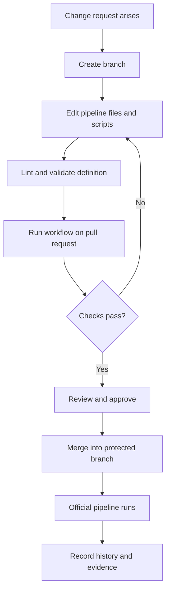

# Storing Pipeline Definitions with Change History

A CI/CD pipeline is part of the software delivery system. It determines when automated work is triggered, what source code is checked, which tools are used, how artifacts are produced, and who has permission to promote a version to the next environment. Therefore, pipeline definitions also need to be managed like application source code.

**Pipeline as code** is the practice of describing CI/CD processes using structured files—typically YAML or a platform-specific configuration language—and storing those files in a version control system. Every pipeline change goes through commit history, pull requests, code review, and branch protection policies. As a result, the team can see how the workflow changed, who changed it, why it changed, and can roll back to a previous version when needed.

## 1. What is pipeline as code?

Instead of configuring individual jobs manually through a CI server's UI, the team declares workflows in a repository. A definition file typically describes:

- **Triggers:** which events start the pipeline, such as a push, pull request, tag, or schedule.
- **Jobs and stages:** groups of tasks to execute and the dependencies between them.
- **Steps:** specific commands, actions, or tasks inside a job.
- **Execution environment:** runner, container, runtime version, and tools.
- **Conditions:** run conditions, skip conditions, success criteria, and error handling.
- **Data exchange:** variables, caches, artifacts, and outputs.
- **Permissions and secrets:** access rights to repositories, registries, cloud environments, and required secrets.
- **Release rules:** target environments, approval requirements, and promotion criteria.

For example, a repository might have a structure like this:

```text
repository/
├── .github/
│   └── workflows/
│       ├── ci.yml
│       └── release.yml
├── scripts/
│   ├── verify.sh
│   └── package.sh
├── .ci/
│   ├── config/
│   └── templates/
├── src/
└── README.md
```

This is just one reference layout. GitLab CI, Jenkins, Azure Pipelines, and other platforms have their own file and directory naming conventions. What matters is that pipeline definitions are stored in an easy-to-find location, can be reviewed, and are tied to the version of the source code they process.

Pipeline as code does not mean all configuration has to live in a single file. A workflow can call scripts in the repository, reuse templates, or reference environment configurations. However, every component that affects release behavior must have an identifiable origin and version.

## 2. Why store pipelines in version control?

When a pipeline exists only in a CI tool's UI, its configuration can change without leaving a corresponding trace in the source code history. Someone could alter run conditions, change a tool version, or add deployment permissions without application code reviewers noticing. When a pipeline breaks, it is also hard for the team to pinpoint which change caused the failure.

Storing pipeline definitions in Git provides the following benefits:

| Benefit | Practical meaning |
|---|---|
| Change history | Know who modified the pipeline, which part changed, when, and the related commit |
| Code review | Responsible owners inspect changes before merging |
| Reproducibility | Retrieve the exact pipeline definition at a specific commit |
| Rollback | Revert faulty changes using familiar version control mechanisms |
| Team alignment | Members work from the same reviewed definition |
| Auditability | Link pipeline changes to requests, pull requests, and releases |
| Automated checks | Lint, validate, and test pipeline definitions in CI |

For example, a change that causes a deploy job to run on every pull request can be caught in the diff before merging. Reviewers see the job's triggers and permissions within the same source code review workflow.

Git history also allows correlating the pipeline state at the exact time an artifact was created. This helps investigate why two builds from the same commit produced different results: the team can compare the pipeline definition, scripts, dependencies, and tool versions used in each run.

## 3. Organizing pipeline files for readability and maintenance

How files are split should reflect boundaries of responsibility. For a small repository, a single CI workflow may be enough. When there are multiple trigger types or multiple release streams, they can be separated into independent workflows.

A common breakdown:

| File or directory | Responsibility |
|---|---|
| `.github/workflows/ci.yml` | Verify pull requests and commits on the main branch |
| `.github/workflows/release.yml` | Create releases from tags or release requests |
| `.github/workflows/deploy-staging.yml` | Deploy to staging if a separate workflow is needed |
| `scripts/` | Reusable verification, packaging, or deployment scripts |
| `.ci/templates/` | Templates shared across multiple workflows |
| `docs/ci-cd.md` | Document execution flows, conditions, and troubleshooting steps |

Do not split files solely because a workflow has many lines. If splitting forces readers to open too many files to understand a simple flow, that structure increases maintenance overhead. Conversely, when CI, release, and deployment have different triggers, permissions, or owners, separating them improves reviewability and control.

Conventions to standardize across the repository:

- Workflow and job names clearly state their purpose, such as `validate`, `test`, `build`, `publish`.
- Variable names indicate scope and units, for example `JAVA_VERSION`, `IMAGE_NAME`.
- Scripts can run locally where appropriate, so developers can reproduce failures without waiting for the CI server.
- Default configuration is placed close to where it is used; environment-specific values are managed at the appropriate configuration layer.
- Comments explain the reasoning behind non-obvious decisions, rather than repeating what the job name or command already makes clear.

## 4. Example: defining CI with GitHub Actions

The example below uses GitHub Actions to illustrate a CI workflow for a Java Maven project. The workflow runs on pull requests and pushes to the `main` branch. It grants read-only repository access, installs Java 21, and runs the Maven Wrapper to verify the project.

```yaml
name: CI

on:
  pull_request:
    branches:
      - main
  push:
    branches:
      - main

permissions:
  contents: read

concurrency:
  group: ci-${{ github.workflow }}-${{ github.ref }}
  cancel-in-progress: true

jobs:
  verify:
    name: Verify source
    runs-on: ubuntu-latest

    steps:
      - name: Check out source
        uses: actions/checkout@v4

      - name: Set up Java
        uses: actions/setup-java@v4
        with:
          distribution: temurin
          java-version: '21'
          cache: maven

      - name: Run verification
        run: ./mvnw --batch-mode verify
```

Reading the workflow in order:

1. `name` assigns a recognizable name to the workflow.
2. `on` declares two event types. Pull requests targeting `main` are verified; pushes to `main` also run verification.
3. `permissions` restricts the default token to read-only access to repository contents.
4. `concurrency` groups runs of the same workflow and ref together. When a new run starts in the group, older runs can be canceled as configured.
5. `jobs.verify` declares a job running on an Ubuntu runner.
6. The steps check out the source code, set up the JDK, and run the verification command.

This example is a minimal source verification workflow. It does not publish artifacts or deploy to production yet. When adding those actions, you must clearly define release triggers, registry write permissions, target environments, secrets, and approvals. Never grant write permissions or production secrets to a pull request workflow simply to share a single configuration file.

Action versions in this example are specified using major tags for readability. For strict supply-chain control requirements, an organization can pin actions to full commit SHAs and update SHAs via reviewed pull requests. A regular process is needed to update pinned actions and runner images so outdated versions are not kept too long.

## 5. Changing pipelines via pull requests

A pipeline change can affect every subsequent commit or release. Therefore, it should follow a reviewed change process similar to application code changes.

Basic flow:



When opening a pull request, the description should answer:

- What problem does this solve?
- Which triggers, jobs, permissions, or environments are changing?
- Does the change affect pull requests, the main branch, or releases?
- Are any new secrets, permissions, or write scopes added?
- Which checks were run and what were the results?
- If the change causes a failure, how can it be reverted?

Reviewers should focus on the pipeline's behavior, not just YAML syntax. A syntactically valid file can still introduce dangerous behavior, such as a deploy job running too broadly, skipping tests, or using over-privileged credentials.

## 6. Validating pipeline definitions before merging

Pipeline definitions are also code and can contain bugs. A good process should validate them before changes are merged into the main branch.

Common validation layers:

| Validation layer | Goal | Examples |
|---|---|---|
| Syntax validation | Detect malformed YAML or structure | YAML parser, schema validator |
| Linter | Detect invalid configuration or questionable usage | actionlint for GitHub Actions |
| Static policy check | Verify permissions, triggers, version pinning, and org rules | Rules forbidding default write permissions |
| Script test | Verify scripts invoked by the pipeline | ShellCheck, unit tests for scripts |
| Workflow test | Verify conditional branch logic and outputs | Emulators or tests in a sandbox environment |
| Integration test | Verify interactions with registries or test environments | Test publishing to a sandbox registry |

Not every project needs every tool. Choose checks commensurate with the complexity and impact of the pipeline. At minimum, verify syntax, lint critical rules, and run the workflow on a pull request before merging.

You should also test rarely executed paths: skipped jobs, failure branches, tag triggers, scheduled runs, manual triggers, and missing configuration variables. A workflow tested only on its happy path can fail during an actual release.

## 7. Protecting change history and pipeline edit permissions

Because pipelines can access registries, cloud accounts, and production environments, permission to edit pipelines must be controlled in alignment with system ownership.

Common measures:

**Protect the main branch.** Require pull requests, mandatory checks, and reviews before merging. Restrict direct pushes or force pushes to release branches.

**CODEOWNERS or equivalent ownership mechanism.** Designate individuals or teams to review pipeline files, release scripts, and critical infrastructure configurations. For example:

```text
# .github/CODEOWNERS
/.github/workflows/ @platform-team
/scripts/release/ @release-engineering
```

Paths and team names should be replaced with the repository's actual structure and teams. Ownership rules only take effect when branch protection requires code owner reviews.

**Enforce required checks before merging.** Essential lint, policy, and test jobs must be configured as required checks. Avoid allowing merges when required checks are skipped or have not completed.

**Restrict token permissions.** Grant the least privilege possible per workflow or job. A job that reads source code does not need package write permissions; a pull request test job does not need production credentials.

**Record approvals.** Changes to permissions, secrets, production environments, or release processes require reviewers with appropriate authority. Record the rationale and approval evidence in accordance with organizational policy.

**Protect release branches and tags.** Release tags should be protected within the platform's capabilities. Prevent untrusted workflows from modifying tags or replacing already-published artifacts.

## 8. Managing variables, configuration, and secrets

A pipeline needs data to operate, but not all data should be stored in the definition file.

Data can be divided into three categories:

| Category | Examples | How to manage |
|---|---|---|
| Public, infrequently changing values | Job names, runtime versions, script paths | Store in the pipeline file or a versioned config file |
| Environment-specific configuration | Endpoint URLs, namespace names, regions | Environment variables or controlled environment configs |
| Secrets | Registry tokens, cloud credentials, signing keys | Platform secret store or secret manager |

Never commit passwords, private keys, access tokens, or credentials to a repository. If a secret is exposed, revoke or rotate the credential; deleting the line in a new commit does not remove the secret from Git history.

Whenever possible, use short-lived credentials, OIDC, or workload identity so jobs receive time-bounded, properly scoped permissions. If static secrets must be used, restrict which repositories, environments, and jobs can access them. Do not print secrets to logs; avoid passing secrets via command-line arguments or artifacts that may be persisted.

For pull requests from forks or untrusted sources, treat the code and scripts in the pull request as potentially malicious data. Do not grant secrets or sensitive write permissions to workflows handling such events. If deeper checks are required, run them in an isolated environment with minimal privileges.

## 9. Reusing pipelines while preserving understandability

When multiple repositories share the same process, teams can reuse workflows, templates, actions, or scripts. This standardizes how code is built, tested, scanned, and released.

Three common levels of reuse:

- **Shared scripts:** consolidate repeated commands into tested scripts invoked from multiple workflows.
- **Templates or reusable workflows:** package a standard set of jobs or process for other repositories to call.
- **Internal actions or plugins:** encapsulate an operation with well-defined inputs, outputs, and contracts.

For example, multiple services can use the same Java verification flow while passing different JDK versions or build types. Templates should document their inputs, defaults, outputs, required permissions, and error handling.

Reuse also introduces dependencies. If a shared workflow changes, multiple repositories may be affected. Therefore:

- Pin the version or ref of shared components.
- Maintain a changelog and announce potentially breaking changes.
- Test templates before releasing a new version.
- Update consuming repositories via pull requests to preserve history and review.
- Avoid creating too many wrapper layers that obscure what a job actually runs.

Do not prematurely abstract a YAML snippet that appears only twice and is still changing frequently. Create shared components only once behavior has stabilized and has at least one clear contract.

## 10. Linking pipeline changes to runs and releases

Storing pipeline files in Git is only part of traceability. When a run begins, the system must record the definition version used alongside the source code and output artifacts.

A release record should link the following information:

```text
Pipeline definition commit
    -> workflow / pipeline run ID
    -> source repository + source commit SHA
    -> test and scan reports
    -> build metadata
    -> artifact name + immutable digest
    -> environment + deployment revision
    -> approval record
    -> post-deployment verification
```

Distinguish between the commit containing the pipeline definition and the source code commit being built. On some platforms, the workflow is fetched from the event's branch or commit; in other cases, the pipeline calls a template from a separate repository. Record both when they differ.

For workflows using external templates, pin to an immutable tag or commit SHA rather than referencing a mutable branch. If only the template name is recorded without its version, accurately reproducing an old build process becomes difficult.

Artifacts should be deployed by digest or immutable identifier. At release time, record the pipeline run ID, pipeline definition commit, source commit, artifact digest, and deployment revision. This information enables the team to prove exactly which process produced a production version.

## 11. Recovering when a pipeline change causes a failure

Version control enables fast recovery, but you must understand the scope of a rollback operation.

**Reverting a commit** creates a new commit that undoes the previous change. This is usually the right choice on a shared branch because history is preserved and team members can clearly see the rollback decision.

**Reverting a pull request** can undo an entire group of commits if the pull request has already been merged. Check subsequent changes introduced afterward to avoid accidentally reverting unrelated content.

**Rolling back a template tag or version** is appropriate when the failure originates from a shared component. Before rolling back, verify that the older version remains compatible with consuming repositories.

**Re-running a pipeline** is only suitable when inputs and conditions are deterministic. If the current workflow has changed, re-running an old release may not reproduce the exact previous behavior. When reproducibility is required, identify the pipeline definition commit, source commit, template versions, runner, and relevant dependencies.

Reverting a pipeline definition does not automatically undo a deployment that has already occurred. If the change already deployed an application or infrastructure, execute a separate rollback or roll-forward procedure for that resource. Preserve logs and artifacts from the failed run so troubleshooting does not lose evidence.

## 12. Common pitfalls when adopting pipeline as code

| Pitfall | Consequence | Mitigation |
|---|---|---|
| Managing only part of the pipeline in Git | UI configuration can drift from files in the repository | Establish a single source of truth and restrict out-of-band changes |
| Overly large, hard-to-read workflows | Reviews miss dangerous conditions or permissions | Split by responsibility, use controlled scripts and reusable workflows |
| Using mutable tags for actions/templates | Behavior can change without a corresponding commit in the repository | Pin versions or commit SHAs and update via review |
| Granting broad permissions at workflow level | Less-trusted jobs inherit unnecessary privileges | Apply least-privilege permissions and separate jobs by privilege level |
| Putting secrets in YAML or logs | Secrets can leak in history and artifacts | Use a secret manager, rotate when exposed, and restrict access |
| Not validating pipelines before merge | Configuration errors surface only at release time | Add linting, policy checks, and workflow tests |
| Using unpinned shared templates | Upstream changes alter behavior across many repositories | Pin versions, maintain changelogs, and upgrade via pull requests |
| Recording only pass/fail status | Difficult to find root causes during incidents | Store run IDs, logs, reports, commits, and artifact digests |

## 13. Checklist for a pipeline change

Before merging a CI/CD definition change, verify:

- [ ] Pipeline files live in the repository at the conventional path.
- [ ] Triggers run only on necessary events and branches.
- [ ] Jobs, steps, and dependencies have clear names.
- [ ] Runners, runtimes, actions, and templates have controlled versions.
- [ ] Syntax checks and linters passed successfully.
- [ ] Scripts invoked by the pipeline can be tested or reproduced as needed.
- [ ] Token permissions and credentials are scoped per job.
- [ ] Secrets are not present in files, logs, caches, or artifacts.
- [ ] Pull requests from untrusted sources do not receive sensitive permissions.
- [ ] The change has been reviewed by pipeline owners.
- [ ] Required checks and branch protection are enforced.
- [ ] A clear revert path exists if the change introduces a failure.
- [ ] Runs record the pipeline commit, source commit, and run ID.
- [ ] Changes affecting releases have been tested in an appropriate environment.

When pipeline definitions are stored alongside Git history, every process change can be read, reviewed, verified, and rolled back. The team can explain why a job ran, which permissions it used, which commit changed it, and which release it produced. That is the foundation for scaling CI/CD with control as services, repositories, and team members grow.
