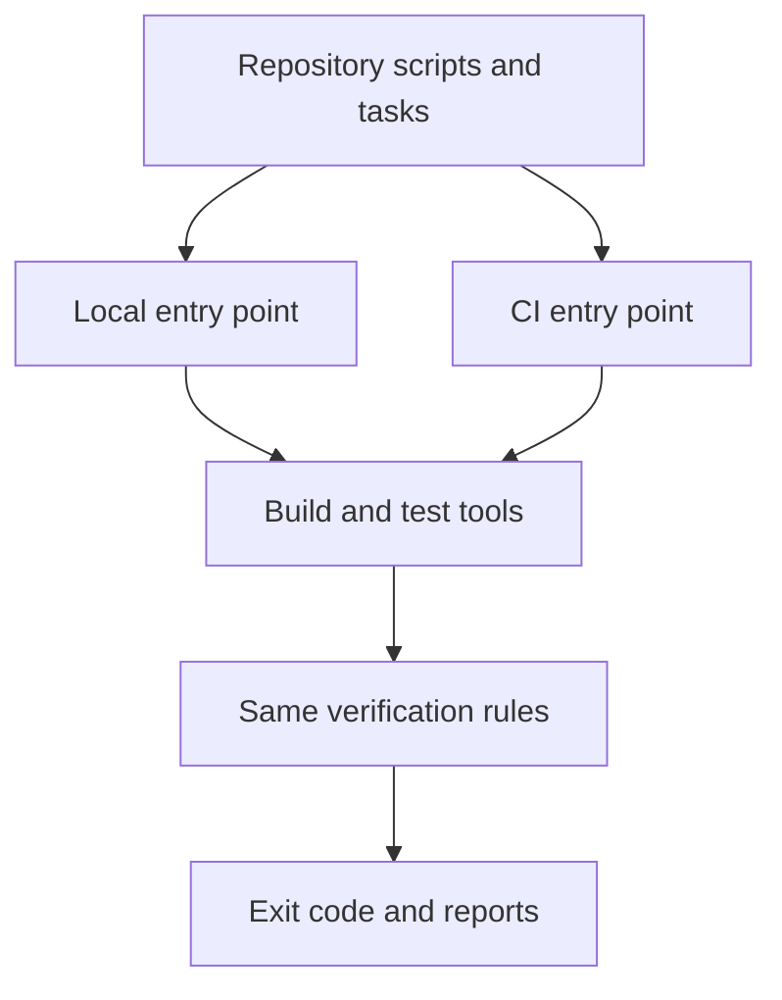

# Organizing Scripts to Run Both Locally and in CI

A reliable CI/CD process must produce consistent results whether executed on a developer's machine or on a CI system runner. If developers have to remember one set of commands while the pipeline runs a different set, the two environments can easily verify different things. Code might pass checks on a personal machine yet fail in CI, or CI might catch a failure that developers cannot reproduce locally.

The solution is to organize build, test, and quality-check operations into scripts or tasks with clear interfaces, managed alongside the source code and invocable from multiple environments. Shared scripts become the standard entry point for the work; the pipeline simply prepares the environment, supplies configuration, and calls that entry point.

In the CI/CD module, this principle reduces drift between local and CI, shortens diagnosis time, eases onboarding, and establishes the foundation for repeatable automation.

## 1. Principle: one job definition, multiple execution environments

Suppose that to validate a change, a developer must run a formatter, linter, unit tests, and build sequentially. If the pipeline only runs build and unit tests, the two environments are enforcing two different standards. A change could be considered complete locally yet get blocked when opening a pull request.

Instead of maintaining two command lists, the repository should define a standard task, such as **verify**. Developers run that task on their machines; the pipeline invokes that exact same task after preparing the runner.

The relationship can be pictured as follows:



What needs to be shared is the job definition and the verification rules. Execution environments may differ in operating system, paths, access permissions, or credential provisioning, but those differences must be managed explicitly.

A shared script does not mean local and CI must have identical environment variables or identical resources. For example, CI may obtain credentials from a secret manager, whereas developers use local development credentials. Both environments can still perform the exact same check as long as they provide valid inputs under the same contract.

## 2. Distinguishing tasks, scripts, and pipelines

These three components have distinct responsibilities:

| Component | Responsibility | Examples |
|---|---|---|
| Task | Describes a meaningful project operation | verify, test, package, formatCheck |
| Script | Orchestrates commands, validates preconditions, and standardizes how tasks are invoked | scripts/verify.sh, scripts/release.ps1 |
| Pipeline | Governs when work runs, on which runner, in what order, and with what permissions | Job triggered on pull requests |

Tasks should focus on project work. Scripts should handle orchestration and provide an ergonomic interface. Pipelines should manage triggers, runners, job dependencies, permissions, secrets, and artifacts.

Do not copy entire verification logic into pipeline YAML if that logic also needs to run on local machines. When logic is duplicated, each copy can diverge over time and produce different outcomes.

Similarly, do not turn a single script into a catch-all containing application logic, environment management, and release orchestration. Scripts should invoke dedicated tools or tasks. Business logic belongs in application code; build logic belongs in the build tool; orchestration logic belongs in scripts and pipelines.

## 3. Organizing script layout in the repository

The structure should help newcomers locate entry points and know which script serves which task. A Java repository using Gradle might be organized like this:

```text
repository/
├── gradlew
├── gradlew.bat
├── settings.gradle.kts
├── build.gradle.kts
├── gradle/
│   └── wrapper/
├── scripts/
│   ├── verify.sh
│   ├── verify.ps1
│   ├── format.sh
│   ├── format.ps1
│   └── release/
│       ├── package.sh
│       └── package.ps1
├── config/
│   └── quality/
└── ci/ or CI configuration for the active platform
```

This is an example, not a mandatory layout. A small repository may only need the Gradle wrapper and a few tasks. As the number of scripts grows, group them by purpose such as verification, release, migration, or environment administration.

Some helpful naming conventions:

- Use names that express action and outcome, such as verify, format-check, package.
- Use consistent names for equivalent tasks across operating systems.
- Avoid overly generic names like run.sh or common.ps1 when they do not describe purpose.
- Keep shared scripts in an easy-to-find location rather than duplicating them into subdirectories.
- Every script should include a brief description of inputs, outputs, environment requirements, and usage.

If a script is just a single line invoking a standard task, consider invoking the task directly from Gradle or the equivalent tool. A script wrapper is only useful when it standardizes paths, parameters, precondition checks, error reporting, or cross-environment compatibility.

## 4. Creating a standard entry point for work

Before writing scripts, the team should identify recurring tasks and standard task names. For example:

| Standard command | Purpose | When used |
|---|---|---|
| verify | Run required checks before integration | Locally and on every PR |
| test | Run the test suite | During development or when investigating test failures |
| format | Automatically format source code | When a developer intentionally fixes formatting |
| formatCheck | Check formatting without modifying files | In CI and before committing |
| build | Produce build outputs | When artifacts need to be built |
| clean | Remove generated build outputs | When verifying a clean build or clearing stale state |

Do not let verify both check and silently modify source code. A verification task should be observational: it reports pass or fail. Formatting tasks should be named separately so developers invoke them deliberately and review the diff.

With Gradle, verification steps can be wired into the check lifecycle task, and then a verify task can be registered as the unified entry point:

```kotlin
tasks.register("verify") {
    group = "verification"
    description = "Run the checks required before integrating changes."
    dependsOn("check")
}
```

Gradle's Java plugin provides the check task to aggregate project verification tasks, typically including tests. Quality plugins such as formatters, static analyzers, or architecture checks can be attached to check as needed by the project.

Then both local and CI invoke verify. If the project uses Maven, it can standardize via the Maven Wrapper and appropriate lifecycle phases or profiles. For Node.js, scripts can be defined in package.json; for Python, a task runner or CLI module can be used. The principle does not depend on a specific tool: a standard task must have a stable name, contract, and behavior.

## 5. Scripts must locate the repository root themselves

A common mistake is assuming a script is always invoked from the repository root. When someone runs the script from a different directory, relative paths break and the script fails to find build files or required data.

Scripts should resolve their own directory, locate the root per repository convention, and change to the right directory before running the task. With a scripts/verify.sh layout, the following Bash example locates the root from the script's location:

```bash
#!/usr/bin/env bash
set -Eeuo pipefail

SCRIPT_DIR="$(cd -- "$(dirname -- "$0")" && pwd)"
ROOT_DIR="$(cd -- "$SCRIPT_DIR/.." && pwd)"

cd "$ROOT_DIR"

if [[ ! -x "$ROOT_DIR/gradlew" ]]; then
  printf '%s\n' "Gradle wrapper is missing or not executable." >&2
  exit 2
fi

exec "$ROOT_DIR/gradlew" --no-daemon verify "$@"
```

The script does not depend on the caller's current working directory. The exec command replaces the shell process with the Gradle wrapper, so Gradle's exit code is returned directly to the caller. "$@" forwards each argument intact without merging them into a single string.

Bash files must have executable permissions recorded in Git. On Unix systems, set this with chmod +x scripts/verify.sh and commit the mode change to the repository. If executable permissions are lost after checkout, CI may report permission denied even when the script contents are valid.

For Windows, an equivalent PowerShell script can be provided:

```powershell
$ErrorActionPreference = "Stop"

$Root = Split-Path -Parent $PSScriptRoot
$Wrapper = Join-Path $Root "gradlew.bat"

if (-not (Test-Path -LiteralPath $Wrapper)) {
    [Console]::Error.WriteLine("Gradle wrapper was not found.")
    exit 2
}

Push-Location $Root
try {
    & $Wrapper --no-daemon verify @args
    $Result = $LASTEXITCODE
}
finally {
    Pop-Location
}

exit $Result
```

The two scripts differ in syntax but invoke the exact same verify task, keeping build and test rules in one place. If a project can standardize environments with containers or use a cross-platform runtime, the team can reduce the number of OS-specific scripts to maintain.

Do not guess the root by searching upward for a generic directory name that might appear at multiple levels. If the repository has an unambiguous marker like settings.gradle.kts, .git, or a project configuration file, use that marker to resolve the root and fail if it cannot be found.

## 6. Defining the script input contract

A reusable script must clearly specify what inputs it accepts. There are three common mechanisms:

**Command-line arguments** fit options explicitly chosen by the caller, such as a staging profile, skip-integration flag, or output directory.

**Environment variables** fit execution environment configuration, such as CI, JAVA_HOME, APP_ENV, or a test service endpoint.

**Configuration files** fit structured settings that are reviewed and managed in version control, such as lint or test configurations.

Avoid sourcing the same value from multiple places without clear precedence rules. If command-line flags override environment variables, document that explicitly. If a required value is missing, the script should report the missing variable or argument name and exit with an appropriate error code.

For example, a configuration verification script might require APP_ENV:

```bash
if ! printenv APP_ENV >/dev/null 2>&1; then
  printf '%s\n' "APP_ENV must be set before running this task." >&2
  exit 2
fi
```

Environment variables should not be used to pass arbitrary command lists. Never use eval to execute strings obtained from environment variables or input arguments. Parse arguments against an allowlist and pass them as separate arguments.

For values that may contain spaces, always quote properly. In Bash, use "$OUTPUT_DIR"; in PowerShell, pass variables and parameters in a way that preserves argument boundaries. Avoid concatenating paths or commands via uncontrolled string manipulation.

## 7. Exit code conventions and error propagation

CI needs to know whether a script succeeded or failed. Common conventions are:

- Code 0: work completed successfully.
- Non-zero code: an error occurred or a check failed.
- Specific exit codes can distinguish missing configuration, missing tools, or check failures, provided the team documents them.

Never force a script to always return 0 just to keep the pipeline moving. If a test fails, the script must propagate that failure back to CI. Conversely, do not fail with an error code for an informational warning that does not block completion if policy does not require blocking.

In Bash, set -e exits when a simple command fails, set -u catches references to unset variables, and set -o pipefail makes a pipeline return failure if any component in the pipe fails. However, set -e has exceptions in certain conditionals, loops, and command lists. Therefore, do not treat it as complete error handling. For critical steps, check status explicitly.

For example, if you need to distinguish test failures from missing configuration, you can invoke the tool and capture its exit code:

```bash
set +e
./gradlew verify
RESULT=$?
set -e

if [[ "$RESULT" -ne 0 ]]; then
  printf 'Verification failed with exit code %s\n' "$RESULT" >&2
  exit "$RESULT"
fi
```

The pattern above is only needed when the script actually performs cleanup or extra error handling before exiting. If no extra handling is required, let the final command return its exit code directly or use exec.

In PowerShell, when invoking native executables like gradlew.bat, inspect $LASTEXITCODE. $ErrorActionPreference = "Stop" handles PowerShell cmdlet errors, but does not replace checking native executable exit codes.

Errors during setup steps must also fail the pipeline. For instance, if the script cannot find Java or cannot read a required configuration file, it must not proceed to another build command and report success.

## 8. Keeping behavior consistent between local and CI

Differences between local and CI can come from many sources. A shared script only solves the task definition part; the team still must control toolchains, dependencies, configuration, and data.

| Aspect | Common risk | How to standardize |
|---|---|---|
| Tool version | Local uses a newer Java version than the runner | Declare JDK version and use wrappers |
| Dependencies | Local has cached or unpinned dependencies | Use lockfiles and deterministic dependency repositories |
| Working directory | Relative paths depend on invocation location | Script resolves repository root automatically |
| Operating system | Path separators, execute permissions, line endings differ | Use appropriate wrappers, test cross-platform as needed |
| Locale and timezone | Tests depend on date or language formatting | Explicitly configure locale and timezone for tests |
| Environment variables | Local has implicit variables that CI lacks | Declare inputs and validate required variables |
| Test data | Personal machine contains stale data | Provision isolated, re-initializable test data |
| Network | Local reaches services inaccessible from CI | Use mocks, service containers, or managed test environments |
| Permissions | Local has broad access, CI has restricted access | Use least privilege and document required credentials |

A practical approach is establishing a development environment with explicit tool versions—for example using the Gradle Wrapper, declaring a Java toolchain in the build, and providing an example environment file. CI provisions the same JDK version and invokes the standard script.

Do not let scripts silently skip tests when detecting CI or local execution. For example, if CI=true causes a script to skip an important check, local and CI behave differently. If a step can only run in CI because it needs dedicated services or privileges, separate it into an explicit task and document why.

## 9. Managing dependencies and tool versions

A script that depends on external tools must check whether those tools are available and meet version requirements. If a tool is missing, the error should explain how to install it or which version is needed.

For Java projects:

- Commit the Gradle Wrapper and required wrapper configuration files.
- Declare the Java toolchain version in the build where appropriate.
- Use dependency locking or version pinning mechanisms for critical dependencies.
- Do not require developers to install an arbitrary system Gradle version.
- Use the same task graph locally and in CI.

The Gradle Wrapper ensures the project downloads and runs the declared Gradle version. It does not automatically lock the JDK version, external dependencies, or other tools; those inputs still need separate management.

For scripts calling external CLIs, check that the command exists before executing it. Do not automatically download and execute unverified binaries from unpinned URLs. When tools must be installed in CI, use managed setup steps with explicit versions and trusted sources.

Onboarding documentation should specify minimum tools, versions, standard commands, and setup troubleshooting. Newcomers should be able to run a single check command to verify their machine is ready.

## 10. Managing configuration and secrets

Non-sensitive configuration can live in the repository if it is part of the project definition and goes through review. For example, lint thresholds, test configurations, or default profile names can be versioned.

Secrets such as passwords, tokens, private keys, and credentialed connection strings must never be written into scripts, committed .env files, or logs. Obtain them from a secret manager, protected environment variables, or the platform's credential provider.

You can provide an .env.example file containing only variable names and placeholder values so developers know what to configure. Real .env files must be excluded from version control. Never use dummy values that resemble real credentials to avoid confusion during deployment.

Scripts should verify that secrets exist without printing their values. For example:

```bash
if ! printenv TEST_DATABASE_URL >/dev/null 2>&1; then
  printf '%s\n' "TEST_DATABASE_URL is required." >&2
  exit 2
fi
```

Do not pass secrets in command-line arguments if tools may expose process lists or log commands. Do not enable debug modes that dump all environment variables when handling secrets. If a secret leaks in logs or commits, revoke or rotate it immediately; deleting a line in a file does not invalidate an old credential.

Local and CI may obtain credentials from two different sources while adhering to the same input contract. For instance, local uses a personal test account while CI uses short-lived system-issued credentials. Both only require permissions for the test environment.

## 11. Clear logs and structured reporting

Scripts need to show users what they are doing and which step failed. Useful logs typically include:

- Task name and tool versions.
- Steps currently running.
- Pass or fail outcomes.
- Locations of test reports, coverage reports, or artifacts.
- Remediation steps when inputs are missing.

Never print all environment variables or dump full configurations into logs. These may contain secrets or sensitive data.

Distinguish normal output from errors. In the shell, progress messages can go to stdout, while errors and remediation instructions go to stderr. CI may capture both, yet readers can still clearly identify error messages.

If a script runs multiple steps, label steps clearly. For example, Checking formatting, Running unit tests, and Validating migration are far easier to diagnose than Step 1, Step 2.

For longer pipelines, emit reports in formats CI can ingest, such as JUnit XML for tests or coverage reports. Scripts should not parse free-form logs when tools already produce machine-readable reports.

## 12. Keeping scripts safe to re-run

Users may run scripts multiple times, CI may retry jobs, and runners may be interrupted. Scripts must clearly define the state they create and how re-runs behave.

Key principles:

- Create output directories if they do not exist.
- Use task- or run-scoped output paths when needed.
- Never overwrite user data unintentionally.
- Delete only resources created by the script itself within a well-defined scope.
- Check existing state before creating external resources.
- Use transactions or idempotency keys for operations with side effects.
- Clean up temporary resources upon exit, including on errors or interrupts if supported.

For example, a script creating a temporary directory should place it within a project-managed area and remove only that exact directory. Avoid delete commands using empty variables or overly broad wildcards. Before destructive operations, verify the path is non-empty and resides inside the expected root.

Do not treat retries as a cure-all for failures. Failures from misconfiguration, failing tests, or missing permissions require fixing the root cause. Only retry transient, recoverable errors, with bounded retry counts and backoff intervals.

## 13. Managing outputs and artifacts

Verification scripts typically generate logs, test reports, coverage reports, or build files. Outputs need stable locations so both developers and CI can find them.

Distinguish between:

- **Source files:** tracked in Git.
- **Temporary files:** used only for a single run and safe to delete afterward.
- **Test reports:** collected by CI for review or retention.
- **Build artifacts:** packaged outputs promoted to release steps.

Do not commit logs, build directories, or generated reports unless the project has an explicit reason. Outputs should live in conventional directories, such as build/reports or build/libs for Gradle.

CI should collect reports even when a test step fails if the platform supports post-failure collection steps. This gives the team diagnostic evidence. However, collecting reports must never turn the final job status into success when mandatory checks failed.

Artifacts need traceable names and versions. If an artifact is used for deployment, the pipeline should record its digest and link it to the commit or revision that produced it.

## 14. Calling scripts from pipelines

The pipeline should prepare the environment, check out source code, install the toolchain, supply necessary environment variables, and invoke the standard script. The example below is a conceptual configuration, independent of any specific CI platform:

```yaml
jobs:
  verify:
    steps:
      - name: Checkout source
        run: checkout repository

      - name: Prepare Java toolchain
        run: install configured JDK

      - name: Run shared verification
        run: ./scripts/verify.sh
```

On Windows runners, the pipeline can invoke scripts/verify.ps1. Both entry points call the exact same verify task in the build. If the CI platform supports multiple operating systems, running the same checks on Linux and Windows can uncover path, line-ending, or shell-behavior bugs.

CI should not duplicate lint, test, and build commands alongside shared scripts if those checks already belong to the standard task. If jobs need to be split for parallel execution, create dedicated tasks with clear names while keeping an aggregate task that verifies all mandatory conditions.

For example, a pipeline might run formatCheck, unitTest, and integrationTest as separate jobs for faster feedback. The verify task should still aggregate all required checks so developers have a single command to run before opening a PR. Avoid letting the aggregate task and CI jobs diverge in what they check.

## 15. Splitting tasks by responsibility and feedback time

A task that is too large takes a long time and makes failures hard to pinpoint. A task that is too small forces users to invoke dozens of commands and understand ordering dependencies.

Tasks can be layered as follows:

| Layer | Examples | Characteristics |
|---|---|---|
| Fast | Format check, lint, compile | Early feedback, run frequently |
| Unit testing | Unit test | Isolated, minimal environment dependencies |
| Integration | Integration test, contract test | Requires services or test resources |
| Packaging | Package, assemble | Produces build outputs |
| Release | Publish, deploy | Has dedicated permissions and conditions |

An aggregate task like verify calls the tasks required for pre-integration verification. Release or deploy tasks should have separate conditions, permissions, and confirmations because they have side effects outside the repository.

Independent tasks can run in parallel if they do not write to the same outputs or contend over shared resources. If two tasks modify the same file, share a database, or update the same environment, coordinate explicitly to prevent race conditions.

Never make a verification task depend on a deploy task. Code verification work must be able to run without production release permissions.

## 16. Testing scripts themselves and verifying reusability

Scripts are executable code and must be tested like any other component. A script working on the author's machine does not prove it works in all contexts.

Scenarios to test:

1. Invoking from the repository root.
2. Invoking from a subdirectory or external working directory.
3. Repository located in a path containing spaces.
4. Missing toolchain or wrapper.
5. Missing required environment variables.
6. Subtask failure and proper exit code propagation.
7. Output directory does not yet exist.
8. Re-running after a previous success or failure.
9. Running across supported operating systems.
10. Logs contain no secrets or sensitive information.

If a script accepts arguments, test valid arguments, invalid arguments, values containing spaces, and missing values. If a script creates or deletes resources, verify it acts strictly within the permitted scope.

A helpful check is running the script against a clean checkout in CI. This catches hidden dependencies on uncommitted files, local caches, or custom environment variables on the author's machine.

## 17. Avoiding common organizational anti-patterns

| Poor practice | Consequence | Improvement |
|---|---|---|
| Local and CI maintain two different command lists | The two environments verify different things | Create a standard task and invoke it from both |
| Script depends on current working directory | Fails when invoked from another location | Resolve the repository root automatically |
| Using arbitrary pre-installed Gradle | Build versions drift | Use the Gradle Wrapper |
| Script swallows exit codes | CI reports green even though tests failed | Propagate child command exit codes |
| Using eval with dynamic input | Can execute unintended commands | Parse arguments and pass them individually |
| Printing secrets to logs | Credential leakage | Check existence only; mask or exclude from logs |
| Script both checks and modifies code | Unpredictable diffs | Separate format and formatCheck |
| Unbounded retries | Masks root errors and prolongs pipelines | Limit retries by error class |
| Treating cache as authoritative data | Outcomes depend on stale state | Treat cache as an optimization reproducible from clean inputs |
| Overly large script with many responsibilities | Hard to read and test | Split tasks by responsibility |
| CI runs commands directly instead of the script | Logic is duplicated | Pipeline calls the shared entry point |
| Testing only on the author's machine | Environment bugs surface only in CI | Test on a clean checkout and supported OSes |

## 18. Process for introducing shared scripts into a project

This can be adopted incrementally:

1. **Inventory current operations:** list commands developers routinely run and steps CI currently executes.
2. **Find duplication:** identify commands serving the same purpose with different invocations or flags.
3. **Define standard tasks:** agree on names, inputs, outputs, and success criteria.
4. **Move logic to the right tool:** use Gradle/Maven for builds, tests, and dependencies; use scripts for orchestration or environment standardization.
5. **Create entry points per supported OS:** keep them thin and call the same standard task.
6. **Test locally:** verify from multiple directories, with paths containing spaces, and in a clean environment.
7. **Update the pipeline:** replace duplicated command lists with the shared entry point.
8. **Audit permissions and secrets:** ensure PR scripts never receive release credentials.
9. **Add documentation:** document standard commands, environment requirements, parameters, and how to read errors.
10. **Monitor after rollout:** track CI duration, environment-related failure rates, and local reproducibility.

Migrate one group of tasks at a time rather than replacing the whole pipeline at once. Once standard tasks exist, legacy jobs can gradually switch to calling them and remove duplicated logic after verification.

## 19. Measuring the effectiveness of shared scripts

The goal of standardization is not merely reducing YAML line count. The team should check whether developers can run checks independently, failures are easy to reproduce, and CI suffers fewer environment discrepancies.

Useful metrics:

- Percentage of CI failures reproducible with the standard local command.
- Time from running checks to receiving feedback.
- Percentage of job failures caused by missing toolchains or misconfiguration.
- Retry rate caused by environment errors.
- Number of separate commands a developer must remember to validate a change.
- Number of places duplicating the same verification rule.
- Onboarding time for a new team member to run the test suite.

Never optimize by dropping slow-but-critical checks or letting scripts report success when skipping failing steps. Optimize ordering, caching, parallelism, and environment provisioning while preserving necessary quality gates.

## 20. Evaluation checklist

Before considering a script suite ready for shared use, verify:

- [ ] A standard task exists for pre-integration verification operations.
- [ ] Local and CI invoke the same agreed-upon task or entry point.
- [ ] Scripts locate the repository root themselves regardless of caller directory.
- [ ] Inputs, arguments, environment variables, and defaults are documented.
- [ ] Missing configuration or tools fail with clear error messages.
- [ ] Child command exit codes are propagated accurately.
- [ ] Scripts handle paths with spaces and arguments safely.
- [ ] Runtime, build tool, and dependency versions are controlled.
- [ ] Secrets are supplied through secure mechanisms and never appear in logs.
- [ ] Outputs and reports reside in conventional locations.
- [ ] Re-runs cause no unintended side effects.
- [ ] Scripts are tested on a clean checkout across supported operating systems.
- [ ] CI collects reports even when checks fail.
- [ ] Documentation guides newcomers to run the right standard commands.

## Conclusion

Shared scripts give a repository a consistent way to perform work both locally and in CI. Tasks need clear names and contracts; scripts must standardize paths, inputs, exit codes, and error reporting; pipelines must prepare the environment and call that exact entry point.

For Java projects, the Gradle Wrapper and lifecycle tasks like check provide a solid foundation for a single standard verification command. When scripts are cleanly organized, repeatable, explicit about inputs, and accurate in propagating failures, developers can reproduce most issues before pushing, and CI becomes a consistent automated verification layer for every change.
