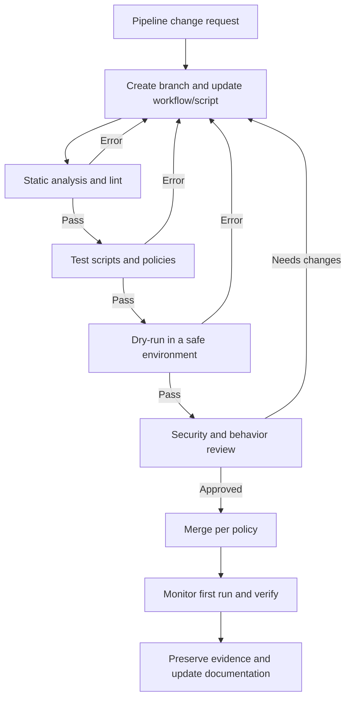

# Reviewing Pipeline Changes Like Application Code Changes

A CI/CD pipeline is software that controls how source code is verified, packaged, stored, and delivered to environments. A change in a workflow can determine which commands run, which runner is used, which secrets are accessed, which artifacts are released, and who has permission to deploy. Therefore, pipeline changes must be reviewed, tested, versioned, and traced with the same discipline as application code.

When modifying application code, teams routinely evaluate behavior, safety, compatibility, and regression testing. The same questions must be asked of pipeline code. A few lines of YAML changes can broaden workflow permissions, expose credentials, bypass quality gates, or halt all releases. Conversely, a carefully reviewed pipeline keeps the build and release process repeatable, explainable, and recoverable.

In the CI/CD module, a pipeline is treated as executable configuration code. It is part of the software delivery system alongside build scripts, Dockerfiles, runner configurations, policies, reusable workflows, and testing tools. Consequently, every change capable of affecting the delivery flow requires explicit intent, test evidence, and accountable ownership.

## 1. Why must pipeline changes be reviewed?

A pipeline can perform actions far more consequential than an ordinary build command: reading repositories, fetching dependencies, accessing registries, obtaining cloud permissions, signing artifacts, modifying infrastructure, or deploying applications. If a workflow is wrong, the impact can propagate across many repositories and environments.

Examples of risks introduced by pipeline changes:

- Modifying a trigger so a release workflow runs on an unintended branch or tag.
- Granting `write` permission to an entire job when only one step needs package write access.
- Exposing secrets into the environment of a pull request from a fork, allowing untrusted code to read or exfiltrate secrets.
- Using an unpinned third-party action, causing workflow behavior to change whenever the action updates.
- Skipping a test step or misplacing `continue-on-error`, causing the pipeline to report success even when mandatory checks fail.
- Altering an `if` condition so a deploy step executes even though a prerequisite job did not pass.
- Accidentally canceling a job producing artifacts or deploying due to misconfigured concurrency.
- Modifying a cache key or cache scope so stale data, wrong data, or data produced by an untrusted job is reused.

These flaws do not necessarily break application compilation. A pipeline can still show green while having skipped checks or expanded access permissions. Therefore, pipeline reviews must evaluate both intended outcomes and side effects on security, reliability, cost, and operability.

### Pipelines are part of the software supply chain

A pipeline typically pulls source code from Git, downloads actions or plugins, fetches dependencies, runs scripts, produces artifacts, and pushes them to a registry. Every component can affect the final output. If one step in the chain changes without control, the team may lose visibility into which code or tools produced an artifact.

To maintain traceability, a run should link to the commit SHA, workflow version, tool versions, runner, dependencies, and generated artifacts. For systems requiring high assurance, checksums, signatures, and attestation/provenance can be added to prove artifacts were produced from the declared source and process.

## 2. Questions to answer when reviewing a pipeline change

Reviewers must understand the goal of the change before reading YAML line by line. Ask the author to explain the current problem, expected behavior, blast radius, and verification method. Then evaluate the change across the following areas.

| Review area | Core question | Evidence to inspect |
|---|---|---|
| Triggers and scope | When does the workflow run, on which branches/tags/events? | `on` configuration, `if` conditions, sample triggering events |
| Behavior and ordering | Which jobs run first, which dependencies are mandatory, how does flow stop on failure? | `needs`, `if`, `continue-on-error`, test results |
| Permissions and identity | What read/write access does the job need, and which identity accesses external services? | `permissions`, cloud roles, token scopes, OIDC trust policy |
| Secrets and data | Where do secrets flow, and what data can logs and artifacts contain? | `secrets`, `env`, outputs, artifact uploads, masking, download access |
| Dependencies and actions | Are actions, images, plugins, and dependencies version-pinned? | Versions or commit SHAs, lockfiles, checksums, download sources |
| Runners and isolation | Which runner type executes untrusted code, and is the workspace shared? | Runner labels, ephemeral runners, OS and network permissions |
| Artifacts and traceability | What outputs are produced, how are they named and tied to revisions? | Artifact paths, checksums, metadata, provenance |
| Reliability and performance | Are timeouts, retries, caching, concurrency, and cancellation appropriate? | Run duration, logs, cache keys, cancellation behavior |
| Maintainability | Are job names, reusable workflows, docs, and ownership clear? | File layout, documentation, CODEOWNERS, change history |

Not every change needs lengthy answers in every category. However, all relevant categories must be examined before merging. For example, renaming a job can break a required status check; changing permissions can affect every step in a run; changing an artifact path can break a deploy step in another workflow.

## 3. Pipeline review workflow from request to rollout

An effective review process combines automated checks with human judgment. Tooling can catch syntax errors, invalid expressions, or common risky patterns. Reviewers still must understand practical impact and confirm the change satisfies requirements.



### Step 1: Describe purpose and scope

The pull request should clearly explain why the pipeline needs changing and what behavior will differ after merging. If modifying triggers, list which events will activate the workflow. If adding permissions, specify which step requires them and which resources are accessed. If changing artifacts, describe where they are produced, stored, and which workflows consume them.

A good pull request should identify:

- The operational issue or requirement being addressed.
- Affected files, jobs, actions, scripts, or policies.
- Behavior before and after the change.
- Risks evaluated, especially permissions, secrets, and untrusted code.
- Checks executed and their results.
- A rollback plan if the change breaks the pipeline or release flow.

Split large changes into focused pull requests with clear purposes. For instance, updating action versions, changing workflow permissions, and restructuring artifacts can be three separate changes. This helps reviewers diagnose check failures and reduces friction if a revert is needed.

### Step 2: Validate syntax and structure

Syntactically valid YAML is not necessarily a valid workflow. A file may parse cleanly yet use wrong key names, wrong data types, non-existent contexts, or invalid dependencies.

For GitHub Actions, `actionlint` validates workflow structure, expressions, and common errors. For shell scripts, use ShellCheck to catch bugs and unsafe idioms. For Dockerfiles, Hadolint can be used. Other platforms offer corresponding linters or schema validators.

Structural validation should run automatically on pull requests. Validation tools must be version-pinned or run in a managed environment so results do not change unexpectedly between runs.

Example validation commands in an environment with pre-installed tools:

```bash
# Lint GitHub Actions workflows in .github/workflows
actionlint

# Lint shell scripts used by the pipeline
shellcheck scripts/ci/*.sh

# Check whitespace and basic patch issues
git diff --check
```

Not every repository has both `.yml` and `.yaml` files or shell scripts. Adjust paths to match the actual repository layout and ensure runners have the corresponding tools. If no files match a glob, handle that case explicitly in the job instead of accidentally skipping the entire check.

### Step 3: Test scripts and conditional logic

Workflows frequently invoke scripts to build, scan, package, or deploy. These scripts are independently testable code. Write unit tests for data handling, argument parsing, and error cases.

For workflow conditional logic, test critical branches:

- Pull requests from internal branches and from forks.
- Pushes to the main branch and release tags.
- Dependent job failures, cancellations, or skips.
- No changed files matching path filters.
- Missing secrets or configuration variables.
- Empty artifacts, malformed artifacts, or artifacts not matching the expected revision.
- Users lacking deployment permissions or unapproved environments.

Fixtures or mock data can test scripts without touching real resources. For deploy steps, prefer plan/dry-run modes or sandbox environments. Never use production as a testbed for an unverified workflow change.

### Step 4: Integration testing in a safe environment

Some failures surface only when a workflow runs on a real runner: missing binaries, wrong paths, shell differences, missing file permissions, timeouts, network policies, or runner image discrepancies. Therefore, linting does not replace live test runs.

You can use a dedicated runner, test repository, ephemeral environment, or constrained workflow dispatch parameters for testing. For deployment changes, use staging or a test target containing non-sensitive data. Ensure testing cannot automatically trigger a production deployment.

Local workflow emulators help verify certain jobs quickly, but they do not always faithfully simulate permissions, OIDC, GitHub contexts, hosted runners, or platform services. Passing local emulation is only one layer of evidence; safe testing on the real CI platform is still necessary.

### Step 5: Security and access control review

This step requires special scrutiny for pipeline changes because workflows often run code submitted by users or contributors. Reviewers must determine the origin of the code, the execution identity, granted permissions, and reachable resources.

Do not approve broad permissions simply because one job needs a write operation. Scope permissions per job and per resource. Inspect every flow of secrets, outputs, logs, and artifacts. For cloud deployment workflows, prefer short-lived identities via OIDC and trust policies scoped to repository, branch, tag, or environment.

### Step 6: Merge, monitor, and verify

After reviews and required checks pass, merge according to repository policy. Monitor the first run after merging, inspect logs, and verify artifacts or outputs are produced properly. If the change impacts the release flow, roll it out to a narrow scope or enable it incrementally if the platform supports doing so.

Record the workflow version, merged commit, verification run, and accountable owner. If an error occurs, revert or restore the previous workflow version following the prepared procedure.

## 4. Security during pipeline reviews

### Least privilege

Each job should receive only the permissions required to complete its task. In GitHub Actions, you can declare `permissions` at the workflow level and narrow or grant specific permissions at the job level. When declaring permissions, omitted scopes may default to `none`; verify platform documentation and actual configuration behavior.

For example, a job that only reads source code can use:

```yaml
permissions:
  contents: read
```

A job that publishes packages may additionally need package write permission. That permission belongs on the publishing job rather than on the entire workflow including jobs running tests on untrusted code.

Reviews must inspect the default token, third-party action permissions, cloud permissions, and runner permissions. Just because a step does not directly invoke an API does not mean it cannot use tokens available in its environment.

### Handling pull requests from forks and untrusted code

Pull requests from forks can contain arbitrary code supplied by contributors. When a workflow checks out and runs tests on this code, build, test, or packaging scripts can execute malicious commands. Therefore, do not grant valuable secrets or repository write access to jobs running untrusted code without a proper isolation and control design.

Exercise extreme caution with `pull_request_target`. This event runs the workflow in the context of the target branch and can have access to repository secrets and write permissions. If the workflow checks out pull request code and executes its scripts, an attacker can turn the check step into arbitrary code execution in a privileged context.

Principles to enforce:

- Use `pull_request` for routine checks on pull request code where appropriate.
- Never check out and execute untrusted code inside a workflow that has secrets or write permissions.
- If `pull_request_target` is needed for labeling or metadata management, never run scripts or binaries from the pull request head in that privileged context.
- Separate untrusted jobs from jobs requiring secrets; pass verified data via checked artifacts rather than arbitrary execution privileges.
- Use ephemeral runners or isolated environments to limit persistence of malicious code after a job ends.

### Preventing command injection via expressions

A common vulnerability is interpolating GitHub event data directly into shell commands. Pull request titles, branch names, or commit messages can be controlled by the submitter. If interpolated into a script, special characters can alter the executed command.

Unsafe example:

```yaml
- name: Print pull request title
  run: echo "${{ github.event.pull_request.title }}"
```

Move the data into an environment variable and treat it as input data:

```yaml
- name: Print pull request title
  env:
    PR_TITLE: ${{ github.event.pull_request.title }}
  run: printf '%s\n' "$PR_TITLE"
```

Never use `eval` or string concatenation to turn input data into commands. When passing data via files or arguments, use proper quoting and format validation for the active shell.

### Protecting secrets and credentials

Secrets should be stored in the platform's secret manager or a dedicated secret management system. Never commit secrets into YAML, scripts, Dockerfiles, logs, or artifacts. Log masking only mitigates accidental exposure; it does not stop malicious scripts from exfiltrating secrets over the network or encoding them to bypass filters.

During review, ask:

- Is this secret genuinely required in this job?
- Is this secret exposed to any step running untrusted code?
- Can long-lived secrets be replaced with OIDC and short-lived tokens?
- Are token permissions scoped by repository, branch, environment, and lifetime?
- Could logs, debug output, caches, or artifacts leak the secret?
- Is there a revocation and rotation procedure if exposure is suspected?

Do not casually enable debug logging in jobs that handle secrets. If investigation is required, restrict retention time, log access, and recorded data.

### Controlling external actions, images, and dependencies

An external action or image is code executed inside your pipeline. Using mutable tags like `@main` or floating version tags allows workflow behavior to change over time without a pull request in your repository.

In GitHub Actions, pinning third-party actions to full commit SHAs locks the exact code invoked. When updating, open an explicit pull request and review release notes, diffs, and permission changes. Dependabot or version management tools can propose periodic updates, though every update still requires review.

For container images, prefer explicit version tags and immutable digests when immutability is needed. Verify image sources, signatures, or provenance where supported. Avoid downloading and executing scripts from unpinned URLs during build or deploy steps.

## 5. Reviewing triggers, conditions, and control flow

Triggers decide when a pipeline starts. Conditions decide whether a job or step executes. A small change in either area can cause a workflow not to run, run too often, or run in an unsafe context.

### Verifying triggers

When modifying `on`, list the intended events and verify each case:

| Event | Verification question |
|---|---|
| `push` | Which branches are allowed to trigger? Are unintended tags included? |
| `pull_request` | Does it run for necessary activity types such as opened, synchronize, and reopened? |
| `workflow_dispatch` | Who can trigger manually, which inputs are accepted, and are environments restricted? |
| `schedule` | Are timezone and timing appropriate? Are delayed or overlapping runs handled? |
| `release` or tags | Does the workflow verify the tag, version, and commit origin? |
| `workflow_call` | Does the reusable workflow explicitly declare inputs, secrets, and permissions? |

`branches`, `tags`, `paths`, and `paths-ignore` filters must be reviewed together. For example, if a workflow runs only when files in `src/` change, a change to build scripts or the workflow itself might fail to trigger checks even though it directly impacts the build.

In particular, workflow-level path filters can prevent an entire workflow from running. If that workflow is a required check, pull requests can stall because the check is never created. Consider having an orchestrating workflow always run and control internal jobs, or designing an aggregate check that always reports an explicit status.

### Verifying dependencies and `if` conditions

Jobs using `needs` form a dependency graph. When a job fails, dependent jobs are normally skipped unless a condition permits continuation. Reviewers must know clearly which steps must stop, which steps should run to collect reports, and which steps must never run when prior conditions are unmet.

`if: always()` can be helpful for uploading logs or reports after test failures. However, using it on a deploy job without checking required job outcomes can deploy code even when the build failed. Explicitly specify success criteria and the exact states under which downstream steps may proceed.

Similarly, `continue-on-error` may suit an experimental non-blocking check, but should never be placed on mandatory tests or security scans. Job names and final statuses must faithfully reflect whether quality gates passed.

### Controlling retries, timeouts, and cancellation

Retries can recover from transient network or external service glitches. However, retries must not mask logic bugs or flaky tests. Bound retry counts, backoff intervals, and retryable error types; log each failed attempt and keep the final status honest.

Timeouts protect runners from hung jobs. Timeout values should be informed by operational data and tailored per job type. A multi-minute unit test and an integration test running migrations do not necessarily share the same limit.

Concurrency and cancellation prevent multiple workflows from duplicating work or contending over shared resources. Before enabling cancellation of in-progress runs, verify the job is safe to cancel. Jobs building artifacts, signing images, mutating infrastructure, or deploying may need dedicated locking and serialization instead.

## 6. Testing pipelines like application code

No single test type suffices to verify an entire pipeline. Use multiple layers of evidence balanced by cost and coverage.

| Test layer | Goal | Examples |
|---|---|---|
| Parsing and schema validation | File is structurally valid | YAML parser, JSON Schema, or platform validator |
| Linting and static analysis | Catch invalid keys, broken expressions, risky configs | actionlint, ShellCheck, Hadolint, policy scanner |
| Script unit tests | Verify build/deploy script logic | Testing version parsers, metadata generation, flag handling |
| Policy tests | Ensure permission and source rules are obeyed | Checking no floating action tags, no broad permissions |
| Integration tests | Verify job coordination on real runners and services | Build, artifact upload/download, reading a sandbox registry |
| End-to-end or staging tests | Verify the full delivery flow | Build artifact, deploy to staging, smoke test, verify rollback |

### Validating configuration with appropriate tools

Each format has dedicated validation tooling. Never rely on a generic YAML parser to conclude a workflow is valid, because generic parsers do not know platform-supported keys or contexts. Combine specialized validators with script linters and policy scanners for proper coverage.

For example, a simple validation job for a repository using GitHub Actions might look like this. Assume the runner is provisioned with version-controlled `actionlint` and `shellcheck`:

```yaml
name: Validate pipeline code

on:
  pull_request:
    paths:
      - '.github/workflows/**'
      - '.github/actions/**'
      - 'scripts/ci/**'
      - 'Dockerfile*'

permissions:
  contents: read

jobs:
  validate:
    runs-on: ubuntu-latest
    timeout-minutes: 10
    steps:
      - name: Checkout
        uses: actions/checkout@v4
        with:
          fetch-depth: 0

      - name: Lint workflow definitions
        run: actionlint

      - name: Lint CI shell scripts
        shell: bash
        run: |
          shopt -s nullglob
          files=(scripts/ci/*.sh)
          if ((${#files[@]})); then
            shellcheck "${files[@]}"
          fi

      - name: Check patch formatting
        if: github.event_name == 'pull_request'
        run: git diff --check "${{ github.event.pull_request.base.sha }}"...HEAD
```

This is an illustrative example that should be adapted to the repository layout and how tools are provisioned on runners. If a directory has no files matching the glob, handle that explicitly in the script or use appropriate commands to avoid false failures.

The example uses `paths` to avoid running on unrelated changes. If `validate` is directly a required check, evaluate what happens when the workflow is skipped because no files match the filter. A common pattern is always triggering the coordinating workflow while letting the lint job inspect changed files; the aggregate check still completes with a clear status.

### Testing scripts with mock data

Suppose a pipeline calls a script that generates a tag from an environment variable. You can test the script with valid inputs, missing variables, malformed formats, and unexpected characters without creating real tags or calling a registry.

```bash
#!/usr/bin/env bash
set -euo pipefail

if [[ -z "${RELEASE_VERSION:-}" ]]; then
  echo "RELEASE_VERSION is required" >&2
  exit 2
fi

if [[ ! "$RELEASE_VERSION" =~ ^[0-9]+\.[0-9]+\.[0-9]+$ ]]; then
  echo "Invalid release version" >&2
  exit 2
fi

printf 'release-%s\n' "$RELEASE_VERSION"
```

When testing, set input variables with mock values and assert both exit codes and outputs. Production scripts may need to support SemVer prerelease or build metadata; valid rules must be agreed upon before writing tests. The example above accepts only a simple `major.minor.patch` form.

### Testing failure paths

Pipelines must be tested when a step fails. For example:

- If the build fails, the artifact upload step must not report success.
- If tests fail, the deploy job must not execute.
- If a secret is missing, the job stops with a helpful error and never prints secret values.
- If registry write permission is missing, the pipeline fails clearly without infinite retries.
- If post-deploy smoke tests fail, verification or rollback steps trigger per policy.
- Users without approval authority cannot bypass environment protection.

Testing failure paths is high-value because many pipeline bugs hide in state-transition conditions rather than in successful build commands.

## 7. Managing reusable workflows and shared scripts

When multiple repositories share the same process, reusable workflows or internal actions reduce duplication and standardize policy. However, a single change to a shared workflow can affect dozens of repositories.

Therefore, reusable workflows must be managed like an API:

- Explicitly declare required inputs, outputs, secrets, and permissions.
- Keep naming and data types stable; breaking changes require a migration plan.
- Provide clear release versions or refs so consuming repositories choose when to upgrade.
- Include tests for valid, missing, and mistyped inputs.
- Provide documentation describing behavior, permissions, and caller responsibilities.
- Track consuming repositories to assess impact before removing old inputs or outputs.

Do not let shared workflows automatically change behavior across all repositories without version control. Consuming repositories need to know which version they use and upgrade via pull requests.

### Backward-compatible changes

When renaming an input or output, keep the old field during a transition period and mark it deprecated. When changing permissions, evaluate whether callers rely on inherited permissions. When changing artifact names or output directories, locate all workflows consuming those artifacts and update them under a coordinated plan.

For major changes, publish the new version in parallel. Only after consuming repositories migrate and verify should the old version be retired on an announced schedule.

## 8. Managing runners, caches, and inter-job data

The runner is the pipeline's execution environment. Changes to runner images, labels, OS privileges, or networking can change build outputs even when application code is unchanged.

When reviewing runner changes, check:

- Are the image or OS versions controlled?
- Are JDK, Gradle, Node, Docker, and other tools version-pinned?
- Are runners reused across jobs or repositories?
- Are workspaces, credentials, and processes cleaned up after a job finishes?
- Which registries or services are reachable over the network?
- Are jobs executing untrusted code isolated from runners holding secrets or internal data?

With self-hosted runners, be especially careful because runners can retain state or access privileges beyond a single job. Ephemeral runners, created fresh per run and destroyed afterward, reduce the risk of persistent malware or leftover credentials from prior runs.

### Cache is not a trusted data source

Caching reduces dependency download or build times, yet cached data can be stale or poisoned if sharing scope is poorly designed. Cache keys should include factors affecting cache contents such as OS, runtime version, and lockfiles. Never share sensitive caches between trusted jobs and jobs running untrusted code without strict isolation.

When reviewing cache changes, verify:

- Does the cache hold downloaded dependencies or executable build outputs?
- Which jobs can write and which jobs can read?
- Does the cache key sufficiently distinguish versions and environments?
- Could fallback keys accidentally restore stale data?
- Can the pipeline run cleanly on a cache miss or purged cache?

Inter-job artifacts should be used for outputs requiring handoff and traceability. Artifacts must have appropriate names, revisions, and retention policies. Never use caches as a substitute for verified release artifacts.

## 9. Managing high-risk changes and rollback readiness

Some pipeline changes carry broad impact: editing reusable workflows, changing cloud permissions, swapping runner images, switching registries, modifying signing steps, or changing deployment logic. These changes require clear rollout and recovery plans.

### Risk classification

| Risk level | Examples | Appropriate controls |
|---|---|---|
| Low | Renaming display titles, adding non-sensitive logs | Standard review and linting |
| Medium | Adding tests, updating cache keys, adjusting a job condition | Linting, behavior tests, and pull request test runs |
| High | Changing release triggers, registry write access, shared runners | Owner review, staging tests, and monitoring the first run |
| Very high | Changing OIDC trust, secret access, signing, production deploy, or org-wide reusable workflows | Dedicated approval, staged rollout, traceability evidence, and tested rollback plan |

Actual risk depends on architecture and effective privileges. A one-line change in a trust policy can be riskier than a large change in log formatting.

### Preparing rollback before merging

A rollback plan should answer:

1. Which recent workflow version or configuration is known to work cleanly?
2. Can we revert the commit or pin the reusable workflow back to its previous ref?
3. Must secrets, permissions, runners, or trust policies be restored in sync?
4. Do artifacts created during the change window need to be kept, flagged, or discarded?
5. What signals indicate the rollback succeeded?
6. Who has authority to trigger rollback and who verifies post-recovery health?

Not every change can be rolled back solely by reverting YAML. If a change already created cloud resources, altered schemas, or published artifacts, corresponding resource and data recovery steps are required. For permission changes, verify both old and new permissions after rolling back.

### Phased rollouts

For shared reusable workflows or runner images, roll out to a representative pilot group of repositories first. Monitor run duration, failure rates, permission errors, and artifact outputs. Once the pilot group stabilizes, expand to the remaining repositories.

If the platform supports parallel versions, let repositories opt into the new version via pull requests. This catches compatibility issues at a small scale and makes reverting to the older version much faster.

## 10. Traceability, documentation, and ownership

Good reviews leave an auditable trail. Every pipeline change should link to the motivating request, pull request, review approvals, test results, and merged commit. For changes affecting releases, preserve the verification run and associated artifacts.

Documentation should describe what operators need to know:

- Which events trigger the workflow and which part of the CI/CD flow it owns.
- Which jobs are required checks and which are advisory warnings only.
- Which secrets, permissions, environments, and runners are used.
- Where artifacts are produced, how they are named, and their retention policy.
- How to run checks locally and reproduce CI failures.
- Workflow owners, contact channels, and recovery procedures.

You can use `CODEOWNERS` to automatically request appropriate reviewers when pipeline files change. For example:

```text
# Workflow files requiring CI/CD owner review
/.github/workflows/ @platform-ci
/.github/actions/   @platform-ci
/scripts/ci/        @platform-ci
/Dockerfile*        @platform-ci
```

Adjust team names and syntax to match the repository. CODEOWNERS only assigns reviewers; branch protection must be configured to require code owner approval if it is mandatory.

Never let a single individual be the sole person who understands critical workflows. Sharing knowledge, documenting decisions, and rotating reviews reduce risk when an owner is unavailable.

## 11. Example: reviewing a change that expands deploy permissions

Suppose a pull request modifies a workflow to deploy an application to the cloud. Previously, the job only built and stored artifacts. After the change, the job retrieves credentials and calls cloud APIs.

Reviewers should not merely verify whether the deploy command runs. They must trace the entire flow:

1. Are triggers restricted to permitted release branches or tags?
2. Could the deploy job run on pull requests from forks?
3. Are OIDC or short-lived tokens used instead of long-lived secrets?
4. Does the trust policy restrict repository, ref, and environment?
5. Does the job receive only `id-token: write` and the minimal permissions required for deployment?
6. Does the production environment enforce appropriate approvals and protection rules?
7. Is the artifact fetched from a verified build tied to a commit SHA and checksum?
8. If deployment fails, does the pipeline preserve logs safely and provide a path to restore the previous version?

Illustrative example of a job with narrowly scoped OIDC permissions:

```yaml
jobs:
  deploy-production:
    if: github.event_name == 'push' && startsWith(github.ref, 'refs/tags/v')
    runs-on: ubuntu-latest
    environment: production
    permissions:
      contents: read
      id-token: write
    steps:
      - name: Checkout deployment definitions
        uses: actions/checkout@v4

      - name: Authenticate to cloud using OIDC
        run: ./scripts/ci/authenticate-cloud.sh

      - name: Deploy verified artifact
        run: ./scripts/ci/deploy.sh
```

This is only an illustrative skeleton. `authenticate-cloud.sh` must use the appropriate cloud SDK or CLI to exchange the OIDC token according to the configured trust relationship. The workflow must retrieve artifacts from a verified source and confirm the tag actually points to an authorized release revision. The `id-token: write` permission only permits requesting an OIDC token; it does not restrict cloud privileges by itself. The cloud-side trust policy must still validate issuer, audience, subject, and repository/ref/environment claims.

If the trigger or `if` condition is wrong, the job may fail to run or run unexpectedly. If the environment has no protection rules, declaring `environment: production` alone does not enforce manual approval. These controls must be configured and verified on the actual platform.

## 12. Pipeline change review checklist

Before merging, authors and reviewers can use this checklist:

- [ ] Purpose, before/after behavior, and blast radius are clearly described in the pull request.
- [ ] Triggers, branch/tag filters, and run conditions have been verified against relevant events.
- [ ] The change does not cause required checks to be skipped or hang due to un-triggered workflows.
- [ ] Job dependencies and behavior on failure, cancellation, or skip are explicit.
- [ ] `continue-on-error` and `if: always()` are not used in ways that mask mandatory gate signals.
- [ ] Permissions are scoped per job and strictly to required resources.
- [ ] Code from untrusted pull requests is never executed in a context with secrets or write permissions.
- [ ] Event data is never interpolated directly into shell commands where it could cause command injection.
- [ ] Secrets never appear in YAML, logs, caches, or artifacts; OIDC is used where appropriate.
- [ ] External actions, images, and dependencies are version-pinned with an update process.
- [ ] Runners, caches, and workspaces have isolation boundaries matching the job's trust level.
- [ ] Artifacts are tied to commit SHAs, verifiable, and governed by clear retention policies.
- [ ] Appropriate linting, static analysis, unit tests, and integration tests passed.
- [ ] Failure paths, timeouts, retries, cancellation, and rollback have been evaluated.
- [ ] High-risk changes have owners, approvals, and a phased rollout plan.
- [ ] Documentation, CODEOWNERS, and operational runbooks are updated as needed.
- [ ] The first run after merging is monitored with verification evidence preserved.

Reviewing pipelines like application code keeps the team in control of the build and release system itself. When every change has clear intent, automated checks, risk-proportional review, and a recovery path, the pipeline becomes a trustworthy part of the software supply chain. That ensures decisions about builds, artifacts, environments, secrets, and deployments remain explainable and traceable.
