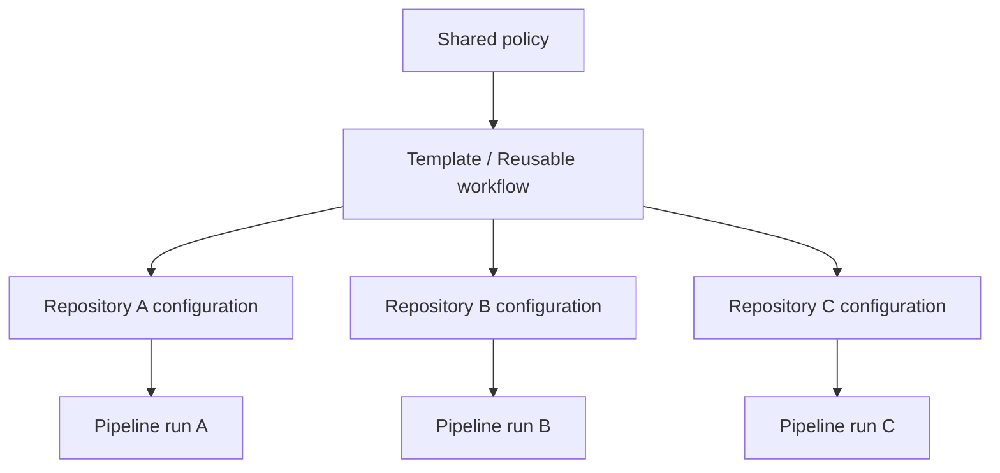

# Controlled Configuration Reuse and Avoiding Unmaintainable Duplication

## 1. Why reuse pipeline configurations?

When a team has only one repository, the pipeline file may stay short and easy to understand. However, as the number of services grows, multiple repositories frequently repeat identical activities: checking out source code, setting up runtimes, restoring dependencies, linting, building, running tests, packaging artifacts, scanning for security issues, and releasing. If each team copies a pipeline file and edits it independently, configurations gradually diverge.

One repository may upgrade its JDK version while another stays on an older version. A secret scanning rule might be missing from one pipeline. A bug in artifact publishing has to be fixed manually in dozens of places. When the release process changes, teams must hunt down and update multiple copies while struggling to tell which copies are fully up to date.

Configuration reuse standardizes parts with the same purpose, reduces repetitive work, and allows a single improvement to propagate to many projects. However, reuse is beneficial only when shared components have clear boundaries and contracts. An overly generic template with obscure parameters or hidden behavior can be harder to maintain than independent configurations.

The goal is finding the right level of reuse: share stable rules, allow intentional customization, control versions and permissions, and keep every pipeline readable and traceable.

## 2. Understanding the true cost of configuration duplication

Copying a snippet of YAML does not create an immediate problem. Trouble arises when multiple copies must change together without a synchronization mechanism.

For example, five repositories share the same Java build job. Each repository declares its own JDK version, dependency cache, test command, and artifact upload logic. Over time:

- One repository moves to a newer JDK while the others do not.
- One copy still uses an old cache key, making results hard to reproduce.
- One copy lacks the step that collects test reports on failure.
- Teams fix artifact publishing bugs in inconsistent ways.
- Operators cannot tell which configuration represents the recommended standard.

This is configuration drift—configurations that started from the same pattern gradually diverging. When security updates or release requirements arrive, drift increases the risk of omissions.

Reuse does not mean eliminating every difference. A web service, a shared library, and a mobile app may require different pipelines. Distinguish between:

| Content type | Appropriate handling |
|---|---|
| Stable, widely shared rules | Move into versioned templates, reusable workflows, or shared libraries |
| Repository-specific values | Pass via inputs, variables, or repository-level configuration |
| Service-specific business decisions | Keep in the service pipeline or an explicit extension |
| Mandatory security/release policies | Manage centrally with change controls and enforcement mechanisms |
| Commands specialized for one component | Keep in the repository until genuine reuse demand exists |

## 3. Common levels of reuse

No single mechanism fits every situation. A CI/CD platform may provide one or more of the following:

| Mechanism | Reuse scope | Best suited when | Caveats |
|---|---|---|---|
| Functions/anchors/aliases within one file | Share small config snippets in one file | Multiple jobs in one pipeline repeat a short block | Support and syntax depend on format/platform; usually lacks strong interfaces |
| Templates/include/extends | Share partial or full pipeline structure across files/repositories | Multiple pipelines share structure and customize via parameters | Must manage inheritance order, overrides, and template versions |
| Reusable workflows/pipelines | Call a complete flow from another pipeline | A multi-job process has stable inputs, outputs, and purpose | Must control permissions, triggers, secrets, and invocation rules |
| Composite actions/task groups | Package a group of steps into a reusable unit | Multiple jobs repeat the same sequence of step-level actions | Platform-dependent; must declare inputs/outputs and execution environment |
| Shared scripts or libraries | Share logic via shell, Python, Java, or internal tools | Complex logic needs testing, linting, debugging, and off-CI execution | Must manage runtimes, dependencies, releases, and execute permissions |
| Pipeline generators | Generate configurations from metadata or conventions | Many similar repositories require consistent bootstrapping | Generated configs must remain inspectable, readable, and traceable to their source |

Naming and semantics differ across vendors. For example, a reusable workflow can encapsulate a multi-job workflow; a composite action usually bundles steps invoked inside a single job. A template might inject YAML into a pipeline at configuration compile time. Read platform documentation before selecting a mechanism instead of treating these terms as strictly equivalent.

## 4. Choosing the right level of abstraction

A practical rule is to reuse at the lowest level that still captures shared intent and delivers maintenance value.

- If only a few simple config lines repeat within one file, anchors or shared variables may suffice.
- If multiple repositories repeat job/stage structure, templates may fit.
- If multiple repositories need the exact same end-to-end multi-job process, reusable workflows/pipelines are usually clearer.
- If only a sequence of operations inside a job repeats, composite actions or task groups may fit.
- If logic involves complex conditionals, error handling, or testing, moving it into versioned scripts/libraries is usually far more maintainable than cramming expressions into YAML.

Do not create an abstraction just because two code blocks currently look alike. Ask whether they share the same reason to change in the future. Two command blocks that look similar yet serve different policies may belong apart. Conversely, two pipelines sharing the same contract and rules can share a template.

A good sign of abstraction is that consumers understand what it does from its name, description, inputs, and outputs. A bad sign is consumers having to read through multiple layers of nested templates just to see which commands actually run.

## 5. Designing clear interfaces for shared configurations

A shared template or reusable workflow is a software component. It needs an API-like interface: inputs, outputs, defaults, preconditions, and failure behavior.

An interface should specify:

- **Name and purpose:** what problem the component solves and which repository or pipeline types it targets.
- **Inputs:** which parameters are required, data types, formats, defaults, and valid constraints.
- **Outputs:** which values or artifacts are produced, their names, and how to consume them.
- **Secrets/permissions:** required permissions, passed secrets, and which jobs can access them.
- **Execution environment:** required runners, operating systems, runtimes, and dependencies.
- **Failure behavior:** failure criteria, exit codes, retries, timeouts, and error reporting.
- **Compatibility:** supported versions and interface change policy.

Conceptual interface example:

```yaml
uses: shared/java-build
with:
  java-version: "21"
  build-command: "./gradlew clean build"
  publish-artifact: true
  artifact-name: "service-package"
```

The key names above illustrate the concept only. Real syntax depends on the tool. Documentation for the shared component must explain which values `java-version` accepts, which shell executes `build-command`, which files `publish-artifact` produces, and how calling pipelines retrieve the artifact.

Avoid exposing too many parameters. If a template has dozens of booleans like `skip_lint`, `skip_tests`, `skip_security`, `skip_upload`, and `force_deploy`, consumers can produce countless untestable combinations. Prefer a small set of options reflecting genuine needs, use named profiles for common modes, and keep mandatory policies outside arbitrary overrides.

## 6. Rules for defaults and input validation

Defaults help users get started quickly, but defaults must be safe and predictable. For example, a build workflow should enable unit tests by default and never auto-deploy to production. Production deployment should require explicit triggers, permissions, and approvals per policy.

Principles to follow:

1. Provide a default only when one option fits most consumers with minimal surprise.
2. Parameters affecting security or releases must have safe defaults.
3. Validate inputs early, before running resource-intensive steps.
4. Fail with error messages naming the parameter, invalid value, and supported values; never print secrets.
5. Avoid overloading empty strings or magic values to represent multiple states when explicit enums or booleans work better.
6. Distinguish required parameters from optional ones and state clearly when a step is skipped.

Example of runtime version validation in a script:

```bash
case "$JAVA_VERSION" in
  17|21) ;;
  *)
    echo "Unsupported Java version: $JAVA_VERSION" >&2
    exit 2
    ;;
esac
```

This is a simple shell example. In production environments, validate inputs safely for the shell and avoid concatenating untrusted input strings into arbitrary commands. When a parameter accepts only a fixed set of values, allowlist validation is far safer than accepting arbitrary strings and trying to filter dangerous cases.

## 7. Versioning shared templates and workflows

When a pipeline references shared configuration, that configuration's version becomes an input to the run. Referencing a moving branch like `main` or a mutable tag means the exact same application commit can execute different pipeline logic at two points in time.

Common referencing approaches:

| Reference style | Pros | Risks/limitations |
|---|---|---|
| Moving branch such as `main` | Receives updates quickly | Behavior can change without modifying the calling repository |
| Version tag such as `v2.3.1` | Readable, convenient for deliberate upgrades | Tags can be moved if the repo does not enforce immutability |
| Immutable commit SHA | Pins exact invoked content | Harder to read; requires an upgrade workflow and version notes |
| Immutable package version | Manageable like a regular dependency | Requires a registry, release workflow, and versioning support |

For components affecting security or production deployments, prefer immutable references or equivalent tag/version protection mechanisms. If the platform requires tag references, restrict tag creation and force-push permissions, and record the underlying commit SHA in run metadata.

Upgrades should be deliberate:

1. Read release notes and interface changes.
2. Test the new version on a sandbox repository or sample pipeline.
3. Update the reference in calling repositories via pull request.
4. Run required checks and verify artifacts/deployments.
5. Monitor for post-upgrade issues and keep a rollback path to the prior version.

Never let template updates silently alter production behavior without controls commensurate with the risk.

## 8. Backward compatibility and interface changes

Shared components may be called by many repositories updating on different schedules. An interface change can break pipelines that have not upgraded yet.

For example, an initial version uses input `artifact-name`. A later version renames it to `package-id`. Removing the old input immediately breaks every repository still passing the old name.

A safe upgrade path:

- Add the new input while temporarily continuing to support the old input.
- If the new input is provided, use it; otherwise, map from the old input according to explicit rules.
- Emit a deprecation warning naming the input and planned removal version.
- Update calling repositories and track adoption.
- Remove the old input only in a new major version or after the announced sunset date.

| Change type | Examples | Typical management approach |
|---|---|---|
| Patch | Bug fixes that preserve interfaces and expected behavior | Release patch and publish release notes |
| Minor | Adding optional inputs/outputs, extending compatibility | Preserve old defaults; test both old and new paths |
| Major | Removing/renaming inputs, changing outputs, or breaking default behavior changes | New major version, migration guide, and transition window |

SemVer conventions can help with templates/packages, though not all platforms support them natively. What matters is having a published versioning policy and never silently breaking consumers.

## 9. Separating shared configuration from repository customization

A maintainable structure typically has three layers:

1. **Core/shared policy:** broadly enforced steps and rules such as mandatory security scans, report collection, artifact identification, and release rules.
2. **Reusable workflow/template:** standard flow for a class of applications, such as Java services, containerized services, or libraries.
3. **Repository-specific configuration:** repository-specific values and tasks such as module names, custom test commands, build paths, or integration steps unique to that service.



The shared layer should hold only what can genuinely be standardized. Calling repositories must still make their service-specific decisions explicit enough for reviewers to understand how the service is built, tested, and released.

Avoid building one monolithic template for every project type if it requires heavy branching across languages, frameworks, operating systems, and environments. Split templates by technology stack or purpose, and share smaller building blocks where genuine commonality exists.

## 10. Managing secrets and permissions in reusable components

Reusable workflows or actions execute code with permissions granted by the calling pipeline. Thus, sharing does not relax security requirements; it can amplify the blast radius of a bug or malicious change across many repositories.

Principles to follow:

- Request only least-privilege permissions and document them clearly.
- Avoid passing all caller secrets when the component needs only one specific credential.
- Never write secrets into outputs, artifacts, logs, or persisted parameters.
- Prevent workflows handling pull requests from forks from receiving sensitive deployment secrets.
- Separate build/test components from production deploy components when they require different privilege boundaries.
- Restrict who can modify shared repositories/templates and who can publish new versions.
- Review external script/action changes and pin dependencies/actions to trusted versions or commits.
- Record the shared component version in logs or release metadata.

If a reusable workflow holds production privileges, every change to that workflow and its dependencies must be reviewed as a production-impacting change. A test job must never receive production privileges simply because a shared workflow declares broad permissions for the entire flow.

## 11. Testing and observing shared components

Shared templates or workflows must be tested like a product. Checking that YAML syntax is valid is insufficient; behavior must be verified across varying inputs.

A testing strategy can include:

- **Static validation:** syntax, schema, input types, references, and lint rules.
- **Unit tests for scripts:** transformation logic, input validation, and error handling.
- **Contract tests:** verifying public inputs/outputs and behavior do not break unexpectedly.
- **Integration tests:** running sample workflows on a test repository to verify runners, artifacts, permissions, and secrets.
- **Compatibility tests:** verifying supported consumer versions continue working.
- **Security reviews:** auditing permissions, dependency sources, secret flows, and behavior on untrusted pull requests.

Maintain one or more sample repositories representing consumer groups. Before releasing a new version, test common scenarios and edge cases: default inputs, custom inputs, missing artifacts, test failures, canceled runners, and missing permissions.

When a workflow fails, logs should identify the template/action version used, non-sensitive inputs, which job/step failed, and a link to the corresponding run. Never log secret values for debugging. If a new version breaks multiple repositories simultaneously, version metadata helps pinpoint impact immediately.

## 12. Ownership, releases, and change governance

Every shared component needs an accountable person or team. Without ownership, bugs bounce back and forth between platform and application teams.

Governance should clarify:

- Who owns the shared template, workflow, action, or script.
- Who can review and merge changes.
- Who can publish tags/packages and protect stable versions.
- Channels for announcing changes, release notes, and deprecation notices.
- Support windows for older versions and emergency vulnerability response procedures.
- How consumers request features or report bugs.
- How to track which repositories run which versions when centralized governance is needed.

Not every change needs heavy bureaucracy. A small script used within one team can use normal peer review. A workflow carrying production deployment privileges for dozens of services needs stricter controls. Governance should scale proportionally with consumer count, granted privileges, and failure impact.

## 13. Example: standardizing pipelines across multiple Java services

Suppose an organization operates many Java services using Gradle. Each repository has a similar layout but differs in artifact names and specific tests.

The platform team creates a reusable workflow `java-service-ci` with these inputs:

| Input | Required | Purpose |
|---|---|---|
| `java-version` | Yes | Supported JDK version |
| `build-command` | Yes, or published default | Standard build command |
| `artifact-path` | Yes | Path of packages to upload |
| `run-integration-tests` | No | Enable integration tests if the repository needs them |
| `artifact-name` | No | Artifact name, defaulting by repository/run |

The standard workflow checks out the revision, sets up the JDK, restores dependencies, lints, builds, runs unit tests, collects reports, and uploads artifacts. Mandatory security rules and commit metadata are managed inside the shared layer. Calling repositories pass only required values and can add custom test jobs before the release gate.

Conceptual caller example:

```yaml
name: service-ci

on:
  pull_request:
  push:
    branches: [main]

jobs:
  standard-ci:
    uses: platform-pipelines/java-service-ci@v2
    with:
      java-version: "21"
      build-command: "./gradlew clean build"
      artifact-path: "build/libs/*.jar"
      run-integration-tests: true
```

This is a hypothetical syntax example for calling a reusable workflow, not a file executable on every platform. Exact `uses`, `with`, trigger, and secret-passing syntax must match the provider. In real deployments, referenced versions must be protected or pinned immutably per organizational policy.

When a service needs specialized checks, the repository can declare a custom job depending on the standard job, provided it does not bypass mandatory gates. When the platform team improves artifact creation or adds security checks, repositories upgrade the shared version via pull requests, review release notes, and test before broad adoption.

## 14. Migrating from duplication to reuse

You do not need to refactor every pipeline at once. Migrate incrementally using this workflow:

1. **Inventory:** find duplicated configuration snippets and identify repository groups with genuinely shared needs.
2. **Compare differences:** categorize shared parts, per-repo values, and differences driven by policy or tech stack.
3. **Pick a representative pilot:** choose a low-risk repository or sandbox environment to build the first shared component.
4. **Design a minimal interface:** define inputs/outputs, permissions, runners, artifacts, conditions, and failure behavior.
5. **Test:** verify standard configurations and edge cases on a sample repository.
6. **Release a version:** write release notes, tag the version, and define support expectations.
7. **Migrate repository by repository:** replace duplicated YAML with calls to the shared component via pull requests.
8. **Monitor:** track errors, run times, adoption, and overrides consumers must add.
9. **Remove old duplicates:** delete legacy copies only after verifying repositories run the new version cleanly without lingering dependencies.

If repositories diverge heavily, you may discover a shared template is the wrong fit. In that case, split into distinct pipeline families or reuse at a lower level such as verification scripts rather than forcing every case into one interface.

## 15. Anti-patterns to avoid

| Anti-pattern | Consequence | Improvement |
|---|---|---|
| Copying templates without synchronization | Configurations drift; fixes are applied unevenly | Use versioned shared components with an upgrade path |
| One giant template for all project types | Complex conditionals, parameters, and unreadable branches | Split by tech stack/purpose and share stable parts |
| Deeply nested template inheritance | Hard to trace final configuration and executed commands | Limit inheritance depth; document config sources and overrides |
| Referencing moving branches for critical releases | Behavior changes without consumer upgrade PRs | Pin immutable versions or protect tags per policy |
| Breaking input/output changes without notice | Existing consumers break | Apply versioning, deprecation notices, and migration guides |
| Too many optional parameters | Configuration combinations explode; hard to test | Keep interfaces small; use named profiles when needed |
| Using `skip` flags to bypass gates | Quality policies are neutralized | Separate mandatory checks from optional ones; manage time-bounded exceptions |
| Shared workflows with overly broad permissions | Bugs or malicious code can impact many repositories | Split jobs by privilege level, enforce least privilege, and restrict callers |
| No owner for shared templates | Nobody takes responsibility when consumers hit bugs | Assign owners, support channels, and a release process |
| Checking only YAML syntax | Bugs surface only during real workflow execution | Maintain sample repositories, integration tests, and contract tests |

## 16. Checklist before adopting a shared pipeline component

Before creating or upgrading a shared template/workflow/action, verify:

- [ ] At least one consumer group genuinely shares the same needs and reasons to change.
- [ ] Reuse is chosen at the right level: template, workflow, action/task, or script.
- [ ] Name, purpose, inputs, outputs, defaults, and error behavior are clearly documented.
- [ ] Inputs are validated and defaults are safe.
- [ ] Permissions, secrets, and runners follow least-privilege boundaries.
- [ ] Versions are managed; breaking changes have a migration path.
- [ ] Configuration, script, contract, and integration tests run on a sample repository.
- [ ] Logs and metadata enable tracing which component version ran.
- [ ] Owners, release notes, bug-reporting channels, and support windows are defined.
- [ ] Calling repositories can still clearly understand their pipeline execution and customizations.

## 17. Core practical principles

1. Reuse configurations that share the same purpose and same reasons to change; do not abstract just because a few lines look alike.
2. Pick the right mechanism for the scope: template, reusable workflow, action/task, script, or library.
3. Design small interfaces with clear inputs/outputs, safe defaults, and explicit validation.
4. Use immutable or protected versioning; upgrade through a tested process.
5. Maintain backward compatibility and announce deprecations before removing old interfaces.
6. Separate shared policies, standard flows, and repository-specific customization.
7. Restrict permissions, control secrets, and treat shared components as code capable of impacting multiple systems.
8. Test against representative consumers, monitor failures, and assign accountable owners.

Controlled configuration reuse enables multiple repositories to share a consistent CI/CD foundation while preserving legitimate local needs. The greatest value comes from being able to improve, test, release, and trace the shared delivery process like a product with a clear lifecycle.
