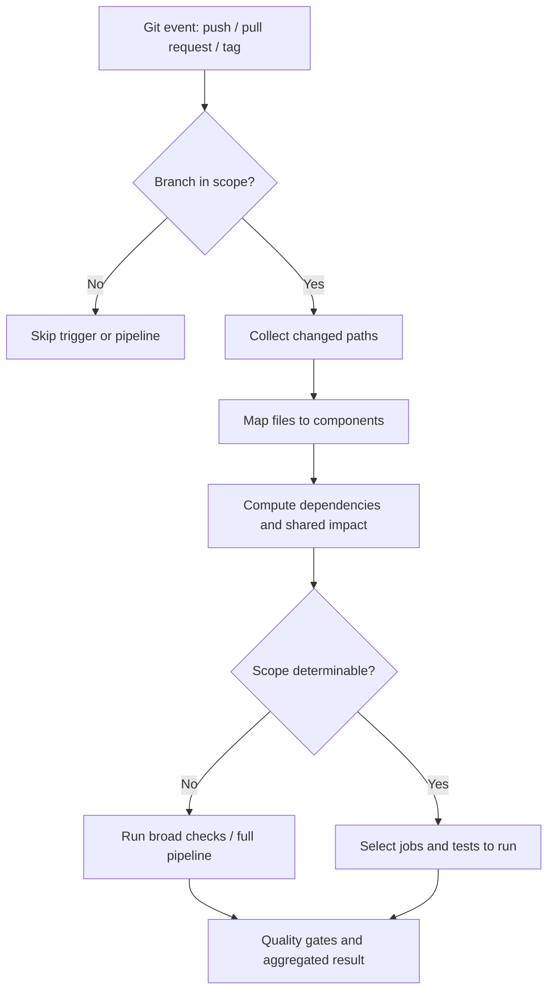
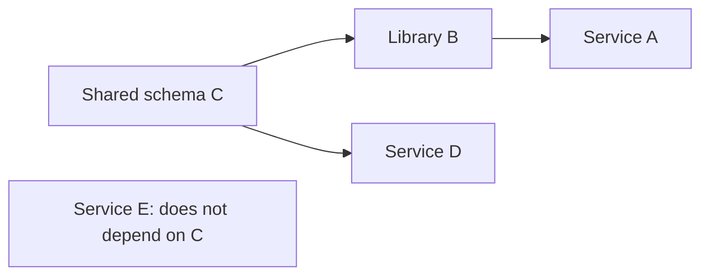

# Selecting Branches, Paths, and Change Scopes to Process

A repository can contain multiple applications, libraries, documentation, and shared configurations. Not every change needs to run the entire pipeline, yet missing a single file with indirect impact can allow unverified code into the main branch or production. CI/CD filter design must therefore balance two goals: fast feedback for unrelated changes and assurance that every affected component is verified.

Branch filters determine which branches or branch types are allowed to trigger a flow. Path filters determine which changed paths are relevant. Scope selection determines the set of jobs, tests, builds, or services to run once the change scope is known. These three layers are related but distinct: selecting the right branch does not mean selecting the right module; filtering the right path does not guarantee covering that module's dependencies.

## 1. Three Questions Before Writing Filters

Before adding `branches`, `paths`, `rules:changes`, or `when { changeset ... }`, answer these questions:

1. **Which events need handling?** Push to the main branch, pull request, release tag, schedule, or manual action?
2. **Where did the change occur?** Source branch, target branch, added/modified/deleted/renamed files, and which shared configurations are affected?
3. **What needs to run?** The full pipeline, a group of modules, a test suite, documentation checks, or only a single verification step?

For example, consider a monorepo with `services/orders`, `services/catalog`, `libs/contracts`, `build-logic`, and `docs`. When `services/orders/**` changes, the team can run orders tests. When `libs/contracts/**` changes, both orders and catalog may need checking because both consume the contracts. When `build-logic/**` or the root lockfile changes, every module may be affected and a broader pipeline must run.



## 2. Distinguishing Source Branch, Target Branch, and Push Target Branch

The word `branch` in a configuration does not always refer to the same branch.

- For a **push** event, the branch is typically the branch receiving new commits.
- For a **pull request/merge request**, common branch filters usually evaluate the target branch (base/target), i.e., where the changes seek to be merged.
- The source branch (head/source) is the branch containing the proposed commits. Filtering on the source branch usually requires platform-specific variables or conditions.
- For a **tag**, the ref is the tag name, not a branch. A separate tag filter must be configured if you want to trigger a release pipeline.

For example: a pull request from `feature/new-checkout` into `main`. If a GitHub Actions pull request trigger specifies `branches: [main]`, this condition evaluates the target branch `main`; it does not mean only `main` is allowed as a source branch.

| Need | Information to Check |
|---|---|
| Only check pushes to `main` | Name of the branch receiving the push |
| Only accept pull requests targeting `main` | Target/base branch |
| Only accept pull requests from `release/*` | Source/head branch; use platform-appropriate variable or condition |
| Run when tag `v*` is created | Tag ref type and tag pattern |
| Run release from main branch after merge | Push event to main branch or selected release event |

Do not infer the source branch from the PR title string shown in the UI. Each platform may check out a synthesized merge ref, a source ref, or a different revision. Use the documented variables provided by the platform for source and target.

## 3. At What Level Do Branch Filters and Path Filters Operate?

Branch filters typically decide whether a pipeline or workflow is launched at all. Path filters can also prevent an entire workflow from being created if changes do not match. Some platforms also allow conditions at the job or stage level; in that case, the pipeline still exists, but specific jobs are skipped.

| Filter Layer | Question Answered | Example |
|---|---|---|
| Pipeline/workflow trigger | Should a run be created? | Only pushes to `main`, only changes under `services/orders/**` |
| Job/stage condition | Within this run, which job or stage executes? | Only run integration tests if `libs/contracts/**` changed |
| Scope-selection command inside job | Which modules/files must this job check? | Use the dependency graph to compute affected modules |

Filtering earlier saves more resources, but filtering at the whole-workflow level may leave pull requests without a status check to protect them. Filtering at the job level keeps an aggregator workflow always present, then decides which jobs run. Choose the filtering level that matches how the repository protects its branches.

## 4. Path Patterns and Rules

### 4.1. Where Are Paths Measured From?

Most path filters compare paths relative to the repository root, though syntax and case sensitivity depend on the platform. Common patterns include:

| Pattern | Typical Intent |
|---|---|
| `services/orders/**` | Files in the orders module and its subdirectories |
| `services/orders/**/*` | Files at any depth under orders in syntaxes supporting this glob style |
| `*.md` | Markdown files at the root in many glob implementations |
| `**/*.md` | Markdown files across directory levels; verify root-matching rules per platform |
| `build.gradle*` | Gradle build files at the root with matching suffixes |
| `.github/workflows/**` | GitHub Actions CI workflows |
| `libs/contracts/**` | Shared contracts or libraries |

Do not assume `*`, `**`, `?`, `!`, or regular expressions mean the same thing across all tools. GitHub Actions and Azure Pipelines have their own glob syntaxes; GitLab uses path matching rules under `rules:changes`; Jenkins typically uses Ant-style patterns for `changeset`; CircleCI path filtering is typically implemented with regex in orb mappings. When switching platforms, test patterns against representative paths.

### 4.2. Distinguishing `*` and `**`

In many glob syntaxes:

- `*` matches a name segment within a single path level and typically does not cross `/`.
- `**` matches across multiple directory levels.
- `?` matches a single character.
- Some tools support negation with `!`, while others use an `exclude` list or conditional expressions.

For example, `services/orders/*.java` typically targets only Java files directly under `services/orders`, whereas `services/orders/**/*.java` targets Java files in subdirectories. If a module has `src/main/java` and `src/test/java`, using a single `*` pattern can miss nested changes.

### 4.3. Distinguishing Include and Exclude

A filter must clearly define what is included and what is excluded. If the platform supports negative patterns, ordering can matter: a negative pattern after an include pattern excludes the path; an include pattern appearing afterward can re-include the path. Other platforms provide `include` and `exclude` keys, or evaluate `rules` in priority order.

Avoid overly broad exclusion lists such as ignoring all `*.yml`, `config/**`, or `scripts/**`. Those files can alter how builds work, pipeline permissions, or runtime configuration even when application code has not changed.

## 5. GitHub Actions: Filtering Branches and Paths in Events

GitHub Actions supports branch, tag, and path filtering directly in `push` or `pull_request` triggers. Example:

```yaml
name: Orders CI

on:
  push:
    branches:
      - main
      - 'release/**'
    paths:
      - 'services/orders/**'
      - 'libs/contracts/**'
      - 'build-logic/**'
      - 'gradle/**'
      - 'settings.gradle*'
      - 'gradle/libs.versions.toml'

  pull_request:
    branches:
      - main
    paths:
      - 'services/orders/**'
      - 'libs/contracts/**'
      - 'build-logic/**'
      - 'gradle/**'
      - 'settings.gradle*'
      - 'gradle/libs.versions.toml'

permissions:
  contents: read

jobs:
  verify:
    runs-on: ubuntu-latest
    steps:
      - uses: actions/checkout@v4
      - run: ./gradlew :services:orders:check
```

In this example:

- For `push`, `branches` evaluates the branch receiving the push.
- For `pull_request`, `branches` evaluates the pull request's target branch.
- When both `branches` and `paths` are declared, both the branch condition and the path condition must match.
- Shared files are added to the list because they can affect the orders module.

### 5.1. `branches` and `branches-ignore`

For the same event, do not declare `branches` and `branches-ignore` simultaneously. If you need both negative and positive patterns in the same list, use negative patterns inside `branches`; there must be at least one positive pattern. Pattern order affects evaluation when a later pattern negates or re-includes a branch.

```yaml
on:
  push:
    branches:
      - 'releases/**'
      - '!releases/**-alpha'
      - 'releases/2026-alpha-hotfix'
```

In this example, `releases/**` branches are accepted, branches matching `releases/**-alpha` are excluded, and one specific alpha hotfix branch is re-included by the final positive pattern. Use readable branch names and test edge cases to avoid hard-to-maintain rules.

### 5.2. `paths` and `paths-ignore`

`paths` allows the workflow to run if at least one changed file matches a pattern. `paths-ignore` skips the workflow when all changed files match the exclusion list. Do not use `paths` and `paths-ignore` together for the same event; if complex include and exclude logic is needed, use negative patterns inside `paths` following GitHub's ordering rules.

```yaml
on:
  pull_request:
    branches: [main]
    paths:
      - 'services/orders/**'
      - '!services/orders/docs/**'
      - 'services/orders/docs/api-contract.md'
```

A negative pattern must follow the positive pattern it excludes from. A subsequent positive pattern can bring a specific path back in. Values containing `!`, `*`, or special characters should be quoted in YAML to prevent the parser from interpreting them as other syntax.

### 5.3. Diffs Used to Evaluate Path Filters

GitHub Actions does not look only at branch names. Path filters are computed over a diff:

- For a pull request, the diff is computed from the merge base of the source and target branches to the head commit of the source branch (three-dot comparison).
- For a push to an existing branch, the diff compares before and after the push (two-dot comparison).
- Path filters are not evaluated for tag push events.

This matters when the target branch has moved ahead: files changed before the merge base are not necessarily considered changes of the current pull request. For large changes, watch out for limits on the file list GitHub uses to evaluate path filters; when a diff has too many files or cannot be generated, plan to run broad checks rather than relying solely on path filtering.

### 5.4. Skipped Workflows and Required Checks

If a workflow is skipped due to a branch filter, path filter, or a skip directive in a commit message, the corresponding check may remain in a Pending state. If branch protection requires that check, the pull request may be blocked from merging even though the workflow intentionally did not run because changes were unrelated.

For repositories using required status checks, consider keeping an aggregator verification workflow that always runs on pull requests and only skips unrelated jobs. The aggregator workflow must report a clear final status and must not mark itself as passed when a required job was improperly skipped.

## 6. GitLab CI/CD: `rules:changes` and Pipeline Scope

GitLab commonly uses `rules:changes` to include a job in a pipeline when matching files change. `workflow: rules` can decide whether a pipeline is created at all; `job rules` decide which jobs are included in the pipeline. These two levels should be designed separately.

```yaml
stages:
  - verify

orders_tests:
  stage: verify
  image: gradle:8-jdk21
  script:
    - gradle :services:orders:check
  rules:
    - if: '$CI_PIPELINE_SOURCE == "merge_request_event"'
      changes:
        paths:
          - services/orders/**/*
          - libs/contracts/**/*
          - build-logic/**/*
          - gradle/**/*
          - settings.gradle*
    - if: '$CI_PIPELINE_SOURCE == "push" && $CI_COMMIT_BRANCH'
      changes:
        paths:
          - services/orders/**/*
          - libs/contracts/**/*
          - build-logic/**/*
          - gradle/**/*
          - settings.gradle*
```

Rules are evaluated in order. When a rule matches, GitLab applies that rule's configuration and stops evaluating subsequent rules. To exclude a case, use `when: never` in the appropriate rule; place exclusion rules before general rules that might otherwise match it.

### 6.1. `workflow: rules` vs. `job rules`

`workflow: rules` controls pipeline creation. For example, a team may want to create pipelines for merge requests and branch pushes without creating two duplicate pipelines for the same commit when the branch already has a merge request. Meanwhile, job `rules` control whether a specific job appears in the pipeline.

If you filter the entire pipeline with `workflow: rules`, aggregator jobs and status checks might also cease to exist. If the goal is merely saving time for a single module, it is usually better to keep the pipeline and filter jobs by scope.

### 6.2. Default Semantics of `rules:changes`

In a merge request pipeline, GitLab compares changes against the target branch. In a branch pipeline, the default usually compares against the previous commit on the branch. For scheduled, manual, or other pipeline sources without a corresponding push or merge request, `rules:changes` may evaluate to true because no suitable default diff baseline exists.

When you need to compare against a specific baseline, use `compare_to`:

```yaml
docs_check:
  stage: verify
  script:
    - ./scripts/check-docs.sh
  rules:
    - if: '$CI_PIPELINE_SOURCE == "schedule"'
      changes:
        compare_to: 'refs/heads/main'
        paths:
          - docs/**/*
```

`compare_to` explicitly defines the reference revision for evaluating changes. Choose the baseline aligned with your goal: main branch, release branch, or a specific ref. Comparing against the wrong baseline can cause a job to always run or always be skipped.

### 6.3. Avoiding Duplicate Pipelines

Depending on configuration, a single commit can spawn both a branch pipeline and a merge request pipeline. If both run the same expensive job suite, costs rise and results become confusing. Use `workflow: rules` to define allowed pipeline sources, or configure jobs by `$CI_PIPELINE_SOURCE`, while keeping required checks for merge requests. Do not blindly disable branch pipelines if branches without merge requests still need CI.

## 7. Azure Pipelines: Branch and Path Filters

Azure Pipelines supports branch and path filters in `trigger`; YAML `pr` triggers can filter pull requests on supported repository types.

```yaml
trigger:
  branches:
    include:
      - main
      - releases/*
    exclude:
      - releases/experimental/*
  paths:
    include:
      - services/orders/**
      - libs/contracts/**
      - build-logic/**
      - gradle/**
      - settings.gradle*
    exclude:
      - services/orders/docs/**

pr:
  branches:
    include:
      - main
  paths:
    include:
      - services/orders/**
      - libs/contracts/**
      - build-logic/**
      - gradle/**
      - settings.gradle*

pool:
  vmImage: ubuntu-latest

steps:
  - script: ./gradlew :services:orders:check
    displayName: Verify orders service
```

In this example, branch and path filters are applied together. Azure path filters are case-sensitive; `include` and `exclude` must match the exact casing of paths in the repository. Test patterns on real agents and repositories, especially when projects have capitalized directory names or run across different operating systems.

### 7.1. Pull Requests on Azure Repos vs. GitHub

YAML `pr` triggers do not apply to Azure Repos Git in the same way as GitHub or Bitbucket Cloud. For Azure Repos Git, pull request validation builds are typically configured through the repository's branch policies. This is an important difference when moving the same `azure-pipelines.yml` across Git provider types.

### 7.2. Excludes and Default Triggers

When using include/exclude, confirm the default policy when no include list is specified. Do not assume omitting `trigger` means not running: default CI behavior may depend on organization or project settings. If you want to disable automatic CI triggers, explicitly declare `trigger: none` and add only the required run sources.

## 8. CircleCI: Branch Filters and Path Filtering

CircleCI provides job-level branch/tag filters inside `workflows`. Example:

```yaml
version: 2.1

jobs:
  verify:
    docker:
      - image: cimg/openjdk:21.0
    steps:
      - checkout
      - run: ./gradlew check

workflows:
  verify_main_and_release:
    jobs:
      - verify:
          filters:
            branches:
              only:
                - main
                - /release\/.*/
```

Jobs with dependencies in a workflow must have compatible filters. If an upstream job is filtered out while a downstream job still requires it, the workflow may fail to run as expected. Check the entire chain of `requires`, branch filters, and tag filters.

### 8.1. Path Filtering with Dynamic Configuration

CircleCI commonly uses the path-filtering orb and dynamic configuration to select sub-pipelines or set parameters based on changed files. This is an additional mechanism, not a simple `paths:` key with the same semantics as GitHub Actions.

Setup config example:

```yaml
version: 2.1
setup: true

orbs:
  path-filtering: circleci/path-filtering@1.0.0

workflows:
  detect_changes:
    jobs:
      - path-filtering/filter:
          base-revision: main
          config-path: .circleci/continue_config.yml
          mapping: |
            services/orders/.* run_orders true
            services/catalog/.* run_catalog true
            libs/contracts/.* run_orders true
            libs/contracts/.* run_catalog true
```

The continuation config file can declare `run_orders` and `run_catalog` parameters and condition jobs accordingly. The mapping example uses regex and parameter names; verify syntax, permissions, and continuation behavior for your orb version. Pin orb versions and review changes as pipeline dependencies.

### 8.2. Choosing a Baseline for Path Filtering

Path filtering must know which revision serves as the baseline. If you pick `main` while the pipeline is processing a release branch or merge request with different history, the resulting changed paths may not reflect the intended scope. Choose the base revision according to pipeline type and test with new branches, long-lived branches, merge commits, and recently merged changes.

## 9. Jenkins: Branch Discovery and `when` Conditions

Jenkins Multibranch Pipeline discovers branches and pull requests through a Branch Source plugin. Branch include/exclude rules, pull request discovery, and build strategies are typically configured on the SCM source or job. Inside a Jenkinsfile, Declarative Pipeline provides `when` conditions to skip stages based on branch, change request, or changeset.

```groovy
pipeline {
    agent none

    stages {
        stage('Verify orders') {
            agent any
            when {
                beforeAgent true
                allOf {
                    anyOf {
                        branch 'main'
                        changeRequest target: 'main'
                    }
                    changeset 'services/orders/**'
                }
            }
            steps {
                sh './gradlew :services:orders:check'
            }
        }

        stage('Verify catalog') {
            agent any
            when {
                beforeAgent true
                changeset 'services/catalog/**'
            }
            steps {
                sh './gradlew :services:catalog:check'
            }
        }
    }
}
```

The `branch` condition typically applies in Multibranch Pipelines. For pull requests, `changeRequest` can filter by attributes such as target branch. `changeset` checks changed files recorded in the build's changelog. These conditions skip stages; the pipeline itself can still be created and started before stages are evaluated. `beforeAgent true` evaluates the condition before allocating an agent for the stage, avoiding unnecessary resource allocation when a stage is skipped.

If you want to avoid creating a build altogether for a branch or PR, configure branch source traits/build strategies or appropriate webhook/plugin mechanisms. Do not treat `when { changeset ... }` as a pipeline-level filter.

## 10. Selecting Change Scopes in a Monorepo

### 10.1. From Changed Files to Affected Components

A path filter only knows which files changed; it does not inherently understand code dependency relationships. An ownership and dependency map is required to compute the set of components needing verification.

Example:

| Changed Path | Direct Component | Recommended Verification Scope |
|---|---|---|
| `services/orders/**` | Orders | Unit and integration tests for orders |
| `services/catalog/**` | Catalog | Unit and integration tests for catalog |
| `libs/contracts/**` | Shared contracts | Orders, catalog, and consumer contract tests |
| `build-logic/**` | Build system | Build/test all affected modules |
| `gradle/libs.versions.toml` | Dependency catalog | At minimum compile/test modules using updated dependencies; potentially full build |
| `settings.gradle*` | Project topology | Full configuration/build validation |
| `.github/workflows/**` or `.gitlab-ci.yml` | CI configuration | Pipeline lint and relevant workflow checks; never skip required CI |
| `docs/**` | Documentation | Link, spelling, formatting, or docs tests |
| `Dockerfile`, build image scripts | Build/runtime image | Build image and test modules using that image |

If a shared file affects multiple components, run the entire set of affected consumers. If dependencies cannot be determined with certainty, running the full pipeline is safer than guessing too narrowly.

### 10.2. Classifying Files by Impact Level

A practical approach is dividing paths into four categories:

1. **Component-specific:** affects only one module; run that module's jobs.
2. **Shared library/contract:** affects consumers; run tests for the library and relevant consumers.
3. **Build/CI/platform configuration:** can alter how every module is built or tested; run a broad pipeline.
4. **Documentation/non-executable assets:** run documentation checks; application builds may be skipped if unrelated to generated docs or APIs.

This classification must be maintained alongside the repository structure. Whenever adding a module or changing dependencies, update the mapping and test that mapping. Never let a new file fall into an "unclassified" state and silently get skipped.

### 10.3. Computing the Dependency Closure

Suppose component A depends on library B, and B depends on schema C. When C changes, do not run tests only for C; identify A and all other consumers of C as well. The verification set is the dependency closure of the change.



If schema C changes, test C, B, A, and D. Service E can be skipped if the dependency graph proves it is unrelated. For dynamic dependencies or plugin-loaded dependencies, provide a broad verification fallback.

### 10.4. Root Files That Must Be Treated as Shared Impact

Paths commonly overlooked when writing path filters:

- Root build files: `settings.gradle`, `build.gradle`, `pom.xml`, `package.json`, `Makefile`.
- Dependency lock/catalog: Gradle lockfiles, version catalogs, npm/yarn/pnpm lockfiles, Maven parent POMs.
- Build logic and plugins: `buildSrc`, `build-logic`, custom Gradle plugins, compiler configs.
- Container/build images: `Dockerfile`, `.dockerignore`, build image creation scripts.
- CI configuration: `.github/workflows/**`, `.gitlab-ci.yml`, `Jenkinsfile`, `azure-pipelines.yml`, `.circleci/**`.
- Shared contracts: OpenAPI, protobuf, GraphQL schemas, database migration conventions, and code generation templates.
- Scripts and toolchains: `scripts/**`, `.tool-versions`, `.java-version`, `.nvmrc`, tool configurations.

A change solely in a workflow file can remove tests or grant wrong deployment permissions. Therefore, pipeline configurations must always be verified through a clear branch-protection path.

## 11. Example: Selecting Jobs by Change Scope

Suppose a monorepo has two modules `orders` and `catalog`, both using `libs/contracts`. In GitHub Actions, you can keep a workflow running on every pull request into `main`, then select which jobs run based on changed paths. Simple example:

```yaml
name: Monorepo CI

on:
  pull_request:
    branches: [main]
  push:
    branches: [main]

permissions:
  contents: read
  pull-requests: read

jobs:
  changes:
    runs-on: ubuntu-latest
    outputs:
      orders: ${{ steps.filter.outputs.orders }}
      catalog: ${{ steps.filter.outputs.catalog }}
      shared: ${{ steps.filter.outputs.shared }}
    steps:
      - uses: actions/checkout@v4
        with:
          fetch-depth: 0
      - uses: dorny/paths-filter@v3
        id: filter
        with:
          filters: |
            orders:
              - 'services/orders/**'
            catalog:
              - 'services/catalog/**'
            shared:
              - 'libs/contracts/**'
              - 'build-logic/**'
              - 'gradle/**'
              - 'settings.gradle*'

  orders:
    needs: changes
    if: needs.changes.outputs.orders == 'true' || needs.changes.outputs.shared == 'true'
    runs-on: ubuntu-latest
    steps:
      - uses: actions/checkout@v4
      - run: ./gradlew :services:orders:check

  catalog:
    needs: changes
    if: needs.changes.outputs.catalog == 'true' || needs.changes.outputs.shared == 'true'
    runs-on: ubuntu-latest
    steps:
      - uses: actions/checkout@v4
      - run: ./gradlew :services:catalog:check
```

This example illustrates classifying files with a third-party action; it is not a native GitHub Actions path filter feature. Pin actions by full commit SHA per organizational policy, grant `pull-requests: read` so the action can read the pull request file list, and ensure `shared` covers all root files. The `changes` job only detects scope; it is not the final quality gate because it does not aggregate module test results. A real repository needs a required aggregator job to confirm the change-detection job succeeded, all selected modules passed, and skipped jobs were intentionally skipped for valid reasons.

An example aggregator job can check the outcomes of dependent jobs:

```yaml
  required:
    if: always()
    needs: [changes, orders, catalog]
    runs-on: ubuntu-latest
    steps:
      - name: Check selected jobs
        env:
          CHANGES_RESULT: ${{ needs.changes.result }}
          ORDERS_RESULT: ${{ needs.orders.result }}
          CATALOG_RESULT: ${{ needs.catalog.result }}
        run: |
          test "$CHANGES_RESULT" = "success"
          for result in "$ORDERS_RESULT" "$CATALOG_RESULT"; do
            case "$result" in
              success|skipped) ;;
              *) exit 1 ;;
            esac
          done
```

Give the aggregator job a stable name and configure that job as the required status check. In real workflows, if a module is mandatory for a given event type or policy, enforce that condition inside the aggregator logic; never accept `skipped` unconditionally for every job.

Another approach is using an internal script to retrieve changed paths and compute the dependency closure. This is more flexible, but requires testing the script, handling the merge base accurately per event, and falling back to a full build when the script cannot determine scope.

## 12. Edge Cases to Handle

### 12.1. Many Changed Files or Diff Limits Exceeded

Large pull requests can modify hundreds or thousands of files. Some platforms cap the number of paths evaluated by filters or enforce timeouts on diff generation. If a filter cannot see the full set of changes, a module may be missed. For large PRs, generated-code changes, or major migrations, run broader checks rather than relying solely on path filters.

### 12.2. Renames and Deletes

File renames may be reported by Git as delete/add pairs depending on rename detection. When computing scope, inspect both old and new paths. Deleting a configuration file or module can also affect consumers, build includes, or deployment manifests. Do not inspect only files that still exist in the new revision.

### 12.3. New Branches, Tags, Schedules, and Manual Runs

These events do not share the same diff baseline as regular pushes. For example, a scheduled pipeline may have no corresponding previous commit; a new branch may not compare the same way as an existing branch. Choose an explicit baseline, such as the default branch or previous release tag, and determine change scope according to the run's purpose.

For manual runs, provide an input to choose a component or full-run mode, but never let input values bypass quality gates or grant production permissions. Manual triggers only propose which work runs; permissions and approvals must still be checked independently.

### 12.4. Submodules and External Repositories

Updating a Git submodule commit pointer can alter contents outside the main repository directory. Path filters only see the pointer or reference file; they do not automatically inspect the full diff inside the child repository. If the pipeline depends on submodules, check out the exact revision and run dedicated checks when the pointer changes. For dependencies fetched from external repositories, version or digest updates should be treated as dependency changes.

### 12.5. Auto-Generated Files

Generated source files can change in bulk when a schema or generator changes. Do not filter only generated outputs if the real source is a schema, template, or generator. The mapping must cover both source and output, or clearly establish which files are the canonical source.

### 12.6. Case Sensitivity and Platform Paths

Repositories may be checked out on Linux and Windows with differences in case sensitivity, path separators, or special characters. A path filter that works on a personal machine may not match on a CI runner. Use consistent path naming, avoid filenames differing only by case, and test filters on the target runners.

## 13. Required Checks and Avoiding Missed Tests

Path filtering optimizes resources, yet creates a risk of false negatives: an impactful change that the filter fails to recognize. Reduce this risk with these principles:

- Maintain an aggregator job with an explicit status, configured as the required check.
- Include root build files, lockfiles, shared libraries, schemas, CI configs, and shared scripts under shared impact.
- When unclassified paths appear, run the full pipeline or fail to prompt updating the mapping.
- Test filters with sample path lists: module files, root files, deeply nested files, deleted/renamed files, and shared files.
- Test PR targets, source branches, pushes to new branches, tags, schedules, and manual runs.
- Record why a job was skipped so reviewers understand it was an intentional decision.

A validly skipped job should not be treated as a test that executed and passed if policy requires execution evidence. The aggregator job must distinguish `passed`, `failed`, `skipped by scope`, and `not evaluated`; policy may accept justified skips while ensuring affected modules were selected.

## 14. Branch/Path Filter Design Checklist

- [ ] Events and ref types identified: branch push, PR/MR, tag, schedule, or manual.
- [ ] Source branch and target branch distinguished for pull requests/merge requests.
- [ ] Filter placement decided: workflow/pipeline level, job/stage level, or module-selection script.
- [ ] Patterns cover files at the right directory depth and match platform syntax.
- [ ] Include/exclude order and scope are clear; critical configurations are not excluded.
- [ ] Shared libraries, build logic, lockfiles, root configs, schemas, and CI configs are mapped.
- [ ] Dependency closure computed from changed components to affected consumers.
- [ ] Full-pipeline fallback exists when scope is indeterminable or diffs are too large.
- [ ] Renames, deletes, new branches, tags, schedules, and manual runs tested.
- [ ] Required status checks always produce a clear final outcome and never stay pending due to filtered-out workflows.
- [ ] Path-to-component mapping has tests and is updated when adding modules.
- [ ] Logs/audit checked to verify which jobs ran, which were skipped, and why.

A good filter lets the pipeline run only the necessary work while preserving quality gate reliability. Start from event semantics, establish the exact diff baseline, map paths to components, and compute affected dependencies. Whenever there is any ambiguity about scope, running broader checks is better than letting a critical change slip through unverified.
