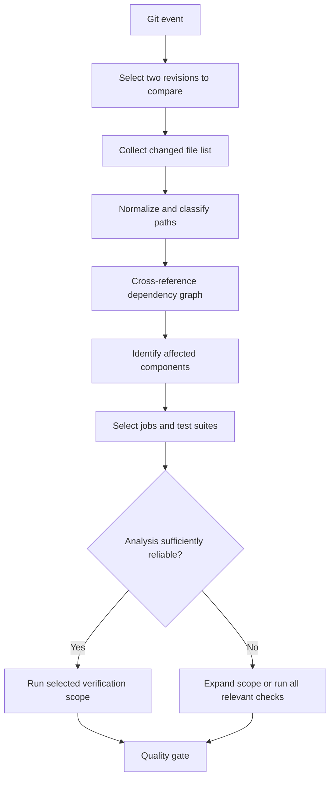
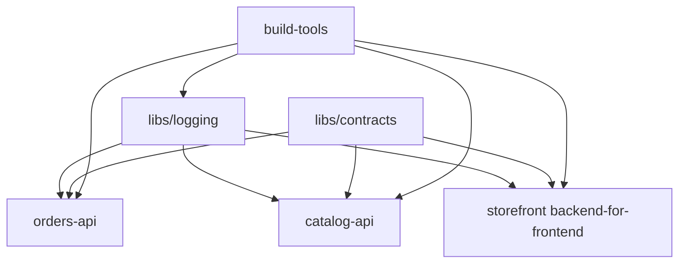
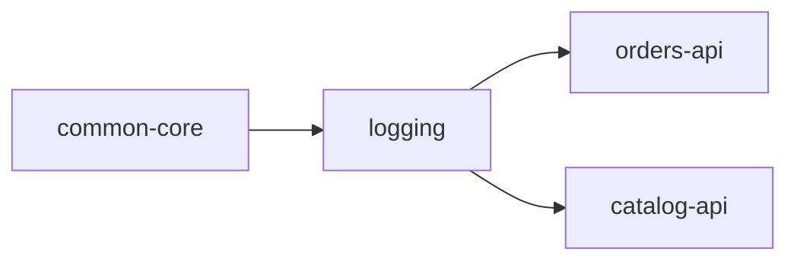
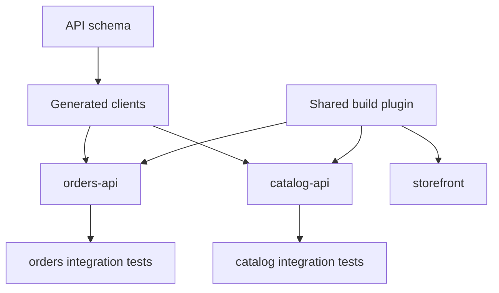

# Understanding the Limits of Change Filters with Shared Dependencies

In a repository containing multiple services, packages, or applications, not every change needs to run the entire pipeline. A change confined to the documentation directory may not require building the backend; a change affecting only the frontend may not require running all integration tests for other services. Change filters (path filters or changed-file filters) help select pipelines or jobs based on files that were added, modified, renamed, or deleted.

However, **a changed file's path is not synonymous with that change's blast radius**. A shared library can be consumed by multiple services; an API schema can generate code for multiple applications; a shared build file can alter how the entire repository is packaged. If a filter looks only at the directory directly containing a file, the pipeline can skip essential consumer checks and allow bugs to slip through to release.

Therefore, a change filter should be treated as a signal to determine initial work scope. To decide which tests must run, the pipeline must combine paths with a dependency graph, change types, build rules, and risk levels. When impact cannot be determined reliably, the safe choice is expanding verification scope or running the full relevant test suite.

## 1. How Do Change Filters Work?

A change filter typically takes the list of differing files between two Git revisions and matches paths against declared patterns. The result can decide:

- Whether to launch a workflow or pipeline.
- Which jobs within the workflow need to run.
- Which modules, packages, or services need to be built and tested.
- Whether an ephemeral environment or component deployment is needed.
- Whether a specialized check suite must run, such as schema or documentation checks.

Example repository structure:

```text
repo/
  services/
    orders-api/
    catalog-api/
  apps/
    storefront/
  libs/
    logging/
    contracts/
  build-tools/
  infra/
  docs/
```

A simple configuration might set rules as follows:

| Changed Path Pattern | Expected Job Scope |
|---|---|
| `services/orders-api/**` | Build and test `orders-api` |
| `services/catalog-api/**` | Build and test `catalog-api` |
| `apps/storefront/**` | Build and test storefront |
| `libs/logging/**` | Test consumers using logging |
| `libs/contracts/**` | Test services and applications using contracts |
| `build-tools/**` | Expand checks for components affected by build tooling |
| `infra/**` | Run infrastructure configuration checks and assess deployment impact |
| `docs/**` | Run documentation checks if changes are confined to this scope |

The critical point lies in the two shared library rows. Running only the `libs/logging` directory job may miss `orders-api` and `catalog-api`, even though both bundle this library. Rules must reflect usage relationships, not merely file locations.

### Path Filtering and Impact Analysis Are Two Different Steps

Path filters answer the question: **which paths changed?** Impact analysis answers the question: **which components could be affected by those changes?**

The two questions are related but not identical. The processing flow can be illustrated as follows:



A mature pipeline can use path filters to narrow the set of components needing analysis, yet it still requires a dependency graph or explicit dependency rules to pick the right consumers.

## 2. Why Are Simple Filters Insufficient for Shared Dependencies?

In a multi-module repository, components frequently depend on other components. A shared library may live in its own directory, yet its behavior is compiled into many different binaries or artifacts.

Example:



If `libs/logging/src/Logger.java` changes, consumers can be impacted even though no file under `services/` was modified. If the pipeline only runs `orders-api` when paths start with `services/orders-api/`, the `orders-api` job will not be selected.

### 2.1. Direct Dependencies

A direct dependency occurs when one component declares usage of another component's package, module, schema, or tool. For instance, `orders-api` declares a dependency on `libs/logging` in its build file. When the library changes, compatibility checks for `orders-api` must at minimum be considered.

### 2.2. Transitive Dependencies

A transitive dependency occurs when A uses B, and B uses C. Changes in C can affect A even when A does not declare C directly.



If `common-core` changes, finding only direct consumers of `common-core` may not suffice if the dependency graph does not fully capture runtime relationships, generated code, or build plugins.

### 2.3. Implicit Convention-Based Dependencies

Some relationships do not appear in package manifests:

- Multiple services sharing a configuration file or pipeline template.
- Multiple applications generating clients from the same API schema.
- Modules sharing database migrations or event definitions.
- A script in `build-tools` altering how all modules compile, test, or package.
- A Terraform module file referenced by multiple environments or stacks.
- A reusable workflow or internal action called by multiple repositories.

If the system relies solely on package manifests, these relationships can be missed. Teams must declare them in dependency metadata, structural conventions, or testable impact rule sets.

### 2.4. Changes to Platform or Shared Tooling

A root file such as `gradle.properties`, `settings.gradle`, a lockfile, compiler configuration, Docker base image reference, or pipeline template can have impact broader than the directory containing it. A filter inspecting only `build-tools/**` can miss changes at the root or in shared configuration files.

Teams should maintain a list of platform files with wide blast radius, such as:

- Root build configurations and shared build plugins.
- Dependency lockfiles and version catalogs.
- Container base images or image build scripts.
- Workflow templates, reusable pipelines, and runner configurations.
- Schemas, code generators, and compiler options.
- Shared security, licensing, and quality gate policies.

When these files change, the pipeline generally needs to expand verification to all relevant consumers or at least run a representative integration suite.

## 3. Common Limitations of Path Filters

### 3.1. Path Matching Does Not Understand Code Semantics

The pattern `services/orders-api/**` only knows a file resides in that directory. It does not know `orders-api` uses `libs/contracts`, where a class is imported, or whether a library change breaks consumer behavior.

Two files in the same directory can have vastly different impacts. Changing a README may only require documentation checks; changing a public interface or migration may require running extensive tests. Conversely, a single file in a shared directory can affect dozens of components.

### 3.2. Glob Semantics Depend on the Tool

CI/CD platforms differ in how they interpret `*`, `**`, negation characters, `/` slashes, case sensitivity, and renamed paths. Never assume a glob pattern behaves identically across all tools.

For example, `libs/**` may match files across multiple levels; `libs/*` may match only a single level depending on the matcher. Include/exclude ordering and handling of negative patterns can also differ.

Check the syntax of your platform and write tests for your path classifier. Changes to glob configurations should be reviewed like pipeline logic changes because they can cause critical jobs to be skipped.

### 3.3. Dependence on the Compared Revision Pair

To know which files changed, the pipeline must determine the correct base and head commits. Different revision pairs can produce different file lists.

| Event Type | Revision Pair to Consider | Risk If Chosen Incorrectly |
|---|---|---|
| Pull request | Merge base of target branch and source head, or platform-provided pair | Comparing against the latest commit instead of the common ancestor can miss accumulated changes |
| Push to branch | Pre-push commit and new commit, or the commit range represented by the event | Comparing only the last commit can miss files changed in earlier commits of the same push |
| Tag/release | Tagged revision against a designated reference revision | Unclear scope of changes since the previous release |
| Manual or scheduled run | Base/head must be explicitly chosen via input or policy | No reliable event diff exists, yet the pipeline applies filters as if one did |

Some events do not provide the same metadata fields. Pipelines must resolve the revision pair by trigger type, check for null values, and log the SHA pair used. Never assume every event has `before`, `after`, `base`, or `head` in the same structure.

### 3.4. Shallow Checkouts and Missing Git History

If a checkout fetches only a single commit, the pipeline may lack the merge base or prior commit required to compute a diff. A failing `git diff` command or empty list does not mean no files changed.

Pipelines must ensure history is deep enough for comparison. When the base commit, merge base, or event metadata cannot be obtained, the analyzer must return an unknown status and trigger the fallback plan. Never interpret a diff calculation failure as "no files changed."

### 3.5. Renames, Deletes, and Generated Files

File changes are not limited to content edits. Files can be added, deleted, renamed, or copied. When a file is renamed, diff tools may represent it as a rename or a delete plus add depending on algorithms and detection thresholds. The classifier must process both old and new paths if relocation changes ownership scope.

Generated files must also be understood by their origin. If a schema changes and generated code is updated, a pipeline checking only outputs may see generated files changed while missing the source schema. Conversely, if generated outputs are committed, a direct output edit may not reflect an actual source change.

Treat source files as the primary signal while checking consistency of generated outputs according to project workflows. For deleted files, run checks confirming no consumers or references to those files remain.

### 3.6. Filters May Not See Changes Outside the Repository

A service may depend on a package published in another repository, a base image updated out-of-band, or a third-party API change. Path filters inside the current repository cannot see these changes.

External dependencies require dedicated mechanisms such as version pinning, dependency update events, scheduled compatibility checks, contract tests, or upstream release notifications. A pipeline that runs only when internal files change cannot guarantee compatibility with all external dependencies.

### 3.7. File Filters Cannot Assess Semantic Risk

A one-line change in a security policy file can impact the entire system; a large change in documentation may have zero runtime impact. Path filters have no awareness of severity or business meaning.

For sensitive changes, inspect by file type and content, such as schema migrations, IAM policies, authentication, deployment manifests, or secret handling. Combine path filters with CODEOWNERS, static analysis, policy-as-code, and domain-expert reviews.

## 4. False Negatives and False Positives

Filter design must balance two types of error.

A **false negative** occurs when a component is affected yet the filter fails to select the required job. This is a severe risk because the pipeline can report green without testing consumers.

A **false positive** occurs when the filter selects extra jobs that are not actually needed. The consequence is usually extra runner usage, time, and cost, which is generally safer than a false negative.

| Situation | Error Type | Example | Remediation |
|---|---|---|---|
| Shared library changes, consumer untested | False negative | `libs/logging` changes, `orders-api` skipped | Query dependency graph and select consumers |
| Incomplete base/head diff | False negative | Multi-commit push comparing only last commit | Use the event's full commit range |
| Glob fails to match nested directory | False negative | `libs/*` misses `libs/contracts/v2/schema.yml` | Test patterns and glob semantics |
| Diff error treated as empty list | False negative | Shallow checkout missing history | Return unknown status and run fallback |
| Every root change triggers all tests | False positive | Editing a root doc file builds all services | Classify root files by actual impact |
| Overly broad dependency graph | False positive | Small library triggers all modules despite subset usage | Maintain accurate, verified dependency edges |

In CI/CD, prioritize minimizing false negatives on gates affecting security, data, and production. Controlled false positives can be tolerated to preserve reliability, then gradually optimized once timing and impact data are available.

## 5. Impact Analysis Using a Dependency Graph

A solid approach is maintaining a dependency graph across modules, packages, services, schemas, workflows, and shared resources. Each node represents a component; edges represent usage or impact relationships.

Example:



When `API schema` changes, the pipeline selects `Generated clients`, then selects potentially affected consumers and their corresponding tests. When `Shared build plugin` changes, the pipeline expands to every module using that plugin.

### 5.1. Selecting Direct and Transitive Consumers

For a changed node, the pipeline can find all directly dependent nodes. If an intermediate node changes public behavior, continue traversing edges to locate transitive consumers. Graph traversal must be directed with clear rules: an edge `A -> B` may mean B depends on A, so changing A requires evaluating B.

Never confuse edge direction. A dependency graph must enforce consistent edge semantics, otherwise the algorithm might select the changed component's dependencies instead of its affected consumers.

### 5.2. Distinguishing Dependency Edge Types

Not every dependency requires the same level of testing. Edges can be classified as:

| Edge Type | Example | Checks to Consider |
|---|---|---|
| Compile/build dependency | Package A imported by service B | Compile and unit tests of B |
| Runtime dependency | Service B calls service A | Contract and integration tests |
| Schema/code generation | Client generated from OpenAPI or protobuf | Verify schema, generated output, and consumers |
| Build tooling | Build plugin used by multiple modules | Build/test modules using the plugin |
| Deployment dependency | Service needs database or platform before running | Verify deployment order and compatibility |
| Policy/configuration | Shared workflow or policy applied to multiple modules | Verify policies and consumer pipelines |

Edge classification helps pick the right test suite rather than running everything merely because a dependency relation exists.

### 5.3. Maintaining a Graph from Trustworthy Sources

The dependency graph can be generated from the build system, package manifests, service catalog, schema registry, or team-declared metadata. Any source must be verified and updated whenever dependencies change.

If the graph is incomplete, the pipeline must know it. A module lacking dependency metadata should not be assumed to have zero consumers. Mark such nodes as `unknown` and apply a broader verification scope until relationships are declared.

In monorepos, build systems often already maintain a dependency graph for compile tasks. However, a build graph may not cover runtime, migration, deployment, or policy dependencies. Supplement information at layers the build graph does not describe.

## 6. Test Scope Selection Strategies

Instead of a single rule ("file changed, run corresponding folder"), test scoping can be organized into layers.

### Layer 1: Always-Run Checks

Some checks should run on every change or every trusted pipeline, such as verifying pipeline configuration, validating metadata formats, checking the validity of the change analyzer itself, and baseline security policies. Supply-chain protection checks or workflow source verification must not be skipped simply because application files did not change.

### Layer 2: Direct File-Based Checks

Select checks close to changed files: documentation, frontend, backend, infrastructure, schemas, or build scripts. This is where path filters shine.

### Layer 3: Consumer Checks

Use the dependency graph to select modules depending on changed libraries, schemas, or tools. Run appropriate compile, contract, integration, or consumer tests.

### Layer 4: Integration and Release Checks

For changes impacting multiple services, APIs, data, or deployment mechanics, run cross-component tests, staging verification, or rollout rehearsals. These checks are costly but necessary for high-risk changes.

### Example Matrix

| Change Type | Direct Checks | Expanded Checks |
|---|---|---|
| Documentation only | Markdown/link checks | No runtime build needed if confirmed unrelated to code or pipelines |
| Single service code | Unit, lint, service build | Relevant consumer contract/integration tests if public behavior changes |
| Shared library | Library tests | Compile/test direct and transitive consumers per dependency type |
| API schema or event schema | Schema validation, code generation | Producer/consumer contract tests and integration tests |
| Build plugin or version catalog | Plugin checks and dependency resolution | Build modules using shared configuration |
| Pipeline template or runner image | Lint and validate pipeline | Verify consumer workflows, permissions, and execution environments |
| Database migration | Migration validation and compatibility tests | Test services using the schema, backup/restore, or rehearsal as needed |
| Shared infrastructure or policy | Validate configs and policies | Assess affected environments, stacks, and services |

## 7. Designing a Fallback When Scope Cannot Be Determined

A reliable filter must have a third outcome beyond "changes present" and "no changes": **unknown**.

Possible causes include:

- Base commit or merge base not found.
- Git command fails or repository checkout lacks sufficient history.
- Event fails to supply the file list or required revision pair.
- Analyzer cannot interpret renames, submodules, or special files.
- Dependency graph fails to load or contains an undescribed node.
- Broken glob rules or invalid filter configuration.
- Changed file belongs to the platform group without a defined impact rule.

In these cases, never default to "no need to run jobs." Choose among these options:

1. Run the entire repository test suite or full relevant scope.
2. Run all consumers of the undetermined dependency group.
3. Halt the pipeline and require fixing metadata or filter configuration if downstream actions carry high risk.
4. Allow continuation on non-release branches, while blocking production promotion when mandatory evidence is missing.

Fallback strictness depends on cost and risk. For normal pull requests, running all relevant tests can be practical. For production, if the artifact or blast radius cannot be determined, halt the release until trustworthy evidence exists.

### Distinguishing `no changes`, `not applicable`, and `unknown`

| Status | Meaning | Action |
|---|---|---|
| `changed` | Files or components in scope changed | Select relevant jobs |
| `no_changes` | Diff succeeded and no in-scope changes exist | Optional jobs may be skipped |
| `not_applicable` | Job does not apply per defined policy | Mark skipped with reason |
| `unknown` | Insufficient data to conclude | Fallback or fail per risk level |
| `analysis_error` | Analyzer failed or metadata invalid | Do not treat as no changes; trigger fallback or stop |

Explicit status representation prevents quality gates from mistaking a job skipped due to an error for a passing job.

## 8. Illustrative YAML Example for Filters and Shared Dependencies

The example below illustrates conceptual logic, not direct syntax of a specific CI/CD platform:

```yaml
change_detection:
  compare:
    base: event_base_revision
    head: event_head_revision
  on_error: unknown

  path_rules:
    orders_api:
      - "services/orders-api/**"
    catalog_api:
      - "services/catalog-api/**"
    shared_logging:
      - "libs/logging/**"
    shared_contracts:
      - "libs/contracts/**"
    build_system:
      - "build-tools/**"
      - "settings.gradle"
      - "gradle/**"

  dependency_graph:
    libs/logging:
      consumers: [orders_api, catalog_api]
    libs/contracts:
      consumers: [orders_api, catalog_api]
    build_system:
      consumers: [orders_api, catalog_api, storefront]

  selection:
    include_directly_changed: true
    include_transitive_consumers: true
    unknown_scope: run_all_affected

jobs:
  detect_changes:
    steps:
      - calculate_changed_paths
      - validate_diff_and_graph
      - publish_affected_components

  test_orders:
    needs: [detect_changes]
    if: affected(orders_api)
    steps: [lint, unit_test, integration_test]

  test_catalog:
    needs: [detect_changes]
    if: affected(catalog_api)
    steps: [lint, unit_test, integration_test]

  test_storefront:
    needs: [detect_changes]
    if: affected(storefront)
    steps: [lint, unit_test, ui_test]

  required_gate:
    needs: [test_orders, test_catalog, test_storefront]
    validate_all_required_results: true
```

The key takeaway is that `detect_changes` does not stop at a file path list. It validates the diff, checks the dependency graph, computes the affected component set, and publishes results for downstream jobs. Test jobs run only when a component is in scope, while the gate must know which jobs are required, which are not applicable, and which lack results.

In real implementations, `affected(component)` must be replaced with outputs, job conditions, or dynamic matrices supported by the platform. Verify behavior when jobs are skipped and how the gate evaluates that status.

## 9. Workflow-Level Filters vs. Job-Level Filters

Many platforms allow filtering events at two levels:

- **Workflow-level filter:** decides whether the entire workflow launches.
- **Job-level condition:** the workflow already runs, while individual jobs are selected or skipped based on change data.

Both approaches affect traceability and required checks differently. If a workflow-level filter excludes a pull request, the platform may never create the check status that branch protection awaits; exact behavior depends on platform and configuration. If the workflow always runs while a job is skipped, the platform may display skipped or success under its own semantics.

For required checks, verify exactly how the platform reports status when filters do not match. You can keep a lightweight gate job always running to validate change analysis outputs and aggregate required jobs. This prevents ambiguous states when a workflow never starts at all.

A generally useful strategy is:

1. Launch a lightweight verification workflow on every protected pull request.
2. Compute diff and blast radius in a dedicated job.
3. Run specialized jobs according to analysis results.
4. Have a final gate confirm every required check passed or was validly marked not applicable.

For very large repositories, workflow-level filters can yield substantial cost savings. Still, required checks and security policies need a mechanism guaranteeing clear status without silently vanishing into an unlogged skipped workflow.

## 10. Security and Reliability of Change Detection Logic

Change filters are part of the quality control path. If contributors can cause filters to skip critical tests or scans by manipulating paths, configurations, or metadata, the pipeline can be bypassed.

Principles to enforce:

- Protect filter definitions, dependency graphs, and analysis scripts with proper reviews.
- Never take inputs from pull requests and execute them as trusted code without validation.
- Never let pull requests from untrusted sources alter conditions that grant secrets or production deployment permissions.
- Keep mandatory security checks independent from test-optimization filters if skipping them could introduce vulnerabilities.
- Log base SHA, head SHA, path lists, dependency graph version, and selected job sets.
- Validate output integrity before using it as a release condition.
- If metadata is untrustworthy or analysis fails, choose a safe fallback.

Change detection scripts should run with least privilege, needing no production secrets and having no permission to alter their own policies. Scoping tests must be separated from decisions granting credentials and deployment permissions.

## 11. Testing the Change Filter Itself

Because filters can prevent a job from running, testing filter logic is as critical as testing application code. Teams should build test suites for typical change scenarios and edge cases.

### Recommended Test Scenarios

| Scenario | Expected Outcome |
|---|---|
| Edit file in `services/orders-api/` | Select `orders-api` and mandatory shared checks |
| Edit `libs/logging/` | Select the library and all declared consumers |
| Edit shared schema | Select code generation, relevant producers, and consumers |
| Edit root build config | Expand to modules using that configuration |
| Delete or rename file | Evaluate both old and new paths; select appropriate consumers |
| Edit documentation only | Select doc checks; skip runtime tests if policy permits |
| Multi-commit changes in one push | Diff covers the full event commit range |
| Missing merge base or shallow history | Return `unknown`, trigger fallback |
| Dependency graph missing a node | Do not conclude zero consumers; expand or halt |
| Path with spaces or special characters | Parsed and passed without improper splitting |
| File in deeply nested directory | Glob matches accurately per chosen syntax |
| A required job is skipped | Gate must not count as passed without valid justification |

Use small Git fixtures with representative commits and directory trees to test scripts. Add regression tests whenever a filter bug misses a consumer. These tests run quickly and safeguard trigger logic during repository refactoring.

### Periodic Reconciliation Checks

In the early stages of adopting change-based optimization, run the broader test suite in observation mode to compare:

- Components selected by the filter.
- Components identified by the build system or full dependency graph.
- Tests that caught failures during broad runs.
- Jobs skipped that were actually relevant.

If the two result sets diverge, investigate why before fully trusting the filter. Even once confidence is high, maintain periodic full runs on a schedule or before major releases to uncover missing relationships.

## 12. Tracking Effectiveness and Accuracy

Do not measure only the number of skipped jobs. A good filter reduces cost while keeping miss probability low.

| Metric | Meaning | How to Use |
|---|---|---|
| Pipeline duration | Time from trigger to result | Evaluate feedback-time improvements |
| Jobs avoided | Count of validly skipped jobs | Estimate saved work |
| Full-scope fallback rate | Share of runs expanding due to unknown scope | Detect metadata or diff issues |
| Filter analysis failure rate | Failure rate in diff calculation or graph analysis | Track filter reliability |
| Missed-impact incidents | Incidents from untested consumers | Assess false negatives |
| Unnecessary job rate | Jobs run despite being out of needed scope | Find opportunities to reduce false positives |
| Dependency graph coverage | Share of components with valid dependency metadata | Measure completeness of impact data |

Never set "maximize `Jobs avoided`" as a goal on its own. If skipped jobs rise while incidents from missed tests also rise, optimization has degraded quality. Read these metrics alongside change failure rate, production defects, and recovery time.

## 13. End-to-End Example: Shared Contract Library Change in a Monorepo

Suppose a monorepo contains `orders-api`, `catalog-api`, and `storefront`. All three use schemas in `libs/contracts`; client code is generated from schemas before building.

A pull request modifies the `deliveryWindow` field in a schema. A naive filter only sees paths starting with `libs/contracts/` and selects the library check job. Stopping there leaves consumer handling of the new field unverified.

A proper flow proceeds as follows:

**Step 1 — Determine diff.** The pipeline retrieves base and head according to event type, computes the file list, and confirms the diff succeeded. It records both SHAs so results are reproducible.

**Step 2 — Classify changes.** Files under `libs/contracts/` are recognized as shared schemas. The analyzer selects not only the library but queries the dependency graph for consumers.

**Step 3 — Compute blast radius.** The pipeline selects code generation, contract validation, and test jobs for `orders-api`, `catalog-api`, and `storefront`. If the graph lacks a consumer or fails to load metadata, the pipeline falls back to checking all related modules.

**Step 4 — Run jobs.** Independent consumers test in parallel, each using generated artifacts and isolated test data. The quality gate waits for all mandatory jobs to complete.

**Step 5 — Release.** If changes pass gates, the pipeline produces immutable artifacts, records provenance, and proceeds through staging. Smoke tests verify flows using the contract before release approval.

**Step 6 — Preserve trace.** The pipeline stores commit, file list, dependency graph revision, selected consumer set, test reports, and artifact digests. When a post-deployment issue occurs, the team can verify why each consumer was or was not tested.

Thus, the filter still avoids running unrelated modules without skipping consumers merely because their source code lives outside the changed directory.

## 14. Common Anti-Patterns

| Anti-Pattern | Consequence | Improvement |
|---|---|---|
| Mapping folders 1-to-1 to jobs | Misses shared library consumers | Combine path filters with a dependency graph |
| Treating empty diff after error as no changes | Skips all required tests | Distinguish `no_changes` and `unknown`; fallback on error |
| Comparing only last commit of multi-commit push | Misses changes in earlier commits | Use the full event revision range |
| Shallow Git history checkout | Cannot compute merge base | Check out sufficient history or use reliable metadata |
| Ignoring renames/deletes | Fails to identify consumers or old paths | Inspect status and both paths |
| Relying on untested globs | Patterns miss nested files or special characters | Write fixture tests for filters |
| Treating incomplete dependency graph as empty | Systematic false negatives | Mark unknown and enrich metadata |
| Checking only generated files | Misses source schemas or generators | Track both sources and code generation pipelines |
| Workflow-level filters dropping required checks | Pull requests lack required check status | Keep gate always running or verify platform semantics |
| Allowing PRs to edit filters to skip own checks | Weakens pipeline protection | Review and protect policies; isolate untrusted permissions |
| Never running periodic broad checks | Missing dependency edges persist unnoticed | Reconcile and run full suites on schedule or pre-release |

## 15. Safe Change Filter Design Checklist

Before using changed-file filters to narrow pipeline scope, teams should review:

- [ ] Git event types and base/head revision pairs to compare are clearly defined.
- [ ] Checkouts include sufficient history and merge base to compute diffs.
- [ ] Added, modified, deleted, renamed files, and generated outputs are distinguished.
- [ ] Globs are tested against the syntax of the platform in use.
- [ ] Root config files, build tooling, schemas, and workflows with broad impact are listed.
- [ ] Dependency graph includes direct, transitive, and implicit relationships not inferable from package manifests.
- [ ] Edge direction in the dependency graph is consistent and selected consumers are verified.
- [ ] Path filters are combined with impact analysis to select jobs.
- [ ] `changed`, `no_changes`, `not_applicable`, `unknown`, and `analysis_error` are distinguished.
- [ ] Fallbacks exist when diffs, metadata, or dependency graphs are unreliable.
- [ ] Mandatory security checks and required checks cannot be bypassed outside policy.
- [ ] Behavior of workflow-level filters, job-level skips, and required checks is verified on the actual platform.
- [ ] Change detection scripts, metadata, and policies are protected from unreviewed edits.
- [ ] Tests exist for filters covering renames, deletes, multi-commit pushes, shallow clones, and nested files.
- [ ] Periodic reconciliation runs against full suites or broader dependency analysis.
- [ ] False negatives, false positives, fallback rate, and pipeline duration are monitored.

## 16. Conclusion

Change filters help CI/CD focus effort on relevant parts of a repository, yet file paths are only an initial signal. In systems with shared libraries, schemas, build tooling, and configurations, impact can propagate across many consumers and dependency layers invisible to simple path filters.

A reliable design combines event-accurate diffs, tested path filters, complete dependency graphs, direct and transitive consumer analysis, explicit `unknown` states, and safe fallbacks. When this logic is protected and observed as part of the pipeline, teams reduce unnecessary work while preserving quality evidence, traceability, and release safety in CI/CD.
