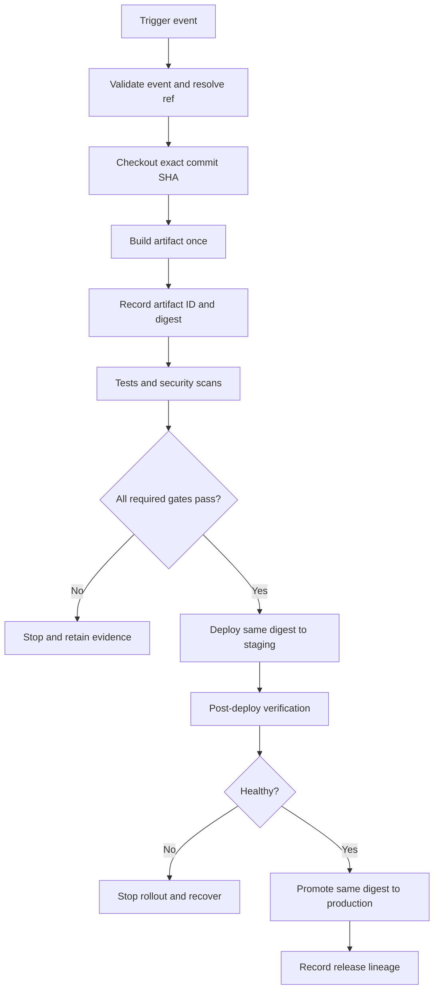

# Linking Trigger Events to the Exact Commit or Artifact

A pipeline can be triggered by a push, pull request, tag, schedule, manual action, or another workflow. The event tells you why the pipeline ran and provides initial context, yet the event name or branch name alone is insufficient to pinpoint the exact source code and software package to process. Branches can move, tags can be altered, pull requests can receive updates while jobs wait in a queue, and a downstream workflow can run in a different context from the workflow that produced the artifact.

Reliable CI/CD design must preserve an unbroken link: **which event occurred → which revision was verified → which artifact was built → which artifact was deployed**. Every step must use appropriate immutable identifiers, store evidence, and verify origin before proceeding. This prevents building the wrong commit, downloading the wrong artifact from another run, or deploying a version that bypassed quality gates.

## 1. Distinguishing Event, Revision, and Artifact

Three concepts are often lumped together yet serve distinct roles:

| Component | Question Answered | Example Identifier |
|---|---|---|
| Trigger event | Why and when did the pipeline start? | `push`, `pull_request`, `schedule`, `release`, `workflow_run` |
| Source revision | Which exact source code state is the pipeline checking? | Full Git commit SHA |
| Build artifact | Which bytes were produced and will be tested or deployed? | Artifact ID, package version, SHA-256 container image digest |

An event can carry multiple Git references such as branch, tag, base SHA, head SHA, or merge SHA. The pipeline must select the right revision for its verification goal. After building, the commit SHA still does not fully determine the package if outputs can vary by toolchain, dependencies, or configuration; therefore, the artifact digest and build provenance must also be recorded.

For example, a pull request has head commit `H` and base commit `B`. The platform may create merge result `M` to test the combination `B + H`. The pipeline checking `M` may pass, yet if base moves to `B2`, the old result does not prove `B2 + H` still passes. Upon merging, the actual commit on mainline may be `M2` or a new commit. Consequently, records must capture head, base, and the revision actually checked out separately.

A minimal traceability chain looks like:

```text
Trigger:
  event = push
  repository = acme/order-service
  ref = refs/heads/main
  delivery_or_run_id = 1842

Source:
  commit_sha = 9f4c...e81a

Build:
  workflow_run = 1842
  attempt = 1

Artifact:
  image = registry.example/order-service@sha256:abc...

Deployment:
  environment = staging
  deployed_digest = sha256:abc...
```

The values above only illustrate structure. In real systems, IDs and digests must come from the Git platform, pipeline, and registry.

## 2. Each Event Type Has Its Own Revision Semantics

Do not assume every trigger checks out the same kind of revision. The same variable, such as `GITHUB_SHA`, can carry different meanings depending on the event.

| Event | Common Context | Revision to Determine |
|---|---|---|
| Push branch | One or more commits pushed to a branch | Tip commit of the ref at the event |
| Push tag | A tag created or updated | Commit the tag points to after tag verification |
| Pull request | Proposed changes from head branch to base branch | Head SHA, base SHA, and/or merge-result SHA depending on test goal |
| Merge queue | A combination of changes queued for integration | Merge-group revision generated by the platform |
| Schedule | Scheduled run at a designated time | Commit of the default branch when the pipeline starts per platform rules |
| Manual dispatch | User selects a ref or run parameters | Selected ref and resolved actual commit SHA |
| Release | A release associated with a tag | Tag name and the commit the tag points to |
| Workflow completion | Another workflow completes | Run ID, repository, event, head branch, and head SHA of the source workflow |
| External dispatch | External system submits a run request | Authenticated payload and revision resolved from a trusted source |

Field names and resolution methods depend on the platform. The pipeline must consult the documentation for the specific event, persist necessary raw values, and verify the revision after checkout using a command such as `git rev-parse HEAD`. Never infer a revision solely from a branch name or workflow name.

## 3. Push: Pin the Revision Rather Than Following a Mutable Branch Name

When a push occurs, webhooks or CI events typically carry the ref and commit SHA of the update. A branch like `main` is a mutable pointer: while waiting for a runner to be allocated, another commit may be pushed. If the job checks out `main` at runtime rather than checking out the event's SHA, the built source code may differ from the revision that triggered the pipeline.

The safe rule is to resolve the revision when receiving the event, then check out that exact commit SHA. You may also record the branch for readability, yet the branch is only metadata describing where the pointer stood at trigger time; the SHA is the revision identifier to verify.

```bash
# SOURCE_SHA must be retrieved from the event payload or CI context.
git fetch origin "$SOURCE_REF"
git checkout --detach "$SOURCE_SHA"

ACTUAL_SHA="$(git rev-parse HEAD)"
test "$ACTUAL_SHA" = "$SOURCE_SHA"
```

This snippet is a conceptual pattern; ref fetching and environment variables depend on the platform. Some platforms check out the exact SHA by default. The `rev-parse` check catches workflows or scripts that accidentally switch to another branch.

If a push event contains multiple commits, distinguish the tip commit from the commit list in the payload. Normal builds should attach to the event's tip SHA. If a pipeline runs per-commit analysis across the range, each commit must be recorded individually and an artifact from an earlier commit must never be mislabeled as the final branch state.

## 4. Pull Request: Distinguish Head, Base, and Merge Result

A pull request has at least two sides: head is the proposed change; base is the target branch. Depending on the platform and pipeline mode, the runner may check the head commit alone or a temporary merge commit synthesized from head and base.

With GitHub Actions, in a `pull_request` workflow, `GITHUB_REF` is typically `refs/pull/<number>/merge` and `GITHUB_SHA` is the pull request's merge commit. The isolated head commit is provided in the payload at `github.event.pull_request.head.sha`; the base commit is at `github.event.pull_request.base.sha`. Choose according to your goal:

- Verify the contributor's standalone changes: use head SHA and record base SHA for context.
- Verify integration capability with the current base: use the platform-generated merge result and record both constituent SHAs.
- After merging: run the pipeline on the actual mainline commit to verify the integrated state.

If the base branch moves while a pull request is open, older results may no longer represent the new merge result. You can require branch updates, use a merge queue, or regenerate the merge result before permitting merge. Required status checks must bind to the exact revision and check context.

### Protecting Workflows Against Untrusted Pull Request Code

Pull requests from forks can contain arbitrary modifications to source code, build scripts, and workflow files. Workflows running that code should never receive production secrets or repository write permissions. On GitHub Actions, `pull_request_target` runs in the context of the base repository and can hold elevated permissions; never check out and execute code from an untrusted head inside this workflow while secrets or privileged tokens are present.

If a privileged workflow must continue after pull request checks finish, pass a specific run ID or artifact ID, and verify the source repository, event, branch, head SHA, and conclusion. Artifacts created by untrusted workflows must be treated as untrusted data: inspect structure, digest, and contents, and never execute scripts inside them merely because the artifact uploaded successfully.

## 5. Tags and Releases: Verify Which Commit a Tag Points To

Tags are commonly used to mark versions such as `v2.4.0`. Tag names are human-readable but do not guarantee immutability on their own. Tags can be deleted and recreated or moved if the repository does not protect them. With annotated tags, Git also creates a tag object pointing to another object; it must be resolved down to the final commit.

When triggering from a tag:

1. Record the tag name and full ref, e.g., `refs/tags/v2.4.0`.
2. Fetch the tag from the authoritative source repository.
3. Resolve the tag to a commit SHA and record the result.
4. If required by policy, verify the tag signature and release-creation permissions.
5. Build from the resolved commit SHA; do not re-checkout the tag name at a later time.
6. Publish the artifact with both a human-readable version and an immutable digest.

Tag protection or release rules reduce the risk of tags being altered. Even so, release records must still store the commit SHA and digest, not just the string `v2.4.0`.

A release event may be emitted in different states such as draft, prerelease, or published. The pipeline must filter for the exact event subtype and check both the tag and release state before publishing or deploying. Having a release object does not automatically mean every artifact attached to that release has passed testing.

## 6. Schedule and Manual Dispatch

A schedule usually means "run against the selected source state at run time," not "re-run the commit that existed when the schedule was created." On GitHub Actions, scheduled workflows run on the default branch using the latest state of the default branch at workflow start time. Therefore, record `GITHUB_SHA`, ref, and start timestamp for every run.

Manual dispatch typically lets operators pick a branch or tag along with several parameters. User-entered values are input requests, not proof that the revision is authorized for deployment. The pipeline should:

- Validate that the ref belongs to an allowed repository and branch/tag.
- Resolve the ref to a commit SHA once.
- Record the initiator, reason, parameters, and resolved SHA.
- Enforce quality gates just like automated pipelines.
- Use environment permissions or appropriate approvals for production.

Do not allow entering an arbitrary artifact URL to download and deploy directly. If selecting an older artifact for rollback, select from a trusted release catalog and verify digest and compatibility policies.

## 7. Downstream Workflows: Fetching Artifacts from the Exact Upstream Run

A common mistake is workflow B being triggered when workflow A finishes, yet workflow B uses its own `github.sha` to look up source code or artifacts. Those two values are not necessarily identical. Downstream context may reflect the default branch or the downstream workflow's ref, whereas the artifact belongs to the upstream run.

With GitHub Actions `workflow_run`, the payload provides source workflow details including `workflow_run.id`, `workflow_run.head_sha`, `workflow_run.head_branch`, `workflow_run.event`, and `workflow_run.conclusion`. Downstream jobs must use `workflow_run.id` to download artifacts from the exact source run and `head_sha` to verify the revision that produced the artifact. When the upstream workflow is in the same repository, `github.repository` can serve as the target repository when downloading artifacts.

Downstream workflow example:

```yaml
name: Consume verified build

on:
  workflow_run:
    workflows: [Build]
    types: [completed]

permissions:
  actions: read
  contents: read

jobs:
  consume:
    if: >-
      github.event.workflow_run.conclusion == 'success' &&
      github.event.workflow_run.event == 'push' &&
      github.event.workflow_run.head_branch == 'main'
    runs-on: ubuntu-latest
    steps:
      - uses: actions/checkout@v4
        with:
          ref: ${{ github.event.workflow_run.head_sha }}

      - name: Download artifact from the triggering run
        uses: actions/download-artifact@v4
        with:
          run-id: ${{ github.event.workflow_run.id }}
          github-token: ${{ secrets.GITHUB_TOKEN }}
          repository: ${{ github.repository }}
          name: application-package
          path: input

      - name: Verify source metadata
        env:
          EXPECTED_SHA: ${{ github.event.workflow_run.head_sha }}
        run: |
          test -s input/app.tar.gz
          test "$(git rev-parse HEAD)" = "$EXPECTED_SHA"
```

This example assumes the `Build` workflow uploads an artifact named `application-package` containing `app.tar.gz`. In production environments, additionally verify repository ID, workflow ID/path, allowed branch, source event, run attempt, artifact ID, and digest. If write or deploy permissions are needed, isolate the privileged job, use environment protection, and grant permissions only after both source and artifact are verified.

`workflow_run` can establish a privilege boundary between build workflows and deployment workflows, yet this boundary alone does not make an artifact trustworthy. A source workflow from a pull request or fork could produce malicious files. Never automatically execute scripts from that artifact in a downstream job holding production secrets.

## 8. External Dispatch and Data from External Systems

Webhooks from ticketing systems, release coordinators, or internal services can trigger pipelines via `repository_dispatch`, API triggers, or equivalent mechanisms. Payloads may contain issue IDs, release IDs, branches, commit SHAs, or artifact digests.

External payloads must be treated as inputs requiring validation:

- Verify webhook signatures or caller credentials per platform rules.
- Validate event type and payload schema; reject missing or mistyped fields.
- Verify repository, ref, and commit belong to allowed sources.
- Resolve refs to concrete SHAs; never check out arbitrary branch strings straight from payloads.
- If the payload specifies an artifact, verify registry, repository, digest, and provenance.
- Log caller identity, event ID, normalized payload, and accept/reject decisions.

Never pass raw payloads directly into shell commands or path-construction expressions. Values must be validated and passed via environment variables or safe parameter mechanisms. Never use the caller's event ID as sole proof for an artifact; tie it to the actual revision and digest.

## 9. Linking Commits to Artifacts After Building

The commit SHA identifies source code, yet an artifact also depends on toolchain, dependencies, build arguments, and build environment. Two builds of the same commit can yield different bytes if the build is non-reproducible. Thus, pipelines should produce a linking manifest or provenance record:

| Field | Meaning |
|---|---|
| Repository identity | Exact source repository, ideally with a stable ID beyond display name |
| Event | Trigger type and event/delivery/run ID |
| Ref | Branch or tag at trigger time |
| Source SHA | Checked-out and verified commit |
| Base/head SHA | Both sides of a pull request where applicable |
| Workflow identity | Workflow path, workflow ID, run ID, and run attempt |
| Builder identity | Runner/toolchain or build service identity |
| Dependencies | Lockfile, dependency snapshot, or SBOM |
| Artifact identity | Package name, version, registry location, and digest |
| Verification | Tests, scans, policy gates, and signature/provenance |

Image identifiers should use digests, such as `registry.example/team/app@sha256:...`. Tags like `2.4.0` or `9f4c...` aid lookup but do not replace digests. If rebuilding, assign a new artifact identity and never overwrite an artifact already used in a previous release.

## 10. From Artifact to Deployment: Preserving the Evidence Chain

Once an artifact has been tested, subsequent environments must promote that exact artifact. Never rebuild from a branch or tag in a deployment job because the ref may have moved and build outputs may differ.

Recommended flow:

1. Trigger received and authenticated; source SHA resolved.
2. Build job checks out SHA, verifies `HEAD`, builds artifact and digest.
3. Tests and security scans fetch the artifact by ID or digest, then record results bound to that identifier.
4. Quality gate aggregates evidence and decides whether promotion is allowed.
5. Staging deploys the same artifact digest; post-deploy validation confirms the running version.
6. Production promotes the same digest, changing only environment configs and secrets per policy.
7. Release record stores trigger, source SHA, artifact digest, environment, timestamp, verification results, and recovery actions if any.



A successful deploy command alone does not prove production is running the right artifact. Post-deploy verification should read the version or digest from the running service/platform, compare it against the expected value, and record the outcome. If the digest mismatches, halt the rollout to investigate.

## 11. GitLab CI and Pipeline Sources

GitLab provides predefined variables to distinguish pipeline sources and revisions. Common variables include:

| Variable | Usage Meaning |
|---|---|
| `CI_PIPELINE_SOURCE` | Pipeline creation source, e.g., `push`, `web`, `schedule`, `api`, `trigger`, `pipeline`, `parent_pipeline`, `merge_request_event` |
| `CI_COMMIT_SHA` | Commit SHA associated with the current pipeline |
| `CI_COMMIT_REF_NAME` | Branch or tag name processed by the pipeline |
| `CI_COMMIT_BRANCH` | Branch name; not set in tag-only pipelines |
| `CI_COMMIT_TAG` | Tag name when the pipeline runs for a tag |
| `CI_MERGE_REQUEST_IID` | Internal ID of the merge request |
| `CI_MERGE_REQUEST_SOURCE_BRANCH_SHA` | SHA of the source branch in pipeline contexts that provide this variable |
| `CI_MERGE_REQUEST_TARGET_BRANCH_SHA` | SHA of the target branch in pipeline contexts that provide this variable |

Merge request variables appear conditionally depending on pipeline type and GitLab configuration; never assume they are always populated. Check whether a variable exists before using it and log `CI_COMMIT_SHA` together with `CI_PIPELINE_SOURCE` in build metadata.

Example rules separating pipelines by source:

```yaml
workflow:
  rules:
    - if: '$CI_PIPELINE_SOURCE == "merge_request_event"'
    - if: '$CI_PIPELINE_SOURCE == "push" && $CI_COMMIT_BRANCH == $CI_DEFAULT_BRANCH'
    - if: '$CI_PIPELINE_SOURCE == "push" && $CI_COMMIT_TAG'
    - if: '$CI_PIPELINE_SOURCE == "schedule"'
    - when: never

build:
  script:
    - test -n "$CI_COMMIT_SHA"
    - test "$(git rev-parse HEAD)" = "$CI_COMMIT_SHA"
    - ./gradlew --no-daemon clean assemble
```

A merge request pipeline can be a detached pipeline or a merged results pipeline. Each checks a different revision; read the exact configuration and pipeline type instead of assuming `CI_COMMIT_SHA` always equals the source branch SHA. For downstream or multi-project pipelines, pass the specific pipeline ID, project identity, and artifact reference so consuming jobs fetch the exact output.

## 12. Jenkins and Other Webhook Systems

In Jenkins, the Git plugin and webhook providers typically supply the detected branch, change request, or commit. The pipeline must check out the SCM revision identified by the webhook/polling event and record the actual SHA via `git rev-parse HEAD`. Avoid `git checkout main` in a later stage if the goal is building the exact revision from the initial trigger.

With multibranch pipelines, change request and tag discovery can spawn multiple jobs with different contexts. Store the build cause, normalized repository URL, branch/tag, commit SHA, build number, and artifact digest in metadata. When a downstream job is triggered, pass the specific build number or artifact reference from upstream; never pass just a job name and fetch "last successful build," because a newer build may already have appeared.

This principle applies across all platforms: webhooks are the signal to start; platform payloads and APIs supply the revision; checkout verifies the revision; artifacts bind to build identity; consumers fetch the exact artifact identity.

## 13. Preventing Duplicate Runs, Race Conditions, and Unsafe Retries

An event may be redelivered due to network retries, duplicate webhook deliveries, or users clicking run multiple times. Closely spaced events can also trigger concurrent pipelines. Without identifiers and coordination policies, pipelines can publish duplicate tags, deploy out of order, or allow an older version to overwrite a newer one.

Measures to consider:

- Use event delivery IDs, pipeline run IDs, or appropriate idempotency keys to identify processing attempts.
- Record source SHA and artifact digest in every publish/deploy operation.
- Scope concurrency groups by repository, environment, or release channel depending on locking scope.
- Clarify whether a new job waits, cancels the old job, or runs in parallel; never use `cancel-in-progress` if the old operation has already caused irreversible changes without safe handling.
- Check version/digest before overwriting environment state.
- Design idempotent deployments and bounded retries for transient failures.
- Use locks or serialization when multiple pipelines modify the same environment or data schema.

For example, two consecutive pushes create pipeline A for commit `C1` and pipeline B for `C2`. If A runs longer than B and deploys after B, production could roll back to `C1`. You can cancel older rollouts, serialize deployments, or verify that the revision being deployed remains permitted under release ordering. Policies must align with whether deploying an older commit for rollback is permitted; rollbacks should be intentional actions with separate records.

## 14. Common Anti-Patterns

| Anti-Pattern | Risk | Mitigation |
|---|---|---|
| Checking out a branch instead of the event's SHA | Builds a newer or different commit than the triggering one | Check out and verify the specific SHA |
| Treating tag names as immutable | Tag moved; artifact no longer matches release | Record tag, resolved commit, and artifact digest; protect tags |
| Failing to distinguish PR head and merge result | Tests wrong revision or misunderstands evidence scope | Record head/base/merge SHAs and state test goal clearly |
| Downstream using its own `github.sha` to locate upstream artifacts | Fetches wrong revision or artifact | Use upstream run ID, head SHA, and artifact ID |
| Downloading the "latest" artifact | Picks wrong branch, run, or retry attempt | Specify run ID/artifact ID and verify metadata |
| Rebuilding inside the deploy job | Production artifact differs from tested artifact | Promote the exact same digest |
| Immediately trusting external payloads | May check out or deploy unauthorized refs | Validate caller, schema, repository, ref, and SHA |
| PR workflows receiving privileged secrets | Untrusted code can steal secrets or write access | Restrict permissions and separate privileged workflows |
| Ignoring run attempt | Fetches wrong artifact from another attempt | Record run ID, attempt, and artifact ID |
| No duplicate-event protection | Duplicate or out-of-order publish/deploy | Idempotency, concurrency, and release records |
| Recording only version without digest | Cannot verify which bytes were deployed | Store digests and provenance |

## 15. Example Scenario: Releasing a Version from a Tag

Suppose a team releases `order-service` version `v2.4.0`. An authorized person creates a tag on commit `9f4c...e81a`, and the tag push triggers the workflow.

1. The workflow confirms the ref starts with `refs/tags/v` and matches the version convention.
2. The runner fetches the tag, resolves it to a commit, and verifies the commit belongs to an allowed source repository. If policy requires, the workflow verifies the tag signature.
3. The runner performs a detached checkout at the resolved commit SHA; `git rev-parse HEAD` must match the recorded value.
4. The build produces a package and container image. The pipeline records tag `v2.4.0`, source SHA, workflow run ID, and image digest.
5. Tests and security scans verify the artifact by digest. Results are stored bound to that same digest.
6. The quality gate confirms all mandatory criteria. If any fail, the workflow stops and does not publish the release candidate to production.
7. Staging deploys the image by digest and verifies the running version. Production promotes the exact verified digest.
8. The release record stores tag, resolved commit, digest, pipeline run, gate outcomes, environment, and deployment timestamp.

If tag `v2.4.0` is moved after the build, the released artifact remains uniquely identified by the digest and commit SHA captured in the release record. The pipeline does not silently rebuild from the new tag target and treat it as the same artifact.

## 16. Trigger, Commit, and Artifact Linking Checklist

Before enabling a release pipeline, verify:

- [ ] Each trigger has explicit rules for source ref and revision.
- [ ] The pipeline logs event type, event/run ID, repository, ref, and event receipt timestamp.
- [ ] Checkout uses the resolved commit SHA and verifies `HEAD` matches that SHA.
- [ ] Pull requests record head SHA, base SHA, and merge-result SHA where applicable.
- [ ] Tags/releases are resolved to commits; tags are protected or verified per policy.
- [ ] Manual dispatch and external dispatch validate refs, callers, and parameters before running.
- [ ] Downstream workflows use the upstream run ID/artifact ID, never inferring from their own context.
- [ ] Artifacts carry name/ID, version, and digest rather than relying solely on mutable tags.
- [ ] Tests, scans, and deployments use the exact same artifact identity.
- [ ] Provenance links repository, revision, workflow, builder, and digest.
- [ ] Workflows running on untrusted PR code receive no production secrets or permissions.
- [ ] Duplicate events, retries, and concurrent pipelines have idempotency/concurrency policies.
- [ ] Post-deploy verification confirms the running digest/version and records the outcome in the release record.
- [ ] Production can be traced backward to artifact, pipeline run, commit, and original trigger.

## 17. Conclusion

A trigger event only initiates a run. For a pipeline to be trustworthy, teams must resolve the exact revision per event semantics, check out and verify the commit SHA, build artifacts with immutable identities, and carry that exact artifact through testing and deployment. For pull requests, distinguish head, base, and merge result; for tags, verify which commit the tag points to; for downstream workflows, use the upstream run ID and artifact ID; for external dispatch, validate payloads.

When trigger, commit, artifact, and deployment are linked by IDs and digests and captured in a release record, teams can answer precisely which change produced the running version, what evidence authorized the release, and which artifact to roll back to when incidents occur.
