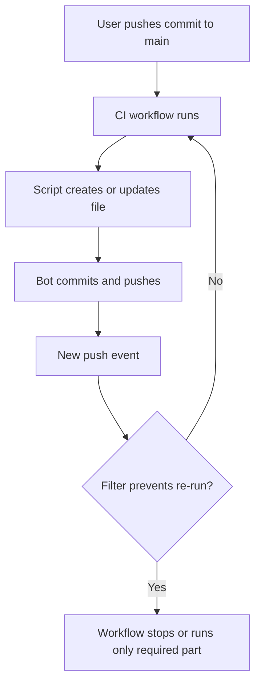

# Preventing Loops When Pipelines Self-Generate Commits, Labels, or Events

CI/CD pipelines do not only react to human-made changes. During execution, a workflow can create commits, push tags, open pull requests, add labels, comment on issues, or dispatch an orchestration event to another workflow. Each of those actions can emit a new Git event or platform event. If a workflow listens to the very event it just produced, the system can trigger itself repeatedly.

Event loops typically inflate CI run counts, consume runners, create duplicate commits or labels, flood notifications, and even trigger unintended deployments. In severe cases, a workflow with write permissions can generate an unbounded chain of actions or cause workflows to invoke one another continuously.

The design principle is to **explicitly define which events are permitted to trigger a workflow, distinguish user-generated actions from bot-generated actions, mutate state only when a change is genuinely needed, and ensure every execution is safe to repeat**. Do not rely on a single trick like adding `[skip ci]` to commit messages. Combine narrow triggers, control guards, least-privilege permissions, and idempotent logic.

## 1. How Do Event Loops Form in CI/CD?

A workflow typically starts from an event such as `push`, `pull_request`, `issues`, `issue_comment`, `release`, or `workflow_dispatch`. When the workflow writes to the repository or sends requests to the platform, that action can emit additional events.

For example, a workflow runs on `push` to `main`, updates a version file, and commits the change back to `main`. The new commit generates another `push` event. The workflow runs again, updates the file, and commits again. If the script always creates a commit even when contents have not changed, the loop can continue indefinitely.



Not every newly emitted event is a bug. Some flows are intentionally chained, such as a build workflow producing an artifact and a deploy workflow consuming the build output. Problems arise when the chain lacks a stopping condition, fails to distinguish event sources, or repeats the same action without making forward progress.

### Common Scenarios

| Workflow Action | Event That May Fire | Loop Risk |
|---|---|---|
| Create commit and push | `push` | CI workflow re-runs on the commit it just created |
| Create or update tag | `push` tag, `create`, or platform-specific event | Release workflow triggers the next release automatically |
| Add or remove issue/PR label | `issues` or `pull_request` with action `labeled`/`unlabeled` | Workflow listening to labels runs again when it adds a label itself |
| Post a comment | `issue_comment` | Workflow replies to the bot's own comment and posts another |
| Open or update pull request | `pull_request` | Bot opens a PR or updates a branch, re-triggering the PR workflow |
| Send `repository_dispatch` or `workflow_dispatch` | Dispatch event | Two workflows invoke each other or one workflow invokes itself |
| Workflow completion | `workflow_run` | Workflow triggers after another finishes and forms a recurring cycle |

When analyzing, map the relationships between triggers, write actions, and emitted events. A single workflow in isolation may show no obvious loop, yet multiple workflows combined can still form a cycle.

## 2. Distinguishing Trigger Mechanisms and Their Limits

Each CI/CD platform has its own rules regarding whether an action performed by a token or bot triggers subsequent workflows. Understand the exact rules of the platform in use before designing guards.

### GitHub Actions and `GITHUB_TOKEN`

In GitHub Actions, events generated using a workflow's `GITHUB_TOKEN` generally do not trigger a new workflow run. This rule prevents many cases of accidental self-triggering. Important exceptions include `workflow_dispatch` and `repository_dispatch`: a workflow can intentionally invoke these two event types to launch a downstream flow.

For example, a workflow using `GITHUB_TOKEN` to commit auto-generated files normally will not cause another `on: push` workflow to run. However, if you use a personal access token (PAT) or GitHub App installation token to push, create labels, or open PRs, that action can trigger corresponding workflows just like an independently authenticated operation.

Therefore, you cannot assume all tokens behave identically. Before swapping tokens, re-examine the entire event graph. Replacing `GITHUB_TOKEN` with a PAT or GitHub App token to work around a permission limit can inadvertently introduce a loop that did not exist before.

### When Are a PAT or GitHub App Token Needed?

Some operations require an identity or permissions different from `GITHUB_TOKEN`, or need to emit events that trigger subsequent workflows. In those cases, a PAT or GitHub App token may fit, but strict controls are required:

- Use tokens with minimal permission scopes and appropriate lifetimes.
- Prefer a GitHub App with explicitly declared permissions for long-lived organizational automation.
- Grant the token only to the job that genuinely needs write operations.
- Never expose the token to jobs running untrusted code from pull requests or forks.
- Add guards on actor, branch, path, or event type to prevent self-triggering.
- Monitor and revoke tokens when no longer in use.

### Distinguishing `github.actor` and the Re-Run Initiator

In GitHub Actions, `github.actor` is the user or bot that initiated the workflow run. When a run is re-run, `github.triggering_actor` may be the person requesting the re-run; permissions for the re-run remain tied to the original actor. Therefore, do not treat these two values as interchangeable when verifying commit origin or deciding permissions.

If using a PAT belonging to a service account, `github.actor` may be that service account. For a GitHub App, the actor typically takes the form of the app name with a `[bot]` suffix. Verify the actual value in logs or context before writing comparison conditions.

## 3. Designing Guards So Workflows Do Not Re-Trigger Themselves

A guard is a condition determining whether a workflow or job is allowed to process the current event. Guards should express clear intent and rely on trustworthy event data.

### Narrow Triggers First

Listen only to the events and branches genuinely needed. If a workflow only needs to verify application source code, do not let it run on every tag, every branch, or every type of issue activity.

Example:

```yaml
name: Verify application source

on:
  push:
    branches: [main]
    paths:
      - 'src/**'
      - 'build.gradle*'
      - 'settings.gradle*'
  pull_request:
    branches: [main]
    paths:
      - 'src/**'
      - 'build.gradle*'
      - 'settings.gradle*'

permissions:
  contents: read

jobs:
  verify:
    runs-on: ubuntu-latest
    steps:
      - uses: actions/checkout@v4
      - run: ./gradlew --no-daemon check
```

In this example, a commit modifying only auto-generated files in `generated/` will not trigger this workflow. However, path filters must cover all files capable of affecting the build. If workflows, CI scripts, lockfiles, or shared configurations are omitted, critical changes can go untested.

Another note: if a workflow is skipped by `branches` or `paths` filters, the corresponding check may remain in a pending state and prevent pull requests from merging when that check is a required status check. For required checks, consider keeping an orchestrating workflow always triggered and letting internal jobs decide whether tests need to run, while ensuring an aggregator check returns a clear final status.

### Filter by Actor or Bot

If a workflow should only react to human-made changes, exclude the bot actor. The example below uses a placeholder bot name; replace it with the actual account or GitHub App login in your repository:

```yaml
jobs:
  verify:
    if: github.actor != 'release-helper[bot]'
    runs-on: ubuntu-latest
    steps:
      - uses: actions/checkout@v4
      - run: ./gradlew --no-daemon check
```

This guard is helpful when a bot uses a PAT or GitHub App token to create commits and the resulting push event keeps triggering workflows. However, do not exclude all bots indiscriminately if some bots such as Dependabot must be tested like normal pull requests. Filter the exact actor and exact event type.

If the bot runs under a regular service account instead of a GitHub App, the actor name will be that account's login without the `[bot]` suffix. Conditions must match actual values.

### Filter by Commit Message

A common convention is tagging pipeline-generated commits with an identifying string, such as `chore: update generated files [skip ci]` or a custom marker like `[bot-generated]`. Workflows can inspect the commit message and decide to skip expensive jobs.

Example commit-message guard for a `push` event:

```yaml
jobs:
  verify:
    if: ${{ !contains(github.event.head_commit.message, '[bot-generated]') }}
    runs-on: ubuntu-latest
    steps:
      - uses: actions/checkout@v4
      - run: ./gradlew --no-daemon check
```

A custom marker allows the workflow run to still be created while jobs can be conditionally skipped. This differs from the platform skipping the entire workflow due to tokens or skip directives. Account for required checks and aggregated statuses so pull requests do not get stuck.

Commit messages can contain user-controlled data. Never pass message contents directly into shell commands. When using expressions in `if`, use them solely for comparison or data inspection, never turning them into executable commands.

### Filter by Bot-Managed Branches or Output Paths

If a workflow only produces files in `generated/`, use a dedicated branch such as `automation/generated-metadata` or monitor changes only on source paths. A separate workflow handles reviewing or merging that output.

Branch and path guards are easy to understand, yet you must ensure valid source changes are not skipped. For instance, if a bot commits both auto-generated files and a build configuration file, relying solely on paths may be insufficient. Combine multiple conditions: actor is the bot, branch carries a dedicated prefix, and changed files stay strictly within allowed directories.

## 4. Using `GITHUB_TOKEN`, Skip Markers, and Job Conditions Properly

No single mechanism fits all cases. Choose based on whether a subsequent workflow needs to run and what status required checks expect.

| Mechanism | Behavior | When Appropriate | Points to Watch |
|---|---|---|---|
| `GITHUB_TOKEN` | Most events created by this token do not trigger new workflow runs | Bot commits or updates labels without needing pipelines to re-run | `workflow_dispatch` and `repository_dispatch` are exceptions; token needs exact permissions |
| PAT/GitHub App token | Actions can emit events that trigger workflows | Need to actively trigger another workflow or default token permissions are insufficient | Must have guards and least privilege; easy to cause loops without controls |
| Job-level `if` | Workflow is created, yet job does not run when condition is false | Skip only bot-created work or unrelated events | Skipped jobs are often treated as passing; verify dependencies and required checks |
| Custom commit marker | Job reads marker and skips unnecessary processing | Distinguish auto-generated commits from source code commits | Must standardize marker placement and avoid using arbitrary text as commands |
| `[skip ci]` or supported variants | Platform skips workflows associated with the commit | Automated commit flows that do not need PR checks | On GitHub, checks may stay pending and block merging |
| Branch/path filter | Workflow runs only when changed branches or files match | Separate source code checks from auto-generated files | Skipping the workflow can leave required checks pending |

### Understanding `[skip ci]` on GitHub Correctly

GitHub Actions supports skip strings such as `[skip ci]`, `[ci skip]`, `[no ci]`, `[skip actions]`, and `[actions skip]` in commit messages for `push` and `pull_request` workflows. When a commit carries a marker, matching workflows may not run.

A common pitfall is that skipped checks can remain in a pending state. If such a check is a required condition on a pull request, the PR may be blocked from merging even though the skip reason is valid. Therefore, do not mechanically append `[skip ci]` to every bot commit. For many repositories, a job-level guard or an always-completing aggregator check workflow is easier to control.

On other platforms, skip marker syntax and status behavior may differ. Do not apply GitHub Actions syntax to GitLab CI, Jenkins, or other systems without verifying platform documentation.

## 5. Preventing Loops When Pipelines Self-Generate Commits

Automated commits commonly update versions, generate docs, format files, sync metadata, or update lockfiles. These are valid tasks, yet they must be designed to commit only when contents genuinely change.

### Commit Only When There Is a Diff

If a script runs again and produces the exact same output, never create an empty commit or identical commit. Checking the diff before committing prevents emitting unnecessary events.

Example script:

```bash
#!/usr/bin/env bash
set -euo pipefail

./scripts/generate-metadata.sh

# Stage only the directory managed by the script.
git add generated/

# If there are no changes, exit normally.
if git diff --cached --quiet; then
  echo "No generated changes; nothing to commit."
  exit 0
fi

git config user.name "github-actions[bot]"
git config user.email "41898282+github-actions[bot]@users.noreply.github.com"
git commit -m "chore: refresh generated metadata [bot-generated]"
git push
```

The script stages only `generated/` so it does not accidentally commit other files created by earlier steps. `git diff --cached --quiet` exits with code 0 when no staged changes exist; when changes exist, the script commits. Ensure the script produces deterministic outputs: identical inputs must produce identical content without inserting timestamps or random data unnecessarily.

If the workflow uses `GITHUB_TOKEN` with `contents: write`, pushes created by the token typically do not trigger a subsequent `push` workflow. If replacing the token with a PAT or GitHub App token, add actor, branch, or marker guards and verify that the new commit does not keep generating identical commits.

Example job invoking the script:

```yaml
name: Refresh generated metadata

on:
  push:
    branches: [main]
    paths:
      - 'schema/**'
      - 'scripts/generate-metadata.sh'

permissions:
  contents: write

jobs:
  refresh:
    if: github.actor != 'github-actions[bot]'
    runs-on: ubuntu-latest
    steps:
      - uses: actions/checkout@v4
        with:
          persist-credentials: true
      - name: Generate and commit metadata
        run: ./scripts/commit-generated-metadata.sh
```

This example uses the default `GITHUB_TOKEN` from `actions/checkout` with `contents` write access. The actor guard acts as an extra safeguard if the flow later changes tokens or gets triggered by another bot. If another workflow must run to verify metadata after the commit, design a separate workflow with explicit triggers and conditions rather than looping via continuous pushes.

### Never Use `git push --force` to Dodge Loops

Force pushing is not a solution to loops. It can overwrite other people's commits, destroy history, and leave other workflows processing obsolete revisions. On shared branches, prefer additive commits or reverts. If a dedicated bot branch must be updated, use controlled synchronization and restrict branch scope.

## 6. Preventing Loops When Pipelines Add Labels or Comments

Issue and pull request triage workflows often apply labels like `needs-triage`, `ready-for-review`, `release-candidate`, or post status comments. If a workflow listens to `labeled` or `issue_comment`, it can react to its own actions.

### Filter by Exact Action and Label Name

Do not listen blindly to all `issues` events. Declare only the required actions and inspect label names in job conditions. Example:

```yaml
name: Triage issue

on:
  issues:
    types: [opened, labeled]

permissions:
  issues: write

jobs:
  triage:
    if: >-
      github.event.action == 'opened' ||
      (github.event.action == 'labeled' && github.event.label.name == 'needs-triage')
    runs-on: ubuntu-latest
    steps:
      - name: Add triaged label
        env:
          GH_TOKEN: ${{ secrets.GITHUB_TOKEN }}
          ISSUE_NUMBER: ${{ github.event.issue.number }}
        run: gh issue edit "$ISSUE_NUMBER" --add-label "triaged"
```

When an issue is opened, the workflow adds the `triaged` label. A subsequent `labeled` event might fire if a workflow-triggering token is used; however, the job continues only when the newly added label is `needs-triage`. The event from adding `triaged` is filtered out by the guard. With `GITHUB_TOKEN`, token-generated events typically do not launch new workflows, yet the guard remains valuable if the token or integration changes.

### Check Current State Before Writing

Labeling operations should be idempotent: if the label already exists, perform no change. Similarly, post comments only when contents or state genuinely need updating. Before creating a comment, search for an earlier comment created by the bot and update it in place if appropriate.

With GitHub CLI, you can inspect existing labels using `gh issue view` or the API before deciding to act. When calling APIs, account for two workflows running concurrently and trying to add the same label. State-update operations must be safe when invoked repeatedly.

### Prevent Bots from Replying to Their Own Comments

If a workflow listens to `issue_comment`, restrict it to the necessary `created` or `edited` actions, check for an explicit command prefix, and ignore bot-created comments.

Example condition:

```yaml
on:
  issue_comment:
    types: [created]

jobs:
  command:
    if: >-
      github.event.issue.pull_request &&
      github.event.comment.user.type != 'Bot' &&
      startsWith(github.event.comment.body, '/ci ')
    runs-on: ubuntu-latest
    steps:
      - run: echo "Handle an approved /ci command"
```

The condition above is an initial filter layer, not a complete authorization mechanism. If a command can deploy or access sensitive data, verify that the caller belongs to an authorized group, check repository permissions, and require appropriate approvals. Never execute comment bodies directly as shell commands.

## 7. Preventing Cycles Across Multiple Workflows

A system may have multiple workflows: workflow A builds artifacts, workflow B deploys staging, workflow C updates PR status. If B sends a dispatch calling A, or C sends a dispatch calling B, workflows can form a cycle even though each individual file looks reasonable.

### Draw the Dependency Graph

Before using `workflow_run`, `workflow_dispatch`, or `repository_dispatch`, list:

- Which workflow is the entry point.
- Which workflow emits the next event.
- What payload or artifact the next event carries.
- What the stopping condition is.
- Whether two runs can process the same event simultaneously.
- If a step fails and is retried, whether downstream workflows run redundantly.

A clean flow typically has a clear direction, e.g., `build → publish artifact → deploy staging → verify`. Never let the final workflow call back into the first workflow without a specific business goal and explicit stopping condition.

### Filter `workflow_run` by Workflow, Branch, and Conclusion

`workflow_run` runs when a designated workflow finishes. Filter by source workflow name, branch, and conclusion before downloading artifacts or executing privileged actions.

Example:

```yaml
name: Deploy after build

on:
  workflow_run:
    workflows: [Build and test]
    types: [completed]
    branches: [main]

permissions:
  contents: read
  actions: read

jobs:
  deploy-staging:
    if: github.event.workflow_run.conclusion == 'success'
    runs-on: ubuntu-latest
    steps:
      - name: Download artifact from the triggering run
        run: echo "Download the artifact for workflow_run.id"
      - name: Deploy to staging
        run: echo "Deploy the verified artifact"
```

This is an illustrative skeleton; use the appropriate API or action to download artifacts by exact `workflow_run.id`. Never ambiguously grab the latest run's artifact, which might fetch an artifact from a different commit. When a source workflow runs on untrusted code, the workflow triggered via `workflow_run` may carry higher privileges; never execute scripts or binaries from untrusted artifacts without verifying origin and contents.

### Dispatch with Explicit Event Types and Correlation IDs

When using `repository_dispatch`, define a specific `event_type` and include source, revision, and correlation identifier in the payload. Receiving workflows must process only allowed event types.

Conceptual payload example:

```json
{
  "event_type": "deploy-staging-requested",
  "client_payload": {
    "source_workflow": "build-and-test",
    "source_sha": "<commit-sha>",
    "correlation_id": "<unique-request-id>"
  }
}
```

Correlation IDs track steps belonging to the same request and detect already-processed requests. Never trust a payload solely because it arrived via dispatch; authenticate the caller, verify revision, check permissions, and verify artifacts.

If a workflow receives a dispatch and emits the same `event_type` back to the source workflow, treat that as a cycle to eliminate or redesign. If a multi-step chain is intentional, each workflow should emit the next event only after completion criteria are satisfied.

## 8. Idempotency: Essential Requirement for Safe Automation

Idempotency means executing the same request once or multiple times brings the system to the exact same final state without creating unnecessary side effects. This is vital for preventing loops and handling retries.

Examples:

- If the `triaged` label already exists, perform no additional label modification.
- If auto-generated files have not changed, create no new commit.
- If a status comment already exists, update that comment instead of creating a new comment on every run.
- If an artifact for a commit SHA is already published and verified, do not publish a duplicate under the same identifier when policy requires immutability.
- If a dispatch with a given `correlation_id` was already processed, do not re-execute side-effectful actions.

An idempotent operation typically has three parts:

1. **Read current state:** fetch existing commits, labels, comments, artifacts, or deployment state.
2. **Compare against desired state:** identify actual differences requiring change.
3. **Apply only the delta:** skip writing if state is already correct.

For concurrent operations, checking before writing alone may not suffice. Two workflows might read the unlabeled state simultaneously and both attempt writes. If the API supports conditional updates, ETags, or idempotency keys, use them. Otherwise, anticipate and handle conflict states safely.

## 9. Combining Multiple Defense Layers

A strong configuration layers multiple safeguards so that even if one guard is edited or a different token is used, workflows still resist accidental loops.

| Defense Layer | Question to Answer | Example |
|---|---|---|
| Narrow trigger | Does the workflow listen only to needed events? | Only `push` to `main`, only `issues.labeled` |
| Actor guard | Should events created by this bot be processed? | Exclude actor `release-helper[bot]` |
| Branch/path guard | Did the event come from an allowed branch or file? | Ignore branch `automation/*`, filter `generated/` directory |
| Event/action guard | Does the action type and label name match? | Handle only label `needs-triage` |
| Idempotency | Will re-running create additional mutations? | Check diff before commit, check label before adding |
| Least privilege | What event types can this workflow emit? | `contents: write` or `issues: write` only on required jobs |
| Resource limits | If something fails, is consumption bounded? | `concurrency`, timeouts, retry caps |
| Observability and alerting | Can anomalous run spikes be detected? | Monitor run frequency, actors, and consecutive commits |

Do not copy-paste every guard blindly. Each condition must correspond to a real risk. Too many overlapping, undocumented conditions can stop a workflow from running when needed or leave operators confused about why a job was skipped.

## 10. Diagnosing When a Loop Is Detected

When runners or notifications indicate a workflow is looping, halt the impact first before investigating deeply.

### Step 1: Identify the Event Chain

Collect recent consecutive runs and record:

- Workflow name, run ID, and start timestamp.
- Event name, action, branch, ref, and commit SHA.
- Actor or token identity that generated the event.
- Job and step performing write operations.
- Commits, labels, comments, tags, or dispatches produced.

Compare inputs and outputs across runs. If each run creates a new commit, inspect commit messages and diffs. If only labels change, identify which workflow listens to `labeled` or `unlabeled` actions. If multiple workflows chain together, map the graph by run ID and event payload.

### Step 2: Halt the Repeating Impact

Temporarily disable the looping trigger or job, revoke write-scoped tokens if abuse is suspected, and cancel in-progress runs consuming resources where the platform allows. Preserve logs and run IDs before deleting or altering data needed for investigation.

If the loop comes from bot commits, temporarily restrict the workflow by branch/path or exclude the specific actor. If from dispatches, pause the dispatch-emitting step. If from comments or labels, narrow actions and label names. Choose the smallest intervention sufficient to stop the impact.

### Step 3: Identify the Root Cause

Check whether the workflow makes changes even when state is already right. Inspect tokens in use, granted permissions, and platform trigger rules. Re-read triggers across all related workflows to uncover indirect cycles.

Common root causes include:

- Scripts always writing timestamps or random values into files, producing a diff every time.
- Jobs committing the entire working tree instead of staging only managed files.
- Workflows using a PAT or App token while still relying on `GITHUB_TOKEN` suppression assumptions.
- Workflows listening to all `labeled` events and adding another label without filtering.
- Workflows replying to every comment, including bot-generated comments.
- Two workflows dispatching back and forth without correlation IDs or termination conditions.
- Retries creating duplicate resources or commits instead of checking current state.

### Step 4: Fix and Verify in a Narrow Scope

Add guards, idempotency, and no-diff checks. Test on a sandbox repository or test branch, then verify every path: user-created events, bot-created events, pre-existing state, and re-run cases.

Do not verify solely that the workflow stopped looping. Confirm valid actions still work: users adding labels still trigger triage, source code commits still run CI, and intentional dispatch flows still complete.

### Step 5: Monitor After Recovery

Monitor run counts, bot commit counts, label/comment churn, and runner consumption. If runs continue spiking abnormally, re-examine the event chain or concurrency conditions. Document the root cause, blast radius, and recurrence prevention measures.

## 11. Error-Prone Practices

| Practice | Problem | Remediation |
|---|---|---|
| Using a PAT to push without guards | Bot commits can re-trigger push workflows | Check actor, branch, and path; verify diff before committing |
| Adding `[skip ci]` to every bot commit | Required checks on PRs may stay pending | Use job-level guards or aggregator checks when appropriate |
| Ignoring all actors ending in `[bot]` | May skip Dependabot or other legitimate bots | Filter only specific bots by purpose |
| Triggering on all issue/PR actions | Runs repeatedly for opened, edited, labeled, closed, etc. | Declare only necessary actions |
| Always posting a new comment | Comments trigger comment workflows and clutter issues | Find and update the bot-owned comment |
| Committing all workspace changes | Can include unrelated files and trigger other workflows | Stage only permitted paths |
| Uncontrolled `workflow_dispatch` or `repository_dispatch` | Can form cycles across workflows | Restrict event types, authenticate sources, and use correlation IDs |
| Relying entirely on token suppression | Switching tokens alters trigger behavior | Treat suppression as one layer; still build guards and idempotency |
| Infinite retries | Inflates cost and amplifies incidents | Cap retries, set timeouts, and track final failures |

## 12. Loop-Free Trigger Design Checklist

Before merging a workflow that performs writes or emits events, verify:

- [ ] All triggers the workflow listens to are listed.
- [ ] All commits, labels, comments, tags, or dispatches the workflow can create are identified.
- [ ] Which token performs each action and the platform's corresponding trigger rules are known.
- [ ] Triggers are scoped to required branches, paths, event types, or actions.
- [ ] Actor guards exclude only the specific bots intended to be skipped.
- [ ] Jobs do not commit when there is no diff and stage only required files.
- [ ] Label/comment operations check current state before writing.
- [ ] Workflows do not unintentionally react to comments or events they created themselves.
- [ ] `workflow_run`, `workflow_dispatch`, and `repository_dispatch` chains are directional with clear stopping conditions.
- [ ] Correlation IDs or processed-request tracking exist where deduplication is needed.
- [ ] Write permissions are scoped to required jobs; secrets never reach jobs running untrusted code.
- [ ] Skip markers do not leave required checks unexpectedly pending.
- [ ] Appropriate timeouts, concurrency limits, and retry caps are configured.
- [ ] User-created events, bot-created events, and re-run scenarios have been tested.
- [ ] Logs capture enough detail to trace run ID, actor, event, and related commit.

Preventing loops is not merely about cutting workflow run counts. The goal is ensuring every event carries meaning, every automated action changes state only when needed, and workflows coordinate in a predictable flow. When triggers are narrowed, tokens are properly understood, operations are idempotent, and event chains have clear stopping points, CI/CD can automate commits, labels, and releases without generating unintended runs.
