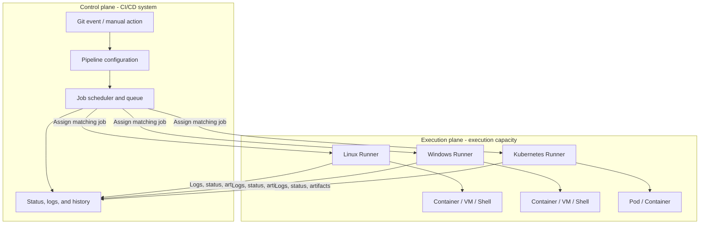
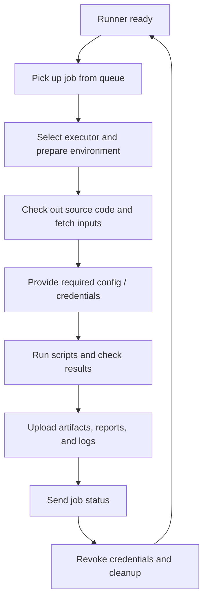
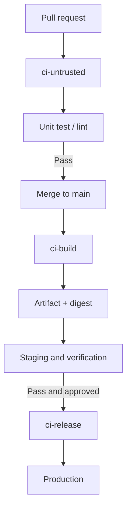

# Role of a Runner, Agent, or Worker in Job Execution

A pipeline describes the work to be done, but the pipeline itself does not compile source code, run tests, or deploy applications. Those operations require an execution component that picks up tasks from the CI/CD system and runs commands in an environment with suitable resources. This component is commonly called a **runner**, **agent**, or **worker**, depending on the platform.

A runner/agent/worker serves as the bridge between the CI/CD orchestrator and the execution machine. It receives a job, prepares the workspace and tools, executes the declared steps, collects logs and results, transfers artifacts or reports to storage, and reports the status back to the orchestration system. The quality of this execution component directly affects pipeline speed, result reproducibility, reliability, and the security boundary of the entire release process.

## 1. Distinguishing Pipeline, Job, Runner, and Executor

These terms often appear together but carry distinct responsibilities:

| Component | Role | Example |
|---|---|---|
| Pipeline | Describes and orchestrates the entire workflow | Build → test → scan → package → deploy |
| Job | A specific task within the pipeline | Run unit tests or build a container image |
| Runner/agent/worker | Component that picks up a job and coordinates its execution | GitLab Runner, GitHub Actions runner, Jenkins agent |
| Executor | Mechanism or environment type the runner uses to run the job | Shell, Docker, Kubernetes, VM |
| Execution environment | Actual runtime space with OS, CPU, RAM, filesystem, network, and toolchain | Linux container with JDK 21, or Windows VM with .NET SDK |
| Artifact | Output saved for other jobs or users to consume | JAR, container image, test report |

You can think of a runner as the supervisor who receives and coordinates tasks on the shop floor; the executor as the assembly line layout and workspace setup; and the execution environment as the specific machinery, operating system, and tools on which commands run. A single runner can manage multiple executors or execution environments depending on the product and configuration.

Naming is not entirely uniform across platforms. GitLab uses the terms *runner* and *executor*; GitHub Actions calls the job-running process a *runner* and distinguishes between GitHub-hosted and self-hosted runners; Jenkins typically uses *controller* and *agent*, where an agent has one or more executor slots. In this document, runner/agent/worker is used as the general name for the component that receives and executes jobs.

## 2. Control Plane and Execution Plane

CI/CD architecture can typically be divided into two logical parts:

- **Control plane:** receives Git events, reads pipeline configurations, schedules jobs, manages state, enforces permissions, stores history, and provides the monitoring UI.
- **Execution plane:** the runners/agents/workers and the environments they use to run commands, access inputs, produce outputs, and send results back to the control plane.



The control plane decides which job needs to run and what conditions allow it to start. The runner performs the work within its granted permission boundaries and sends the results back. This separation allows an organization to scale execution capacity across different machines, network zones, or platforms while keeping pipeline management centralized.

In some products, the control plane and runner can run on the same machine or be packaged together. That is a physical deployment choice; in terms of responsibility, you still need to distinguish where scheduling and management happen from where pipeline-specified code runs.

## 3. Lifecycle of a Job on a Runner

A job typically goes through the following stages. Exact names and the order of certain operations vary by platform or executor:

1. **Registration and readiness:** the runner authenticates with the CI/CD system, advertises its labels, capabilities, and readiness to accept work.
2. **Job pickup:** the runner or manager polls the control plane to claim a pending job that matches its labels, runner group, and authorization policy.
3. **Environment preparation:** creates a container, pod, VM, or workspace; prepares the required shell, toolchain, configuration variables, and network.
4. **Input retrieval:** checks out the exact commit, downloads dependent artifacts, caches, and authorized configuration files.
5. **Credential provisioning:** receives tokens or secrets scoped to the required permissions and duration. Broad-permission credentials should not be injected into every job.
6. **Execution:** runs scripts in sequence, records logs, captures exit codes, and evaluates declared conditions.
7. **Result packaging:** stores artifacts, test reports, logs, and metadata; sends the job status back to the control plane.
8. **Cleanup:** revokes tokens, deletes the workspace, or destroys the container/pod/VM according to policy; frees resources for the next job.



If a stage fails, the runner must report the status along with sufficient logs to pinpoint where the error occurred. For example, failure to download source code is an input-preparation error; a test assertion failure is a testing error; running out of disk space is an execution-environment resource error. Proper classification helps teams choose the right remediation.

## 4. Common Execution Environment Models

Runners can use various executors. There is no single model suited for every task; the choice depends on OS requirements, tooling, isolation level, resources, and reliability.

| Model | How it works | Best suited for | Considerations |
|---|---|---|---|
| Shell executor | Runs commands directly on the runner host OS | Lightweight scripts, pre-installed tools, internal environments | Jobs may share filesystem and processes; cleanup and isolation depend on configuration |
| Container/Docker executor | Spins up a container as the job environment | Linux builds, dependencies packable as images | Containers share the host kernel; privileged mode or Docker socket mounts increase risk |
| Virtual machine | Each job or group of jobs runs inside a VM | Needing a dedicated OS/kernel or stronger isolation than containers | Slower startup and higher CPU/RAM/disk overhead |
| Kubernetes executor | Creates a pod to run the job in a cluster | Autoscaling, cluster-wide resource management | Requires managing namespaces, service accounts, network policies, quotas, and pod lifecycle |
| Bare metal/dedicated host | Runs on a physical or dedicated machine | Builds needing specialized hardware, devices, or high performance | High overhead for administration, patching, and cleaning between jobs |

### Shell Executor

The shell executor runs commands using a shell available on the runner machine, such as Bash or PowerShell. This approach is simple and useful when jobs need access to tools or devices pre-installed on the host. However, jobs can leave behind files, processes, packages, or configurations that affect subsequent jobs. If multiple repositories with different trust levels share the same host, the risk of reading each other's data or accessing leftover credentials increases.

Shell runners should only be used for workloads with an appropriate trust level and clear policies for workspaces, user accounts, cleanup, and access permissions. Avoid running untrusted jobs on a shell runner machine that holds production credentials or has deep access into the internal network.

### Container Executor

The container executor typically launches an image as the environment for a job. The image can package the JDK, Node.js, .NET SDK, compilers, and required tools, ensuring runs use nearly identical configurations. Choose images with explicit versions, apply security updates, and pin by digest when high reproducibility is required.

Containers isolate filesystems and process namespaces, but they are not equivalent to VMs with separate kernels. Containers typically share the host kernel; `privileged` configurations, broad host directory mounts, or binding `/var/run/docker.sock` can grant a job extensive privileges. Running inside a container should not be treated as a guarantee of absolute isolation.

### VM and Kubernetes Executors

VMs provide an isolated kernel boundary, making them suitable for jobs that need a specific OS or specialized drivers. A runner can provision VMs on demand and destroy them after the job to minimize persistent state. The Kubernetes executor typically creates a dedicated pod per job, leveraging the cluster's scheduler and quotas. However, if pods share a broad-permission service account, the same namespace, or unrestricted networking, effective isolation remains weak.

With VMs and Kubernetes, you must also manage the infrastructure layer: base images, OS patches, cluster control permissions, CPU/RAM limits, ephemeral storage, network policies, and registry access permissions.

## 5. Runner Labels, Tags, and Job Eligibility

The orchestration system needs to know which runner is suitable for a job. Platforms commonly use tags, labels, runner groups, capabilities, or executor constraints to describe runner capabilities.

For example, a job may require:

- Linux and Docker to build a container image.
- Windows to build a .NET Framework application.
- JDK 21 to compile a Java project.
- Access to an internal registry.
- A GPU or specialized testing device.
- A runner group authorized to handle production workloads.

GitLab CI example:

```yaml
build_app:
  stage: build
  tags:
    - linux
    - docker
  image: eclipse-temurin:21-jdk
  script:
    - java -version
    - ./gradlew assemble --no-daemon
```

A job can only be picked up by a runner when a runner is registered with matching tags and is permitted to run that job. `image` requires an executor that supports container images, such as Docker or Kubernetes; a shell executor does not automatically provision an environment from this field. If no matching runner is available, the job may remain waiting (pending/stuck) even if the script configuration has no syntax errors.

Do not assign overly generic tags across all kinds of work if runners have different permissions and capabilities. For example, runners with access to the production network should have dedicated tags or groups, paired with policies allowing only protected release jobs to use them. Tags are merely routing criteria; they do not create a security boundary on their own. Access control must still be configured at the control plane, host, network, and secret store levels.

## 6. Scheduling, Concurrency, and Execution Capacity

Runners usually have a limit on concurrent jobs (concurrency/executor slots). When a job arrives, the scheduler must find a runner with free capacity, matching labels, and satisfied constraints. If no suitable runner exists or all slots are busy, the job waits in the queue.

Several factors affect execution capacity:

- **CPU:** compilation, parallel tests, or image compression may require many cores.
- **RAM:** large test suites, compilers, or multiple concurrent containers can cause out-of-memory failures.
- **Disk and I/O:** large repository checkouts, dependency caches, image layers, and artifacts can fill up the disk.
- **Network:** downloading dependencies, pushing images, and calling test services depend on bandwidth and network stability.
- **Concurrency:** increasing simultaneous jobs can reduce queue wait time, but also causes resource contention and raises costs.
- **Startup time:** provisioning a new VM or pod can add latency before commands begin executing.

Setting concurrency too high can overload the host, slow down tests, or cause intermittent failures. Setting it too low leads to long queues and wasted resources. You should monitor queue wait time, execution duration, CPU/RAM/disk utilization, infrastructure-related job failure rates, and cost per pipeline.

### Static Runners and Autoscaling Runners

Static runners stay online continuously waiting for jobs. This model is predictable and useful when workloads are steady or machines need specialized setups. However, machines can sit idle outside peak hours and tend to accumulate state across jobs.

Autoscaling (ephemeral) runners spin up additional machines, VMs, or pods when the queue grows and tear them down when work completes. This model fits fluctuating workloads and provides stronger isolation if each job gets a fresh environment. In return, the system must handle startup latency, cloud quotas, image caching, cost limits, and scenarios where a runner is terminated mid-job.

A practical design may combine always-on runners for lightweight tasks, dedicated runners for specialized platforms, and ephemeral runners for low-trust builds/tests or bursty load.

## 7. Job Isolation and Trust Boundaries

Runners execute code supplied by repositories and pipelines. When a job runs a script, that script can read files in the workspace, make network calls, spawn processes, and use whatever permissions it was granted. Therefore, the runner is part of the security boundary, not just a build-acceleration machine.

Classify workloads by trust level:

- **Trusted workloads:** protected pipelines, reviewed commits, and controlled permissions and input sources.
- **Untrusted workloads:** pull requests from forks, experimental branches, externally supplied scripts, or unverified repositories.
- **Privileged workloads:** production deployments, artifact signing, or accessing cloud accounts and release registries.

Do not allow untrusted workloads to run on runners that can access production secrets, administrative SSH keys, or host control sockets. Use separate runner groups or pools, dedicated OS user accounts, and ephemeral environments for lower-trust workloads.

### Workspace and Leftover Data

If a runner is reused, data from a previous job may remain on disk: source code, config files, tokens, caches, logs, or temporary artifacts. Cleanup must wipe the working directory properly, revoke credentials, and ensure the next job cannot read prior data. Simply deleting the checkout directory is insufficient if background processes, containers, volumes, or temporary files remain.

Ephemeral environments reduce this risk by destroying the entire VM or pod after each job. Even so, verify that volumes, disk snapshots, shared caches, and logs do not retain sensitive data beyond policy limits.

### Least Privilege and Secret Protection

- Run the runner agent under an OS account with the minimum required privileges.
- Provision tokens/secrets only to jobs that need them, with short lifetimes and narrow scopes.
- Never print secrets to logs, command lines, or public artifacts.
- Restrict network egress and access to internal services per workload.
- Separate build/test runners from deploy or release-signing runners when trust levels differ.
- Protect registration credentials and runner connection keys; rotate them if exposure is suspected.
- Update the runner agent, OS images, and executors regularly to apply patches.
- Log runner administrative actions and configuration changes, and monitor for anomalous job behavior.

For containers, avoid granting `privileged` mode or mounting host filesystems/sockets unless there is a specific operational reason. For Kubernetes, restrict service accounts, namespaces, pod security settings, and resource creation permissions. For VMs, manage base images and metadata credentials so jobs cannot retrieve host control credentials.

## 8. Artifacts, Cache, and Workspaces Between Jobs

Runners handle three distinct types of data:

| Data | Purpose | Management approach |
|---|---|---|
| Workspace | Where source code is checked out and job commands run | Isolated per job, cleaned up upon completion |
| Cache | Speeds up builds by reusing dependencies or regenerable data | Uses cache keys, scopes, and expiration policies; never used as a release source |
| Artifact | Output passed to another job or stored for release/inspection | Stored with access control, versioning, and provenance tracking |

A build job might produce a JAR and upload it as an artifact. A test or deploy job on a different runner then downloads that artifact into its own workspace. Do not assume jobs always run on the same machine or share the same filesystem. When passing data between jobs, use the platform's artifact/cache mechanisms or a managed repository.

Caches can speed up builds, but keys must be designed around the OS, toolchain, dependency lockfile, and branch/trust scope. Do not share caches containing sensitive data across groups with different permissions. For untrusted workloads, a shared cache can become a vector for injecting forged or malicious data into subsequent trusted jobs.

Artifacts should include content identifiers such as checksums or digests, along with metadata pointing to the commit and pipeline that produced them. A runner uploading an artifact must fail the job if the upload is incomplete or the digest mismatches. Downstream jobs should verify received inputs before using them.

## 9. Managing Reproducible Execution Environments

Build results can vary if runners use different toolchains, dependencies, or operating systems. To improve reproducibility:

1. Specify explicit OS images and toolchain versions.
2. Pin dependency versions using lockfiles or equivalent management mechanisms.
3. Use vetted images that are updated on a schedule.
4. Declare required environment variables in managed configuration.
5. Avoid relying on manually installed packages or unmanaged files on the host.
6. Record the runner image, toolchain versions, and parameters that affect the build.
7. Keep build scripts independent of hostnames, personal home directories, or leftover state from previous jobs.

Example of a GitHub Actions workflow selecting execution environments by runner label:

```yaml
jobs:
  test-linux:
    runs-on: ubuntu-24.04
    steps:
      - uses: actions/checkout@v4
      - uses: actions/setup-java@v4
        with:
          distribution: temurin
          java-version: '21'
      - run: ./gradlew test --no-daemon

  test-windows:
    runs-on: windows-2025
    steps:
      - uses: actions/checkout@v4
      - uses: actions/setup-java@v4
        with:
          distribution: temurin
          java-version: '21'
      - run: .\gradlew.bat test --no-daemon
```

Two jobs test the same source code on two operating systems to detect platform differences. Hosted runner labels may change according to the provider's catalog and support lifecycle; check platform documentation when choosing images. For self-hosted runners, you must manage images, toolchains, and updates yourself.

## 10. Observing and Troubleshooting Runners

When a job fails to start or runs slowly, distinguish between errors in the scheduler, runner, executor, and application commands. Useful signals include:

- Online/offline runner counts and last heartbeat timestamps.
- Pending job counts, queue wait times, and reasons no matching runner was found.
- Active executor slots versus concurrency limits.
- Time spent in environment preparation, checkout, dependency download, and cleanup.
- Host or pod CPU, RAM, disk, I/O, and network metrics.
- Error rates from runner disconnections, timeouts, resource exhaustion, or image pull failures.
- Deployed versions of the runner agent, executor, and OS image.

Common troubleshooting scenarios:

| Symptom | Possible cause | What to check |
|---|---|---|
| Job pending for a long time | No runner with matching tag/label, runner offline, or all slots busy | Check tags, runner groups, heartbeats, concurrency, and queue |
| Job fails before running script | Checkout failure, image pull error, expired credentials | Read prepare-stage logs, check network and registry permissions |
| Job runs unusually slowly | CPU/RAM/disk contention, cache misses, heavy network load | Compare per-stage durations and host metrics |
| Next job sees files from previous job | Shared workspace or volume not cleaned up | Check executor, user account, volume mounts, and cleanup procedures |
| Only one runner frequently fails | Image or toolchain version drift, degraded host | Compare config against healthy runners, check disk and agent version |
| Job can access unrelated secrets | Runner group or credential scope is too broad | Review job permissions, secret scopes, network, and trust boundaries |
| Runner disappears mid-job | Autoscaler/host reclaimed, connection lost, or quota exhausted | Check infrastructure events, timeouts, quotas, and retry mechanisms |

Do not fix every pending-job bottleneck simply by raising concurrency or registering more unclassified runners. First determine what capabilities the jobs request, which runners are permitted to pick them up, and whether the bottleneck is in the queue or in underlying resources.

## 11. Example Runner Architecture for a Development Team

Suppose a Java service development team has three types of workloads:

- Pull requests running unit tests and lint on Linux.
- Image builds requiring Docker and permission to push to a development registry.
- Production releases requiring access to the production environment and approvals.

Runners can be split into pools:

| Pool | Workload | Environment | Permissions |
|---|---|---|---|
| `ci-untrusted` | PRs and routine tests | Ephemeral runners, clean containers or VMs | No production secrets, restricted network |
| `ci-build` | Build/package and push dev images | Linux runners with Docker or managed build service | Scoped registry token |
| `ci-release` | Production deployments | Dedicated, protected runners with access control | Short-lived credentials, least-privilege deploy permissions, approval-gated |

The workflow might look like this:



The key principle is that permissions escalate according to the trust level of the change and the target task. Runners handling PRs do not need production deployment rights. Release runners only accept jobs from protected pipelines/branches/tags and receive credentials just in time for deployment. Pool separation does not replace access controls at the repository, cloud, registry, and target environment levels; all layers must stay aligned.

## 12. Runner Design and Operations Checklist

When building or reviewing a runner system, verify:

1. Are pipeline, job, runner/agent, executor, and execution environment clearly distinguished?
2. Are runners registered with the right groups, tags/labels, and job eligibility permissions?
3. Are OS images, toolchains, dependencies, and executors version-managed?
4. Are CPU, RAM, disk, network, and concurrency sufficient for peak workloads?
5. Are autoscaling or queue management mechanisms suited to load fluctuations?
6. Are workspaces, volumes, caches, and credentials isolated between jobs?
7. Are untrusted workloads separated from runners holding production secrets or privileges?
8. Are secrets narrowly scoped, short-lived, and excluded from logs/artifacts?
9. Are runner agents, OS images, and executors updated, patched, and monitored?
10. Are artifacts, reports, logs, and job statuses reliably returned to the control plane?
11. Does cleanup handle background processes, containers, pods, volumes, and temporary files?
12. Are metrics available to distinguish queue wait time, prep time, execution time, and infrastructure errors?

The runner/agent/worker is where pipeline configuration turns into actual work. When this component is properly selected, scoped with least privilege, isolated appropriately, and operated with observability, pipelines become more stable, results become more reproducible, and CI/CD workflows can scale while remaining under control.
