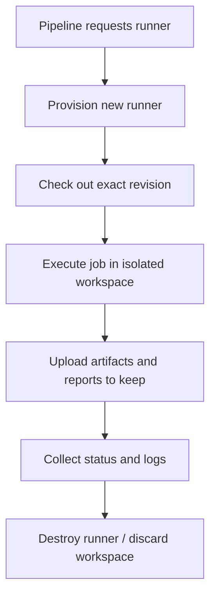
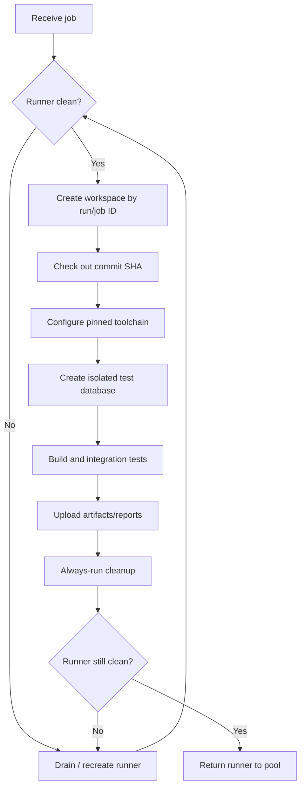

# Designing Clean Workspaces and Run Isolation

## 1. Why Clean Workspaces and Run Isolation Matter

Every CI/CD execution needs a working area to check out source code, restore dependencies, generate build files, run tests, and prepare artifacts. This working area is commonly called a workspace. If multiple runs share a workspace without state control, leftover files, lingering processes, or configurations from a prior run can affect the next run.

For example, a build job fails partway through and leaves a JAR file behind. The next run checks out new source code, but the packaging step accidentally picks up the stale JAR file. The pipeline might report success even though the artifact was not built from the commit under test. Another case is two concurrent jobs writing to the same `build/` directory, overwriting outputs or causing tests to read each other's data.

Designing clean workspaces and run isolation ensures that:

- Every run has deterministic inputs and does not depend on leftover files from previous runs.
- Concurrent jobs cannot overwrite or accidentally read each other's data.
- Source code, processes, environment variables, and credentials remain scoped to what is necessary.
- Artifacts are handed off intentionally, with identifiers and traceability.
- Runners can be safely reused or disposed of after execution according to policy.
- When a job fails or is canceled, temporary resources and data are handled properly.

A clean workspace supports build and test reproducibility. Isolation is also a security control: pipeline code or source code submitted by external contributors may be untrusted, so that run must not be able to access data or permissions belonging to another run.

## 2. Distinguishing Workspace, Job, Runner, and Execution Environment

These terms are related but not synonymous:

| Component | Role | Example |
|---|---|---|
| Pipeline run | A single pipeline execution triggered by a revision or event | CI run for commit `abc123` |
| Job | A scheduled and executed unit of work | Job `unit-tests` |
| Runner/agent | Machine or process that receives and executes a job | Linux VM, self-hosted Windows machine, container runner |
| Execution environment | Operating system, container, runtime, tools, and config where commands execute | Ubuntu with JDK 21 and Gradle |
| Workspace | Directory holding the checkout and working files of a job or run per platform rules | `/work/project` or `D:\agent\_work\app` |
| Artifact | Output stored for another job or pipeline to consume | JAR, container image, test report |
| Cache | Regenerable data stored temporarily to reduce processing time | Dependency cache, build cache |

On many platforms, each job gets its own workspace, yet that does not guarantee the runner or physical machine is dedicated. A runner may be an ephemeral VM, a container on a shared host, or a long-lived self-hosted machine. You must understand the platform's exact model and actual configuration.

A dedicated workspace only limits files inside that directory. It does not automatically isolate processes, networking, the Docker daemon, system privileges, credentials, or data outside the workspace. Full protection requires examining multiple isolation layers.

## 3. Core Principles of a Clean Workspace

A workspace is considered clean when the state observable by a job starts from a well-defined baseline. That baseline consists of the source code revision, dependencies, tooling, environment variables, and test data declared or generated for that run.

Fundamental principles:

1. **One run, one dedicated working area:** never let two concurrent pipeline runs share a writable checkout or build directory.
2. **One job, one workspace per the runner contract:** if a job needs data from another job, pass it via artifacts or an explicitly declared sharing mechanism.
3. **Check out the exact revision:** record the commit/ref being verified; do not rely on leftover repository state.
4. **Regenerate reproducible state:** dependencies and build outputs should be recoverable from definitions and locked inputs.
5. **Separate durable data from the workspace:** retained logs, reports, and artifacts must be uploaded or stored in a managed location before the workspace is deleted.
6. **Controlled cleanup:** delete temporary files and credentials after use, even when the job fails or is canceled.
7. **Untrusted by default:** code from external pull requests or uncontrolled sources must run with restricted permissions and resources.

Clean does not mean every run must re-download all dependencies from the Internet. Caches can be used to accelerate runs, provided they are partitioned by trust scope and keyed on appropriate inputs. A cache is a performance optimization; it is not an authoritative data source replacing artifacts or repositories.

## 4. Workspace Provisioning Strategies

### 4.1. Ephemeral Runners

An ephemeral runner is provisioned for a single job or run, then destroyed or reset to a clean baseline. This reduces the risk of leftover state across jobs and makes execution environments more predictable.

General flow:



The advantage is clear boundaries between runs, less effort cleaning stale state, and better suitability for untrusted code compared to persistent runners. In return, runner startup and dependency download times may increase; you should use pre-baked base images, secure caches, or on-demand runner pools.

Ephemeral runners do not automatically solve everything. If multiple runners share a Docker daemon, volume, cache, or external service, those shared resources still require isolation. You must also inspect where logs, artifacts, caches, and credentials are stored.

### 4.2. Persistent Runners

A persistent runner serves multiple jobs over time. This saves startup overhead and retains local caches, but requires a reliable cleanup procedure.

Common risks:

- Untracked or gitignored files remain from a previous run.
- Background processes, services, or test containers were never stopped.
- Leftover environment variables, credentials, or sensitive configuration files persist.
- Manually upgraded tool versions cause jobs to run under inconsistent environments.
- Other users or repositories can read leftover disk data if directory permissions are not separated.

If persistent runners must be used, you should:

- Run the runner under a dedicated OS account with least privilege.
- Create separate workspaces per repository, job, and run ID; never share writable build directories.
- Delete the workspace or perform a fresh checkout after each job per policy.
- Stop processes/containers and revoke temporary credentials when the job ends.
- Update images/tools through a versioned process; avoid untracked manual edits.
- Monitor disk usage, runner health, and signs of workspace contamination.
- Periodically rebuild the runner host or image from standard configuration.

If a runner executes jobs across multiple repositories or trust levels, carefully assess host-sharing risks. A separate workspace alone cannot stop malicious code in one job from accessing files or processes of another job if they run under the same account or system privileges.

### 4.3. Workspaces in Containers or Virtual Machines

Containers help package environments and isolate filesystems/processes to a degree. Virtual machines provide a separate OS kernel boundary, generally offering stronger isolation than containers when isolating untrusted tenants. Effective protection depends on kernel configuration, runtime, privileges, mounts, networking, and the hypervisor.

| Model | Benefits | Controls needed |
|---|---|---|
| Separate directory on shared runner | Simple, low overhead | Filesystem permissions, processes, env vars, and shared files |
| Dedicated container per job | Packaged environment, isolated filesystem and namespaces | Containers share the kernel; privileged mode, host mounts, and Docker socket can break boundaries |
| Dedicated virtual machine | Stronger OS and kernel isolation | Provisioning latency, image management, patching, and teardown |
| Physical machine/dedicated runner | Can isolate hardware or network for specialized workloads | Cost, maintenance, data history, and host admin access |

Do not treat containers by default as an adequate security boundary for arbitrary untrusted code. Avoid running containers in privileged mode, mounting the host filesystem, or exposing the host Docker socket to untrusted jobs. If container builds are needed, choose an appropriate builder model and access scope, restrict daemon privileges, and segregate runners by trust level.

## 5. Partitioning Workspaces by Pipeline Run and Job

Workspace directory names should include unique identifiers so concurrent runs cannot overwrite one another. An illustrative layout:

```text
runner-work/
  repository-a/
    run-1042/
      job-build/
      job-test/
    run-1043/
      job-build/
      job-test/
```

Actual paths are managed by the platform and should not be assumed. If building a custom runner or orchestration script, construct workspaces using the repository ID, run ID, and job ID. Do not use branch names as unique identifiers, as multiple runs can execute concurrently on the same branch.

Shell example illustrating isolated directory creation:

```bash
set -eu

: "${RUN_ID:?RUN_ID is required}"
: "${JOB_ID:?JOB_ID is required}"

WORK_ROOT="${RUNNER_TEMP:-/tmp/ci-work}"
WORKSPACE="$WORK_ROOT/$RUN_ID/$JOB_ID"

mkdir -p "$WORKSPACE"
test -d "$WORKSPACE"
printf 'Workspace: %s\n' "$WORKSPACE"
```

This example illustrates a self-managed runner; variables and paths must be adapted to your platform. Ensure `RUN_ID` and `JOB_ID` come from a trusted source, are validated before path concatenation, and contain no `..` components or control characters. The root directory must have permissions preventing one job from accessing another job's workspace.

Do not use a fixed directory like `/tmp/build` or `C:\temp\build` across concurrent runs. If a fixed subdirectory is needed inside a job, create it beneath that job's isolated workspace.

## 6. Clean Checkouts and Exact Revision Identification

Checkout is the critical starting point ensuring the workspace reflects the exact source code under test. A reliable checkout process should:

- Specify the exact repository and commit/ref.
- Clean or recreate the checkout directory before fetching code.
- Handle submodules, Git LFS, or external source dependencies if used by the project.
- Record the commit SHA and checkout status in logs/metadata.
- Never rely on manually edited files on the runner.

With Git, you can perform a fresh clone into a dedicated workspace. If reusing a checkout, understand exactly how the checkout tool handles tracked, untracked, and ignored files. `git reset --hard` only restores tracked files to the current commit; it does not remove untracked files. `git clean` removes files and directories not tracked by Git.

Example of cleaning a known checkout:

```bash
git reset --hard HEAD
git clean -ffdx
git checkout --detach "$SOURCE_REVISION"
```

These commands delete untracked and ignored files in the current repository. Run them only inside a clearly scoped temporary checkout, never from a user home directory or a folder containing files you need to keep. `git clean -ffdx` can delete build outputs, local config files, and uncommitted test data; therefore, upload artifacts/reports before cleaning if they must be retained.

For release pipelines, record the actual commit SHA rather than only the branch name. A branch may advance to new commits after the pipeline starts; the commit SHA identifies the exact revision that was built.

## 7. Distinguishing Workspace, Artifact, and Cache

These three concepts are often confused, leading to storing data in the wrong place or inadvertently depending on stale state.

| Component | Nature | Lifecycle | Should it be used as a release input? |
|---|---|---|---|
| Workspace | Temporary working directory for a job/run | Typically ends with the job or run | Not directly; must package and upload an artifact |
| Artifact | Intentional output stored for handoff | Follows artifact repository retention and policies | Yes, once verified and uniquely identified |
| Cache | Regenerable data used to speed up execution | Can be evicted, expired, or replaced | No; builds must succeed if cache is missing |

For example, the `build/` directory in a workspace may hold compiled classes and temporary files. A packaged, tested JAR uploaded as an artifact can then be downloaded by a deploy job. A dependency cache merely reduces library download time; if the cache is cleared, the build must still produce its output from locked dependencies.

Cache keys must reflect inputs that affect content, such as operating system, runtime version, dependency lock file, and build tool version. If two branches or trust levels share a writable cache, partition the cache or restrict write access to prevent cache poisoning. Code from external pull requests should not have write access to a cache consumed by trusted release pipelines unless the cache mechanism protects data provenance.

Never store secrets inside caches or artifacts. Even if the platform encrypts data at rest, putting credentials into reusable data expands the audience and extends secret lifetime.

## 8. Isolating Concurrent Runs

Multiple pipelines can run concurrently against the same repository or runner. Isolation must prevent one run from interfering with files, processes, and external resources of another run.

Scenarios to handle:

- Two runs writing to the same build folder or temporary artifact path.
- Tests from two runs using the same fixed database/schema or bucket name.
- Two jobs deploying simultaneously to the same environment and overwriting each other.
- A job is canceled while child processes continue running in the background.
- Shared caches or volumes are updated concurrently.

Effective safeguards include:

1. Creating dedicated workspaces keyed by run/job ID.
2. Naming test databases/schemas, buckets, or test resources with the run ID and deleting them afterward.
3. Using locks or concurrency groups for resources that cannot be safely shared.
4. Enforcing timeouts and child-process termination when a job is canceled.
5. Using immutable artifacts to pass files between jobs rather than reading a directory written by another job.
6. Allowing only one deployment flow at a time against the same environment if releases could overwrite each other.

For instance, two test runs can create databases named `test_run_1042` and `test_run_1043` instead of sharing `test_db`. Upon completion, the cleanup step drops the respective database. If a shared test environment cannot create separate databases, lock the resource or queue conflicting jobs.

Not everything should be locked. Overly broad locks eliminate the benefits of parallel execution. Lock only resources with shared mutable state that cannot be partitioned per run/job.

## 9. Cleanup After Job Completion

Cleanup is a core part of job design, not an optional step that only runs on success. A job can fail at any step or be canceled mid-flight; processes, temporary files, and external resources may still linger.

A typical cleanup sequence includes:

1. Collecting logs, test reports, and artifacts to retain.
2. Stopping background processes, services, and containers spawned by the job.
3. Revoking temporary tokens/credentials or ending auth sessions.
4. Deleting provisioned test databases, namespaces, buckets, or temporary resources.
5. Removing the temporary workspace if the runner is reused.
6. Logging the cleanup outcome to simplify investigation if resources remain.

Cleanup should be placed in the platform's always-run/`finally` mechanism when available. If cleanup fails, the system should alert and run periodic sweeping based on labels or run IDs. Never delete resources based solely on generic names; verify ownership and run identifiers to avoid deleting another run's resources.

Simple shell example:

```bash
cleanup() {
  if [ -n "${TEST_CONTAINER_ID:-}" ]; then
    docker rm -f "$TEST_CONTAINER_ID" || true
  fi
  if [ -n "${TEMP_DIR:-}" ] && [ -d "$TEMP_DIR" ]; then
    rm -rf -- "$TEMP_DIR"
  fi
}

trap cleanup EXIT INT TERM
```

This snippet only illustrates tying cleanup to the shell lifecycle. In production implementations, verify that path variables and container IDs were created by the job, validated, and scoped within the job's workspace/resources. Never pass arbitrary paths from untrusted inputs directly into `rm -rf`.

With ephemeral runners, destroying the runner is a helpful cleanup layer, yet you still must collect artifacts and revoke permissions in external systems. Do not assume destroying the machine automatically purges all copies of logs, caches, or external volumes. If secure data erasure is required by security policy, use appropriate storage, encryption, and key-destruction controls; standard file deletion on SSDs or shared storage does not always guarantee physical data erasure.

## 10. Isolating Untrusted Source Code

Pull requests from forks, branches from external contributors, or scripts pulled from unverified sources can contain arbitrary code. When a pipeline runs that code, it can read files accessible to the runner account, make network calls, spawn processes, or attempt to steal credentials.

Protective measures:

- Run untrusted code on ephemeral runners or dedicated runner pools without sensitive data.
- Never expose production secrets, registry write access, or deployment rights to jobs validating untrusted pull requests.
- Use short-lived tokens with minimal read-only permissions.
- Separate build/test jobs from high-privilege publish/deploy jobs.
- Restrict outbound network access when unnecessary; allowlist endpoints where appropriate.
- Never mount host directories, the Docker socket, or host credentials into untrusted containers.
- Partition caches and artifacts by repository, branch, and trust level.
- Enforce CPU, memory, timeout, and process limits to prevent resource exhaustion.
- Review high-privilege workflows carefully, especially when triggered by pull requests or consuming contributor-controlled inputs.

Critically, pipeline definition files themselves can be modified in a pull request. If a workflow reads its definition from the branch under test, a contributor can alter the job definition to extract secrets or escalate permissions. Rely on the platform's workflow and secret protection controls, govern the source of privileged workflows, and separate untrusted events from release flows.

## 11. Environment Control and Reproducibility

A clean workspace is not enough if the same commit builds with different runtimes, dependencies, or tools. To make results reproducible, manage environment components:

- Pin versions of the JDK, Node.js, Python, compilers, package managers, and build tools.
- Use lockfiles or dependency-locking mechanisms; verify sources and checksums where appropriate.
- Use runner/container images with explicit versions or digests.
- Set locale, timezone, and required environment variables explicitly.
- Avoid depending on local configuration files outside version control.
- Record runner, image, toolchain, and critical dependency versions in build metadata.
- Separate environment configuration from artifacts; do not rebuild with different configs without controlled justification.

For example, building the same Java commit on JDK 17 in the morning and JDK 21 in the afternoon can yield different outputs. Recording the commit without recording the toolchain is insufficient to reproduce the build. Pipelines should declare the exact JDK and log or record the actual version in build metadata.

For dependency caches, verify that caching never alters correctness. A clean build without cache should still pass. Caches are strictly optimizations; if clearing the cache breaks the build, the process may depend on undeclared data.

## 12. Observing and Diagnosing Workspace Contamination

Workspace contamination occurs when a job's outcome is influenced by leftover data or state from another run. Symptoms can include:

- A build succeeds on one runner yet fails on a fresh runner.
- Tests fail only when run concurrently or after another specific test.
- Artifacts carry stale timestamps or contain classes not matching the commit.
- A job fails on a clean run but passes after retrying on the same runner.
- Workspace disk usage grows unexpectedly or contains files absent from the current checkout.

To investigate:

1. Record the run ID, job ID, runner ID, commit SHA, and start/end timestamps.
2. Record the OS, image, runtime, and build tool versions.
3. Inspect Git status: current commit, modified, untracked, and ignored files as needed.
4. Check for leftover running processes/containers and shared resources.
5. Re-run in a fresh workspace or ephemeral runner to compare.
6. Compare artifact digests and metadata between passing and failing runs.
7. Identify the source of leftover state and add isolation, cleanup, or explicit dependency declarations.

Do not simply retry a job until it passes and ignore the underlying cause. If a failure disappears on a fresh runner, that is a signal to investigate runner or workspace state, not proof that the source code is healthy.

## 13. Example: Designing Safe Build and Test Jobs on Self-Hosted Runners

Suppose an organization uses a persistent Linux runner pool to run pipelines across multiple Java services. Each run must check out source code, build a JAR, and run integration tests against a temporary database.

Recommended design:

1. The orchestrator assigns a unique workspace keyed by `run_id/job_id` beneath a root directory accessible only to the runner account.
2. The job checks out a specific commit SHA into a fresh workspace; it never reuses a prior run's directory.
3. The toolchain comes from a pinned image or configuration; JDK and Gradle versions are logged.
4. The job creates a dedicated database named with the run ID, then runs build and tests.
5. The JAR and test reports are uploaded as artifacts tagged with commit and run ID metadata.
6. An always-run cleanup step stops containers, drops the database, and deletes the temporary workspace.
7. The runner verifies no job processes or resources remain before accepting the next job; if state is unclean, the runner is drained from the pool and recreated.
8. Jobs from external pull requests run on a separate pool without deployment secrets or production registry write access.

General flow:



This design enables runner reuse while controlling state between jobs. If workloads span different trust levels or need strong isolation, use ephemeral runners or separate pools instead of relying solely on cleanup on a shared host.

## 14. Common Pitfalls

| Pitfall | Consequence | How to improve |
|---|---|---|
| Sharing a workspace across multiple runs | Overwritten files, non-deterministic builds, data cross-contamination | Partition workspaces by run/job ID |
| Running only `git reset --hard` | Untracked/ignored files persist and can affect builds | Perform fresh checkouts or controlled checkout cleaning |
| Treating containers as an absolute security boundary | Host mounts, privileged mode, or Docker socket can expose the host | Restrict privileges, mounts, networking, and use VMs/ephemeral runners when needed |
| Keeping runners long-lived without rebuilds | Toolchains, processes, and credentials accumulate over time | Clean workspaces, validate runner state, and rebuild periodically |
| Using cache as an artifact source | Data can be overwritten or evicted, breaking traceability | Upload immutable artifacts and use cache only for speed |
| Two tests sharing one database | Data races causing flaky test failures | Use isolated databases/schemas or resource locks |
| Running cleanup only on success | Failed jobs leave behind containers, tokens, or temp data | Use `finally`/`trap` and scheduled sweeping |
| Passing secrets to untrusted pull requests | Malicious code can exfiltrate credentials or abuse pipeline privileges | Separate workflows and runners by trust level; enforce least privilege |
| Storing logs only in the workspace | Logs vanish when the runner is destroyed | Upload logs/reports before cleanup |
| Not recording commit and toolchain | Hard to reproduce build outcomes | Record revision, image, and tool versions in metadata |

## 15. Workspace and Isolation Design Checklist

Before putting a runner into service, verify:

- [ ] Every pipeline run/job has its own workspace with unique identifiers.
- [ ] Checkout starts from a specific revision with a clean baseline.
- [ ] Jobs do not depend on leftover files from previous runs.
- [ ] Workspaces are never inadvertently shared across repositories or trust levels.
- [ ] Processes, containers, databases, and temporary resources have stop/delete procedures.
- [ ] Retained artifacts/reports are uploaded prior to cleanup.
- [ ] Caches are partitioned by trust boundary and keyed on inputs; caches can be regenerated.
- [ ] Credentials are short-lived, least-privilege, and not retained in workspaces longer than needed.
- [ ] Runners enforce timeouts, resource limits, and cancellation handling.
- [ ] Untrusted code runs on runners/pools without sensitive privileges.
- [ ] Mechanisms exist to detect dirty runners and drain/recreate them as needed.
- [ ] Logs capture run ID, job ID, commit SHA, runner/image, and cleanup status.

## 16. Core Operational Principles

1. Treat the workspace as ephemeral job data, not long-term state storage.
2. Create isolated working areas per run and job; never share writable directories across concurrent runs.
3. Prefer ephemeral runners for untrusted or high-isolation workloads; if using persistent runners, maintain a clean baseline and periodic rebuilds.
4. Understand the boundaries of directories, processes, containers, VMs, networks, and OS permissions.
5. Check out exact commits and pin toolchains and dependencies so outcomes are reproducible.
6. Use artifacts for deliverable outputs and caches for regenerable data.
7. Run cleanup through always-execute hooks, uploading logs and reports before deleting the workspace.
8. Segregate runners, secrets, caches, and permissions by source code trust level.
9. Monitor for signs of contamination and fix root causes rather than simply retrying jobs.

A reliable execution environment starts with a deterministic workspace and explicit isolation boundaries. When each run has isolated data, scoped permissions, and a well-defined lifecycle, CI/CD pipelines suffer fewer hard-to-reproduce failures, limit cross-run interference, and produce verifiable artifacts throughout the release process.
