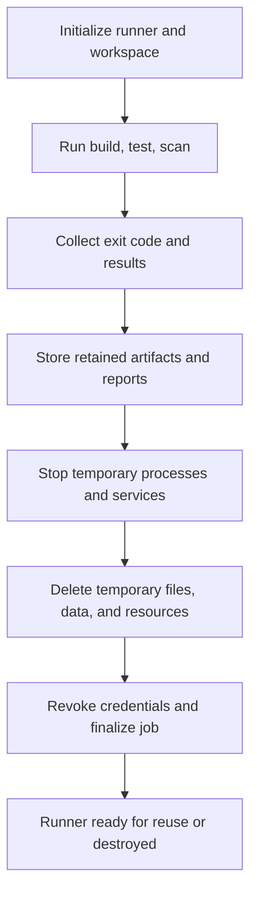

# Cleaning Up Processes, Temporary Files, and Data After Completion

A CI job may run tests, start temporary databases, create containers, generate reports, and download numerous dependencies. When the main command finishes, the execution environment's work is not necessarily over. Child processes may still run in the background, containers may keep holding network ports, temporary files may contain tokens or test data, and the workspace may be reused for the next job.

Without controlled cleanup, runners gradually accumulate orphaned processes, large files, containers, volumes, and sensitive data. Subsequent jobs can fail from disk exhaustion, port conflicts, stale data reuse, or reading data left by a previous job. In CI/CD, **cleanup is part of the execution lifecycle**: every resource created for a run needs an owner, an end time, and a clear disposal policy.

The goal is not to wipe everything blindly the instant a job finishes. Teams must distinguish temporary resources to reclaim, data to retain as evidence, artifacts to release, and data governed by retention policies. Effective cleanup keeps runners safe to reuse, lowers costs, and preserves pipeline traceability.

## 1. Lifecycle of an Execution Environment

A CI/CD job typically goes through these stages:

1. **Initialization:** provision the runner or container, check out source code, create the workspace, and inject required credentials.
2. **Execution:** run scripts, build, test, scan, and spawn child processes, containers, and temporary data.
3. **Result collection:** gather exit codes, logs, test reports, coverage, and artifacts to retain.
4. **Cleanup:** stop remaining processes, release temporary resources, delete unneeded data, and revoke credentials.
5. **Completion:** record job status, retain evidence per retention policy, and release the runner.



The ordering between saving results and deleting data is critical. Deleting the workspace before uploading reports destroys pipeline evidence. Uploading an entire temporary folder as an artifact without classification risks leaking tokens, config files, or test data.

### Cleanup Must Run Across All Termination Paths

A job can end due to:

- Success.
- A build or test command returning a non-zero exit code.
- Timeout.
- User or system cancellation of the pipeline.
- Runner disconnection or execution host termination.
- Another job causing the workflow to cancel.

Cleanup must be designed for both success and failure paths. However, not every mechanism executes when a machine loses power abruptly or a process is forcibly killed. Therefore, cleanup scripts must be paired with short-lived runners, TTL-based reclamation, and periodic sweeps for leftover resources.

## 2. Classifying Resources Before Deletion

Never apply a single blanket delete command to the whole workspace. First identify each resource type and who needs it after the job finishes.

| Data or resource type | Examples | Typical appropriate handling |
|---|---|---|
| Temporary processes | Job-spawned test servers, mock services, browser drivers, compiler daemons | Stop and wait for termination before releasing the runner |
| Temporary files | Intermediate files, sockets, PID files, partial dependency downloads | Delete once no process holds them open |
| Workspace | Source checkout, build directory, test directory | Delete or recreate fresh before next job per runner policy |
| Test data | Databases, schemas, buckets, users, or queues created for tests | Delete by ownership scope; retain temporarily if needed for debugging |
| Containers and networks | Test containers, networks, temporary volumes | Stop and remove resources scoped to the project/run |
| Release artifacts | Verified JARs, images, packages, bundles | Publish and retain per retention policy; never delete with temp files |
| Test reports | JUnit XML, coverage, scan reports | Upload as evidence with scoped access and retention |
| Secrets | Tokens, credential files, private keys, secret env vars | Revoke or expire; delete temp copies and exclude from logs/artifacts |
| Caches | Dependency caches, build caches | Retain per cache policy; never replace release artifacts with caches |

A practical rule is to classify resources at creation time. Embed the pipeline run ID in names, directories, or tags so ownership is unambiguous. During cleanup, delete only resources with verified identifiers and ownership.

## 3. Managing Process Lifecycles and Child Processes

A single pipeline command can spawn many child processes. For instance, a test command starts a test runner, the test runner launches a browser, the browser spawns renderer processes, and the app under test starts a background server. When the parent process exits, child processes do not always terminate automatically.

### 3.1. Distinguishing Parent, Child, and Orphan Processes

- **Parent process:** the process that launches one or more other processes.
- **Child process:** a process created by a parent process.
- **Orphan process:** a process still running after its direct parent process exited or stopped tracking it.
- **Zombie process:** on Unix systems, a process that has terminated whose exit status has not yet been reaped by its parent via `wait`.

Orphan processes can hold open ports, file handles, CPU, RAM, or database connections. If the runner is reused, the next job may hit mysterious errors such as `address already in use`, tests hitting responses from an old server, or leftover Java processes consuming memory.

### 3.2. Tracking PIDs and Managing Process Groups

If a script starts background processes, track their PIDs or use the platform's process management primitives. On Linux, process groups or sessions allow signaling an entire process tree. On Windows, Job Objects or process-tree termination APIs manage child processes.

Never search and kill by generic names like `java`, `node`, or `python` on a shared runner. That can terminate processes belonging to another job or the runner service itself. Restrict signaling strictly to the PID, process group, Job Object, or container created by the current job.

### 3.3. Graceful Shutdown Before Forceful Termination

A safe shutdown sequence generally follows:

1. Stop accepting new work or close listeners.
2. Send a graceful termination signal to the process.
3. Wait for the process to exit within a bounded grace period.
4. If the grace period expires, send a forceful kill signal only to the owned process group or tree.
5. Reap process handles and verify resources are released.

For test services, invoke an application-provided shutdown endpoint or stop command before killing. This lets services flush logs, close connections, and release locks cleanly.

### Linux Example: Cleaning Up a Temp Directory on Script Exit

The following Bash snippet demonstrates creating an isolated job directory and registering cleanup upon shell exit:

```bash
#!/usr/bin/env bash
set -Eeuo pipefail

temp_root="${RUNNER_TEMP:-/tmp}"
work_dir="$(mktemp -d "${temp_root%/}/ci-job.XXXXXX")"
child_pid=""

cleanup() {
  exit_code=$?
  trap - EXIT INT TERM

  if [[ -n "$child_pid" ]] && kill -0 "$child_pid" 2>/dev/null; then
    kill -TERM "$child_pid" 2>/dev/null || true
    for _ in {1..10}; do
      kill -0 "$child_pid" 2>/dev/null || break
      sleep 1
    done
    kill -KILL "$child_pid" 2>/dev/null || true
    wait "$child_pid" 2>/dev/null || true
  fi

  rm -rf -- "$work_dir"
  exit "$exit_code"
}

trap cleanup EXIT
trap 'exit 130' INT
trap 'exit 143' TERM

./run-tests.sh --output "$work_dir/results" &
child_pid=$!
wait "$child_pid"
child_pid=""
```

This example directly tracks one child process. If `run-tests.sh` spawns additional background processes, manage a process group/session or use the runner's timeout and process-tree reaper to ensure descendants terminate as well. `trap` will not run if the host loses power, the process receives `SIGKILL`, or the runner is terminated abruptly.

### Windows PowerShell Example: Always Removing Temp Directories

```powershell
$tempRoot = if ($env:RUNNER_TEMP) { $env:RUNNER_TEMP } else { $env:TEMP }
$workDir = Join-Path $tempRoot ("ci-job-" + [guid]::NewGuid().ToString("N"))

New-Item -ItemType Directory -Path $workDir -ErrorAction Stop | Out-Null

try {
    & .\run-tests.exe --output $workDir
    if ($LASTEXITCODE -ne 0) {
        throw "Test process failed with exit code $LASTEXITCODE"
    }
}
finally {
    if (Test-Path -LiteralPath $workDir) {
        Remove-Item -LiteralPath $workDir -Recurse -Force -ErrorAction SilentlyContinue
    }
}
```

`finally` cleans up the directory whether the block finishes normally or throws an exception. Calling a native executable sets `$LASTEXITCODE` to the program's exit code. If a script launches background processes via `Start-Process`, retain the process handle and terminate the full process tree or assign processes to an appropriate Job Object; deleting a directory in `finally` will not stop processes holding open file locks.

## 4. Cleaning Up Temporary Files and Workspaces

Temporary files can be created by scripts, build tools, test frameworks, compilers, package managers, or the application itself. They typically reside in OS temp directories, runner workspaces, or repository build folders.

### 4.1. Creating Separate Directories per Run

Never let multiple jobs write to a hardcoded path like `/tmp/test-output` or `C:\temp\build`. Use unique names derived from UUIDs or pipeline run IDs to prevent collisions.

Example:

```text
runner-temp/
  ci-10482-7f3a/
    logs/
    test-data/
    downloads/
  ci-10483-a92c/
    logs/
    test-data/
    downloads/
```

A job may delete only directories it owns. Never delete the runner's root directory or shared temp directories. Normalize cleanup paths, verify they sit beneath the permitted root, and confirm they are non-empty before recursive deletion.

### 4.2. Avoiding Overly Broad Delete Commands

Recursive delete commands can cause severe damage if path variables are wrong or empty. Before deleting, verify:

- The path variable is set and non-empty.
- You are using a normalized absolute path.
- The target directory resides under the job's assigned root directory.
- Only directories carrying the current run's name or marker are deleted.
- Symlinks or junctions are not followed outside the owned boundary if the tool supports controlling traversal.
- Deleted resource paths are logged without logging sensitive contents.

For example, `rm -rf "$WORK_DIR"` is safe only after validating that `WORK_DIR` is non-empty and inside the job's workspace. A command like `rm -rf "$WORK_DIR"/*` can expand into unintended deletions if the variable is empty or malformed. Never construct cleanup paths from unvalidated inputs.

### 4.3. Cleaning Up Downloads and Temporary Caches

Interrupted downloads can leave partial files behind. Download to a temporary filename and atomically rename after verification succeeds. On failure, cleanup removes temporary files belonging to that run.

Caches have a different lifecycle from temporary files. Caches can persist across jobs for speed, governed by keys, size caps, expiration policies, and access controls. Do not wipe shared caches inside an individual job's cleanup unless governed by dedicated cache rules.

### 4.4. Workspaces on Shared Runners

Persistent runners can retain source checkouts, build outputs, and configs after a job finishes. Use one of these approaches:

- Create a fresh workspace per job and delete it upon completion.
- Use isolated workspaces per pipeline run, never shared across unrelated jobs.
- Use ephemeral runners that destroy the host or container after one run.
- Reset the workspace before accepting a new job and verify clean state.

Do not assume `git clean` alone is always enough. Build tools can write outside the repository, background processes can keep writing files, and data inside cache or home directories can persist across runs.

## 5. Cleaning Up Containers, Networks, and Backing Services

Integration tests often need databases, message brokers, caches, mock servers, or auxiliary services. These resources may run via Docker Compose, Kubernetes, or temporary cloud environments.

### 5.1. Docker Compose

Give each pipeline run its own project name so two jobs never act on the same container group. After collecting logs and reports, tear down only the stack belonging to that project.

Illustrative example:

```bash
#!/usr/bin/env bash
set -Eeuo pipefail

compose_project="ci-${CI_PIPELINE_ID:-local}-${CI_JOB_ID:-test}"

cleanup() {
  exit_code=$?
  trap - EXIT INT TERM
  docker compose -p "$compose_project" logs --no-color > integration-services.log || true
  if ! docker compose -p "$compose_project" down --remove-orphans; then
    echo "Compose cleanup failed for project $compose_project" >&2
    if [[ "$exit_code" -eq 0 ]]; then
      exit_code=1
    fi
  fi
  exit "$exit_code"
}

trap cleanup EXIT
trap 'exit 130' INT
trap 'exit 143' TERM

docker compose -p "$compose_project" up -d --wait
./run-integration-tests.sh
```

In real scripts, wrap test execution in `trap` or `try/finally` so `down` still runs when tests fail or catchable cancellation signals arrive. The command above omits `--volumes` because volumes may hold data needed for troubleshooting. Delete volumes only when dedicated to the current run and after required diagnostics are collected.

Never run `docker system prune` as a job cleanup step on a shared runner without clear ownership and policy. Global prune commands can wipe images, containers, or caches belonging to concurrent jobs.

### 5.2. Ephemeral Kubernetes Namespaces

A job can create a dedicated namespace tagged with the run ID, deploy services and run tests, and then delete the namespace. Attach labels such as `managed-by=ci` and `run-id=<id>` to identify ownership. Cleanup deletes only namespaces matching both label and run ID.

Namespace deletion is asynchronous. Pipelines must monitor deletion progress with a timeout. Finalizers or stuck resources can leave a namespace in `Terminating`; log and handle leftovers rather than assuming `delete` immediately freed everything.

### 5.3. Ephemeral Cloud Resources

Integration or performance tests may create buckets, databases, VMs, load balancers, queues, or security groups. Tag every resource with project, pipeline run, owner, and expiration timestamp. A periodic sweeper can reclaim expired resources if a job terminates before cleanup completes.

CI accounts should have permission to delete only resources within the scope they created. Avoid granting permission to delete an entire resource group or project merely to clean up a test environment.

## 6. Cleaning Up Test Data and Application State

Test data can include database records, uploaded files, bucket objects, queue messages, test accounts, and cached state. When shared across jobs, leftover data creates test-order dependencies or polluted assertions.

### 6.1. Use Isolated Data Namespaces

Prefer creating data scoped by pipeline run or test suite. For example, give each run schema `ci_run_10482`, tenant `test-10482`, or bucket prefix `ci/10482/`. Cleanup removes only that scope.

If multiple tests run in parallel, give each shard its own namespace so two tests never wipe the same table or mutate the same user concurrently.

### 6.2. Clean Up in Dependency Order

Before deleting data, stop consumers and processes actively using it. For example, stop queue workers before deleting a queue; stop the test server before dropping a database schema; wait for uploads to finish before deleting a temporary bucket.

In databases with foreign keys, delete in dependency order or drop the entire isolated schema. Never run `TRUNCATE` on a shared database unless the job owns all data inside it.

### 6.3. Handling Sensitive Data

Test data might contain personal information or copies of production records. Prefer synthetic or anonymized data. If sensitive data must be used, enforce access controls, encryption, tight TTLs, and audit logging of every user or job accessing it.

Cleanup does not replace data protection requirements. Deleting a file does not ensure data vanished from snapshots, backups, logs, caches, artifacts, or versioned storage. Keep sensitive data out of CI environments unless proper lifecycle controls exist.

## 7. Revoking Temporary Credentials and Secrets

Runners may receive registry tokens, cloud credentials, SSH keys, config files, or certificates. Keep these short-lived and least-privilege.

Core principles to enforce:

- Prefer OIDC or workload identity to issue short-lived per-job credentials.
- Never print secrets to command lines, logs, test reports, or public artifacts.
- When credentials must be written to a file, place them in a private directory with restricted read permissions and delete them after use.
- Revoke tokens or sessions where supported by the provider; deleting a local file does not invalidate an issued token.
- Never pass secrets across jobs via shared caches or artifacts.
- Avoid keeping credentials in process environments longer than necessary.

For example, a deploy job can obtain a short-lived token, perform the rollout, and close the session. During cleanup, it deletes the credential file and runs logout/revoke if supported. Even if the runner is killed abruptly, short token lifetimes limit the exposure window.

Never claim that overwriting or deleting a file guarantees absolute physical erasure. SSDs, copy-on-write filesystems, snapshots, and distributed storage can retain physical blocks. For sensitive data, avoid writing to disk unnecessarily, use encrypted ephemeral storage, and destroy keys or ephemeral environments per policy.

## 8. Preserving Artifacts and Evidence Before Cleanup

One common cleanup mistake is wiping the workspace before the pipeline saves its outputs. Before deleting anything, define clearly what must be kept.

| Data | Keep after job? | Rationale |
|---|---|---|
| Test reports | Usually yes | Quality gate evidence and failure debugging |
| Coverage reports | Per policy | Tracking quality and trends |
| Scan reports | Per security policy | Vulnerability and policy compliance evidence |
| Release artifacts | Yes per retention policy | Deployment, rollback, and traceability |
| Build provenance and manifests | Yes | Links artifacts to source and pipeline run |
| Diagnostic logs | Time-bounded | Failure investigation while limiting sensitive data |
| Intermediate files and temp downloads | Usually no | Unneeded once artifacts are published |
| Test databases or buckets | Usually deleted; controlled copy if debugging | Avoid stale data and accumulating costs |
| Credential files | No | Minimize secret exposure risk |

Run a `publish-results` or `upload-artifacts` step before cleanup. Upload only an explicit allowlist of paths rather than archiving the whole workspace blindly. Use path allowlists and content checks to prevent secrets or sensitive data from leaking into artifacts.

Retention policies should distinguish release artifacts, test reports, logs, and caches. Each carries different lifetimes, access rules, and storage requirements. Rollback-eligible artifacts may be retained longer than transient logs; caches can expire sooner than test reports.

## 9. Designing Cleanup to Run on Failure and Cancellation

Reliable cleanup requires defense in depth across multiple layers:

1. **Inside scripts:** use `trap`, `finally`, or defer hooks to handle normal exits, exceptions, and catchable signals.
2. **Inside the job runner:** declare cleanup steps or post-job actions that run after main steps per platform semantics.
3. **In the environment:** use ephemeral containers or VMs to reclaim all local state when the job ends.
4. **Outside the job:** use TTL tags and background sweepers to reclaim resources left after crashes or disconnects.

Do not rely solely on a final workflow step. If a job is canceled mid-run, some platforms skip trailing steps; if a runner disconnects, scripts cannot execute cleanup. Layered controls reduce the risk of leaked resources.

### Distinguishing Cleanup from Post-Processing Steps

Some actions must run even when tests fail—such as uploading reports and gathering logs. Other actions must run only after producing valid artifacts—such as publishing releases. Pipelines should distinguish:

- **Always-run diagnostics:** collecting logs, test reports, and process state.
- **Cleanup:** stopping temporary services, removing files, and reclaiming resources.
- **Success-only publish:** publishing artifacts or releases when quality gates pass.
- **Failure handling:** preserving diagnostic evidence and marking failure status.

If every step is marked "always run," a pipeline can accidentally publish broken artifacts or deploy after test failures. Step conditions must reflect step intent.

### Cleanup Must Never Mask the Original Failure

Suppose tests fail with exit code `1` and cleanup also fails to remove a container. The pipeline must preserve both signals. Never let a `0` exit code from cleanup overwrite a test failure; equally, never silently ignore a cleanup failure that leaves credentials or costly cloud resources running.

Record separately:

- Primary job outcome: `success` / `failure` / `canceled`.
- Cleanup outcome: `success` / `partial failure` / `failure`.
- Remaining resources and why cleanup failed.
- Follow-up action or ticket ID if manual intervention is required.

## 10. Ephemeral Runners and Fallback Reclamation

An ephemeral runner is an execution environment provisioned for a single job or short-lived batch and then destroyed. When destroyed, its workspace, processes, temporary filesystem, and local state disappear with it.

Benefits include:

- Lower risk of a subsequent job reading data or credentials from a prior job.
- Prevention of orphan processes and junk files accumulating across runs.
- Clean, reproducible, and easier-to-debug environments.
- Simpler local cleanup since the whole host or container is discarded.

Ephemeral runners do not automatically delete external resources. Cloud databases, persistent volumes, buckets, registry images, DNS records, or load balancers can outlive the runner. Those still require owners, tags, TTLs, and sweepers.

### TTLs and Sweepers

A sweeper is a periodic job that locates temporary resources past their expiration or lacking an active owner job. Tag resources with metadata such as:

```text
owner=ci
project=orders-api
run_id=10482
created_at=2026-11-18T07:00:00Z
expires_at=2026-11-18T09:00:00Z
```

A sweeper should:

- Touch only resources carrying CI-managed tags or namespaces.
- Verify expiration and active job status before deleting.
- Support dry-run or reporting modes before enabling automated deletion.
- Write audit logs for every action taken.
- Skip resources whose lease was renewed or tied to an active job.
- Operate with least privilege scoped to designated regions/namespaces.

TTLs are a safety net, not an excuse to skip active cleanup. If every job relies on the sweeper, resources linger longer than needed and inflate costs.

## 11. Cleanup in Multi-Job and Parallel Pipelines

When multiple jobs run concurrently, cleanup must respect ownership. One job must never delete resources currently used by another job.

For example, if multiple test shards share a database, give each shard its own schema or coordinate through locks. When each shard owns an isolated namespace, it can delete its own namespace without affecting sibling shards.

Guidelines:

- Embed both run ID and job ID into resource names.
- Isolate directories, containers, namespaces, and datasets per job whenever possible.
- Never run `docker prune`, wipe runner-wide caches, or delete parent directories from a single job's cleanup on a shared runner.
- When one job is canceled, clean up only resources it owns; shared resources need a coordinating owner.
- Aggregator jobs should delete shared data only after all consumers finish and reports are archived.
- If one dependent job fails, still collect reports from sibling branches before wiping their workspaces.

A useful pattern gives each job an isolated child resource scope and the pipeline run a parent scope for shared resources. Job cleanup removes only the child scope; pipeline cleanup removes the parent scope after all jobs finish.

## 12. Observing and Measuring Cleanup Effectiveness

Cleanup needs telemetry to prove it actually works. A delete command exiting silently does not confirm remote resources or background processes were freed.

| Metric | Meaning | What it detects |
|---|---|---|
| Orphan process count | Job processes still alive after job exit | Scripts missing child-process tracking or improper runner teardown |
| Temporary storage usage | Residual temp file volume | Junk files, aborted downloads, or uncleaned workspaces |
| Container/resource leftovers | Surviving containers, namespaces, volumes, or cloud resources | Incomplete cleanup or insufficient deletion permissions |
| Cleanup duration | Time spent in teardown | Slow shutdowns or excessive process wait timeouts |
| Cleanup failure rate | Rate of cleanup errors | Permission issues, timeouts, or ownership logic bugs |
| TTL sweep count | Resources reclaimed by the sweeper | Gaps where active job cleanup missed resources |
| Secret exposure findings | Secrets found in logs, artifacts, or leftover workspaces | Credential leakage and sensitive data exposure risks |

You do not need to collect sensitive payloads to measure cleanup. Recording resource IDs, types, states, timestamps, and owners suffices for most cases.

If cleanup consistently takes too long, inspect how resources are created. Test services may need cleaner shutdown hooks, temporary environments may need tighter TTLs, or test suites may be generating excessive unnecessary data.

## 13. End-to-End Example: Integration Testing with a Database and Browser

Suppose a pipeline tests `orders-api` alongside a PostgreSQL database and browser tests for the checkout UI.

**Initialization:** the pipeline provisions an ephemeral runner, creates a run-ID-scoped workspace, and launches the database and API containers inside a uniquely named Compose project. Browser tests run in another container on the same project network.

**Execution:** tests create a schema and test data keyed by run ID, run API integration tests, and then execute browser tests. Processes are supervised by the runner or container runtime. Logs and test reports write to a dedicated output directory.

**Evidence collection:** whether tests pass or fail, the pipeline uploads JUnit reports, browser screenshots screened for sensitive data, and key service logs. Release artifacts are published only if mandatory quality gates pass.

**Cleanup:** the pipeline signals the browser and API to stop, waits for processes to exit, collects final logs, and runs `down` on the Compose project. Temporary database volumes are removed since they contain only synthetic data for this run. The workspace and credential files are deleted, while short-lived tokens expire automatically.

**Fallback reclamation:** if the runner disconnects before cleanup runs, the sweeper finds containers or resources labeled with `run-id` past their TTL and reclaims them. Audit logs record the cleaned resources and reasons.

This flow keeps tests repeatable, free of stale data dependencies, and prevents temporary services from lingering after jobs finish.

## 14. Common Anti-Patterns

| Anti-pattern | Consequence | Improvement |
|---|---|---|
| Cleaning up only on job success | Processes and files linger after failed tests | Use `trap`, `finally`, and always-run post-job cleanup |
| Killing only the parent process | Child processes keep running in the background | Manage process groups, process trees, or containers |
| Killing by generic process name | Can terminate sibling jobs or runner services | Target exact PIDs, process groups, Job Objects, or resource IDs |
| Using fixed temporary directories | Parallel jobs overwrite or delete each other's data | Create unique directories per run/job ID |
| Wiping the workspace before uploading reports | Loses test and debugging evidence | Upload artifacts and reports before cleanup |
| Uploading the entire temp directory | Risks leaking tokens and sensitive files | Use explicit allowlists and content screening before upload |
| Running global `prune` on shared runners | Deletes resources belonging to other jobs | Clean up scoped by project, label, and owner |
| No TTL on cloud test resources | Resources survive if the runner dies | Tag with `expires_at` and run a sweeper |
| Sharing mutable test data | Race conditions and flaky tests | Namespace data per run or shard |
| Treating file deletion as credential revocation | Issued tokens remain valid | Revoke tokens or use short-lived credentials |
| Cleanup fails while job reports green silently | Orphaned resources and secrets persist | Report cleanup status separately and alert |
| Using cleanup to delete release artifacts | Breaks rollback and auditability | Separate release artifacts, reports, caches, and temp files |

## 15. Execution Environment Cleanup Design Checklist

Before considering a job design complete, review:

- [ ] Every process or service spawned by the job is tracked and stopped.
- [ ] Child processes are managed via process groups, process trees, Job Objects, or container scope.
- [ ] Cleanup runs on success, failure, and catchable cancellation signals.
- [ ] Timeouts and forceful kill fallbacks exist for unresponsive processes.
- [ ] Each job uses isolated temp directories and unique resource IDs.
- [ ] Cleanup paths are normalized and verified within owned bounds before deletion.
- [ ] Global delete/prune commands are avoided on shared runners and shared resources.
- [ ] Test data, databases, queues, buckets, and namespaces are isolated per run or shard.
- [ ] Retained logs, reports, provenance, and artifacts are uploaded before cleanup.
- [ ] Release artifacts, reports, caches, and temp files have separate retention policies.
- [ ] Secret files are deleted and tokens/sessions are revoked or short-lived.
- [ ] Ephemeral runners are preferred when isolation across jobs is critical.
- [ ] Remote resources carry owner, run ID, TTL tags, and sweeper backup.
- [ ] Cleanup never overwrites exit codes or masks the root job failure.
- [ ] Cleanup status and leftover resources are logged for investigation.
- [ ] Periodic checks detect orphan processes, junk files, and leaked resources.

## 16. Conclusion

Cleaning up processes, temporary files, and data is an essential part of CI/CD execution environment management. A job is truly finished only when owned processes have stopped, temporary resources are reclaimed, retained evidence is safely stored, and secrets do not outlive their authorized lifecycle.

Reliable cleanup combines process-tree management, run-scoped directories, isolated test data, container and service teardown, credential revocation, pre-cleanup artifact uploads, ephemeral runners, and TTL fallback sweepers. When cleanup is owned, repeatable, and observable, pipelines cut resource leaks, eliminate cross-job interference, and keep execution environments clean for the next run.
