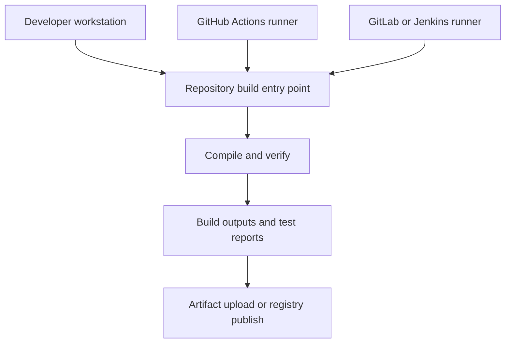

# Automating Builds with a Clear Single Command

A good build process needs a unified entry point so developers, CI runners, and operators can run the same sequence of checks with a single memorable command. That command must clearly define the source code, toolchain, dependencies, configuration, build and test steps, expected outputs, and error reporting behavior. When the same command is used on local workstations and in pipelines, the team reduces "it works on my machine" issues and can investigate build outcomes using concrete evidence.

In CI/CD, build automation is not just combining multiple commands onto one line. The goal is to establish a stable execution contract: inputs are controlled, steps run without manual interaction, results are verifiable, failures return a non-zero exit code, and artifacts are produced at deterministic locations. A clear command is the entry point of the process; reproducibility also depends on pinning tool versions, dependencies, and environmental factors that affect the output.

## 1. Why a Unified Build Command Is Needed

If every developer memorizes a different sequence of commands, the process easily drifts over time. One person runs compile and then test, while another only runs package; someone uses a system-wide JDK installation while someone else uses a different version; CI runs its own separate script. When a production build fails, the team has to investigate not only bugs in the code, but also differences in how the build was invoked.

A standard command helps:

- **Reduce differences between local and CI:** the same wrapper and task are invoked in both places.
- **Clarify completion criteria:** a build only succeeds when all required steps pass.
- **Enable automation:** no user prompts or mid-run confirmations are needed.
- **Improve traceability:** logs record the revision, toolchain versions, executed command, and results.
- **Simplify integration:** pipelines only need to call the entry point defined by the repository.
- **Make improvements easier:** the team updates the process in one place and reviews changes like source code.

A unified command does not force all tasks to run inside a single process. Beneath the entry point, there can be multiple tasks, scripts, and jobs. What matters is that callers know exactly which command represents a complete build verification.

## 2. The Build Command Contract

Before choosing tools, define what the standard command must do. A build contract can describe the following components:

| Component | Question to Answer | Example |
|---|---|---|
| Source | Which source code is being built? | Commit SHA checked out from Git |
| Toolchain | Which runtime and tool versions are used? | JDK 21, pinned Gradle Wrapper |
| Dependencies | Where are dependencies resolved from and are they locked? | Lockfile, configured repositories, checksums |
| Configuration | Which parameters affect the build? | Profile, target platform, build flags |
| Steps | Which required tasks must complete? | Clean, compile, test, package, static checks |
| Outputs | Which files are generated and where are they located? | `build/libs/app.jar`, test reports |
| Exit status | What determines success? | All required tasks pass, command exits with code 0 |
| Evidence | What information should be retained for investigation? | Commit, tool versions, logs, test reports, digest |

The command should behave consistently when executed from the repository root directory. If parameters are needed, name them clearly, provide safe defaults, and validate inputs before executing. Avoid letting the command depend on an arbitrary working directory, undeclared secret environment variables, or leftover state from a previous run.

Example contract for a Java application using Gradle:

```text
Entry point: ./gradlew --no-daemon --console=plain clean build

Inputs:
  - Checked-out Git revision
  - JDK matching the project toolchain
  - Dependencies declared in Gradle

Required work:
  - Clean previous outputs
  - Compile main and test sources
  - Run unit tests and check tasks
  - Create a deployable package

Outputs:
  - build/libs/*
  - build/test-results/*
  - build/reports/*

Success:
  - Exit code = 0
```

The command above is an example for a Gradle repository where `build` is configured appropriately. Each project must verify its actual task graph and outputs before publishing this as its standard command.

## 3. Using a Wrapper to Lock the Build Tool

You should not require every machine to install a version of Gradle or Maven globally and invoke that tool directly. The version installed on a machine may differ from the version the project uses for development. A wrapper allows the repository to provide the launcher script and tool version configuration.

With Gradle, the files typically tracked in the repository include:

```text
gradlew
gradlew.bat
gradle/wrapper/gradle-wrapper.jar
gradle/wrapper/gradle-wrapper.properties
```

The `gradle-wrapper.properties` file specifies the distribution to download, for example:

```properties
distributionBase=GRADLE_USER_HOME
distributionPath=wrapper/dists
distributionUrl=https\://services.gradle.org/distributions/gradle-8.10.2-bin.zip
distributionSha256Sum=<sha256-of-the-approved-distribution>
zipStoreBase=GRADLE_USER_HOME
zipStorePath=wrapper/dists
```

The version in the example is illustrative only. The project must select a Gradle version compatible with its plugins, JDK, and configuration; the checksum must be a verified value from a trusted release source. Do not fill in a placeholder or fake checksum. When upgrading Gradle, wrapper changes should be reviewed and tested on CI.

On Linux or macOS:

```bash
./gradlew --version
./gradlew --no-daemon --console=plain clean build
```

On Windows PowerShell:

```powershell
.\gradlew.bat --version
.\gradlew.bat --no-daemon --console=plain clean build
```

Both developers and CI invoke the wrapper inside the repository. The wrapper can download the declared distribution if the machine does not have it cached yet; therefore, the first run needs connectivity to an allowed download source. If the build environment has restricted network access, the organization must configure a trusted mirror or tool distribution cache.

With Maven, use the Maven Wrapper (`mvnw`, `mvnw.cmd`, and wrapper configuration) so the project specifies the Maven version. A commonly used command for full verification is:

```bash
./mvnw -B -ntp clean verify
```

`-B` enables batch mode to avoid interactive prompts; `-ntp` reduces download transfer progress noise in logs; `clean verify` runs the verification lifecycle up through the `verify` phase. On Windows, you can run `mvnw.cmd -B -ntp clean verify`.

## 4. Choosing a Task That Represents a Full Build

The standard build command should invoke a high-level task with clear semantics rather than requiring everyone to memorize a list of lower-level tasks. In Gradle, the `build` task typically depends on `assemble` and `check`; `check` includes the verifications and tests attached to the lifecycle. Therefore, a typical Java project can use:

```bash
./gradlew --no-daemon --console=plain clean build
```

Meaning:

- `clean` deletes previous build outputs to prevent stale files from hiding errors or being packaged accidentally.
- `build` runs the tasks required to produce outputs and execute configured checks.
- `--no-daemon` fits certain ephemeral CI environments; a project may omit this option if runners are reused and the daemon speeds up builds.
- `--console=plain` produces clean logs that are easy to archive and read in CI.

Not every repository needs `clean` on every run. When developers iterate quickly, running `./gradlew build` can take advantage of incremental builds. In CI creating a clean environment, `clean build` helps surface hidden dependencies on stale outputs. If a pipeline needs to optimize build times, measure and design caching properly instead of silently dropping checks.

With Maven, `verify` is usually the appropriate phase to run plugins bound to the lifecycle through the verification step. If the project has separate integration tests or special profiles, include them in the standard entry point or define a documented CI command. Avoid having the standard command only run `package` when the team expects tests and quality checks to have run as well.

## 5. Organizing the Repository for Discoverability and Maintainability

A clear structure helps developers recognize the entry point without searching through multiple workflows:

```text
repository/
├── gradlew
├── gradlew.bat
├── settings.gradle.kts
├── build.gradle.kts
├── gradle/
│   └── wrapper/
│       ├── gradle-wrapper.jar
│       └── gradle-wrapper.properties
├── scripts/
│   └── ci.sh                 # optional if additional orchestration is needed
├── .github/
│   └── workflows/
│       └── ci.yml
└── src/
    ├── main/
    └── test/
```

There is no need to create extra scripts if the Gradle Wrapper already provides a single clear command. If there are multiple steps outside the build tool—such as schema checks, code generation, manifest validation, or running security tools—you can add an orchestration script at `scripts/ci.sh` or a dedicated Gradle task. Naming and placement must match project documentation.

Example Bash orchestration script:

```bash
#!/usr/bin/env bash
set -Eeuo pipefail

ROOT_DIR="$(cd "$(dirname "${BASH_SOURCE[0]}")/.." && pwd)"
cd "$ROOT_DIR"

if ! command -v java >/dev/null 2>&1; then
  echo "ERROR: Java runtime is required." >&2
  exit 1
fi

echo "== Build metadata =="
git rev-parse HEAD
java -version
./gradlew --version

echo "== Build and verify =="
./gradlew --no-daemon --console=plain clean build

echo "== Expected outputs =="
test -d build/libs
find build/libs -maxdepth 1 -type f -print
echo "Build completed successfully."
```

This script illustrates setting the working directory, checking required tools, printing metadata, and verifying outputs. If the repository needs to support Windows, provide an equivalent PowerShell entry point or prefer cross-platform wrappers/tasks to avoid maintaining two diverging logic streams. Do not rely on a Bash script as the only option when developers primarily work on Windows without a standardized Bash environment.

`set -Eeuo pipefail` ensures the script exits if a command fails, an unset variable is referenced, or any component in a shell pipeline returns an error. Commands that are allowed to be missing must be handled explicitly, as with `command -v` in the example. If a script ignores exit codes or uses `|| true` broadly, the pipeline may report green even though a required step failed.

## 6. Building a Meaningful Task Graph

A build command may trigger many tasks, but each task needs clear responsibilities and proper dependency relationships. For example, a project may need to compile, run unit tests, check formatting, run static analysis, and package artifacts. Attach required checks to the `check` lifecycle or a clearly named verification task so the standard command executes them.

Gradle Kotlin DSL example:

```kotlin
plugins {
    java
    id("com.diffplug.spotless") version "6.25.0"
}

tasks.test {
    useJUnitPlatform()
}

spotless {
    java {
        googleJavaFormat()
    }
}

tasks.named("check") {
    dependsOn("spotlessCheck")
}
```

The snippet illustrates the Spotless plugin creating the `spotlessCheck` task and attaching it to the `check` lifecycle. The plugin version is an example only; the project must choose an approved version compatible with its Gradle version. Do not let an empty or always-succeeding task pass as evidence that formatting checks ran.

When expanding the task graph, keep in mind:

- Tasks that produce outputs should declare their inputs/outputs so Gradle can evaluate incremental execution and caching correctly.
- Verification tasks must fail with an error when required conditions are not met.
- Do not introduce circular dependencies between tasks.
- Do not rely on task declaration order in a file to infer execution order; declare explicit dependencies or ordering constraints.
- Do not allow packaging tasks to run with stale output files if the task generating new files fails.
- Separate fast checks from resource-intensive tasks if they differ in cadence or purpose, while clearly documenting which command constitutes a full build.

A standard command can run `build` for routine verification alongside a separate release command for additional steps such as integration tests, security scans, or SBOM generation. Command names must reflect their actual scope; do not call `build` "release verification" if it does not execute release gates.

## 7. Keeping the Build Environment Consistent

The same command can still produce different results if the toolchain or environment differs. To reduce drift, explicitly manage:

| Environmental Input | How to Control |
|---|---|
| JDK/runtime | Declare Java toolchain; CI installs the exact vendor and version per policy |
| Build tool | Commit wrapper, pin distribution version, and verify checksum |
| OS/architecture | Use controlled runner or container image versions when needed |
| Locale/timezone | Set standardized values if builds or tests depend on formatting or date/time |
| Environment variables | Declare an allowlist of variables and defaults; validate required variables |
| Dependency repositories | Use trusted repositories, managed mirrors, and explicit resolution rules |
| Dependency versions | Declare exact versions, lockfiles, or appropriate pinning mechanisms |
| Build arguments | Record parameters that affect output |
| Network inputs | Pin by version/checksum or fetch from authenticated sources |

With Gradle, you can declare the toolchain in the build script:

```kotlin
java {
    toolchain {
        languageVersion.set(JavaLanguageVersion.of(21))
    }
}
```

Toolchains help Gradle select the right JDK for compiling and testing, but the environment still needs a reliable way to provision or install that toolchain. Declaring major version `21` alone does not pin every patch release, vendor, or operating system; the pinning granularity must match the project's reproducibility requirements.

For builds requiring strict reproducibility, you can use container images pinned by digest instead of mutable tags, lock both JDK patch and vendor, and control runner architecture. A tag like `jdk:21` is readable but mutable; a digest uniquely identifies the exact image bytes.

## 8. Controlling Dependencies and Download Sources

Dependencies are one of the largest sources of variance. If versions are declared as ranges or tools are allowed to pick the latest version automatically, the same commit can resolve different dependencies at different times.

Practices to consider:

- Use explicit versions and review updates.
- Enable dependency locking when supported by the ecosystem; commit lockfiles to the repository.
- Verify dependency checksums or signatures whenever possible.
- Use controlled repositories/mirrors; avoid adding untrusted sources in build scripts.
- Record a dependency snapshot or SBOM for release artifacts.
- Treat build plugins and CI actions as dependencies that can affect output.
- Avoid downloading unpinned scripts and executing them directly during the build.

Dependency caches speed up downloads, but a cache does not replace lockfiles or checksums. Builds must still succeed with an empty cache. If a cache holds modified dependencies or its cache key does not reflect the lockfile, runners may use unexpected stale data.

With Gradle, dependency verification can be configured to check checksums or signatures of approved dependencies. When adding a new dependency, generate and review verification metadata following the team's workflow; do not disable verification just to make a build green.

## 9. Building Without Hidden State Dependencies

A reproducible build requires all inputs to be declared. Common hidden factors that cause divergence include:

- Files generated by a previous run remaining in the output directory.
- Personal configuration files in the home directory or IDE.
- Environment variables differing between local machines and CI.
- Current timestamps, timezones, locales, or non-deterministic file traversal orders.
- Dependencies fetched via mutable tags or from different repositories.
- External data changing without the build recording its version.
- Build scripts reading Git state or uncommitted files without recording them.
- Tasks depending on a daemon, service, or pre-running process on the host.

To detect hidden state, run builds in a clean workspace, container, or fresh runner; test building twice with identical inputs; check for files created outside the output directory; and compare metadata and digests. If outputs differ, investigate timestamps, file ordering, random values, absolute paths, or unpinned dependencies.

A `clean build` command removes known build outputs, but does not clear external state such as home directories, global caches, daemons, or network services. Reproducibility relies on controlling those inputs, not merely adding the `clean` keyword.

## 10. Distinguishing a Successful Build from a Bit-for-Bit Reproducible Build

These two concepts are related but not synonymous:

- **Automated and consistent build:** the same entry point runs the defined steps, returns accurate exit codes, and produces outputs per the contract.
- **Reproducible build in the strict sense:** the same source, dependencies, toolchain, configuration, and controlled inputs produce artifacts with identical bytes, typically verified by comparing digests.

A standard command is a prerequisite for reproducibility, though not sufficient on its own. For example, if packaging writes the current timestamp into a manifest, two runs on the same commit will still produce different digests. If a `1.+` dependency resolves to a newer release, outputs may change. If the compiler differs in patch version, outputs may differ.

To move toward bit-for-bit reproducibility:

1. Pin the commit, dependencies, toolchain, and build arguments.
2. Eliminate unnecessary timestamps, random values, and absolute paths from outputs.
3. Normalize timezones, locales, file ordering, and archive metadata where tools support it.
4. Control network inputs and data downloaded during the build.
5. Build independently twice in clean environments.
6. Compare the SHA-256 digests of the artifacts and investigate any differences.

Some ecosystems provide time-normalization variables such as `SOURCE_DATE_EPOCH`, but this only works for tools that read and honor the variable. Do not set the variable and assume every plugin or archive automatically drops timestamps. Inspect the actual output directly.

## 11. Designing Non-Interactive and Diagnosable Commands

CI usually runs without a human watching a terminal. Build commands need to terminate with a clear status instead of waiting for prompts, password entry, or profile selection.

A CI-ready command should:

- Run in batch/non-interactive mode.
- Enforce timeouts at the job level or on tasks that might hang.
- Log enough context to identify which task failed.
- Return a non-zero exit code when any required step fails.
- Never swallow errors with `|| true`, `continue-on-error`, or overly broad exception handling.
- Never print secrets or tokens on command lines or in logs.
- Use deterministic output paths and avoid writing files to arbitrary user directories.
- Be safe to re-run after fixing an issue without leaving duplicate or corrupted state.

For easier diagnosis, retain test reports and build scans if your organization uses them. With Gradle, test reports are typically located under `build/reports/tests/test` and XML results under `build/test-results/test`. With Maven, Surefire/Failsafe typically writes reports under `target/surefire-reports` and `target/failsafe-reports`. Exact paths depend on plugins and project configuration.

Logs should print the revision and tool versions at the start of each run. Avoid dumping all environment variables, as that can expose secrets. Print only selected non-sensitive variables such as `JAVA_VERSION`, commit SHA, or build profile.

## 12. Calling the Same Command from GitHub Actions

CI workflows should call the exact wrapper/task documented in the repository. Do not rewrite separate compile/test/package steps that diverge from the command developers are instructed to run.

GitHub Actions example for a Gradle application:

```yaml
name: CI

on:
  pull_request:
  push:
    branches: [main]

permissions:
  contents: read

jobs:
  build:
    runs-on: ubuntu-latest
    steps:
      - name: Checkout source
        uses: actions/checkout@v4

      - name: Set up Java
        uses: actions/setup-java@v4
        with:
          distribution: temurin
          java-version: '21'
          cache: gradle

      - name: Run the repository build command
        run: ./gradlew --no-daemon --console=plain clean build

      - name: Upload test reports
        if: always()
        uses: actions/upload-artifact@v4
        with:
          name: test-reports-${{ github.run_id }}-${{ github.run_attempt }}
          path: |
            **/build/test-results/**
            **/build/reports/**
          if-no-files-found: warn
          retention-days: 7

      - name: Upload application package
        if: success()
        uses: actions/upload-artifact@v4
        with:
          name: application-${{ github.sha }}
          path: build/libs/*.jar
          if-no-files-found: error
          retention-days: 14
```

This workflow demonstrates a single build command and separates two output types: reports may need to be uploaded even when the build fails; packages are only uploaded when the build succeeds. For multi-module Gradle projects, report and package patterns must be adjusted to cover the appropriate modules. Artifact names include the run ID/attempt or commit to avoid confusion across runs.

`ubuntu-latest` and Java major `21` are convenient defaults, but they do not fully lock the environment for bit-for-bit reproducibility. Where strict reproducibility is required, pin the runner/container image and exact JDK release, and control the toolchain, dependencies, and other inputs.

## 13. Calling the Same Command from GitLab CI

GitLab CI should also invoke the wrapper managed by the repository. Example:

```yaml
stages:
  - verify

build:
  stage: verify
  image: eclipse-temurin:21-jdk
  script:
    - ./gradlew --no-daemon --console=plain clean build
  artifacts:
    when: always
    paths:
      - '**/build/test-results/'
      - '**/build/reports/'
    expire_in: 7 days
```

The example image uses a readable tag. For stricter environment control, pin the image by digest and verify that it comes from a trusted source. In real configurations, you can separate test reports from packages and use `artifacts:reports:junit` so GitLab displays test results natively.

The key principle remains the same entry point. Do not let GitHub Actions run `clean build`, GitLab run `assemble`, and developers run `test` while calling them the same process.

## 14. Integrating Multiple Platforms Without Duplicating Logic

A repository may be built on local machines, GitHub Actions, GitLab CI, or Jenkins. Keep build logic inside the project's wrapper, build scripts, or tasks; platform configurations should only provide runners, toolchains, permissions, secrets, caches, and artifact storage.



Platforms may differ in syntax, but the repository needs a single canonical definition of the standard build command. If there are platform-specific steps, such as uploading artifacts or minting OIDC tokens, keep them in the workflow; do not duplicate compile, test, or packaging logic when the build tool can perform it.

When changing the entry point, update the README or developer guide, CI workflows, and related scripts in the same reviewed change. This prevents documentation from instructing one command while pipelines have moved to another.

## 15. Caching and Incremental Builds While Preserving Correctness

Fast builds give developers quicker feedback. Gradle, Maven, and other tools can use dependency caches, incremental compilation, or build caches. However, caching must be a disposable optimization, not a required undeclared input.

Principles:

- Base cache keys on lockfiles, toolchains, OS/architecture, and configurations that affect outputs.
- Do not share writable caches across unequal trust boundaries, such as workflows from forks and production workflows.
- Run clean builds periodically or on the main branch to catch incremental/cache bugs.
- Never treat caches as the sole storage location for release artifacts.
- When suspecting a cache-related failure, re-run with a fresh cache and compare results.
- Custom tasks must declare inputs and outputs accurately so the build tool knows when outputs can be reused.

A command can support a fast mode for developers and a full mode for CI, provided their names and scopes are clearly distinguished. For example, `./gradlew test` works well for fast test runs; `./gradlew clean build` is the full verification command. Do not let production pipelines call a fast mode that skips required gates.

## 16. Managing Configuration and Secrets

Builds should receive configuration through explicitly named parameters or environment variables. Non-sensitive configuration can be committed if shared broadly; environment-specific configuration should be managed separately with schema/validation. Secrets must come from a secret manager or CI platform identity mechanisms—never from source code, wrapper properties, loggable command arguments, or report files.

If a variable is required, the build command should validate it up front and fail with a clear error if missing. Do not use implicit defaults for production endpoints or credentials. Routine builds should also not need production deployment permissions; separating build from deploy limits blast radius when workflows run on untrusted code.

For reproducible builds, secrets should not alter artifact bytes unless strictly necessary. For example, do not embed access tokens or personal information inside manifests. If artifacts need signing, perform signing in a separate step with restricted permissions, record the signing identity, and bind the signature to the package digest.

## 17. Common Mistakes in Build Automation

| Mistake | Consequence | Remedy |
|---|---|---|
| Calling globally installed Gradle/Maven | Local and CI may use different versions | Use committed wrappers and pin versions |
| Using different command sequences everywhere | Local and CI results are not equivalent | Publish a single canonical entry point |
| Running only compile or package | Tests and quality checks may not have run | Choose an appropriate lifecycle task such as `build` or `verify` |
| Requiring interactive input | CI hangs or fails with no user to respond | Use batch/non-interactive mode |
| Script does not stop on error | Pipeline may falsely report green | Check exit codes and enable strict error handling |
| Using `|| true` on required steps | Failures are masked | Handle exceptions conditionally with clear justification |
| Unpinned dependencies | The same commit may resolve different versions | Use explicit versions, lockfiles, and checksums |
| Relying on stale outputs | Packages may include files from previous builds | Use clean workspaces and inspect outputs |
| Treating cache as source of truth | Cache misses break builds or serve stale data | Ensure builds still succeed on cache miss |
| Using mutable runner images | Toolchains can change silently outside review | Pin images/versions to match reproducibility needs |
| Not saving test reports | Hard to diagnose failures after jobs finish | Upload reports even when tests fail |
| Printing the entire environment | Secrets may leak into logs | Print only selected non-sensitive metadata |

Another design mistake is making scripts overly clever: guessing branches, auto-downloading the latest tool version, selecting profiles by hostname, or silently skipping tests when dependencies are missing. Such decisions make behavior unpredictable. Turn important choices into named configurations with valid value sets and explicit input checks.

## 18. Practical Example: Standardizing the Build for a Java Service

Suppose a team has an `order-service` using Gradle. Previously, developers ran `test` in their IDE, others ran `gradle build`, and CI used a script that installed Gradle separately. When switching machines or upgrading runners, the team hit inconsistent failures and struggled to tell which checks production packages had passed.

The team standardizes the workflow:

1. Commit the Gradle Wrapper and reviewed distribution configuration.
2. Declare the Java toolchain in the build script and standardize the JDK installed by CI.
3. Attach required unit tests, formatter checks, and static checks to the `check` lifecycle.
4. Ensure the `build` task produces the package and runs the defined checks.
5. Publish the standard command `./gradlew --no-daemon --console=plain clean build` in repository documentation.
6. Configure both GitHub Actions and GitLab CI to run that exact command.
7. Upload test reports even when builds fail; publish packages only when the command succeeds.
8. Associate the package with its commit SHA and compute its digest before advancing to testing or deployment.
9. When proving bit-for-bit reproducibility is required, rebuild the same revision in two clean environments with locked inputs and compare digests.

After this change, developers can run the exact same command locally and read results using the same conventions. CI becomes an automated executor for the reviewed entry point; artifacts are promoted only when the build and required checks pass.

## 19. Checklist for Designing a Standard Build Command

Before putting an entry point into use, verify:

- [ ] A single standard command is documented at the repository root.
- [ ] Local and CI use the same wrapper/task or orchestration script.
- [ ] Build tool versions are pinned and wrapper files are tracked in Git.
- [ ] JDK/runtime and toolchains are declared and installed by explicit rules.
- [ ] Dependencies have explicit versions, lockfiles, or corresponding verification mechanisms.
- [ ] The command runs non-interactively and does not depend on IDE actions.
- [ ] Required compile, test, static checks, and packaging steps are all in the task graph.
- [ ] Required failures cause the command to exit with a non-zero status code.
- [ ] Outputs and test reports have deterministic locations; reports are saved on failure.
- [ ] Caches only accelerate builds, and pipelines succeed when caches are empty.
- [ ] Clean workspaces do not rely on leftover files from prior runs.
- [ ] Configuration is validated; secrets are absent from source, outputs, and logs.
- [ ] CI workflows call the exact entry point and record commit, toolchain, and artifact identity.
- [ ] If bit-for-bit reproducibility is needed, independent rebuilds and digest comparisons are tested.

## 20. Conclusion

A clear build command provides a shared entry point for developers and CI. For the command to be reliable, the repository must define inputs, toolchains, dependencies, the task graph, configuration, outputs, logs, and exit status. Wrappers lock the build tool; lifecycle tasks bundle required checks; CI workflows invoke the same entry point; artifacts and reports supply evidence for downstream stages.

A unified command enables automation and reduces drift, though it does not automatically guarantee byte-for-byte identical artifacts. Achieving strict reproducibility also requires controlling dependencies, environments, timestamps, network inputs, and hidden state, then verifying through independent rebuilds and digest comparison. When these elements are managed together, every build becomes a repeatable, explainable, and traceable operation across the entire CI/CD pipeline.
