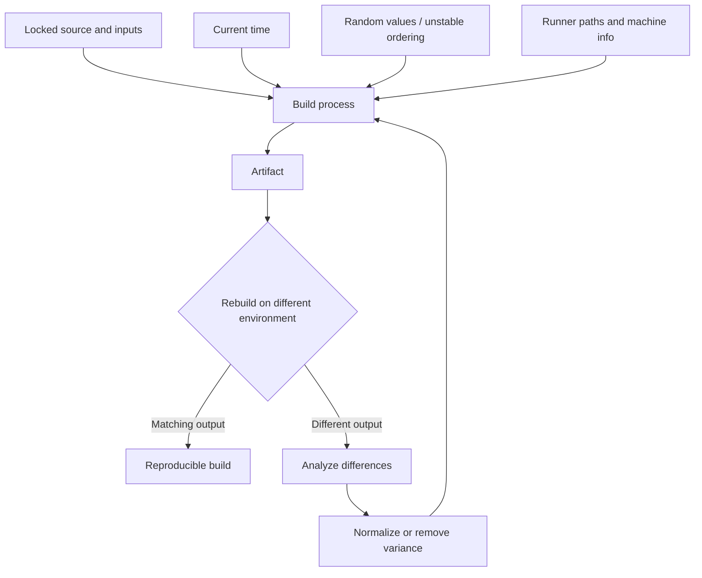

# Controlling Dependencies on Time, Randomness, and Machine Paths

A reproducible build must produce the exact same output when re-run with the same source code, tools, and declared inputs. In practice, two builds of the same commit can still generate different files because the process inadvertently injects the current time, random values, or the build host's file paths into the artifact.

These differences are often subtle: filenames and application contents appear identical, tests pass, yet the two packages have different checksums. This undermines artifact verification, cross-runner build comparison, and proof that a release package matches what was tested. Achieving reproducible builds requires identifying these sources of variance, normalizing them into explicit inputs, or removing them from the artifact.

## 1. Reproducible Builds and Hidden Sources of Variance

A build can be modeled as a function:

\[
Artifact = Build(Source, Toolchain, Dependencies, Configuration, Environment)
\]

If an environmental value changes without being declared, the artifact can change even when the commit does not. The three variance categories addressed in this lesson are:

| Category | Sources of Variance | Examples Appearing in Artifacts |
|---|---|---|
| Time | System clock, timezone, file modification times, package build date | Build time headers, timestamps in ZIP/JAR, manifests, generated sources |
| Randomness | PRNGs, UUIDs, hash seeds, iteration order, concurrency | Auto-generated IDs, file ordering, differently sorted contents |
| Machine paths | Workspace, temp directories, home directory, hostname, separators | Debug information, source maps, manifests, generated files, bundled logs |



The goal is not to purge all timestamps, UUIDs, or paths from the entire system. The goal is to prevent machine-dependent or execution-time-dependent values from silently entering outputs. When such details are operationally needed, store them in run metadata or a separate release record rather than inside the reproducible artifact itself.

## 2. Controlling Time and Timestamps

### Why does the system clock change artifacts?

Some tools record the current time when generating files or packaging archives. Examples include:

- Scripts generating `BuildInfo.java` using `new Date()` or `datetime.now()`.
- ZIP/JAR archives preserving the modification time of each input file.
- Manifests recording the build timestamp from the runner's clock.
- Documentation generators embedding the publication date into output contents.
- `date` commands generating versions such as `2026.11.18` on each build.

Two builds executed seconds apart can get different timestamps, resulting in different package checksums. If runners reside in different timezones, the exact same instant can even be formatted into two different date/time strings.

### Using a canonical timestamp

A common approach is the `SOURCE_DATE_EPOCH` environment variable, following the Reproducible Builds specification. Its value is a Unix UTC epoch seconds integer used as a stable timestamp for the build. Many packaging tools and compilers support this convention, though not every tool reads it automatically; check documentation and configuration for each component.

For a build tied to a specific commit, the team can use the commit's committer timestamp as the epoch:

```bash
export SOURCE_DATE_EPOCH="$(git show -s --format=%ct "$GIT_COMMIT")"
export TZ=UTC
export LC_ALL=C
export LANG=C

./gradlew clean build --no-daemon
```

`GIT_COMMIT` must point to the actual commit being built. If unset, `HEAD` can be used after the pipeline checks out the exact revision. Crucially, every build of the same revision must pick the exact same timestamp rather than reading the runner's current clock. `TZ=UTC` keeps timezone-aware commands aligned to a single timezone; `LC_ALL=C` and `LANG=C` prevent locale-driven variations in formatting and sorting.

Never set `SOURCE_DATE_EPOCH` and assume the entire build is automatically reproducible. A script might ignore the variable and still read the system clock. Audit all timestamp generation points, configure archive tooling, and verify outputs after building.

### Normalizing archive timestamps

Archives such as ZIP, JAR, or TAR can store file modification times. If each build uses workspace file timestamps, outputs can diverge. With Gradle, configure archive tasks not to preserve input file timestamps and to use reproducible file ordering:

```kotlin
import org.gradle.api.tasks.bundling.AbstractArchiveTask

tasks.withType<AbstractArchiveTask>().configureEach {
    isPreserveFileTimestamps = false
    isReproducibleFileOrder = true
}
```

With Maven, configure `project.build.outputTimestamp` in a format supported by your packaging plugins, for example in `pom.xml`:

```xml
<properties>
    <project.build.outputTimestamp>2026-01-01T00:00:00Z</project.build.outputTimestamp>
</properties>
```

The value above illustrates a fixed timestamp. In production pipelines, pass a timestamp derived from the revision or release metadata as supported by the plugins in use; avoid manually changing it per build. Verify whether specific plugins and versions apply this property to every archive produced.

### Do not embed the current time into auto-generated source code

If an application needs to expose a version or release timestamp, distinguish between:

- **Build identity:** commit SHA, release version, or artifact digest, which can be reproducible.
- **Build execution time:** when a runner executed the build, which belongs in run metadata.
- **Release/deployment time:** when an artifact reached an environment, which belongs in the deployment record.

Avoid writing `Instant.now()` into generated source files or manifests inside artifacts if that field changes bytes on every build. If an artifact genuinely requires a timestamp, derive it from `SOURCE_DATE_EPOCH` or release metadata fixed prior to the build.

## 3. Controlling Randomness and Data Ordering

### Where does randomness in builds come from?

Builds can introduce randomness directly or indirectly:

- Scripts generating UUIDs or random suffixes for filenames.
- Tests generating random data without recording a seed.
- Generators creating keys, IDs, or sample data during packaging.
- Language runtimes using randomized hash seeds that alter collection iteration order.
- Parallel tasks writing to a shared file or aggregating results in completion order.
- Tools picking an item from an unsorted collection.

Not every randomness-induced difference looks like an explicit random number. A `HashMap`, `HashSet`, or directory listing read directly from the filesystem can yield different ordering across runtimes, operating systems, or runs. If that order is written into an archive, manifest, or generated source, the artifact changes.

### Fixed seeds for tests and generators

For synthetic data or tests, use a declared seed and log it whenever needed to reproduce failures:

```python
import random

TEST_SEED = 7319
rng = random.Random(TEST_SEED)

sample_ids = [rng.randrange(1_000_000) for _ in range(10)]
print(sample_ids)
```

When a test fails, log the seed so the exact same inputs can be replayed. For parallel tests, derive deterministic per-test-case seeds from a root seed and test ID to avoid depending on scheduler execution order.

Fixed seeds are not appropriate for all randomness. **Never use a fixed seed to generate passwords, tokens, encryption keys, or security nonces.** Security-sensitive values must use a proper cryptographic random source. For reproducible builds, decouple secret generation from the build process: artifacts reference secrets injected at deployment time, while secret values are generated and managed by a secret manager.

### Stabilizing file and collection ordering

If outputs contain elements drawn from maps, sets, or the filesystem, sort them before serializing or packaging:

```python
from pathlib import Path

root = Path("src")
files = sorted(
    (p.relative_to(root).as_posix() for p in root.rglob("*") if p.is_file()),
    key=lambda value: value.encode("utf-8"),
)

for relative_path in files:
    print(relative_path)
```

Ordering should be independent of locale, filesystem directory entry order, and OS path separators. For JSON/YAML data or manifests, enforce deterministic key ordering and serialization formatting if tools allow variation. Avoid relying on iteration order of collections without stability guarantees.

### Controlling concurrency and race conditions

Running jobs in parallel can make outputs depend on completion order. For instance, two tasks write to `version.txt` and whichever finishes last wins; or one task packages files while another is still modifying them. Ways to mitigate risk:

- Have each task write to its own isolated output directory.
- Declare explicit task dependencies instead of relying on incidental timing.
- Aggregate outputs only after all upstream tasks complete.
- Sort data before writing combined outputs.
- Avoid sharing mutable state or intermediate files across concurrent processes.
- If a shared resource is unavoidable, use well-scoped locking with guaranteed cleanup on failure/cancellation.

You do not have to disable all build parallelism to achieve reproducibility. Ensure independent tasks are genuinely independent and merging outputs follows deterministic rules.

## 4. Controlling Machine Paths

### Why do absolute paths cause builds to differ?

CI runners frequently check out the same repository into different directories:

```text
/home/runner/work/api/api
/builds/team/api-42
D:\a\api\api
C:\agent\_work\17\s
```

If a compiler, code generator, or script embeds full paths into an artifact, builds on different runners produce different bytes. Paths can appear inside:

- Binary debug information.
- Source maps or compiler metadata.
- Generated sources, manifests, and bundled report files.
- Stack traces or `__FILE__` strings compiled into binaries.
- Cache keys, package metadata, or auto-generated version files.

Absolute paths can also expose internal directory layouts, account names, or agent names. Stripping machine-dependent paths both improves reproducibility and reduces environment information leakage.

### Using relative paths and standardized workspaces

Build scripts should treat the repository root as the logical base and store relative paths in metadata. For example, instead of recording:

```text
C:\agent\_work\17\s\src\main\java\com\example\App.java
```

record:

```text
src/main/java/com/example/App.java
```

Avoid pulling `pwd`, `$HOME`, `%USERPROFILE%`, hostnames, or temp directory paths into artifact contents. If a temporary directory is needed for intermediate operations, never embed its name or path in the final package.

Some CI systems can mount the repository at a fixed path inside a container, such as `/workspace`. This reduces variation across one runner pool, but does not replace stripping paths from artifacts: local environments, other runners, or non-CI builds may still use different paths.

### Path remapping in compilers

With GCC, prefix-map flags can replace the build root path with a stable prefix in file metadata embedded into binaries:

```bash
BUILD_ROOT="$(pwd -P)"

gcc -O2 \
  -ffile-prefix-map="$BUILD_ROOT"=. \
  -o app src/main.c
```

`-ffile-prefix-map` is provided by GCC to remap path prefixes in embedded file references; related options such as `-fdebug-prefix-map` and `-fmacro-prefix-map` have narrower scopes. Verify support and behavior in the specific GCC/Clang version you use. Not all compilers or linkers accept identical flags.

For MSVC and other toolchains, look up the corresponding path mapping flags or configure the build to omit workspace paths. Never copy GCC flags verbatim into a different compiler. You can inspect artifacts by searching for path strings like `C:\agent\_work`, `/home/runner/work`, or usernames/hostnames in binaries, source maps, and manifests.

### Normalizing separators, case sensitivity, and symlinks

Windows commonly uses `\\` and case-insensitive filesystems; Linux uses `/` and case-sensitive filesystems. Symlinks can also resolve to different paths depending on the workspace. When generating metadata or archives:

- Use a unified logical path format, typically `/` in metadata.
- Never rely on case differences alone to distinguish two files if cross-OS support is needed.
- Define symlink handling: preserve links or dereference target contents—do not let tools pick different defaults per platform.
- Never embed host drive letters or mount points into artifact contents.
- Check filenames and special characters for compatibility with target operating systems.

## 5. Combining Time, Randomness, and Path Normalization

These three sources of variance often appear together. A single manifest script might write the current time, generate a UUID, and record the workspace path all at once. Fixing only one factor still leaves checksums mismatched.

Example shell wrapper illustrating stable environment setup before building:

```bash
#!/usr/bin/env bash
set -Eeuo pipefail

export TZ=UTC
export LC_ALL=C
export LANG=C
export PYTHONHASHSEED=7319
export SOURCE_DATE_EPOCH="$(git show -s --format=%ct "$GIT_COMMIT")"

repo_root="$(git rev-parse --show-toplevel)"
cd "$repo_root"

./gradlew clean build --no-daemon
```

This example configures timezone, locale, Python hash seed, and a commit-derived timestamp. `PYTHONHASHSEED` only affects Python processes launched in this environment; it does not replace explicit sorting of collections. `SOURCE_DATE_EPOCH` only works for tools that support it or scripts that explicitly read it. `repo_root` is used for navigation inside the script and should not be written verbatim into artifacts.

For builds with strict reproducibility requirements, also inspect:

- Timestamps on individual archive entries and generated files.
- Ordering of entries, keys, and file lists.
- UUIDs, random suffixes, build numbers, and runner IDs.
- Source, workspace, temp, home paths, and host details inside binaries/metadata.
- Locale, timezone, line endings, and sorting rules.
- Parallel task outputs and how results are merged.

## 6. Control Example in a Gradle Project

A Java project can apply configurations such as the following in `build.gradle.kts`:

```kotlin
import org.gradle.api.tasks.bundling.AbstractArchiveTask

tasks.withType<AbstractArchiveTask>().configureEach {
    isPreserveFileTimestamps = false
    isReproducibleFileOrder = true
}

tasks.register("writeBuildIdentity") {
    val commit = providers.environmentVariable("GIT_COMMIT").orElse("")
    val sourceDateEpoch = providers.environmentVariable("SOURCE_DATE_EPOCH").orElse("")

    inputs.property("commit", commit)
    inputs.property("sourceDateEpoch", sourceDateEpoch)
    outputs.file(layout.buildDirectory.file("generated/build-identity.txt"))

    doLast {
        val commitValue = commit.get().takeIf { it.isNotBlank() } ?: error("GIT_COMMIT is required")
        val epochValue = sourceDateEpoch.get().takeIf { it.isNotBlank() } ?: error("SOURCE_DATE_EPOCH is required")
        val output = layout.buildDirectory.file("generated/build-identity.txt").get().asFile
        output.parentFile.mkdirs()
        output.writeText("commit=$commitValue\nbuildEpoch=$epochValue\n")
    }
}
```

This task illustrates writing identity metadata from declared inputs instead of reading the system clock or generating a random UUID. In a real project, wire the task into the appropriate source set or packaging task and ensure no absolute paths are written to the file. If the identity file is packaged inside the artifact, the same commit and `SOURCE_DATE_EPOCH` produce identical contents.

Avoid creating `build-identity.txt` by writing `new Date()` inside `doLast`. When a task ran is an execution attribute, not an immutable property of the source revision. If you need to record when a runner actually executed, store that in CI logs or metadata outside the artifact.

## 7. Verifying Reproducible Builds

You cannot confirm a build is reproducible merely by reading configuration files. Re-run with identical inputs under differing conditions and compare actual artifacts.

Basic verification workflow:

1. Select a commit SHA and record the toolchain, dependencies, configuration, and build inputs.
2. Run a clean first build in workspace A.
3. Rebuild the same commit in workspace B, ideally with a different path or runner.
4. Compare the checksum of each resulting artifact.
5. If they differ, compare archive structures and analyze differing bytes.
6. After fixing sources of variance, repeat until results are consistent.

Example on Linux:

```bash
sha256sum build-a/libs/app.jar build-b/libs/app.jar
```

If the checksums match, both files have identical byte contents under SHA-256 with negligible collision probability in practice. If checksums differ, inspect archive structure first:

```bash
unzip -l build-a/libs/app.jar
unzip -l build-b/libs/app.jar
```

Next, use a tool such as `diffoscope` to isolate differences in timestamps, file metadata, debug paths, manifests, or generated contents. Byte-comparison tools tell you whether a difference exists; `diffoscope` explains which layer contains the difference.

### Testing across two different workspaces

A useful test is building the same commit in two distinct paths, for example:

```text
/tmp/build-a/project
/agent/work/92/project
```

If artifacts differ solely due to the workspace path, remove the path from binaries or metadata. You can also test across Windows and Linux if the project claims cross-platform build support, though clarify which targets require byte-identical outputs across OS boundaries. Some toolchains intentionally produce OS-specific artifacts; in those cases, compare builds per platform or define the reproducibility scope explicitly.

### Do not overlook small differences

Even a single byte alters the checksum. Commonly overlooked fields include:

- ZIP extra fields or per-entry timestamps.
- File ordering inside archives.
- File permissions or owner metadata.
- Manifests containing build numbers, hostnames, or timestamps.
- Debug paths, source maps, and generated code.
- JSON files with differing key order or whitespace.
- Compressed payloads that vary with compressor versions or parameters.

Checking only filenames or running functional tests will not catch these differences.

## 8. Practices That Easily Break Reproducibility

| Practice | Why It Causes Divergence | Remediation |
|---|---|---|
| Writing `now()` into a version file | Every run gets a different timestamp | Use a fixed epoch or store time outside the artifact |
| Using `latest` or today's date as a build input version | Value changes over time | Use an explicit revision or fixed version |
| Generating random UUIDs during packaging | Artifacts get different IDs | Derive deterministic IDs from inputs or omit IDs from artifacts |
| Iterating maps/sets without sorting | Iteration order is not guaranteed | Sort using a deterministic comparator |
| Writing `pwd` directly into manifests | Runner workspaces have different paths | Record relative paths or omit host info |
| Embedding absolute debug paths | Binaries contain host paths | Use appropriate compiler path mapping flags |
| Relying on default timezone/locale | Runners have different regional settings | Set UTC and explicit locale |
| Multiple tasks writing to shared output | Race conditions make results order-dependent | Isolate outputs, declare dependencies, merge deterministically |
| Preserving file timestamps in archives | Checked-out files have varying mtimes | Normalize timestamps or disable timestamp preservation |
| Using a fixed seed for secrets | Weakens cryptographic security | Use fixed seeds only for tests; generate secrets at runtime |

## 9. Variance Control Checklist

Before declaring a build reproducible, verify:

1. Are timestamps inside artifacts derived from a stable epoch?
2. Do packaging tools normalize timestamps and entry ordering?
3. Do scripts or generators read the current system clock?
4. Are random seeds for tests and generators declared and logged?
5. Are any UUIDs, random suffixes, or runner IDs embedded in artifacts?
6. Are collections and file lists sorted deterministically?
7. Do parallel tasks share files or mutable state causing race conditions?
8. Do artifacts contain absolute paths, usernames, hostnames, or temp directories?
9. Does the compiler support source/debug path remapping and is it configured?
10. Are timezone, locale, and formatting rules pinned?
11. Do two clean builds of the same commit yield identical checksums?
12. When differences appear, can the team pinpoint the exact file or metadata responsible?

Controlling time, randomness, and machine paths eliminates hidden inputs that cause artifacts to vary across runs. When these values are normalized or separated from release contents, teams can compare builds by checksum, verify artifact provenance, and place greater trust in their CI/CD pipeline.
