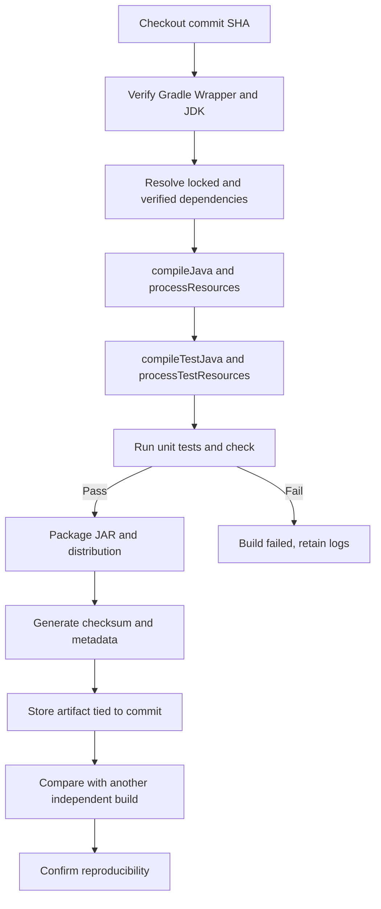

# Example Build, Test, and Packaging Pipeline for a Java Project

A reliable build pipeline must turn a specific source revision into verifiable and traceable outputs. For a Java project using Gradle, that flow typically covers checking out the commit, provisioning the JDK and Gradle, resolving dependencies, compiling main code, compiling test code, running tests, building a JAR or distribution, and then verifying and storing the artifact.

For builds to be reproducible, inputs that affect the output must be controlled: source commit, Gradle version, JDK, plugins, dependencies, build configuration, and execution environment. If the same revision is built twice under equivalent conditions yet yields different artifacts, the team must isolate the cause before using that artifact as release evidence.

This lesson walks through an end-to-end example for a small Java application using Gradle Kotlin DSL. We will configure toolchains, dependency locking, dependency verification, and archive reproducibility; execute compilation, testing, and packaging; and compare checksums across independent builds in CI.

## 1. What Outputs Must the Build Pipeline Produce?

A Java pipeline usually needs to answer the following questions:

- Which commit did the source code come from?
- Which JDK, Gradle, and plugin versions were used?
- Which repositories supplied dependencies, and were any altered unexpectedly?
- Did main sources and test sources compile successfully?
- Which tests ran and what were their results?
- Which artifacts were generated, where are they stored, and which commit are they tied to?
- Do two independent builds produce the exact same artifact?

Overall flow:



Steps can be split across multiple jobs for parallel execution or privilege separation. However, artifacts should be published only after required checks pass and the artifact origin is clearly established.

## 2. Preparing the Java Project Structure

This example uses a small console application named `hello-service`:

```text
hello-service/
├── gradlew
├── gradlew.bat
├── settings.gradle.kts
├── build.gradle.kts
├── gradle/
│   └── wrapper/
│       ├── gradle-wrapper.jar
│       └── gradle-wrapper.properties
└── src/
    ├── main/
    │   └── java/
    │       └── com/example/
    │           ├── App.java
    │           └── Greeting.java
    └── test/
        └── java/
            └── com/example/
                └── GreetingTest.java
```

`settings.gradle.kts` declares the project name:

```kotlin
rootProject.name = "hello-service"
```

`App.java` is the application entry point:

```java
package com.example;

public final class App {
    private App() {
    }

    public static void main(String[] args) {
        var greeting = new Greeting();
        System.out.println(greeting.message("CI/CD"));
    }
}
```

`Greeting.java` contains the logic under test:

```java
package com.example;

public final class Greeting {
    public String message(String name) {
        if (name == null || name.isBlank()) {
            throw new IllegalArgumentException("name must not be blank");
        }
        return "Hello, " + name + "!";
    }
}
```

Corresponding tests in `GreetingTest.java`:

```java
package com.example;

import static org.junit.jupiter.api.Assertions.assertEquals;
import static org.junit.jupiter.api.Assertions.assertThrows;

import org.junit.jupiter.api.Test;

class GreetingTest {
    private final Greeting greeting = new Greeting();

    @Test
    void createsGreetingForName() {
        assertEquals("Hello, CI/CD!", greeting.message("CI/CD"));
    }

    @Test
    void rejectsBlankName() {
        assertThrows(IllegalArgumentException.class, () -> greeting.message(" "));
    }
}
```

The tests use fixed inputs and have no dependence on the network, current time, or external service state. This is a key trait of deterministic testing: identical inputs must yield identical results.

## 3. Locking Build Tool Versions

The Gradle Wrapper ensures every team member and CI runner uses the exact same Gradle version. Never ask each machine to install an arbitrary Gradle version globally and run `gradle`; invoke `./gradlew` on Linux/macOS or `gradlew.bat` on Windows.

Generate or update the wrapper using a version chosen by the team:

```bash
gradle wrapper --gradle-version 8.10.2 --distribution-type bin
```

The command above illustrates how to pin the version; real projects should select a Gradle version compatible with their plugins and JDK, then commit the wrapper files to Git.

`gradle/wrapper/gradle-wrapper.properties` can look like:

```properties
distributionBase=GRADLE_USER_HOME
distributionPath=wrapper/dists
distributionUrl=https\://services.gradle.org/distributions/gradle-8.10.2-bin.zip
distributionSha256Sum=<64-char-sha256-from-official-release-source>
zipStoreBase=GRADLE_USER_HOME
zipStorePath=wrapper/dists
```

The `distributionSha256Sum` value in the example is a placeholder that must be replaced with the official SHA-256 checksum of that exact distribution file before use. Never fabricate or guess a checksum. The wrapper verifies downloaded file contents against this value, detecting tampered archives.

In addition to the distribution ZIP, protect `gradle-wrapper.jar` because it is executable code that runs before Gradle starts. Obtain the wrapper from an official trusted Gradle source, verify integrity per official guidance, and review any changes to wrapper files just like executable code changes.

### Locking the JDK with a Java toolchain

Never rely on the runner's default JDK. Declaring a toolchain instructs Gradle to select the exact Java version for compilation and related tasks.

In this example, the team standardizes on Java 21 and the Temurin vendor. For strict reproducibility requirements, pin the exact JDK patch release or containing image, not just the major version.

## 4. Configuring Gradle for Reproducible Builds

Complete `build.gradle.kts` for this example:

```kotlin
import org.gradle.api.tasks.bundling.AbstractArchiveTask
import org.gradle.api.tasks.compile.JavaCompile
import org.gradle.api.tasks.testing.Test
import org.gradle.jvm.toolchain.JvmVendorSpec

plugins {
    application
}

group = "com.example"
version = "1.0.0"

repositories {
    mavenCentral()
}

dependencies {
    testImplementation(platform("org.junit:junit-bom:5.11.4"))
    testImplementation("org.junit.jupiter:junit-jupiter")
    testRuntimeOnly("org.junit.platform:junit-platform-launcher")
}

java {
    toolchain {
        languageVersion.set(JavaLanguageVersion.of(21))
        vendor.set(JvmVendorSpec.ADOPTIUM)
    }
}

application {
    mainClass.set("com.example.App")
}

tasks.withType<JavaCompile>().configureEach {
    options.encoding = "UTF-8"
    options.release.set(21)
}

tasks.withType<Test>().configureEach {
    useJUnitPlatform()
    systemProperty("user.timezone", "UTC")
    systemProperty("user.language", "en")
    systemProperty("user.country", "US")
}

tasks.withType<AbstractArchiveTask>().configureEach {
    isPreserveFileTimestamps = false
    isReproducibleFileOrder = true
}

dependencyLocking {
    lockAllConfigurations()
}
```

Key configurations:

- `toolchain` selects Java 21 and the agreed vendor. `options.release` restricts the Java API surface code can target to Java 21.
- `options.encoding` sets source encoding to UTF-8, preventing results from depending on the host's default encoding.
- `Test` fixes locale and timezone so tests do not change behavior based on host environment settings. If an application needs to test other locales, pass those locales explicitly within individual tests.
- `isPreserveFileTimestamps = false` strips original file timestamps from archives.
- `isReproducibleFileOrder = true` ensures stable entry ordering inside archives.
- `dependencyLocking` instructs Gradle to record resolved dependency versions so subsequent builds use the exact same versions.

These archive properties make Gradle-managed JARs and archives much more reproducible. They do not guarantee the entire build matches if plugins, JDKs, dependencies, file-generation scripts, or the environment still vary.

### Why must time and environmental data be controlled?

A build becomes non-reproducible if scripts inject the current time into generated files, read arbitrary environment variables, depend on OS file ordering, or rely on default locales and timezones. Identify every input that truly affects the artifact and pass it explicitly.

If timestamp details are needed in release metadata, separate traceability metadata from reproducible binary payloads. Store execution timestamps in provenance or a release record outside the JAR. If a timestamp must live inside the artifact, define a normalized value as an explicit input and supply it consistently across every build.

## 5. Locking and Verifying Dependencies

Declaring dependencies with dynamic versions like `1.+`, `latest.release`, version ranges, or snapshots means the same commit can download different components at different times. Once a repository publishes a newer release, rebuilding an older commit can produce different results even though source code is unchanged.

Use explicit versions, dependency locking, and dependency verification.

### Generating the lockfile

With `dependencyLocking { lockAllConfigurations() }` declared, run the build so Gradle resolves the required configurations and writes lock state:

```bash
./gradlew --no-daemon clean check installDist distZip --write-locks
```

Commit the generated lockfiles into Git. When upgrading dependencies, update lockfiles in a pull request, review the list of changed versions, and re-run relevant tests. Never delete lockfiles just to let builds pick the latest versions automatically.

Lockfiles fix resolved versions, yet do not prove downloaded artifact contents were not tampered with. Therefore, add dependency verification.

### Generating checksum verification metadata

Gradle supports generating checksum metadata for resolved dependencies:

```bash
./gradlew --no-daemon --write-verification-metadata sha256 clean check installDist distZip
```

This command creates or updates `gradle/verification-metadata.xml`. Review all newly added checksums, verify dependency origins, and commit the metadata file to Git. During normal builds, Gradle uses this metadata to verify downloaded artifacts.

Never blindly accept every new checksum simply because the metadata generator suggested it. If a dependency or download source is compromised, approving checksums without review legitimizes untrusted content.

### Dependency upgrade workflow

1. Open a pull request with a clear dependency upgrade intent.
2. Update lockfiles using `--write-locks`.
3. Update verification checksums when newly approved artifacts are introduced.
4. Review versions, origins, checksums, and compatibility changes.
5. Run compilation, unit tests, integration tests, and appropriate security checks.
6. Merge the lockfile together with verification metadata once all checks pass.

For internal dependencies, store artifacts in a managed repository with clear retention and write-access controls. Builds must remain able to re-fetch the exact versions throughout the reproducibility and release-investigation window.

## 6. Understanding Compilation, Testing, and Packaging Order in Gradle

Gradle structures work as a task graph. When executing a high-level task, Gradle automatically builds all required task dependencies.

With the `application` plugin and the configuration above, key tasks include:

| Task | Role | Typical Output |
|---|---|---|
| `compileJava` | Compiles main source code | `build/classes/java/main` |
| `processResources` | Copies and processes main resources | `build/resources/main` |
| `classes` | Aggregates compiled main classes and resources | Classes ready for downstream tasks |
| `compileTestJava` | Compiles test source code | `build/classes/java/test` |
| `processTestResources` | Processes test resources | `build/resources/test` |
| `testClasses` | Prepares inputs for tests | Test classes and resources |
| `test` | Executes unit tests | Reports under `build/reports/tests/test` |
| `check` | Runs verification checks | Results of verification tasks |
| `jar` | Packages main classes and resources | `build/libs/hello-service-1.0.0.jar` |
| `installDist` | Builds an unpacked distribution with scripts and libs | `build/install/hello-service` |
| `distZip` | Builds a distribution ZIP archive | `build/distributions/hello-service-1.0.0.zip` |

High-level tasks carry different meanings:

- `compileJava` only compiles main code; it does not prove tests pass.
- `test` runs tests, yet does not represent all other verification checks.
- `check` aggregates verification tasks, including tests and lifecycle-bound checks.
- `assemble` produces distributable outputs configured by applied plugins.
- `build` is the lifecycle task combining `check` and `assemble`.

Accordingly, for this project, `build` is the right choice for a complete build verification. When explicit distribution outputs are needed, invoke `installDist` or `distZip` as well.

## 7. Running the Build on a Developer Workstation

First check the working tree state and current commit:

```bash
git status --short
git rev-parse HEAD
```

Run the full build flow:

```bash
./gradlew --no-daemon clean build
```

Or invoke the exact outputs to inspect explicitly:

```bash
./gradlew --no-daemon clean check jar installDist distZip
```

`clean` clears previous build outputs; `check` executes verifications; `jar` creates the JAR; `installDist` and `distZip` build distribution packages. `--no-daemon` keeps the run from relying on a pre-existing Gradle daemon, though it does not by itself make the environment or dependencies immutable.

Inspect generated outputs:

```text
build/
├── classes/
├── reports/
│   └── tests/test/index.html
├── libs/
│   └── hello-service-1.0.0.jar
├── install/
│   └── hello-service/
│       ├── bin/
│       └── lib/
└── distributions/
    └── hello-service-1.0.0.zip
```

Test running the installed distribution:

```bash
./build/install/hello-service/bin/hello-service
```

On Windows, use the generated `.bat` script inside `bin`:

```powershell
.\build\install\hello-service\bin\hello-service.bat
```

If tests fail, inspect the HTML report and `test` task logs to locate the first failing assertion or exception. Do not stop at the final `BUILD FAILED` line, as the task may have failed due to an earlier dependent task.

## 8. Generating Checksums and Verifying Artifacts

After a successful build, generate SHA-256 checksums to identify artifact contents.

On Linux/macOS:

```bash
sha256sum build/libs/hello-service-1.0.0.jar
sha256sum build/distributions/hello-service-1.0.0.zip
```

On Windows PowerShell:

```powershell
Get-FileHash .\build\libs\hello-service-1.0.0.jar -Algorithm SHA256
Get-FileHash .\build\distributions\hello-service-1.0.0.zip -Algorithm SHA256
```

Checksums allow comparing two files and detecting content modifications. They do not by themselves prove who built the artifact, which source code was used, or which tests passed. For traceability, store commit SHA, workflow version, JDK, Gradle, lockfile, and test results alongside the artifact.

Avoid embedding build timestamps or changing run IDs into filenames or JAR contents when bit-for-bit comparison is the goal. Store those in CI metadata or external artifact storage names; canonical filenames inside archives should remain stable by project and version.

## 9. Verifying Reproducibility via Two Independent Builds

A single successful build only proves the pipeline can produce an artifact. To verify reproducibility, build the exact same commit at least twice in independent environments, then compare checksums.

Keep comparison conditions aligned:

- Identical commit SHA and identical source tree state.
- Identical Gradle Wrapper and distribution checksum.
- Identical JDK vendor, version, and patch level.
- Identical lockfiles and verification metadata.
- Identical build configuration, locale, timezone, and output-affecting environment variables.
- Identical OS family, architecture, and native tools if involved in artifact generation.

For the test to be meaningful, both builds must run in separate clean workspaces or separate runners. Never simply re-run tasks in the same directory and compare checksums, because stale outputs or build caches could be reused.

Example flow across two CI runners:

1. Job `build-a` checks out the exact commit SHA, uses the pinned JDK/Gradle, runs `clean check distZip`, and uploads the ZIP and checksum.
2. Job `build-b` runs independently on another runner, checks out the same SHA, uses the identical toolchain and lockfile, and uploads the ZIP and checksum.
3. Job `compare` downloads both artifacts, recomputes SHA-256, and compares them.

Comparison commands on Linux:

```bash
sha256sum build-a/hello-service-1.0.0.zip
sha256sum build-b/hello-service-1.0.0.zip

cmp --silent build-a/hello-service-1.0.0.zip build-b/hello-service-1.0.0.zip
```

If `cmp` exits with code 0, both files are byte-for-byte identical. If they differ, compare checksums and inspect archive contents to isolate which entry changed. Use `unzip -l`, `unzip -p`, or ZIP analysis tools to check entry ordering, timestamps, manifests, and file contents.

### Distinguishing the build cache from reproducible builds

The Gradle build cache stores task outputs for reuse when inputs have not changed. Caching accelerates builds, yet two runs pulling the same cached output do not prove two independent environments independently produce identical results.

When verifying bit-for-bit reproducibility, disable the build cache or use isolated cache homes and ensure tasks actually execute. Example:

```bash
./gradlew --no-daemon --no-build-cache clean check distZip
```

You can still use a dependency cache if dependency artifacts are verified by checksum; that is not the same as reusing build task outputs. For an even stronger test, use two separate `GRADLE_USER_HOME` directories to avoid sharing any caches between runners.

## 10. GitHub Actions Pipeline Example for a Java Project

The following workflow illustrates building, testing, packaging, and archiving artifacts on pull requests or pushes to `main`:

```yaml
name: Java build and package

on:
  pull_request:
    branches: [main]
  push:
    branches: [main]

permissions:
  contents: read

jobs:
  build:
    runs-on: ubuntu-24.04
    steps:
      - name: Checkout source
        uses: actions/checkout@v4

      - name: Set up Java
        uses: actions/setup-java@v4
        with:
          distribution: temurin
          java-version: '21'

      - name: Build, test and package
        run: ./gradlew --no-daemon clean check installDist distZip

      - name: Calculate artifact checksum
        run: sha256sum build/distributions/hello-service-1.0.0.zip | tee build/distributions/hello-service-1.0.0.zip.sha256

      - name: Upload distribution
        uses: actions/upload-artifact@v4
        with:
          name: hello-service-${{ github.sha }}
          path: |
            build/distributions/hello-service-1.0.0.zip
            build/distributions/hello-service-1.0.0.zip.sha256
          if-no-files-found: error
          retention-days: 14
```

Key takeaways:

- Checkout fetches the source revision being tested by CI.
- `setup-java` provisions Temurin JDK 21; the Gradle toolchain in the build file further pins the Java compiler used.
- The Gradle Wrapper dictates the Gradle version rather than relying on an arbitrary pre-installed runner binary.
- `clean check installDist distZip` compiles, tests, and produces the distribution ZIP.
- Artifact names include the commit SHA to link back to the source that produced them.
- `if-no-files-found: error` fails the workflow if the distribution package is not produced.

This is an illustrative workflow. For higher assurance, pin GitHub Actions by full commit SHA rather than version tags; pin exact JDK patch versions and runner images; verify the Gradle Wrapper; and store checksums in metadata files so downstream jobs can re-verify them. `ubuntu-24.04` is a stable major-release label, yet the underlying image receives updates over time, so it does not guarantee a bit-for-bit immutable environment.

### Expanding to two independent builds

You can split the workflow into two build jobs checking out the same commit on separate runners. Each job produces the same artifact path, computes SHA-256, and uploads under distinct artifact names. A third job downloads both copies and compares checksums.

When implementing this pattern, ensure:

- Both jobs check out the exact `github.sha`, never a moving branch that could advance mid-run.
- Both use identical JDK, Gradle Wrapper, lockfiles, verification metadata, and environment variables.
- Builds do not read secrets or runner-specific data to shape artifact contents.
- Build caches are not shared between the two verification jobs.
- The comparison job fails if either artifact is missing or checksums differ.

If the two artifacts differ, never arbitrarily pick one as the release artifact. Investigate the discrepancy, eliminate the source of nondeterminism, and re-run the verification.

## 11. Causes of Different Artifacts from the Same Commit

| Cause | Symptom | Control |
|---|---|---|
| Different JDK or Gradle versions | Bytecode, metadata, or task behavior differs | Use wrappers, toolchains, and pin tool patch versions |
| Dynamic dependency versions | Later builds pull newer library releases | Use explicit versions, lockfiles, and verification metadata |
| Timestamps in JAR/ZIP | Archive checksums differ despite identical file contents | Disable timestamp preservation and avoid writing current time into archives |
| Unstable file ordering | Archive entries appear in different order | Enable reproducible file order and sort data in custom tasks |
| Different locale or timezone | Tests or generated files yield different results | Set explicit locale/timezone and test edge cases |
| Random numbers or UUIDs | Generated content changes on every run | Use fixed seeds where appropriate or supply controlled inputs |
| Reading data from the network | Output depends on external service or mutable content | Pin data, use fixtures, or store checksummed source artifacts |
| Different environment variables | Build metadata or resources change | Declare an environment variable allowlist and standard values |
| Different paths or OS | Generated files contain differing paths, separators, or line endings | Normalize paths/line endings and check cross-platform differences |
| Build cache masking tasks | One run pulls cached output while another executes fresh | Disable build cache during independent checks and log task state |
| Nondeterministic plugins or code generators | Generated sources/resources change | Pin plugins, test tasks, and strip variable data |

When investigating, start from the checksum and compare archive structure. If only a single resource file differs, inspect the task generating that resource and its inputs. If `.class` files differ, examine the JDK, compiler options, annotation processors, and dependencies. If entry contents match yet the archive differs, check timestamps, entry ordering, and ZIP metadata.

## 12. Storing Artifacts with Traceability Evidence

CI-built artifacts should be accompanied by enough metadata to establish origin and process. A baseline record might look like:

```json
{
  "project": "hello-service",
  "version": "1.0.0",
  "sourceCommit": "<full-commit-sha>",
  "gradleVersion": "8.10.2",
  "javaVendor": "Eclipse Adoptium",
  "javaVersion": "21",
  "artifact": "hello-service-1.0.0.zip",
  "sha256": "<sha256-of-artifact>",
  "tests": "passed"
}
```

Values in this example are illustrative. Pipelines should generate metadata from actual run values rather than hardcoding or guessing versions. Never put tokens, secrets, or credentials into metadata.

For high-assurance environments, add signed provenance/attestations emitted by the build system recording builder identity, source repository, commit, dependencies, and build parameters. Checksums show whether a file changed; signatures and provenance help consumers evaluate origin and build integrity.

Once verified, promote the exact same artifact across environments. Never rebuild a separate package for staging and production and assume they match just because they share a version string. Promoting the same artifact ensures test results and release deployments refer to the exact same binary content.

## 13. Checklist for Java Build, Test, and Packaging Pipelines

Before treating a Java pipeline as reproducible, verify:

- [ ] CI checks out an explicit commit SHA with no unexpected working-tree changes.
- [ ] Gradle Wrapper is committed, version-pinned, and verifies the distribution checksum.
- [ ] `gradle-wrapper.jar` originates from a trusted source with verified integrity.
- [ ] Java toolchain pins major version, vendor, and patch level per requirements.
- [ ] Compiler encoding and `--release` are explicitly configured.
- [ ] Plugins and dependencies use explicit versions with no uncontrolled dynamic versions.
- [ ] Dependency lockfiles are committed and updated via pull requests.
- [ ] `verification-metadata.xml` is generated, reviewed, and committed.
- [ ] Tests have no unintended dependence on time, randomness, locale, timezone, or external services.
- [ ] Archives disable original timestamps and enable reproducible entry ordering.
- [ ] Build command runs `check` before publishing artifacts.
- [ ] JARs/distributions are created at stable paths without unnecessary variable metadata.
- [ ] Artifacts are tied to the commit SHA and accompanied by SHA-256 checksums.
- [ ] Two independent builds on identical inputs are compared when bit-for-bit verification is required.
- [ ] Build caches are never treated as sole proof of reproducibility.
- [ ] Verified artifacts are promoted across environments instead of rebuilt uncontrollably.
- [ ] Logs, test reports, checksums, and metadata are retained according to policy.

A solid Java CI/CD pipeline does not stop at `build` returning success. It accurately identifies the source code, tools, and dependencies used; proves compilation and tests passed; produces clearly identified artifacts; and provides a way to verify that identical inputs reproduce identical outputs. When those elements are controlled, artifacts become trustworthy deliverables ready to move through quality gates, environments, and release workflows.
