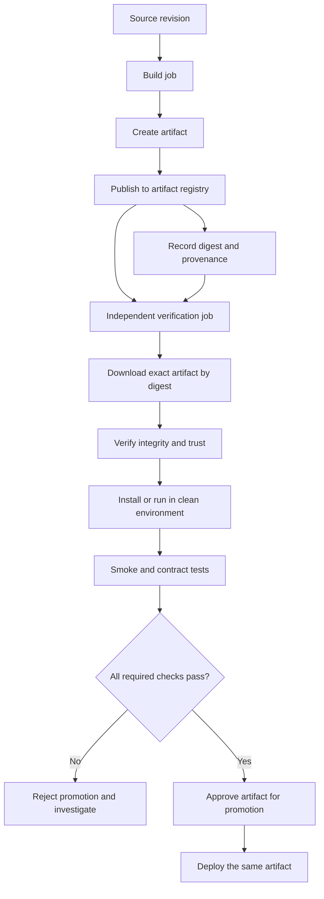

# Verifying Artifacts Independently from the Build Environment That Produced Them

A successful build only shows that the build process produced output according to what the tooling reported. It does not prove the artifact can be installed, launched, or consumed in the environment that users and target systems actually provide. An artifact can unintentionally depend on unpackaged files, local caches, runner-specific environment variables, or libraries that exist only on the build host.

Therefore, once an artifact is created and stored, it must be tested in an environment independent of the one that produced it. The verification environment must pull the artifact from storage, verify the exact published content, and install or run the artifact according to the published runtime contract. The goal is to prove the release package is self-contained for everything it is supposed to bundle and depends only on declared components.

In CI/CD, this verification adds a trust boundary between building and consumption. Teams catch packaging errors, missing files, runtime misconfigurations, implicit dependencies, and platform differences early—before promoting the artifact to higher-value environments.

## 1. Why Verify Outside the Build Environment?

Build environments usually hold far more tools and resources than actual runtime environments. They may contain a JDK, compilers, package managers, source code, system libraries, dependency caches, development configuration files, and credentials granted to the pipeline.

If an artifact is tested inside that same environment, the application can accidentally rely on something absent from the release package. For example:

- A Java application runs because the JDK and libraries are already present in the build image, whereas the production runtime only provides a JRE.
- A configuration file is read from the checkout directory even though it was never packaged into the JAR or ZIP.
- Tests pass thanks to a dependency sitting in the Gradle cache even though the dependency was not properly declared.
- A startup script reads an environment variable that exists only on the build runner.
- A container runs because a file was bind-mounted from the host, yet the published image does not contain that file.
- A package installs on the build host due to special tools or elevated permissions, yet fails to install on a clean machine.

An independent verification environment strips away those accidental crutches. It receives only the published artifact, permitted runtime configuration, and declared backing services. If the artifact is missing a component or depends on something outside the contract, verification catches it.

This matters especially for automated artifacts promoted across multiple stages. When staging and production run the exact same package, verification evidence attached to that package carries far more weight than checks run against source code or internal build directories.

## 2. Distinguishing Artifact Verification from Reproducible Builds

These two activities are related yet answer two different questions:

| Activity | Question to Answer | How It Is Performed |
|---|---|---|
| Independent artifact verification | Can the produced artifact be verified, installed, and used in a consumer environment? | Pull the artifact from the registry, place it in a clean environment, and test it |
| Reproducible build | Do identical source and controlled inputs yield equivalent or identical artifacts? | Perform another independent build and compare digests or contents per defined criteria |

Independent verification does not require rebuilding the artifact. The focus is on using the exact package already produced to validate its behavior. If the verification environment rebuilds from source and only tests the newly built copy, the team has not proven the published artifact is usable.

Reproducible builds can add evidence about the consistency of the artifact creation process. Two independent builds yielding identical digests provide strong proof of bit-for-bit rebuildability. However, an artifact can still install and run properly even when metadata such as timestamps or signatures keeps two builds from matching byte-for-byte. Conversely, two builds yielding identical digests do not automatically prove the application runs properly at runtime.

Teams should therefore view these as two complementary verification layers: one tests the produced package from a consumer perspective, while the other tests rebuildability of the build process when assurance levels require it.

## 3. How Independent Does the Independent Environment Need to Be?

Independence does not mean an environment completely devoid of dependencies. Applications always require a runtime, operating system, services, or specific configuration. What must be eliminated are hidden dependencies on the environment that built the artifact.

An independent verification environment should have the following characteristics:

- Created fresh from an explicitly versioned image, virtual machine, or namespace.
- Reuses no workspace, build directory, or undeclared cache from the build job.
- Fetches the artifact from a registry or repository via an immutable identifier.
- Installs only runtimes and libraries belonging to the product's support contract.
- Receives test configuration and secrets through mechanisms matching the consumer environment.
- Has no permissions to modify the published artifact.
- Records the digest of the exact artifact verified.
- Can be torn down and recreated without retaining state from prior runs.

You can use a fresh runner, ephemeral container, short-lived VM, or dedicated Kubernetes namespace. Isolation depth depends on artifact type and risk profile. For a Java library, a clean consumer project may suffice. For a container image, pull the image by digest and run it inside a container runtime. For OS installer packages, install on a clean VM matching each supported platform.

The environment must closely mirror the real usage contract for tests to be meaningful. If a product supports Linux and Windows, testing only on Linux does not prove the package works on Windows. If a product specifies JRE 21, testing under JDK 21 can mask missing components in a JRE runtime image.

## 4. Independent Artifact Verification Flow

A typical flow includes the following stages:

1. Build job creates the artifact from an identified revision.
2. Publish job stores the artifact in a controlled registry or repository.
3. System records the digest, metadata, and provenance evidence.
4. Verification job runs on a fresh runner or environment.
5. Job downloads the artifact by immutable version or digest.
6. Job verifies checksums, signatures, and provenance per policy.
7. Job installs or runs the artifact in a clean consumer environment.
8. Job executes appropriate smoke tests, contract tests, or compatibility checks.
9. Job records results bound to the digest and permits promotion only when required checks pass.

Diagram:



Crucially, the verification job consumes the published artifact. Do not pass an internal build directory as the sole source, because doing so can mask publishing or packaging defects. CI artifact transfers may carry files between jobs, provided the verification job receives the exact recorded object and verifies its digest.

## 5. Identifying the Exact Artifact to Verify

Before testing, know which artifact is the official deliverable. A repository can produce many files: JARs, ZIPs, images, packages, test reports, source archives, or debug symbols. Not all of them are distributed the same way.

Each artifact should have clear identifiers:

- Product or module name.
- Version or release identifier.
- Target platform and architecture, if applicable.
- Artifact type and format.
- Source revision or commit SHA.
- Build run ID.
- Content digest.
- Toolchain and dependency metadata where needed.

Do not rely on generic filenames like `app-latest.jar` to identify the output under test. Names can be overwritten or point to another release. Using immutable versions and digests ensures the verification job pulls the exact package.

If a release emits multiple artifacts across operating systems or architectures, explicitly list every variant. Verifying an `amd64` image does not prove the `arm64` image works. When using multi-architecture manifests, verify both the manifest and the underlying per-platform child images.

## 6. Verifying Integrity via Digest

A digest is a fingerprint computed from artifact contents using a hash algorithm, typically SHA-256. If contents change, the digest almost certainly changes. This lets teams verify that a downloaded file matches the exact content published.

A simple workflow:

1. Publish job computes the artifact digest and records it in trusted metadata.
2. Verification job downloads the artifact by immutable identifier.
3. Job recomputes the digest from the downloaded file.
4. Job compares it against the recorded digest.
5. Job aborts verification if they do not match.

Example with a JAR file on Linux:

```bash
ARTIFACT_FILE="app-2.4.0.jar"

if [ -z "$EXPECTED_SHA256" ]; then
  echo "EXPECTED_SHA256 is required" >&2
  exit 2
fi

printf '%s  %s\n' "$EXPECTED_SHA256" "$ARTIFACT_FILE" \
  | sha256sum --check -
```

`EXPECTED_SHA256` must come from trusted metadata or a trusted channel tied to the publish event. If both the artifact and a checksum file are pulled from the same modifiable location and compared solely against each other, an attacker could replace both. Checksums prove content matches a reference digest; they do not by themselves prove who created the artifact.

For container images, registries typically expose digests for manifests or manifest lists. Verification jobs should pull and run that exact digest rather than pulling a tag that might change between verification and deployment.

Digests must also be saved in test results and release records. That way, during an incident, the team knows precisely which binary was tested and deployed.

## 7. Verifying Signatures and Artifact Origin

Digests verify content, yet do not verify the identity of the person or system that produced that content. Digital signatures and provenance provide origin evidence.

**Signatures** verify that an artifact or metadata was signed by a trusted identity under organizational policy. Verification jobs must check the signature, signer identity, issuer or trusted key, and authorized signing scope.

**Provenance** describes which source revision, workflow or builder, and inputs produced an artifact. Teams can inspect provenance to confirm the artifact came from an authorized repository, branch, workflow, and builder.

**SBOMs** list software components packaged or consumed inside an artifact. They support dependency, license, and known-vulnerability checks. SBOMs do not replace runtime testing or signatures.

These pieces of evidence play distinct roles:

| Evidence | Helps Answer | Does Not Prove on Its Own |
|---|---|---|
| Digest/checksum | Does the content match the reference value? | Who created the content |
| Signature | Was the artifact or metadata signed by a trusted signer? | That the application runs properly |
| Provenance | Which source and builder produced the artifact? | Absence of functional bugs |
| SBOM | Which components does the artifact contain? | That components are vulnerability-free |
| Runtime tests | How does the artifact behave in a test environment? | Artifact origin without digest/provenance verification |

Never accept a signature solely because it is mathematically valid. Signer identity and trust policy must also match. For example, a workflow running from an untrusted fork must never qualify as an authorized builder for signing production releases.

## 8. Inspecting Package Contents

Before executing an artifact, inspect its structure and contents to catch missing files, unwanted extras, or sensitive data.

For JARs or ZIPs, list entries and verify expected manifests, resources, service descriptors, and configuration files. For OS packages, inspect the file list, installation metadata, pre-install/post-install scripts, and declared dependencies. For container images, verify the entrypoint, user, exposed ports, installed packages, and required filesystem paths.

Useful checks:

- Does the executable or entrypoint exist?
- Are required resources and default configuration files packaged?
- Are unnecessary test files, internal sources, or development data bundled?
- Were secrets, private keys, tokens, or local config files accidentally packaged?
- Does version metadata match the release?
- Do declared dependencies fit the package format?
- Are file and script permissions correct for installation or execution?

Not every file in a package must be checked manually. Define an allowlist or expected content manifest and automate validation. When a package legitimately changes structure across versions, update and review validation rules accordingly.

For container images, inspect the final image after multi-stage builds. Scanning only the build stage is insufficient if the runtime image ships different packages or files. Conversely, do not require the runtime image to carry compilers or source code unless the product contract requires them.

## 9. Testing a JAR in a Clean Consumer Environment

For Java applications, the build environment usually contains a JDK, Gradle or Maven, source code, and caches. The consumer environment may have only a compatible JRE along with required configuration and services.

An independent test can follow these steps:

1. Provision a fresh runner or container with the supported JRE version.
2. Download the JAR from the artifact repository by version and digest.
3. Verify the checksum and signature, if present.
4. Inspect JAR contents and the manifest.
5. Launch using the exact documented operational command.
6. Supply test configuration externally outside the artifact.
7. Wait for the health endpoint to become ready.
8. Exercise key APIs or business flows.
9. Collect logs and test results.
10. Tear down the environment after completion.

Structure inspection example:

```bash
jar --list --file app-2.4.0.jar
```

If the application is packaged as an executable JAR, test launching it on a JRE:

```bash
java -version
java -jar app-2.4.0.jar
```

This example only applies when the JAR defines an entry point and corresponding launch configuration. Many Java libraries cannot run directly via `java -jar`; they must be consumed from another project.

For libraries, create a clean consumer project declaring the dependency solely from a staging or package repository. Compile and run code exercising the public API. Never use the original build project or its output/classes directory as the classpath, as doing so can mask missing classes or resources in the published package.

## 10. Verifying Container Images After Publishing

If the artifact is a container image, the verification job must pull the published image by digest and run it like an actual consumer.

Typical steps include:

- Verify digest and signature per policy.
- Inspect image metadata, architecture, user, entrypoint, and command.
- Start the container with configuration close to the target environment.
- Inject test environment variables and secrets via secure mechanisms.
- Wait for health checks or readiness probes.
- Run smoke tests and inspect logs.
- Stop the container and record results bound to the digest.

Illustrative launch command:

```bash
docker pull registry.example.com/team/service@sha256:REPLACE_WITH_VERIFIED_DIGEST

docker run --rm \
  --read-only \
  --cap-drop=ALL \
  --user 10001:10001 \
  -p 18080:8080 \
  registry.example.com/team/service@sha256:REPLACE_WITH_VERIFIED_DIGEST
```

The digest in this example is a placeholder. Flags such as `--read-only`, `--cap-drop`, and `--user` should match the application's contract; some applications need a writable temp directory or specific capabilities. When needed, mount a `tmpfs` or dedicated volume for explicitly permitted writable paths. The goal is testing under permissions matching deployment, not granting broad privileges just to make the container start.

Never run a freshly built image straight from the workspace when the goal is verifying the published image. Reusing the local image cache risks testing an image that differs from the digest stored in the registry. Verification should pull the exact digest in a fresh environment or explicitly verify the corresponding image ID.

## 11. Verifying Installable Packages and Published Libraries

For packages like DEB, RPM, MSI, or installers, run verification on a clean virtual machine matching each supported OS and version.

A typical process includes:

1. Create a fresh VM or snapshot.
2. Download the package from the release repository.
3. Verify its digest and signature.
4. Install using the official package manager or installer.
5. Check system dependencies and file permissions.
6. Start the service or run CLI commands.
7. Test upgrading from a prior version if upgrade flows are supported.
8. Test uninstalling or rolling back per policy.
9. Capture installation logs and results.

For libraries, use a fresh consumer project rather than build outputs from the source repository. This project should depend only on the published artifact, compiler/runtime, and declared dependencies. Test compiling, linking, or importing the public API to catch missing metadata or packaged files.

For packages targeting multiple OS/architecture variants, define a test matrix matching the support statement. Not every combination needs deep exhaustive tests, yet every published variant needs at least integrity checks and appropriate installation tests.

## 12. Validating Runtime Contracts and Configuration

Artifacts must not embed configuration specific to a single deployment environment. Service URLs, ports, feature flags, resource limits, and credentials are typically supplied at runtime.

Verification jobs should apply test configuration representing the published contract:

- Required environment variables are supplied.
- Default values behave appropriately.
- Missing required configuration produces clear errors.
- Invalid configuration does not let the application silently start with wrong values.
- Secrets are injected via secure mechanisms and never appear in logs.
- Environment configuration is never written back into the artifact.

Never use production secrets to verify artifacts. Use limited-privilege test credentials and synthetic data. If the application must connect to external services, permit network access only to required test endpoints.

Distinguish artifact failures from verification-environment failures. If the test database is unavailable, the test is inconclusive regarding the artifact. If the application fails to start because the artifact omits a database driver declared as a required dependency, that is an artifact defect to fix. Logs and step statuses must make distinguishing these two cases straightforward.

## 13. Selecting Appropriate Tests for Artifacts

Not every check carries the same value post-packaging. Some tests run best at source level; others are only meaningful when consuming the actual artifact.

| Check Type | Purpose | Examples |
|---|---|---|
| Integrity check | Matches published content | SHA-256, registry digest |
| Signature/provenance check | Trusted origin and builder | Verify signer and attestation |
| Package inspection | Valid package structure | Check manifest, resources, entrypoint |
| Install test | Installable on supported platforms | Install DEB/RPM/MSI on clean VM |
| Startup test | Starts under declared runtime | Run JAR on JRE or launch container image |
| Smoke test | Core user/system flows work | Health endpoint, test login, create sample record |
| Contract test | Interoperates cleanly with dependencies | API, message schema, database contract |
| Compatibility test | Runs across supported platform versions | JDK, OS, architecture |
| Security scan | Detects risks in final package | Image scan, dependency/SBOM policy |
| Upgrade/rollback test | Upgrades and reverts per contract | Upgrade package, roll back service |

Select tests according to risk. Library artifacts need consumer tests; service images need startup and smoke tests; installable packages need install and upgrade tests. Re-running the entire unit test suite inside a consumer environment can waste time without adding evidence if unit tests already passed on that same revision. Focus on failures that only surface at the packaging and consumption boundary.

## 14. Designing Reproducible Verification Jobs

Verification jobs are also pipeline-as-code. Clearly specify the environment, input artifact, verification steps, tests, and outputs.

A well-designed job should:

- Use a fresh runner or container.
- Skip checking out source code if only the artifact is needed; if source is checked out to fetch a test harness, ensure the harness never rebuilds or substitutes the artifact.
- Download the artifact by immutable version or digest.
- Verify the digest before installing or running anything.
- Use a version-pinned runtime image.
- Supply minimal test configuration and test secrets.
- Enforce timeouts per step and for the whole job.
- Collect logs, reports, and environment details.
- Clean up temporary resources upon completion.
- Bind the final status to the artifact digest.

Conceptual YAML example:

```yaml
jobs:
  verify-published-artifact:
    runs-on: fresh-runner
    steps:
      - name: Download published artifact
        run: fetch artifact by immutable version

      - name: Verify artifact digest
        run: compare downloaded digest with trusted release metadata

      - name: Verify provenance
        run: validate signer and build provenance

      - name: Prepare consumer runtime
        run: create clean runtime environment

      - name: Install or start artifact
        run: install and launch the downloaded artifact

      - name: Run smoke tests
        run: execute consumer tests against the running artifact

      - name: Save verification evidence
        run: publish reports with artifact digest
```

Commands in this example describe logical steps and must be replaced with actions or commands for your CI platform. Actual configurations must review job permissions, artifact download mechanics, trusted metadata protection, and log retention without leaking secrets.

If jobs share a runner pool, `fresh-runner` must genuinely provision a clean workspace. Merely renaming a job or creating a separate job on the same persistent workspace does not guarantee an independent environment. Understand your platform's runner reuse, caching, and filesystem lifecycle policies.

## 15. Distinguishing Artifact Failures, Environment Failures, and Test Failures

Verification results are only actionable when the team knows why a failure occurred. Failures can be categorized as:

| Failure Category | Examples | Remediation |
|---|---|---|
| Integrity/trust | Wrong digest, invalid signature, failed provenance | Reject artifact, inspect publish source and trust chain |
| Packaging | Missing resources, wrong entrypoint, wrong file permissions | Fix packaging config and build a new artifact |
| Runtime | Missing class, missing library, incompatible runtime version | Check dependencies and runtime contract |
| Configuration | Missing required variable, invalid config value | Fix sample config or docs and check validation |
| External service | Test database unavailable, DNS or network failure | Restore test environment and re-run verification |
| Test harness | Wrong endpoint, uninitialized test data, assertion bug | Fix harness and re-verify against the exact same digest |
| Resource | Out of memory, disk full, or timeout | Analyze limits and adjust with justification |

Never automatically mark an artifact as failed if the verification environment suffered an infrastructure outage before the artifact even ran. Conversely, never treat all errors as transient and blindly retry in a loop. Statuses may need three outcomes: `passed`, `failed`, and `inconclusive/infra-error`. Only `passed` qualifies for promotion; `infra-error` requires remediation and re-running against the exact same artifact digest.

If an artifact fails, produce a new artifact after fixing code or build configuration. Never patch files directly inside a published artifact to turn tests green. Modifying contents creates a different artifact that must receive a new digest, metadata, provenance, and fresh test results.

## 16. Binding Verification Evidence to Artifacts

A test result without an artifact identifier creates ambiguity. Verification records should capture at least:

- Artifact name, version, and digest.
- Registry or download origin of the artifact.
- Source commit and build run ID, if available.
- Signature/provenance verification results.
- Verification runtime image or environment and its digest.
- OS, architecture, and runtime version.
- Test harness version and non-sensitive test configuration.
- Executed tests, statuses, and timestamps.
- Logs, reports, and links to the CI run.
- Approving human or system identity, if applicable.

This evidence can be stored as release metadata, test reports, or attestations. When promoting to staging or production, the system can verify that the artifact digest already carries a passing verification record per policy.

If the same artifact deploys across multiple environments, pre-promotion verification records remain bound to that same digest. Runtime configuration can differ per environment, yet environment-specific differences that alter behavior warrant targeted checks.

## 17. Promoting the Same Artifact Across Environments

After an artifact passes independent verification, promote that exact artifact through staging and production. Never rebuild merely because you are moving to another environment.

Flow:

- Build creates the artifact.
- Publish stores the artifact and digest.
- Verification tests that exact digest.
- Staging receives the exact verified digest.
- Production receives that exact digest after approvals and staging verification pass.

Environment configuration is injected at deployment time. Artifact contents must never be edited to swap a staging URL for a production URL. When configuration differs, use environment variables, config maps, or secret managers per application design.

If a defect surfaces during verification or staging, create a new version after fixing it. Never overwrite content behind a tag or version treated as immutable. Even when a registry permits mutable tags, record and deploy by digest.

## 18. Scenario Example: JAR Runs in Build Container Yet Fails at Runtime

A team builds a Java application in an image containing JDK 21, Gradle, and numerous system libraries. Unit tests and packaging succeed. After deployment, the service fails to start because a required native library or runtime component is absent from the actual runtime image.

Testing only inside the build container misses the bug because that environment contains more components than production. The team can verify using the following workflow:

1. Publish the JAR and record its digest in release metadata.
2. Provision a fresh container containing only the supported JRE version.
3. Pull the JAR from the artifact repository by version and verify its digest.
4. Supply test configuration without touching files or configs from the build workspace.
5. Start the JAR and wait for the health endpoint.
6. Call smoke-test APIs with synthetic data.
7. Inspect logs, resource usage, and test results.
8. Record verification evidence bound to the digest.

If the application fails to start due to a missing runtime dependency, the team fixes packaging or runtime declarations. After rebuilding, the new artifact has a new digest and must go through verification from scratch. Never carry over test results from the previous artifact.

## 19. Common Anti-Patterns

| Poor Practice | Consequence | Improvement |
|---|---|---|
| Testing inside the build workspace | Depends on files and caches outside the artifact | Pull the artifact into a clean environment |
| Verification rebuilds from source | Fails to verify the actual published package | Consume the published artifact by digest |
| Using the `latest` tag | Risks testing the wrong version | Fetch by immutable version or digest |
| Trusting a sidecar checksum file without source auth | Both artifact and checksum can be replaced | Compare against digests from trusted metadata |
| Running only unit tests prior to publish | Misses packaging or installation defects | Add install/startup/smoke tests |
| Using a JDK to verify a JRE-only artifact | Masks dependencies on compiler/JDK tools | Use the runtime declared in the product contract |
| Using persistent caches of unclear origin | Results depend on stale state | Use clean runners; treat caches strictly as optimizations |
| Tying test results to build runs rather than digests | Cannot tell which binary was tested | Record the digest in every verification record |
| Editing an artifact after testing | Prior evidence no longer applies | Build a new artifact and re-verify |
| Granting production secrets to test jobs | Expands blast radius if jobs or tests are compromised | Use synthetic data and least-privilege credentials |
| Treating infra errors as artifact failures | False rejections or misguided retries | Distinguish `failed` from `infra-error` |
| Promoting by rebuilding | Staging and production artifacts can differ | Promote the exact same digest |

## 20. Project Adoption Roadmap

You can adopt this in stages:

1. **Inventory release artifacts:** identify which JARs, images, packages, archives, or libraries need verification.
2. **Define consumer contracts:** runtime, OS, architecture, configuration, and required services.
3. **Create a clean consumer environment:** choose a fresh runner, container, VM, or namespace per artifact type.
4. **Publish immutable artifacts:** store versions, digests, and build run metadata.
5. **Add trust verification:** validate digests, signatures, provenance, and SBOMs as required.
6. **Write consumer tests:** install, start, exercise APIs, or consume libraries from a package repository.
7. **Integrate into pipelines:** run verification post-publish and pre-promotion.
8. **Store evidence:** bind test results, runtime details, and logs to the digest.
9. **Enforce promotion gates:** allow only verified artifacts to advance to downstream environments.
10. **Run failure drills:** test missing files, bad digests, incompatible runtimes, and test-infra failures to confirm classification.

Start with your highest-impact artifact and a minimal consumer environment. Once the workflow stabilizes, expand to additional platforms, architectures, and package formats.

## 21. Measuring Independent Verification Effectiveness

An artifact verification process proves its worth when it catches defects invisible to the build job and provides clear evidence for promotion decisions.

Useful metrics:

- Percentage of artifacts caught with packaging or runtime defects post-publish.
- Percentage of defects surfacing only in consumer environments.
- Rate of verification failures caused by infrastructure versus artifact defects.
- Time elapsed from publish to verification result.
- Percentage of artifacts with complete digests, provenance, and verification records.
- Percentage of releases deploying the exact verified digest.
- Count of rebuilds required due to missing files or runtime misconfigurations.
- Time required to reproduce a bug in a clean consumer environment.

Never optimize runtime by dropping smoke tests or reusing workspaces. Instead, optimize runtime images, parallelize artifact downloads, cache tools under strict controls, and stratify tests by risk. Artifacts must be verified against their exact published contents.

## 22. Pre-Promotion Checklist

- [ ] Artifact is downloaded from an identified registry or repository.
- [ ] Artifact version and digest remain immutable during verification.
- [ ] Downloaded digest matches trusted metadata.
- [ ] Signatures and provenance are verified per policy where applicable.
- [ ] SBOM or dependency metadata is available when required.
- [ ] Verification executes on an independent runner, container, or VM.
- [ ] Build job workspaces and caches cannot alter verification outcomes.
- [ ] Runtime, OS, and architecture match the support contract.
- [ ] Package contents, entrypoints, and required resources are inspected.
- [ ] Artifact is installed or executed exactly as consumers use it.
- [ ] Critical smoke tests or consumer tests pass.
- [ ] Test secrets follow least privilege and never appear in logs.
- [ ] Results are bound to the digest, environment, and test harness version.
- [ ] Infrastructure errors are clearly separated from artifact failures.
- [ ] Promotion reuses the exact verified artifact digest.

## Conclusion

Verifying artifacts independently from the environment that produced them proves release packages can be consumed under realistic conditions. Verification jobs must pull the exact artifact from storage, verify its digest and origin, place the package into a clean environment, and test installation, startup, and runtime contract behavior.

When results are bound to digests and promotions reuse those exact artifacts, teams hold clear evidence for the exact binary tested. Reproducible builds can complement this by proving build consistency, while independent verification confirms the resulting package can be safely consumed across the release pipeline.
