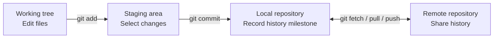

# What is Git and its role in source code management

When developing software, source code changes continuously: a feature is added, a bug is fixed, a configuration is adjusted, or a piece of code needs to be reverted to a previous version. If you only save multiple copies of a directory with names like `project-final`, `project-final-new`, or `project-final-latest`, the development team has a very hard time knowing which version is the right one, who changed what, and how to recover from a change that caused a bug.

Git solves that problem by recording the change history of a project. Each member can work on their own machine, save change milestones, experiment on separate branches, and exchange results with others. Therefore, Git is a foundational tool in the software development process, from personal projects to systems involving multiple teams.

## 1. What is source code management?

Source code management (often called SCM or version control) is the way of organizing and tracking versions of source code throughout the development process. A version control system helps answer important questions:

- How has a file changed between two points in time?
- Who made the change, when, and for what purpose?
- Can a stable version be created for release while still developing new features?
- Can multiple people work simultaneously without overwriting each other's work?
- If a change causes a bug, can the root cause be identified and an appropriate state restored?

Before using a version control system, teams often had to manually copy directories, send files via email, or note changes by hand. This approach quickly becomes unmanageable when a project has many files, multiple versions, and many contributors. Version control turns project history into structured data that can be inspected and coordinated using tools.

## 2. What is Git?

**Git is a distributed version control system (DVCS)**. Git tracks the history of files in a project and allows users to create, view, compare, share, or restore those change milestones.

Git is called *distributed* because whenever a repository is normally cloned, the user receives a copy of the repository on their own machine, including the data needed to work with the project's history. As a result, many operations such as viewing history, creating branches, and committing can be performed even when the machine is offline. A network connection is mainly needed when exchanging data with a repository elsewhere, such as fetching new changes or pushing your commits to a remote.

Git stores history milestones as **commits**. You can think of each commit as a snapshot of the project's state at a point in time, along with metadata such as the author, timestamp, descriptive message, and links to parent commits. Git reuses data between milestones for efficient storage; therefore, the notion that "Git simply stores a full copy of every file in each commit" does not reflect how Git organizes data internally.

A Git repository typically contains:

- The contents and structure of the recorded versions.
- Commit history and relationships between commits.
- References such as branches and tags to mark important positions in history.
- Configuration and data needed for Git to manage the project.

The `.git` directory at the root of the project is where Git stores repository data. The files and directories that users directly open and edit in the project make up the *working tree*.

## 3. What role does Git play in a project?

### 3.1. Storing inspectable change history

Each commit creates a referenceable milestone in history. Developers can view the list of commits, read messages, compare content between milestones, and trace changes to find the cause of a bug. This is useful when you need to determine when a behavior appeared or understand why a piece of code was modified.

### 3.2. Supporting experimentation and parallel development

Branches allow creating a separate line of development based on a commit. One team member can create a branch to develop a feature while the main branch remains in a stable state. When work is complete, branches can be integrated via merge or another history organization method suited to the team's workflow.

Thanks to branches, the team does not have to wait for everyone to finish their work in a sequential queue. Multiple features or bug fixes can be developed independently and then integrated in a controlled manner.

### 3.3. Supporting collaboration

Each member can clone the repository, create local commits, and send those commits to a remote. The team can use pull requests or merge requests on a hosting platform to discuss, review, and reach consensus before bringing changes into the shared branch.

Git also helps detect conflicts when two changes cannot be combined automatically—for example, when two people edit the same section of a file. When that happens, the person integrating the changes needs to inspect the relevant content, choose or combine the correct parts, and then complete the integration.

### 3.4. Reducing risk during modifications

Commits create milestones that can be reverted to or used for comparison. When a change introduces a bug, history helps the team determine the scope of impact and choose how to handle it. Git provides several recovery mechanisms, but each mechanism has a different effect on the working tree, staging area, and history; you should understand a command before using it, especially with operations that overwrite or rewrite history.

### 3.5. Providing a foundation for the release process

Tags can mark a commit corresponding to a release version, such as `v1.0.0`. The team can rely on tags to know exactly which source code was released, compare bugs across versions, and prepare patches.

## 4. Foundational concepts of Git

| Concept | Meaning | Role in workflow |
|---|---|---|
| Working tree | The project files the user is currently viewing and editing | Where initial changes are made |
| Staging area (index) | The area for selecting changes to be included in the next commit | Precisely controls the contents of a commit |
| Repository | The Git database containing commits, directory trees, objects, and references | Stores recorded history |
| Commit | A milestone snapshot of the project along with metadata and history links | Records a meaningful unit of change |
| Branch | A named reference pointing to a commit, usually moving when new commits are created on the branch | Organizes lines of development |
| HEAD | A reference indicating the current position the repository is working on | Helps Git determine which branch or commit is checked out |
| Remote | A configured name pointing to a repository located elsewhere | Exchanges commits with the team or a server |
| Tag | A reference used to mark a specific position in history | Marks versions or important milestones |

The first three areas form Git's common workflow:



The key point to remember is that `git add` places the selected content into the staging area; it does not create a commit yet. `git commit` records a milestone into the local repository. Sending commits to a remote is a separate operation, typically using `git push`.

## 5. A basic workflow with Git

Suppose you have just created a small project and want to start tracking its source code. A simple workflow might look like the following.

### Step 1: Initialize or obtain a repository

If the project directory is not yet managed by Git, run the following command in that directory:

```bash
git init
```

Git creates a local repository inside the `.git` directory. If the project already has a repository on a server, you typically start by cloning it:

```bash
git clone https://example.com/team/sample-project.git
```

`git clone` creates a working directory and configures a default remote usually named `origin`.

### Step 2: Check status

```bash
git status
```

This command shows the current branch and which files have changes, whether they have been added to the staging area, or whether they are untracked by Git. You should use `git status` frequently to understand the state before taking the next action.

### Step 3: Select changes to commit

After editing `README.md`, you can view the differences and add the file to the staging area:

```bash
git diff
git add README.md
git diff --staged
```

By default, `git diff` displays unstaged changes. `git diff --staged` displays staged content—that is, what will be recorded in the commit if you commit right now. You can stage specific files or select individual change hunks so that a commit contains only one clear set of changes.

### Step 4: Create a commit

```bash
git commit -m "docs: add project overview"
```

The commit records the staged content. The commit message should briefly describe the purpose of the change, for example `fix: handle empty input` or `feat: add user profile endpoint`. A clear message helps others understand the history without having to open every file.

### Step 5: View history

```bash
git log --oneline --graph --decorate
```

This command displays commits in a compact format, along with a relationship graph and some references. When you need more details, you can use `git show` with the corresponding commit hash or reference.

### Step 6: Exchange with the remote

If the repository has a remote configured, you can fetch new updates from the remote and push your commits:

```bash
git fetch origin
git push -u origin main
```

`git fetch` downloads data and updates remote-tracking references; this command does not automatically integrate changes into the current working tree. `git push` sends eligible local commits to the remote. For a new repository, the default branch name might not be `main`, so check your current branch before using the example above.

`git pull` is a convenience command that fetches and then integrates changes from the remote into the current branch according to the active configuration and options. When working in a team, understand the target branch and integration method before pulling to avoid surprises with uncommitted changes or conflicts.

## 6. How do Git, GitHub, and GitLab differ?

Git is a version control tool that runs on your computer. GitHub, GitLab, and Bitbucket are platforms that provide Git repository hosting along with collaboration features such as code review, pull requests or merge requests, issue tracking, access control, and workflow automation.

You can use Git without GitHub or GitLab: a repository can exist and store its history entirely on a personal machine. Conversely, when a team needs a shared place to host the repository, review code, and coordinate, hosting platforms provide those capabilities. In other words, Git manages source code history; platforms like GitHub or GitLab support hosting and collaboration around the repository.

## 7. How is Git typically used in a team workflow?

A common workflow for a new feature consists of the following steps:

1. Clone the repository or update information from the remote.
2. Create a branch from an appropriate base branch, for example `feature/user-profile`.
3. Edit source code, run necessary checks, and review the diff.
4. Stage the relevant changes and create a commit with a clear message.
5. Push the branch to the remote.
6. Open a pull request or merge request to describe, discuss, and review the changes.
7. Once approved, integrate the branch according to the project's conventions.

This workflow creates a checkpoint before changes enter the shared branch. Details such as branch naming conventions, testing requirements, and whether to merge or rebase depend on each team's conventions; what matters is that everyone agrees on them and follows them consistently.

## 8. Good habits when starting with Git

- **Commit with one clear purpose:** avoid bundling bug fixes, new features, and project-wide reformatting into the same commit if they are unrelated.
- **Check `git status` and diff before committing:** verify that the right files and the right content are in the staging area.
- **Write meaningful messages:** describe what changed or why it changed; do not use vague messages like `update` or `fix`.
- **Use `.gitignore` appropriately:** exclude auto-generated files, build directories, caches, or environment files that should not be tracked. Ignore rules do not automatically untrack files that were already committed earlier.
- **Do not commit secrets:** passwords, tokens, private keys, and credentials must not be stored in repository history. If a secret has been committed or pushed, treat it as an exposure incident and rotate the affected credentials.
- **Sync according to team workflow:** understand the source branch, target branch, and how to handle changes from the remote before integrating.
- **Be careful with commands that can overwrite or rewrite history:** some recovery commands can discard unsaved changes or alter shared commits. Check the status and carefully review a command's impact before running it.

## 9. Common misconceptions

| Misconception | Correct understanding |
|---|---|
| Installing Git means all changes are saved automatically | Git only records changes when the user performs the appropriate actions, typically `add` followed by `commit` |
| `git add` already saves changes to history | `git add` only stages content for the next commit |
| Commit is the same as push | Commit saves a milestone in the local repository; push sends commits to the remote |
| Git and GitHub are the same thing | Git is a version control system; GitHub is a hosting and collaboration platform built around Git |
| A branch is an independent directory copy | A branch is essentially a reference to a commit; Git lets you switch between lines of development within the same repository |
| Having Git means you have a safe backup | A local repository can still be lost along with the computer; you need a remote and an appropriate backup strategy to protect data |

## 10. When should you use Git?

Git is suitable when you need to track the history of source code or text files, experiment with changes while keeping stable milestones, collaborate with others, review code, or manage release versions. Even for a solo project, Git remains useful because it records the development process and lets you compare decisions over time.

As you study the following sections, always distinguish three actions: **editing files in the working tree, selecting content into the staging area, and recording a milestone with a commit**. This is the foundation for understanding branches, merging, rebasing, remotes, tags, and handling more complex collaboration scenarios.
