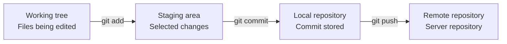
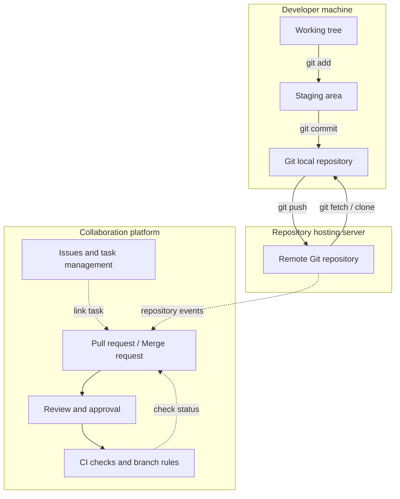

# How Git, repository hosting services, and collaboration platforms differ

When working on a software project, we often hear phrases like "push code to Git", "create a repository on GitHub", or "open a pull request for review". While convenient in conversation, these expressions sometimes cause beginners to confuse three distinct concepts: **Git**, **Git repository hosting services**, and **collaboration platforms for development teams**.

These three concepts are closely related, yet they serve different roles. Git manages the versions and change history of a project. A repository hosting service keeps a copy of the repository where a team can access it over the network. A collaboration platform adds interfaces and workflows so multiple people can plan, review, test, and release software together.

Distinguishing among them helps us understand exactly where data resides, which component a Git command acts upon, and which tool is responsible for each step in a team workflow.

## 1. What is Git?

**Git is a Distributed Version Control System (DVCS)**. Git tracks the change history of files in a project, enabling you to view older versions, create parallel development branches, combine changes, and locate the root cause of a bug.

The key point is that Git runs directly on the developer's machine. After cloning a repository, the computer can hold all the data and history needed to inspect logs, create commits, create branches, or compare versions without needing a continuous connection to a server.

### 1.1. What does Git manage?

A Git repository typically has two parts that learners need to recognize:

- **Working tree:** the files you are opening and editing.
- **Git repository:** Git's internal data used to store objects, commits, branches, tags, and history information. In a normal repository, this data resides in the `.git` directory.

Between the working tree and a commit lies the **staging area (or index)**. This is where you select the exact changes to include in the next commit.

The basic workflow can be visualized as follows:



For example, after editing `README.md`, you can run:

```bash
git status
git add README.md
git diff --cached
git commit -m "docs: update project instructions"
```

`git add` places the changed content into the staging area; it does not send data to a server yet. `git commit` creates a history milestone in the repository on the current machine. Until you run `git push`, that commit exists only in the local repository and other copies have not received it.

### 1.2. Commits, branches, and history

Git organizes history into **commits**. Each commit records the state of the project at a point in time, along with metadata such as an identifier, author, timestamp, message, and parent commit relationships. In terms of storage, Git uses objects to represent file contents, directory trees, and commits; therefore, you can think of a commit as an efficiently managed snapshot of the project state rather than just a note saying "this file changed".

A **branch** in Git is a named reference pointing to a commit. Creating a branch helps you develop a feature or fix a bug independently of other branches. When finished, histories can be combined via merge or rearranged via rebase depending on team conventions.

Example:

```bash
git switch -c feature/login
# edit source code
git add src/
git commit -m "feat: add login flow"
git switch main
git merge feature/login
```

All of the operations above can be performed locally. Git does not require a GitHub, GitLab, or any cloud service account to create commits or branches.

### 1.3. What does Git not provide on its own?

Git itself is a version control tool. Git does not provide a website for the whole team to sign into, nor does it create a pull request UI, task boards, team permission systems, CI runners, or issue discussion pages. These capabilities are typically provided by a Git server or a collaboration platform.

Therefore, saying "using Git" refers to the version control system; saying "using GitHub" or "using GitLab" usually refers to a service or platform that uses Git and adds team collaboration features.

## 2. What is a Git repository hosting service?

A **Git repository hosting service** provides a place to store a Git repository on a server so users or other systems can access it over a network. The server receives and serves Git data, and usually handles authentication, access permissions, and certain operational policies.

In a common workflow, each developer has a local copy of the repository. The team maintains an additional repository on a server as a shared exchange point. When a developer pushes commits to the server, other team members can fetch those commits into their own repositories.

### 2.1. What problems does a hosting server solve?

A repository hosting service typically provides the following capabilities:

- **Hosting remote repositories:** storing Git objects, commits, and branch/tag references on a server.
- **Data exchange:** enabling clone, fetch, and push over supported protocols, typically HTTPS or SSH.
- **Authentication:** identifying which user or key is connecting.
- **Authorization:** restricting who can read from or write to a repository, depending on service configuration.
- **Operations:** supporting backups, availability, storage, and server administration to varying degrees depending on the product.

A Git server may only provide a remote repository, such as a bare repository accessed over SSH. It does not necessarily need a web UI, pull requests, or task management boards.

### 2.2. What does "remote" mean in Git?

In Git, a **remote** is a shorthand name that a local repository uses to refer to another repository. The most common remote is usually named `origin`, though this is just a naming convention; Git does not require using that name.

You can inspect and configure a remote as follows:

```bash
git remote -v
git remote add origin git@github.com:example/team-project.git
git push -u origin main
```

In this example:

- `origin` is the remote name in local configuration.
- The address following it is the URL used to connect to the repository on the server.
- `git push` sends commits and updates branch references from local to the remote, subject to granted permissions.
- `-u` sets the upstream for the current branch so subsequent pushes or pulls can use the default tracking configuration.

A remote is not a special GitHub data type. It is a configuration in the local repository that can point to GitHub, GitLab, Bitbucket, Azure Repos, a self-hosted server, or another accessible Git repository.

### 2.3. Operations for exchanging with a remote repository

Three common commands have distinct meanings:

| Command | Role |
|---|---|
| `git clone <url>` | Creates a local copy from the specified repository; typically configures a remote named `origin`. |
| `git fetch <remote>` | Downloads objects and updates remote-tracking references from the remote; does not automatically integrate changes into the active working branch. |
| `git pull <remote> <branch>` | Fetches and then integrates changes into the current branch. The integration method is usually merge, though it can be rebase if specified or configured. |
| `git push <remote> <branch>` | Sends commits and updates the branch on the remote, if accepted by the server. |

For example, `git fetch origin` updates new information from the server. Afterward, you can inspect differences before deciding to merge or rebase. Conversely, `git pull` performs both the data download step and the integration step, so it can modify the current branch immediately.

Note: locally created commits, branches, and tags do not automatically appear on the server. You must push the corresponding references if you want to share them. Similarly, others' changes on the remote do not automatically enter your working tree until you fetch and integrate them.

## 3. What is a software development collaboration platform?

A **software development collaboration platform** provides an environment for multiple people to coordinate across the development lifecycle: exchanging source code, discussing requirements, reviewing changes, running tests, managing tasks, and releasing software.

A collaboration platform typically integrates Git repository hosting, but its scope goes beyond receiving and sending commits. Users can interact via a website or API, and the system can automatically trigger workflows when the repository changes.

### 3.1. Common features

| Feature | Purpose in a development team |
|---|---|
| Pull request / merge request | Proposes bringing changes from one branch into another, providing a place for discussion and inspection before integration. |
| Code review | Allows members to comment line by line, request edits, and approve changes. |
| Issue / ticket | Tracks bugs, feature requests, engineering tasks, and related discussions. |
| Project board / workflow | Tracks status, assignees, priority, and work progress. |
| CI (Continuous Integration) | Automatically runs builds, tests, linters, or checks on events such as a push or opening a pull request. |
| CD / release workflow | Supports packaging, releasing, or deploying according to project workflows. |
| Package / artifact registry | Stores software packages, images, or artifacts produced by the build process. |
| Permissions and policy management | Configures roles, branch protection rules, review requirements, and integration restrictions. |
| Wiki, documentation, and discussions | Stores project knowledge and technical decisions where the whole team can access them. |
| Security and auditing | Helps detect vulnerable dependencies, manage secrets, log activity, and enforce policies depending on configuration. |

Not every platform includes all of the features above, and some features depend on service tier, edition, or admin configuration. However, the common thread is that the platform connects the repository to human workflows and automated systems.

### 3.2. Are pull requests and merge requests Git commands?

No. **Pull requests (PR)** and **merge requests (MR)** are workflow concepts provided by collaboration platforms. They create a space for the team to inspect changes, discuss, run checks, and decide whether to integrate a branch.

Git provides the underlying operations such as commit, branch, merge, and rebase. The platform uses Git data to display diffs, track review status, and enforce team rules. Whether it is called PR or MR depends on the product, but the collaboration goal is similar.

You can certainly merge two branches using the `git merge` command without opening a PR/MR. However, in a team with a mandatory review process, merging directly may violate repository policies or bypass required checks.

### 3.3. Examples of platforms

Some popular products that combine Git hosting with collaboration features:

- **GitHub:** hosts Git repositories, pull requests, reviews, issues, projects, and automated workflows such as GitHub Actions.
- **GitLab:** provides Git repositories along with merge requests, issues, CI/CD pipelines, and many software lifecycle features; available as a hosted service or self-managed deployment.
- **Bitbucket:** hosts Git repositories and integrates review workflows, pull requests, and other tools in the Atlassian ecosystem.
- **Azure Repos / Azure DevOps:** provides Git source hosting and can combine with Boards, Pipelines, Artifacts, and development management services.

These examples show that a single product can serve as both a repository hosting service and a collaboration platform. The boundary between the two groups is a boundary of **functional scope**, not necessarily two separate products.

## 4. How do the three components work together?

You can picture the workflow in three layers:



The diagram above illustrates typical roles rather than a mandatory architecture for every product. One platform may run on the same infrastructure as the Git hosting service; in another product, those capabilities may be implemented across multiple integrated services.

Example of a member completing a login feature:

1. The member clones the repository to their machine. Git creates a local repository and configures a remote to exchange data with the server.
2. The member creates branch `feature/login`, edits source code, selects changes with `git add`, and saves them with `git commit`.
3. The member runs `git push` to send the branch and commits to the remote repository.
4. The member opens a pull request or merge request on the collaboration platform. The platform renders the diff and allows linking the change to the corresponding issue.
5. Teammates review, discuss, and request changes if needed. Each time new commits are pushed to the branch, the changes in the PR/MR are usually updated.
6. The CI system runs automated checks. Results are displayed in the PR/MR for reviewers and approvers to inspect.
7. Once team rules are satisfied, the changes are merged into the target branch. Members update their local repositories using fetch and merge or pull according to project conventions.

In this workflow, Git records history and performs operations on the repository; the hosting service transfers data between repository copies; the collaboration platform coordinates reviews, tasks, and automated checks.

## 5. Direct comparison

| Criterion | Git | Repository hosting service | Collaboration platform |
|---|---|---|---|
| Nature | Distributed version control system | Server/service storing Git repositories | Environment supporting team development workflows |
| Where it operates | Primarily on local machines; can also run on servers | Server or remote hosting infrastructure | Website, API, and integrated services |
| Core data/functionality | Commits, branches, tags, contents, and history | Remote repositories, access permissions, and data exchange | Reviews, issues, workflows, CI/CD, policies, and integrations |
| Usable offline? | Yes, with data already present locally | Cannot exchange with the server when disconnected | Online features generally require connectivity; some data may be cached locally |
| Mandatory? | Required if the project chooses Git for version control | Needed when the team wants to share repositories via a server | Depends on scale and workflow; small teams may use other tools or simpler processes |
| Examples | Git CLI, Git GUI | Self-managed Git server, Git hosting service | GitHub, GitLab, Bitbucket, Azure DevOps |

A common point of confusion is that GitHub, GitLab, and Bitbucket can all host Git repositories. Therefore, when we say "GitHub is where we store code", we are referring to one function of the platform. That does not mean Git and GitHub are the same thing.

## 6. Choosing and using each component in practice

### 6.1. When is Git alone enough?

Git can be sufficient for personal work or small projects when the primary goal is tracking history, branching, experimenting, and recovering changes. You can initialize a repository with:

```bash
mkdir demo-project
cd demo-project
git init
git status
```

This repository works without creating an account on any hosting platform. You can still commit, view logs, create branches, and compare versions.

### 6.2. When is a repository hosting service needed?

When multiple machines need to exchange the same project, or when you want a remote copy of the repository for backup and sharing, you need an accessible Git hosting location. That service can be a vendor's hosted service or a server operated by your organization.

When choosing, consider access protocols, authentication, read/write permissions, backup capabilities, availability, data residency, and repository administration. A private repository on a server only solves storing and exchanging source code; the team may still need other tools to manage reviews or tasks.

### 6.3. When is a collaboration platform needed?

When a team needs a consistent review workflow, automated checks, issue tracking, main branch protection, task assignment, or decision traceability, a collaboration platform brings these activities into a unified workflow.

Before choosing a platform, the team should define the workflows it needs to support: who can create repositories, who can review, how many approvals are required, which checks must pass before merging, how secrets and access permissions are handled, and integration requirements with existing tools. Only then should you compare products by features, cost, self-management capabilities, and security requirements.

## 7. Common misconceptions

### "Git is GitHub"

Git is a version control system; GitHub is an online platform that uses Git and adds hosting and collaboration features. You can use Git without GitHub, and you can also use GitHub to host the repository while working daily through the Git CLI or a GUI application.

### "Once committed, everyone can see the change"

A commit only records history in the local repository. For others to receive the commit, you need to push to a remote or share the repository in another way. Similarly, a pull request is created on the platform after the branch has been pushed somewhere the platform can access.

### "Push puts a website onto the Internet"

`git push` updates the remote repository. This command does not deploy an application or publish a website by default. Deployment only happens if the platform or a CI/CD system is configured to run a deploy pipeline on the appropriate event.

### "A remote is a branch on GitHub"

A remote is a configured name pointing to another repository. Remote-tracking branches such as `origin/main` are local references reflecting the branch state recorded during the last fetch from the remote. They are not regular local branches that you commit onto directly.

### "Pull request is the only way to merge"

Pull requests/merge requests are a platform collaboration workflow. Git can still merge branches via commands. Teams use PRs/MRs to control quality and record discussions before integrating; whether that workflow is mandatory depends on the repository's policies.

### "Having a repository on a platform means you have a safe backup"

A remote repository can serve as redundancy, but the level of safety still depends on backup policies, retention, admin permissions, account security, and recovery capabilities. Do not assume that every service or plan meets your organization's backup requirements.

## 8. Self-check with a scenario

Suppose a team of three developers is building an application together. Each person clones the project to their machine, creates a separate branch, and commits changes. The team uses a repository on a server to exchange commits. When a feature is complete, each person opens a PR/MR, teammates review it, and an automated system runs tests before merging.

Try identifying the responsible component in each activity:

1. Creating a commit after editing source code: **Git**.
2. Hosting the remote repository for the whole team to clone and push: **Git repository hosting service**.
3. Displaying line-by-line review comments: **collaboration platform**.
4. Creating branch `feature/search` on the local machine: **Git**.
5. Blocking a merge when approvals are insufficient: **policies of the collaboration platform or a Git server supporting corresponding rules**.
6. Downloading new commits from the remote to the machine: **Git exchanging data with the repository hosting service**.

A single activity can involve multiple components. For example, when clicking the Merge button on a website, the platform checks policies and integration requirements; the operation that updates repository history still relies on Git's data model and mechanisms.

## 9. Terms to remember

| Term | Meaning |
|---|---|
| Version control | Managing versions and change history of a project. |
| DVCS | Distributed version control system; each clone has the repository data and history needed to work independently. |
| Repository (repo) | Storage containing Git data and the history of a project. |
| Working tree | Files currently checked out for the user to view and edit. |
| Staging area / index | The area for selecting content to be recorded in the next commit. |
| Commit | A history milestone recording project state and linking to prior history. |
| Branch | A named reference pointing to a commit, used to develop lines of work. |
| Remote | A configured name in the local repository used to refer to another repository. |
| Hosting | A service providing remote repository storage and network access. |
| Pull request / merge request | A request to integrate changes accompanied by a review workflow on a platform. |
| CI/CD | Automated workflows supporting software integration, testing, packaging, and deployment. |

## 10. Conclusion

Git is responsible for managing versions and change history. Repository hosting services provide remote repositories for machines to exchange data. Collaboration platforms connect repositories with people, review workflows, tasks, and automated systems.

When working, ask yourself three things: **which repository is Git recording changes in; where is the remote repository hosted; and which tool coordinates the review/testing workflow?** Answering those three questions will help you use the right commands, understand data state accurately, and collaborate more clearly with your team.
