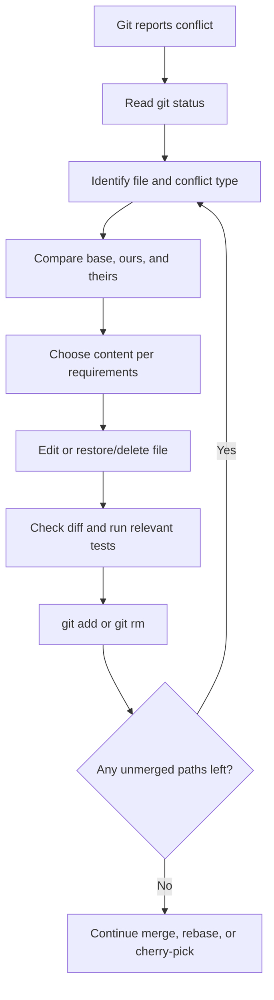

# Resolving Same-Line Edit and Modify-vs-Delete Conflicts

When multiple branches modify the same file, Git can usually combine the changes automatically. A merge conflict occurs when Git cannot safely determine the final outcome. The developer must understand the intent of each branch, select the right content, and record the result in the staging area.

This lesson belongs to the `SOURCE_CONTROL_GIT` module, where you practice everything from working tree, staging area, and commits to branching, merging, rebasing, remotes, and collaboration. This section focuses on two common scenarios: two branches editing the same line in different ways, and one branch deleting a file while the other modifies it.

## 1. Why Does Git Create Conflicts?

When merging two branches, Git typically uses a three-way merge:

- **Base**: the common ancestor version before the two branches diverged.
- **Ours**: the version on the current branch, i.e., the branch receiving the changes.
- **Theirs**: the version from the branch being merged in.

Git compares all three versions to detect what changed. If two branches edit independent regions, Git usually combines them automatically. If both branches edit the same region in ways that cannot be cleanly combined, Git stops and asks the user to resolve it.

A conflict does not mean the repository is corrupted. It indicates a content decision that Git cannot make on its own. While conflicts remain, the merge, rebase, or cherry-pick operation cannot finish.

After Git reports a conflict, check the status first:

```bash
git status
git diff --name-only --diff-filter=U
```

The first command shows which operation is in progress and which files need handling. The second lists the paths still in an unmerged state.

## 2. Two Branches Making Different Edits on the Same Line

Suppose the common version has a configuration setting:

```python
REQUEST_TIMEOUT = 30
```

The `main` branch increases the timeout to 45 seconds:

```python
REQUEST_TIMEOUT = 45
```

Meanwhile, the `feature/upload` branch increases it to 60 seconds to support large files:

```python
REQUEST_TIMEOUT = 60
```

When merging `feature/upload` into `main`, both branches changed the same line but provided different values. Git does not know which value meets product requirements, so it marks a conflict in the text file:

```text
<<<<<<< HEAD
REQUEST_TIMEOUT = 45
=======
REQUEST_TIMEOUT = 60
>>>>>>> feature/upload
```

The delimiters mean the following:

- `<<<<<<< HEAD` opens the content from the current branch.
- `=======` separates the two versions.
- `>>>>>>> feature/upload` closes the content from the branch being merged in; the branch name or label here may vary depending on the operation.

Git inserts these markers to preserve both options. They are not valid syntax in Python, YAML, or your programming language. If left as-is, the file may fail to run or be invalid.

### How to Choose the Final Content

Do not pick one side merely because it is `HEAD`, or because it came from a newer branch. Identify the reason behind each change and the actual requirements:

1. Read the context surrounding the conflicted line to understand the related configuration or logic.
2. Check the goal of both changes, such as through commit messages or pull request discussions.
3. Choose one value, combine both changes if they can coexist, or redesign the code block if neither individual option is right on its own.
4. Remove all `<<<<<<<`, `=======`, `>>>>>>>` markers and the unchosen content.
5. Run appropriate checks for the edited file.

For example, after confirming that large-file uploads require 60 seconds and that this value remains suitable for other call flows, the final content can be:

```python
REQUEST_TIMEOUT = 60
```

In cases where the two changes are truly independent, you can keep both by representing them separately. For example, if one branch added a default timeout while the other added a maximum limit, the result could be:

```python
DEFAULT_TIMEOUT = 45
MAX_UPLOAD_TIMEOUT = 60
```

Only combine them this way when the configuration model and consuming code support two separate values. Do not keep both lines simply to avoid making a decision; doing so can introduce duplicate configuration or undefined behavior.

### Completing a Same-Line Edit Conflict

After editing and saving the file, inspect the changes:

```bash
git diff -- path/to/config.py
git diff --check
```

`git diff` helps verify the chosen content. `git diff --check` detects certain whitespace errors in the changes; you still need to inspect manually to ensure no conflict markers remain.

Once the content is correct, mark the file as resolved:

```bash
git add -- path/to/config.py
git diff --cached -- path/to/config.py
git status
```

`git add` puts the resolved result into the staging area and tells Git the file is no longer in conflict. Review the staged version before continuing the paused operation.

## 3. One Branch Deletes a File, the Other Modifies It

This scenario is commonly called a **modify/delete** conflict. For example, the common version has the file `config/app.yml`:

```yaml
service:
  name: billing
  retry_count: 3
```

After branching:

- The `main` branch determines this configuration is obsolete and deletes `config/app.yml`.
- The `feature/retry-policy` branch still needs the file and updates `retry_count` to `5`.

When merging, Git encounters two opposing decisions: one side wants the file gone, while the other wants to keep the file with new content. Git cannot know whether the system still needs the file.

Unlike a same-line edit conflict, a delete/modify scenario usually **has no `<<<<<<<` and `=======` markers inside the file**. This is a conflict over the existence of a path. Use `git status` to see which side Git reports as having deleted the file, and inspect the versions stored in the index if needed.

```bash
git status
git ls-files -u -- config/app.yml
```

`git ls-files -u` displays the unmerged versions currently stored in the index. During a standard merge, the stages mean:

| Stage | Content |
| --- | --- |
| `1` | Common base version before the two branches diverged |
| `2` | Version on the current branch (ours) |
| `3` | Version on the branch being merged in (theirs) |

Because one side deleted the file, the corresponding stage may not exist. You can view each remaining version with commands such as:

```bash
git show :1:config/app.yml
git show :2:config/app.yml
git show :3:config/app.yml
```

The command for the non-existent stage will return no content. That is normal in a delete/modify conflict. Do not deduce the right choice solely from the stage number; identify which branch holds the modified version.

### Option A: Keep the File Deletion

If the file is obsolete, no longer referenced, and deleting it is the right decision, keep the deletion:

```bash
git rm -- config/app.yml
git status
```

`git rm` removes the path from the working tree and the index, and records the deletion as the conflict resolution. Before choosing this option, check everywhere the file might still be used, such as deployment configs, scripts, runbooks, or code reading the file.

### Option B: Keep the Modified File

If the application still needs the file, restore the content from the branch or commit containing the modified version, then verify and stage the file:

```bash
git show feature/retry-policy:config/app.yml
git restore --source=feature/retry-policy -- config/app.yml
git diff -- config/app.yml
git add -- config/app.yml
git status
```

Replace `feature/retry-policy` with the actual branch name or commit hash containing the version to keep. `git restore --source` brings the content from that source into the working tree; `git add` marks the choice to keep the file as resolved. If the content needs further adjustments to remain compatible with the current branch, edit the file before running `git add`.

In some cases, the file is already present in the working tree after Git reports the conflict. Even so, read its content and verify its source before accepting it. If you are unsure which version is present, use `git ls-files -u` and `git show :1:`, `git show :2:`, or `git show :3:` to inspect.

## 4. Be Careful When Identifying ours and theirs

In a standard merge, `ours` is the current branch and `theirs` is the branch being merged in. However, when resolving a conflict during a **rebase**, this naming easily causes confusion: `ours` is usually the target branch onto which commits are being replayed, while `theirs` is the commit belonging to the branch being rebased.

Therefore, do not run `git checkout --ours` or `git checkout --theirs` out of habit without confirming whether Git is performing a merge or a rebase and which side's changes you want to keep. In a delete/modify conflict, a command selecting one side can also mean deleting the file or restoring the file. Check `git status`, branch names, and actual content before choosing.

## 5. End-to-End Resolution Workflow

The following workflow applies to both conflict types:



The completion commands depend on the operation that triggered the conflict:

| Paused operation | After all conflicts are resolved |
| --- | --- |
| Merge | `git merge --continue` or `git commit` to create the merge commit |
| Rebase | `git rebase --continue` |
| Cherry-pick | `git cherry-pick --continue` |
| Revert | `git revert --continue` |

After marking the resolved files, run `git status` again. Only continue when no unmerged paths remain. If files remain, go back and handle each file; having run `git add` on one file does not mean the entire merge is free of conflicts.

If you realize you started the wrong operation or cannot make a safe decision, you can abort the paused operation with the corresponding command:

```bash
git merge --abort
git rebase --abort
```

Only use the command matching the active operation. Before aborting, safeguard any uncommitted changes you need to keep; aborting a merge or rebase is not a substitute for backing up unrecorded work.

## 6. Common Mistakes

- **Choosing ours or theirs without reading the content**: this can lose necessary changes, especially during a rebase or a delete/modify conflict.
- **Only removing conflict markers without understanding the logic**: the file may be syntactically valid yet behave incorrectly.
- **Assuming every conflict has markers inside the file**: modify/delete conflicts usually require deciding whether to keep or delete the path.
- **Checking only the working tree and forgetting the staging area**: after `git add`, inspect `git diff --cached` to see the exact content that will be committed.
- **Using `git reset --hard` as a "quick fix"**: this command can wipe out uncommitted changes. It is not a standard conflict resolution workflow.
- **Continuing a merge or rebase while unmerged files remain**: the active operation cannot finish until every conflicted path is handled.

## 7. Self-Check Before Continuing

Before completing a merge, rebase, or cherry-pick, confirm for yourself:

1. Do I understand the cause and intent of each side?
2. For same-line edit conflicts, does the final content match the requirements and have all markers been removed?
3. For delete/modify conflicts, have I confirmed whether the file should be kept or deleted and checked where the file is used?
4. Have I inspected `git diff` and `git diff --cached` to verify both the edited content and the staged content?
5. Have the appropriate checks or tests passed?
6. Has `git status` confirmed there are no remaining unmerged paths?

Good conflict resolution means preserving the right necessary intent from the branches and producing a consistent working tree state. Once the result is verified, the staging area records that choice so Git can continue the operation and preserve a clear change history.
