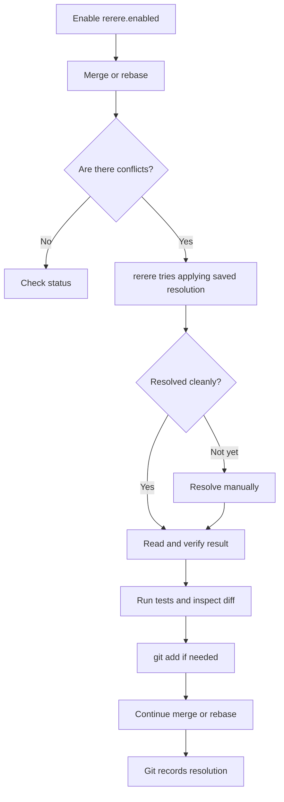

# Reusing Repeated Conflict Resolutions with git rerere

While developing a long-lived feature branch, you may have to merge or rebase multiple times as the target branch keeps changing. Some conflicts repeat because both branches keep modifying the same code region. Having to read and manually resolve the exact same conflict every time is time-consuming and error-prone.

Git provides the `rerere` mechanism to remember how you resolved a conflict and try reapplying that resolution when a matching conflict appears again. The name `rerere` stands for **reuse recorded resolution**. This mechanism fits well within the `SOURCE_CONTROL_GIT` module, where you practice working tree, staging area, commits, branching, merging, rebasing, remotes, and collaboration. It cuts down repetitive work in the conflict resolution workflow while still letting you verify the result before recording it.

## 1. How Does Git rerere Work?

When a merge operation produces conflicts, Git can save two states for each conflict:

- **Preimage**: the file content after Git attempted its automatic merge while still containing conflicts, typically with `<<<<<<<`, `=======`, and `>>>>>>>` markers.
- **Postimage**: the final content after you resolved the conflict.

Git stores this data in the `rr-cache` directory inside the repository's Git directory. You can inspect the actual path with:

```bash
git rev-parse --git-path rr-cache
```

When a matching conflict occurs again, Git uses the new conflicted content along with the saved preimage and postimage to attempt a three-way merge. If the result applies cleanly, Git writes the resolved result into the working tree. You can then inspect it, run tests, and stage the file into the staging area.

`rerere` relies on text conflict content and conflict markers for matching. Git normalizes certain differences such as branch labels on markers and common ancestor display styles, so renaming a branch or changing conflict style does not necessarily break matching. However, it is not a semantic program analyzer: a recorded resolution may no longer match new requirements.

## 2. Enabling rerere

You need to enable `rerere.enabled` so Git records and reuses resolutions. There are two common configuration scopes.

**Enable for all repositories of the current user:**

```bash
git config --global rerere.enabled true
```

**Enable only in the current repository:**

```bash
git config --local rerere.enabled true
```

If many projects involve repeated merge/rebase workflows, global configuration is more convenient. If you prefer to decide per repository, use local configuration.

By default, `rerere.autoupdate` is `false`. This means rerere can update the working tree with the remembered resolution while leaving the index unresolved; you must inspect and run `git add` to confirm. This is the safest choice when getting started.

You can set that option explicitly:

```bash
git config --global rerere.autoupdate false
```

Once comfortable, if you want Git to automatically update the index too when a saved resolution applies cleanly, you can enable:

```bash
git config --global rerere.autoupdate true
```

With `autoupdate` enabled, the result can go straight into the staging area. Therefore, you still need to review the staged diff before committing.

Inspect the current configuration and its source:

```bash
git config --show-origin --get rerere.enabled
git config --show-origin --get rerere.autoupdate
```

`--show-origin` shows which configuration file each value comes from. If a key has not been set, the corresponding `--get` command may print nothing and exit with a non-zero code; that does not necessarily indicate a repository error.

## 3. Recording the First Resolution

Suppose `main` and `feature/payment` both modify the same line in `payment.yml`. The current branch sets the timeout to `30`, while the feature branch sets it to `60`. Git cannot choose the final value automatically and reports a conflict.

When `rerere.enabled` is turned on, Git invokes rerere automatically during merge or rebase handling. For a new conflict, Git records the initial conflicted state as the preimage. Inspect the paths rerere is tracking:

```bash
git status
git rerere status
```

You resolve the file according to actual requirements. For instance, after confirming the payment service requires a 60-second timeout:

```yaml
payment:
  timeout_seconds: 60
```

Remove all conflict markers, inspect the content, and run appropriate tests. Then stage the resolved file:

```bash
git diff -- payment.yml
git diff --check
git add -- payment.yml
git diff --cached -- payment.yml
git status
```

When you finish the merge with a commit, Git automatically invokes rerere to record the corresponding postimage. You can also run `git rerere` manually after editing to tell Git to update the resolution record:

```bash
git rerere
```

Recorded information is stored in the repository's cache, not as a new commit. It can still be reused on subsequent merges or rebases even if branch history changes afterward, provided Git recognizes the corresponding conflict and the resolution still applies.

## 4. Reusing the Resolution Next Time

Suppose after a trial merge, both `main` and `feature/payment` receive new commits. A subsequent merge or rebase may trigger the conflict in the payment configuration block again.

When rerere recognizes a saved conflict, Git attempts to apply the old resolution to the new conflict content. Inspect the status and changes:

```bash
git status
git rerere status
git rerere remaining
git diff -- payment.yml
git diff --cc -- payment.yml
```

`git rerere remaining` lists conflicted paths that rerere could not resolve automatically. If the resolution was applied to the working tree while `rerere.autoupdate` is `false`, the index is still not marked resolved. After reviewing and confirming the content is correct, stage the file:

```bash
git add -- payment.yml
git diff --cached -- payment.yml
git status
```

If `rerere.autoupdate` is `true`, Git may have updated the index along with the working tree. In that case, inspect `git diff --cached` to verify the staged result before continuing.

Once all conflicted paths are resolved and verified, continue the paused operation:

```bash
git merge --continue
```

For rebase, use:

```bash
git rebase --continue
```

For cherry-pick, use:

```bash
git cherry-pick --continue
```

Choose the command matching the operation in progress. `rerere` helps reuse resolutions across merges and rebases; it does not decide for you whether a change still fits product requirements.

## 5. Cache Inspection and Management Commands

You can use the following commands to inspect and manage rerere data:

| Command | Purpose |
| --- | --- |
| `git rerere status` | Lists paths with conflicts whose resolutions rerere will record |
| `git rerere remaining` | Lists conflicted paths not yet auto-resolved by rerere |
| `git rerere diff` | Shows the diff related to the recorded resolution state |
| `git rerere` | Checks current conflicts, tries reusing saved resolutions, or records resolved results |
| `git rerere forget -- path/to/file` | Forgets the recorded resolution for the current conflict at the specified path |
| `git rerere gc` | Cleans up old cache entries according to Git's retention policy |

For example, view files not automatically resolved and inspect the diff rerere is tracking:

```bash
git rerere remaining
git rerere diff
```

If rerere applied an old resolution that you realize is no longer suitable, tell Git to forget the record for the current conflict on that file:

```bash
git rerere forget -- payment.yml
```

Then manually resolve the file again, verify its content, stage it, and finish the paused operation. Use `forget` with the exact conflicted path you want to change so you avoid deleting or losing another useful record.

## 6. Limitations to Understand

**Rerere does not check business correctness.** A resolution that was right last week can be wrong after payment rules, data structures, or API contracts change. Always read the applied result, inspect the context, and run tests.

**Rerere does not handle every conflict type.** This mechanism relies on conflict markers inside file content. Submodule conflicts, binary files, or conflicts that do not produce text markers may not be auto-resolved. `git rerere remaining` helps identify paths that still require manual handling.

**Literal conflict markers in content can cause confusion.** If a file legitimately contains lines matching marker syntax, rerere may fail to detect conflict boundaries properly. Git supports the `conflict-marker-size` attribute in `.gitattributes` to change marker length when needed.

**The cache is local Git data.** Entries in `rr-cache` live inside the Git directory and are not committed or pushed like normal source files. Each clone accumulates its own resolution history. Teammates do not automatically receive your rerere cache simply by pulling a branch.

**Auto-updating the index removes a manual check step.** If `rerere.autoupdate` is enabled, Git may stage the remembered result automatically. Inspect the staged diff before committing; if you are not used to it, keep this setting as `false`.

## 7. Recommended Practice Workflow

When a project frequently merges or rebases long-lived branches, you can follow this workflow:



Key points to remember in practice:

1. Enable `rerere.enabled` before starting the merges/rebases you want remembered.
2. Resolve the conflict the first time as usual; verify logic, not just marker removal.
3. Let Git record the postimage via `git rerere` or upon completing the merge commit.
4. When the conflict recurs, inspect the content rerere applied before staging or continuing.
5. If the old resolution is wrong, use `git rerere forget` for the current conflict and resolve it again.

`git rerere` is especially useful when you regularly update a long-lived feature branch, run trial merges before a release, or have to rebase repeatedly onto a changing target branch. It reduces repetitive manual steps, while the final decision must still rest on current requirements and test results.

## References

- [Git documentation: git-rerere](https://git-scm.com/docs/git-rerere) — describes how conflict resolutions are recorded and reused.
- [Git documentation: git-config](https://git-scm.com/docs/git-config) — explains `rerere.enabled` and `rerere.autoupdate`.
- [Pro Git: Rerere](https://git-scm.com/book/en/v2/Git-Tools-Rerere) — practical examples with repeated merges.
