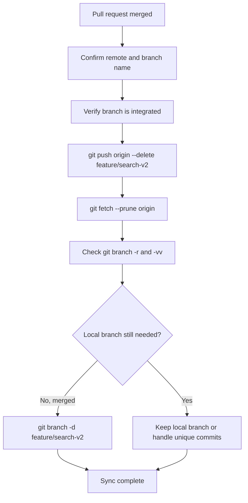

# Deleting Remote Branches and Cleaning Up Stale Tracking Branches with fetch --prune

During collaboration, feature branches are often deleted on the server after a pull request is merged or work is canceled. However, teammates' local Git copies may still display that branch in their remote-tracking branch list. These stale references make the branch list long and create confusion when selecting a branch to merge or rebase.

Git provides `git push <remote> --delete <branch>` to delete a branch on the remote and `git fetch --prune` to clean up remote-tracking refs that no longer exist on the remote. These two operations address different parts of the synchronization process. This lesson belongs to the `SOURCE_CONTROL_GIT` module, where you practice working tree, staging area, commit, branch, merge, rebase, remote, and tag workflows; this section focuses on keeping the local branch list synchronized with the shared repository.

## 1. Distinguishing Three Branch Types

Before deleting branches, distinguish server branches, remote-tracking branches, and local branches.

| Type | Example | Where Stored | Meaning |
| --- | --- | --- | --- |
| Remote branch | `feature/old-api` on `origin` | Repository on the server | Actual branch that team members can fetch or push to if authorized |
| Remote-tracking branch | `origin/feature/old-api` | Your local repository | Local reference recording where Git last knew the corresponding branch was on the remote |
| Local branch | `feature/old-api` | Your local repository | Personal working branch, which can track a remote branch |

The name `origin/feature/old-api` is not a branch running live on the server. It is a local reference under `refs/remotes/origin/`. When the server branch is deleted, this reference can remain in your repository until you fetch and prune.

View configured remotes and the remote-tracking branch list:

```bash
git remote -v
git branch -r
git branch -vv
```

`git remote -v` displays remote names alongside fetch/push URLs. `git branch -r` lists remote-tracking branches. `git branch -vv` shows local branches and the upstreams they track; after an upstream is pruned, a local branch still pointing to that upstream is typically marked `[origin/branch-name: gone]`.

## 2. Deleting the Actual Branch on the Remote

Suppose branch `feature/old-api` has been merged into `main` on server `origin`. If you have permission to delete branches, run:

```bash
git push origin --delete feature/old-api
```

This command sends a request to delete `refs/heads/feature/old-api` on remote `origin`. This operation modifies the shared repository. Before running it, verify the right remote and branch name, and confirm the branch has been merged or the project owner decided to retire it. A protected branch or server policy may reject the deletion request.

The older equivalent syntax is:

```bash
git push origin :feature/old-api
```

The `--delete` syntax is easier to read and should be preferred in new documentation or scripts.

If the branch was already deleted through the pull request UI, repository administration page, or by another team member, you do not need to push the delete command again. What remains is updating remote-tracking information in your local repository.

You can check whether the server still advertises the branch with:

```bash
git ls-remote --heads origin refs/heads/feature/old-api
```

If the command returns no lines, the remote is not advertising a head with that name at query time. If results appear, the first column is the object ID and the second is the ref on the remote.

## 3. Cleaning Up Stale Tracking Branches with fetch --prune

After a branch on the remote is deleted, the remote-tracking branch `origin/feature/old-api` may still exist in the local repository. Run:

```bash
git fetch --prune origin
```

Git fetches new information from `origin` and removes remote-tracking refs within the remote's refspec scope that are no longer advertised by the remote. Then check:

```bash
git branch -r
git branch -vv
```

If the corresponding remote-tracking ref is gone, `origin/feature/old-api` disappears from the list. Local branch `feature/old-api`, if present, still remains. `fetch --prune` does not delete branches on the server and does not delete local working branches.

You can preview which remote-tracking refs would be removed with:

```bash
git remote prune --dry-run origin
```

If the list matches expectations, you can prune without fetching new objects or refs:

```bash
git remote prune origin
```

`git remote prune origin` only cleans up stale remote-tracking refs based on remote info; it does not delete actual branches on the server. In normal synchronization workflows, `git fetch --prune origin` is more convenient because it updates new info and cleans up stale info together.

## 4. Synchronizing and Pruning Multiple Remotes

A repository can have multiple remotes, for instance `origin` pointing to the main repository and `upstream` pointing to the original project you forked. When you need to update all configured remotes and prune stale remote-tracking refs for each one:

```bash
git fetch --all --prune
```

`--all` tells Git to fetch from all matching configured remotes; `--prune` applies stale ref cleanup to those remotes. If you only want to update a single remote, specify its name such as `git fetch --prune upstream`.

Remotes are managed independently. If `origin/feature/old-api` no longer exists while `upstream/feature/old-api` still exists, pruning `origin` only removes the stale reference belonging to `origin`; `upstream`'s tracking branch is preserved.

## 5. Enabling Automatic Pruning on Fetch

If your team regularly deletes branches after merging pull requests, you can configure Git to prune automatically on every fetch.

**Apply only to the current repository:**

```bash
git config --local fetch.prune true
```

**Apply to all repositories for the user:**

```bash
git config --global fetch.prune true
```

Once enabled, regular fetch commands like `git fetch origin` also prune according to the configuration. Use local scope if synchronization policies differ across projects; use global if you want consistent behavior across all repositories.

Verify the value and configuration origin:

```bash
git config --show-origin --get fetch.prune
```

To turn off the setting at the scope where it was enabled, set `false`:

```bash
git config --local fetch.prune false
```

Note that enabling `fetch.prune` by default does not mean local branches whose upstream disappeared will be deleted automatically. It only controls cleaning up remote-tracking refs according to the fetch refspec.

## 6. Pruning Branches Does Not Mean Pruning Tags

By default, `git fetch --prune` primarily cleans up remote-tracking refs per the refspec. Tags that Git automatically follows are not necessarily pruned the same way. If you configure tag refspecs or pass `--prune-tags`, Git can prune local tags no longer present on the remote.

Example:

```bash
git fetch --prune --prune-tags origin
```

Only add `--prune-tags` when you genuinely want to synchronize your local tag set with the remote's tag set. Tags may be created locally or originate from another source, so pruning tags can delete local tags you still need. For cleaning up stale tracking branches, `git fetch --prune origin` is normally all you need.

## 7. Cleaning Up Local Branches Still Tracking Deleted Upstreams

After pruning remote-tracking refs, local branches with stale upstream links still remain. Check:

```bash
git branch -vv
```

Example output might show:

```text
* main                 a1b2c3d [origin/main] Merge pull request #42
  feature/old-api      d4e5f6a [origin/feature/old-api: gone] Remove old API
```

This means local branch `feature/old-api` still exists, while upstream `origin/feature/old-api` is gone. If the local branch has already been merged into the target branch, switch to another working branch and delete the local branch:

```bash
git switch main
git branch --merged main
git branch -d feature/old-api
```

`git branch --merged main` lists local branches already integrated into `main`. `git branch -d` deletes a local branch only when Git determines it has been safely merged according to the command's rules. If the command refuses, inspect remaining unique commits on the branch before deciding.

`git branch -D feature/old-api` force-deletes the local branch even if unmerged. Use it only when you have confirmed you do not need to keep unique commits on the branch; this action can remove a convenient reference name for finding unintegrated work.

Do not use `git branch -r -d origin/feature/old-api` as a substitute for deleting a branch on the server. That command only deletes the remote-tracking ref inside your local repository. In most cases, `git fetch --prune origin` is the clearer way to synchronize.

## 8. End-to-End Practical Workflow

Suppose the pull request for `feature/search-v2` has been merged into `main` on `origin` and the team decides to delete the feature branch.



Commands can be run in the following order:

```bash
# View remotes and branch status
git remote -v
git branch -vv

# Confirm feature branch commits are in the target branch
git fetch origin
git log --oneline origin/main..origin/feature/search-v2

# Delete the branch on the remote if the team decided to retire it
git push origin --delete feature/search-v2

# Clean up stale remote-tracking refs and check local branches
git fetch --prune origin
git branch -r
git branch -vv

# If the local branch is integrated and no longer needed
git switch main
git branch -d feature/search-v2
```

`git log origin/main..origin/feature/search-v2` lists commits present on the feature branch that are not yet in the target branch at comparison time. If the command prints commits, inspect them before deleting the branch. If the team already deleted the remote branch via the UI after merging, skip the `git push --delete` step and start with `git fetch --prune origin`.

## 9. Common Misconceptions

- **Thinking `fetch --prune` deletes branches on the server**: this command only cleans up remote-tracking refs in the local repository. To delete the actual branch, use `git push <remote> --delete <branch>`.
- **Thinking prune deletes local branches**: local branches stay intact and may display a `[gone]` upstream in `git branch -vv`.
- **Running prune on the wrong remote**: `origin` and `upstream` are different remotes. Check `git remote -v` and pick the right name.
- **Assuming all same-named branches disappear**: pruning one remote affects only refs belonging to that remote; another remote may still keep a branch with the same name.
- **Using `--prune-tags` when only intending to clean up branches**: depending on refspec configuration, this can delete local tags absent from the remote.
- **Deleting a local branch that still has unique commits**: check `git branch --merged` or compare logs with the target branch before running a delete command.

## Self-Check

Before finishing branch cleanup, verify:

1. Have I confirmed the correct remote and exact branch name?
2. Has the server branch been merged or clearly marked for deletion?
3. Do I understand that `git push --delete` deletes the actual branch, whereas `git fetch --prune` cleans up local remote-tracking refs?
4. Have I checked `git branch -r` and `git branch -vv` after pruning?
5. If deleting a local branch, have I confirmed its unique commits are already integrated or no longer needed?

Keeping the branch list clean makes synchronization, review, and upstream selection easier to follow. Treat remote branches, remote-tracking refs, and local branches as three distinct references; knowing which command affects which reference lets you clean up a repository safely and avoid accidentally deleting work.

## References

- [Git documentation: git-fetch](https://git-scm.com/docs/git-fetch) — `--prune`, `--all`, and `--prune-tags` options.
- [Git documentation: git-push](https://git-scm.com/docs/git-push) — deleting a branch on a remote with `--delete`.
- [Git documentation: git-remote](https://git-scm.com/docs/git-remote) — `remote prune` command and remote management.
- [Git documentation: git-branch](https://git-scm.com/docs/git-branch) — listing, inspecting, and deleting local branches.
