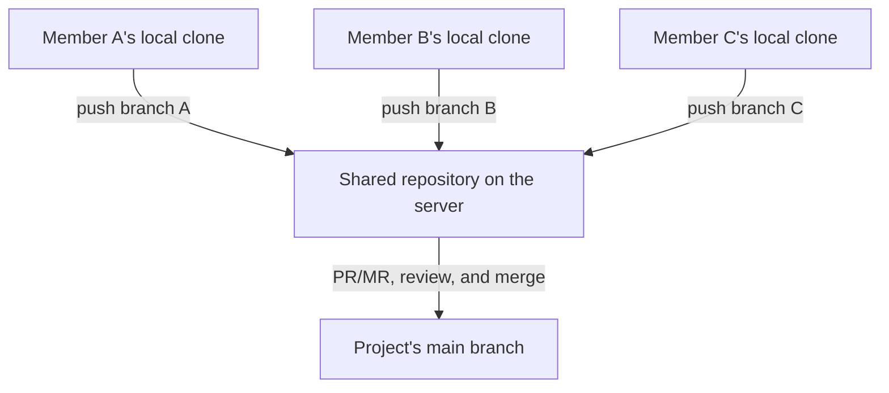
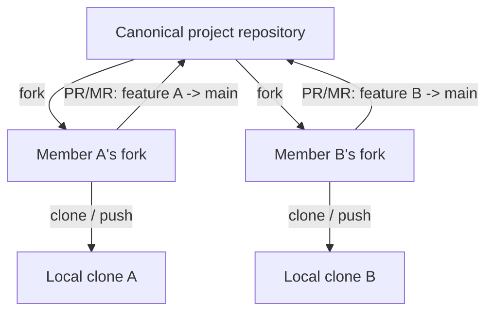

# Shared Repository Workflow vs. Fork Workflow

When multiple people develop a Git project together, the team must agree on how each person retrieves source code, creates branches, shares commits, and proposes integrating changes. Two common collaboration models are the **shared repository workflow** and the **fork workflow**.

In the shared repository model, team members are granted write access to the same repository on the server. Each person clones that repository, creates a dedicated branch, pushes the branch to the shared repository, and usually opens a pull request or merge request for review. In the fork model, each person works on a separate repository under their own account or namespace; then proposes changes from the fork back to the original repository.

Both models use Git to manage commits, branches, merges, and history. The primary difference lies in **repository write permissions, where contributor branches are stored, and how the team receives changes**. Understanding this difference helps you choose a workflow suited to team size, trust level, and source code protection policies.

## 1. Concepts to Distinguish First

### 1.1. Canonical Repository, Shared Repository, and Fork

The **canonical repository** is the repository the project treats as the official source of truth. This is typically where the default branch such as `main`, release tags, and team-maintained history reside.

In the **shared repository workflow**, the canonical repository is also the shared repository to which members with write access can push their branches.

In the **fork workflow**, each person creates a separate copy of the repository under their own hosting platform namespace. That personal copy is called a **fork**. A fork maintains a relationship with the canonical repository on the platform, yet remains an independent repository regarding write permissions and can receive its own commits.

A fork is not a branch. A branch is a ref within the same repository; a fork is a different repository. Creating a branch does not create a new repository, and forking is not simply renaming a branch.

### 1.2. Clone, Remote, and Upstream

The following three concepts frequently appear together:

- **Clone:** creates a local copy of a repository on your machine using `git clone`.
- **Remote:** a configured name in a local repository used to connect to another repository. `origin` and `upstream` are common conventional names that can be changed.
- **Upstream branch:** the branch that a local branch is configured to track, for example local branch `main` tracking `origin/main`. Distinguish this upstream branch from a remote named `upstream`.

In the fork workflow, the standard naming convention is:

| Remote Name | Points To | Role |
|---|---|---|
| `origin` | Contributor's own fork | Where you push your own branches and commits |
| `upstream` | Project's canonical repository | Where you fetch official changes and the target for pull requests |

In the shared repository workflow, `origin` usually points directly to the shared repository. The team does not necessarily need a remote named `upstream`.

### 1.3. Pull Request and Merge Request

A pull request (PR) or merge request (MR) is a collaboration mechanism provided by code hosting platforms. A contributor proposes integrating a source branch into a target branch; reviewers can inspect the diff, discuss, request changes, and verify CI status before merging.

PR/MR is not a Git command. Git provides commits, branches, fetch, push, merge, and rebase; the collaboration platform provides the interface and review workflow. A team can use PRs/MRs in both the shared repository workflow and the fork workflow.

## 2. Shared Repository Workflow

### 2.1. Structure

In this model, team members are granted write access to the same repository on the server. Each person clones the canonical repository, creates a separate branch in their local repository, and pushes that branch back to the same repository.



Team members share a single remote repository space. Write permissions allow them to create branches on the server, while the main branch such as `main` is usually protected so changes must pass review and checks.

### 2.2. Typical Workflow

Suppose the shared repository has the SSH URL:

```text
git@example.com:team/project.git
```

**Step 1: Clone the shared repository**

```bash
git clone git@example.com:team/project.git
cd project
git remote -v
```

Typically, Git configures the `origin` remote to point to the shared repository. Members can fetch and push via this remote according to their granted permissions.

**Step 2: Update the base branch before working**

```bash
git switch main
git fetch origin
git merge --ff-only origin/main
```

`git fetch` updates the remote-tracking ref `origin/main`; `git merge --ff-only origin/main` advances local `main` if history permits a fast-forward. If local `main` has diverged, the command stops for inspection rather than automatically creating a merge commit.

**Step 3: Create a task branch**

```bash
git switch -c feature/search
```

The `feature/search` branch is created from the current `main`. The member edits source code, reviews the diff, and creates commits:

```bash
git status
git diff
git add src/
git diff --cached
git commit -m "feat: add search feature"
```

**Step 4: Push the branch to the shared repository**

```bash
git push -u origin feature/search
```

The branch is created in the shared repository if the user has permission and server policy allows it. `-u` sets the upstream for the local branch so subsequent pushes can simply use `git push` without specifying the remote and branch.

**Step 5: Open a PR/MR within the same repository**

On the collaboration platform, the member opens a PR/MR with:

- Source (source branch): `team/project:feature/search`.
- Target (target branch): `team/project:main`.

Teammates review the diff, discuss, and request changes if necessary. When the author pushes additional commits to `feature/search`, the PR/MR automatically updates because it continues tracking that source branch.

**Step 6: Integrate the changes**

Once reviews and required checks succeed, an authorized person merges the PR/MR into `main` per project policy. The team may choose merge commit, squash merge, or rebase merge depending on platform capabilities and history conventions.

**Step 7: Update local and clean up the branch**

```bash
git switch main
git pull --ff-only origin main
git branch -d feature/search
```

If the local branch has been integrated and has no unsaved changes, `git branch -d` deletes the local branch. The remote branch can be automatically deleted by the platform after merging; if not, an authorized person can delete the remote branch following team process.

### 2.3. Access Permissions in the Shared Repository Model

Members need appropriate write permissions on the shared repository to push branches. However, write permission should not equate to permission to modify the main branch directly. Teams commonly combine:

- Branch protection or rulesets to restrict direct pushes to `main`.
- Requiring one or more approvals before merging.
- Mandatory CI checks such as build, unit tests, lint, or security scans.
- Defining who can dismiss reviews, merge, or delete branches.
- CODEOWNERS or an equivalent mechanism to require owners to review sensitive code areas.

The names and capabilities of these settings depend on the platform. The shared goal is to ensure all significant changes can be reviewed and verified before entering the main branch.

## 3. Fork Workflow

### 3.1. Structure

In the fork workflow, a contributor creates a fork of the canonical repository under their own account or namespace. They clone the fork locally, work on local branches, and push branches to the fork. Finally, they open a PR/MR from the fork back to the canonical repository.



Contributors only need write access to their own fork. They do not need push access to the canonical repository; review and merge permissions for PRs/MRs remain controlled by the project owner or authorized delegates.

### 3.2. Forking and Cloning the Fork

Suppose the canonical repository is:

```text
git@example.com:organization/project.git
```

On the code hosting platform, the contributor creates a fork under a personal namespace, for example:

```text
git@example.com:alice/project.git
```

Then clone the fork:

```bash
git clone git@example.com:alice/project.git
cd project
git remote -v
```

After cloning, `origin` typically points to Alice's fork. Add the canonical repository under the remote name `upstream`:

```bash
git remote add upstream git@example.com:organization/project.git
git remote -v
```

The output may look like:

```text
origin    git@example.com:alice/project.git (fetch)
origin    git@example.com:alice/project.git (push)
upstream  git@example.com:organization/project.git (fetch)
upstream  git@example.com:organization/project.git (push)
```

In many projects, contributors only need to fetch from `upstream`; they may not need to push to `upstream`. Having a push URL listed for a remote does not mean the current account has write permissions to that repository.

### 3.3. Syncing the Fork's Main Branch with the Canonical Repository

The canonical repository may continue receiving commits while the contributor's fork falls behind. To pull in new changes:

```bash
git fetch upstream
git switch main
git merge --ff-only upstream/main
git push origin main
```

Explanation:

1. `git fetch upstream` downloads data and updates remote-tracking refs such as `upstream/main`.
2. `git switch main` switches to the local `main` branch.
3. `git merge --ff-only upstream/main` advances local `main` to the new commit if history allows fast-forward.
4. `git push origin main` updates the `main` branch in Alice's fork.

The `--ff-only` option is appropriate when local `main` is simply behind `upstream/main`. If the two branches have diverged, Git stops. Inspect `git status`, `git log --oneline --left-right main...upstream/main`, and check local commits before choosing how to integrate. Do not force-reset just because a fast-forward fails; the local branch might contain commits you want to keep.

Some platforms offer a "Sync fork" button or feature in the UI. Its underlying mechanism varies by product; whether using the UI or the Git CLI, understand which branch is being updated and avoid overwriting custom commits in your fork.

### 3.4. Creating a Feature Branch on the Fork

After updating `main`, create a new branch:

```bash
git switch -c feature/search main
```

Edit, inspect, and commit as usual:

```bash
git status
git diff
git add src/
git diff --cached
git commit -m "feat: add search feature"
```

Push the branch to the fork:

```bash
git push -u origin feature/search
```

The `feature/search` branch resides in Alice's fork. It does not appear in the canonical repository's branch namespace until integrated or shared by another means.

### 3.5. Opening a PR/MR from the Fork to the Canonical Repository

On the collaboration platform, create a PR/MR with:

- Source repository: `alice/project`.
- Source branch: `feature/search`.
- Target repository: `organization/project`.
- Target branch: `main`.

Project maintainers review the changes and decide whether to merge. When the author updates the code and pushes additional commits to the branch in the fork, the PR/MR updates automatically with the source branch.

After the PR/MR is merged, the source branch in the fork can be kept or deleted. Deleting the source branch on the fork does not delete the `main` branch in the canonical repository.

## 4. Comparing the Two Models

| Criterion | Shared Repository Workflow | Fork Workflow |
|---|---|---|
| Where contributors push branches | Shared repository | Contributor's own fork |
| Required permissions | Appropriate write access to the shared repository | Permission to fork and write to own fork; no write access needed on canonical repository |
| Common remotes | `origin` points to shared repository | `origin` points to fork; `upstream` points to canonical repository |
| PR/MR | Source and target branches usually reside in the same repository | Source branch resides in fork, target branch resides in canonical repository |
| Best suited for | Internal teams, members already granted access | Open-source projects, external contributors, teams restricting direct write access |
| Branch management | Task branches coexist in the shared repository | Each person manages task branches in their own fork |
| Syncing canonical changes | Fetch from `origin` | Fetch from `upstream`, then update fork if needed |
| Permission governance | Must manage write permissions for many members on one repository | Restricts canonical repository write permissions to a smaller group |
| Potential for stale forks/branches | Shared branches may linger if not cleaned up | Forks can fall behind and hold long-lived custom branches/commits |

Neither model is universally better. Both can use short-lived branches, PRs/MRs, mandatory reviews, CI, and branch protection. The difference is where contributor branches live and the scope of write permissions.

## 5. Which Model Fits Which Situation?

### 5.1. Use a Shared Repository When

- Members belong to the same organization or verified team and can be granted write access.
- The team wants to simplify daily branch sharing, reviewing, and coordination.
- The repository has clear permission governance, protected main branches, and audited activity.
- The team has a relatively stable set of collaborators and active access management.

Example: an internal development team of six engineers. Each person is granted write access to the repository, creates dedicated branches, and opens PRs for two other members to review before merging into `main`.

### 5.2. Use a Fork When

- Contributors are outside the organization or have not been granted write access to the canonical repository.
- The project accepts public community contributions.
- Project owners want to keep canonical repository write permissions limited to a small group of maintainers.
- Write isolation is needed so contributors can experiment or develop independently.

Example: a developer finds a bug in an open-source library. They fork the project, create a bugfix branch, push to their fork, and submit a PR to the canonical repository. Maintainers review and merge if the changes meet requirements.

### 5.3. Combining Both Models

Many projects use a shared repository for internal team members while accepting forks from external contributors. This is a practical hybrid approach:

- Members with write access create branches directly in the shared repository.
- External contributors create forks and submit PRs/MRs to the canonical repository.
- The same set of review rules, CI, and target branch protections apply to all PRs/MRs when supported by the platform.

Thus, shared and fork are two models for organizing access control, not two different ways of managing versions.

## 6. Keeping Task Branches Up to Date as the Project Evolves

Regardless of the model used, a feature branch can become outdated as `main` receives new commits. Contributors should fetch the updated base branch and integrate it into the task branch per team convention.

### 6.1. With a Shared Repository

If `origin/main` is the latest base branch:

```bash
git fetch origin
git switch feature/search
git merge origin/main
```

Or the team may require rebasing:

```bash
git fetch origin
git switch feature/search
git rebase origin/main
```

Merge preserves existing commits and creates a merge commit when needed. Rebase replays the task branch's commits onto a new base, changing the commit hashes of the replayed commits. If the branch has already been pushed and others are using it, coordinate before rebasing and pushing again.

### 6.2. With a Fork Workflow

Fetch from the canonical repository, then integrate `upstream/main` into the feature branch:

```bash
git fetch upstream
git switch feature/search
git merge upstream/main
```

Or use rebase if project conventions require it:

```bash
git fetch upstream
git switch feature/search
git rebase upstream/main
```

If you rebase a branch already pushed to your fork, updating the fork branch may require a force push. When truly necessary and after checking for new commits on the remote, prefer:

```bash
git push --force-with-lease origin feature/search
```

`--force-with-lease` reduces the risk of overwriting someone else's new changes compared to `--force`, though it still rewrites branch history on the fork. Do not use this operation on a shared branch where others are actively collaborating without agreement.

## 7. Handling Conflicts in Both Workflows

Conflicts occur when Git cannot automatically combine changes, typically during a merge or rebase. Conflicts do not depend on whether the branch lives in a shared repository or a fork; they depend on the content and historical relationship between commits.

General resolution process:

1. Read Git's output to see which files are conflicted.
2. Open each file and inspect the `<<<<<<<`, `=======`, and `>>>>>>>` marker sections.
3. Choose or combine the right content according to feature requirements; remove all conflict markers.
4. Run tests and inspect the diff to verify the final content.
5. For merge, run `git add <file>` followed by `git commit` if Git prompts for a merge commit.
6. For rebase, run `git add <file>` followed by `git rebase --continue`; if you need to abort the entire ongoing operation, run `git rebase --abort`.

Example status check:

```bash
git status
git diff
```

Do not mark a conflict as resolved just to make Git continue. The result must be verified with tests and review because both sides may contain valid changes that need to be combined.

## 8. Common Collaboration Mistakes

### 8.1. Pushing to the Wrong Repository

In the fork workflow, `origin` is usually your fork while `upstream` is the canonical repository. Before pushing, verify:

```bash
git remote -v
git status -sb
git branch -vv
```

Do not rely on the name `origin` to infer permissions or destination; check the actual URL.

### 8.2. Confusing the `upstream` Remote with an Upstream Branch

The `upstream` remote is the named connection to the canonical repository in a fork workflow. An upstream branch is the branch tracked by a local branch, such as `feature/search` tracking `origin/feature/search`. These are two distinct concepts despite sharing the word "upstream".

### 8.3. Creating a PR/MR in the Wrong Direction

In the fork workflow, a PR/MR usually goes from the contributor's fork to the canonical repository. If you select the repositories or target branch backwards, the changes may be proposed into your personal fork instead of the main project. Check the source repository, source branch, target repository, and target branch before submitting.

### 8.4. Working off an Outdated Base Branch

If you create a feature branch from an outdated local `main`, the PR may contain unnecessary changes or be hard to integrate. Fetch and update the base branch before starting work; if development on the branch has already begun, integrate new changes following your merge/rebase convention.

### 8.5. Committing Directly to the Main Branch

Pushing directly to `main` can bypass review, CI, or release policies. Use task branches and PRs/MRs if that is the team's agreed workflow. Branch protection helps prevent improper actions.

### 8.6. Force Pushing on a Branch Shared by Multiple People

A force push can remove commits that others are relying on from the tip of the branch. Before rewriting shared history, discuss with collaborators. If you must force-update a personal branch, prefer `--force-with-lease` after fetching and checking remote status.

### 8.7. Assuming Deleting a Branch Deletes the PR/MR or History

Deleting a source branch after merging usually does not delete the completed PR/MR or the commits preserved in the target branch's history. However, archive and link behavior in the UI depends on the platform. Before deleting an unmerged branch, ensure its contents are no longer needed.

## 9. Pre-Review Checklist for a Change

Before opening a PR/MR, the contributor should self-check:

- You are in the right repository and task branch.
- The branch was created from the appropriate, up-to-date base branch.
- Only files within the scope of the change are included in commits.
- The diff contains no secrets, unnecessary auto-generated files, or out-of-scope edits.
- Commit messages clearly describe their purpose.
- Builds, tests, linters, and required project checks have been run.
- The branch has been pushed to the right remote.
- The PR/MR specifies the right source repository, source branch, target repository, and target branch.
- The PR/MR description explains the problem, solution, and how it was tested; links the issue if applicable.

Maintainers or reviewers should additionally check change scope, compatibility impact, test quality, security risks, and branch policy compliance before merging.

## 10. Scenario Exercises

### Scenario A: Internal Team

An eight-person team is developing an enterprise application. All members belong to the organization and have repository write permissions. The team wants every change entering `main` to have two approvals and green CI.

The appropriate model is usually the shared repository workflow:

1. Everyone clones the shared repository.
2. Each person creates a separate branch and pushes to `origin`.
3. Open a PR/MR from the task branch into `main` within the same repository.
4. Branch protection requires two approvals and passing CI.
5. An authorized person merges once policies are met.

### Scenario B: Contributing to an Open-Source Project

A user discovers a bug in a public library but does not have write permissions to the canonical repository.

The appropriate model is usually the fork workflow:

1. Create a fork of the canonical repository.
2. Clone the fork; configure `origin` as the fork and `upstream` as the canonical repository.
3. Fetch `upstream`, and create a bugfix branch from the latest base branch.
4. Commit and push the branch to `origin`.
5. Open a PR from the fork targeting the appropriate branch in the canonical repository.
6. Address review feedback, wait for CI, and let maintainers decide on merging.

### Scenario C: Project Using Both

A project has an internal maintainer team and an external community. Maintainers can push branches to the shared repository; external contributors submit changes from forks. Both flows converge at PRs/MRs and share the same review, testing, and target branch protection policies.

## 11. Key Takeaways

- Shared repository workflow: members with write access push task branches to the shared repository; PRs/MRs usually stay within the same repository.
- Fork workflow: each person pushes branches to their own fork; PRs/MRs go from the fork to the canonical repository.
- A fork is an independent repository; a branch is a ref within a repository. Cloning creates a local copy of a repository.
- In the fork workflow, `origin` is usually your personal fork and `upstream` is the canonical repository. Verify URLs with `git remote -v`.
- An upstream branch is the branch a local branch tracks; it is different from a remote named `upstream`.
- Fetch updates information from a remote; merge or rebase integrates history into the current branch.
- Both models require branch protection, reviews, CI, and access governance aligned with project risk.
- Choose the model based on access permissions and collaboration structure; teams can also combine the shared workflow for internal members and the fork workflow for external contributors.

When starting work, identify where the canonical repository is, which repository you have write access to, where your task branch will be pushed, and which branch the PR/MR should target. Those four questions prevent most confusion between shared repositories and forks.
