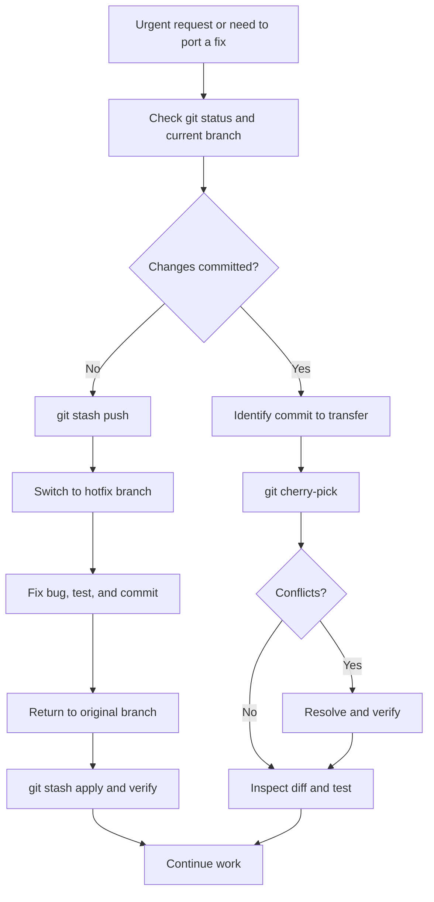

# Handling Urgent Changes and Porting Fixes Between Branches

While developing a feature, you may receive an urgent request to fix a bug on a release branch. Your current work may be incomplete, or a fix may have been committed to another branch by mistake. Without clearly managing your working tree state and commit history, it is easy to mix unrelated changes, miss a fix, or create duplicate commits.

Git offers two helpful tools for these situations: **stash** to temporarily store uncommitted changes, and **cherry-pick** to apply an existing commit onto another branch. This lesson belongs to the `SOURCE_CONTROL_GIT` module, where you practice working with the working tree, staging area, commits, branches, merges, rebases, remotes, and tags. The goal is to choose the right way to transfer changes based on the current state of your work.

## 1. Choosing a Tool Based on Change State

Before switching branches, locate where your changes live:

| State | Appropriate Handling | Reason |
| --- | --- | --- |
| Uncommitted changes in working tree or staging area | `git stash` | Temporarily sets work aside so the working tree is clean, then restores it |
| Fix already committed as an individual commit | `git cherry-pick` | Applies that commit's changes onto the target branch |
| Multiple commits already integrated on a branch needing the whole history moved to another branch | Merge or rebase per team workflow | Preserves historical relationships between branches instead of copying individual commits |

`stash` and `cherry-pick` solve two different problems. Stash temporarily stores uncommitted changes in the local repository; cherry-pick takes the contents of an existing commit and creates a new commit on the current branch. Do not use stash as a mechanism to share work across team members, and do not use cherry-pick to replace merging a completed feature branch.

Before any operation, inspect the state:

```bash
git status
git branch --show-current
git diff
git diff --cached
```

The two diff commands distinguish unstaged and staged changes. Note the current branch so you can return to the right place after handling the urgent request.

## 2. Temporarily Storing Uncommitted Work with git stash

Suppose you are on the `feature/customer-search` branch, having edited several files without finishing. The team discovers a critical bug on `main` and needs an immediate fix. You do not want to create a temporary commit just to switch branches.

### Saving Changes to Stash

Check status and save changes with a descriptive message:

```bash
git status
git stash push -m "WIP: customer search"
```

`git stash push` saves tracked changes in the working tree and index into a stash entry, then resets those files to a clean state matching the current commit. A descriptive label helps you recognize the stash entry when multiple tasks are temporarily stored.

By default, files not tracked by Git (untracked) are excluded from the stash. If your work includes new files not yet added with `git add`, use `-u`:

```bash
git stash push -u -m "WIP: customer search"
```

`-u` includes untracked files. The `-a` option also includes ignored files; only use it when you truly intend to stash all of those files, as it can create a huge stash or capture unnecessary local data.

Inspect the saved entry and its contents:

```bash
git stash list
git stash show --include-untracked --stat stash@{0}
git stash show --include-untracked -p stash@{0}
git status
```

Stashes are typically numbered starting at `stash@{0}` for the newest entry. Every time a new stash is created, indices shift; check `git stash list` before acting on a specific entry. After stashing successfully, verify the working tree is clean before switching branches.

### Switching to the Urgent Fix Branch

Fetch updates from the remote and create a hotfix branch from the latest `main`:

```bash
git fetch origin
git switch -c hotfix/search-crash origin/main
```

The first command updates remote-tracking refs. The second creates and switches to `hotfix/search-crash` starting from `origin/main`. If your team uses a different release branch, replace `origin/main` with the agreed target branch.

Fix the bug, run appropriate checks, and commit the fix cleanly:

```bash
git status
git diff
git add -- path/to/fixed-file
git diff --cached
git commit -m "Fix customer search crash"
```

If team workflow requires pushing the branch to open a pull request:

```bash
git push -u origin hotfix/search-crash
```

After the hotfix is reviewed and integrated into the target branch, the fix can be ported back to the feature branch using the cherry-pick workflow below. If the team automatically deletes the hotfix branch after merging, the commit can still be found in the target branch's history.

### Returning to Work in Progress

Once the urgent fix is done, switch back to the feature branch and apply the stash:

```bash
git switch feature/customer-search
git stash apply --index stash@{0}
```

`apply` restores the saved changes while keeping the stash entry intact. The `--index` option asks Git to restore the staged state as well when possible. Re-verify:

```bash
git status
git diff
git diff --cached
```

If the changes are fully restored and you confirm you no longer need that stash, delete the specific entry you used:

```bash
git stash drop stash@{0}
```

Do not delete a stash just because `apply` finished; verify all files, including untracked files, were properly restored. If unsure, keep the stash so you can retry or cross-check.

## 3. Handling Conflicts When Applying a Stash

A stash is created from a specific repository state. If the current branch has modified the same region of code, `git stash apply` may cause conflicts. Git leaves conflicted files in the working tree and asks you to resolve them.

```bash
git status
git diff
```

Open each file, compare the stashed changes against current content, and edit to produce the right result. Then stage the resolved files and run appropriate checks:

```bash
git add -- path/to/conflicted-file
git diff --cached
git status
```

When applying a stash with `apply`, the stash entry is kept even if conflicts occur. This lets you continue editing or retry after restoring the working tree. If using `git stash pop`, Git only deletes the stash entry when it applies cleanly; when conflicts occur, the stash entry is normally retained. For clearer control, the safe workflow is `apply`, verify, and then manually `drop`.

If you decide not to continue resolving the newly applied changes, be careful before reverting or deleting files. Compare the contents against the stash using `git stash show --include-untracked -p stash@{0}` so you do not lose work you need to keep.

## 4. Porting a Committed Fix with cherry-pick

Suppose the urgent bug has been fixed and committed on `hotfix/search-crash`. The `feature/customer-search` branch also needs that fix, without pulling in the entire hotfix branch. This is a good fit for `cherry-pick`.

First, identify the commit to transfer:

```bash
git log --oneline --decorate hotfix/search-crash
```

Example:

```text
8ac41d2 Fix customer search crash
5f2b6a0 Add crash reproduction test
```

If only commit `8ac41d2` contains the fix needed on the feature branch, switch branches and apply it:

```bash
git switch feature/customer-search
git cherry-pick -x 8ac41d2
```

`git cherry-pick` takes the changes introduced by the specified commit and creates a new commit on the current branch. The new commit has equivalent changes but usually a different hash because its parent commit and history metadata differ. The `-x` option appends a reference line to the source commit in the commit message; this is helpful when sharing fixes across multiple branches so reviewers can trace the origin.

Inspect the result after applying:

```bash
git show --stat --oneline HEAD
git show --format=fuller --no-ext-diff HEAD
git status
```

Run tests relevant to the fixed bug. If the target branch needs pushing, follow your normal review workflow:

```bash
git push origin feature/customer-search
```

Never cherry-pick a commit solely because its message sounds relevant. Read the source commit's diff to determine whether it includes dependent changes, configuration edits, or test updates that must accompany it.

## 5. Transferring Multiple Commits in Order

If a fix consists of multiple interdependent commits, apply them in chronological order from oldest to newest to preserve dependencies.

For example, the source history has:

```text
a1b2c3d Add regression test
e4f5a6b Fix search null handling
9a8b7c6 Improve error response
```

If all three commits are needed, you can cherry-pick each commit in order:

```bash
git cherry-pick -x a1b2c3d
git cherry-pick -x e4f5a6b
git cherry-pick -x 9a8b7c6
```

Or use a contiguous commit range:

```bash
git cherry-pick -x a1b2c3d^..9a8b7c6
```

In range syntax, `A..B` selects commits reachable from `B` that are not in `A`; the `^` in `A^` includes the starting commit `A` in the range. Before using a range, inspect `git log --oneline A^..B` to ensure no unrelated commits are included. If the history contains merge commits, handle them specially instead of assuming a simple range always works.

Do not cherry-pick an entire branch if the goal is only porting an isolated fix. If all changes from the source branch are needed and the two branches share a long-term development relationship, coordinate with the team to use merge or rebase per shared convention.

## 6. Resolving Conflicts During cherry-pick

Cherry-pick can conflict when the target branch has modified the same code area as the source commit. Git pauses and reports which files require resolution:

```bash
git status
git diff --name-only --diff-filter=U
```

Open the files, compare the incoming changes from the commit being applied against the current version, and edit to preserve the right logic from both sides. After resolving:

```bash
git add -- path/to/conflicted-file
git diff --cached
git cherry-pick --continue
```

If you no longer want to apply that commit and want to return to the state before starting the current cherry-pick:

```bash
git cherry-pick --abort
```

If the current commit is unnecessary in a cherry-pick sequence and you have confirmed it can be omitted, you can run:

```bash
git cherry-pick --skip
```

`--skip` skips the conflicting commit and continues with the remaining commits in the sequence. Only use it when you understand the impact of omitting the commit; later commits may depend on changes in the skipped commit.

## 7. When the Fix Is Already on the Target Branch

Once a hotfix has been merged into `main`, teams often need to bring it into maintenance branches or active development branches. Two common approaches exist:

- **Cherry-pick the hotfix commit** when only the standalone fix is needed on a specific branch, or the team requires tracing the source commit via `-x`.
- **Merge the target branch into the active development branch** when that branch needs all new changes from `main`, not just a single bugfix commit.

For example, if the feature branch only needs one specific hotfix commit:

```bash
git fetch origin
git switch feature/customer-search
git log --oneline origin/main -n 20
git cherry-pick -x <hotfix-commit>
```

Replace `<hotfix-commit>` with the actual hash identified from the target branch history. If the team plans to merge `main` into the feature branch shortly anyway, check the plan before cherry-picking; the fix may arrive via the merge without needing separate duplication. Cherry-pick creates a new commit with a different hash, so later the same change may appear as two commits in history. This does not necessarily apply the code twice, but it can cause confusion during reviews or future integrations.

## 8. Common Mistakes

- **Switching branches with unmanaged working tree changes**: Git may refuse to switch branches, or changes may follow you across branches if there are no conflicts. Check `git status` and decide to commit, stash, or discard each change first.
- **Forgetting untracked files when stashing**: new files are excluded from stash by default; use `git stash push -u` if they belong to work you need to keep.
- **Using `stash pop` and accidentally losing data on conflicts**: use `apply` first, verify the result, and only then `drop`.
- **Cherry-picking a commit with missing dependencies**: inspect the diff and source history to identify commits that must travel together.
- **Cherry-picking a fix already obtained via merge**: check the target branch history first to avoid duplicate commits and unnecessary conflicts.
- **Using `cherry-pick --skip` to dodge conflicts without checking dependencies**: the skipped commit may contain changes required by subsequent commits.
- **Confusing cherry-pick with merge**: cherry-pick creates a new commit on the target branch; merge integrates the source branch's history into the current branch.

## 9. Decision Workflow



Before wrapping up, verify for yourself:

1. Have I identified whether the changes are in the working tree, staging area, or a commit?
2. If using stash, did I inspect the stash list and restore the right entry?
3. If using cherry-pick, did I select the right commit and verify dependencies?
4. Did I resolve all conflicts, inspect the staged diff, and run appropriate tests?
5. Has the urgent fix been delivered to all necessary branches per team workflow?

Once you know the current state of your changes, you can choose the right transfer method: stash to temporarily set aside uncommitted work, cherry-pick to port completed commits, or merge/rebase when integrating history across branches. Clearly recording provenance and verifying results after each transfer helps the entire team track fixes without losing ongoing work.

## References

- [Git documentation: git-stash](https://git-scm.com/docs/git-stash) — saving, viewing, applying, and dropping stash entries.
- [Git documentation: git-cherry-pick](https://git-scm.com/docs/git-cherry-pick) — applying commits, continuing, or aborting on conflicts.
- [Git documentation: git-switch](https://git-scm.com/docs/git-switch) — switching branches and creating new branches.
- [Pro Git: Stashing and Cleaning](https://git-scm.com/book/en/v2/Git-Tools-Stashing-and-Cleaning) — scenarios for temporarily storing work during development.
