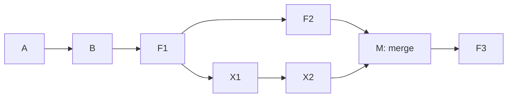
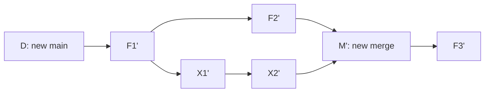

# Preserving merge structure with `--rebase-merges` and its limitations

When updating a feature branch onto a newer `main`, we commonly use `git rebase`. A standard rebase replays the feature branch's commits onto the new base commit and creates a linear history. This is easy to read, but merge commits within the rebase range are usually omitted from the list and the branching structure is flattened.

In some projects, merge commits represent important integration milestones: a sub-branch was merged into a feature branch, an experimental branch was brought into a release branch, or the team wants to preserve the structure of the development process. The **`git rebase --rebase-merges`** option instructs Git to attempt to recreate the branching structure and merge commits within the rebased range.

This option still rewrites history. Git creates new commits and recreates merge commits rather than moving the old commit objects intact. Therefore, you must understand how it works, what gets preserved, and what must be re-verified or re-applied manually.

## 1. Why preserve merge structure?

### 1.1. Merge commits record relationships between branches

A regular commit (other than a root commit) has one parent commit; a root commit has no parent. A merge commit has two or more parent commits; two parents is the common case when merging two branches. This parent relationship records that two lines of history met at a specific point.

For example, the `topic` branch had a child branch `experiment` developed in parallel and then merged back in:



Merge commit `M` has two parents: `F2` on `topic` and `X2` on `experiment`. As a result, history shows that commits `X1` and `X2` were integrated into `topic` at a specific milestone.

This information can be useful when:

- A feature branch is split into multiple sub-branches owned by different individuals or teams.
- The team wants to preserve the integration milestone for each piece of work.
- A development branch regularly merges changes from the base branch to resolve conflicts in batches.
- History structure helps trace when a sub-branch was brought in or investigate a regression.

### 1.2. How does a standard rebase handle merge commits?

With the command:

```bash
git rebase origin/main
```

Git usually drops merge commits from the operation list and replays the needed commits into a linear sequence. The content commits may still appear, but the merge relationship represented by the merge commit is no longer preserved in the new history.

This is usually appropriate when a branch only has a simple chain of commits. However, if a merge commit represents a meaningful integration event, flattening history can make it hard for readers to tell where sub-branches were combined.

### 1.3. What does `--rebase-merges` do?

The command:

```bash
git rebase --rebase-merges origin/main
```

instructs Git to recreate the branching structure within the range of rebased commits, including necessary merge commits. Git replays normal commits and creates new merge commits with corresponding parent relationships in the new history.

The shorthand option is `-r`:

```bash
git rebase -r origin/main
```

The result is a commit graph that retains branches and merge points, though the replayed commits get new identifiers because a commit depends on its content, parents, and metadata.

## 2. Example before and after rebasing

Suppose `main` has advanced by one commit `D`, while `topic` has a sub-branch merged into it:

```text
Before rebase:

A---B---C---D                 main
     \
      F1---F2-------M---F3    topic
       \            /
        X1---X2----/          experiment
```

`M` is the merge commit joining `experiment` into `topic`. We want to update `topic` onto the latest `main` at `D`.

### 2.1. Standard rebase

```bash
git switch topic
git rebase main
```

Git replays the necessary commits onto base `D` in a linear chain. Merge commit `M` is not recreated as a merge commit, so the merge relationship between the two branches is no longer represented by a merge point in the new history.

### 2.2. Rebase preserving merge structure

```bash
git switch topic
git rebase --rebase-merges main
```

Git recreates the branches and merge commits within the processed range. Conceptual diagram after rebasing:



New commits carry `'` to distinguish them from old commits. `M'` is the new merge commit with two parents in the new graph. The diagram illustrates structure only; actual hashes and layout depend on the specific history and rebase range.

## 3. Safe usage workflow

Before rebasing, confirm the working branch, the new base commit, and the range of history to be rewritten.

### Step 1: Check status and commit graph

```bash
git status
git branch --show-current
git log --graph --oneline --decorate --all
```

If the working tree or staging area has uncommitted changes, decide to save them with a commit or stash first. Rebase needs a clean working state; do not let unattributed changes get mixed into history rewriting.

To inspect the parents of a specific merge commit:

```bash
git show --no-patch --pretty=raw <merge-commit>
```

Or view the commit's object ID and its parents directly:

```bash
git rev-list --parents -n 1 <merge-commit>
```

These commands help verify which branches a merge commit actually connects.

### Step 2: Fetch the latest base

```bash
git fetch origin
```

Fetch updates remote-tracking refs such as `origin/main`; it does not automatically merge changes into your local branch. If you want to rebase onto the latest state of `main` on the remote, use `origin/main` as the upstream.

### Step 3: Create a rollback point before rewriting history

If the branch has a complex structure or has already been shared, create a backup branch:

```bash
git branch backup/topic-before-rebase
```

The backup branch preserves a ref pointing to the pre-rebase history so you can compare or recover if the result is not as expected. Because the old history is usually no longer an ancestor of the rebased branch, `git branch -d` may refuse deletion. Only after checking and ensuring the backup is no longer needed can you delete it with `git branch -D backup/topic-before-rebase`.

### Step 4: Run rebase preserving merge structure

```bash
git switch topic
git rebase --rebase-merges origin/main
```

If you want to view and edit the operation list before Git executes it, use interactive mode:

```bash
git rebase -i --rebase-merges origin/main
```

### Step 5: Verify the result

```bash
git status
git log --graph --oneline --decorate --all
```

Compare the graph before and after to confirm that the sub-branches and merge commits to keep still appear. Check diffs, run tests, and review any sections that had manual conflict resolution.

## 4. Interactive todo list of `--rebase-merges`

Rebasing while preserving merge structure needs to describe moving between branches and recreating merge commits. Therefore, the operation list (todo list) may contain extra commands alongside `pick`.

| Command in todo | Meaning |
|---|---|
| `pick <commit>` | Replay a regular commit. |
| `label <name>` | Label the current HEAD position for later reference. |
| `reset <name>` | Move HEAD to the specified label or position in the todo list. |
| `merge -C <commit> <label>` | Create a merge commit with the labeled branch and reuse the old merge commit's message. |
| `merge -c <commit> <label>` | Similar to `-C`, but opens the editor to edit the merge commit message. |
| `reword <commit>` | Replay the commit and edit its commit message. |
| `edit <commit>` | Pause to modify the commit during the rebase. |
| `exec <command>` | Run a shell command at that point in the todo list. |

The example below only illustrates the idea of the todo list, not a fixed output that Git always generates:

```text
label onto
reset onto
pick <F1>
label topic-side-base
pick <F2>
label topic-tip
reset topic-side-base
pick <X1>
pick <X2>
label experiment-tip
reset topic-tip
merge -C <M> experiment-tip
pick <F3>
```

Git uses `label` to remember points on the graph, `reset` to jump back to a remembered branch, and `merge` to recreate merge points. If you edit the todo list, preserve the correct order and label relationships; deleting or misplacing commands can alter the resulting structure.

`--rebase-merges` can be combined with `-i` for manual todo editing. When manual editing is unnecessary, simply run `git rebase --rebase-merges <upstream>`.

## 5. Two modes for handling "cousin" branches

The `--rebase-merges` option has two modes:

- `no-rebase-cousins` (default): commits that are not descendants of the original fork point retain their original base.
- `rebase-cousins`: those cousin commits are also moved onto the new base, i.e., the upstream or target specified by `--onto`.

"Cousin" here describes commits on a side branch whose original fork point lies outside the ancestry path of the branch being rebased. They may have been merged into the working branch, yet they themselves do not sit on the same line of development starting from the original fork point.

Select the default mode:

```bash
git rebase --rebase-merges=no-rebase-cousins origin/main
```

Or move cousin branches onto the new base as well:

```bash
git rebase --rebase-merges=rebase-cousins origin/main
```

Example of the difference:

- With `no-rebase-cousins`, a side branch starting from an old commit can keep its old base commit, while the main branch being rebased moves onto `origin/main`.
- With `rebase-cousins`, that side branch is also replayed onto the new base.

Neither mode is always right. If the side branch needs to retain its relationship with a release base or separate maintenance branch, the default may fit better. If the entire group of branches needs to move together onto a new base, `rebase-cousins` may be the right choice. Inspect the graph and commit range before choosing.

### 5.1. Combining with `--onto`

`--onto` lets you specify both the new base commit and the start of the range to rebase:

```bash
git rebase --rebase-merges --onto origin/release <old-base> topic
```

This command tells Git to take commits on `topic` after `<old-base>` and recreate them on `origin/release`, while attempting to preserve merge structure within that range. `<old-base>` must be identified accurately; picking the wrong starting point can omit commits or pull extra commits into the new history.

## 6. Handling conflicts while recreating merges

Conflicts can occur when Git replays regular commits or recreates merge commits. The resolution workflow is essentially the same as regular merge/rebase, except with `--rebase-merges`, an old merge commit may need conflict resolution again.

### 6.1. Resolution steps

When Git pauses:

```bash
git status
```

Open the conflicted files, inspect both sides' contents, combine the right changes, and remove conflict markers. Then:

```bash
git add <resolved-file>
git rebase --continue
```

If additional conflicts occur in the next commit or merge commit, repeat these steps. You can check diffs to verify:

```bash
git diff
git diff --cached
```

If you realize you picked the wrong base or do not want to continue the in-progress operation:

```bash
git rebase --abort
```

This command cancels the running rebase session and returns the branch to its state before the rebase started. If you want to skip the commit currently being applied, `git rebase --skip` can be used in some cases, but only when you have determined that commit's content is no longer needed.

### 6.2. Why do old merge conflicts need to be resolved again?

When two branches were merged previously, the developer may have manually edited the result to reconcile two implementations. Those edits may exist only in the merge commit's content, not as standalone commits on either parent branch.

When `--rebase-merges` creates a new merge commit, Git re-executes the merge based on the new parent commits. Git cannot always infer every manual decision made during the old merge. Therefore, conflicts can reappear and special edits must be re-applied.

After resolving, verify the merge result with tests and diff review. Git reporting that the rebase completed does not prove that the old merge's logic was preserved intact.

## 7. Important limitations

### 7.1. Structure is recreated, old commits are not preserved intact

`--rebase-merges` creates new commits. Even though messages and branching relationships are preserved, the hashes of regular commits and merge commits change because parents or contents may change. This is not a verbatim copy of old merge commits.

Because the new commits are new objects, GPG/SSH signatures attached to old commits no longer validate for the new commits. If your workflow requires signed commits, re-sign commits created in the new history using the appropriate configuration.

### 7.2. Conflict resolutions and manual edits are not automatically preserved

Edits made directly inside the old merge result may not be replayed automatically by Git. The operator must inspect and re-apply them when creating the new merge. This is the most important limitation when rebasing a branch with many merge commits that had complex conflict resolutions.

### 7.3. Topology is only preserved within the rebased range

`--rebase-merges` attempts to preserve the branching structure of commits within the rebase range. It does not recreate every branch, tag, or ref across the entire repository. Refs outside the range may still point to the old history. Commits already present in the new base or that become empty may also be handled per rebase rules, so the final graph does not necessarily look identical to the old graph.

Therefore, clearly specify the upstream, starting point, and target branch. When using `--onto`, be especially careful to confirm the old base commit so unintended commits are not pulled into scope.

### 7.4. Merge strategy and merge options may need to be re-specified

When recreating a merge, Git must re-run the merge operation. The default merge strategy typically used is `ort`; if the project needs a different strategy or custom merge options, consider `--strategy` and `--strategy-option` when running rebase.

Example of syntax:

```bash
git rebase --rebase-merges --strategy=ort --strategy-option=<option> origin/main
```

Valid strategy and option names depend on the Git version and situation. Do not copy merge options from an old command without checking whether they fit the merge being recreated.

### 7.5. Unsuitable for rewriting shared branches without coordination

Rebase changes commit hashes. If a branch has been pushed and others rely on the old commits, rebasing can make their history diverge and force them to adjust their local branches.

Do not arbitrarily rebase shared branches or published main branches. If the team agrees to rewrite a pushed branch, notify collaborators and update the remote in a controlled manner. For a personal branch that has been pushed, when a forced update is needed after rebasing, prefer:

```bash
git push --force-with-lease origin topic
```

`--force-with-lease` verifies the remote ref state local expects before force-updating, reducing the risk of overwriting others' new commits. It still rewrites remote history and does not replace coordinating with the team.

### 7.6. Tags and other refs may still point to old history

A tag is a ref pointing to a Git object. Rebase does not automatically move all tags or other refs to the new commits. After rebasing, inspect related tags and branches if they serve as release or integration milestones. Do not move published release tags without an explicit team decision.

### 7.7. Not every branch needs to preserve merge commits

If a branch has only a linear chain of commits, `--rebase-merges` provides little benefit. If the team prefers a clean, easy-to-read history and does not need to keep sub-branch integration milestones, a standard rebase may be more appropriate.

Preserving topology can make history longer and more complex. Choose it only when the merge structure conveys information useful for maintenance, review, or traceability.

## 8. Inspecting history after rebase

Once complete, do not only check the working tree status. Inspect the graph and contents of the recreated merge commits.

```bash
# View commit graph
git log --graph --oneline --decorate --all

# Check branch status
git status -sb

# View commit and parents of the new merge commit
git show --no-patch --pretty=raw <new-merge-commit>

# View changes of a merge commit
git show --stat <new-merge-commit>
```

For a merge commit, you can view the diff against each parent with:

```bash
git diff <new-merge-commit>^1 <new-merge-commit>
git diff <new-merge-commit>^2 <new-merge-commit>
```

These two diffs help check the merged result relative to each parent branch. Combine them with tests and logic review because diffs alone do not verify correct program behavior.

If you want to cross-check old history, keep the pre-rebase backup branch until verification is complete. You can compare the old and new graphs using `git log --graph` on the respective refs.

## 9. When should and shouldn't you use `--rebase-merges`?

| Situation | Recommendation |
|---|---|
| Branch has multiple merged sub-branches and integration milestones must be preserved | Consider `--rebase-merges` |
| Branch has only a linear commit chain | Standard rebase is usually simpler |
| Old merge commits had heavy manual conflict edits | Only rebase when you have time to re-apply and test those edits |
| Branch is already used by multiple people | Avoid rewriting history without clear coordination |
| Want to move cousin side branches onto the new base too | Consider `--rebase-merges=rebase-cousins` |
| Want cousin branches to keep their original base | Use the default `no-rebase-cousins` mode |
| Want step-by-step control over merge recreation | Use `git rebase -i --rebase-merges` and carefully inspect the todo list |

## 10. Complete practice workflow

Suppose `topic` has a sub-branch merged into it and `origin/main` just received new commits. The goal is to update `topic` onto the new base, preserve the merge topology, and verify the result.

**Step 1: Check and fetch latest data**

```bash
git status
git log --graph --oneline --decorate --all
git fetch origin
```

**Step 2: Create a backup point and switch to the branch to rebase**

```bash
git branch backup/topic-before-rebase
git switch topic
```

**Step 3: Recreate merge structure on the new base**

```bash
git rebase --rebase-merges origin/main
```

If you need to view and adjust the recreation operations:

```bash
git rebase -i --rebase-merges origin/main
```

**Step 4: Resolve conflicts if any**

```bash
git status
# edit conflicted files
git add <resolved-file>
git rebase --continue
```

Repeat until the rebase completes. If you decide to stop:

```bash
git rebase --abort
```

**Step 5: Verify topology and contents**

```bash
git log --graph --oneline --decorate --all
git status
```

Confirm that the merge commits to keep were recreated, inspect diffs, and run all required tests. Specifically review old merges that previously involved manual edits.

**Step 6: Update the remote if the branch was shared**

If this is a pushed personal branch and the team has agreed on rewriting history:

```bash
git push --force-with-lease origin topic
```

If the branch is a shared branch, coordinate with everyone using it before updating the remote.

**Step 7: Clean up the backup point after verification**

```bash
git branch -D backup/topic-before-rebase
```

Only delete the backup after verifying the new history and passing all checks. `-D` skips checking whether the branch was merged; therefore, ensure the backup is no longer the sole copy holding commits that might need recovery.

## 11. Summary

- Standard rebase usually drops merge commits in scope and replays commits into a linear history.
- `git rebase --rebase-merges` (or `git rebase -r`) attempts to recreate branching structure and merge commits.
- New merge commits receive new hashes; this recreates topology rather than preserving old commit objects intact.
- Manual edits made during old merge conflict resolutions may need to be re-applied.
- `no-rebase-cousins` is the default mode; `rebase-cousins` moves cousin branches onto the new base as well.
- The todo list may use `label`, `reset`, `merge -C`, and `merge -c` to recreate branches and merges.
- Rebase rewrites history; do not arbitrarily rebase shared or published branches.
- After rebasing, inspect the graph, merge commits, diffs, and tests; when updating a pushed personal branch, consider `--force-with-lease` after coordinating.

Use `--rebase-merges` when merge structure carries information your team needs to preserve. Before running it, confirm the exact range and new base; afterward, verify each important merge and re-apply manual edits if needed.
