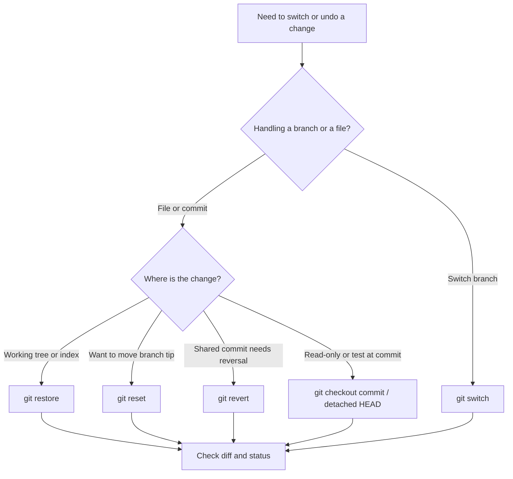

# Distinguishing restore, reset, revert, and checkout by Scope of Impact

When working with Git, a change can reside in the working tree, the staging area, or already be recorded in a commit. Therefore, asking how to "undo a change" is not enough to choose a command: you need to know which area you want to change and whether you want to rewrite commit history. Using the wrong command can cause you to lose uncommitted work or alter history that teammates are relying on.

This lesson belongs to the **Switching and Undoing** chapter of the `SOURCE_CONTROL_GIT` module. The module guides you from the working tree, staging area, commits, and history to branches, merges, rebases, remotes, and tags; the goal is to collaborate with branches, handle changes, and recover from mistakes while preserving important history.

## 1. Four Areas and Concepts to Distinguish

Before choosing a command, picture the four objects Git commonly affects:

- **Working tree**: the files currently present in your working directory. This is where you edit code and documentation.
- **Index (staging area)**: the snapshot of content selected to go into the next commit. `git add` updates the index.
- **HEAD**: the reference to the current commit. When you are on a normal branch, HEAD points to that branch and the branch points to the latest commit.
- **Commit history**: the chain of commits that have been created. Moving a branch tip can cause a commit to no longer lie on that branch's history; creating a revert commit keeps the old commit and adds a new commit that reverses the change.

Inspect the status and differences between areas:

```bash
git status
git diff
git diff --cached
git log --oneline --decorate -5
```

`git diff` compares the working tree with the index; `git diff --cached` compares the index with HEAD. These two commands help you determine which changes are staged and which are unstaged before undoing anything.

## 2. Quick Selection Table

| Command | Primary impact | Commit history | When to use |
| --- | --- | --- | --- |
| `git restore` | Restores working tree and/or index content from a source | Does not move HEAD, does not create a commit | Discard edits in a file or unstage a file |
| `git reset` | Moves branch/HEAD and depending on mode updates index, working tree; path form updates index only | Can move branch tip, does not create a new commit | Adjust local commits or unstage a file |
| `git revert` | Creates a new commit that reverses the changes of an older commit | Keeps old history and adds a new commit | Undo a commit that has already been shared or pushed |
| `git checkout` | Legacy command with multiple modes: switches branch/HEAD or restores files to index and working tree | Depends on syntax; can switch branches or enter detached HEAD | Reading older repository guides; use `switch`/`restore` for new workflows |

No single command is always the "safest" in every situation. Choose based on your goal: modifying file contents, modifying the staging area, moving a branch tip, or creating a reversing commit.

## 3. git restore: Restoring File Contents

`git restore` is designed to restore paths in the working tree or index from a source. This command does not move HEAD and does not create commits.

### Discarding unstaged changes in the working tree

Suppose you edited `src/search.java` but want to discard the unstaged edits and return to the content currently in the index:

```bash
git restore -- src/search.java
```

When `--source` is not specified, `git restore` takes content from the index to update the working tree. Unstaged changes to that path will be overwritten. If you need to keep the edits, back them up or commit/stash them before running the command.

### Unstaging while keeping modified content

If you already ran `git add src/search.java` but changed your mind and want to remove the file from the staging area:

```bash
git restore --staged -- src/search.java
```

With `--staged` and no `--source` specified, the default source is HEAD. Git updates the index to match HEAD's content while leaving the working tree untouched. As a result, the edits remain in the file and appear in `git diff` instead of `git diff --cached`.

### Restoring both index and working tree from a commit

To take a file from a previous commit and place the same content into both the index and the working tree:

```bash
git restore --source=HEAD~1 --staged --worktree -- src/search.java
```

`--source=HEAD~1` selects the parent commit of HEAD as the source. `--staged` updates the index and `--worktree` updates the working tree. The command does not switch the branch to that commit; only the specified path is restored to the source content.

You can also pull a file from another branch, for example:

```bash
git restore --source=origin/main --worktree -- config/application.yml
```

The command above puts the content from `origin/main` into the working tree, while keeping the index unchanged. To update the index as well, add `--staged`.

### Note on untracked files

`git restore` operates on paths that Git tracks in the index. Untracked files do not have a version in the index to restore this way. If you want to delete untracked files, that is a different task; preview first with `git clean -n` and only run the delete command after confirming the exact scope.

## 4. git reset: Unstaging or Moving the Branch Tip

`git reset` has two usage patterns to distinguish: the pathspec form only updates the index; the commit form moves HEAD/branch and, depending on the mode, can also update the index and working tree.

### Path form: unstaging a file

```bash
git reset HEAD -- src/search.java
```

This command copies the content from HEAD into the index for the specified path. It unstages the file's changes while keeping the content in the working tree unchanged. The effect is similar to `git restore --staged -- src/search.java`.

In pathspec form, `git reset` does not move HEAD or the branch tip. This syntax is useful when you want to deselect a file from the next commit without losing your edits.

### Commit form: choosing the reset mode

When you run `git reset <commit>`, Git moves the current branch (and HEAD along with that branch) to the specified commit. The mode determines whether the index and working tree are updated.

| Mode | Branch/HEAD | Index | Working tree |
| --- | --- | --- | --- |
| `--soft` | Moves to target commit | Unchanged | Unchanged |
| `--mixed` (default) | Moves to target commit | Restored to target commit | Unchanged |
| `--hard` | Moves to target commit | Restored to target commit | Restored to target commit |

For example, if you just created a local commit and want to undo that commit while keeping all changes staged:

```bash
git reset --soft HEAD~1
```

The branch tip moves back to the parent commit, while the index and working tree keep the previously committed content. `git status` will typically show the changes as staged so you can adjust them or create a new commit.

If you want to undo the commit while keeping the edits in the working tree as unstaged changes:

```bash
git reset --mixed HEAD~1
```

This is also the default behavior when running `git reset HEAD~1` without specifying a mode. HEAD/branch moves to the parent commit, the index is reset to match that commit, and the working tree keeps the modified content. Because the index no longer contains the edits, the changes appear in `git diff`.

If you want to undo the commit and discard both staged and unstaged changes so the working tree matches the target commit completely:

```bash
git reset --hard HEAD~1
```

This command can cause loss of uncommitted data. In addition to replacing tracked changes, Git may delete untracked files or directories if they block paths that need to be written from the target commit. Only use it after checking `git status`, saving any work you need to keep, and making sure the target commit is right.

### Reset is not the way to undo shared commits

Reset moves the branch tip. If a commit has already been pushed and teammates have based work on it, resetting and force-pushing can rewrite history that others are using. For shared branches, you should generally use `git revert` to create a reversing commit. Only rewrite remote history when the team has agreed and understands the impact on other clones.

## 5. git revert: Reversing a Commit with a New Commit

`git revert` creates a new commit that applies the inverse of the changes from the specified commit. The old commit remains in history. This is usually the appropriate choice when you need to undo a change that has already been pushed to a shared branch.

For example, commit `a1b2c3d` introduced a buggy change into the `main` branch. After confirming it needs to be undone:

```bash
git switch main
git pull --ff-only
git revert a1b2c3d
```

Git opens your editor to confirm the revert commit message (unless you pass a different message option). Once complete, history has a new commit describing the reversal of `a1b2c3d`. The code returns to the state corresponding to that reversal, while the original commit is not deleted.

If you want to preview the changes and create the commit yourself later:

```bash
git revert --no-commit a1b2c3d
git diff
git diff --cached
```

`--no-commit` applies the reversed changes to the index and working tree without automatically creating a commit. You can inspect them, combine related adjustments, and then commit according to your team's workflow.

### Revert can produce conflicts

If subsequent commits modified the same code regions, Git may not be able to apply the reverse changes automatically. In that case:

```bash
git status
```

Resolve each file according to the current logic, stage the result, and continue:

```bash
git add -- path/to/conflicted-file
git revert --continue
```

If you want to cancel the entire in-progress revert operation:

```bash
git revert --abort
```

### Reverting a merge commit

A merge commit has multiple parents, so when reverting it you must specify the mainline parent with `-m`:

```bash
git revert -m 1 <merge-commit>
```

`-m 1` selects the first parent as the mainline, which is usually the branch you were on before the merge. Check `git show --no-patch --pretty=raw <merge-commit>` or `git log --graph` to determine the parent order before running it. Choosing the wrong parent can reverse unintended changes. Reverting a merge commit also affects how Git handles future merges; if you later need to re-integrate the reverted changes, plan a separate merge strategy rather than simply repeating the old merge operation.

## 6. git checkout: Legacy Command with Multiple Roles

`git checkout` is a historical command that combines two groups of functions: switching branches/commits and restoring paths. Because a single keyword can affect HEAD, the index, or the working tree depending on syntax, beginners can easily get confused.

### Checking out a branch

```bash
git checkout main
```

This command switches HEAD to the `main` branch and updates the index and working tree to match that branch. If uncommitted changes would be overwritten, Git usually refuses to switch branches; inspect and commit/stash them first.

In modern Git, you should express your intent clearly with:

```bash
git switch main
```

### Checking out a specific commit

```bash
git checkout a1b2c3d
```

This command moves HEAD to that commit in a detached HEAD state. You can read or experiment at this commit, but any new commits created will not automatically belong to a branch. If you want to keep resulting work, create a branch:

```bash
git switch -c experiment/from-a1b2c3d
```

### Checking out a file from the index

```bash
git checkout -- src/search.java
```

In path form, `checkout` restores the file in the working tree from the index, similar to `git restore -- src/search.java`. Unstaged changes to the file will be overwritten.

### Checking out a file from another commit or branch

```bash
git checkout origin/main -- config/application.yml
```

In the form with a tree-ish and a path, Git takes the path's content from the specified source and updates both the index and the working tree. HEAD does not switch to `origin/main`; you remain on your current branch. The newer, more readable syntax is:

```bash
git restore --source=origin/main --staged --worktree -- config/application.yml
```

Therefore, you cannot assume `checkout` always switches branches or always restores files. You must look at the full syntax to determine its scope of impact.

## 7. Same Goal, Different Commands

The following examples illustrate how to choose a command based on the state you need to change:

| Goal | Recommended command | Result |
| --- | --- | --- |
| Unstage a file while keeping edits | `git restore --staged -- file` | Index returns to HEAD; working tree keeps edits |
| Discard unstaged edits in a file | `git restore -- file` | Working tree takes content back from index |
| Undo last local commit, keep changes staged | `git reset --soft HEAD~1` | Branch moves back one commit; index and working tree keep content |
| Undo last local commit, keep content unstaged | `git reset --mixed HEAD~1` | Branch and index move back; working tree keeps content |
| Undo last local commit and discard tracked changes | `git reset --hard HEAD~1` | Branch, index, and working tree all move back; risk of data loss |
| Undo a shared commit | `git revert <commit>` | Creates a new commit reversing the changes |
| Switch to another branch | `git switch <branch>` | Changes branch/HEAD and updates working tree |
| Get a file from another branch | `git restore --source=<branch> --staged --worktree -- file` | Updates only that file in index and working tree |

## 8. Pre- and Post-Undo Verification Workflow

Before running a command that can overwrite data or move a branch tip, inspect status and history:

```bash
git status
git diff
git diff --cached
git log --oneline --decorate --graph -8
```

If you are about to reset a local commit, verify the current branch and target commit. You can create a reference branch to preserve the current point before rewriting history:

```bash
git branch backup/before-reset
```

After the operation, check again:

```bash
git status
git diff
git diff --cached
git log --oneline --decorate -8
```

With `restore`, confirm the right file and the right source. With `reset`, confirm the branch tip, index, and working tree are in the expected state. With `revert`, confirm the new commit reversed the right changes and no conflicts remain. With legacy `checkout`, confirm whether you switched HEAD or only updated a path.

## 9. Common Mistakes

- **Using `git restore -- file` when you only want to unstage**: this command overwrites the working tree from the index and can discard unstaged edits. Use `git restore --staged -- file` to preserve content.
- **Using `git reset --hard` as a routine cleanup command**: tracked changes in the index and working tree can be lost. Inspect and back up first.
- **Using `git reset` to undo commits on a shared branch**: the branch tip is moved and can cause remote history to diverge from other clones. Consider `git revert`.
- **Thinking `git revert` deletes the old commit**: revert adds a new commit that reverses the content; old history remains.
- **Forgetting `-m` when reverting a merge commit**: Git needs to know which parent is the mainline to determine which changes to reverse.
- **Using `git checkout -- file` and forgetting `--`**: the filename may be interpreted as a branch name or tree-ish. Use `git restore` for newer file operations.
- **Checking out a commit and making changes without creating a branch**: detached HEAD does not attach new commits to a branch; create a branch if you want to keep your work.

## 10. Command Selection Flowchart



Before finishing, ask yourself:

1. Do I want to change the working tree, index, HEAD, or commit history?
2. Will the command I am about to run overwrite content or move a branch tip?
3. Has the commit I want to undo already been shared with others?
4. Did I check `git status`, `git diff`, and `git diff --cached` before and after the operation?
5. If the operation does not go as expected, do I have a backup branch or a copy of the work I need to keep?

`restore` is suited for restoring file contents, `reset` for adjusting the index or moving a branch tip, `revert` for reversing a commit with a new commit, and `checkout` is a legacy command whose full syntax must be read carefully to understand its impact. When you clearly distinguish between the working tree, index, HEAD, and history, you will choose the right undo method and keep your repository consistent during collaboration.

## References

- [Git documentation: git-restore](https://git-scm.com/docs/git-restore) — restoring content in the working tree and index.
- [Git documentation: git-reset](https://git-scm.com/docs/git-reset) — soft, mixed, hard modes and pathspec resets.
- [Git documentation: git-revert](https://git-scm.com/docs/git-revert) — creating reversing commits and handling merge commit reverts.
- [Git documentation: git-checkout](https://git-scm.com/docs/git-checkout) — syntax for checking out branches, commits, and paths.
- [Git documentation: git-switch](https://git-scm.com/docs/git-switch) — switching branches separately from restoring files.
