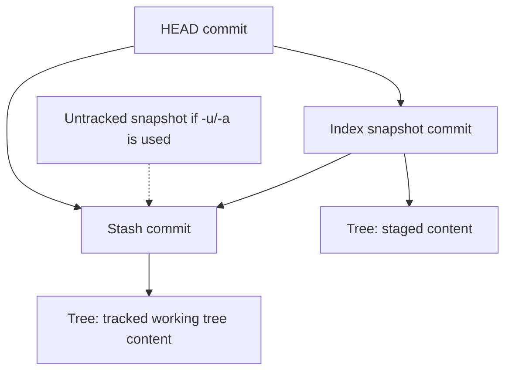
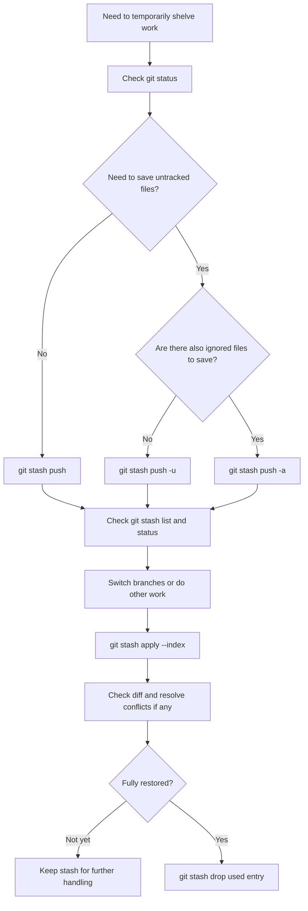

# What Stash Temporarily Saves and How It Relates to the Index

While working on a feature, you may need to switch to another branch to handle an urgent bug or inspect a change without creating a commit yet. If the working tree still has modifications, switching branches may be rejected by Git or carry those changes over to the other branch. `git stash` helps temporarily shelve your current work so you can return to it later.

It is important to understand what kinds of changes stash saves and how it preserves staging state. Git distinguishes between content in the **working tree** and content in the **index (staging area)**. By default, stash records both staged and unstaged changes of files tracked by Git. Untracked and ignored files require separate options. This lesson belongs to the `SOURCE_CONTROL_GIT` module, where you learn working tree, staging area, commit, branch, merge, rebase, remote, and tag to collaborate and recover work safely.

## 1. Working tree, index, and HEAD

Before using stash, distinguish three states:

- **HEAD**: the current commit that the branch points to.
- **Index (staging area)**: the content you have selected with `git add` to include in the next commit.
- **Working tree**: the current file content in the working directory; it can contain staged edits as well as newer unstaged modifications.

For example, a file `src/search.java` has `timeout = 30` in the commit. You edit it to `timeout = 45` and run `git add`, then continue editing it to `timeout = 60` without staging again. At this point:

| Area | Content |
| --- | --- |
| HEAD | `timeout = 30` |
| Index | `timeout = 45` |
| Working tree | `timeout = 60` |

The following two commands show the differences between these areas:

```bash
git diff -- src/search.java
git diff --cached -- src/search.java
```

`git diff` compares the working tree against the index, so it displays the change from `45` to `60`. `git diff --cached` compares the index against HEAD, so it displays the change from `30` to `45`.

## 2. What changes does stash save by default?

Basic command:

```bash
git stash push -m "WIP: search timeout"
```

By default, Git saves changes to tracked files in both places:

- Staged changes in the index.
- Unstaged changes in the working tree compared to the index.

After saving successfully, Git removes those tracked changes from the working tree and index to return to a clean state matching HEAD. Therefore, if you staged part of your work and continued editing the rest, stash still records both states so they can be restored later.

In the `timeout` example above, stash records the index content as `45` and the working tree content as `60`. After a regular stash completes, both the index and the working tree revert to the HEAD content `30`.

### Files not saved by default

| File type | Default | Option |
| --- | --- | --- |
| Modified tracked files, staged or unstaged | Saved | No extra option needed |
| New untracked files | Not saved | `-u` or `--include-untracked` |
| Files ignored by `.gitignore` (ignored) | Not saved | `-a` or `--all` |

If your work includes new files not yet tracked by Git, use:

```bash
git stash push -u -m "WIP: search feature with new test"
```

`-u` saves untracked files as well, while cleaning them from the working tree after the stash succeeds. If you also want to save ignored files, use:

```bash
git stash push -a -m "WIP: local build changes"
```

`-a` includes both untracked and ignored files. Check carefully beforehand because ignored files may include large build directories, caches, auto-generated files, or private environment data. There is no need to include them in a stash if your goal is only to preserve source code edits.

### Stashing only staged changes

In Git versions that support the `--staged` option, you can shelve only the changes currently in the index:

```bash
git stash push --staged -m "Staged patch only"
```

Unstaged edits remain in the working tree. This is useful when you want to temporarily shelve the changes selected for a commit while continuing to work on other edits. If Git reports that it does not recognize the option, check the Git version you are using and the corresponding command documentation.

### Keeping staged changes in the working tree

The `--keep-index` option instructs Git to keep staged changes in the index after creating the stash:

```bash
git stash push --keep-index -m "Stash unstaged work"
```

This is useful when you have staged what you want to commit and want to temporarily shelve unstaged changes to test the exact content that will be committed. Unlike `--staged`, `--keep-index` controls the index state after the stash operation; it does not mean that the stash records only staged changes.

## 3. How does stash relate to the index?

A stash is not just a single patch of the working tree. In terms of Git structure, a regular stash is a special commit that records the working state:

- The first parent points to the HEAD commit at the time the stash was created.
- The second parent is an auxiliary commit recording the index (staging area) content.
- The tree of the stash commit records the working tree content of tracked files at that time.
- When `-u` or `-a` is used, the stash can have an additional parent containing a snapshot of untracked files (and ignored files if `-a` is used).

This relationship can be illustrated as follows:



In the diagram, the stash commit stores the tree of the working tree, while the second parent stores the tree of the index. Because both snapshots exist, Git can distinguish staged edits from unstaged edits when restoring properly.

You can inspect the structure of the latest stash with:

```bash
git cat-file -p stash@{0}
```

The output shows `parent` lines. The first parent is the original HEAD, and the second parent is the index snapshot. View the contents of the index commit:

```bash
git show --stat stash@{0}^2
```

In repositories where a stash includes untracked files, there may be a third parent. Do not rely on fixed hashes or a fixed parent count in scripts without checking the stash type first.

### Comparing saved staged and unstaged changes

Suppose `stash@{0}` is the stash just created. You can view the staged changes at the time of the stash by comparing the original HEAD with the index snapshot:

```bash
git diff stash@{0}^1 stash@{0}^2
```

Unstaged tracked edits can be viewed by comparing the index snapshot with the stash tree:

```bash
git diff stash@{0}^2 stash@{0}
```

These two comparisons clarify why stash needs to store the index state separately. They are useful when you want to inspect exactly which changes were selected into the staging area before shelving them.

## 4. Viewing and managing stash entries

Stash entries are managed as an ordered list, typically displaying the newest entry at the top:

```bash
git stash list
```

Example:

```text
stash@{0}: On feature/search: WIP: search timeout
stash@{1}: On main: WIP: update deployment config
```

View a summary of changes in the latest entry:

```bash
git stash show --stat stash@{0}
```

View the patch:

```bash
git stash show -p stash@{0}
```

If the stash contains untracked files and you want to view them as well, use `--include-untracked`:

```bash
git stash show --include-untracked -p stash@{0}
```

The index `stash@{0}` can shift when you create or delete other entries. Run `git stash list` to confirm the right entry before applying, popping, or dropping it.

## 5. Restoring a stash and recovering the index state

There are two commonly used commands to apply a stash:

```bash
git stash apply stash@{0}
git stash pop stash@{0}
```

- `apply` applies the changes to the working tree while keeping the stash entry in the list.
- `pop` applies the changes and deletes the stash entry if the application succeeds. If a conflict occurs, Git typically keeps the stash entry so you can resolve it.

By default, when applying a stash, Git does not attempt to restore the original staged state. If you want to restore the index state as well, use `--index`:

```bash
git stash apply --index stash@{0}
```

Or:

```bash
git stash pop --index stash@{0}
```

`--index` tells Git to restore both the changes in the index and the working tree as they were when the stash was created. This can fail if current changes or conflicts prevent Git from restoring the index cleanly. In that case, resolve the conflicts, inspect the diff, and manually stage the necessary parts.

Example of a controlled workflow:

```bash
git stash list
git stash show -p stash@{0}
git stash apply --index stash@{0}
git status
git diff
git diff --cached
```

Only after confirming the changes are back in the right places and you no longer need the stash entry should you delete that entry:

```bash
git stash drop stash@{0}
```

If you want to delete all stashes, the command is:

```bash
git stash clear
```

`clear` deletes all stash references in the repository and can make snapshots difficult or impossible to recover after Git prunes unreferenced objects. Use it only when you are sure you do not need any stash entries.

## 6. Practical scenario: staging partially then continuing edits

Suppose you are developing a search feature and want to commit the input handling first, without including experimental logging changes in the commit yet.

Initial state:

```bash
git status
```

You stage the input handling file, then make further edits to logging:

```bash
git add src/search.java
# Continue editing src/search.java or other files after staging
```

Inspect both areas:

```bash
git diff --cached
git diff
```

If you need to pause and switch to another branch, stash both states:

```bash
git stash push -u -m "WIP: search input and logging"
```

After handling the other work, switch back to the original branch and restore:

```bash
git switch feature/search
git stash apply --index stash@{0}
```

Verify again:

```bash
git status
git diff --cached
git diff
```

If the restore succeeds, the previously staged changes remain in the index, and the subsequent edits remain in the working tree. You can continue refining and committing them incrementally.

## 7. Conflicts and limitations to keep in mind

A stash is created from a specific repository state. If the current branch has changed the same lines or code regions, applying it can cause conflicts. When that happens:

```bash
git status
git diff
```

Open each conflicted file, compare the stashed changes against the current content, edit to the desired result, and stage it:

```bash
git add -- path/to/resolved-file
git diff --cached
```

The stash entry is preserved when using `apply`, so you can reference it or retry after handling the issues. Do not drop the stash before verifying all tracked and untracked files that need to be restored.

A few points to remember:

- Stashes live in the local repository and are not automatically pushed to a remote like branches. To share work, create a branch and commit according to your team's workflow.
- Stash is not a substitute for long-term backups. If changes are important, commit them on a separate branch to keep a clear history.
- Untracked files are only saved when using `-u` or `-a`; ignored files require `-a`.
- `--index` attempts to restore the staging state, but may fail if there are conflicts or if the current index is incompatible.
- If there are multiple stash entries, always check the list and contents before operating by index number.

## 8. Workflow for choosing and using stash



Before finishing, check yourself:

1. Have I distinguished between staged and unstaged changes?
2. Does my work include untracked or ignored files that need to be included in the stash?
3. Do I need to preserve the original index when applying with `--index`?
4. Have I inspected the right stash entry before apply/pop/drop?
5. Have I verified the working tree, index, and files to be restored before deleting the stash?

Stash records temporary working state, in which the index has its own snapshot so Git can distinguish staged changes from unstaged changes. When you understand this relationship properly, you can pause work, switch contexts, and restore the exact state needed without having to create commits just to temporarily shelve changes.

## References

- [Git documentation: git-stash](https://git-scm.com/docs/git-stash) — how to save, view, apply, and manage stashes.
- [Git documentation: git-diff](https://git-scm.com/docs/git-diff) — comparing working tree, index, and commits.
- [Pro Git: Stashing and Cleaning](https://git-scm.com/book/en/v2/Git-Tools-Stashing-and-Cleaning) — examples of using stash during development.
