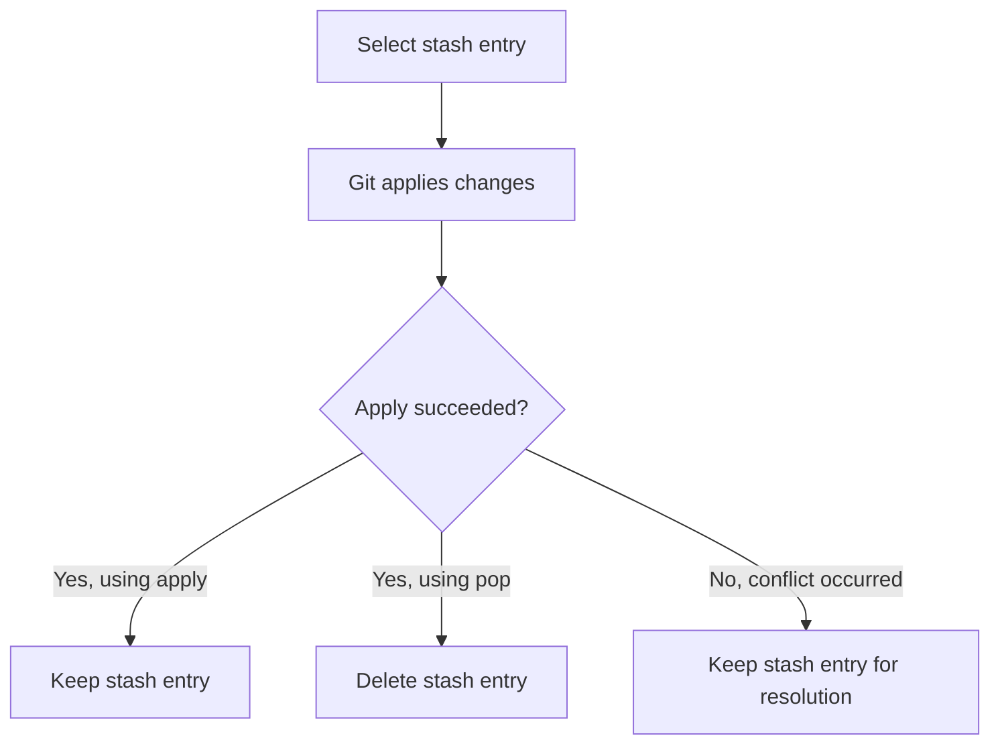

# Distinguishing `git stash apply` from `git stash pop`

When working on an unfinished task and needing to switch to another branch, we can use `git stash` to temporarily shelve changes in the working tree. Afterward, Git provides two ways to bring the shelved changes back: **`git stash apply`** and **`git stash pop`**.

Both commands apply the contents of a stash to the current working tree. The key difference lies in how the stash entry is handled after a successful apply: `apply` keeps the entry in the stash list for reuse; `pop` automatically deletes that entry from the list if the application succeeds. If a conflict occurs, `pop` does not delete the entry, so we still have the stash available to resolve or retry.

Understanding this difference helps prevent losing track of changes, especially when switching branches, resolving conflicts, or needing to apply the same set of changes in multiple places.

## 1. What is stash and what changes does it save?

**Stash** is Git's mechanism for temporarily saving uncommitted changes, typically including changes in files already tracked by Git. After a successful stash, Git brings the working tree to a clean state matching the current commit so we can switch branches or perform other work.

For example, we are editing a feature but do not want to create a commit yet:

```bash
git status
git stash push -m "WIP: search form"
git status
```

The first command checks the changes. The second saves them into a stash with a descriptive message. After a successful stash, the changes are temporarily saved and the working tree typically returns to a clean state.

### 1.1. What does stash save by default?

By default, `git stash push` saves changes to files tracked by Git, including:

- Unstaged changes in the working tree.
- Staged changes in the staging area.

New untracked files are not included in the stash by default. If you want to save them too, use `-u` or `--include-untracked`:

```bash
git stash push -u -m "WIP: include new test files"
```

If you also need to save ignored files, use `-a` or `--all`:

```bash
git stash push -a -m "WIP: include ignored build output"
```

Be cautious with `-a`, because it can put build files, caches, or large data into the stash. Stash does not replace long-term backups and does not automatically sync changes to a remote.

### 1.2. Stash entry and stash list

Each time a stash succeeds, Git creates a new stash entry. You can view the list with:

```bash
git stash list
```

Example:

```text
stash@{0}: On feature/search: WIP: search form
stash@{1}: On main: WIP: update documentation
stash@{2}: On bugfix/login: WIP: reproduce timeout
```

`stash@{0}` is the newest entry; `stash@{1}` is the previous entry. Indices can change when adding or deleting entries. Therefore, check `git stash list` again before applying or deleting a specific entry.

## 2. How does `git stash apply` work?

`git stash apply` brings changes from the stash into the current working tree while **keeping the stash entry in the list**.

Basic syntax:

```bash
git stash apply
```

If no entry is specified, Git applies the latest stash, typically `stash@{0}`. You can specify an entry explicitly:

```bash
git stash apply 'stash@{1}'
```

After applying successfully:

- Changes from the stash appear in the current working tree.
- Changes are applied to the working tree; by default Git does not restore exactly which parts were staged before stashing.
- The stash entry remains in `git stash list`.
- We can re-apply that entry later, or delete it manually when sure it is no longer needed.

Example:

```bash
git stash list
git stash apply 'stash@{0}'
git status
git stash list
```

The final `git stash list` command still displays the entry just applied. This is useful when you want to test applying changes, inspect the result, and then decide whether to keep the stash.

### 2.1. When should `apply` be used?

Use `apply` when:

- You want to keep a backup stash while verifying changes.
- You need to apply the same set of changes across multiple branches or multiple worktrees.
- You want to apply first, review and test, and only then decide to delete the stash.
- You are handling a complex situation and want to be able to retry from the original entry.

For example, we want to try applying a UI fix onto the `feature/new-layout` branch, yet still keep the stash so we can apply it again on another branch:

```bash
git switch feature/new-layout
git stash apply 'stash@{0}'
```

After verifying, we can commit the changes. The original stash remains, so we decide on our own when to delete it.

## 3. How does `git stash pop` work?

`git stash pop` applies changes from the stash into the current working tree and **deletes the stash entry from the list if the application succeeds**.

Syntax:

```bash
git stash pop
```

Or specify an entry:

```bash
git stash pop 'stash@{1}'
```

You can think of `pop` as a combined two-step operation:

1. Apply the stash's contents to the current working tree.
2. If the application succeeds, delete that entry from the stash list.

Example:

```bash
git stash list
git stash pop 'stash@{0}'
git status
git stash list
```

If the command applies successfully, the popped entry is no longer in the list. Other entries remain; their indices may shift because an entry was removed.

### 3.1. When should `pop` be used?

Use `pop` when:

- You only need to retrieve the changes once.
- You have identified the exact stash entry.
- You are on the right branch or working state to receive the changes.
- You do not need to keep that entry as a backup in the stash list after a successful apply.

For example, after finishing urgent work and returning to the original branch:

```bash
git switch feature/search
git stash list
git stash pop 'stash@{0}'
```

After retrieving the changes, we continue editing and committing as usual.

## 4. Direct comparison of `apply` and `pop`

| Criterion | `git stash apply` | `git stash pop` |
|---|---|---|
| Applies changes from stash | Yes | Yes |
| Deletes entry after successful apply | No | Yes |
| Can re-apply the same entry after success | Yes, because the entry stays in the list | No longer in the list to pop/apply directly |
| If apply encounters a conflict | Entry remains | Entry also remains, not deleted |
| Suitable when | You want to keep the stash to verify or reuse | You want to retrieve changes and clean up the entry immediately upon success |

We can visualize the processing flow:



Key point: `pop` does not delete the stash first and then apply it. Git only deletes the entry after applying succeeds. If there is a conflict, the entry remains for the user to resolve.

## 5. `--index`: restoring the staged state as well

When creating a stash, part of the changes may have been staged while another part remained unstaged. By default, when applying a stash, Git does not attempt to restore exactly which parts were staged previously.

If you want Git to attempt restoring the original staging state too, use `--index`:

```bash
git stash apply --index
```

Or:

```bash
git stash pop --index
```

You can specify a particular entry:

```bash
git stash apply --index 'stash@{1}'
```

Initial example:

```bash
git add src/search.js
# continue editing README.md without staging
git stash push -m "WIP: search and docs"
```

The stash saves both the staged change in `src/search.js` and the unstaged change in `README.md`. When retrieving:

```bash
git stash apply --index
git status
```

Git attempts to put `src/search.js` back into the staging area and `README.md` back into unstaged changes. Restoring the index can fail if the current state is incompatible or a conflict occurs; in that case, check `git status` and resolve according to what Git reports.

`--index` does not automatically commit changes. It only attempts to restore the staged/unstaged split recorded in the stash.

## 6. What happens when `pop` encounters a conflict?

Suppose a stash was created while on the `feature/search` branch. Later we switch to another branch and new changes exist in the same file. When running:

```bash
git stash pop
```

Git may not be able to merge the changes automatically and reports a conflict.

When that happens:

- One or more files may be in an unmerged state.
- The working tree may contain conflict markers such as `<<<<<<<`, `=======`, `>>>>>>>`.
- The stash entry is kept in the list because the pop operation did not apply completely cleanly.
- We need to resolve the conflicts, inspect the result, and decide afterward whether to keep or delete the stash entry.

### 6.1. Resolution steps

**Step 1: Check status**

```bash
git status
git stash list
```

Identify the conflicted files and note the stash entry to preserve. Do not assume the stash was deleted just because you ran `pop`.

**Step 2: Resolve contents**

Open each conflicted file, combine the content properly according to your work goal, and remove the conflict markers. Do not blindly pick one side entirely if both sides contain changes that need to be kept.

**Step 3: Mark resolved and verify**

```bash
git add <resolved-file>
git diff --cached
git status
```

Run appropriate tests to make sure the final content works properly. If there are files that need to remain unstaged, check the staging area and adjust it after resolving conflicts.

**Step 4: Decide what to do with the stash entry**

Because `pop` hit a conflict, the entry still remains. If you want to keep it for reference or retry, do nothing to the entry. If you have confirmed the content is fully restored and no longer need the stash, check the list and delete the right entry:

```bash
git stash list
git stash drop 'stash@{0}'
```

Re-check the index right before dropping. If a new stash was created during resolution, the entry to delete may no longer be `stash@{0}`.

### 6.2. Do not re-apply repeatedly without checking status

After a conflict, do not hastily run `git stash apply` or `git stash pop` again. Part of the changes from the stash may already be in the working tree, so re-applying can cause duplicates or create more conflicts.

First, resolve the current state. If you want to start over from the state before applying, clearly identify which changes belong to the stash, which changes were already present, and how to revert safely. Do not run `git reset --hard` or `git clean` just to clear the working tree unless you have confirmed they will not erase other work.

## 7. Selecting the right stash entry

When there are multiple stashes, inspect the contents before applying or popping:

```bash
git stash list
git stash show --stat 'stash@{1}'
git stash show -p 'stash@{1}'
```

- `git stash list` shows the entries and messages.
- `git stash show --stat` shows a summary of changed files.
- `git stash show -p` shows the detailed patch.

After identifying the right entry, specify it explicitly in the command:

```bash
git stash apply 'stash@{1}'
```

Or:

```bash
git stash pop 'stash@{1}'
```

Enclosing `stash@{n}` in single quotes helps prevent some shells from interpreting braces as special syntax. You can use this syntax in PowerShell and common shells.

## 8. When and how to delete a stash entry?

`apply` keeps the stash entry, so after inspecting and committing changes, we can delete the entry if it is no longer needed:

```bash
git stash list
git stash drop 'stash@{0}'
```

`git stash drop` deletes a specific entry. If no entry is specified, Git deletes the newest entry (`stash@{0}`). Specify the entry explicitly if the list has multiple items.

`git stash clear` deletes all stash entries:

```bash
git stash clear
```

This is a broad operation and much harder to recover from than `drop`; use it only when you truly want to wipe the entire stash list. Do not use `clear` as a default cleanup step after every apply/pop.

A well-controlled workflow with `apply` is:

```bash
git stash apply 'stash@{0}'
# inspect, run tests, and commit if appropriate
git status
git stash list
git stash drop 'stash@{0}'
```

Note: if you create or delete other stashes along the way, indices may shift. Re-check the list before the `drop` command.

## 9. Using `git stash branch` when the current branch is no longer suitable

Sometimes a stash was created from an old branch, yet the current branch has changed so much that apply/pop causes conflicts. Git provides the command:

```bash
git stash branch recover-search 'stash@{0}'
```

This command creates a new branch from the commit where the stash was created, switches to that branch, and applies the stash's changes. If the application succeeds, the entry is deleted from the stash list. This approach is helpful when you want to recover changes in a context close to when the stash was created.

If `git stash branch` encounters an error when applying, check the status and stash list before proceeding. Do not manually delete the entry until you have confirmed the changes are restored.

## 10. Real-world workflow example

Suppose you are developing a search feature but must switch to the `hotfix/payment` branch to fix an urgent bug.

### Step 1: Shelve current work

```bash
git status
git stash push -u -m "WIP: search filters"
```

`-u` helps save newly created untracked files as well, such as a newly created test file.

### Step 2: Switch to the urgent branch

```bash
git switch hotfix/payment
# fix the payment bug
git add src/payment.js
git commit -m "fix: handle payment timeout"
```

### Step 3: Return to the feature branch

```bash
git switch feature/search
git stash list
git stash show --stat 'stash@{0}'
```

Verify the right stash `WIP: search filters`.

### Step 4: Choose how to restore

If you want to keep the stash to reuse or inspect first:

```bash
git stash apply 'stash@{0}'
```

If you want to restore once and delete the entry on success:

```bash
git stash pop 'stash@{0}'
```

After restoring, check:

```bash
git status
git diff
```

If there are conflicts, resolve and test. If using `pop`, the stash entry remains until application succeeds. If using `apply`, the entry remains even when application succeeds; drop it yourself when no longer needed.

## 11. Common misconceptions

### “Both `apply` and `pop` delete the stash after restoring”

Only `pop` automatically deletes the entry when application succeeds. `apply` always keeps the entry in the stash list.

### “`pop` deletes the stash before applying”

No. Git applies first and only deletes the entry if it succeeds. If there is a conflict, the entry remains.

### “Successful application means the changes are committed”

No. Both `apply` and `pop` only bring changes back to the working tree/staging area as selected. You still must review, test, and commit if you want to save them as a new commit.

### “Stash includes all new files by default”

No. Untracked files require `-u`; ignored files require `-a`. Choose the right option for the content you want to shelve.

### “`--index` creates a commit”

No. `--index` requests restoring the original staged state when applying a stash. It does not create a commit.

### “You can re-apply after a conflict without checking”

You should not. The working tree may have already received part of the changes. Resolve or restore the current state before trying again.

## 12. Key takeaways

- `git stash apply` applies changes and keeps the stash entry.
- `git stash pop` applies changes and then deletes the entry if the application succeeds.
- If `pop` hits a conflict, the entry remains; check `git stash list` to confirm.
- `--index` tells Git to attempt restoring the original staged/unstaged state.
- By default stash saves changes to tracked files; use `-u` for untracked and `-a` for ignored files too.
- Use `git stash show -p` to view the patch before restoring.
- `git stash drop` deletes one entry; `git stash clear` deletes the entire list.
- `git stash branch` can be helpful when you need to restore a stash onto a branch starting from its original commit.

Choose `apply` when you want to keep the stash for inspection or reuse; choose `pop` when you are ready to take the changes out and clean up the entry upon successful application. Whichever command you choose, inspect the working tree and resolve conflicts carefully before committing.
