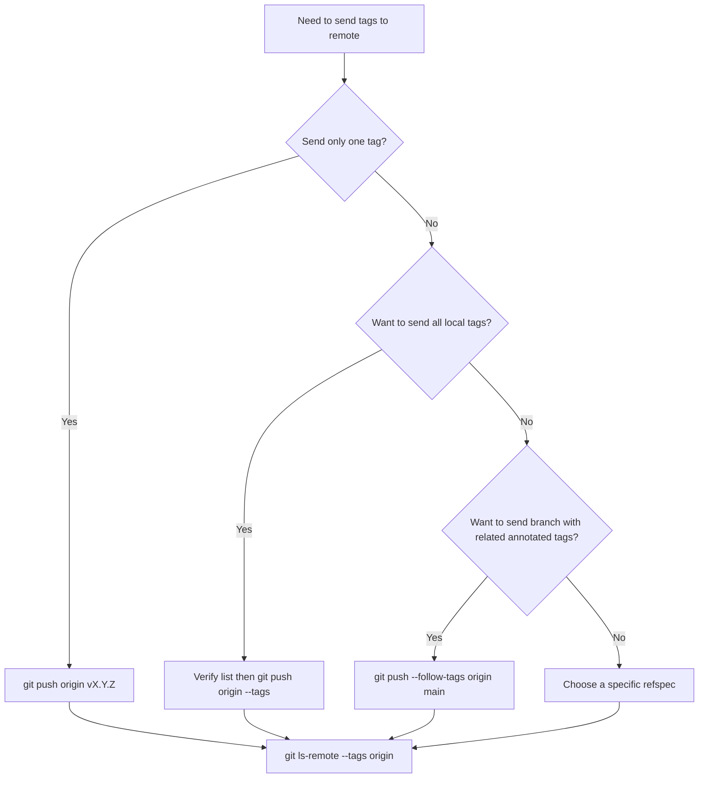

# Pushing individual tags, --tags, and --follow-tags

A tag marks a specific object in Git history, usually a commit representing a release. Creating a tag in a local repository does not make it appear on the server. For teammates or CI/CD systems to see that version milestone, you must push the tag to the remote.

Git supports several ways to push tags: specifying a single tag, using `--tags` to push all local tags, or using `--follow-tags` to push annotated tags associated with the refs being pushed. Choosing the right approach ensures the correct version is released and avoids accidentally pushing experimental tags to a shared repository.

This lesson belongs to the **Tags and Version Milestones** chapter of the `SOURCE_CONTROL_GIT` module. The module covers everything from the working tree, staging area, commits, and history to branches, merges, rebases, remotes, and tags; tags help teams mark important milestones and coordinate traceable releases.

## 1. What is a tag and why must it be pushed?

A tag is a named ref, typically located in `refs/tags/`, pointing to a Git object. In release workflows, a tag usually points to a commit that has been verified and selected as a version, such as `v1.4.0`.

Tags are created in the local repository. Commands like `git tag` and `git show` let you manage and inspect tags on your machine, but they do not automatically send tags to the remote. Therefore, after creating a tag, you need to push it if you want the remote, teammates, or release pipelines to use that milestone.

View local tags:

```bash
git tag --list
git tag --list "v1.*"
git show v1.4.0
```

Tags do not automatically move with a branch. If the `main` branch gains new commits, the `v1.4.0` tag continues pointing to the originally marked object. This characteristic makes tags suitable as stable version milestones.

## 2. Distinguishing annotated tags and lightweight tags

Git has two common tag types:

| Type | Creation | Characteristics |
| --- | --- | --- |
| Lightweight | `git tag v1.4.0` | A simple ref pointing directly to the tagged object, with no separate tag object |
| Annotated | `git tag -a v1.4.0 -m "Release v1.4.0"` | Creates a tag object containing tagger, timestamp, message, and optional signature |

For release milestones, annotated tags are generally more appropriate because they store the creator, timestamp, and message. If the project requires verifying release provenance, signed tags such as `git tag -s` can be used and verified per team policy.

Example of creating an annotated tag for the current commit:

```bash
git tag -a v1.4.0 -m "Release v1.4.0"
```

Or explicitly specify the commit to mark:

```bash
git tag -a v1.4.0 8ac41d2 -m "Release v1.4.0"
```

Before pushing, check where the tag points:

```bash
git show --no-patch v1.4.0
git cat-file -t v1.4.0
```

For an annotated tag, `git cat-file -t` usually returns `tag` because the tag name points to a tag object. For a lightweight tag pointing directly to a commit, the command usually returns `commit`. `git show` lets you view the target commit and the annotated tag's annotation details.

## 3. Pushing a specific tag

This is the most tightly scoped approach when you only want to publish one version milestone:

```bash
git push origin v1.4.0
```

This command sends the `v1.4.0` tag from local to the `origin` remote. You can also write the full refspec:

```bash
git push origin refs/tags/v1.4.0:refs/tags/v1.4.0
```

The part before `:` is the local source ref; the part after is the destination ref on the remote. The full syntax is helpful in scripts because it explicitly specifies the `refs/tags/` namespace and avoids confusing a tag name with a branch.

If a tag has not been pushed yet, the command above creates the corresponding tag on the remote. If the remote already has a tag with the same name pointing to a different object, Git usually rejects updating the tag. Inspect both local and remote tags before deciding how to proceed; published release tags should generally be treated as immutable.

Check tags on the remote:

```bash
git ls-remote --tags origin
```

For an annotated tag, the output usually has two lines: one for the tag object and one with a `^{}` suffix for the object the tag points to after peeling. If you only want to list tag refs without showing peeled lines:

```bash
git ls-remote --tags --refs origin
```

You can also view existing local tags:

```bash
git tag --list
```

## 4. Using --tags to push all local tags

When you need to send all local tags to a remote, use:

```bash
git push origin --tags
```

`--tags` instructs Git to push all refs in the `refs/tags/` namespace to the remote. This scope includes both annotated tags and lightweight tags. This option may send more tags than you intend, such as experimental tags, internal tags, or checkpoints from unreleased branches.

Before using it, check the tag list:

```bash
git tag --list
git tag --list "v*"
```

If the repository contains multiple kinds of tags, consider pushing individual release tags rather than using `--tags` mechanically. This is especially important in CI/CD, where a new tag can trigger a build or deployment pipeline.

`--tags` adds pushing all tags to a push operation. For example:

```bash
git push --tags origin main
```

This command pushes the `main` branch according to the specified refspec while also pushing local tags. If you only want to send tags, you do not need to specify a branch:

```bash
git push origin --tags
```

## 5. Using --follow-tags to push related tags

In day-to-day workflows, you might push a branch after merging a release commit and want to include annotated tags related to the history just pushed. Use:

```bash
git push --follow-tags origin main
```

`--follow-tags` asks Git to push **annotated tags** in `refs/tags/` whose tagged objects are reachable from the refs being pushed and that do not yet exist on the remote. This option does not push all local tags; it only follows tags relevant to the pushed refs.

Key points to remember:

- `--follow-tags` only automatically includes annotated tags.
- Lightweight tags are not pushed by the follow-tags mechanism.
- The tag must be reachable from the history of the ref being pushed and not already exist on the remote.
- The specified branch/ref is still pushed according to normal rules.

If you want `git push` to use this behavior by default, you can enable the setting:

```bash
git config --global push.followTags true
```

Or enable it only in the current repository:

```bash
git config --local push.followTags true
```

Check the configuration value:

```bash
git config --show-origin --get push.followTags
```

Even with the setting enabled, you should still know which refs are being pushed and which tags will accompany them. For release operations requiring high predictability, explicitly pushing a specific tag name remains the easiest to review.

## 6. Comparing the three ways to push tags

| Push method | Scope of tags sent | Tag type | Best suited for |
| --- | --- | --- | --- |
| `git push origin v1.4.0` | Only the specified tag | Annotated or lightweight | Publishing one specific version |
| `git push origin --tags` | All local tags | Annotated and lightweight | Syncing all tags after reviewing the list |
| `git push --follow-tags origin main` | Tags reachable from the pushed ref and missing on the remote | Annotated only | Pushing a branch along with related annotated tag milestones |

Do not treat these three methods as equivalent. Choose based on the scope you want to publish, the tag type your project uses, and your team's release workflow.

## 7. Release workflow with a specific tag

Suppose the team is preparing to release version `v2.3.0` from a commit that has been reviewed and integrated into `main`.

First update the branch and check status:

```bash
git switch main
git pull --ff-only origin main
git status
git log --oneline --decorate -5
```

Ensure the working tree is clean and the release commit is HEAD, or explicitly specify the approved commit. Create an annotated tag:

```bash
git tag -a v2.3.0 -m "Release v2.3.0"
```

Inspect before publishing:

```bash
git show v2.3.0
git cat-file -t v2.3.0
git tag --list "v2.3.0"
```

Push the branch if the commit is not yet on the remote, then push the specific tag:

```bash
git push origin main
git push origin v2.3.0
```

If the commit is already on the remote, you may only need to push the tag. Finally, verify the remote received the tag:

```bash
git ls-remote --tags --refs origin
```

In a CI/CD environment, a pipeline may start immediately once the tag is pushed. Verify the tag points to the right commit, has the proper message, and follows naming conventions before sending it.

## 8. Handling existing tags or tags that need deletion

Git does not allow a normal push of a new tag to overwrite an existing tag on the remote. If local and remote tags share the same name but have different targets, inspect both first:

```bash
git show v2.3.0
git ls-remote --tags origin "refs/tags/v2.3.0*"
```

For a published release tag, keep the old milestone intact and create a new version tag if a re-release is needed. Moving a published tag can cause teammates and pipelines to interpret the same version name as two different commits. Do not use `--force` to update a shared tag without an explicit decision from the release manager.

If the team confirms a tag was created by mistake and policy permits deletion, delete it separately locally and on the remote:

```bash
git tag -d v2.3.0
git push origin --delete v2.3.0
```

The first command deletes the local tag. The second deletes `refs/tags/v2.3.0` on the remote. Deleting in one place does not automatically delete in the other. Afterward, re-verify with `git tag --list` and `git ls-remote --tags origin`.

## 9. Common mistakes

- **Creating a local tag and assuming teammates already see it**: tags exist only on your machine until pushed.
- **Using `--tags` when you only want to publish one version**: the command may also send experimental or internal tags.
- **Assuming `--follow-tags` sends every tag**: this option only includes annotated tags reachable from the refs being pushed.
- **Using a lightweight tag and expecting `--follow-tags` to include it**: lightweight tags are not pushed automatically by follow-tags.
- **Pushing a tag before verifying the target commit**: the tag may mark the wrong commit and trigger a pipeline for the wrong version.
- **Moving a published release tag**: can make version history inconsistent across clones and deployment systems.
- **Deleting a local tag but forgetting the remote tag**: the tag remains on the server and others continue fetching it.
- **Forgetting to check remote tags**: `git tag --list` only displays local tags; use `git ls-remote --tags` to view tags advertised by the remote.

## 10. Flowchart for choosing a push method



Before pushing, check yourself:

1. Does the tag point to the right release commit?
2. Is the tag annotated or lightweight?
3. Do I need to push just one tag, all local tags, or annotated tags related to the branch being pushed?
4. Does the remote already have a tag with the same name, and does it point to the same object?
5. Did I verify the tag appeared on the remote after pushing?

Tags are important reference milestones in release history. Pushing an individual tag is best when you need tight control over a single version; `--tags` is useful when synchronizing all tags; `--follow-tags` fits when you want to send a branch along with related annotated tags. Inspecting tags and target commits before pushing helps the team release the right milestone and keep version history consistent.

## References

- [Git documentation: git-push](https://git-scm.com/docs/git-push) — `--tags` and `--follow-tags` options.
- [Git documentation: git-tag](https://git-scm.com/docs/git-tag) — creating, viewing, and deleting annotated and lightweight tags.
- [Git documentation: git-ls-remote](https://git-scm.com/docs/git-ls-remote) — inspecting refs and tags advertised by a remote.
- [Pro Git: Tagging](https://git-scm.com/book/en/v2/Git-Basics-Tagging) — using tags to mark versions.
