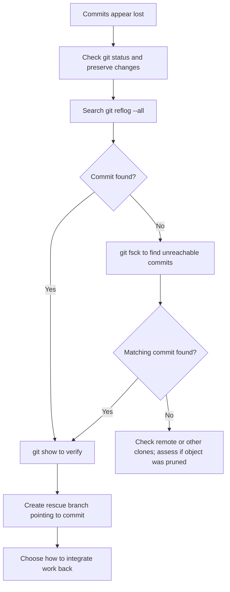

# Finding Lost Commits After a Reset, Branch Deletion, or Rebase

Sometimes a Git operation makes commits appear to vanish: you run `git reset` to the wrong target, delete a branch that held your work, or finish a rebase only to realize the new history is not what you wanted. In many cases, the commits are still in the Git database, just no longer referenced by any branch or tag. You can locate them again with **reflog**; if the reflog no longer has a trace, `git fsck` can help find unreferenced commits.

The first critical step is to stop operations that could lose track of data, inspect the current state, and preserve any discovered commit hash with a rescue branch. Do not rush to run further resets, garbage collection, or pruning before identifying the commits you need to recover.

## 1. Why Can a Commit Look Lost?

Git stores commits as objects. Branches and tags are references pointing to those objects. When a branch is moved or deleted, old commits may no longer be referenced by a familiar branch name, yet the commit objects themselves are not necessarily deleted right away.

Some common scenarios:

- **Mistaken reset:** `git reset --hard HEAD~2` moves the branch back to an older commit; the commits that just left the branch tip are no longer referenced by that branch.
- **Branch deletion:** `git branch -D feature/payment` deletes the local branch name. Commits held solely by that branch can become unreachable.
- **Rebase:** Git recreates commits on a new base with different commit hashes. The pre-rebase commits may no longer lie on the new branch history.
- **Amend or squash:** `git commit --amend` or squashing creates a new commit replacing the old one on the branch; the old commit may remain in the reflog for a while.
- **Repeated checkouts or resets:** multiple HEAD movements make the previous position hard to spot if you only look at the current `git log`.

A commit is called *unreachable* when it cannot be reached from the refs or roots considered by Git in the corresponding check. That does not mean the object has been immediately deleted from the database. Reflog records ref updates so you can trace back to earlier positions.

## 2. Preserving State Before Searching for Commits

When you realize commits are missing, stop history-altering operations and begin by checking the state:

```bash
git status
git branch --all --verbose
git log --oneline --decorate --graph --all -20
```

These commands show whether the working tree has uncommitted changes, which branches/refs still exist, and where current history points.

If there are unsaved local changes you need to keep, back up the working tree or commit/stash as appropriate before attempting to switch branches or recover. If you suspect critical data is about to be removed by garbage collection, create a copy of the repository before proceeding. Do not run `git gc`, `git prune`, `git reflog expire`, or object-cleanup commands to "fix" this situation.

## 3. Finding Old Commits with git reflog

**Reflog** is a local log recording every time a ref is updated. It typically saves the positions HEAD or a branch previously pointed to, including commits, resets, rebases, and checkouts.

To view HEAD's movement history:

```bash
git reflog
```

To view timestamps clearly:

```bash
git reflog --date=iso
```

To search across the reflogs of multiple refs in the repository:

```bash
git reflog --all --date=iso
```

Example output:

```text
9ab12cd HEAD@{0}: reset: moving to HEAD~2
6de34fa HEAD@{1}: commit: add payment validation
3bc45de HEAD@{2}: commit: add payment endpoint
```

In this example, the current branch was reset to an older position. The two lines below it show the commits that were previously HEAD before the reset. The object ID at the start of each line is what you should note down for further inspection.

You can view the reflog of a specific branch if that branch still exists:

```bash
git reflog show main --date=iso
```

`git reflog` is not a centralized log on the remote. It is local data for the current repository; another clone may have a different reflog. Reflog also has retention limits and can be cleaned up according to configuration, so it is not guaranteed to hold every commit indefinitely.

## 4. Verifying the Right Commit Before Recovery

Do not create a rescue branch solely based on a commit hash spotted in the reflog without inspecting its contents. Use `git show` to view the commit's information and changes:

```bash
git show --stat --oneline 6de34fa
git show 6de34fa
```

To view history starting from that commit:

```bash
git log --oneline --decorate --graph -10 6de34fa
```

Verify:

- Does the commit message match the work you are looking for?
- Do the author and timestamp match the lost work session?
- Does the list of changed files include the code or documentation you need to recover?
- Are the parent commits and related commits in the expected order?

If you need to inspect the contents of a file at that commit:

```bash
git show 6de34fa:src/payment/PaymentService.java
```

This command reads the file contents at the specified commit without modifying the working tree.

## 5. Creating a Rescue Branch to Preserve the Found Commit

Once you have identified the right commit, a safe and easy-to-inspect approach is to create a new branch pointing to that commit:

```bash
git branch rescue/payment-work 6de34fa
```

This command creates the ref `rescue/payment-work` at commit `6de34fa`; it does not switch the current branch and does not overwrite working tree contents. Confirm the branch exists:

```bash
git branch --list "rescue/*"
git log --oneline --decorate -5 rescue/payment-work
```

Once you have a rescue branch, the commit is anchored by an explicit ref and no longer depends solely on reflog retention. You can switch to the rescue branch to inspect further when the working tree is in a clean/suitable state:

```bash
git switch rescue/payment-work
```

If there are uncommitted changes, handle or back them up before switching. If the rescue branch name already exists, pick a different name rather than overwriting a ref that might be holding other work.

## 6. Recovering After Running git reset by Mistake

Suppose the original history was:

```text
A---B---C---D  (HEAD -> feature/payment)
```

You accidentally ran:

```bash
git reset --hard HEAD~2
```

The branch now points to `B`; `C` and `D` are no longer at the branch tip. If the reflog still records the old position, look up commit `D`'s hash:

```bash
git reflog --date=iso
```

After verifying the right commit hash, preserve it with a rescue branch:

```bash
git branch rescue/payment-before-reset <commit-D>
```

Now you can inspect the contents of `D` or switch to the rescue branch. If your goal is to bring the `feature/payment` branch back to `D`, confirm the working tree has been preserved and the current branch is the one you intend to move. Only then should you consider resetting that branch to the rescued commit. Creating the rescue branch first keeps a reference to the old commit even as you continue testing.

Note that if the original command used `--hard`, uncommitted changes in the working tree may have been overwritten. Reflog helps locate commits, but does not automatically restore content that was never committed or saved elsewhere.

## 7. Recovering a Deleted Branch

Suppose you accidentally deleted a local branch:

```bash
git branch -D feature/payment
```

If the branch only existed locally, the deleted branch name may no longer appear in `git branch`. Find the branch's last commit via the reflog:

```bash
git reflog --all --date=iso
git reflog show HEAD --date=iso
```

Look for the line recording the last time you committed on `feature/payment` or checked out away from that branch. Verify the final commit with `git show`, then recreate the branch:

```bash
git branch feature/payment <last-commit-of-feature>
```

If you want to keep both a rescue copy and restore the original branch name, create a rescue branch first:

```bash
git branch rescue/payment-deleted <last-commit-of-feature>
```

Deleting a branch usually deletes that branch's dedicated reflog as well, so do not rely solely on `git reflog show feature/payment`. HEAD's reflog or the reflogs of other refs may still hold the commit you need. If the branch was previously pushed, check the remote repository or another clone; the remote branch may still exist even if the local branch was deleted.

## 8. Recovering After a Rebase

Rebase creates new commits when replaying changes onto a different base. Example before rebase:

```text
          C---D  (feature/payment)
         /
A---B---E---F  (main)
```

After rebasing `feature/payment` onto `main`, the history may become:

```text
A---B---E---F  (main)
             \
              C'---D'  (feature/payment)
```

`C'` and `D'` have new commit hashes. The old commits `C` and `D` may still be found via the reflog if they have not been cleaned up.

### If the Rebase Is Still Running

If Git paused mid-rebase due to a conflict and you want to cancel the entire ongoing operation, use:

```bash
git rebase --abort
```

This command tells Git to return the branch to its state before the rebase started. This is the right approach while a rebase is still in progress; do not use `--abort` after a rebase has already completed.

### If the Rebase Has Already Completed

Check `ORIG_HEAD`, which usually stores the tip position before a rebase:

```bash
git show --stat --oneline ORIG_HEAD
```

`ORIG_HEAD` is a helpful clue, but it can be overwritten by other operations. Therefore, also check the reflog of the branch and HEAD:

```bash
git reflog show feature/payment --date=iso
git reflog show HEAD --date=iso
```

Find the entry before the rebase started, verify the old commit with `git show`, and then create a rescue branch:

```bash
git branch rescue/payment-before-rebase <old-tip>
```

You can compare the old and new commit sequences using `git range-diff` once you identify the two corresponding commit ranges:

```bash
git range-diff <old-base>..<old-tip> <new-base>..feature/payment
```

This command helps show how commits were mapped or altered after the rebase. Use the actual base and tip identified from your real history; the names in the example are placeholders.

## 9. When Reflog No Longer Has the Commit: Using git fsck

If the reflog no longer has a matching entry, the commit may still exist as an object not referenced by any ref. `git fsck` checks the integrity and reachability of the object database.

To find unreachable objects without treating reflogs as reference roots:

```bash
git fsck --full --no-reflogs --unreachable
```

Example output:

```text
unreachable commit 6de34fa...
dangling commit 3bc45de...
unreachable tree 7ef89ab...
```

Focus on the `unreachable commit` or `dangling commit` lines. A dangling commit is a type of unreachable object not referenced by any other object in the way Git checks. Not every unreachable object is a commit you need to restore; some may be intermediate objects or unrelated data.

You can tell Git to write found objects into the `.git/lost-found` directory:

```bash
git fsck --full --no-reflogs --lost-found
```

The `--lost-found` option creates reference files in the repository metadata to assist inspection. It does not automatically restore branches or place contents into the working tree.

For each commit hash found, inspect its contents:

```bash
git show --stat --oneline <commit-id>
git show <commit-id>
```

If it is the commit you need to keep, create a rescue branch:

```bash
git branch rescue/found-by-fsck <commit-id>
```

If only a blob or tree is found without a commit, recovery is more complex because Git no longer has a commit holding the complete historical relationships. In that case, you must identify the relevant objects, paths, and contents before reconstructing files.

## 10. Limitations to Know

- **Reflog is local only:** other clones may have their own reflog history; the server does not automatically provide your machine's reflog.
- **Reflog expires:** entries can expire based on configuration and be cleaned up during maintenance/garbage collection.
- **Unreachable objects can be pruned:** if an object has already been physically deleted from the object database, neither `reflog` nor `fsck` can reconstruct it.
- **Reset --hard can lose uncommitted changes:** finding the commit again does not mean recovering content that was never saved into a commit.
- **Force-push can impact collaboration:** if history has already been shared, coordinate with your team before moving a remote branch back to an old commit.
- **ORIG_HEAD is not a long-term record:** treat it as a clue and verify using the reflog and commit contents.

If a commit had already been pushed before the branch was deleted locally, check the remote before using `fsck`. An existing remote branch or tag can be a direct and easier-to-verify reference source.

## 11. General Recovery Workflow

When you suspect lost commits after a reset, branch deletion, or rebase, proceed in this order:

1. Stop any further reset, rebase, prune, or garbage collection operations.
2. Run `git status` and back up any uncommitted local changes you need to keep.
3. Inspect `git reflog --all --date=iso` to locate the previous HEAD/branch position.
4. If you just rebased, also check `ORIG_HEAD` and the relevant branch's reflog.
5. Use `git show --stat` and `git show` to verify the commit.
6. Create a rescue branch with `git branch rescue/<name> <commit-id>`.
7. If reflog yields no results, use `git fsck --full --no-reflogs --unreachable` to find unreachable commits.
8. Only after preserving the commit and confirming your goal should you decide to checkout, reset, cherry-pick, or merge to bring the work back to the main branch.

Condensed decision diagram:



## 12. Common Misconceptions

| Misconception | Accurate Understanding |
|---|---|
| A commit leaving a branch is deleted immediately | The object may remain in the database and be found via reflog or fsck |
| `git log --all` always finds every old commit | This command traverses from current refs; commits no longer held by any ref may not appear |
| Deleting a branch immediately deletes all commits | The branch ref is deleted; commit objects may persist until cleaned up |
| Rebase only renames the branch | Rebase creates new commits; old commits may remain in the reflog for a while |
| `ORIG_HEAD` always points to the pre-rebase state | This value can be overwritten; verify using the reflog |
| `git fsck` automatically restores the branch | `fsck` finds and reports objects; you must verify them and create a ref like a rescue branch |
| Reflog recovers all uncommitted data | Reflog stores ref update history, not a copy of the working tree or index |

## 13. Takeaways

When commits vanish from a branch after a reset, branch deletion, or rebase, check `git reflog` first. Verify the commit hash with `git show`, then create a rescue branch to preserve the object. If the reflog no longer has a trace, `git fsck --full --no-reflogs --unreachable` can locate unreferenced commits.

The reflog and object database are not permanent storage. Recover commits into a named ref as soon as possible, preserve uncommitted changes, and coordinate before rewriting shared history. This approach keeps incident handling controlled and preserves the repository's important history.
