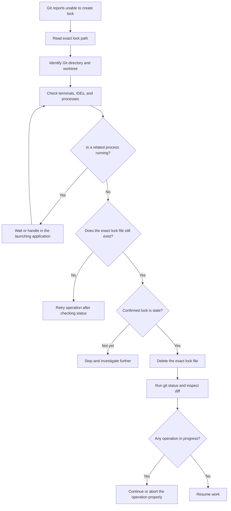

# Diagnosing Stale Lock Files and Avoiding Interference with Running Git Processes

When running a Git command, you may encounter messages such as `Unable to create '.git/index.lock': File exists` or `Another git process seems to be running in this repository`. This message usually means Git cannot acquire permission to update a data area because the corresponding lock file already exists.

A `.lock` file can be a normal sign of a running Git operation. It can also be left behind after a process crashes or is abruptly terminated. Deleting a lock by mistake while Git is still writing data can corrupt the index, refs, or repository state. Therefore, you must identify the exact lock file, check the process owning the operation, and clean it up only after proving the lock is no longer in use.

This lesson belongs to the **Debugging and Recovery** chapter of the `SOURCE_CONTROL_GIT` module. The module teaches the working tree, staging area, commits, history, branches, merges, rebases, remotes, and tags; this section helps you diagnose incidents when Git updates the repository and preserve data during recovery.

## 1. Why Does Git Create .lock Files?

Git typically updates data by writing to a temporary lock file first, then replacing the target file via a rename operation once the contents are ready. Lock creation generally uses an exclusive file creation operation so two processes do not write to the same data area at the same time.

For example, when updating the index, Git may:

1. Create `.git/index.lock`.
2. Write the new index contents into the lock file.
3. Finish and close the file.
4. Rename `index.lock` to `index` to replace the old index.

If another process also tries to update the index meanwhile, it sees `index.lock` already exists and usually aborts with a message that the lock cannot be created. This mechanism prevents two operations from overwriting each other's data.

Some common lock paths:

| Lock File | Git Data Being Updated |
| --- | --- |
| `index.lock` | Index (staging area) of the current worktree |
| `refs/heads/<branch>.lock` | Ref of a local branch |
| `refs/tags/<tag>.lock` | Ref of a tag |
| `packed-refs.lock` | File containing packed refs |
| `config.lock` | Repository configuration |

Exact names and locations depend on the operation, repository configuration, and worktree type. Not every Git command creates the same lock file.

## 2. How Do Active Locks and Stale Locks Differ?

An **active lock** is created by a Git process or tool currently performing a repository update operation. Examples:

- `git add` updating the index.
- `git commit` writing a commit and updating a branch ref.
- `git checkout`, `git switch`, `git reset`, or a merge/rebase operation updating the index and related state.
- An IDE running a background Git command, such as refreshing status, staging files, or completing a commit.
- A hook, Git LFS, or child process invoked during a Git operation that is still running.

A **stale lock** can appear when the process that created the lock exits abnormally before finishing or cleaning up the temporary file. Causes can include:

- The terminal or IDE was forcefully closed.
- The computer lost power or restarted mid-operation.
- The Git process crashed or was terminated by the OS.
- An operation was interrupted while Git was updating data.

Merely seeing a `.lock` file is not enough to conclude it is stale. The file's modification time does not prove the process has ended either: a long-running operation can hold a lock for an extended period without continuously writing to the file.

The contents of a lock file are not reliable PID metadata either. For instance, `index.lock` may contain index data being written; do not read or modify its contents to guess which process owns it.

## 3. Read the Error Message Before Acting

The message usually specifies the lock path Git failed to create. For example:

```text
fatal: Unable to create '.git/index.lock': File exists.
```

Or:

```text
Another git process seems to be running in this repository,
e.g. an editor opened by 'git commit'. Please make sure all processes
are terminated then try again. If it still fails, a git process
may have crashed in this repository earlier:
remove the file manually to continue.
```

Note the exact path mentioned. If the message mentions `index.lock`, it is the index lock. If it mentions a ref lock or `packed-refs.lock`, a different data area is involved. Do not assume every lock error can be resolved by deleting `.git/index.lock`.

If the error appears during `git commit`, check both the terminal running Git and the commit editor. Git may be waiting for you to save or close the commit message. If the error appears in an IDE, check the Git/Source Control panel and running background tasks.

## 4. Identify the Correct Git Directory and Lock Path

Not every repository has a standard `.git` directory directly inside the project folder. With a linked worktree, the `.git` file in the working directory may only contain a path pointing to a separate Git directory; some data like refs lives in the common Git directory. Submodules also have their own Git directory structure.

Therefore, do not assume the lock path is always `.git/index.lock`. Inside the repository, you can ask Git to return the exact path:

```bash
git rev-parse --git-dir
git rev-parse --git-path index.lock
```

The first command reports the Git directory attached to the current repository/worktree. The second returns the location Git uses for `index.lock`, accounting for repository layout and related path configuration.

If the error message mentions a ref lock, you can query the corresponding path, for example:

```bash
git rev-parse --git-path refs/heads/main.lock
git rev-parse --git-path packed-refs.lock
git rev-parse --git-path config.lock
```

Run these commands inside the exact repository and worktree reporting the error. If `git rev-parse` cannot identify the repository or returns a path different from the error message, stop and inspect your working directory before touching the filesystem.

## 5. Check Git Processes Before Touching the Lock

This is the most important step. Check terminals, IDEs, and OS processes. A Git process might not be running in an open terminal window; it could have been spawned by an IDE or another tool.

### On Windows PowerShell

List common Git processes:

```powershell
Get-CimInstance Win32_Process |
  Where-Object { $_.Name -in @('git.exe', 'git-remote-https.exe', 'git-remote-http.exe', 'git-lfs.exe') } |
  Select-Object ProcessId, ParentProcessId, Name, CommandLine
```

Check open terminal windows and IDEs as well. If a Git process exists, inspect its command line, PID, parent process, and launching application to understand what operation it is performing. You can use Task Manager or Process Explorer to view the process tree.

### On Linux or macOS

```bash
ps -ef | grep '[g]it'
```

Read the PID, parent process, and command arguments. Check terminals, IDEs, and child processes related to Git operations.

### When a Running Process Is Found

- Let the process finish if it is still operating normally.
- If Git is waiting on an editor, credential prompt, hook, or confirmation, handle it in that exact window/application.
- If the operation appears hung, investigate causes such as a hook waiting for input, remote authentication, network, disk, or child processes.
- If cancellation is necessary, stop it from the terminal/IDE that launched the operation and wait for the process to exit. Then check repository status before taking the next step.

Do not delete a lock while a related process is still running. Do not terminate a process just because its name is `git.exe`; first determine which repository it belongs to and what it is doing. On a shared machine, if you lack permissions to view all processes, ask an administrator to verify before cleaning up the lock.

## 6. Clean Up the Lock Only After Confirming It Is Stale

Consider a lock stale only when you have confirmed all of the following:

1. No Git process or child process is performing an operation on that repository/worktree.
2. IDEs and terminals have no pending Git tasks waiting to complete.
3. The exact lock path has been identified from the error message or `git rev-parse --git-path`.
4. The lock file still persists after the related process has terminated.

On Windows, example checking `index.lock` in PowerShell:

```powershell
$lockPath = git rev-parse --git-path index.lock
$lockPath
Test-Path -LiteralPath $lockPath
if (Test-Path -LiteralPath $lockPath) {
  Get-Item -LiteralPath $lockPath | Format-List FullName, Length, LastWriteTime
}
```

Only after confirming no Git process is active and the path is the stale lock for the right repository should you delete that exact file:

```powershell
Remove-Item -LiteralPath $lockPath
```

On Linux or macOS, you can retrieve and inspect the path:

```bash
lock_path=$(git rev-parse --git-path index.lock)
printf '%s\n' "$lock_path"
ls -l -- "$lock_path"
```

After confirming it is stale, delete that exact path:

```bash
rm -- "$lock_path"
```

For other locks, replace `index.lock` with the exact path named in the error message, such as `refs/heads/main.lock`. Do not delete the entire `.git` directory, do not bulk-delete `*.lock`, and do not use wildcard scripts to clear all lock files.

If you cannot prove the lock is stale, leave it intact and investigate further or ask an administrator for help. Deleting an active lock by mistake can allow a writing process to continue while another process creates a new lock, causing desynchronization or data corruption.

## 7. Inspect the Repository After Cleaning the Lock

After deleting the exact stale lock, run verification commands in the right repository:

```bash
git status
git diff
git diff --cached
git log --oneline --decorate -5
```

Read the output to determine whether the previous operation completed or was interrupted. If Git reports an in-progress merge or rebase, do not blindly reset or delete metadata. Identify the current state and then continue or abort with the corresponding command:

```bash
git merge --continue
git merge --abort
git rebase --continue
git rebase --abort
```

Run only the command matching the actual operation and only after inspecting existing changes. If the previous operation was a commit, check `git log` and `git status` to see whether the commit was created. Do not blindly re-run the commit command, as that could create an unintended commit.

If the index shows signs of inconsistency or Git continues reporting object read errors, save the error message and look into deeper repository inspection. Do not use `git reset --hard` or `git clean -fd` just to make a lock error vanish; they are not lock-repair tools and can lose work.

## 8. Situation-Based Diagnostic Workflow

| Situation | What to Do |
| --- | --- |
| IDE is running Fetch, Pull, Commit, or Stage | Wait for completion and check the result in the IDE |
| Git commit has an editor open | Save/close the editor to finish or cancel the commit from the right terminal session |
| Git process is alive but appears hung | Check hooks, prompts, authentication, network, and child processes; cancel from the launcher only after understanding state |
| No Git process remains, lock path still exists | Verify the exact repository/worktree and lock path before deleting the specific stale file |
| Unable to determine process or repository | Do not delete the lock; ask someone with permissions to inspect processes and paths |
| After clearing the lock, a merge/rebase is still in progress | Run `git status`, then continue or abort the corresponding operation |



## 9. Mistakes to Avoid

- **Deleting `.git/index.lock` as soon as you see an error**: you might delete the lock of a process still writing the index.
- **Treating an old lock by timestamp as stale**: modification time does not prove the process has exited.
- **Looking for a PID inside the lock contents**: lock files usually hold Git data being written, not owner metadata.
- **Assuming `.git` is always a directory**: linked worktrees can use a `.git` file pointing to another Git directory.
- **Deleting all `*.lock` files**: each lock may protect a different ref or data area; bulk deletion can corrupt active operations.
- **Killing every `git.exe` process**: one process might be fetching, committing, running a hook, or updating a different repository.
- **Using reset hard or clean to fix lock errors**: these commands can delete changes without addressing the cause of the lock.
- **Re-running commit or merge without checking**: the earlier operation may have partially or fully completed before failing on a subsequent step.

## Self-Check Before Recovery

Before cleaning up a lock, confirm:

1. Have I read the exact lock path from the error message?
2. Have I identified the exact Git directory and worktree?
3. Have I checked relevant terminals, IDEs, and Git processes?
4. Do I have evidence that the process exited and the lock is no longer in use?
5. Am I deleting only the specific stale lock, not bulk-deleting lock files?
6. After cleanup, have I checked `git status`, diffs, and merge/rebase state?

A `.lock` file is part of Git's data protection mechanism when updating a repository. Clean it up only after verifying the owning process has exited and the remaining lock is genuinely stale. Following this sequence avoids interfering with active operations and keeps both your work and your teammates' work intact.

## References

- [Git documentation: gitrepository-layout](https://git-scm.com/docs/gitrepository-layout) — structure of the Git directory, refs, and index.
- [Git documentation: git-rev-parse](https://git-scm.com/docs/git-rev-parse) — locating the Git directory and internal paths with `--git-dir` and `--git-path`.
- [Git source: lockfile API](https://github.com/git/git/blob/master/lockfile.h) — lockfile mechanism used for safely updating Git data.
