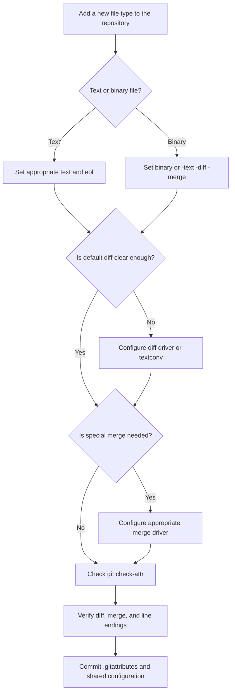

# Declaring Text Files, Binary Files, and Diff or Merge Handlers

In a repository, Git needs to know how to handle each file type when storing content, generating diffs, and merging changes. Source code, images, office documents, and binary data files should not be treated the same way. If Git misidentifies a file type, diffs can become unreadable, line endings can flip across operating systems, or merges can produce invalid content.

The `.gitattributes` file lets you declare attributes by path. You can mark files as text or binary, normalize line endings, choose a diff driver for readable change output, and choose a merge driver for special formats. This lesson belongs to the **Ignore and attributes** chapter of the `SOURCE_CONTROL_GIT` module, where you learn how to manage repository contents and collaborate reliably across development environments.

## 1. What Is .gitattributes Used For?

`.gitattributes` is a path-based configuration file, usually placed at the repository root and committed with source code so team members share it. Each line specifies a pattern and one or more attributes:

```gitattributes
<pattern> <attribute> <attribute> ...
```

Example:

```gitattributes
*.java text eol=lf
*.png binary
```

The two lines above instruct Git to treat Java files as text with LF in the working tree, while PNG images are treated as binary files.

An attribute can take one of the following forms:

| Syntax | Meaning |
| --- | --- |
| `text` | Enable the `text` attribute |
| `-text` | Disable the `text` attribute |
| `text=auto` | Assign the string value `auto` to the attribute |
| `!text` | Reset the attribute to the unspecified state |

Git distinguishes the unset state (`-attr`) from unspecified (`!attr`). Unset is an explicit choice; unspecified means the attribute has no assigned value and Git uses the corresponding default behavior if no other effective value exists.

## 2. Distinguishing .gitattributes from .gitignore

Both files use path patterns, yet solve two different problems:

| File | Purpose | Effect on tracked files |
| --- | --- | --- |
| `.gitignore` | Prevent untracked files from appearing as suggestions to add to Git | Does not stop tracking files already committed or staged beforehand |
| `.gitattributes` | Declare how Git handles content, diff, merge, and conversions by path | Takes effect on tracked files as well |

For example, `.gitignore` can ignore the build directory:

```gitignore
build/
```

While `.gitattributes` declares how files in the repository are handled:

```gitattributes
*.java text eol=lf
*.png binary
```

Do not use `.gitignore` to control diffs or line endings. Likewise, do not use `.gitattributes` to prevent Git from detecting untracked files.

## 3. Declaring Text and Normalizing Line Endings

Different operating systems can use different line endings. Linux and macOS typically use LF (`\n`), while Windows typically uses CRLF (`\r\n`). Without a clear convention, the same file can produce huge diffs merely from line-ending conversions.

The `text` attribute controls line-ending normalization when content enters the index:

- `text`: treat the file as text and normalize line endings in the index to LF.
- `text=auto`: let Git automatically detect text files and normalize those detected as text.
- `-text`: do not perform line-ending conversion; commonly used for binary files.

The `eol` attribute controls line endings in the working tree:

- `eol=lf`: use LF in the working tree.
- `eol=crlf`: use CRLF in the working tree.

Example of a common convention:

```gitattributes
# Detect text and normalize automatically
* text=auto

# Source code, scripts, and config files use LF
*.java text eol=lf
*.js text eol=lf
*.ts text eol=lf
*.sh text eol=lf
*.yml text eol=lf
*.yaml text eol=lf

# Windows batch files use CRLF in the working tree
*.bat text eol=crlf
*.cmd text eol=crlf

# Image files do not undergo line-ending conversion
*.png -text
*.jpg -text
```

When `eol` is explicitly set, Git treats that path as text and applies the corresponding conversion rules. Thus, `*.java text eol=lf` keeps content in the index with LF and checks out to the working tree with LF on every operating system.

### The binary Macro

Git provides the `binary` attribute macro, equivalent to:

```gitattributes
-text -diff -merge
```

Example:

```gitattributes
*.png binary
*.jpg binary
*.gif binary
*.pdf binary
*.zip binary
*.class binary
```

Declaring `binary` prevents Git from normalizing line endings, generating regular text diffs, and attempting to automatically merge binary content as text. For binary files, when two branches both modify the file, team members typically have to pick the right version or use a specialized tool.

## 4. Choosing How Diffs Are Displayed

The `diff` attribute determines whether Git treats a path as text when generating diffs, or uses a named driver.

```gitattributes
*.png -diff
*.docx -diff
*.java diff
```

- `diff` enables standard text diff display.
- `-diff` disables text diff; Git typically shows a notice that the binary file has changed.
- `diff=<driver>` selects a diff driver with a corresponding configuration.

For binary formats whose content can be extracted as text, `textconv` makes diffs much easier to read. For example, if the `docx2txt` tool is available on the machine:

```gitattributes
*.docx diff=word
```

Configure the driver in `.gitconfig`:

```ini
[diff "word"]
    textconv = docx2txt
    cachetextconv = true
```

When running `git diff`, Git invokes `docx2txt` to convert document contents into text and then compares the output. `cachetextconv` allows Git to cache conversion results to avoid unnecessarily re-running the tool.

Another example is using a tool that converts PDF to text:

```gitattributes
*.pdf diff=pdf
```

```ini
[diff "pdf"]
    textconv = pdftotext -layout
```

The actual command depends on available tools and how each tool accepts input/output. Test the driver on your machine before putting shared settings into the project; each member needs to install the corresponding tool to get the same diff experience.

### External diff Command and textconv

Git also allows configuring `diff.<driver>.command` to invoke an external diff program. `textconv` is usually appropriate when you only need to convert a file into readable text before comparing; an external diff command lets the program fully control how differences are presented.

Drivers can be declared in `.gitattributes`, while the specific commands typically live in local or global Git config. That way, the repository can share driver names while each machine configures tool paths individually.

## 5. Choosing How Merges Work

The `merge` attribute lets Git choose a handler when two branches modify the same path.

Common values:

| Attribute | Handling |
| --- | --- |
| `merge` | Use the standard three-way text merge handler |
| `-merge` | Do not automatically merge content as text; leave the path in a state requiring manual resolution |
| `merge=union` | Use the built-in union merge driver, combining lines from both sides instead of creating standard conflict markers |
| `merge=<driver>` | Use a configured custom merge driver |

For binary files, the `binary` macro already disables automatic merging. For some text files whose lines can be combined independently, `merge=union` can be helpful, though you must inspect results because line ordering or duplicate lines may not suit the format.

Example:

```gitattributes
*.png binary
*.pdf binary
CHANGELOG.txt merge=union
```

`merge=union` does not understand content semantics. It simply combines lines from both versions. Do not use it for JSON, YAML, or configuration files if concatenating lines could create duplicate keys, broken structure, or invalid data.

### Custom Merge Driver

For special formats, you can declare a driver name in `.gitattributes`:

```gitattributes
*.generated merge=keep-current
```

Then configure the driver in Git config:

```ini
[merge "keep-current"]
    name = Keep current version
    driver = true
```

The example above illustrates a driver that preserves the current side's content by leaving the output file `%A` untouched and returning success. The `true` command is a POSIX-shell example; Windows environments or project workflows should use an appropriate tested program or script.

A custom merge driver receives common placeholders:

| Placeholder | Content |
| --- | --- |
| `%O` | Common base version (ancestor) |
| `%A` | Current side's version; the driver must write the merge result to this file |
| `%B` | Other side's version |
| `%L` | Conflict marker length |
| `%P` | Path of the file being merged |

A driver typically returns exit code `0` when the merge succeeds, `1` when conflicts require user resolution, and a value greater than `1` when an error occurs. Merge driver configuration is usually local or global config, not automatically shared via `.gitattributes` alone; every machine must install the executable and configure the corresponding driver.

**Be cautious with drivers that keep one side:** configurations like `keep-current` can silently discard changes from the other side. Use them only when project policy clearly specifies which side always wins, such as auto-generated files with a separate authoritative source.

## 6. Attribute Precedence Order

Git can read attributes from multiple locations. Precedence order from highest to lowest:

1. `$GIT_DIR/info/attributes` of the current repository/worktree.
2. `.gitattributes` files in the directory containing the file and parent directories; the file closest to the path has higher precedence than files in parent directories.
3. The global attributes file specified by `core.attributesFile`.

Within the same `.gitattributes` file, a later matching line can override attribute values set by an earlier line. Attributes are processed independently, so a later line changes only the attributes it specifies.

Example in the root directory:

```gitattributes
* text=auto
*.dat binary
```

In the `data/` subdirectory, a separate `.gitattributes` can be placed:

```gitattributes
*.dat text eol=lf
```

The file `data/report.dat` receives the closer rule from `data/.gitattributes`. If you need an exception only on a personal machine without committing it to the repository, you can use `$GIT_DIR/info/attributes`. This has the highest precedence, so keep in mind it can make check results on your machine differ from teammates'.

## 7. Checking Applied Attributes

To inspect attributes for a path, use `git check-attr`:

```bash
git check-attr text eol diff merge -- src/Main.java
git check-attr --all -- assets/logo.png
```

The first command checks specific attributes; the second lists all attributes applied to the file. Output may display `unspecified` if an attribute is not declared.

To trace where Git gets attributes during debugging, inspect each `.gitattributes` file, `info/attributes`, and the global attributes config. You can view the global attributes file path with:

```bash
git config --show-origin --get core.attributesFile
```

If you need to inspect how Git is handling content, use:

```bash
git diff -- src/Main.java
git diff -- assets/logo.png
git status
```

After editing `.gitattributes`, verify affected files across multiple operating systems if the project has members on Windows, Linux, and macOS.

## 8. Applying Line-Ending Changes to Tracked Files

Adding or modifying `text`/`eol` attributes does not automatically rewrite the index of all tracked files right away. If a repository already contains content with inconsistent line endings, after agreeing on rules, you can renormalize tracked files with:

```bash
git add --renormalize .
```

This command re-applies the clean conversion process to tracked files to update the index according to the new attributes. Before committing, review the changes carefully:

```bash
git status
git diff --cached --stat
git diff --cached
```

If the diff changes too much or contains unexpected modifications, re-check the patterns and attributes before committing. It is best to perform line-ending normalization changes in a separate commit for easier review.

## 9. Example .gitattributes Configuration for a Project

A baseline configuration for a project with source code, scripts, documentation, and binary assets:

```gitattributes
# Auto-detect text by default
* text=auto

# Source code and configuration use LF
*.java text eol=lf
*.kt text eol=lf
*.js text eol=lf
*.ts text eol=lf
*.json text eol=lf
*.yml text eol=lf
*.yaml text eol=lf
*.xml text eol=lf
*.md text eol=lf
*.sh text eol=lf

# Windows scripts use CRLF
*.bat text eol=crlf
*.cmd text eol=crlf

# Binary assets
*.png binary
*.jpg binary
*.jpeg binary
*.gif binary
*.pdf binary
*.zip binary
*.jar binary
*.class binary

# Example diff driver for Word documents
*.docx diff=word

# Example merge driver for line-based changelog
CHANGELOG.txt merge=union
```

This is only a starting point. Adjust the list of extensions to match the actual file types of your project. Do not mark every file with an unfamiliar extension as text or binary before confirming its format.

## 10. Common Errors

- **Confusing `.gitattributes` with `.gitignore`**: attributes control how Git processes content; ignore controls detection of untracked files.
- **Failing to declare binary files**: Git may attempt to diff or merge them as text, yielding confusing results.
- **Setting only `eol=lf` without verifying applied rules**: check with `git check-attr` and diff to confirm Git picked up the right attributes.
- **Thinking `diff=word` installs the diff tool automatically**: the driver name only links the attribute to a config entry; each machine still needs to configure the command and install the tool.
- **Thinking custom merge drivers are fully shared via `.gitattributes`**: the driver name can be committed, but the command configuration and executable must be set up in each environment.
- **Using union merge for structured data**: line concatenation does not guarantee JSON/YAML or config files remain valid.
- **Using a keep-one-side driver for files with manual edits**: this can silently lose changes from the other side.
- **Editing attributes without renormalizing**: the index may still hold old content until files go through clean conversion; inspect and use `git add --renormalize` when needed.
- **Forgetting local attributes override repository rules**: `info/attributes` has high precedence, so check it when behavior on a personal machine differs from teammates'.

## 11. Workflow for Choosing Attributes



Before finishing, verify for yourself:

1. Have I classified text and binary files accurately?
2. Do line endings in the index and working tree follow the project convention?
3. Are the conversion tools or executables for diff drivers already installed?
4. Does the merge driver handle the format properly without silently dropping data?
5. Have I verified precedence order and `git check-attr` output?
6. If line endings changed, have I reviewed the staged diff after `git add --renormalize`?

`.gitattributes` helps Git understand how to handle each file type across the entire collaboration lifecycle: normalizing content, presenting diffs, and merging changes. Clear declarations, testing drivers in real environments, and reviewing results before committing keep the repository working consistently across team members.

## References

- [Git documentation: gitattributes](https://git-scm.com/docs/gitattributes) — `text`, `eol`, `diff`, `merge` attributes and precedence order.
- [Git documentation: git-check-attr](https://git-scm.com/docs/git-check-attr) — checking attributes applied to paths.
- [Git documentation: git-add](https://git-scm.com/docs/git-add) — renormalizing tracked files with `--renormalize`.
- [Pro Git: Customizing Git - Git Attributes](https://git-scm.com/book/en/v2/Customizing-Git-Git-Attributes) — examples of declaring file types and drivers.
