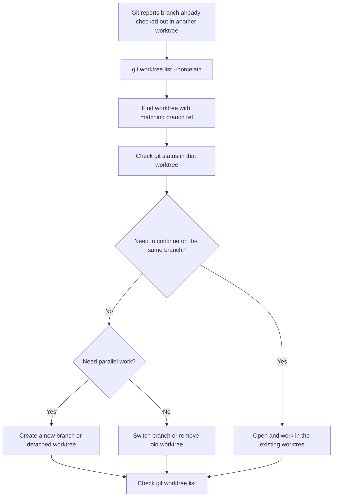

# Constraints When a Branch Is Already Used in Another Worktree

Git worktree allows a repository to have multiple working directories at the same time. You can keep a feature branch open in one directory while keeping `main` open in another directory for review, running tests, or handling a hotfix. However, Git has an important rule: by default, a local branch can only be checked out in one worktree at a time.

If you try to open the same branch in a second worktree, Git will usually refuse and report that the branch is already in use in another worktree. This is a protective mechanism because worktrees have separate working trees and indexes, while sharing the branch ref. This lesson belongs to the **Multiple Working Directories** chapter of the `SOURCE_CONTROL_GIT` module, where you learn to collaborate via branches, merge, rebase, remotes, and manage history without mixing up working states.

## 1. Why does Git limit a branch to one worktree?

A linked worktree has its own working directory, index, and `HEAD`. However, worktrees belonging to the same repository share the object database and most refs, including local branch refs.

For example, the `feature/payment` branch is the ref `refs/heads/feature/payment`. If that branch is checked out in the `repo-payment` worktree, the `HEAD` of this worktree points to that branch ref. When a new commit is created, Git updates the shared ref.

If a second worktree also checked out the same branch, both directories would have independent indexes and working files while relying on a single branch pointer. One place could create commits that move the branch ref while the other still holds old working tree contents. Continuing to edit, stage, or commit from both places easily causes state confusion and lost work when operations overlap.

Therefore, Git applies a **one branch — one worktree** rule by default. This rule applies to the local branch currently checked out. You can still view commits, fetch remotes, or reference the branch from another worktree without checking out that branch.

## 2. Identifying which worktree is using a branch

Use the command:

```bash
git worktree list
```

Example output:

```text
D:/projects/payment       4a1b2c3 [main]
D:/projects/payment-hotfix 8d9e0f1 [feature/payment]
D:/projects/payment-test  4a1b2c3 (detached HEAD)
```

Each line indicates the worktree path, current commit, and checked-out branch (or detached HEAD state). In the example, `feature/payment` is currently in use at `D:/projects/payment-hotfix`.

For script-friendly output:

```bash
git worktree list --porcelain
```

Porcelain output includes fields such as `worktree`, `HEAD`, `branch`, `detached`, `locked`, or `prunable`. When you need to locate where a branch is, find the `branch refs/heads/<branch-name>` line and read the `worktree` path immediately above it.

You can also inspect that worktree's status without switching terminal windows:

```bash
git -C D:/projects/payment-hotfix status
git -C D:/projects/payment-hotfix branch --show-current
```

`-C` tells Git to run as if the command were executed from the specified directory. Use the exact path returned by `git worktree list`.

## 3. When adding a worktree with an already checked-out branch

Suppose you already created the first worktree:

```bash
git worktree add ../payment-hotfix -b feature/payment origin/main
```

The command creates the `feature/payment` branch from `origin/main` and checks it out in the `../payment-hotfix` directory.

If you then run:

```bash
git worktree add ../payment-review feature/payment
```

Git refuses because `feature/payment` is already checked out at `../payment-hotfix`. You cannot use the same branch in a second worktree using the default behavior.

The message may look similar to:

```text
fatal: 'feature/payment' is already checked out at '.../payment-hotfix'
```

When you encounter this message, do not rush to delete the branch or recreate the repository. First use `git worktree list` to find the worktree holding the branch and choose an approach suited to your goal.

## 4. Appropriate ways to handle it

### Option A: Continue working in the worktree holding the branch

If you need to continue working on that exact branch, open your terminal or IDE in the worktree that has the branch checked out:

```bash
cd ../payment-hotfix
git status
git branch --show-current
```

You can use `git -C` from your current location to inspect or run commands without changing directories:

```bash
git -C ../payment-hotfix log --oneline -5
git -C ../payment-hotfix status
```

This is usually the simplest choice when the branch already has a valid workspace.

### Option B: Create a new branch for the new worktree

If you need to work on two tasks in parallel, create a separate branch for the second worktree. You can branch off the branch currently in use:

```bash
git worktree add -b feature/payment-review ../payment-review feature/payment
```

The command creates the `feature/payment-review` branch from the current commit of `feature/payment`, then checks out the new branch in the `../payment-review` worktree. The two worktrees now have separate branch refs and can be developed independently.

If you want to start from `main` or a remote-tracking branch:

```bash
git fetch origin
git worktree add -b fix/payment-timeout ../payment-timeout origin/main
```

The new branch can be integrated later via merge, rebase, or cherry-pick according to your team's conventions.

### Option C: Open a detached worktree to inspect or experiment

If you only need to inspect a commit, run a benchmark, or view historical contents without moving a branch pointer, use detached HEAD:

```bash
git worktree add --detach ../payment-inspect 8d9e0f1
```

The new worktree checks out commit `8d9e0f1` without attaching to a local branch. This avoids occupying a branch already in use in another worktree.

If you create commits in detached HEAD and want to keep them, create a branch before leaving the worktree:

```bash
git switch -c experiment/payment-inspect
```

If you do not create a branch or another ref holding the commit, the new commit can become hard to find after the worktree is removed and Git cleans up unreferenced objects.

### Option D: Switch the branch away from the old worktree

If the old worktree no longer needs that branch, switch it to another branch:

```bash
git -C ../payment-hotfix switch main
```

Once `feature/payment` is no longer checked out in the old worktree, you can add a new worktree for that branch:

```bash
git worktree add ../payment-review feature/payment
```

Before switching branches, check `git -C <path> status`. If there are uncommitted changes, commit, stash, or handle them first so you do not lose work.

### Option E: Remove the old worktree when no longer needed

If the old worktree is finished and that working directory is no longer needed, check its status and then remove it:

```bash
git -C ../payment-hotfix status
git worktree remove ../payment-hotfix
```

`git worktree remove` removes the specified worktree and its corresponding management metadata. Git normally refuses to remove a worktree with uncommitted changes; handle or back up changes before removing.

After removal, the `feature/payment` branch is no longer held by that worktree and can be checked out in another worktree if no other worktree is using it.

## 5. Why shouldn't you use force to check out the same branch?

Git has options to bypass the constraint:

```bash
git worktree add --force ../payment-review feature/payment
```

Or when switching branches inside a worktree:

```bash
git switch --ignore-other-worktrees feature/payment
```

These options bypass the check for whether the branch is already checked out in another worktree. They do not create an independent copy of the branch. Both worktrees still share the same branch ref, so a commit in one worktree moves the branch pointer that the other worktree also references.

As a result, the working tree and index states in the two locations may no longer reflect the same commit. Subsequent operations may be rejected, create confusing history, or lose changes if you attempt manual synchronization. Only use force options in special situations when you understand how Git shares refs and have a process to avoid concurrent writes. For ordinary parallel development, create a separate branch.

## 6. An in-use branch also affects branch management operations

Git protects a branch checked out in another worktree from operations that modify or delete the ref in ways that could break the working state. For example, deleting a checked-out branch is usually rejected:

```bash
git branch -d feature/payment
```

If Git reports that the branch is in use in another worktree, find its location with:

```bash
git worktree list --porcelain
```

Then switch that worktree to another branch or remove the worktree if it is no longer needed. Once the branch is freed, check its merge status before deleting:

```bash
git branch --merged main
git branch -d feature/payment
```

`-D` forces deletion of an unmerged branch, but should not be treated as a way around the worktree constraint. Before deleting, make sure the branch's unique commits are no longer needed and no worktree relies on that branch.

## 7. Handling stale worktree metadata

Sometimes a worktree directory is deleted manually outside of Git or a drive is disconnected. Git may still keep metadata and show the worktree as `prunable`. This case is different from an active worktree at another path.

View the detailed list:

```bash
git worktree list --porcelain
```

If a worktree truly no longer exists, preview the metadata to be cleaned up:

```bash
git worktree prune --dry-run --verbose
```

Only after confirming that path is no longer a worktree to keep should you prune the metadata:

```bash
git worktree prune --verbose
```

`git worktree prune` cleans up management metadata for missing worktrees; this command does not replace `git worktree remove` when the working directory still exists. If the worktree directory was moved to another location, use `git worktree repair` to fix management links instead of pruning metadata:

```bash
git worktree repair ../payment-moved
```

Only run `repair` with the actual path of the moved worktree. Then recheck `git worktree list`.

## 8. Diagnostic workflow when Git reports a branch is already checked out

Suppose you want to open `feature/payment` at `../payment-review` but Git reports the branch is already in use.

```bash
# View worktrees and checked-out branches
git worktree list --porcelain

# Check the worktree holding the branch
git -C ../payment-hotfix status
git -C ../payment-hotfix branch --show-current

# If parallel work is needed, create a separate branch from the current branch
git worktree add -b feature/payment-review ../payment-review feature/payment
```

This workflow helps you see where the branch is held, confirm the change status in that worktree, and create a separate workspace for the new task.



## 9. Common mistakes

- **Creating a second worktree with the same branch**: Git refuses by default because the branch is already checked out in another worktree.
- **Assuming each worktree has its own branch pointer**: the working tree, index, and HEAD are separate, but local branch refs are shared.
- **Using `--force` to create a copy of a branch**: force only bypasses the check; it does not duplicate the branch ref.
- **Deleting a branch while it is checked out in another worktree**: free the branch by switching or removing the worktree first.
- **Deleting a worktree directory with Explorer/File Manager**: metadata may remain; use `git worktree remove` when the directory still exists.
- **Using prune to delete an active worktree**: prune only cleans up metadata of worktrees that no longer exist and qualify for expiration.
- **Forgetting to save commits made in detached HEAD**: create a branch if you want to continue developing or preserve the commits.
- **Switching branches when a worktree has modifications**: check status and commit/stash first to avoid losing changes.

## Self-check

Before resolving a worktree conflict, verify:

1. Have I found the worktree checking out the branch using `git worktree list`?
2. Have I checked for uncommitted changes in that worktree?
3. Does the new task require the same branch or can it use a separate branch?
4. If using detached HEAD, have I created a branch to keep needed commits?
5. If cleaning up worktrees, have I distinguished `remove`, `prune`, and `repair` for the right scenario?
6. Do I understand that `--force` and `--ignore-other-worktrees` bypass protection while still sharing the branch ref?

The one-branch-per-worktree constraint lets each directory keep its own working state while keeping branch pointers consistent. When parallel work is needed, creating a separate branch for each worktree is the clearest approach; when continuing an existing branch, return to the worktree holding it and check its status before acting.

## References

- [Git documentation: git-worktree](https://git-scm.com/docs/git-worktree) — add, list, remove, repair, and prune worktrees.
- [Git documentation: git-switch](https://git-scm.com/docs/git-switch) — switch branches and the `--ignore-other-worktrees` option.
- [Git documentation: git-branch](https://git-scm.com/docs/git-branch) — manage branches and constraints on checked-out branches.
- [Pro Git: Git Tools - Advanced Merging / Multiple Worktrees](https://git-scm.com/docs/git-worktree) — command reference for managing multiple worktrees.
