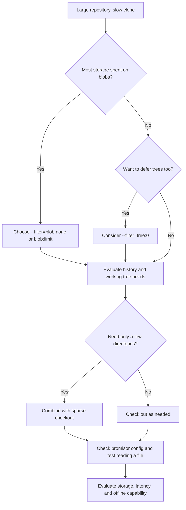

# Partial clone with --filter and on-demand object fetching

In large repositories, most of the storage size may reside in file contents (blobs), such as images, sample datasets, documentation, or assets used by only certain teams. If every clone downloads all blobs, time and bandwidth can increase substantially even when the current work needs only a small subset.

Partial clone lets the client ask the server to omit certain objects during the initial download. Git records the remote responsible for supplying the deferred objects and automatically retrieves them when later operations need them. This mechanism is commonly called **lazy fetch** or on-demand object fetching.

This lesson belongs to the **Sparse Checkout** chapter of the `SOURCE_CONTROL_GIT` module. The module guides from working tree, staging area, commits, and history to branches, merges, rebases, remotes, and tags; partial clone helps manage large repositories by reducing the amount of objects downloaded up front.

## 1. What objects does Git use to store a repository?

Git stores history and contents as core object types:

| Object | What does it store? | Usage example |
| --- | --- | --- |
| Commit | Commit metadata, root tree, and parent relationships | Commit history, branch tips |
| Tree | Directory structure, path names, and references to child objects | Traversing repository structure |
| Blob | Actual contents of a file | Source code, images, docs, data |
| Tag | Annotated tag metadata and tagged object | Release milestones with messages or signatures |

In a regular clone, Git downloads the objects needed for a complete repository covering the fetched and checked-out refs. With partial clone, the client can ask to omit certain object types. For example, when using `blob:none`, commits and trees can still be downloaded so Git knows the history and directory structure, while blob contents are fetched later.

Partial clone does not delete objects from the source repository. It only controls which objects are sent to the client initially.

## 2. What is a filter?

The `--filter=<filter-spec>` option in `git clone` tells Git which kinds of objects may be deferred. Some commonly used filters:

| Filter | Meaning |
| --- | --- |
| `blob:none` | Do not download blobs in the initial fetch; blobs are fetched when needed |
| `blob:limit=<size>` | Skip blobs at or above the specified size threshold |
| `tree:0` | Treeless clone: skip trees and blobs initially, fetching only the required commit structure |
| `tree:1` | Keep root trees at the commit level while deferring deeper trees and blobs beneath them |

Filters can be selected according to repository characteristics and workflow. For most projects, `blob:none` is an easy starting point because Git can still traverse commits and tree structures while file contents are fetched on demand.

## 3. Cloning with blob:none

Suppose a repository has many large files, but you want history and structure first without downloading all blob contents:

```bash
git clone --filter=blob:none https://example.com/team/large-app.git
```

Git asks the remote to send unfiltered objects while recording the partial clone configuration in the local repository. When checking out the default branch, Git still needs the contents of files in the working tree; thus it can lazy-fetch blobs for the checked-out files during the clone process.

This point is important: `blob:none` does not mean Git will never download any blobs. It means Git does not download every blob simply because it is reachable from history; any blob needed for checkout or subsequent commands will be fetched.

If the default checkout includes nearly the entire repository, the volume of blobs downloaded right away may still be large. To further reduce what needs to be fetched, combine partial clone with sparse checkout in section 7.

## 4. Filtering blobs by size

If small files are needed right away while large assets are needed only in specific cases, use a size filter:

```bash
git clone --filter=blob:limit=1m https://example.com/team/large-app.git
```

The `blob:limit=1m` filter defers blobs whose size is equal to or greater than the 1 MiB threshold; blobs smaller than the threshold are still downloaded as usual. Git supports size suffixes such as `k`, `m`, and `g`.

For example, a repository has small source code files and large test datasets. This filter can download most source code up front, while large data blobs are fetched when tests or tools actually need to read them.

Choose the threshold based on actual file sizes and usage. If most blobs are smaller than the threshold, savings may be minimal. If the threshold is too low, Git may have to fetch many additional objects during day-to-day work.

## 5. Treeless clone with tree:0

Tree objects describe directory structure and point to blobs or subtrees. For repositories with massive directory structures and many commits, you can defer trees as well:

```bash
git clone --filter=tree:0 https://example.com/team/large-app.git
```

This is commonly called a **treeless clone**. Initially, Git fetches the required commits without fetching trees and blobs in the normal way. When a command needs to traverse a directory tree or read contents, Git fetches the corresponding tree/blob from the promisor remote.

A treeless clone can reduce initial data even more aggressively than a blobless clone, but in exchange it can generate many fetch round-trips when tooling needs to inspect wide portions of history or structure. Network latency can affect operations like logs that display paths, checkouts, or diffs.

For most developers frequently browsing and editing source code, `blob:none` is usually more predictable. Treeless clones fit certain pipelines or tools that only need commit metadata first and then access specific parts of the tree.

## 6. How do promisor remotes and lazy fetch work?

When cloning with a filter, Git needs to remember that certain objects are not yet local but can be obtained from a remote. A remote that supplies those objects is called a **promisor remote**.

The process typically proceeds as follows:

1. The client sends a clone request with a filter, such as `blob:none`.
2. The server sends commits, trees, and unfiltered objects.
3. The client saves the promisor remote configuration and the filter used.
4. A Git command needs a missing blob, such as checkout or displaying file contents.
5. Git requests the missing object from the promisor remote.
6. The object is stored in the local object database and the original command continues.

Git automatically downloading missing objects on demand is called **lazy fetch**. Users normally do not need to look up hashes and fetch individual blobs manually.

For example, after cloning with `blob:none`, you can inspect commit history:

```bash
git log --oneline --decorate -10
```

This command generally only needs commit metadata. When requesting to view a file's contents:

```bash
git show HEAD:src/payment/InvoiceService.java
```

If the blob is not yet local, Git can connect to the promisor remote to download the blob and display its contents. From then on, the object is cached locally so Git does not need to download it again.

Lazy fetch depends on network connectivity, access permissions, and the remote's ability to serve objects. If you are offline and a needed object has not been downloaded yet, the command can fail.

## 7. Combining partial clone with sparse checkout

Partial clone reduces downloaded objects; sparse checkout reduces paths placed into the working tree. Combining both mechanisms is especially effective in monorepos.

For example, you only develop the `services/billing` service and the `libraries/common` library:

```bash
git clone --filter=blob:none --sparse https://example.com/team/monorepo.git
cd monorepo
git sparse-checkout set services/billing libraries/common
```

The `--sparse` option initializes the working tree in selective mode. The `sparse-checkout set` command picks the directories to work on. Git fetches the blobs needed for files within the checkout scope; blobs for unchecked-out areas can remain unfetched.

If you only use `--filter=blob:none` while checking out the entire repository, Git will have to fetch blobs for nearly every file in the working tree. Combining sparse checkout keeps the working tree small and reduces the number of blobs downloaded initially.

When you need to add a directory:

```bash
git sparse-checkout add docs/api
```

When disabling sparse checkout:

```bash
git sparse-checkout disable
```

Git expands the working tree; in a partial clone, that operation can trigger lazy fetches for many missing blobs.

## 8. Combining partial clone with shallow clone

Partial clone and shallow clone optimize two independent dimensions:

- Partial clone filters objects by type or size.
- Shallow clone limits commit history depth.

For example, a CI job only needs the latest commit and blobs for the files required to build:

```bash
git clone --depth 1 --filter=blob:none --sparse https://example.com/team/monorepo.git
cd monorepo
git sparse-checkout set services/billing libraries/common
```

In this example:

- `--depth 1` limits history.
- `--filter=blob:none` defers blob downloads.
- `--sparse` and `sparse-checkout set` restrict the working tree.

If the job needs `git blame`, bisect, or comparison against distant commits, shallow depth 1 may be insufficient. In that case, increase depth or omit `--depth` to keep full history.

## 9. Inspecting partial clone configuration

### Checking promisor remote and filter

For a remote named `origin`, use:

```bash
git config --get remote.origin.promisor
git config --get remote.origin.partialclonefilter
git config --get extensions.partialClone
```

Typically, a partial clone will have configuration indicating the remote is a promisor and which filter was used. If the repository uses a different remote, replace `origin` with that remote's name. Some keys may not be set depending on the Git version and how the repository was created.

### Checking shallow state

```bash
git rev-parse --is-shallow-repository
```

A result of `true` indicates the repository still has shallow boundaries. A partial clone is not necessarily shallow; this command distinguishes between the two states.

### Checking sparse checkout

```bash
git sparse-checkout list
```

This command lists the currently selected directories or patterns. If sparse checkout is not enabled, the command may report it has not been initialized.

### Viewing object statistics

```bash
git count-objects -vH
```

This command shows loose object counts and pack storage sizes so you can compare object database size. This is an overview metric and does not directly report how many blobs are missing or how much data will be lazy-fetched later.

## 10. The server must support filters

Partial clone requires server support for object filtering in the fetch protocol. On self-managed Git servers, administrators must enable filter support via the upload-pack configuration, typically:

```ini
[uploadpack]
    allowFilter = true
```

On managed Git services, this capability depends on the provider and repository configuration. If the server does not support filters, Git may print a warning, reject the request, or fail to achieve the expected savings. Check the clone messages and verify promisor/filter configuration after cloning instead of assuming the filter was applied.

## 11. Impact on daily work

**Commands needing only commit metadata:** many basic history inspection operations can run without downloading blobs. This is an advantage when a repository has huge history but you mainly inspect commits.

**Commands needing file contents:** checkout, show, diff, grep, or build tools may need blobs and trigger lazy fetches. The first run may be slower due to network latency; subsequent runs are usually faster because the objects are cached locally.

**Working offline:** already downloaded objects remain usable. Deferred objects that are not yet local cannot be retrieved from the promisor remote when offline. Before going offline, open or pre-fetch the areas of data you will need.

**Multiple remotes:** partial clone records which promisor remote is responsible for providing objects. If the URL changes, access permissions are lost, or the remote is removed, commands needing missing objects may fail to complete. Check remotes and credentials when encountering lazy fetch errors.

**Git LFS:** Git LFS uses pointer blobs in Git and stores large file contents on an LFS server. This is a separate mechanism; partial clone filters do not replace the LFS object download workflow.

## 12. Common issues and diagnostics

| Symptom | Possible cause | How to check or resolve |
| --- | --- | --- |
| Clone does not save as much storage as expected | Default checkout needs blobs for nearly every file | Combine with sparse checkout or use `--no-checkout` when workflow permits |
| File-viewing commands are slow the first time | Git is lazy-fetching missing blobs | Check network, remote access permissions, and wait for fetch to finish |
| Commands needing contents fail while offline | Required objects have not been downloaded locally | Connect to the network or pre-fetch needed objects/files |
| Clone reports filter is not supported | Server has not enabled or does not support filtering | Check server partial clone capability |
| Lazy fetch fails after changing remote | Promisor remote is unreachable or URL/permissions are wrong | Check `git remote -v` and promisor configuration |
| Repository is both partial and shallow, causing missing history | Object filter and shallow boundary are both active | Check `--is-shallow-repository`, deepen/unshallow if needed |

Do not manually create blob files or edit the object database to work around missing object errors. Determine whether the object is one the promisor remote promised to provide, then restore connectivity and proper access permissions to that remote.

## 13. Filter selection workflow



Before adopting this in a project, confirm for yourself:

1. Does the large size come mainly from blobs, trees, or commit history?
2. Does the chosen filter fit the types of commands and data the team routinely uses?
3. Does the server support filters and does the client have permission to lazy-fetch objects?
4. If using sparse checkout, does the working tree contain enough directories to build and test?
5. Does the pipeline need to run offline or require full history for blame/bisect?
6. Have I checked the promisor remote configuration and tested a command requiring an unfetched blob?

Partial clone with `--filter` defers downloading objects until they are actually needed. `blob:none` is usually the easiest choice to start with; size-based filters fit when you only want to defer large assets; `tree:0` can shrink initial data further but increases tree fetch demand. Combine with sparse checkout or shallow clone when you need to further optimize the working tree or history, and always account for network connectivity in your workflow.

## References

- [Git documentation: partial clone](https://git-scm.com/docs/partial-clone) — partial clone architecture, promisor remotes, and lazy fetch.
- [Git documentation: git-clone](https://git-scm.com/docs/git-clone) — the `--filter` option and filter specs.
- [Git documentation: git-fetch](https://git-scm.com/docs/git-fetch) — fetching objects and updating data from remotes.
- [Git documentation: git-sparse-checkout](https://git-scm.com/docs/git-sparse-checkout) — combining sparse checkout to restrict the working tree.
